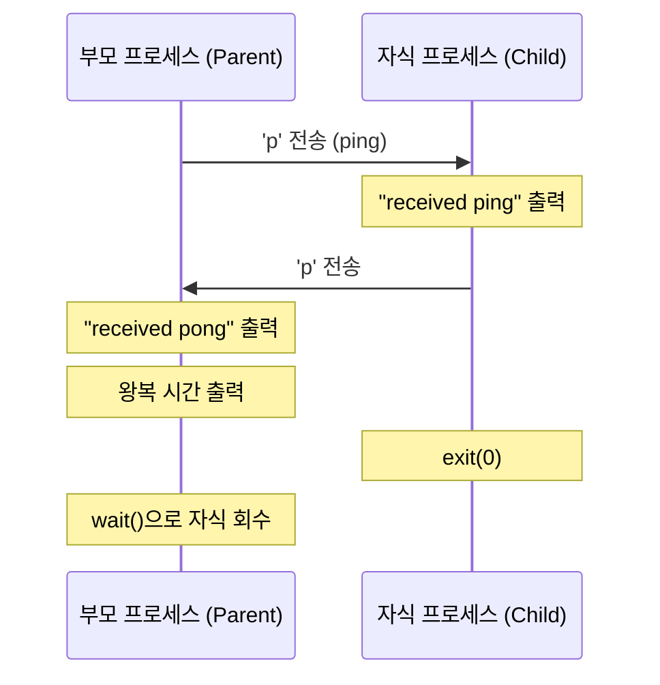
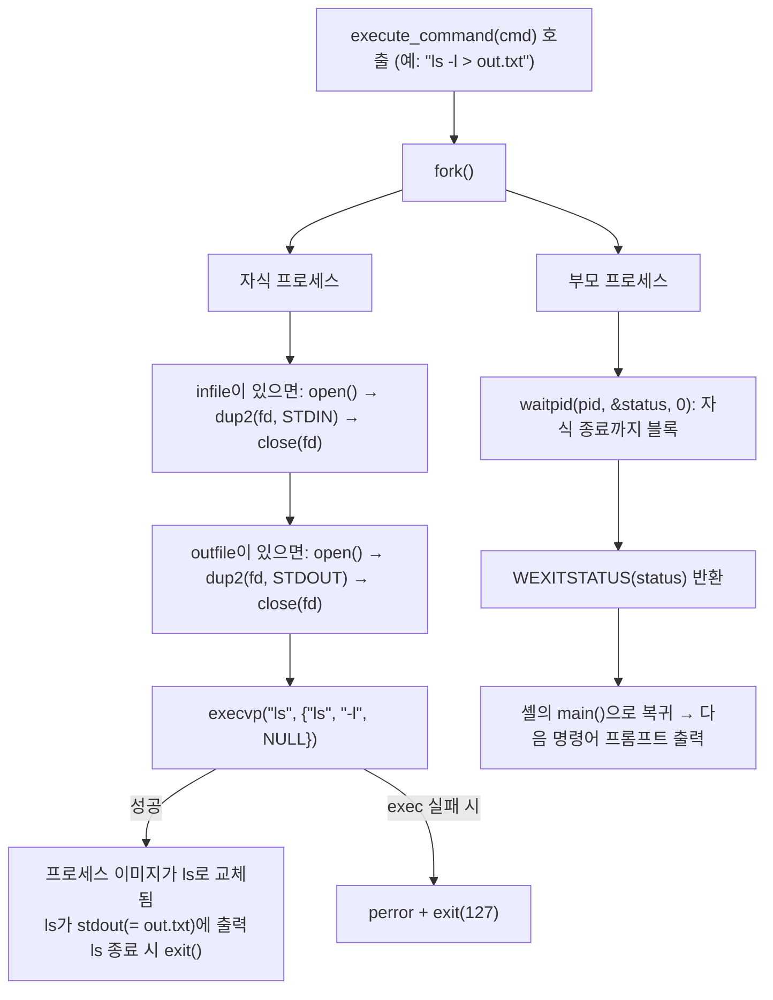
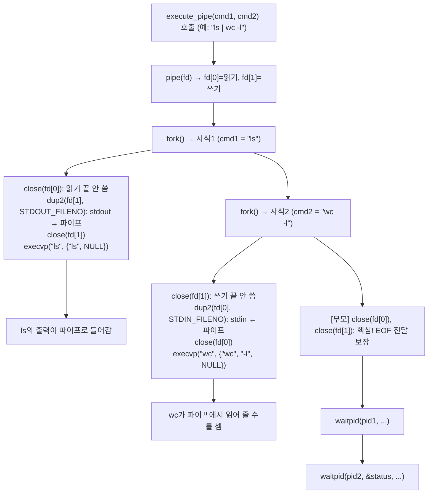

# HW1 과제 해설 — pingpong과 minishell

[레포지토리 안내](../../README.ko.md) | [English](Assignment-Explanation.md) | [한국어](Assignment-Explanation.ko.md)

> **최종 수정일:** 2026-11-18
>
> Operating System Concepts, Silberschatz, Galvin, and Gagne, Ch 3 (3.1-3.3); xv6: a simple, Unix-like teaching operating system, Cox, Kaashoek, and Morris, Ch 1

> **학습 목표:**
> 1. 파이프 두 개로 부모와 자식 프로세스 사이의 양방향 통신을 구현하고 왕복 시간을 측정할 수 있다
> 2. 각 프로세스에서 사용하지 않는 파이프 fd를 닫아야 하는 이유를 EOF 전달과 연결하여 설명할 수 있다
> 3. `fork()`, `execvp()`, `waitpid()`로 셸의 단일 명령어 실행을 구현할 수 있다
> 4. `open()`과 `dup2()`로 입력 리디렉션과 출력 리디렉션을 구현할 수 있다
> 5. `pipe()`와 두 번의 `fork()`로 `cmd1 | cmd2` 파이프라인을 구현할 수 있다

---

## 목차

- [1. 과제 개요](#1-과제-개요)
  - [1.1 과제에서 다루는 시스템 콜](#11-과제에서-다루는-시스템-콜)
  - [1.2 파일 구성](#12-파일-구성)
- [2. 요구사항](#2-요구사항)
  - [2.1 과제 1: pingpong](#21-과제-1-pingpong)
  - [2.2 과제 2: minishell](#22-과제-2-minishell)
  - [2.3 주어진 자료구조 이해](#23-주어진-자료구조-이해)
  - [2.4 채점 기준과 유의 사항](#24-채점-기준과-유의-사항)
- [3. 과제 1: pingpong.c 해설](#3-과제-1-pingpongc-해설)
  - [3.1 왜 파이프가 2개 필요한가?](#31-왜-파이프가-2개-필요한가)
  - [3.2 TODO 1: 파이프 2개 생성](#32-todo-1-파이프-2개-생성)
  - [3.3 TODO 2, 6: 사용하지 않는 fd 닫기](#33-todo-2-6-사용하지-않는-fd-닫기)
  - [3.4 TODO 3, 4, 5: 자식 프로세스의 동작](#34-todo-3-4-5-자식-프로세스의-동작)
  - [3.5 TODO 7, 8, 9: 부모 프로세스의 동작](#35-todo-7-8-9-부모-프로세스의-동작)
  - [3.6 전체 데이터 흐름 정리](#36-전체-데이터-흐름-정리)
  - [3.7 핵심 학습 포인트](#37-핵심-학습-포인트)
- [4. 과제 2: minishell.c 해설 (execute_command)](#4-과제-2-minishellc-해설-execute_command)
  - [4.1 TODO 1: fork()로 자식 생성](#41-todo-1-fork로-자식-생성)
  - [4.2 TODO 2a: 입력 리디렉션](#42-todo-2a-입력-리디렉션)
  - [4.3 TODO 2b: 출력 리디렉션](#43-todo-2b-출력-리디렉션)
  - [4.4 TODO 2c, 2d: 명령어 실행](#44-todo-2c-2d-명령어-실행)
  - [4.5 TODO 3: 부모의 대기](#45-todo-3-부모의-대기)
  - [4.6 execute_command 전체 흐름 요약](#46-execute_command-전체-흐름-요약)
- [5. 과제 2: minishell.c 해설 (execute_pipe)](#5-과제-2-minishellc-해설-execute_pipe)
  - [5.1 파이프가 무엇을 하는가?](#51-파이프가-무엇을-하는가)
  - [5.2 TODO 4: 파이프 생성](#52-todo-4-파이프-생성)
  - [5.3 TODO 5: 자식1 (cmd1 실행)](#53-todo-5-자식1-cmd1-실행)
  - [5.4 TODO 6: 자식2 (cmd2 실행)](#54-todo-6-자식2-cmd2-실행)
  - [5.5 TODO 7: 부모에서 정리](#55-todo-7-부모에서-정리)
  - [5.6 execute_pipe 전체 흐름 요약](#56-execute_pipe-전체-흐름-요약)
  - [5.7 파이프 + 리디렉션 조합](#57-파이프--리디렉션-조합)
- [6. 빌드와 테스트](#6-빌드와-테스트)
  - [6.1 빌드와 실행](#61-빌드와-실행)
  - [6.2 자동 테스트](#62-자동-테스트)
- [7. 핵심 개념 정리](#7-핵심-개념-정리)
  - [7.1 시스템 콜 조합 패턴 총정리](#71-시스템-콜-조합-패턴-총정리)
  - [7.2 fd 관리 규칙](#72-fd-관리-규칙)
  - [7.3 이 과제와 강의 내용의 연결](#73-이-과제와-강의-내용의-연결)
  - [7.4 시스템 콜별 핵심 포인트](#74-시스템-콜별-핵심-포인트)
- [요약](#요약)
- [점검 문제](#점검-문제)

---

<br>

## 1. 과제 개요

> **풀어 보기:** 이 문서는 정답과 풀이를 담고 있다. 먼저 [과제 안내문](Original/Assignment.ko.md)의 문제를 직접 풀어 본 뒤 읽는다.

과제는 2주차(프로세스 1)에서 배운 프로세스 생성, 파이프, 입출력 리디렉션을 C 프로그램 두 개로 구현하는 문제이다. 문제의 원문은 [과제 안내문](Original/Assignment.ko.md)에 있고, 배포된 시작 코드와 자동 테스트 스크립트는 `Original/skeleton/`과 `Original/tests/`에 원본 그대로 있다.

- **pingpong**(기본): 두 프로세스가 파이프로 1바이트를 주고받는 프로그램이다.
- **minishell**(중급): 파이프와 I/O 리디렉션을 지원하는 간단한 셸이다.

### 1.1 과제에서 다루는 시스템 콜

| 시스템 콜 | 역할 | 강의 연계 |
|:----------|:-----|:----------|
| **fork()** | 현재 프로세스의 복사본(자식 프로세스) 생성 | 2주차 이론: 프로세스 생성 (Ch 3.3.1) |
| **exec()** | 프로세스 이미지를 새 프로그램으로 교체 | 2주차 이론: fork() 이후의 exec() |
| **wait()** | 자식 프로세스의 종료를 대기하여 좀비(Zombie) 방지 | 2주차 이론: 프로세스 종료 (Ch 3.3.2) |
| **pipe()** | 단방향 IPC 채널(커널 버퍼) 생성 | 2주차 실습 3: pipe() |
| **dup2()** | 파일 디스크립터(FD)를 복제하여 I/O 리디렉션 | 2주차 실습 4: dup2() |
| **read() / write()** | 파일 디스크립터를 통한 데이터 읽기와 쓰기 | 2주차 실습 3: pipe() |
| **close()** | 파일 디스크립터 닫기 | 2주차 실습: 사용하지 않는 fd는 반드시 닫기 |

*표 1. 과제에서 다루는 시스템 콜과 강의 연계*

### 1.2 파일 구성

```text
Coursework/HW01_Process-1/
├── Assignment-Explanation.ko.md    # 과제 해설 (한국어, 이 문서)
├── Assignment-Explanation.md       # 과제 해설 (영어)
├── Code-Walkthrough.ko.md          # 코드 총정리 (한국어)
├── Code-Walkthrough.md             # 코드 총정리 (영어)
├── Original/
│   ├── Assignment.ko.md            # 과제 안내문 (한국어)
│   ├── Assignment.md               # 과제 안내문 (영어)
│   ├── skeleton/
│   │   ├── minishell.c             # 배포된 시작 코드 (과제 2)
│   │   └── pingpong.c              # 배포된 시작 코드 (과제 1)
│   └── tests/
│       ├── test_minishell.sh       # 배포된 자동 테스트 스크립트 (과제 2)
│       └── test_pingpong.sh        # 배포된 자동 테스트 스크립트 (과제 1)
└── Solution/
    ├── minishell.c                 # 과제 2의 풀이
    ├── pingpong.c                  # 과제 1의 풀이
    ├── test_minishell.sh           # 메시지를 영어로 옮긴 테스트 스크립트 (과제 2)
    └── test_pingpong.sh            # 메시지를 영어로 옮긴 테스트 스크립트 (과제 1)
```

*그림 1. HW1 과제의 디렉토리 구성*

---

<br>

## 2. 요구사항

### 2.1 과제 1: pingpong

과제 1은 xv6 교재 Ch 1의 Exercise 1을 바탕으로 한 문제이다. 시작 코드 `skeleton/pingpong.c`의 TODO 1\~9를 채워 다음 동작을 완성해야 한다. 왕복 시간을 재는 함수 `get_time_us()`와 시간 측정, 출력 코드는 시작 코드에 이미 있다.

**목표:** 부모 프로세스와 자식 프로세스가 파이프(Pipe)를 통해 1바이트를 **왕복**으로 주고받고, 왕복 시간(Round-trip Time)을 측정한다.



*그림 2. pingpong의 ping과 pong 교환*

**예상 출력:**
```text
12345: received ping
12344: received pong
Round-trip time: 156.000 us
```

> **[컴퓨터네트워크]** 왕복 시간(Round-trip Time, RTT)은 네트워크에서 패킷이 목적지까지 갔다가 돌아오는 데 걸리는 시간을 의미한다. 이 과제에서는 프로세스 간 파이프 통신의 RTT를 측정하는데, 이는 IPC(프로세스 간 통신)의 오버헤드를 파악하는 데 유용하다. 같은 호스트 안의 파이프 RTT는 하드웨어, 운영체제, 스케줄링 상태에 따라 수 마이크로초에서 수백 마이크로초까지 달라진다.

사용해야 하는 시스템 콜은 `pipe()`, `fork()`, `read()`, `write()`, `close()`, `wait()`, `getpid()`이다. 과제는 세 가지를 강조한다. 양방향 통신에는 파이프가 두 개 필요하고, 각 프로세스는 사용하지 않는 파이프 fd를 `close()`해야 하며, ping은 자식이 받고 pong은 부모가 받는다. 출력은 위의 세 줄 형식을 정확히 따라야 한다.

### 2.2 과제 2: minishell

과제 2는 파이프와 입출력 리디렉션을 지원하는 간단한 셸이다.

**목표:** `fork()`, `exec()`, `wait()`, `pipe()`, `dup2()`를 활용하여 **실제 셸(Shell)** 의 핵심 동작을 구현한다.

| 기능 | 예시 | 사용 시스템 콜 |
|:-----|:-----|:-------------|
| 단일 명령어 실행 | `ls -l` | fork + execvp + wait |
| 출력 리디렉션 | `echo hello > file.txt` | open + dup2 + execvp |
| 입력 리디렉션 | `sort < data.txt` | open + dup2 + execvp |
| 파이프 | `ls \| wc -l` | pipe + fork×2 + dup2 + execvp |
| 종료 | `exit` | 루프 탈출 |

*표 2. minishell의 기능과 사용 시스템 콜*

**이미 구현된 부분:** `main()`(입력 읽기, 파이프 분할, exit 처리), `parse_command()`(명령어 파싱, 리디렉션 파싱), `struct command`

**학생이 구현할 부분:** `execute_command()`, `execute_pipe()`

> **참고:** **2주차 이론: 셸의 동작 원리.** UNIX 셸의 기본 동작 원리는 fork(), exec(), wait()의 반복이다. 이 과제는 그 원리를 직접 코드로 구현한다.

`execute_command()`는 `fork()`로 자식을 만들어야 한다. 자식은 `cmd->infile`이 있으면 `open()`, `dup2(fd, STDIN_FILENO)`, `close(fd)`로, `cmd->outfile`이 있으면 `open()`, `dup2(fd, STDOUT_FILENO)`, `close(fd)`로 리디렉션을 설정한 뒤 `execvp(cmd->argv[0], cmd->argv)`를 실행하고, exec가 실패하면 오류를 출력하고 `exit(127)`로 끝난다. 부모는 `waitpid()`로 자식의 종료를 기다리고, 자식의 종료 상태(`WEXITSTATUS`)를 반환하거나 오류이면 -1을 반환한다.

`execute_pipe()`는 파이프 하나와 자식 두 개로 `cmd1 | cmd2`를 실행해야 한다. 자식1은 stdout을 파이프의 쓰기 끝에, 자식2는 stdin을 파이프의 읽기 끝에 연결하며, `cmd1`의 입력 리디렉션과 `cmd2`의 출력 리디렉션도 적용한다. 부모는 파이프의 양쪽 끝을 닫고 두 자식을 모두 기다린 뒤 `cmd2`의 종료 상태를 반환한다. 과제는 `execute_pipe()`가 `execute_command()`의 확장이므로 `execute_command()`를 먼저 완성하고 테스트하도록 권한다.

### 2.3 주어진 자료구조 이해

```c
struct command {
    char *argv[MAX_ARGS];   /* 인자 목록 (NULL로 종료) */
    char *infile;           /* 입력 리디렉션 파일명, 없으면 NULL */
    char *outfile;          /* 출력 리디렉션 파일명, 없으면 NULL */
};
```

**파싱 예시:**

| 입력 | `argv[]` | `infile` | `outfile` |
|:-----|:---------|:---------|:----------|
| `ls -l` | `{"ls", "-l", NULL}` | `NULL` | `NULL` |
| `echo hello > out.txt` | `{"echo", "hello", NULL}` | `NULL` | `"out.txt"` |
| `sort < data.txt` | `{"sort", NULL}` | `"data.txt"` | `NULL` |
| `cat < in.txt > out.txt` | `{"cat", NULL}` | `"in.txt"` | `"out.txt"` |

*표 3. parse_command()의 파싱 예시*

`parse_command()` 함수가 `<`와 `>`를 토큰으로 인식하여 `infile`과 `outfile`에 저장하고, 나머지를 `argv[]`에 넣는 부분은 이미 구현되어 있다.

### 2.4 채점 기준과 유의 사항

배점은 pingpong이 30%(컴파일과 정상 실행 10%, 출력 형식 15%, 왕복 시간 측정 5%), minishell이 70%(단일 명령어 실행 20%, 출력 리디렉션 15%, 입력 리디렉션 15%, 파이프 20%)이다. 모든 코드는 `gcc -Wall`로 경고 없이 컴파일되어야 하고 macOS와 Linux에서 모두 동작해야 하며, `fork()`, `exec()`, `open()`의 실패를 처리해야 한다. 사용하지 않는 파이프 fd를 닫지 않으면 프로그램이 멈출 수 있으므로 닫아야 하고, 메모리 누수는 감점하지 않는다. 배포된 자동 테스트 스크립트가 검사하는 항목은 6.2절에 정리한다.

---

<br>

## 3. 과제 1: pingpong.c 해설

### 3.1 왜 파이프가 2개 필요한가?

파이프(Pipe)는 **단방향(unidirectional)** 통신 채널이다. 한쪽 끝(`fd[1]`)으로 쓰고, 다른 쪽 끝(`fd[0]`)으로 읽는다.

**양방향 통신**을 하려면 파이프 2개가 필요하다.

```text
parent_to_child[2]:   부모가 [1]에 쓰기 → 자식이 [0]에서 읽기
child_to_parent[2]:   자식이 [1]에 쓰기 → 부모가 [0]에서 읽기
```

*그림 3. 두 파이프의 데이터 방향*

```c
int parent_to_child[2];   /* 부모 → 자식 방향 */
int child_to_parent[2];   /* 자식 → 부모 방향 */
```

| 파이프 | 쓰기 끝 `[1]` | 읽기 끝 `[0]` |
|:-------|:-------------|:-------------|
| `parent_to_child` | 부모가 사용 | 자식이 사용 |
| `child_to_parent` | 자식이 사용 | 부모가 사용 |

*표 4. 파이프 양 끝의 사용 주체*

> **참고:** **2주차 실습 3.** `pipe()` 함수는 `int fd[2]` 배열에 `fd[0]`(읽기 끝)과 `fd[1]`(쓰기 끝)을 채운다. 이 과제에서는 이 원리를 확장하여 **2개의 파이프**로 양방향 통신을 구현한다.

### 3.2 TODO 1: 파이프 2개 생성

TODO 1은 `fork()` 전에 파이프 두 개를 만들고, `pipe()`가 실패하면 `perror` 후 종료하라고 요구한다. `Solution/pingpong.c`의 53~60번 줄이 이 부분이다.

```c
/* TODO 1: pipe 2개를 생성하세요. */
if (pipe(parent_to_child) < 0) {
    perror("pipe");
    exit(1);
}
if (pipe(child_to_parent) < 0) {
    perror("pipe");
    exit(1);
}
```

> **핵심:**
> - `pipe()`를 호출한 뒤 반환 값을 확인하여 **오류 처리**를 해야 한다.
> - `pipe()`는 실패하면 `-1`을 반환하고 `errno`를 설정한다.
> - `perror()`는 `errno`에 해당하는 오류 메시지를 자동으로 출력해 준다.
> - 파이프 생성은 `fork()` **이전에** 해야 한다. 자식 프로세스가 부모의 파일 디스크립터 테이블을 상속받기 때문이다.

> **참고:** **2주차 이론.** `fork()`는 부모 프로세스의 **주소 공간의 복사본**을 만든다. 파일 디스크립터 테이블도 복사되므로, `fork()` 이전에 생성한 파이프의 fd를 부모와 자식이 모두 갖게 된다. 이것이 파이프를 통한 부모와 자식 간 통신이 가능한 이유이다.

### 3.3 TODO 2, 6: 사용하지 않는 fd 닫기

TODO 2와 TODO 6은 각 프로세스에서 사용하지 않는 파이프 fd를 닫으라고 요구한다. `fork()` 후 부모와 자식은 모두 파이프 fd 4개를 갖고 있으므로, 각 프로세스에서 **사용하지 않는 끝**을 닫아야 한다. 자식은 72\~73번 줄, 부모는 91\~92번 줄에서 닫는다.

**자식 프로세스 (TODO 2):**
```c
/* 자식은 parent_to_child에서 읽기만, child_to_parent에 쓰기만 한다 */
close(parent_to_child[1]);   /* 부모→자식 파이프의 쓰기 끝 (자식은 안 씀) */
close(child_to_parent[0]);   /* 자식→부모 파이프의 읽기 끝 (자식은 안 읽음) */
```

**부모 프로세스 (TODO 6):**
```c
/* 부모는 parent_to_child에 쓰기만, child_to_parent에서 읽기만 한다 */
close(parent_to_child[0]);   /* 부모→자식 파이프의 읽기 끝 (부모는 안 읽음) */
close(child_to_parent[1]);   /* 자식→부모 파이프의 쓰기 끝 (부모는 안 씀) */
```

> **참고:** **2주차 실습 3.** 실습에서는 사용하지 않는 쪽을 항상 닫는다는 규칙을 다룬다. 그 이유는 두 가지이다. (1) 쓰기 끝이 열려 있으면 읽는 쪽이 **EOF를 수신할 수 없어** 프로그램이 영원히 블록된다. (2) 파일 디스크립터는 유한한 자원이므로 불필요한 fd는 즉시 해제해야 한다.

### 3.4 TODO 3, 4, 5: 자식 프로세스의 동작

TODO 3\~5는 자식이 부모가 보낸 1바이트를 읽어 `<pid>: received ping`을 출력하고, 1바이트를 부모에게 돌려보낸 뒤, 사용한 fd를 닫고 `exit(0)`으로 끝나도록 요구한다. 자식의 코드는 75\~86번 줄이다.

```c
/* TODO 3: 부모로부터 1바이트를 읽으세요. */
char buf;
read(parent_to_child[0], &buf, 1);    /* 부모가 보낸 'p'를 읽음 */
printf("%d: received ping\n", getpid());

/* TODO 4: 부모에게 1바이트를 보내세요. */
write(child_to_parent[1], &buf, 1);   /* 받은 바이트를 다시 부모에게 보냄 */

/* TODO 5: 사용한 pipe fd를 닫고 exit(0)으로 종료하세요. */
close(parent_to_child[0]);
close(child_to_parent[1]);
exit(0);
```

**실행 흐름:**
1. `read()`는 부모가 데이터를 보낼 때까지 **블록(block)** 되며, 이것이 동기화 역할을 한다.
2. 바이트를 읽으면 `"received ping"`을 출력한다.
3. 같은 바이트를 `write()`로 부모에게 돌려보낸다(pong).
4. 사용한 fd를 모두 닫고 `exit(0)`으로 정상 종료한다.

> **참고:** **2주차 이론.** 자식 프로세스가 `exit(0)`으로 종료하면, 부모가 `wait()`를 호출할 때까지 **좀비 프로세스(Zombie Process)** 상태가 된다. 이 과제에서는 부모가 마지막에 `wait(NULL)`을 호출하여 좀비를 회수한다.

### 3.5 TODO 7, 8, 9: 부모 프로세스의 동작

TODO 7\~9는 부모가 자식에게 `'p'` 1바이트를 보내고(ping), 자식이 돌려보낸 1바이트를 읽어 `<pid>: received pong`을 출력한 뒤, 사용한 fd를 닫고 `wait()`로 자식을 기다리도록 요구한다. 왕복 시간 측정(`get_time_us()`의 두 호출과 출력)은 시작 코드에 이미 있다. 부모의 코드는 90\~111번 줄이다.

```c
long start_time = get_time_us();      /* 시간 측정 시작 */

/* TODO 7: 자식에게 1바이트를 보내세요 (ping). */
char buf = 'p';
write(parent_to_child[1], &buf, 1);   /* 'p' 전송 */

/* TODO 8: 자식으로부터 1바이트를 읽으세요 (pong). */
read(child_to_parent[0], &buf, 1);    /* 자식의 응답을 읽음 */
printf("%d: received pong\n", getpid());

long end_time = get_time_us();        /* 시간 측정 종료 */
double elapsed = (double)(end_time - start_time);
printf("Round-trip time: %.3f us\n", elapsed);

/* TODO 9: 사용한 pipe fd를 닫고 wait()으로 자식을 기다리세요. */
close(parent_to_child[1]);
close(child_to_parent[0]);
wait(NULL);   /* 자식 프로세스 회수: 좀비 방지 */
```

> **참고:** **2주차 이론: 문맥 교환.** 왕복 시간에는 **문맥 교환(Context Switch)** 오버헤드가 포함된다. CPU 코어가 하나라면 부모가 `write()`한 뒤 자식이 `read()`에서 깨어나려면 CPU가 부모에서 자식으로 전환되어야 하고, 자식이 `write()`한 뒤 부모가 `read()`에서 깨어나려면 또 한 번 전환이 필요하다. 즉 단일 코어에서 측정된 RTT는 대략 데이터 복사 시간 + 문맥 교환 시간 × 2이다. 멀티코어에서는 부모와 자식이 서로 다른 코어에서 실행될 수 있으므로, 문맥 교환 대신 다른 코어에서 잠든 프로세스를 깨우는 비용이 든다.

### 3.6 전체 데이터 흐름 정리

```text
시간 →

부모 프로세스                               자식 프로세스
━━━━━━━━━                                ━━━━━━━━━
pipe(parent_to_child)
pipe(child_to_parent)
fork() ──────────────────────────────────→ [생성됨]
close(parent_to_child[0])          close(parent_to_child[1])
close(child_to_parent[1])          close(child_to_parent[0])
                                              │
start_time = get_time_us()                    │
write(parent_to_child[1], 'p') ───→ read(parent_to_child[0])
        │                            printf("received ping")
        │                         write(child_to_parent[1], 'p')
read(child_to_parent[0]) ←─────────
printf("received pong")                   close(...)
end_time = get_time_us()              exit(0) → [좀비 상태]
printf("Round-trip time: ...")                │
close(...)                                    │
wait(NULL) ──────────────────────────────→ [회수됨]
```

*그림 4. pingpong의 전체 데이터 흐름*

### 3.7 핵심 학습 포인트

| 학습 포인트 | 강의 연계 | 이 과제에서의 적용 |
|:-----------|:----------|:-----------------|
| **파이프는 단방향** | 2주차 실습: `pipe()` 실습 | 양방향 통신에 파이프 2개 사용 |
| **fork()는 fd를 상속** | 2주차 이론: fork()의 동작 방식 | fork() 전에 pipe() 생성 → 부모와 자식 모두 fd 보유 |
| **사용하지 않는 fd 닫기** | 2주차 실습: 파이프 규칙 | 각 프로세스에서 불필요한 2개의 fd를 close() |
| **read()의 블로킹** | 2주차 실습: 생산자-소비자 패턴 | 부모가 쓸 때까지 자식의 read()가 대기 → 자연스러운 동기화 |
| **wait()으로 좀비 방지** | 2주차 이론: 좀비 프로세스 | 부모가 마지막에 wait(NULL) 호출 |
| **문맥 교환 오버헤드** | 2주차 이론: 문맥 교환 | RTT에 문맥 교환 비용이 포함됨 |

*표 5. pingpong의 핵심 학습 포인트*

---

<br>

## 4. 과제 2: minishell.c 해설 (execute_command)

### 4.1 TODO 1: fork()로 자식 생성

`execute_command()`의 TODO 1은 `fork()`로 자식 프로세스를 만들고, `fork()`가 실패하면 `perror` 후 -1을 반환하라고 요구한다. `Solution/minishell.c`의 138~142번 줄이 이 부분이다.

```c
static int execute_command(struct command *cmd)
{
    /* TODO 1: fork()로 자식 프로세스를 생성하세요. */
    pid_t pid = fork();
    if (pid < 0) {
        perror("fork");
        return -1;
    }
    ...
}
```

**왜 fork()가 필요한가?**
- 셸 자체는 다음 명령어를 받아야 하므로 계속 실행되어야 한다.
- `exec()`는 현재 프로세스의 이미지를 **덮어쓰기** 때문에, 자식에서 실행해야 셸이 살아남는다.
- 이것이 **fork() + exec()** 패턴의 핵심 이유이다.

> **참고:** **2주차 이론: fork() 반환 값.** fork()의 반환 값 규칙이 여기서 그대로 적용된다. 부모는 양수(자식 pid)를 받아 `waitpid()`에 사용하고, 자식은 0을 받아 `exec()` 경로로 분기한다. `-1`은 fork 실패(프로세스 테이블 가득 참 등)를 의미하며, 이를 적절히 처리해야 한다.

### 4.2 TODO 2a: 입력 리디렉션

TODO 2의 a는 자식에서 `cmd->infile`이 `NULL`이 아니면 그 파일을 `O_RDONLY`로 열고, 실패하면 `perror` 후 `exit(1)`로 끝나며, 성공하면 `dup2(fd, STDIN_FILENO)`로 stdin을 바꾼 뒤 원래 fd를 닫으라고 요구한다. 148~156번 줄이 이 부분이다.

```c
if (pid == 0) {
    /* TODO 2 (자식 프로세스): */

    /* a. 입력 리디렉션 */
    if (cmd->infile != NULL) {
        int fd = open(cmd->infile, O_RDONLY);   /* 파일을 읽기 전용으로 열기 */
        if (fd < 0) {
            perror(cmd->infile);
            exit(1);                            /* 파일 열기 실패 시 종료 */
        }
        dup2(fd, STDIN_FILENO);                 /* stdin(fd 0)을 파일로 교체 */
        close(fd);                              /* 원래 fd는 닫기 */
    }
    ...
}
```

**`dup2(fd, STDIN_FILENO)` 동작 원리:**
1. 파일 디스크립터 테이블에서 `STDIN_FILENO`(= 0)이 가리키는 대상을 `fd`와 같은 대상으로 바꾼다.
2. 이후 `exec()`로 실행되는 프로그램이 `stdin`에서 읽으면 실제로는 파일에서 읽게 된다.
3. 프로그램은 리디렉션을 **인식하지 못하며**, 평소처럼 stdin에서 읽을 뿐이다.

> **참고:** **2주차 실습 4.** `sort < data.txt`를 실행하면 `sort` 프로그램은 평소처럼 `stdin`에서 읽지만, 실제로는 `data.txt`의 내용이 읽힌다. 프로그램을 수정하지 않고도 입출력 대상을 바꿀 수 있다는 점이 UNIX I/O 리디렉션의 강점이다.

### 4.3 TODO 2b: 출력 리디렉션

TODO 2의 b는 `cmd->outfile`이 `NULL`이 아니면 그 파일을 `O_WRONLY|O_CREAT|O_TRUNC` 플래그와 권한 0644로 열고, 실패하면 `perror` 후 `exit(1)`로 끝나며, 성공하면 `dup2(fd, STDOUT_FILENO)`로 stdout을 바꾼 뒤 원래 fd를 닫으라고 요구한다. 159~167번 줄이 이 부분이다.

```c
    /* b. 출력 리디렉션 */
    if (cmd->outfile != NULL) {
        int fd = open(cmd->outfile,
                      O_WRONLY | O_CREAT | O_TRUNC,   /* 쓰기용 | 없으면 생성 | 있으면 덮어쓰기 */
                      0644);                          /* 권한: rw-r--r-- */
        if (fd < 0) {
            perror(cmd->outfile);
            exit(1);
        }
        dup2(fd, STDOUT_FILENO);    /* stdout(fd 1)을 파일로 교체 */
        close(fd);
    }
```

**`open()` 플래그 의미:**

| 플래그 | 의미 |
|:-------|:-----|
| `O_WRONLY` | 쓰기 전용으로 열기 |
| `O_CREAT` | 파일이 없으면 새로 생성 |
| `O_TRUNC` | 파일이 존재하면 내용을 비우고 처음부터 쓰기 (셸의 `>` 동작) |

*표 6. open() 플래그의 의미*

**권한 `0644`:** 소유자는 읽기와 쓰기, 그룹과 기타 사용자는 읽기만 할 수 있다.

### 4.4 TODO 2c, 2d: 명령어 실행

TODO 2의 c와 d는 `execvp(cmd->argv[0], cmd->argv)`로 명령어를 실행하고, `execvp()`가 반환하면 실패한 것이므로 `perror("minishell")`을 출력한 뒤 `exit(127)`로 끝나라고 요구한다. 170~174번 줄이 이 부분이다.

```c
    /* c. 명령어 실행 */
    execvp(cmd->argv[0], cmd->argv);

    /* d. exec 실패: 이 줄에 도달하면 exec이 실패한 것 */
    perror("minishell");
    exit(127);
}
```

**`execvp()`를 사용하는 이유:**
- `v`(vector): 인자를 `char *argv[]` 배열로 전달하므로 `struct command`의 `argv`를 그대로 사용할 수 있다.
- `p`(path): `PATH` 환경 변수에서 실행 파일을 자동으로 검색하므로, 전체 경로(`/bin/ls`)를 쓸 필요 없이 `ls`만으로 충분하다.

**exec 성공 시:**
- 자식 프로세스의 텍스트, 데이터, 힙, 스택이 새 프로그램으로 **완전히 교체**된다.
- `execvp()` 이후의 코드는 **절대 실행되지 않는다**.

**exec 실패 시(존재하지 않는 명령어 등):**
- `execvp()`가 반환하고 그 아래 코드가 실행된다.
- `exit(127)`: 셸 관례상 "command not found"의 종료 코드는 127이다.

> **참고:** **2주차 이론: exec() 계열.** exec() 계열 함수(execl, execlp, execle, execv, execvp, execve) 중 `execvp`를 선택한 이유는 인자가 배열 형태(`argv`)이고 PATH 검색이 필요하기 때문이다. l/v는 인자 전달 방식, p는 PATH 검색 여부, e는 환경 변수 지정 여부를 결정한다.

### 4.5 TODO 3: 부모의 대기

TODO 3은 부모가 `waitpid(pid, &status, 0)`로 자식의 종료를 기다리고, `WIFEXITED(status)`이면 `WEXITSTATUS(status)`를, 그렇지 않으면 -1을 반환하라고 요구한다. 178~182번 줄이 이 부분이다.

```c
    /* TODO 3 (부모 프로세스): */
    int status;
    waitpid(pid, &status, 0);       /* 특정 자식(pid)의 종료를 대기 */
    if (WIFEXITED(status))
        return WEXITSTATUS(status); /* 정상 종료 시 종료 코드 반환 */
    return -1;                      /* 비정상 종료 */
}
```

**`waitpid()` vs `wait()`:**

| 함수 | 대상 | 사용 시점 |
|:-----|:-----|:---------|
| `wait(NULL)` | 아무 자식이나 하나 | 자식이 1개일 때 간편하게 사용 |
| `waitpid(pid, &status, 0)` | 특정 pid의 자식 | 자식이 여러 개일 때 정확한 제어 |

*표 7. wait()과 waitpid()의 비교*

여기서는 자식이 1개지만, `waitpid()`를 사용하여 **정확히 해당 자식**의 종료 상태를 받아온다.

**종료 상태 매크로:**
- `WIFEXITED(status)`는 자식이 `exit()`으로 정상 종료했는지 확인한다.
- `WEXITSTATUS(status)`는 종료 코드(0~255)를 추출한다.

### 4.6 execute_command 전체 흐름 요약



*그림 5. execute_command()의 실행 흐름*

이것이 2주차 이론에서 다룬 **fork() + exec() + wait() = 셸의 기본 동작** 패턴의 구체적 구현이다.

---

<br>

## 5. 과제 2: minishell.c 해설 (execute_pipe)

### 5.1 파이프가 무엇을 하는가?

셸에서 `cmd1 | cmd2`를 입력하면 다음과 같이 연결된다.
- `cmd1`의 **표준 출력(stdout)** 이 파이프를 통해 `cmd2`의 **표준 입력(stdin)** 으로 연결된다.


*그림 6. `ls | wc -l`에서 파이프로 연결된 두 프로세스*

**execute_pipe()가 해야 할 일:**
1. 파이프 1개를 생성한다(cmd1 → cmd2 방향).
2. 자식 2개를 생성한다(cmd1용, cmd2용).
3. 각 자식에서 `dup2()`로 파이프를 stdin이나 stdout에 연결한다.
4. 부모에서 파이프를 닫고 자식 2개를 모두 `wait()`한다.

> **참고:** **2주차 실습 4.** 실습에는 `ls | wc -l`을 구현하는 연습 문제가 있다. 이 과제의 `execute_pipe()`는 그 구현을 일반화한 것으로, 어떤 두 명령어든 파이프로 연결할 수 있게 한다.

### 5.2 TODO 4: 파이프 생성

`execute_pipe()`의 TODO 4는 `int fd[2]`에 `pipe(fd)`로 파이프를 만들고, 실패하면 `perror` 후 -1을 반환하라고 요구한다. 213~217번 줄이 이 부분이다.

```c
static int execute_pipe(struct command *cmd1, struct command *cmd2)
{
    /* TODO 4: pipe()로 파이프를 생성하세요. */
    int fd[2];
    if (pipe(fd) < 0) {
        perror("pipe");
        return -1;
    }
    ...
}
```

**pingpong과의 차이:**
- pingpong은 양방향 통신이므로 파이프가 **2개** 필요하다.
- minishell 파이프는 단방향 통신(cmd1 → cmd2)이므로 파이프가 **1개**면 된다.

```text
fd[0] = 읽기 끝 → cmd2의 stdin에 연결할 것
fd[1] = 쓰기 끝 → cmd1의 stdout에 연결할 것
```

*그림 7. 파이프 양 끝과 두 명령어의 연결*

### 5.3 TODO 5: 자식1 (cmd1 실행)

TODO 5는 `fork()`로 자식1을 만들고, 자식1에서 파이프의 읽기 끝 `fd[0]`을 닫고 `dup2(fd[1], STDOUT_FILENO)`로 stdout을 파이프의 쓰기 끝에 연결한 뒤 `fd[1]`을 닫으며, `cmd1->infile`이 있으면 입력 리디렉션을 설정한 다음 `cmd1`을 실행하라고 요구한다. exec가 실패하면 `perror` 후 `exit(127)`로 끝난다. 220~246번 줄이 이 부분이다.

```c
/* TODO 5: fork()로 자식1을 생성하세요 (cmd1 실행). */
pid_t pid1 = fork();
if (pid1 < 0) {
    perror("fork");
    close(fd[0]);
    close(fd[1]);    /* 오류 시 파이프 정리 */
    return -1;
}

if (pid1 == 0) {
    /* 자식1: cmd1의 stdout을 파이프 쓰기 끝으로 연결 */
    close(fd[0]);                      /* 읽기 끝은 사용 안 함 */
    dup2(fd[1], STDOUT_FILENO);        /* stdout → 파이프 쓰기 끝 */
    close(fd[1]);                      /* dup2 후 원래 fd는 닫기 */

    if (cmd1->infile != NULL) {        /* cmd1에 입력 리디렉션이 있으면 */
        int infd = open(cmd1->infile, O_RDONLY);
        if (infd < 0) { perror(cmd1->infile); exit(1); }
        dup2(infd, STDIN_FILENO);
        close(infd);
    }

    execvp(cmd1->argv[0], cmd1->argv); /* cmd1 실행 */
    perror("minishell");
    exit(127);
}
```

> **핵심:** `dup2(fd[1], STDOUT_FILENO)`를 호출하면 cmd1이 `printf()`나 `write(1,...)`로 출력할 때 데이터가 **파이프의 커널 버퍼**로 들어간다.

### 5.4 TODO 6: 자식2 (cmd2 실행)

TODO 6은 `fork()`로 자식2를 만들고, 자식2에서 파이프의 쓰기 끝 `fd[1]`을 닫고 `dup2(fd[0], STDIN_FILENO)`로 stdin을 파이프의 읽기 끝에 연결한 뒤 `fd[0]`을 닫으며, `cmd2->outfile`이 있으면 출력 리디렉션을 설정한 다음 `cmd2`를 실행하라고 요구한다. exec가 실패하면 `perror` 후 `exit(127)`로 끝난다. 249~275번 줄이 이 부분이다.

```c
/* TODO 6: fork()로 자식2를 생성하세요 (cmd2 실행). */
pid_t pid2 = fork();
if (pid2 < 0) {
    perror("fork");
    close(fd[0]);
    close(fd[1]);
    return -1;
}

if (pid2 == 0) {
    /* 자식2: cmd2의 stdin을 파이프 읽기 끝으로 연결 */
    close(fd[1]);                      /* 쓰기 끝은 사용 안 함 */
    dup2(fd[0], STDIN_FILENO);         /* stdin → 파이프 읽기 끝 */
    close(fd[0]);                      /* dup2 후 원래 fd는 닫기 */

    if (cmd2->outfile != NULL) {       /* cmd2에 출력 리디렉션이 있으면 */
        int outfd = open(cmd2->outfile, O_WRONLY | O_CREAT | O_TRUNC, 0644);
        if (outfd < 0) { perror(cmd2->outfile); exit(1); }
        dup2(outfd, STDOUT_FILENO);
        close(outfd);
    }

    execvp(cmd2->argv[0], cmd2->argv); /* cmd2 실행 */
    perror("minishell");
    exit(127);
}
```

> **핵심:** `dup2(fd[0], STDIN_FILENO)`를 호출하면 cmd2가 `scanf()`나 `read(0,...)`로 읽을 때 데이터가 **파이프의 커널 버퍼**에서 읽힌다. 즉 cmd1의 출력이 cmd2의 입력이 된다.

### 5.5 TODO 7: 부모에서 정리

TODO 7은 부모가 파이프의 양쪽 끝(`fd[0]`, `fd[1]`)을 모두 닫고, `waitpid`로 자식1과 자식2의 종료를 기다린 뒤 `cmd2`의 종료 상태를 반환하라고 요구한다. 278~287번 줄이 이 부분이다.

```c
/* TODO 7: 부모에서 정리하세요. */
close(fd[0]);                    /* 부모의 파이프 fd 닫기 (매우 중요!) */
close(fd[1]);

int status;
waitpid(pid1, NULL, 0);          /* 자식1(cmd1) 종료 대기 */
waitpid(pid2, &status, 0);       /* 자식2(cmd2) 종료 대기 + 상태 수집 */

if (WIFEXITED(status))
    return WEXITSTATUS(status);  /* cmd2의 종료 코드 반환 (셸 관례) */
return -1;
```

**부모가 파이프의 양쪽을 닫는 것이 왜 중요한가?**

- 부모도 `fork()` 전에 만든 `fd[0]`, `fd[1]`을 갖고 있다.
- 부모가 `fd[1]`(쓰기 끝)을 닫지 않으면 다음 일이 일어난다.
  - cmd2의 `read()`가 **EOF를 받지 못해** 영원히 블록되고, 프로그램이 멈춘다.
- UNIX의 파이프 규칙에 따르면 **모든 쓰기 끝이 닫혀야** 읽는 쪽에서 EOF를 수신한다.

> **참고:** **2주차 실습 3.** 쓰기 끝을 닫아야 읽는 쪽에서 EOF를 수신한다는 실습의 규칙을 실제로 적용하는 부분이다. 부모, 자식1, 자식2의 총 3개 프로세스가 파이프 fd를 갖고 있으므로, **각 프로세스에서 사용하지 않는 fd를 모두 닫아야** 정상 동작한다.

### 5.6 execute_pipe 전체 흐름 요약



*그림 8. execute_pipe()의 실행 흐름*

### 5.7 파이프 + 리디렉션 조합

이 구현은 **파이프와 리디렉션의 조합**도 지원한다.

```bash
minishell> echo hello | cat > /tmp/pipe_test.txt
```

이 경우는 다음과 같다.
- **cmd1** = `echo hello`이며, stdout이 **파이프**로 연결된다.
- **cmd2** = `cat > /tmp/pipe_test.txt`이며, stdin은 **파이프**에서, stdout은 **파일**로 연결된다.


*그림 9. 파이프와 출력 리디렉션의 조합*

코드에서 자식2가 `cmd2->outfile`을 확인하여 출력 리디렉션을 추가로 설정하는 부분이 이 경우를 처리한다.

---

<br>

## 6. 빌드와 테스트

### 6.1 빌드와 실행

두 프로그램은 표준 C 라이브러리와 POSIX 시스템 콜만 쓰므로 `gcc -Wall`로 바로 빌드한다.

```bash
# 레포지토리 루트에서 풀이 디렉토리로 이동
cd Coursework/HW01_Process-1/Solution

# pingpong
gcc -Wall -o pingpong pingpong.c
./pingpong

# minishell
gcc -Wall -o minishell minishell.c
./minishell
```

### 6.2 자동 테스트

과제는 프로그램마다 자동 테스트 스크립트를 배포했다. `Original/tests/`의 원본은 메시지가 한국어이고 기본 소스 경로가 `../skeleton/`의 파일이다. `Solution/`의 두 스크립트는 원본의 메시지와 주석을 영어로 옮기고 기본 경로를 같은 폴더의 `.c` 파일로 바꾼 것이며, 검사 내용은 원본과 같다.

```bash
# Solution 디렉토리에서 실행 (기본값: 같은 경로의 .c 파일 컴파일)
./test_pingpong.sh
./test_minishell.sh

# 다른 경로의 소스 파일을 지정할 수도 있음
./test_pingpong.sh /path/to/pingpong.c
./test_minishell.sh /path/to/minishell.c

# 배포된 원본 스크립트로 검사 (Solution 디렉토리 기준)
cd ../Original/tests
./test_pingpong.sh ../../Solution/pingpong.c
./test_minishell.sh ../../Solution/minishell.c
```

| 스크립트 | 검사 항목 |
|:-----|:-----|
| `test_pingpong.sh` | `gcc -Wall` 컴파일과 경고 확인, 5초 안의 정상 종료(exit code 0), `<pid>: received ping`과 `<pid>: received pong` 행의 존재와 형식, 두 PID가 서로 다른지, 왕복 시간 출력, ping 행이 pong 행보다 먼저 나오는지, 5회 반복 실행 (검사 10개) |
| `test_minishell.sh` | 컴파일, `echo`, 인자 처리, 출력 리디렉션, 입력 리디렉션(`wc -l < file`), 파이프(`wc -w`와 `grep`), 파이프와 출력 리디렉션, 입력 리디렉션과 파이프(`sort < file \| head -1`), `exit`, EOF, 존재하지 않는 명령어 뒤의 계속 실행, 빈 입력, 명령어 세 개의 연속 실행 (검사 14개) |

*표 8. 자동 테스트 스크립트의 검사 항목*

풀이는 두 스크립트의 검사를 모두 통과한다. 다음은 `Solution/`의 스크립트를 실행한 출력의 끝부분이며, `Original/tests/`의 원본 스크립트로 검사해도 같은 개수가 통과한다. 왕복 시간은 하드웨어와 시스템 부하에 따라 실행할 때마다 달라진다.

```text
$ ./test_pingpong.sh
...
 Passed: 10 / 10
 Failed: 0 / 10

 All tests passed!

$ ./test_minishell.sh
...
 Passed: 14 / 14
 Failed: 0 / 14

 All tests passed!
```

---

<br>

## 7. 핵심 개념 정리

### 7.1 시스템 콜 조합 패턴 총정리

| 패턴 | 용도 | 이 과제에서의 적용 |
|:-----|:-----|:-----------------|
| **fork() + wait()** | 자식 생성 후 종료 대기 | pingpong: 부모가 자식을 기다림 |
| **fork() + exec() + wait()** | 새 프로그램 실행 (셸의 기본 동작) | minishell: execute_command() |
| **pipe() + fork() + read/write** | 프로세스 간 데이터 교환 | pingpong: 1바이트 왕복 |
| **pipe() + fork()×2 + dup2() + exec()** | 셸 파이프라인 구현 | minishell: execute_pipe() |
| **open() + dup2() + close()** | I/O 리디렉션 | minishell: 입출력 리디렉션 |

*표 9. 시스템 콜 조합 패턴*

### 7.2 fd 관리 규칙

**규칙 1: 사용하지 않는 파이프 fd는 반드시 닫는다.**
- 닫지 않으면 EOF가 전달되지 않아 프로그램이 영원히 블록된다.

**규칙 2: `dup2()` 후에는 원래 fd를 닫는다.**
- `dup2(fd, STDOUT_FILENO)` 후 `close(fd)`를 호출한다. fd와 STDOUT 두 개가 같은 파일을 가리키므로 원래 fd는 필요 없다.

**규칙 3: fork() 후에는 3개의 프로세스(부모, 자식1, 자식2)가 모두 파이프 fd를 갖고 있다.**
- 각 프로세스에서 불필요한 fd를 닫아야 한다.

```text
fd 소유 상황 (fork() 후):

             fd[0]  fd[1]
       부모:   ✕      ✕     ← 둘 다 닫기
자식1(cmd1):   ✕      ✓     ← fd[0] 닫기, fd[1]을 stdout에 연결 후 닫기
자식2(cmd2):   ✓      ✕     ← fd[1] 닫기, fd[0]을 stdin에 연결 후 닫기
```

*그림 10. fork() 후 프로세스별 파이프 fd 처리*

### 7.3 이 과제와 강의 내용의 연결

**이론(Lecture) 연계:**

| 강의 개념 | 이 과제에서 직접 체험한 것 |
|:----------|:------------------------|
| 프로세스 = 실행 중인 프로그램 | `fork()` 후 자식 프로세스가 독립적 실행 단위가 됨 |
| 프로세스 생성 (부모→자식) | `fork()`로 자식을 생성하고 `getpid()`로 각 프로세스의 PID를 출력 |
| fork()의 반환 값 | 부모는 자식 pid, 자식은 0을 받으며 이를 if-else로 분기 |
| exec()로 새 프로그램 적재 | `execvp()`로 자식의 메모리 이미지를 교체 |
| 좀비 프로세스(Zombie) | `wait()`이나 `waitpid()`를 호출하지 않으면 발생 |
| 문맥 교환(Context Switch) | pingpong의 RTT에 문맥 교환 오버헤드가 포함됨 |
| fork() + exec() + wait() = 셸 | minishell의 execute_command()가 바로 이 패턴 |

*표 10. 2주차 이론과 과제의 연결*

**실습(Lab) 연계:**

| 실습 개념 | 이 과제에서 직접 체험한 것 |
|:----------|:------------------------|
| pipe()는 단방향 | pingpong에서 양방향을 위해 2개 사용 |
| 사용 안 하는 fd 닫기 | 모든 프로세스에서 불필요한 fd를 close() |
| dup2()로 I/O 리디렉션 | minishell에서 파일이나 파이프를 stdin/stdout에 연결 |
| 생산자-소비자 패턴 | 파이프를 통한 cmd1→cmd2 데이터 흐름 |

*표 11. 2주차 실습과 과제의 연결*

### 7.4 시스템 콜별 핵심 포인트

**1. fork() 관련:**
- fork()의 반환 값은 부모에서 자식 pid, 자식에서 0, 실패 시 -1이다.
- fork() 후 부모와 자식의 실행 순서는 **보장되지 않는다**(스케줄러 의존).
- fork()를 호출하면 부모의 주소 공간이 **복사**되고, fd 테이블도 함께 복사된다.

**2. exec() 관련:**
- exec()는 성공하면 메모리가 덮어쓰기되므로 원래 코드로 **반환하지 않는다**.
- exec()는 PID를 변경하지 않는다.

**3. wait() 관련:**
- wait()을 호출하지 않으면 **좀비 프로세스**가 생긴다.
- 부모가 먼저 종료하면 자식은 **고아 프로세스**가 되어 init이나 systemd에 입양된다.

**4. pipe() 관련:**
- 파이프는 **단방향**이므로 양방향 통신에는 2개가 필요하다.
- 모든 쓰기 끝이 닫혀야 읽는 쪽에서 **EOF**를 수신한다.
- 사용하지 않는 fd를 닫지 않으면 **데드락(deadlock)** 이 발생할 수 있다.

**5. dup2() 관련:**
- `dup2(oldfd, newfd)`는 newfd가 oldfd와 같은 대상을 가리키게 한다.
- 셸의 `>`, `<`, `|`는 모두 dup2()로 표준 입력이나 표준 출력을 다른 fd에 연결해 구현한다(`|`는 pipe()로 만든 fd를 연결한다).

> **핵심:** 위 5개 시스템 콜은 동작 원리와 함께 코드에서 호출하는 순서(fork 전에 pipe, fork 후에 dup2, exec 전에 리디렉션 설정 등)가 올바른 동작을 좌우한다.

---

<br>

## 요약

| 개념 | 핵심 요약 |
|:-----|:---------|
| pingpong.c | `pipe()` 두 개(양방향), `fork()`, `read()`/`write()`, `wait()`를 조합하여 파이프로 프로세스 간 동기화와 RTT 측정을 한다. |
| fd 관리 | 사용하지 않는 fd는 반드시 close()하고, dup2() 뒤에는 원래 fd를 닫으며, fork() 뒤에는 모든 프로세스에서 불필요한 fd를 정리한다. |
| execute_command() | `fork()` + `exec()` + `wait()`는 셸의 기본 동작 원리이고, `open()` + `dup2()` + `close()`는 I/O 리디렉션을 구현한다. |
| execute_pipe() | `pipe()` + `fork()×2` + `dup2()`로 셸 파이프라인을 만들며, 부모를 포함한 3개 프로세스 모두에서 불필요한 fd를 닫는다. |
| execvp()의 선택 이유 | `v`(배열 인자)와 `p`(PATH 검색) 덕분에 struct command의 argv를 그대로 사용하면서 PATH를 자동으로 검색한다. |
| 파이프 + 리디렉션 조합 | cmd1의 stdout이 파이프를 거쳐 cmd2의 stdin으로 연결되고, cmd2에는 출력 리디렉션을 추가로 설정할 수 있다. |
| 시스템 콜 조합 패턴 | 주요 패턴은 fork+wait, fork+exec+wait, pipe+fork+read/write, pipe+fork×2+dup2+exec, open+dup2+close이다. |
| 시스템 콜 동작의 핵심 | fork 반환 값 구분, exec 성공 시 미반환, wait 미호출 시 좀비, 파이프 단방향 원칙, dup2 동작 원리가 핵심이다. |
| 강의 연계 | 2주차 이론의 프로세스 생성, 종료, 좀비, 문맥 교환(Ch 3.1\~3.3)과 2주차 실습의 pipe, dup2, fd 관리(실습 3\~4)를 적용한다. |
| 자동 테스트 | 배포된 테스트 스크립트는 pingpong에서 10개, minishell에서 14개 항목을 검사하며, 풀이는 모든 항목을 통과한다. |

---

<br>

## 점검 문제

1. **파이프 개수와 닫을 fd:** pingpong에서 파이프가 두 개 필요한 이유와, `fork()` 직후 자식 프로세스가 닫아야 하는 fd 두 개를 쓰라.

   <details>
   <summary>정답</summary>

   파이프는 한쪽 끝으로 쓰고 다른 쪽 끝으로 읽는 단방향 채널이므로, 부모에서 자식으로 가는 `parent_to_child`와 자식에서 부모로 가는 `child_to_parent`가 각각 필요하다. 자식은 `parent_to_child[0]`에서 읽고 `child_to_parent[1]`에 쓰므로, 쓰지 않는 `parent_to_child[1]`과 읽지 않는 `child_to_parent[0]`을 닫는다.

   </details>

2. **부모가 쓰기 끝을 닫지 않으면:** `ls | wc -l`을 실행하는 `execute_pipe()`에서 부모가 `close(fd[1])`을 빠뜨리면 어떤 일이 일어나는지 설명하라.

   <details>
   <summary>정답</summary>

   `wc`는 stdin에서 EOF를 받을 때까지 읽는데, 파이프의 쓰기 끝이 하나라도 열려 있으면 EOF가 전달되지 않는다. `ls`가 끝나 자식1의 쓰기 끝이 닫혀도 부모가 `fd[1]`을 계속 열어 두므로 `wc`의 `read()`는 영원히 블록된다. 부모는 `waitpid(pid2, &status, 0)`에서 `wc`의 종료를 기다리므로, 부모와 `wc`가 서로를 기다리는 상태가 되어 셸이 멈춘다.

   </details>

3. **존재하지 않는 명령어:** minishell에서 존재하지 않는 명령어 `foo`를 입력하면 자식 프로세스와 부모의 `execute_command()`가 각각 무엇을 하고, `execute_command()`가 어떤 값을 반환하는지 쓰라.

   <details>
   <summary>정답</summary>

   자식에서 `execvp("foo", ...)`가 실패하여 반환하므로 다음 줄의 `perror("minishell")`이 `minishell: No such file or directory` 같은 오류 메시지를 출력하고, 자식은 `exit(127)`로 종료한다. 부모의 `execute_command()`는 `waitpid()`로 자식을 회수하며, 자식이 `exit()`로 정상 종료했으므로 `WIFEXITED(status)`가 참이 되어 `WEXITSTATUS(status)`인 127을 반환한다.

   </details>

4. **리디렉션 설정 순서:** `sort < data.txt`를 실행할 때 자식이 `open()`, `dup2()`, `close()`, `execvp()`를 이 순서로 호출해야 하는 이유를 설명하라.

   <details>
   <summary>정답</summary>

   먼저 `open()`으로 `data.txt`를 열어야 복제할 fd가 생긴다. `dup2(fd, STDIN_FILENO)`는 fd 0이 그 파일을 가리키게 하며, 이 설정은 `exec()` 뒤에도 유지된다. 그다음 `close(fd)`로 원래 fd를 닫는데, fd 0이 이미 같은 파일을 가리키므로 원래 fd는 필요 없기 때문이다. `execvp()`는 성공하면 프로세스 이미지를 교체하고 반환하지 않으므로, 리디렉션은 반드시 `execvp()` 전에 끝내야 한다. 그러면 `sort`는 리디렉션을 인식하지 못한 채 평소처럼 stdin에서 읽지만 실제로는 `data.txt`의 내용을 읽는다.

   </details>
