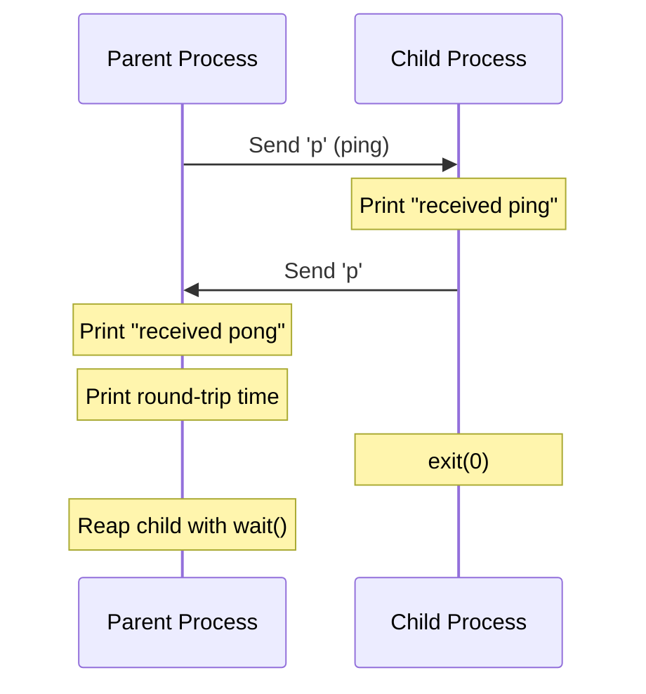
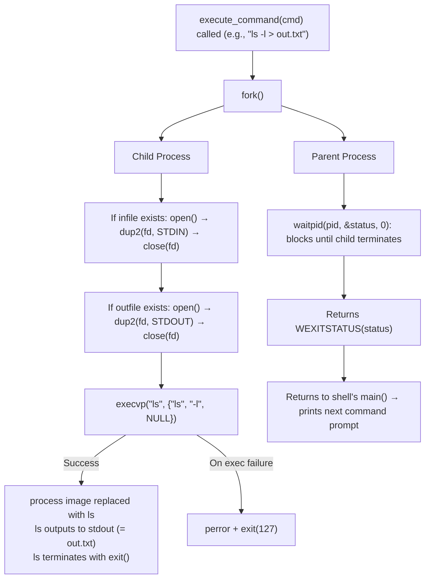
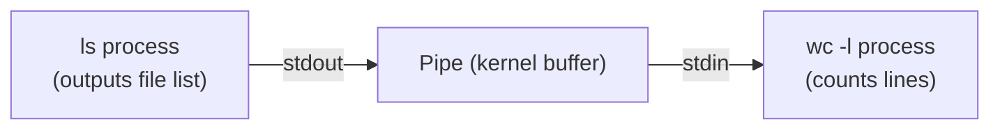
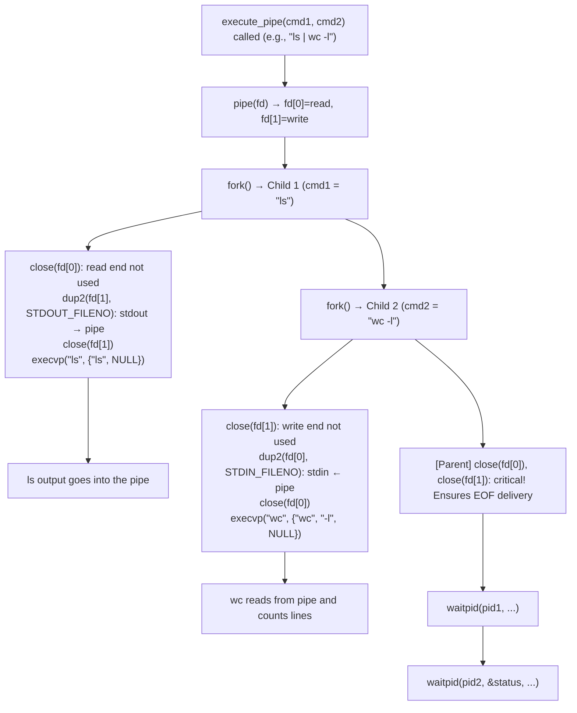

# HW1 Assignment Explanation — pingpong & minishell

[Repository Guide](../../README.md) | [English](Assignment-Explanation.md) | [한국어](Assignment-Explanation.ko.md)

> **Last Updated:** 2026-11-16
>
> Operating System Concepts, Silberschatz, Galvin, and Gagne, Ch 3 (3.1-3.3); xv6: a simple, Unix-like teaching operating system, Cox, Kaashoek, and Morris, Ch 1

> **Learning Objectives:**
> 1. Implement bidirectional communication between a parent and a child process with two pipes and measure the round-trip time
> 2. Explain why each process must close its unused pipe fds, in connection with EOF delivery
> 3. Implement single-command execution in a shell with `fork()`, `execvp()`, and `waitpid()`
> 4. Implement input and output redirection with `open()` and `dup2()`
> 5. Implement a `cmd1 | cmd2` pipeline with `pipe()` and two `fork()` calls

---

## Table of Contents

- [1. Assignment Overview](#1-assignment-overview)
  - [1.1 System Calls Covered by the Assignment](#11-system-calls-covered-by-the-assignment)
  - [1.2 File Layout](#12-file-layout)
- [2. Requirements](#2-requirements)
  - [2.1 Assignment 1: pingpong](#21-assignment-1-pingpong)
  - [2.2 Assignment 2: minishell](#22-assignment-2-minishell)
  - [2.3 Understanding the Given Data Structure](#23-understanding-the-given-data-structure)
  - [2.4 Grading Criteria and Notes](#24-grading-criteria-and-notes)
- [3. Assignment 1: pingpong.c Explanation](#3-assignment-1-pingpongc-explanation)
  - [3.1 Why Are Two Pipes Needed?](#31-why-are-two-pipes-needed)
  - [3.2 TODO 1: Create Two Pipes](#32-todo-1-create-two-pipes)
  - [3.3 TODO 2, 6: Close Unused fds](#33-todo-2-6-close-unused-fds)
  - [3.4 TODO 3, 4, 5: Child Process Operations](#34-todo-3-4-5-child-process-operations)
  - [3.5 TODO 7, 8, 9: Parent Process Operations](#35-todo-7-8-9-parent-process-operations)
  - [3.6 Complete Data Flow Summary](#36-complete-data-flow-summary)
  - [3.7 Key Learning Points](#37-key-learning-points)
- [4. Assignment 2: minishell.c Explanation (execute_command)](#4-assignment-2-minishellc-explanation-execute_command)
  - [4.1 TODO 1: Create a Child with fork()](#41-todo-1-create-a-child-with-fork)
  - [4.2 TODO 2a: Input Redirection](#42-todo-2a-input-redirection)
  - [4.3 TODO 2b: Output Redirection](#43-todo-2b-output-redirection)
  - [4.4 TODO 2c, 2d: Command Execution](#44-todo-2c-2d-command-execution)
  - [4.5 TODO 3: Parent Waiting](#45-todo-3-parent-waiting)
  - [4.6 execute_command Complete Flow Summary](#46-execute_command-complete-flow-summary)
- [5. Assignment 2: minishell.c Explanation (execute_pipe)](#5-assignment-2-minishellc-explanation-execute_pipe)
  - [5.1 What Does a Pipe Do?](#51-what-does-a-pipe-do)
  - [5.2 TODO 4: Create a Pipe](#52-todo-4-create-a-pipe)
  - [5.3 TODO 5: Child 1 (Execute cmd1)](#53-todo-5-child-1-execute-cmd1)
  - [5.4 TODO 6: Child 2 (Execute cmd2)](#54-todo-6-child-2-execute-cmd2)
  - [5.5 TODO 7: Cleanup in the Parent](#55-todo-7-cleanup-in-the-parent)
  - [5.6 execute_pipe Complete Flow Summary](#56-execute_pipe-complete-flow-summary)
  - [5.7 Pipe + Redirection Combination](#57-pipe--redirection-combination)
- [6. Build and Test](#6-build-and-test)
  - [6.1 Build and Run](#61-build-and-run)
  - [6.2 Automated Tests](#62-automated-tests)
- [7. Key Concepts Summary](#7-key-concepts-summary)
  - [7.1 System Call Combination Patterns Summary](#71-system-call-combination-patterns-summary)
  - [7.2 fd Management Rules](#72-fd-management-rules)
  - [7.3 Connecting This Assignment to Lecture Content](#73-connecting-this-assignment-to-lecture-content)
  - [7.4 Key Points by System Call](#74-key-points-by-system-call)
- [Summary](#summary)
- [Self-Check Questions](#self-check-questions)

---

<br>

## 1. Assignment Overview

> **Try It First:** This document contains the answers and solutions. Solve the problems in the [assignment handout](Original/Assignment.md) yourself before reading on.

The assignment asks for two C programs that put the process creation, pipes, and I/O redirection of Week 2 (Process 1) into practice. The original problem is in the [assignment handout](Original/Assignment.md), and the distributed starter code and automated test scripts are in `Original/skeleton/` and `Original/tests/` as distributed.

- **pingpong** (basic): a program where two processes exchange 1 byte via pipes.
- **minishell** (intermediate): a simple shell supporting pipes and I/O redirection.

### 1.1 System Calls Covered by the Assignment

| System Call | Role | Lecture Reference |
|:-----------|:-----|:-----------------|
| **fork()** | Create a copy (child process) of the current process | Week 2 Lecture: Process Creation (Ch 3.3.1) |
| **exec()** | Replace the process image with a new program | Week 2 Lecture: exec() after fork() |
| **wait()** | Wait for child process termination to prevent zombies | Week 2 Lecture: Process Termination (Ch 3.3.2) |
| **pipe()** | Create a unidirectional IPC channel (kernel buffer) | Week 2 Lab 3: pipe() |
| **dup2()** | Duplicate a file descriptor (FD) for I/O redirection | Week 2 Lab 4: dup2() |
| **read() / write()** | Read and write data through file descriptors | Week 2 Lab 3: pipe() |
| **close()** | Close a file descriptor | Week 2 Lab: Always close unused fds |

*Table 1. System calls covered in the assignment and their lecture references*

### 1.2 File Layout

```text
Coursework/HW01_Process-1/
├── Assignment-Explanation.ko.md    # Assignment explanation (Korean)
├── Assignment-Explanation.md       # Assignment explanation (English, this document)
├── Code-Walkthrough.ko.md          # Code walkthrough (Korean)
├── Code-Walkthrough.md             # Code walkthrough (English)
├── Original/
│   ├── Assignment.ko.md            # Assignment handout (Korean)
│   ├── Assignment.md               # Assignment handout (English)
│   ├── skeleton/
│   │   ├── minishell.c             # Distributed starter code (Assignment 2)
│   │   └── pingpong.c              # Distributed starter code (Assignment 1)
│   └── tests/
│       ├── test_minishell.sh       # Distributed automated test script (Assignment 2)
│       └── test_pingpong.sh        # Distributed automated test script (Assignment 1)
└── Solution/
    ├── minishell.c                 # Solution of Assignment 2
    ├── pingpong.c                  # Solution of Assignment 1
    ├── test_minishell.sh           # Test script with English messages (Assignment 2)
    └── test_pingpong.sh            # Test script with English messages (Assignment 1)
```

*Figure 1. Directory layout of HW1*

---

<br>

## 2. Requirements

### 2.1 Assignment 1: pingpong

Assignment 1 is based on Exercise 1 of xv6 textbook Ch 1. TODOs 1-9 in the starter code `skeleton/pingpong.c` must be filled in to complete the following behavior. The function `get_time_us()` that measures the round-trip time, together with the timing and printing code, is already in the starter code.

**Goal:** The parent process and child process exchange 1 byte in a **round-trip** fashion through pipes, and measure the round-trip time (RTT).



*Figure 2. Ping and pong exchange in pingpong*

**Expected Output:**
```text
12345: received ping
12344: received pong
Round-trip time: 156.000 us
```

> **[Computer Networks]** Round-trip Time (RTT) in networking refers to the time it takes for a packet to travel to a destination and back. In this assignment, we measure the RTT of inter-process pipe communication, which is useful for understanding IPC (Inter-Process Communication) overhead. Pipe RTT within the same host ranges from a few microseconds to hundreds of microseconds, depending on the hardware, the operating system, and the scheduling state.

The system calls to use are `pipe()`, `fork()`, `read()`, `write()`, `close()`, `wait()`, and `getpid()`. The assignment stresses three points: bidirectional communication needs two pipes, each process must `close()` the pipe fds it does not use, and the child receives the ping while the parent receives the pong. The output must follow the three-line format above exactly.

### 2.2 Assignment 2: minishell

Assignment 2 is a simple shell that supports pipes and I/O redirection.

**Goal:** Implement the core behavior of an **actual shell** using `fork()`, `exec()`, `wait()`, `pipe()`, and `dup2()`.

| Feature | Example | System Calls Used |
|:--------|:--------|:-----------------|
| Single command execution | `ls -l` | fork + execvp + wait |
| Output redirection | `echo hello > file.txt` | open + dup2 + execvp |
| Input redirection | `sort < data.txt` | open + dup2 + execvp |
| Pipe | `ls \| wc -l` | pipe + fork×2 + dup2 + execvp |
| Exit | `exit` | Loop exit |

*Table 2. Features of minishell and the system calls they use*

**Already implemented:** `main()` (input reading, pipe splitting, exit handling), `parse_command()` (command parsing, redirection parsing), `struct command`

**To be implemented by the student:** `execute_command()`, `execute_pipe()`

> **Note:** **Week 2 Lecture: How Shells Work.** The basic operating principle of a UNIX shell is the repetition of fork(), exec(), and wait(). This assignment directly implements that principle in code.

`execute_command()` must create a child with `fork()`. The child sets up redirection with `open()`, `dup2(fd, STDIN_FILENO)`, and `close(fd)` if `cmd->infile` exists and with `open()`, `dup2(fd, STDOUT_FILENO)`, and `close(fd)` if `cmd->outfile` exists, then runs `execvp(cmd->argv[0], cmd->argv)`, and on exec failure prints an error and ends with `exit(127)`. The parent waits for the child to terminate with `waitpid()` and returns the child's exit status (`WEXITSTATUS`), or -1 on error.

`execute_pipe()` must run `cmd1 | cmd2` with one pipe and two children. Child 1 connects its stdout to the write end of the pipe and child 2 connects its stdin to the read end, and the input redirection of `cmd1` and the output redirection of `cmd2` are also applied. The parent closes both ends of the pipe, waits for both children, and returns the exit status of `cmd2`. Since `execute_pipe()` is an extension of `execute_command()`, the assignment recommends completing and testing `execute_command()` first.

### 2.3 Understanding the Given Data Structure

```c
struct command {
    char *argv[MAX_ARGS];   /* Argument list (NULL-terminated) */
    char *infile;           /* Input redirection filename, NULL if none */
    char *outfile;          /* Output redirection filename, NULL if none */
};
```

**Parsing Examples:**

| Input | `argv[]` | `infile` | `outfile` |
|:------|:---------|:---------|:----------|
| `ls -l` | `{"ls", "-l", NULL}` | `NULL` | `NULL` |
| `echo hello > out.txt` | `{"echo", "hello", NULL}` | `NULL` | `"out.txt"` |
| `sort < data.txt` | `{"sort", NULL}` | `"data.txt"` | `NULL` |
| `cat < in.txt > out.txt` | `{"cat", NULL}` | `"in.txt"` | `"out.txt"` |

*Table 3. Parsing examples of parse_command()*

The `parse_command()` function, which recognizes `<` and `>` as tokens, stores them in `infile` and `outfile`, and places the rest in `argv[]`, is already implemented.

### 2.4 Grading Criteria and Notes

Assignment 1 (pingpong) is worth 30% (compilation and normal execution 10%, output format 15%, round-trip time measurement 5%) and Assignment 2 (minishell) 70% (single command execution 20%, output redirection 15%, input redirection 15%, pipe 20%). All code must compile without warnings with `gcc -Wall` and work on both macOS and Linux, and failures of `fork()`, `exec()`, and `open()` must be handled. Unused pipe fds must be closed because the program may hang otherwise, and memory leaks are not penalized. The items checked by the distributed automated test scripts are listed in Section 6.2.

---

<br>

## 3. Assignment 1: pingpong.c Explanation

### 3.1 Why Are Two Pipes Needed?

A pipe is a **unidirectional** communication channel. Data is written to one end (`fd[1]`) and read from the other end (`fd[0]`).

For **bidirectional communication**, two pipes are required.

```text
parent_to_child[2]:   Parent writes to [1] → Child reads from [0]
child_to_parent[2]:   Child writes to [1] → Parent reads from [0]
```

*Figure 3. Data directions of the two pipes*

```c
int parent_to_child[2];   /* Parent → Child direction */
int child_to_parent[2];   /* Child → Parent direction */
```

| Pipe | Write end `[1]` | Read end `[0]` |
|:-----|:----------------|:---------------|
| `parent_to_child` | Used by parent | Used by child |
| `child_to_parent` | Used by child | Used by parent |

*Table 4. Users of each pipe end*

> **Note:** **Week 2 Lab 3.** The `pipe()` function fills an `int fd[2]` array with `fd[0]` (read end) and `fd[1]` (write end). This assignment extends that principle to implement bidirectional communication using **two pipes**.

### 3.2 TODO 1: Create Two Pipes

TODO 1 requires creating two pipes before `fork()` and, if `pipe()` fails, calling `perror` and exiting. This is lines 53-60 of `Solution/pingpong.c`.

```c
/* TODO 1: Create 2 pipes. */
if (pipe(parent_to_child) < 0) {
    perror("pipe");
    exit(1);
}
if (pipe(child_to_parent) < 0) {
    perror("pipe");
    exit(1);
}
```

**Key Points:**
- After calling `pipe()`, the return value must be checked for **error handling**.
- `pipe()` returns `-1` on failure and sets `errno`.
- `perror()` automatically prints the error message corresponding to `errno`.
- Pipes must be created **before** `fork()`, because the child process inherits the parent's file descriptor table.

> **Note:** **Week 2 Lecture.** `fork()` creates a **copy of the parent process's address space**. The file descriptor table is also copied, so both parent and child will have the pipe fds created before `fork()`. This is why communication between parent and child through pipes is possible.

### 3.3 TODO 2, 6: Close Unused fds

TODO 2 and TODO 6 require each process to close the pipe fds it does not use. After `fork()`, both the parent and the child hold all 4 pipe fds, so each process must close the **unused ends**. The child closes them on lines 72-73 and the parent on lines 91-92.

**Child Process (TODO 2):**
```c
/* The child only reads from parent_to_child and only writes to child_to_parent */
close(parent_to_child[1]);   /* Write end of parent→child pipe (child does not write) */
close(child_to_parent[0]);   /* Read end of child→parent pipe (child does not read) */
```

**Parent Process (TODO 6):**
```c
/* The parent only writes to parent_to_child and only reads from child_to_parent */
close(parent_to_child[0]);   /* Read end of parent→child pipe (parent does not read) */
close(child_to_parent[1]);   /* Write end of child→parent pipe (parent does not write) */
```

> **Note:** **Week 2 Lab 3.** The lab covers the rule of always closing the unused end. There are two reasons. (1) If the write end remains open, the reading side **cannot receive EOF**, causing the program to block forever. (2) File descriptors are a finite resource, so unnecessary fds should be released immediately.

### 3.4 TODO 3, 4, 5: Child Process Operations

TODOs 3-5 require the child to read the 1 byte sent by the parent and print `<pid>: received ping`, send 1 byte back to the parent, then close the fds it used and end with `exit(0)`. The child's code is lines 75-86.

```c
/* TODO 3: Read 1 byte from the parent. */
char buf;
read(parent_to_child[0], &buf, 1);    /* Read 'p' sent by the parent */
printf("%d: received ping\n", getpid());

/* TODO 4: Send 1 byte to the parent. */
write(child_to_parent[1], &buf, 1);   /* Send the received byte back to the parent */

/* TODO 5: Close the used pipe fds and terminate with exit(0). */
close(parent_to_child[0]);
close(child_to_parent[1]);
exit(0);
```

**Execution Flow:**
1. `read()` **blocks** until the parent sends data, which serves as synchronization.
2. After reading the byte, the child prints `"received ping"`.
3. The child sends the same byte back to the parent via `write()` (pong).
4. The child closes all used fds and terminates normally with `exit(0)`.

> **Note:** **Week 2 Lecture.** When a child process terminates with `exit(0)`, it becomes a **zombie process** until the parent calls `wait()`. In this assignment, the parent calls `wait(NULL)` at the end to reap the zombie.

### 3.5 TODO 7, 8, 9: Parent Process Operations

TODOs 7-9 require the parent to send the 1 byte `'p'` to the child (ping), read the 1 byte the child sends back and print `<pid>: received pong`, then close the fds it used and wait for the child with `wait()`. The round-trip time measurement (the two `get_time_us()` calls and the output) is already in the starter code. The parent's code is lines 90-111.

```c
long start_time = get_time_us();      /* Start time measurement */

/* TODO 7: Send 1 byte to the child (ping). */
char buf = 'p';
write(parent_to_child[1], &buf, 1);   /* Send 'p' */

/* TODO 8: Read 1 byte from the child (pong). */
read(child_to_parent[0], &buf, 1);    /* Read the child's response */
printf("%d: received pong\n", getpid());

long end_time = get_time_us();        /* End time measurement */
double elapsed = (double)(end_time - start_time);
printf("Round-trip time: %.3f us\n", elapsed);

/* TODO 9: Close the used pipe fds and wait for the child with wait(). */
close(parent_to_child[1]);
close(child_to_parent[0]);
wait(NULL);   /* Reap child process: prevent zombie */
```

> **Note:** **Week 2 Lecture: Context Switch.** The round-trip time includes **context switch** overhead. With a single CPU core, for the child to wake up on `read()` after the parent calls `write()`, the CPU must switch from parent to child, and for the parent to wake up on `read()` after the child calls `write()`, another switch is needed. In other words, the RTT measured on a single core is roughly data copy time + context switch time × 2. On a multicore machine the parent and child can run on different cores, so the cost is waking a process that sleeps on another core instead of a context switch.

### 3.6 Complete Data Flow Summary

```text
Time →

Parent Process                                 Child Process
━━━━━━━━━━━━━━                                ━━━━━━━━━━━━━
pipe(parent_to_child)
pipe(child_to_parent)
fork() ──────────────────────────────────────→ [Created]
close(parent_to_child[0])              close(parent_to_child[1])
close(child_to_parent[1])              close(child_to_parent[0])
                                                    │
start_time = get_time_us()                          │
write(parent_to_child[1], 'p') ────→ read(parent_to_child[0])
        │                            printf("received ping")
        │                         write(child_to_parent[1], 'p')
read(child_to_parent[0]) ←──────────
printf("received pong")                       close(...)
end_time = get_time_us()                 exit(0) → [Zombie state]
printf("Round-trip time: ...")                  │
close(...)                                      │
wait(NULL) ──────────────────────────────→ [Reaped]
```

*Figure 4. Complete data flow of pingpong*

### 3.7 Key Learning Points

| Learning Point | Lecture Reference | Application in This Assignment |
|:--------------|:-----------------|:------------------------------|
| **Pipes are unidirectional** | Week 2 Lab: `pipe()` exercise | Two pipes used for bidirectional communication |
| **fork() inherits fds** | Week 2 Lecture: How fork() works | Create pipe() before fork() → both parent and child hold fds |
| **Close unused fds** | Week 2 Lab: Pipe rules | close() 2 unnecessary fds in each process |
| **read() blocks** | Week 2 Lab: Producer-consumer pattern | Child's read() waits until parent writes → natural synchronization |
| **Prevent zombies with wait()** | Week 2 Lecture: Zombie processes | Parent calls wait(NULL) at the end |
| **Context switch overhead** | Week 2 Lecture: Context switch | RTT includes context switch cost |

*Table 5. Key learning points of pingpong*

---

<br>

## 4. Assignment 2: minishell.c Explanation (execute_command)

### 4.1 TODO 1: Create a Child with fork()

TODO 1 of `execute_command()` requires creating a child process with `fork()` and, if `fork()` fails, calling `perror` and returning -1. This is lines 138-142 of `Solution/minishell.c`.

```c
static int execute_command(struct command *cmd)
{
    /* TODO 1: Create a child process with fork(). */
    pid_t pid = fork();
    if (pid < 0) {
        perror("fork");
        return -1;
    }
    ...
}
```

**Why is fork() necessary?**
- The shell itself must continue running to accept the next command.
- `exec()` **overwrites** the current process image, so it must run in a child to keep the shell alive.
- This is the core reason for the **fork() + exec()** pattern.

> **Note:** **Week 2 Lecture: fork() Return Values.** The fork() return value rules are directly applied here. The parent receives a positive value (child pid) to use with `waitpid()`, and the child receives 0 to branch into the `exec()` path. `-1` indicates fork failure (e.g., process table full), which must be handled appropriately.

### 4.2 TODO 2a: Input Redirection

Part a of TODO 2 requires the child, when `cmd->infile` is not `NULL`, to open that file with `O_RDONLY`, end with `perror` and `exit(1)` on failure, and otherwise replace stdin with `dup2(fd, STDIN_FILENO)` and close the original fd. This is lines 148-156.

```c
if (pid == 0) {
    /* TODO 2 (Child Process): */

    /* a. Input redirection */
    if (cmd->infile != NULL) {
        int fd = open(cmd->infile, O_RDONLY);   /* Open file as read-only */
        if (fd < 0) {
            perror(cmd->infile);
            exit(1);                            /* Exit on file open failure */
        }
        dup2(fd, STDIN_FILENO);                 /* Replace stdin (fd 0) with the file */
        close(fd);                              /* Close the original fd */
    }
    ...
}
```

**How `dup2(fd, STDIN_FILENO)` works:**
1. In the file descriptor table, what `STDIN_FILENO` (= 0) points to is changed to the same target as `fd`.
2. When the program executed via `exec()` reads from `stdin`, it actually reads from the file.
3. The program is **unaware** of the redirection and simply reads from stdin.

> **Note:** **Week 2 Lab 4.** When you run `sort < data.txt`, the `sort` program reads from `stdin` as usual, but the actual content read comes from `data.txt`. The strength of UNIX I/O redirection is that the input/output target can be changed without modifying the program.

### 4.3 TODO 2b: Output Redirection

Part b of TODO 2 requires, when `cmd->outfile` is not `NULL`, opening that file with the flags `O_WRONLY|O_CREAT|O_TRUNC` and permission 0644, ending with `perror` and `exit(1)` on failure, and otherwise replacing stdout with `dup2(fd, STDOUT_FILENO)` and closing the original fd. This is lines 159-167.

```c
    /* b. Output redirection */
    if (cmd->outfile != NULL) {
        int fd = open(cmd->outfile,
                      O_WRONLY | O_CREAT | O_TRUNC,   /* Write-only | Create if absent | Overwrite if exists */
                      0644);                          /* Permissions: rw-r--r-- */
        if (fd < 0) {
            perror(cmd->outfile);
            exit(1);
        }
        dup2(fd, STDOUT_FILENO);    /* Replace stdout (fd 1) with the file */
        close(fd);
    }
```

**`open()` flag meanings:**

| Flag | Meaning |
|:-----|:--------|
| `O_WRONLY` | Open as write-only |
| `O_CREAT` | Create the file if it does not exist |
| `O_TRUNC` | If the file exists, truncate it and write from the beginning (shell `>` behavior) |

*Table 6. Meanings of open() flags*

**Permissions `0644`:** the owner can read and write, and the group and others can only read.

### 4.4 TODO 2c, 2d: Command Execution

Parts c and d of TODO 2 require running the command with `execvp(cmd->argv[0], cmd->argv)` and, since a return from `execvp()` means failure, printing `perror("minishell")` and ending with `exit(127)`. This is lines 170-174.

```c
    /* c. Execute the command */
    execvp(cmd->argv[0], cmd->argv);

    /* d. exec failure: reaching this line means exec failed */
    perror("minishell");
    exit(127);
}
```

**Why `execvp()` is used:**
- `v` (vector): arguments are passed as a `char *argv[]` array, so the `argv` from `struct command` can be used directly.
- `p` (path): the executable is searched for automatically in the `PATH` environment variable, so `ls` alone is sufficient without the full path (`/bin/ls`).

**When exec succeeds:**
- The child process's text, data, heap, and stack are **completely replaced** with the new program.
- Code after `execvp()` is **never executed**.

**When exec fails (e.g., non-existent command):**
- `execvp()` returns and the code below it executes.
- `exit(127)`: by shell convention, "command not found" uses exit code 127.

> **Note:** **Week 2 Lecture: exec() Family.** Among the exec() family functions (execl, execlp, execle, execv, execvp, execve), `execvp` is chosen because the arguments are in array form (`argv`) and PATH searching is needed. l/v determines the argument passing method, p determines PATH searching, and e determines environment variable specification.

### 4.5 TODO 3: Parent Waiting

TODO 3 requires the parent to wait for the child to terminate with `waitpid(pid, &status, 0)` and to return `WEXITSTATUS(status)` if `WIFEXITED(status)` holds and -1 otherwise. This is lines 178-182.

```c
    /* TODO 3 (Parent Process): */
    int status;
    waitpid(pid, &status, 0);       /* Wait for specific child (pid) to terminate */
    if (WIFEXITED(status))
        return WEXITSTATUS(status); /* Return exit code on normal termination */
    return -1;                      /* Abnormal termination */
}
```

**`waitpid()` vs `wait()`:**

| Function | Target | When to Use |
|:---------|:-------|:-----------|
| `wait(NULL)` | Any one child | Convenient when there is only 1 child |
| `waitpid(pid, &status, 0)` | Specific child by pid | Precise control when there are multiple children |

*Table 7. Comparison of wait() and waitpid()*

Here there is only 1 child, but `waitpid()` is used to receive the termination status of **exactly that child**.

**Termination Status Macros:**
- `WIFEXITED(status)` checks whether the child terminated normally via `exit()`.
- `WEXITSTATUS(status)` extracts the exit code (0-255).

### 4.6 execute_command Complete Flow Summary



*Figure 5. Execution flow of execute_command()*

This is the concrete implementation of the **fork() + exec() + wait() = shell's basic operation** pattern covered in the Week 2 lecture.

---

<br>

## 5. Assignment 2: minishell.c Explanation (execute_pipe)

### 5.1 What Does a Pipe Do?

When you type `cmd1 | cmd2` in a shell, the commands are connected as follows.
- `cmd1`'s **standard output (stdout)** is connected to `cmd2`'s **standard input (stdin)** through a pipe.



*Figure 6. Two processes connected by a pipe in `ls | wc -l`*

**What execute_pipe() must do:**
1. Create 1 pipe (cmd1 → cmd2 direction).
2. Create 2 children (one for cmd1, one for cmd2).
3. In each child, connect the pipe to stdin or stdout using `dup2()`.
4. In the parent, close the pipe fds and `wait()` for both children.

> **Note:** **Week 2 Lab 4.** The lab includes a practice exercise for implementing `ls | wc -l`. The `execute_pipe()` in this assignment is a generalization of that implementation, allowing any two commands to be connected via a pipe.

### 5.2 TODO 4: Create a Pipe

TODO 4 of `execute_pipe()` requires creating a pipe in `int fd[2]` with `pipe(fd)` and, on failure, calling `perror` and returning -1. This is lines 213-217.

```c
static int execute_pipe(struct command *cmd1, struct command *cmd2)
{
    /* TODO 4: Create a pipe with pipe(). */
    int fd[2];
    if (pipe(fd) < 0) {
        perror("pipe");
        return -1;
    }
    ...
}
```

**Difference from pingpong:**
- pingpong uses bidirectional communication, so it needs **2** pipes.
- The minishell pipe uses unidirectional communication (cmd1 → cmd2), so **1** pipe suffices.

```text
fd[0] = read end  → will be connected to cmd2's stdin
fd[1] = write end → will be connected to cmd1's stdout
```

*Figure 7. Connection of the pipe ends to the two commands*

### 5.3 TODO 5: Child 1 (Execute cmd1)

TODO 5 requires creating child 1 with `fork()`; child 1 closes the read end `fd[0]`, connects stdout to the write end of the pipe with `dup2(fd[1], STDOUT_FILENO)`, closes `fd[1]`, sets up input redirection if `cmd1->infile` exists, and then runs `cmd1`. On exec failure it ends with `perror` and `exit(127)`. This is lines 220-246.

```c
/* TODO 5: Create child 1 with fork() (to execute cmd1). */
pid_t pid1 = fork();
if (pid1 < 0) {
    perror("fork");
    close(fd[0]);
    close(fd[1]);    /* Clean up pipe on error */
    return -1;
}

if (pid1 == 0) {
    /* Child 1: Connect cmd1's stdout to pipe write end */
    close(fd[0]);                      /* Read end not used */
    dup2(fd[1], STDOUT_FILENO);        /* stdout → pipe write end */
    close(fd[1]);                      /* Close original fd after dup2 */

    if (cmd1->infile != NULL) {        /* If cmd1 has input redirection */
        int infd = open(cmd1->infile, O_RDONLY);
        if (infd < 0) { perror(cmd1->infile); exit(1); }
        dup2(infd, STDIN_FILENO);
        close(infd);
    }

    execvp(cmd1->argv[0], cmd1->argv); /* Execute cmd1 */
    perror("minishell");
    exit(127);
}
```

**Key Point:** after `dup2(fd[1], STDOUT_FILENO)`, when cmd1 outputs via `printf()` or `write(1,...)`, the data goes into the **pipe's kernel buffer**.

### 5.4 TODO 6: Child 2 (Execute cmd2)

TODO 6 requires creating child 2 with `fork()`; child 2 closes the write end `fd[1]`, connects stdin to the read end of the pipe with `dup2(fd[0], STDIN_FILENO)`, closes `fd[0]`, sets up output redirection if `cmd2->outfile` exists, and then runs `cmd2`. On exec failure it ends with `perror` and `exit(127)`. This is lines 249-275.

```c
/* TODO 6: Create child 2 with fork() (to execute cmd2). */
pid_t pid2 = fork();
if (pid2 < 0) {
    perror("fork");
    close(fd[0]);
    close(fd[1]);
    return -1;
}

if (pid2 == 0) {
    /* Child 2: Connect cmd2's stdin to pipe read end */
    close(fd[1]);                      /* Write end not used */
    dup2(fd[0], STDIN_FILENO);         /* stdin → pipe read end */
    close(fd[0]);                      /* Close original fd after dup2 */

    if (cmd2->outfile != NULL) {       /* If cmd2 has output redirection */
        int outfd = open(cmd2->outfile, O_WRONLY | O_CREAT | O_TRUNC, 0644);
        if (outfd < 0) { perror(cmd2->outfile); exit(1); }
        dup2(outfd, STDOUT_FILENO);
        close(outfd);
    }

    execvp(cmd2->argv[0], cmd2->argv); /* Execute cmd2 */
    perror("minishell");
    exit(127);
}
```

**Key Point:** after `dup2(fd[0], STDIN_FILENO)`, when cmd2 reads via `scanf()` or `read(0,...)`, the data is read from the **pipe's kernel buffer**. In other words, cmd1's output becomes cmd2's input.

### 5.5 TODO 7: Cleanup in the Parent

TODO 7 requires the parent to close both ends of the pipe (`fd[0]` and `fd[1]`), wait for child 1 and child 2 to terminate with `waitpid`, and return the exit status of `cmd2`. This is lines 278-287.

```c
/* TODO 7: Clean up in the parent. */
close(fd[0]);                    /* Close parent's pipe fds (very important!) */
close(fd[1]);

int status;
waitpid(pid1, NULL, 0);          /* Wait for child 1 (cmd1) to terminate */
waitpid(pid2, &status, 0);       /* Wait for child 2 (cmd2) to terminate + collect status */

if (WIFEXITED(status))
    return WEXITSTATUS(status);  /* Return cmd2's exit code (shell convention) */
return -1;
```

**Why is it important for the parent to close both ends of the pipe?**

- The parent also holds `fd[0]` and `fd[1]` created before `fork()`.
- If the parent does not close `fd[1]` (write end), the following happens.
  - cmd2's `read()` **never receives EOF** and blocks forever, so the program hangs.
- By the UNIX pipe rule, **all write ends must be closed** for the read side to receive EOF.

> **Note:** **Week 2 Lab 3.** This is the practical application of the lab rule that the read side receives EOF only when the write end is closed. Since the parent, child 1, and child 2 (a total of 3 processes) all hold pipe fds, **all unused fds must be closed in each process** for correct operation.

### 5.6 execute_pipe Complete Flow Summary



*Figure 8. Execution flow of execute_pipe()*

### 5.7 Pipe + Redirection Combination

This implementation also supports **combining pipes with redirection**.

```bash
minishell> echo hello | cat > /tmp/pipe_test.txt
```

This case works as follows.
- **cmd1** = `echo hello`, and its stdout is connected to the **pipe**.
- **cmd2** = `cat > /tmp/pipe_test.txt`, and its stdin comes from the **pipe** while its stdout goes to the **file**.


*Figure 9. Combination of a pipe and output redirection*

In the code, child 2 checks `cmd2->outfile` to additionally set up output redirection, which handles this case.

---

<br>

## 6. Build and Test

### 6.1 Build and Run

Both programs use only the standard C library and POSIX system calls, so they build directly with `gcc -Wall`.

```bash
# Move from the repository root to the solution directory
cd Coursework/HW01_Process-1/Solution

# pingpong
gcc -Wall -o pingpong pingpong.c
./pingpong

# minishell
gcc -Wall -o minishell minishell.c
./minishell
```

### 6.2 Automated Tests

The assignment distributed an automated test script for each program. The originals in `Original/tests/` print Korean messages and default to the files in `../skeleton/`. The two scripts in `Solution/` translate the messages and comments of the originals into English and default to the `.c` files in the same folder; their checks are the same as the originals.

```bash
# Run in the Solution directory (default: compiles .c files in the same path)
./test_pingpong.sh
./test_minishell.sh

# You can also specify a source file at a different path
./test_pingpong.sh /path/to/pingpong.c
./test_minishell.sh /path/to/minishell.c

# Check with the distributed original scripts (from the Solution directory)
cd ../Original/tests
./test_pingpong.sh ../../Solution/pingpong.c
./test_minishell.sh ../../Solution/minishell.c
```

| Script | Checked items |
|:-----|:-----|
| `test_pingpong.sh` | `gcc -Wall` compilation and warning check, normal exit (exit code 0) within 5 seconds, presence and format of the `<pid>: received ping` and `<pid>: received pong` lines, whether the two PIDs differ, round-trip time output, whether the ping line comes before the pong line, 5 repeated runs (10 checks) |
| `test_minishell.sh` | compilation, `echo`, argument handling, output redirection, input redirection (`wc -l < file`), pipes (`wc -w` and `grep`), pipe with output redirection, input redirection with a pipe (`sort < file \| head -1`), `exit`, EOF, continuing after a non-existent command, empty input, three sequential commands (14 checks) |

*Table 8. Items checked by the automated test scripts*

The solution passes every check of both scripts. The following is the end of the output of the scripts in `Solution/`, and the original scripts in `Original/tests/` pass the same number of checks. The round-trip time varies from run to run with the hardware and the system load.

```text
$ ./test_pingpong.sh
...
 Passed: 10 / 10
 Failed: 0 / 10

 All tests passed!

$ ./test_minishell.sh
...
 Passed: 14 / 14
 Failed: 0 / 14

 All tests passed!
```

---

<br>

## 7. Key Concepts Summary

### 7.1 System Call Combination Patterns Summary

| Pattern | Purpose | Application in This Assignment |
|:--------|:--------|:------------------------------|
| **fork() + wait()** | Create child and wait for termination | pingpong: parent waits for child |
| **fork() + exec() + wait()** | Execute a new program (shell's basic operation) | minishell: execute_command() |
| **pipe() + fork() + read/write** | Exchange data between processes | pingpong: 1-byte round-trip |
| **pipe() + fork()×2 + dup2() + exec()** | Implement shell pipeline | minishell: execute_pipe() |
| **open() + dup2() + close()** | I/O redirection | minishell: input/output redirection |

*Table 9. System call combination patterns*

### 7.2 fd Management Rules

**Rule 1: Always close unused pipe fds.**
- If they are not closed, EOF is not delivered and the program blocks forever.

**Rule 2: Close the original fd after `dup2()`.**
- After `dup2(fd, STDOUT_FILENO)`, call `close(fd)`. Since both fd and STDOUT point to the same file, the original fd is unnecessary.

**Rule 3: After fork(), all 3 processes (parent, child 1, child 2) hold pipe fds.**
- Unnecessary fds must be closed in each process.

```text
fd ownership (after fork()):

               fd[0]  fd[1]
     Parent:     ✕      ✕     ← close both
Child 1(cmd1):   ✕      ✓     ← close fd[0], connect fd[1] to stdout then close
Child 2(cmd2):   ✓      ✕     ← close fd[1], connect fd[0] to stdin then close
```

*Figure 10. Handling of pipe fds in each process after fork()*

### 7.3 Connecting This Assignment to Lecture Content

**Theory (Lecture) Connections:**

| Lecture Concept | What You Directly Experienced in This Assignment |
|:---------------|:------------------------------------------------|
| Process = running program | After `fork()`, the child process becomes an independent execution unit |
| Process creation (parent→child) | Created a child with `fork()` and printed each process's PID with `getpid()` |
| fork() return values | Parent gets child pid, child gets 0, and the code branches with if-else |
| Loading a new program with exec() | Replaced child's memory image with `execvp()` |
| Zombie process | Occurs if `wait()` or `waitpid()` is not called |
| Context switch | pingpong's RTT includes context switch overhead |
| fork() + exec() + wait() = shell | minishell's execute_command() is exactly this pattern |

*Table 10. Connections between the Week 2 lecture and the assignment*

**Lab Connections:**

| Lab Concept | What You Directly Experienced in This Assignment |
|:-----------|:------------------------------------------------|
| pipe() is unidirectional | Used 2 pipes for bidirectional communication in pingpong |
| Close unused fds | Called close() on unnecessary fds in every process |
| I/O redirection with dup2() | Connected files or pipes to stdin/stdout in minishell |
| Producer-consumer pattern | Data flow from cmd1→cmd2 through pipes |

*Table 11. Connections between the Week 2 lab and the assignment*

### 7.4 Key Points by System Call

**1. fork() Related:**
- fork() returns the child pid in the parent, 0 in the child, and -1 on failure.
- After fork(), the execution order of parent and child is **not guaranteed** (scheduler-dependent).
- When fork() is called, the parent's address space is **copied**, and the fd table is copied as well.

**2. exec() Related:**
- On success, exec() **does not return** to the original code because memory is overwritten.
- exec() does not change the PID.

**3. wait() Related:**
- Not calling wait() leaves a **zombie process**.
- If the parent terminates first, the child becomes an **orphan process** and is adopted by init or systemd.

**4. pipe() Related:**
- Pipes are **unidirectional**, so bidirectional communication requires 2.
- All write ends must be closed for the read side to receive **EOF**.
- Failing to close unused fds can cause **deadlock**.

**5. dup2() Related:**
- `dup2(oldfd, newfd)` makes newfd point to the same target as oldfd.
- The shell implements `>`, `<`, and `|` by using dup2() to connect standard input or output to another fd (for `|`, an fd created by pipe()).

> **Key Point:** For the above 5 system calls, correct behavior depends on both their operating principles and the order in which they are called in code (pipe before fork, dup2 after fork, redirection set up before exec, etc.).

---

<br>

## Summary

| Concept | Key Summary |
|:--------|:-----------|
| pingpong.c | It combines two `pipe()`s (bidirectional), `fork()`, `read()`/`write()`, and `wait()` to synchronize processes and measure RTT through pipes. |
| fd management | Unused fds must always be closed, the original fd is closed after dup2(), and unnecessary fds are cleaned up in all processes after fork(). |
| execute_command() | `fork()` + `exec()` + `wait()` is the shell's basic operating principle, and `open()` + `dup2()` + `close()` implements I/O redirection. |
| execute_pipe() | `pipe()` + `fork()×2` + `dup2()` builds a shell pipeline, and unnecessary fds are closed in all 3 processes including the parent. |
| Why execvp() | `v` (array arguments) and `p` (PATH search) let it use struct command's argv directly while searching PATH automatically. |
| Pipe + redirection combo | cmd1's stdout is connected through the pipe to cmd2's stdin, and cmd2 can additionally have output redirection. |
| System call combination patterns | The main patterns are fork+wait, fork+exec+wait, pipe+fork+read/write, pipe+fork×2+dup2+exec, and open+dup2+close. |
| Key system call behaviors | The essentials are distinguishing fork return values, exec not returning on success, a zombie on a missing wait, the unidirectional pipe principle, and how dup2 works. |
| Lecture connections | It applies process creation, termination, zombies, and context switches from the Week 2 lecture (Ch 3.1-3.3) and pipe, dup2, and fd management from the Week 2 lab (Labs 3-4). |
| Automated tests | The distributed test scripts check 10 items for pingpong and 14 items for minishell, and the solution passes all of them. |

---

<br>

## Self-Check Questions

1. **Number of pipes and fds to close:** Explain why pingpong needs two pipes, and name the two fds the child process must close right after `fork()`.

   <details>
   <summary>Answer</summary>

   A pipe is a unidirectional channel written at one end and read at the other, so `parent_to_child` (parent to child) and `child_to_parent` (child to parent) are each needed. The child reads from `parent_to_child[0]` and writes to `child_to_parent[1]`, so it closes `parent_to_child[1]`, which it does not write, and `child_to_parent[0]`, which it does not read.

   </details>

2. **If the parent does not close the write end:** Explain what happens if the parent omits `close(fd[1])` in `execute_pipe()` while running `ls | wc -l`.

   <details>
   <summary>Answer</summary>

   `wc` reads from stdin until it receives EOF, and EOF is not delivered while any write end of the pipe remains open. Even after `ls` finishes and child 1's write end is closed, the parent keeps `fd[1]` open, so `wc`'s `read()` blocks forever. The parent waits for `wc` to terminate in `waitpid(pid2, &status, 0)`, so the parent and `wc` wait for each other and the shell hangs.

   </details>

3. **Non-existent command:** When the non-existent command `foo` is entered in minishell, state what the child process and the parent's `execute_command()` each do and what value `execute_command()` returns.

   <details>
   <summary>Answer</summary>

   In the child, `execvp("foo", ...)` fails and returns, so the next line `perror("minishell")` prints an error message such as `minishell: No such file or directory`, and the child terminates with `exit(127)`. The parent's `execute_command()` reaps the child with `waitpid()`; since the child terminated normally via `exit()`, `WIFEXITED(status)` is true, and it returns `WEXITSTATUS(status)`, which is 127.

   </details>

4. **Order of redirection setup:** Explain why the child must call `open()`, `dup2()`, `close()`, and `execvp()` in this order when running `sort < data.txt`.

   <details>
   <summary>Answer</summary>

   `open()` must first open `data.txt` to obtain an fd to duplicate. `dup2(fd, STDIN_FILENO)` makes fd 0 point to that file, and this setting persists across `exec()`. Then `close(fd)` closes the original fd, because fd 0 already points to the same file and the original fd is no longer needed. On success, `execvp()` replaces the process image and does not return, so redirection must be completed before `execvp()`. As a result, `sort` reads from stdin as usual without knowing about the redirection, but actually reads the contents of `data.txt`.

   </details>
