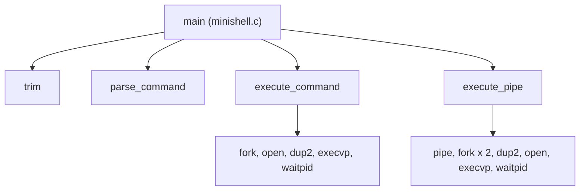

# HW1 코드 총정리 — pingpong과 minishell

[레포지토리 안내](../../README.ko.md) | [English](Code-Walkthrough.md) | [한국어](Code-Walkthrough.ko.md)

> **최종 수정일:** 2026-11-18

> **학습 목표:**
> 1. `pingpong.c`와 `minishell.c`의 함수 구성을 설명하고, 시작 코드에서 주어진 부분과 작성한 부분을 구분할 수 있다
> 2. `pingpong.c`의 부모와 자식이 각 단계에서 열어 두는 파이프 fd를 추적할 수 있다
> 3. `trim()`과 `parse_command()`가 입력 줄을 `struct command`로 바꾸는 과정을 토큰 단위로 추적할 수 있다
> 4. `execute_command()`와 `execute_pipe()`가 호출하는 시스템 콜의 순서와 각 프로세스의 fd 번호를 추적할 수 있다
> 5. `main()` 루프가 빈 줄, `exit`, EOF, 파이프가 있는 줄을 처리하는 경로를 설명할 수 있다

---

## 목차

- [1. 파일 구성](#1-파일-구성)
- [2. pingpong.c](#2-pingpongc)
  - [2.1 머리 주석과 헤더](#21-머리-주석과-헤더)
  - [2.2 get_time_us](#22-get_time_us)
  - [2.3 파이프 생성과 fork](#23-파이프-생성과-fork)
  - [2.4 자식 프로세스](#24-자식-프로세스)
  - [2.5 부모 프로세스](#25-부모-프로세스)
- [3. minishell.c](#3-minishellc)
  - [3.1 머리 주석, 헤더, 상수, 구조체](#31-머리-주석-헤더-상수-구조체)
  - [3.2 trim](#32-trim)
  - [3.3 parse_command](#33-parse_command)
  - [3.4 execute_command](#34-execute_command)
  - [3.5 execute_pipe](#35-execute_pipe)
  - [3.6 main](#36-main)
- [4. 실행 추적](#4-실행-추적)
  - [4.1 pingpong의 파이프 fd](#41-pingpong의-파이프-fd)
  - [4.2 minishell의 파이프와 출력 리디렉션](#42-minishell의-파이프와-출력-리디렉션)
- [요약](#요약)
- [점검 문제](#점검-문제)

---

<br>

## 1. 파일 구성

> **풀어 보기:** 이 문서는 작성한 코드 전체와 줄별 설명을 담고 있다. 먼저 [과제 안내문](Original/Assignment.ko.md)의 문제를 직접 풀어 본 뒤 읽는다.

짝이 되는 문서 [HW1 과제 해설](Assignment-Explanation.ko.md)은 요구사항, TODO별 풀이, 테스트 결과를 정리한다. 이 문서는 `Solution/`의 두 C 파일을 처음부터 끝까지 읽는다. 두 파일은 배포된 시작 코드(`Original/skeleton/`)의 한국어 주석을 영어로 옮기고 파일 맨 앞에 작성자 정보 주석을 더한 뒤 TODO 자리를 채운 것이며, 주어진 코드 자체는 바꾸지 않았다.

| 파일 | 줄 | 부분 | 시작 코드와의 관계 |
|:-----|:-----|:-----|:-----|
| `pingpong.c` | 1\~6 | 작성자 정보 주석 | 추가 |
| `pingpong.c` | 8\~40 | 머리 주석, 헤더, `get_time_us()` | 그대로 (주석만 영어로 옮김) |
| `pingpong.c` | 42\~115 | `main()` | TODO 1\~9를 작성 |
| `minishell.c` | 1\~6 | 작성자 정보 주석 | 추가 |
| `minishell.c` | 8\~112 | 머리 주석, 헤더, 상수, `struct command`, `trim()`, `parse_command()` | 그대로 (주석만 영어로 옮김) |
| `minishell.c` | 115\~183 | `execute_command()` | TODO 1\~3을 작성 |
| `minishell.c` | 185\~288 | `execute_pipe()` | TODO 4\~7을 작성 |
| `minishell.c` | 291\~355 | `main()` | 그대로 (주석만 영어로 옮김) |

*표 1. 두 소스 파일의 구성과 시작 코드와의 관계*



*그림 1. minishell.c의 함수 호출 관계*

`pingpong.c`는 `main()`과 보조 함수 `get_time_us()` 하나로 이루어진다. `minishell.c`의 `main()`은 한 줄을 읽을 때마다 `trim()`으로 공백을 정리하고, 파이프 문자가 있으면 양쪽을 따로 `parse_command()`로 파싱해 `execute_pipe()`를, 없으면 `execute_command()`를 호출한다.

---

<br>

## 2. pingpong.c

### 2.1 머리 주석과 헤더

1\~6번 줄은 파일 이름, 요약, 작성자, 날짜를 적은 주석이고, 8\~26번 줄은 시작 코드의 머리 주석을 영어로 옮긴 것이다. 머리 주석은 프로그램의 네 단계 동작(ping 전송, 출력과 pong 전송, pong 수신과 출력, 왕복 시간 출력), 출력 형식, 컴파일과 실행 명령을 적는다.

```c
#include <stdio.h>
#include <stdlib.h>
#include <unistd.h>
#include <sys/wait.h>
#include <sys/time.h>
```
| 헤더 | 이 파일에서 쓰는 선언 |
|:-----|:-----|
| `<stdio.h>` | `printf()`, `perror()` |
| `<stdlib.h>` | `exit()` |
| `<unistd.h>` | `pipe()`, `fork()`, `read()`, `write()`, `close()`, `getpid()` |
| `<sys/wait.h>` | `wait()` |
| `<sys/time.h>` | `gettimeofday()`, `struct timeval` |

*표 2. pingpong.c가 포함하는 헤더와 쓰는 선언*

### 2.2 get_time_us

```c
/* Return current time in microseconds */
static long get_time_us(void)
{
    struct timeval tv;
    gettimeofday(&tv, NULL);
    return tv.tv_sec * 1000000L + tv.tv_usec;
}
```

`gettimeofday()`는 1970년 1월 1일 0시(UTC)부터 지난 시간을 초(`tv_sec`)와 마이크로초(`tv_usec`)로 나누어 `struct timeval`에 채운다. 39번 줄은 초에 1,000,000을 곱해 마이크로초로 바꾸고 `tv_usec`을 더한다. 상수에 `L`을 붙였으므로 곱셈은 `long`으로 계산되며, `long`이 32비트인 환경이 아니라면 넘침이 생기지 않는다. 이 함수는 시작 코드에 주어진 것이다.

> **참고:** `gettimeofday()`는 벽시계 시간을 돌려주므로, 측정 도중 시스템 시각이 조정되면 두 값의 차이가 실제 경과 시간과 달라질 수 있다. 짧은 구간을 잴 때는 조정의 영향을 받지 않는 `clock_gettime(CLOCK_MONOTONIC, ...)`이 더 안전하다.

### 2.3 파이프 생성과 fork

```c
int main(void)
{
    /*
     * Two pipes are needed for bidirectional communication.
     * parent_to_child: parent -> child direction
     * child_to_parent: child -> parent direction
     */
    int parent_to_child[2];
    int child_to_parent[2];

    /* TODO 1: Create 2 pipes. */
    if (pipe(parent_to_child) < 0) {
        perror("pipe");
        exit(1);
    }
    if (pipe(child_to_parent) < 0) {
        perror("pipe");
        exit(1);
    }

    pid_t pid = fork();
    if (pid < 0) {
        perror("fork");
        exit(1);
    }
```

49\~50번 줄의 두 배열은 각각 파이프 하나의 읽기 끝(`[0]`)과 쓰기 끝(`[1]`)을 담는다. 53\~60번 줄(TODO 1)은 `fork()`보다 먼저 두 파이프를 만들며, 실패하면 `perror("pipe")`로 원인을 출력하고 종료 코드 1로 끝낸다. 파이프를 먼저 만들어야 62번 줄의 `fork()`가 복사하는 fd 테이블에 네 fd가 모두 들어가, 부모와 자식이 같은 파이프를 공유한다. 63\~66번 줄의 `fork()` 실패 처리는 시작 코드에 주어진 것이다.

`fork()`보다 앞에 `printf()`가 없다는 점도 중요하다. `fork()`는 stdio 버퍼까지 복사하므로, 출력이 버퍼에 남은 채로 `fork()`하면 같은 내용이 두 번 출력될 수 있다. 이 프로그램은 `fork()` 시점에 버퍼가 비어 있다.

### 2.4 자식 프로세스

```c
    if (pid == 0) {
        /* ===== Child Process ===== */

        /* TODO 2: Close unused pipe fds. */
        close(parent_to_child[1]);
        close(child_to_parent[0]);

        /* TODO 3: Read 1 byte from parent. */
        char buf;
        read(parent_to_child[0], &buf, 1);
        printf("%d: received ping\n", getpid());

        /* TODO 4: Send 1 byte to parent. */
        write(child_to_parent[1], &buf, 1);

        /* TODO 5: Close used pipe fds and exit with exit(0). */
        close(parent_to_child[0]);
        close(child_to_parent[1]);
        exit(0);
```

자식은 `fork()`가 0을 반환한 쪽이다. 72\~73번 줄(TODO 2)은 자식이 쓰지 않는 `parent_to_child`의 쓰기 끝과 `child_to_parent`의 읽기 끝을 닫는다. 76\~77번 줄(TODO 3)의 `read()`는 부모가 1바이트를 쓸 때까지 블록되므로, 이 호출이 두 프로세스의 순서를 맞추는 동기화 역할을 한다. 바이트를 받으면 78번 줄이 자신의 PID와 함께 `received ping`을 출력한다.

81번 줄(TODO 4)은 받은 바이트를 그대로 `child_to_parent`에 써서 pong으로 돌려보낸다. 84\~86번 줄(TODO 5)은 사용한 두 fd를 닫고 `exit(0)`으로 끝난다. `exit()`는 종료하기 전에 stdio 버퍼를 비우므로, 출력이 파일이나 파이프로 리디렉션되어 버퍼에 남아 있던 `received ping` 행도 이때 기록된다.

> **참고:** 이 코드는 `read()`와 `write()`의 반환값을 검사하지 않는다. 과제의 1바이트 교환에서는 문제가 되지 않지만, `read()`가 0(EOF)이나 -1을 반환하면 `buf`는 초기화되지 않은 채로 남는다. 견고한 구현은 반환값이 1인지 확인한다.

### 2.5 부모 프로세스

```c
    } else {
        /* ===== Parent Process ===== */

        /* TODO 6: Close unused pipe fds. */
        close(parent_to_child[0]);
        close(child_to_parent[1]);

        long start_time = get_time_us();

        /* TODO 7: Send 1 byte to child (ping). */
        char buf = 'p';
        write(parent_to_child[1], &buf, 1);

        /* TODO 8: Read 1 byte from child (pong). */
        read(child_to_parent[0], &buf, 1);
        printf("%d: received pong\n", getpid());

        long end_time = get_time_us();
        double elapsed = (double)(end_time - start_time);
        printf("Round-trip time: %.3f us\n", elapsed);

        /* TODO 9: Close used pipe fds and wait for child with wait(). */
        close(parent_to_child[1]);
        close(child_to_parent[0]);
        wait(NULL);
    }

    return 0;
}
```

91\~92번 줄(TODO 6)은 부모가 쓰지 않는 `parent_to_child`의 읽기 끝과 `child_to_parent`의 쓰기 끝을 닫는다. 94번 줄에서 시각을 잰 뒤, 97\~98번 줄(TODO 7)이 `'p'` 1바이트를 자식에게 쓰고, 101번 줄(TODO 8)의 `read()`가 자식의 pong이 도착할 때까지 블록된다. 따라서 104번 줄에서 잰 시각과의 차이에는 바이트 두 개의 전달과, 자식이 깨어나 읽고 쓰는 시간과, 부모가 다시 깨어나는 시간이 모두 들어간다.

105\~106번 줄은 차이를 `double`로 바꾸어 소수점 셋째 자리까지 출력한다. 109\~111번 줄(TODO 9)은 사용한 fd를 닫고 `wait(NULL)`로 자식을 회수하므로 자식이 좀비로 남지 않는다. 부모의 stdio 버퍼는 114번 줄의 `return 0`으로 프로세스가 끝날 때 비워지는데, 이 시점은 `wait()`가 반환한 뒤, 곧 자식이 이미 종료하여 자신의 버퍼를 비운 뒤이다. 그래서 출력이 파일로 리디렉션되어도 `received ping` 행이 `received pong` 행보다 먼저 기록된다.

---

<br>

## 3. minishell.c

### 3.1 머리 주석, 헤더, 상수, 구조체

1\~6번 줄은 작성자 정보 주석이고, 8\~24번 줄은 지원 기능(단일 명령어, 파이프, 입력 리디렉션, 출력 리디렉션, exit)과 구현할 두 함수를 적은 머리 주석이다.

```c
#include <stdio.h>
#include <stdlib.h>
#include <string.h>
#include <unistd.h>
#include <fcntl.h>
#include <sys/wait.h>
#include <errno.h>

#define MAX_LINE    1024    /* Maximum input line length */
#define MAX_ARGS    64      /* Maximum number of arguments */

/* ===== Command Structure ===== */

struct command {
    char *argv[MAX_ARGS];   /* Argument list (NULL-terminated) */
    char *infile;           /* Input redirection filename, NULL if none */
    char *outfile;          /* Output redirection filename, NULL if none */
};
```

`<string.h>`는 `strtok()`, `strcmp()`, `strlen()`, `strchr()`, `strncpy()`, `memset()`을, `<fcntl.h>`는 `open()`과 `O_RDONLY` 같은 플래그를 선언한다. `<errno.h>`는 포함되어 있지만 코드가 `errno`를 직접 쓰지는 않으며, `perror()`가 내부에서 `errno`를 읽어 오류 메시지를 만든다. `MAX_LINE`은 입력 한 줄의 최대 길이, `MAX_ARGS`는 인자 배열의 크기이다.

`struct command`는 명령어 하나를 나타낸다. `argv`는 `execvp()`에 그대로 넘길 수 있도록 `NULL`로 끝나는 문자열 포인터 배열이고, `infile`과 `outfile`은 리디렉션할 파일 이름이며 리디렉션이 없으면 `NULL`이다. 세 필드 모두 입력 줄의 버퍼를 가리키는 포인터이므로, 그 버퍼가 살아 있는 동안만 쓸 수 있다.

### 3.2 trim

```c
static char *trim(char *s)
{
    while (*s == ' ' || *s == '\t')
        s++;
    if (*s == '\0')
        return s;
    char *end = s + strlen(s) - 1;
    while (end > s && (*end == ' ' || *end == '\t' || *end == '\n'))
        *end-- = '\0';
    return s;
}
```

54\~55번 줄은 앞쪽의 공백과 탭을 건너뛰고, 문자열이 비었으면 그대로 반환한다. 58\~60번 줄은 마지막 문자부터 거꾸로 가며 공백, 탭, 개행 문자를 `'\0'`으로 바꾼다. `fgets()`는 줄 끝의 개행 문자를 버퍼에 남기므로 이 단계에서 지워진다. 반환값은 같은 버퍼 안의 포인터이다.

### 3.3 parse_command

```c
static int parse_command(char *line, struct command *cmd)
{
    memset(cmd, 0, sizeof(*cmd));

    int argc = 0;
    char *token = strtok(line, " \t");

    while (token != NULL) {
        if (strcmp(token, "<") == 0) {
            /* Input redirection */
            token = strtok(NULL, " \t");
            if (token == NULL) {
                fprintf(stderr, "minishell: syntax error near '<'\n");
                return -1;
            }
            cmd->infile = token;
        } else if (strcmp(token, ">") == 0) {
            /* Output redirection */
            token = strtok(NULL, " \t");
            if (token == NULL) {
                fprintf(stderr, "minishell: syntax error near '>'\n");
                return -1;
            }
            cmd->outfile = token;
        } else {
            if (argc >= MAX_ARGS - 1) {
                fprintf(stderr, "minishell: too many arguments\n");
                return -1;
            }
            cmd->argv[argc++] = token;
        }
        token = strtok(NULL, " \t");
    }

    cmd->argv[argc] = NULL;

    if (argc == 0) {
        return -1;  /* Empty command */
    }

    return 0;
}
```

73번 줄은 구조체를 0으로 채워 `infile`과 `outfile`을 `NULL`로 만든다. 76번 줄의 `strtok()`은 공백과 탭을 구분자로 하여 첫 토큰을 돌려주고, 102번 줄의 `strtok(NULL, " \t")`가 다음 토큰을 이어서 돌려준다. `strtok()`은 구분자 자리에 `'\0'`을 써서 원래 문자열을 바꾸므로, `main()`은 입력의 사본을 넘긴다.

토큰이 `<`이면 79\~86번 줄이 다음 토큰을 `infile`로, `>`이면 87\~94번 줄이 다음 토큰을 `outfile`로 저장하고, 파일 이름이 없으면 문법 오류를 출력하고 -1을 반환한다. 나머지 토큰은 100번 줄이 `argv`에 넣는다. 96번 줄은 `argc`가 `MAX_ARGS - 1`에 이르면 멈추어 마지막 칸을 105번 줄의 `NULL`에 남겨 둔다. 107\~109번 줄은 명령어 이름이 하나도 없으면(빈 줄이나 `> out.txt`만 있는 줄) -1을 반환한다.

> **주의:** 토큰은 공백으로만 나뉘므로 `<`와 `>`는 앞뒤가 띄어져 있어야 리디렉션으로 인식된다. `sort<data.txt`는 토큰 하나가 되어 명령어 이름으로 취급된다.

### 3.4 execute_command

117\~134번 줄은 시작 코드의 함수 설명 주석이다. 함수 본문은 다음과 같다.

```c
static int execute_command(struct command *cmd)
{
    /* TODO 1: Create a child process with fork(). */
    pid_t pid = fork();
    if (pid < 0) {
        perror("fork");
        return -1;
    }

    if (pid == 0) {
        /* TODO 2 (Child process): */

        /* a. Input redirection */
        if (cmd->infile != NULL) {
            int fd = open(cmd->infile, O_RDONLY);
            if (fd < 0) {
                perror(cmd->infile);
                exit(1);
            }
            dup2(fd, STDIN_FILENO);
            close(fd);
        }

        /* b. Output redirection */
        if (cmd->outfile != NULL) {
            int fd = open(cmd->outfile, O_WRONLY | O_CREAT | O_TRUNC, 0644);
            if (fd < 0) {
                perror(cmd->outfile);
                exit(1);
            }
            dup2(fd, STDOUT_FILENO);
            close(fd);
        }

        /* c. Execute command */
        execvp(cmd->argv[0], cmd->argv);

        /* d. exec failure */
        perror("minishell");
        exit(127);
    }

    /* TODO 3 (Parent process): */
    int status;
    waitpid(pid, &status, 0);
    if (WIFEXITED(status))
        return WEXITSTATUS(status);
    return -1;
}
```

138\~142번 줄(TODO 1)은 자식을 만들고, `fork()`가 실패하면 -1을 반환한다. 셸 자신은 다음 명령어를 받아야 하므로, 프로세스 이미지를 바꾸는 `execvp()`는 자식에서만 호출한다.

148\~156번 줄(TODO 2a)은 입력 파일을 읽기 전용으로 열고 `dup2(fd, STDIN_FILENO)`로 fd 0이 그 파일을 가리키게 한 뒤 원래 fd를 닫는다. 159\~167번 줄(TODO 2b)은 출력 파일을 쓰기 전용으로 열되, 없으면 만들고(`O_CREAT`) 있으면 내용을 비운다(`O_TRUNC`). 새 파일의 권한 0644는 프로세스의 umask가 가린 비트를 뺀 값으로 적용된다. 두 블록은 각자 지역 변수 `fd`를 선언하므로 이름이 겹쳐도 충돌하지 않는다. 열기에 실패하면 자식만 `exit(1)`로 끝나고 셸은 계속 실행된다.

170번 줄(TODO 2c)의 `execvp()`는 성공하면 반환하지 않는다. 173\~174번 줄(TODO 2d)에 도달했다는 것은 실행에 실패했다는 뜻이므로, `perror("minishell")`이 `errno`에 맞는 메시지(존재하지 않는 명령어라면 `No such file or directory`)를 출력하고 자식은 종료 코드 127로 끝난다. 178\~182번 줄(TODO 3)의 부모는 그 자식만 `waitpid()`로 기다리고, 정상 종료이면 종료 코드를, 시그널로 종료했다면 -1을 반환한다. `main()`은 이 반환값을 쓰지 않는다.

### 3.5 execute_pipe

185\~209번 줄은 함수 설명 주석이다. 213\~226번 줄은 파이프와 자식1을 만든다.

```c
static int execute_pipe(struct command *cmd1, struct command *cmd2)
{
    /* TODO 4: Create a pipe with pipe(). */
    int fd[2];
    if (pipe(fd) < 0) {
        perror("pipe");
        return -1;
    }

    /* TODO 5: Fork child1 with fork() (runs cmd1). */
    pid_t pid1 = fork();
    if (pid1 < 0) {
        perror("fork");
        close(fd[0]);
        close(fd[1]);
        return -1;
    }

    if (pid1 == 0) {
        close(fd[0]);
        dup2(fd[1], STDOUT_FILENO);
        close(fd[1]);

        if (cmd1->infile != NULL) {
            int infd = open(cmd1->infile, O_RDONLY);
            if (infd < 0) {
                perror(cmd1->infile);
                exit(1);
            }
            dup2(infd, STDIN_FILENO);
            close(infd);
        }

        execvp(cmd1->argv[0], cmd1->argv);
        perror("minishell");
        exit(127);
    }
```

213\~217번 줄(TODO 4)이 만든 파이프는 이후의 두 `fork()`에서 자식들에게 복사된다. 자식1을 만드는 `fork()`가 실패하면 221\~226번 줄이 파이프의 양쪽 끝을 닫고 -1을 반환하여 fd가 새지 않게 한다.

자식1(228\~246번 줄, TODO 5)은 읽기 끝을 닫고, `dup2(fd[1], STDOUT_FILENO)`로 fd 1을 파이프의 쓰기 끝으로 바꾼 뒤 원래의 `fd[1]`을 닫는다. 이제 이 자식의 쓰기 끝은 fd 1 하나뿐이다. `cmd1->infile`이 있으면 233\~241번 줄이 fd 0도 파일로 바꾼다. fd 1과 fd 0은 서로 다른 번호이므로 두 설정의 순서는 결과에 영향을 주지 않는다. 그다음 `cmd1`을 실행하고, 실패하면 종료 코드 127로 끝난다.

```c
    /* TODO 6: Fork child2 with fork() (runs cmd2). */
    pid_t pid2 = fork();
    if (pid2 < 0) {
        perror("fork");
        close(fd[0]);
        close(fd[1]);
        return -1;
    }

    if (pid2 == 0) {
        close(fd[1]);
        dup2(fd[0], STDIN_FILENO);
        close(fd[0]);

        if (cmd2->outfile != NULL) {
            int outfd = open(cmd2->outfile, O_WRONLY | O_CREAT | O_TRUNC, 0644);
            if (outfd < 0) {
                perror(cmd2->outfile);
                exit(1);
            }
            dup2(outfd, STDOUT_FILENO);
            close(outfd);
        }

        execvp(cmd2->argv[0], cmd2->argv);
        perror("minishell");
        exit(127);
    }

    /* TODO 7: Clean up in parent. */
    close(fd[0]);
    close(fd[1]);

    int status;
    waitpid(pid1, NULL, 0);
    waitpid(pid2, &status, 0);

    if (WIFEXITED(status))
        return WEXITSTATUS(status);
    return -1;
}
```

자식2(257\~275번 줄, TODO 6)는 자식1과 대칭이다. 쓰기 끝을 닫고 fd 0을 파이프의 읽기 끝으로 바꾼 뒤, `cmd2->outfile`이 있으면 fd 1을 파일로 바꾸고 `cmd2`를 실행한다. 명세에 따라 `cmd1`의 출력 리디렉션과 `cmd2`의 입력 리디렉션은 처리하지 않는다.

부모(278\~287번 줄, TODO 7)는 두 자식을 만든 뒤에야 파이프의 양쪽 끝을 닫는다. 자식2보다 먼저 닫으면 자식2가 파이프를 물려받지 못하기 때문이다. 부모가 쓰기 끝을 닫으면 쓰기 끝은 자식1의 fd 1만 남으므로, `cmd1`이 끝나는 순간 `cmd2`의 `read()`가 EOF를 받는다. 부모는 자식1과 자식2를 차례로 기다리고 `cmd2`의 종료 코드를 반환한다.

> **참고:** 자식2를 만드는 `fork()`가 실패하면 250\~255번 줄은 파이프를 닫고 곧바로 반환하므로, 이미 실행 중인 자식1은 회수되지 않는다. 읽는 쪽이 모두 닫힌 파이프에 쓰는 자식1은 `SIGPIPE`로 끝나고, 셸이 종료할 때까지 좀비로 남는다. 이 경우까지 처리하려면 반환하기 전에 `waitpid(pid1, NULL, 0)`을 호출한다.

### 3.6 main

```c
int main(void)
{
    char line[MAX_LINE];

    while (1) {
        /* Print prompt */
        printf("minishell> ");
        fflush(stdout);

        /* Read input */
        if (fgets(line, sizeof(line), stdin) == NULL) {
            printf("\n");
            break;  /* EOF (Ctrl-D) */
        }

        /* Remove whitespace */
        char *input = trim(line);
        if (*input == '\0')
            continue;  /* Empty line */

        /* Built-in command handling: exit */
        if (strcmp(input, "exit") == 0)
            break;
```

루프는 매번 `minishell> ` 프롬프트를 출력하고 `fflush(stdout)`으로 곧바로 내보낸다. 프롬프트에는 개행 문자가 없어 줄 단위 버퍼링으로는 출력되지 않기 때문이다. 303번 줄의 `fgets()`가 `NULL`을 반환하면(Ctrl-D나 입력의 끝) 개행 문자 하나를 출력하고 루프를 빠져나온다. `trim()` 뒤에 빈 줄이면 다음 입력을 받고, 줄 전체가 정확히 `exit`이면 루프를 끝낸다. 앞뒤 공백은 `trim()`이 지우므로 `  exit  `도 종료로 처리된다.

```c
        /* Check for pipe */
        char *pipe_pos = strchr(input, '|');

        if (pipe_pos != NULL) {
            /* Split at pipe character */
            *pipe_pos = '\0';
            char *left = input;
            char *right = pipe_pos + 1;

            /* Create copies for strtok (strtok modifies the string) */
            char left_copy[MAX_LINE], right_copy[MAX_LINE];
            strncpy(left_copy, left, sizeof(left_copy) - 1);
            left_copy[sizeof(left_copy) - 1] = '\0';
            strncpy(right_copy, right, sizeof(right_copy) - 1);
            right_copy[sizeof(right_copy) - 1] = '\0';

            struct command cmd1, cmd2;
            if (parse_command(left_copy, &cmd1) < 0)
                continue;
            if (parse_command(right_copy, &cmd2) < 0)
                continue;

            execute_pipe(&cmd1, &cmd2);
        } else {
            /* Single command */
            char copy[MAX_LINE];
            strncpy(copy, input, sizeof(copy) - 1);
            copy[sizeof(copy) - 1] = '\0';

            struct command cmd;
            if (parse_command(copy, &cmd) < 0)
                continue;

            execute_command(&cmd);
        }
    }

    return 0;
}
```

318번 줄의 `strchr()`는 첫 번째 `|`만 찾는다. 파이프가 있으면 그 자리에 `'\0'`을 써서 줄을 왼쪽과 오른쪽으로 나누고, 각각을 `MAX_LINE` 크기의 사본으로 복사한다. `strncpy()`는 원본이 길면 끝에 `'\0'`을 쓰지 않으므로 329, 331번 줄이 마지막 칸에 직접 쓴다. 두 쪽 중 하나라도 파싱에 실패하면 그 줄을 건너뛰고, 모두 성공하면 `execute_pipe()`를 호출한다. 파이프가 없으면 342\~350번 줄이 같은 방식으로 사본을 만들어 `execute_command()`를 호출한다.

> **주의:** 파이프는 하나만 지원한다. `ls | grep c | wc -l`을 입력하면 오른쪽 부분 ` grep c | wc -l`이 통째로 `cmd2`가 되어, 두 번째 `|`는 `grep`의 일반 인자로 넘어간다.

---

<br>

## 4. 실행 추적

### 4.1 pingpong의 파이프 fd

표에서 `p2c`는 `parent_to_child`, `c2p`는 `child_to_parent`를 줄인 것이다.

| 단계 (줄) | 부모가 열어 둔 파이프 fd | 자식이 열어 둔 파이프 fd |
|:-----|:-----|:-----|
| 두 `pipe()` 뒤 (53\~60) | `p2c[0]`, `p2c[1]`, `c2p[0]`, `c2p[1]` | 자식 없음 |
| `fork()` 직후 (62) | 네 개 모두 | 네 개 모두 (복사본) |
| 사용하지 않는 끝을 닫은 뒤 (자식 72\~73, 부모 91\~92) | `p2c[1]`, `c2p[0]` | `p2c[0]`, `c2p[1]` |
| 교환을 마친 뒤 (자식 84\~85, 부모 109\~110) | 없음 | 없음 |

*표 3. pingpong의 단계별 파이프 fd*

셋째 행에서 각 파이프의 쓰기 끝과 읽기 끝은 각각 한 프로세스에만 열려 있다. 그래서 부모가 `p2c[1]`에 쓴 바이트는 자식만 읽고, 자식이 `c2p[1]`에 쓴 바이트는 부모만 읽는다.

### 4.2 minishell의 파이프와 출력 리디렉션

입력 `echo hello | cat > /tmp/pipe_test.txt`를 처리하는 과정을 따라간다. 셸이 fd 0, 1, 2만 연 상태라고 가정한다. 새 fd는 비어 있는 가장 작은 번호를 받는다.

1. `fgets()`가 줄을 읽고 `trim()`이 끝의 개행 문자를 지운다. 빈 줄도 `exit`도 아니며, `strchr()`가 `|`를 찾는다.
2. 왼쪽 `echo hello `는 `argv = {"echo", "hello", NULL}`, 오른쪽 ` cat > /tmp/pipe_test.txt`는 `argv = {"cat", NULL}`, `outfile = "/tmp/pipe_test.txt"`로 파싱된다.
3. `execute_pipe()`의 `pipe(fd)`가 `fd[0] = 3`, `fd[1] = 4`를 만든다.
4. 자식1은 fd 3을 닫고, `dup2(4, 1)` 뒤 fd 4를 닫는다. `echo`가 실행되어 `hello`와 개행 문자를 fd 1, 곧 파이프에 쓰고 끝난다.
5. 자식2는 fd 4를 닫고, `dup2(3, 0)` 뒤 fd 3을 닫는다. 이어서 `open()`이 출력 파일을 열면 비어 있는 가장 작은 번호인 3을 받고, `dup2(3, 1)` 뒤 fd 3을 닫는다. `cat`은 fd 0(파이프)에서 읽어 fd 1(파일)에 쓴다.
6. 부모는 fd 3과 4를 닫는다. 쓰기 끝을 가진 프로세스가 자식1뿐이므로, `echo`가 끝나면 `cat`의 `read()`가 EOF를 받고 `cat`도 끝난다. 부모는 두 자식을 회수하고 `cat`의 종료 코드 0을 반환한다.

결과로 `/tmp/pipe_test.txt`에는 `hello` 한 줄이 들어간다. 이는 과제 안내문의 수동 테스트와 자동 테스트의 파이프와 출력 리디렉션 항목이 확인하는 동작이다.

---

<br>

## 요약

| 개념 | 핵심 요약 |
|:-----|:-----|
| 파일 구성 | 두 파일은 시작 코드의 주석을 영어로 옮기고 TODO 자리만 채운 것이며, pingpong은 `main()`의 TODO 1\~9, minishell은 `execute_command()`와 `execute_pipe()`의 TODO 1\~7을 작성했다. |
| get_time_us | `gettimeofday()`의 초와 마이크로초를 `long` 마이크로초 하나로 합친다. |
| pingpong의 fd | `fork()` 전에 만든 파이프 fd 네 개 가운데 각 프로세스가 두 개씩 닫아, 파이프마다 쓰는 쪽과 읽는 쪽이 하나씩 남는다. |
| 출력 순서 | 자식은 `exit(0)`에서, 부모는 `wait()` 뒤의 `return 0`에서 stdio 버퍼를 비우므로 리디렉션되어도 ping 행이 먼저 기록된다. |
| parse_command | `strtok()`으로 공백과 탭에서 나눈 토큰 중 `<`, `>` 다음 토큰을 파일 이름으로, 나머지를 `NULL`로 끝나는 `argv`로 저장한다. |
| execute_command | 자식에서 `open()`, `dup2()`, `close()`로 리디렉션을 설정한 뒤 `execvp()`하고, 실패하면 127로 끝나며, 부모는 `waitpid()`로 종료 코드를 얻는다. |
| execute_pipe | 파이프 하나를 두 자식이 물려받아 각자 fd 1 또는 fd 0에 연결하고, 부모가 양쪽 끝을 닫아야 읽는 쪽이 EOF를 받는다. |
| main | 프롬프트를 `fflush()`로 내보내고, EOF와 `exit`에서 끝나며, 첫 번째 `|`만 기준으로 줄을 나눈다. |

---

<br>

## 점검 문제

1. **출력 순서:** 자동 테스트처럼 pingpong의 출력을 파일로 리디렉션하면 `printf()`의 출력이 버퍼에 쌓인다. 그런데도 `received ping` 행이 `received pong` 행보다 먼저 기록되는 이유를 쓰라.

   <details>
   <summary>정답</summary>

   자식의 버퍼는 `exit(0)`이 호출될 때 비워진다. 부모의 버퍼는 `main()`이 `return 0`으로 끝날 때 비워지는데, 그 앞의 `wait(NULL)`은 자식이 종료한 뒤에야 반환한다. 따라서 자식이 버퍼를 비운 뒤에 부모가 버퍼를 비우므로, `received ping` 행이 먼저 기록된다. 두 프로세스는 `fork()`로 복사된 같은 열린 파일을 공유하므로 파일의 위치도 이어진다.

   </details>

2. **exit의 판정:** minishell에 `  exit  `과 `exit now`를 각각 입력하면 어떻게 되는지 쓰라.

   <details>
   <summary>정답</summary>

   `  exit  `은 `trim()`이 앞뒤 공백을 지워 `exit`이 되므로 `strcmp()`가 일치하여 루프가 끝난다. `exit now`는 `exit`과 일치하지 않으므로 일반 명령어로 파싱되고, `execute_command()`의 자식에서 `execvp("exit", ...)`이 실패하여 `minishell: No such file or directory`를 출력하고 종료 코드 127로 끝난다. 셸은 계속 실행된다.

   </details>

3. **두 번째 파이프:** `ls | grep c | wc -l`을 입력하면 `cmd2`의 `argv`가 어떻게 되는지 쓰라.

   <details>
   <summary>정답</summary>

   `strchr()`는 첫 번째 `|`만 찾으므로 오른쪽 부분은 ` grep c | wc -l`이다. `parse_command()`는 공백에서만 나누고 `|`를 특별히 다루지 않으므로 `argv = {"grep", "c", "|", "wc", "-l", NULL}`이 된다. 두 번째 `|`, `wc`, `-l`은 `grep`의 인자로 넘어간다.

   </details>

4. **fd 번호:** 4.2절의 추적에서 자식2가 출력 파일을 `open()`하면 몇 번 fd를 받는지와 그 이유를 쓰라.

   <details>
   <summary>정답</summary>

   3번을 받는다. 자식2는 `open()` 전에 fd 4를 닫고, `dup2(3, 0)`으로 fd 0을 파이프의 읽기 끝으로 바꾼 뒤 fd 3을 닫는다. 이때 열려 있는 fd는 0, 1, 2뿐이고, `open()`은 비어 있는 가장 작은 번호를 돌려주므로 3이 된다.

   </details>
