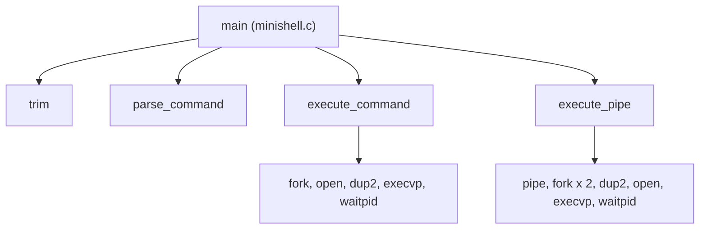

# HW1 Code Walkthrough — pingpong & minishell

[Repository Guide](../../README.md) | [English](Code-Walkthrough.md) | [한국어](Code-Walkthrough.ko.md)

> **Last Updated:** 2026-11-18

> **Learning Objectives:**
> 1. Describe the functions of `pingpong.c` and `minishell.c` and distinguish the parts given in the starter code from the parts written for the assignment
> 2. Trace the pipe fds that the parent and the child of `pingpong.c` keep open at each step
> 3. Trace, token by token, how `trim()` and `parse_command()` turn an input line into a `struct command`
> 4. Trace the order of the system calls made by `execute_command()` and `execute_pipe()` and the fd numbers in each process
> 5. Explain the paths by which the `main()` loop handles an empty line, `exit`, EOF, and a line with a pipe

---

## Table of Contents

- [1. File Layout](#1-file-layout)
- [2. pingpong.c](#2-pingpongc)
  - [2.1 Header Comments and Includes](#21-header-comments-and-includes)
  - [2.2 get_time_us](#22-get_time_us)
  - [2.3 Pipe Creation and fork](#23-pipe-creation-and-fork)
  - [2.4 Child Process](#24-child-process)
  - [2.5 Parent Process](#25-parent-process)
- [3. minishell.c](#3-minishellc)
  - [3.1 Header Comments, Includes, Constants, and the Structure](#31-header-comments-includes-constants-and-the-structure)
  - [3.2 trim](#32-trim)
  - [3.3 parse_command](#33-parse_command)
  - [3.4 execute_command](#34-execute_command)
  - [3.5 execute_pipe](#35-execute_pipe)
  - [3.6 main](#36-main)
- [4. Execution Traces](#4-execution-traces)
  - [4.1 Pipe fds of pingpong](#41-pipe-fds-of-pingpong)
  - [4.2 Pipe and Output Redirection in minishell](#42-pipe-and-output-redirection-in-minishell)
- [Summary](#summary)
- [Self-Check Questions](#self-check-questions)

---

<br>

## 1. File Layout

> **Try It First:** This document contains the complete code and line-by-line explanations. Solve the problems in the [assignment handout](Original/Assignment.md) yourself before reading on.

The companion document [HW1 Assignment Explanation](Assignment-Explanation.md) summarizes the requirements, the solution of each TODO, and the test results. This document reads the two C files in `Solution/` from beginning to end. Both files take the distributed starter code (`Original/skeleton/`), translate its Korean comments into English, add an author comment at the top, and fill in the TODOs; the given code itself is unchanged.

| File | Lines | Part | Relation to the starter code |
|:-----|:-----|:-----|:-----|
| `pingpong.c` | 1-6 | Author comment | Added |
| `pingpong.c` | 8-40 | Header comment, includes, `get_time_us()` | Unchanged (comments translated) |
| `pingpong.c` | 42-115 | `main()` | TODOs 1-9 written |
| `minishell.c` | 1-6 | Author comment | Added |
| `minishell.c` | 8-112 | Header comment, includes, constants, `struct command`, `trim()`, `parse_command()` | Unchanged (comments translated) |
| `minishell.c` | 115-183 | `execute_command()` | TODOs 1-3 written |
| `minishell.c` | 185-288 | `execute_pipe()` | TODOs 4-7 written |
| `minishell.c` | 291-355 | `main()` | Unchanged (comments translated) |

*Table 1. Structure of the two source files and their relation to the starter code*



*Figure 1. Function call relations in minishell.c*

`pingpong.c` consists of `main()` and one helper function, `get_time_us()`. The `main()` of `minishell.c` cleans up whitespace with `trim()` for each line it reads; if the line has a pipe character, it parses both sides separately with `parse_command()` and calls `execute_pipe()`, and otherwise it calls `execute_command()`.

---

<br>

## 2. pingpong.c

### 2.1 Header Comments and Includes

Lines 1-6 are a comment with the file name, a summary, the author, and the date, and lines 8-26 are the starter code's header comment translated into English. The header comment states the program's four steps (sending the ping, printing and sending the pong, receiving and printing the pong, printing the round-trip time), the output format, and the compile and run commands.

```c
#include <stdio.h>
#include <stdlib.h>
#include <unistd.h>
#include <sys/wait.h>
#include <sys/time.h>
```
| Header | Declarations used in this file |
|:-----|:-----|
| `<stdio.h>` | `printf()`, `perror()` |
| `<stdlib.h>` | `exit()` |
| `<unistd.h>` | `pipe()`, `fork()`, `read()`, `write()`, `close()`, `getpid()` |
| `<sys/wait.h>` | `wait()` |
| `<sys/time.h>` | `gettimeofday()`, `struct timeval` |

*Table 2. Headers included by pingpong.c and the declarations it uses*

### 2.2 get_time_us

```c
/* Return current time in microseconds */
static long get_time_us(void)
{
    struct timeval tv;
    gettimeofday(&tv, NULL);
    return tv.tv_sec * 1000000L + tv.tv_usec;
}
```

`gettimeofday()` fills a `struct timeval` with the time elapsed since 00:00 UTC on January 1, 1970, split into seconds (`tv_sec`) and microseconds (`tv_usec`). Line 39 converts the seconds to microseconds by multiplying by 1,000,000 and adds `tv_usec`. Because the constant has the suffix `L`, the multiplication is done in `long`, so it does not overflow unless `long` is 32 bits wide. This function is given in the starter code.

> **Note:** `gettimeofday()` returns wall-clock time, so if the system time is adjusted during a measurement, the difference of the two values can differ from the real elapsed time. For short intervals, `clock_gettime(CLOCK_MONOTONIC, ...)`, which is not affected by such adjustments, is safer.

### 2.3 Pipe Creation and fork

```c
int main(void)
{
    /*
     * Two pipes are needed for bidirectional communication.
     * parent_to_child: parent -> child direction
     * child_to_parent: child -> parent direction
     */
    int parent_to_child[2];
    int child_to_parent[2];

    /* TODO 1: Create 2 pipes. */
    if (pipe(parent_to_child) < 0) {
        perror("pipe");
        exit(1);
    }
    if (pipe(child_to_parent) < 0) {
        perror("pipe");
        exit(1);
    }

    pid_t pid = fork();
    if (pid < 0) {
        perror("fork");
        exit(1);
    }
```

The two arrays on lines 49-50 each hold the read end (`[0]`) and write end (`[1]`) of one pipe. Lines 53-60 (TODO 1) create both pipes before `fork()`, and on failure print the cause with `perror("pipe")` and end with exit code 1. The pipes must be created first so that all four fds are in the fd table that `fork()` on line 62 copies, letting the parent and child share the same pipes. The handling of a `fork()` failure on lines 63-66 is given in the starter code.

It also matters that no `printf()` comes before `fork()`. Since `fork()` also copies the stdio buffer, forking while output is still in the buffer can print the same content twice. In this program the buffer is empty at the time of `fork()`.

### 2.4 Child Process

```c
    if (pid == 0) {
        /* ===== Child Process ===== */

        /* TODO 2: Close unused pipe fds. */
        close(parent_to_child[1]);
        close(child_to_parent[0]);

        /* TODO 3: Read 1 byte from parent. */
        char buf;
        read(parent_to_child[0], &buf, 1);
        printf("%d: received ping\n", getpid());

        /* TODO 4: Send 1 byte to parent. */
        write(child_to_parent[1], &buf, 1);

        /* TODO 5: Close used pipe fds and exit with exit(0). */
        close(parent_to_child[0]);
        close(child_to_parent[1]);
        exit(0);
```

The child is the side where `fork()` returned 0. Lines 72-73 (TODO 2) close the write end of `parent_to_child` and the read end of `child_to_parent`, which the child does not use. The `read()` on lines 76-77 (TODO 3) blocks until the parent writes 1 byte, so this call synchronizes the order of the two processes. Once the byte arrives, line 78 prints `received ping` with the child's own PID.

Line 81 (TODO 4) writes the received byte unchanged to `child_to_parent`, sending it back as the pong. Lines 84-86 (TODO 5) close the two fds the child used and end with `exit(0)`. Because `exit()` flushes the stdio buffers before terminating, the `received ping` line is written at this point even if the output is redirected to a file or pipe and was still in the buffer.

> **Note:** This code does not check the return values of `read()` and `write()`. This causes no problem in the 1-byte exchange of the assignment, but if `read()` returns 0 (EOF) or -1, `buf` is left uninitialized. A robust implementation checks that the return value is 1.

### 2.5 Parent Process

```c
    } else {
        /* ===== Parent Process ===== */

        /* TODO 6: Close unused pipe fds. */
        close(parent_to_child[0]);
        close(child_to_parent[1]);

        long start_time = get_time_us();

        /* TODO 7: Send 1 byte to child (ping). */
        char buf = 'p';
        write(parent_to_child[1], &buf, 1);

        /* TODO 8: Read 1 byte from child (pong). */
        read(child_to_parent[0], &buf, 1);
        printf("%d: received pong\n", getpid());

        long end_time = get_time_us();
        double elapsed = (double)(end_time - start_time);
        printf("Round-trip time: %.3f us\n", elapsed);

        /* TODO 9: Close used pipe fds and wait for child with wait(). */
        close(parent_to_child[1]);
        close(child_to_parent[0]);
        wait(NULL);
    }

    return 0;
}
```

Lines 91-92 (TODO 6) close the read end of `parent_to_child` and the write end of `child_to_parent`, which the parent does not use. After the time is taken on line 94, lines 97-98 (TODO 7) write the 1 byte `'p'` to the child, and the `read()` on line 101 (TODO 8) blocks until the child's pong arrives. The difference from the time taken on line 104 therefore includes the transfer of two bytes, the time for the child to wake up, read, and write, and the time for the parent to wake up again.

Lines 105-106 convert the difference to `double` and print it to three decimal places. Lines 109-111 (TODO 9) close the fds the parent used and reap the child with `wait(NULL)`, so the child does not remain a zombie. The parent's stdio buffer is flushed when the process ends with `return 0` on line 114, which happens after `wait()` returns, that is, after the child has already terminated and flushed its own buffer. That is why the `received ping` line is written before the `received pong` line even when the output is redirected to a file.

---

<br>

## 3. minishell.c

### 3.1 Header Comments, Includes, Constants, and the Structure

Lines 1-6 are the author comment, and lines 8-24 are the header comment listing the supported features (single commands, pipes, input redirection, output redirection, exit) and the two functions to implement.

```c
#include <stdio.h>
#include <stdlib.h>
#include <string.h>
#include <unistd.h>
#include <fcntl.h>
#include <sys/wait.h>
#include <errno.h>

#define MAX_LINE    1024    /* Maximum input line length */
#define MAX_ARGS    64      /* Maximum number of arguments */

/* ===== Command Structure ===== */

struct command {
    char *argv[MAX_ARGS];   /* Argument list (NULL-terminated) */
    char *infile;           /* Input redirection filename, NULL if none */
    char *outfile;          /* Output redirection filename, NULL if none */
};
```

`<string.h>` declares `strtok()`, `strcmp()`, `strlen()`, `strchr()`, `strncpy()`, and `memset()`, and `<fcntl.h>` declares `open()` and flags such as `O_RDONLY`. `<errno.h>` is included, but the code does not use `errno` directly; `perror()` reads `errno` internally to build its error message. `MAX_LINE` is the maximum length of an input line, and `MAX_ARGS` is the size of the argument array.

`struct command` represents one command. `argv` is a `NULL`-terminated array of string pointers so that it can be passed to `execvp()` as is, and `infile` and `outfile` are the file names to redirect from and to, or `NULL` if there is no redirection. All three fields point into the buffer of the input line, so they can be used only while that buffer is alive.

### 3.2 trim

```c
static char *trim(char *s)
{
    while (*s == ' ' || *s == '\t')
        s++;
    if (*s == '\0')
        return s;
    char *end = s + strlen(s) - 1;
    while (end > s && (*end == ' ' || *end == '\t' || *end == '\n'))
        *end-- = '\0';
    return s;
}
```

Lines 54-55 skip leading spaces and tabs and return the string as is if it is empty. Lines 58-60 walk backward from the last character, replacing spaces, tabs, and newlines with `'\0'`. Since `fgets()` leaves the newline at the end of the line in the buffer, it is removed at this step. The return value is a pointer into the same buffer.

### 3.3 parse_command

```c
static int parse_command(char *line, struct command *cmd)
{
    memset(cmd, 0, sizeof(*cmd));

    int argc = 0;
    char *token = strtok(line, " \t");

    while (token != NULL) {
        if (strcmp(token, "<") == 0) {
            /* Input redirection */
            token = strtok(NULL, " \t");
            if (token == NULL) {
                fprintf(stderr, "minishell: syntax error near '<'\n");
                return -1;
            }
            cmd->infile = token;
        } else if (strcmp(token, ">") == 0) {
            /* Output redirection */
            token = strtok(NULL, " \t");
            if (token == NULL) {
                fprintf(stderr, "minishell: syntax error near '>'\n");
                return -1;
            }
            cmd->outfile = token;
        } else {
            if (argc >= MAX_ARGS - 1) {
                fprintf(stderr, "minishell: too many arguments\n");
                return -1;
            }
            cmd->argv[argc++] = token;
        }
        token = strtok(NULL, " \t");
    }

    cmd->argv[argc] = NULL;

    if (argc == 0) {
        return -1;  /* Empty command */
    }

    return 0;
}
```

Line 73 fills the structure with zeros, making `infile` and `outfile` `NULL`. The `strtok()` on line 76 returns the first token with spaces and tabs as delimiters, and `strtok(NULL, " \t")` on line 102 returns the following tokens. Because `strtok()` modifies the original string by writing `'\0'` over the delimiters, `main()` passes a copy of the input.

If a token is `<`, lines 79-86 store the next token as `infile`; if it is `>`, lines 87-94 store the next token as `outfile`; and if the file name is missing, they print a syntax error and return -1. Line 100 puts the remaining tokens in `argv`. Line 96 stops when `argc` reaches `MAX_ARGS - 1`, leaving the last slot for the `NULL` on line 105. Lines 107-109 return -1 if there is no command name at all (an empty line or a line with only `> out.txt`).

> **Caution:** Tokens are split only at whitespace, so `<` and `>` are recognized as redirections only when surrounded by spaces. `sort<data.txt` becomes a single token and is treated as a command name.

### 3.4 execute_command

Lines 117-134 are the function's description comment from the starter code. The function body is as follows.

```c
static int execute_command(struct command *cmd)
{
    /* TODO 1: Create a child process with fork(). */
    pid_t pid = fork();
    if (pid < 0) {
        perror("fork");
        return -1;
    }

    if (pid == 0) {
        /* TODO 2 (Child process): */

        /* a. Input redirection */
        if (cmd->infile != NULL) {
            int fd = open(cmd->infile, O_RDONLY);
            if (fd < 0) {
                perror(cmd->infile);
                exit(1);
            }
            dup2(fd, STDIN_FILENO);
            close(fd);
        }

        /* b. Output redirection */
        if (cmd->outfile != NULL) {
            int fd = open(cmd->outfile, O_WRONLY | O_CREAT | O_TRUNC, 0644);
            if (fd < 0) {
                perror(cmd->outfile);
                exit(1);
            }
            dup2(fd, STDOUT_FILENO);
            close(fd);
        }

        /* c. Execute command */
        execvp(cmd->argv[0], cmd->argv);

        /* d. exec failure */
        perror("minishell");
        exit(127);
    }

    /* TODO 3 (Parent process): */
    int status;
    waitpid(pid, &status, 0);
    if (WIFEXITED(status))
        return WEXITSTATUS(status);
    return -1;
}
```

Lines 138-142 (TODO 1) create a child and return -1 if `fork()` fails. Since the shell itself must receive the next command, `execvp()`, which replaces the process image, is called only in the child.

Lines 148-156 (TODO 2a) open the input file read-only, make fd 0 refer to that file with `dup2(fd, STDIN_FILENO)`, and close the original fd. Lines 159-167 (TODO 2b) open the output file write-only, creating it if absent (`O_CREAT`) and emptying it if present (`O_TRUNC`). The permission 0644 of a new file is applied with the bits masked by the process's umask removed. Each block declares its own local variable `fd`, so the same name causes no conflict. If opening fails, only the child ends with `exit(1)`, and the shell keeps running.

The `execvp()` on line 170 (TODO 2c) does not return on success. Reaching lines 173-174 (TODO 2d) means execution failed, so `perror("minishell")` prints the message matching `errno` (`No such file or directory` for a non-existent command) and the child ends with exit code 127. The parent on lines 178-182 (TODO 3) waits for that child alone with `waitpid()` and returns its exit code on a normal exit, or -1 if it was terminated by a signal. `main()` does not use this return value.

### 3.5 execute_pipe

Lines 185-209 are the function's description comment. Lines 213-226 create the pipe and child 1.

```c
static int execute_pipe(struct command *cmd1, struct command *cmd2)
{
    /* TODO 4: Create a pipe with pipe(). */
    int fd[2];
    if (pipe(fd) < 0) {
        perror("pipe");
        return -1;
    }

    /* TODO 5: Fork child1 with fork() (runs cmd1). */
    pid_t pid1 = fork();
    if (pid1 < 0) {
        perror("fork");
        close(fd[0]);
        close(fd[1]);
        return -1;
    }

    if (pid1 == 0) {
        close(fd[0]);
        dup2(fd[1], STDOUT_FILENO);
        close(fd[1]);

        if (cmd1->infile != NULL) {
            int infd = open(cmd1->infile, O_RDONLY);
            if (infd < 0) {
                perror(cmd1->infile);
                exit(1);
            }
            dup2(infd, STDIN_FILENO);
            close(infd);
        }

        execvp(cmd1->argv[0], cmd1->argv);
        perror("minishell");
        exit(127);
    }
```

The pipe created on lines 213-217 (TODO 4) is copied to the children by the two `fork()` calls that follow. If the `fork()` for child 1 fails, lines 221-226 close both ends of the pipe and return -1 so that no fd leaks.

Child 1 (lines 228-246, TODO 5) closes the read end, turns fd 1 into the write end of the pipe with `dup2(fd[1], STDOUT_FILENO)`, and closes the original `fd[1]`. Now fd 1 is this child's only write end. If `cmd1->infile` exists, lines 233-241 also turn fd 0 into the file. Since fd 1 and fd 0 are different numbers, the order of the two settings does not affect the result. It then runs `cmd1` and ends with exit code 127 on failure.

```c
    /* TODO 6: Fork child2 with fork() (runs cmd2). */
    pid_t pid2 = fork();
    if (pid2 < 0) {
        perror("fork");
        close(fd[0]);
        close(fd[1]);
        return -1;
    }

    if (pid2 == 0) {
        close(fd[1]);
        dup2(fd[0], STDIN_FILENO);
        close(fd[0]);

        if (cmd2->outfile != NULL) {
            int outfd = open(cmd2->outfile, O_WRONLY | O_CREAT | O_TRUNC, 0644);
            if (outfd < 0) {
                perror(cmd2->outfile);
                exit(1);
            }
            dup2(outfd, STDOUT_FILENO);
            close(outfd);
        }

        execvp(cmd2->argv[0], cmd2->argv);
        perror("minishell");
        exit(127);
    }

    /* TODO 7: Clean up in parent. */
    close(fd[0]);
    close(fd[1]);

    int status;
    waitpid(pid1, NULL, 0);
    waitpid(pid2, &status, 0);

    if (WIFEXITED(status))
        return WEXITSTATUS(status);
    return -1;
}
```

Child 2 (lines 257-275, TODO 6) is symmetric to child 1. It closes the write end, turns fd 0 into the read end of the pipe, turns fd 1 into the file if `cmd2->outfile` exists, and runs `cmd2`. Following the specification, the output redirection of `cmd1` and the input redirection of `cmd2` are not handled.

The parent (lines 278-287, TODO 7) closes both ends of the pipe only after creating both children, because closing them before child 2 is created would keep child 2 from inheriting the pipe. Once the parent closes the write end, the only remaining write end is fd 1 of child 1, so `cmd2`'s `read()` receives EOF as soon as `cmd1` ends. The parent waits for child 1 and child 2 in turn and returns the exit code of `cmd2`.

> **Note:** If the `fork()` for child 2 fails, lines 250-255 close the pipe and return immediately, so child 1, which is already running, is not reaped. Child 1, writing to a pipe whose read ends are all closed, ends with `SIGPIPE` and remains a zombie until the shell exits. Handling this case as well requires calling `waitpid(pid1, NULL, 0)` before returning.

### 3.6 main

```c
int main(void)
{
    char line[MAX_LINE];

    while (1) {
        /* Print prompt */
        printf("minishell> ");
        fflush(stdout);

        /* Read input */
        if (fgets(line, sizeof(line), stdin) == NULL) {
            printf("\n");
            break;  /* EOF (Ctrl-D) */
        }

        /* Remove whitespace */
        char *input = trim(line);
        if (*input == '\0')
            continue;  /* Empty line */

        /* Built-in command handling: exit */
        if (strcmp(input, "exit") == 0)
            break;
```

Each iteration prints the `minishell> ` prompt and sends it out immediately with `fflush(stdout)`, because the prompt has no newline and would not be output under line buffering. If `fgets()` on line 303 returns `NULL` (Ctrl-D or the end of input), the loop prints one newline and exits. After `trim()`, an empty line moves on to the next input, and a line that is exactly `exit` ends the loop. Since `trim()` removes leading and trailing whitespace, `  exit  ` is also treated as exit.

```c
        /* Check for pipe */
        char *pipe_pos = strchr(input, '|');

        if (pipe_pos != NULL) {
            /* Split at pipe character */
            *pipe_pos = '\0';
            char *left = input;
            char *right = pipe_pos + 1;

            /* Create copies for strtok (strtok modifies the string) */
            char left_copy[MAX_LINE], right_copy[MAX_LINE];
            strncpy(left_copy, left, sizeof(left_copy) - 1);
            left_copy[sizeof(left_copy) - 1] = '\0';
            strncpy(right_copy, right, sizeof(right_copy) - 1);
            right_copy[sizeof(right_copy) - 1] = '\0';

            struct command cmd1, cmd2;
            if (parse_command(left_copy, &cmd1) < 0)
                continue;
            if (parse_command(right_copy, &cmd2) < 0)
                continue;

            execute_pipe(&cmd1, &cmd2);
        } else {
            /* Single command */
            char copy[MAX_LINE];
            strncpy(copy, input, sizeof(copy) - 1);
            copy[sizeof(copy) - 1] = '\0';

            struct command cmd;
            if (parse_command(copy, &cmd) < 0)
                continue;

            execute_command(&cmd);
        }
    }

    return 0;
}
```

The `strchr()` on line 318 finds only the first `|`. If there is a pipe, the line is split into left and right parts by writing `'\0'` at that position, and each part is copied into a copy of size `MAX_LINE`. Since `strncpy()` does not write `'\0'` at the end when the source is long, lines 329 and 331 write it into the last slot directly. If parsing fails for either side, the line is skipped; if both succeed, `execute_pipe()` is called. Without a pipe, lines 342-350 make a copy in the same way and call `execute_command()`.

> **Caution:** Only one pipe is supported. If `ls | grep c | wc -l` is entered, the whole right part ` grep c | wc -l` becomes `cmd2`, and the second `|` is passed to `grep` as an ordinary argument.

---

<br>

## 4. Execution Traces

### 4.1 Pipe fds of pingpong

In the table, `p2c` stands for `parent_to_child` and `c2p` for `child_to_parent`.

| Step (lines) | Pipe fds open in the parent | Pipe fds open in the child |
|:-----|:-----|:-----|
| After the two `pipe()` calls (53-60) | `p2c[0]`, `p2c[1]`, `c2p[0]`, `c2p[1]` | No child yet |
| Right after `fork()` (62) | All four | All four (copies) |
| After closing the unused ends (child 72-73, parent 91-92) | `p2c[1]`, `c2p[0]` | `p2c[0]`, `c2p[1]` |
| After the exchange (child 84-85, parent 109-110) | None | None |

*Table 3. Pipe fds of pingpong at each step*

In the third row, the write end and the read end of each pipe are each open in only one process. Thus the byte the parent writes to `p2c[1]` is read only by the child, and the byte the child writes to `c2p[1]` is read only by the parent.

### 4.2 Pipe and Output Redirection in minishell

This follows how the input `echo hello | cat > /tmp/pipe_test.txt` is processed. Suppose the shell has only fds 0, 1, and 2 open. A new fd gets the lowest free number.

1. `fgets()` reads the line and `trim()` removes the trailing newline. The line is neither empty nor `exit`, and `strchr()` finds `|`.
2. The left part `echo hello ` is parsed into `argv = {"echo", "hello", NULL}`, and the right part ` cat > /tmp/pipe_test.txt` into `argv = {"cat", NULL}` with `outfile = "/tmp/pipe_test.txt"`.
3. `pipe(fd)` in `execute_pipe()` creates `fd[0] = 3` and `fd[1] = 4`.
4. Child 1 closes fd 3, and after `dup2(4, 1)` closes fd 4. `echo` runs, writes `hello` and a newline to fd 1, that is, the pipe, and ends.
5. Child 2 closes fd 4, and after `dup2(3, 0)` closes fd 3. When `open()` then opens the output file, it gets 3, the lowest free number, and after `dup2(3, 1)` fd 3 is closed. `cat` reads from fd 0 (the pipe) and writes to fd 1 (the file).
6. The parent closes fds 3 and 4. Since child 1 is the only process with the write end, `cat`'s `read()` receives EOF when `echo` ends, and `cat` ends too. The parent reaps both children and returns `cat`'s exit code 0.

As a result, `/tmp/pipe_test.txt` contains the single line `hello`. This is the behavior checked by the manual test in the assignment handout and by the pipe-with-output-redirection item of the automated test.

---

<br>

## Summary

| Concept | Key Summary |
|:-----|:-----|
| File layout | Both files translate the starter code's comments into English and fill in only the TODOs; for pingpong, TODOs 1-9 in `main()` were written, and for minishell, TODOs 1-7 in `execute_command()` and `execute_pipe()`. |
| get_time_us | It combines the seconds and microseconds of `gettimeofday()` into a single `long` microsecond value. |
| fds of pingpong | Of the four pipe fds created before `fork()`, each process closes two, leaving one writer and one reader per pipe. |
| Output order | The child flushes its stdio buffer at `exit(0)` and the parent at `return 0` after `wait()`, so the ping line is written first even when redirected. |
| parse_command | Of the tokens split at spaces and tabs by `strtok()`, it stores the token after `<` or `>` as a file name and the rest as a `NULL`-terminated `argv`. |
| execute_command | The child sets up redirection with `open()`, `dup2()`, and `close()` and then calls `execvp()`, ending with 127 on failure, while the parent obtains the exit code with `waitpid()`. |
| execute_pipe | Two children inherit one pipe and connect it to fd 1 or fd 0, and the reader receives EOF only after the parent closes both ends. |
| main | It sends out the prompt with `fflush()`, ends on EOF and `exit`, and splits the line only at the first `|`. |

---

<br>

## Self-Check Questions

1. **Output order:** When the output of pingpong is redirected to a file, as in the automated test, the output of `printf()` accumulates in a buffer. Explain why the `received ping` line is still written before the `received pong` line.

   <details>
   <summary>Answer</summary>

   The child's buffer is flushed when `exit(0)` is called. The parent's buffer is flushed when `main()` ends with `return 0`, and the `wait(NULL)` before it returns only after the child has terminated. The parent therefore flushes after the child has flushed, so the `received ping` line is written first. Since the two processes share the same open file copied by `fork()`, the file position also continues from one write to the next.

   </details>

2. **Recognizing exit:** State what happens when `  exit  ` and `exit now` are each entered into minishell.

   <details>
   <summary>Answer</summary>

   For `  exit  `, `trim()` removes the leading and trailing spaces to leave `exit`, so `strcmp()` matches and the loop ends. `exit now` does not match `exit`, so it is parsed as an ordinary command; in the child of `execute_command()`, `execvp("exit", ...)` fails, prints `minishell: No such file or directory`, and ends with exit code 127. The shell keeps running.

   </details>

3. **A second pipe:** Write the `argv` of `cmd2` when `ls | grep c | wc -l` is entered.

   <details>
   <summary>Answer</summary>

   Since `strchr()` finds only the first `|`, the right part is ` grep c | wc -l`. `parse_command()` splits only at whitespace and gives `|` no special treatment, so `argv = {"grep", "c", "|", "wc", "-l", NULL}`. The second `|`, `wc`, and `-l` are passed to `grep` as arguments.

   </details>

4. **fd numbers:** In the trace of Section 4.2, state which fd number child 2 gets when it calls `open()` on the output file, and why.

   <details>
   <summary>Answer</summary>

   It gets 3. Before `open()`, child 2 closes fd 4, turns fd 0 into the read end of the pipe with `dup2(3, 0)`, and closes fd 3. At that point only fds 0, 1, and 2 are open, and `open()` returns the lowest free number, which is 3.

   </details>
