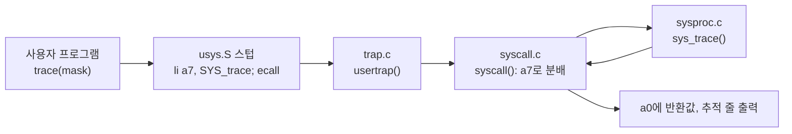

# HW2 과제 해설 — trace 시스템 콜 추가

[레포지토리 안내](../../README.ko.md) | [English](Assignment-Explanation.md) | [한국어](Assignment-Explanation.ko.md)

> **최종 수정일:** 2026-11-16
>
> xv6: a simple, Unix-like teaching operating system, Cox, Kaashoek, and Morris, Ch 2, 4

> **학습 목표:**
> 1. xv6에서 사용자 프로그램의 시스템 콜이 커널의 처리 함수에 도달하기까지 거치는 경로를 설명할 수 있다
> 2. 새 시스템 콜을 번호, 사용자 스텁, 선언, 분배 테이블, 처리 함수에 등록하는 단계를 나열할 수 있다
> 3. 비트마스크로 시스템 콜마다 추적 여부를 나타내고 검사할 수 있다
> 4. 프로세스별 커널 상태가 `fork()`에서 상속되고 슬롯을 다시 쓸 때 초기화되어야 하는 이유를 설명할 수 있다
> 5. 커널이 모은 정보를 사용자 공간의 버퍼로 안전하게 전달하는 방법을 설명할 수 있다

---

## 목차

- [1. 과제 개요](#1-과제-개요)
- [2. 요구사항](#2-요구사항)
  - [2.1 trace 시스템 콜](#21-trace-시스템-콜)
  - [2.2 sysinfo 시스템 콜 (보너스)](#22-sysinfo-시스템-콜-보너스)
  - [2.3 채점 기준](#23-채점-기준)
- [3. 시스템 콜의 경로](#3-시스템-콜의-경로)
- [4. trace의 구현](#4-trace의-구현)
  - [4.1 번호, 사용자 스텁, 선언](#41-번호-사용자-스텁-선언)
  - [4.2 프로세스 구조체의 필드](#42-프로세스-구조체의-필드)
  - [4.3 처리 함수](#43-처리-함수)
  - [4.4 분배 테이블과 추적 출력](#44-분배-테이블과-추적-출력)
  - [4.5 fork와 freeproc](#45-fork와-freeproc)
- [5. sysinfo의 구현](#5-sysinfo의-구현)
  - [5.1 구조체와 보조 함수](#51-구조체와-보조-함수)
  - [5.2 처리 함수와 커널과 사용자의 경계](#52-처리-함수와-커널과-사용자의-경계)
- [6. 빌드와 테스트](#6-빌드와-테스트)
- [요약](#요약)
- [점검 문제](#점검-문제)

---

<br>

## 1. 과제 개요

> **풀어 보기:** 이 문서는 정답과 풀이를 담고 있다. 먼저 [과제 안내문](Original/Assignment.ko.md)의 문제를 직접 풀어 본 뒤 읽는다.

과제는 MIT 6.1810의 System Calls 실습을 바탕으로 xv6에 시스템 콜을 더하는 문제이다. 필수 과제는 호출한 프로세스의 시스템 콜을 추적하는 `trace(int mask)`이고, 보너스 과제는 빈 메모리의 양과 사용 중인 프로세스의 수를 돌려주는 `sysinfo(struct sysinfo *)`이다. 3주차 실습에서 사용자 프로그램부터 커널까지 따라간 시스템 콜 경로가 바탕이 된다. 문제의 원문은 [과제 안내문](Original/Assignment.ko.md)에 있고, 배포된 테스트 프로그램 `trace_test.c`와 TODO 주석이 들어 있는 패치 `trace.patch`는 `Original/`에 원본 그대로 있다. 제출물은 xv6 작업 트리의 `git diff`인 `Solution/trace.patch` 하나이다.

```text
Coursework/HW02_Process-2/
├── Assignment-Explanation.ko.md    # 과제 해설 (한국어, 이 문서)
├── Assignment-Explanation.md       # 과제 해설 (영어)
├── Code-Walkthrough.ko.md          # 코드 총정리 (한국어)
├── Code-Walkthrough.md             # 코드 총정리 (영어)
├── Original/
│   ├── Assignment.ko.md            # 과제 안내문 (한국어)
│   ├── Assignment.md               # 과제 안내문 (영어)
│   ├── trace.patch                 # 배포된 패치 (TODO 주석)
│   └── trace_test.c                # 배포된 테스트 프로그램
└── Solution/
    └── trace.patch                 # 제출한 커널 패치
```

*그림 1. HW2 과제의 디렉토리 구성*

---

<br>

## 2. 요구사항

### 2.1 trace 시스템 콜

`trace(int mask)`는 호출한 프로세스의 시스템 콜 추적을 켠다. `mask`는 추적할 시스템 콜의 비트마스크이며, 번호 `n`인 시스템 콜을 추적하려면 비트 `(1 << n)`을 켠다. 추적 대상인 시스템 콜이 호출될 때마다 커널은 `<pid>: syscall <syscall_name> -> <return_value>` 형식의 줄을 출력해야 한다. `fork()`로 만든 자식은 부모의 마스크를 상속하고, `trace(0)`은 추적을 끈다.

과제는 일곱 단계의 구현 안내를 준다. `SYS_trace`를 22번으로 정의하고(1단계), `user/usys.pl`과 `user/user.h`에 사용자 쪽 스텁과 선언을 더하며(2단계), `struct proc`에 `trace_mask` 필드를 둔다(3단계). `sys_trace()`는 `argint()`로 마스크를 읽어 저장하고 0을 반환한다(4단계). `kernel/syscall.c`에는 원형, `syscalls[]` 항목, 시스템 콜 이름 배열 `syscall_names[]`를 더하고, `syscall()`이 처리 함수를 실행한 뒤 해당 비트가 켜져 있으면 추적 줄을 출력하게 한다(5단계). 반환값 `p->trapframe->a0`은 `uint64`이므로 `%d`로 출력하려면 `(int)`로 캐스트해야 하며, 그러지 않으면 `-Werror` 때문에 컴파일 오류가 된다. 마지막으로 `kfork()`가 마스크를 자식에게 복사하고(6단계), `freeproc()`이 마스크를 0으로 되돌린다(7단계).

배포된 `Original/trace.patch`는 1\~3단계(번호, 스텁, 선언, 필드)와 5단계의 원형과 테이블 항목을 이미 담고 있고, `sys_trace()`의 본문, 시스템 콜 이름 배열, `syscall()`의 추적 로직, `kfork()`의 복사, `freeproc()`의 초기화 자리에는 TODO 주석만 넣어 둔 패치이다. 테스트는 `trace_test.c`를 `user/`에 복사하고 `Makefile`의 `UPROGS`에 더한 뒤 xv6 셸에서 실행하며, 테스트 4개가 모두 `PASSED`를 출력해야 한다.

### 2.2 sysinfo 시스템 콜 (보너스)

`sysinfo(struct sysinfo *)`는 현재 시스템 상태를 돌려준다. `kernel/sysinfo.h`에 `uint64` 필드 `freemem`(사용 가능한 메모리의 바이트 수)과 `nproc`(state가 `UNUSED`가 아닌 프로세스의 수)을 가진 `struct sysinfo`를 정의하고, `SYS_sysinfo`를 23번으로 등록한다. `kernel/kalloc.c`의 `freemem_count()`는 free list를 순회하여 빈 페이지 수에 `PGSIZE`를 곱한 값을, `kernel/proc.c`의 `proc_count()`는 `proc[]`에서 `UNUSED`가 아닌 프로세스의 수를 반환한다. `sys_sysinfo()`는 `argaddr()`로 받은 사용자 포인터에 구조체를 `copyout()`으로 복사한다. 과제는 `sys_fstat()`의 구현 방식을 참고하라고 한다.

### 2.3 채점 기준

| 항목 | 배점 |
|:-----|-----:|
| `trace` 시스템 콜의 등록 (컴파일 성공) | 20점 |
| `sys_trace()`의 구현과 마스크 저장 | 20점 |
| `syscall()`의 올바른 형식의 추적 출력 | 30점 |
| `fork()`에서 trace_mask 상속 | 20점 |
| 코드 스타일과 주석 | 10점 |
| (보너스) `sysinfo` 시스템 콜 | +10점 |

*표 1. 채점 기준*

---

<br>

## 3. 시스템 콜의 경로

`trace()` 호출은 3주차 실습에서 따라간 경로를 그대로 지난다. 사용자 프로그램이 `trace(mask)`를 호출하면 빌드 때 `usys.pl`이 만든 `usys.S`의 스텁이 시스템 콜 번호를 레지스터 a7에 넣고 `ecall`을 실행한다. `ecall`은 사용자 모드에서 슈퍼바이저 모드로 넘어가는 트랩을 일으키고, `trap.c`의 `usertrap()`이 그 트랩을 처리하여 `syscall.c`의 `syscall()`을 부른다. `syscall()`은 트랩 프레임에서 a7을 읽고 함수 포인터 배열 `syscalls[]`로 `sysproc.c`의 `sys_trace()`를 호출하며, 반환값을 트랩 프레임의 a0에 넣는다. 사용자 프로그램으로 돌아가면 a0이 `trace()`의 반환값이 된다.



*그림 2. trace() 호출이 커널의 처리 함수에 이르는 경로*

이 구조는 이중 모드 연산의 구체적인 모습이다. 시스템 콜 인터페이스는 커널로 들어가는 통제된 입구를 하나 두어, 특권이 없는 프로세스가 특권 연산을 직접 실행하지 못하게 한다. 사용자 프로그램이 커널에 전달할 수 있는 것은 레지스터에 담은 번호와 인자뿐이고, 무엇을 실행할지는 커널의 분배 테이블이 정한다.

---

<br>

## 4. trace의 구현

### 4.1 번호, 사용자 스텁, 선언

1, 2단계는 새 시스템 콜에 번호를 주고 사용자 프로그램이 부를 수 있게 하라고 요구한다. 패치는 `kernel/syscall.h`에 두 번호를 정의한다(183\~184번 줄).

```diff
 #define SYS_link   19
 #define SYS_mkdir  20
 #define SYS_close  21
+#define SYS_trace  22
+#define SYS_sysinfo 23
```

`user/usys.pl`에 더한 `entry("trace");`(449번 줄)는 빌드할 때 22를 a7에 넣고 `ecall`을 실행하는 어셈블리 스텁을 만들고, `user/user.h`의 `int trace(int);`(435번 줄)는 사용자 프로그램이 이 함수를 C에서 부를 수 있게 하는 원형이다. 같은 자리에 보너스의 `sysinfo` 항목과 선언도 함께 들어 있다(436\~437, 450번 줄).

### 4.2 프로세스 구조체의 필드

3단계는 프로세스마다 추적 마스크를 저장할 자리를 요구한다. 패치는 `struct proc`의 끝에 `int trace_mask`를 더한다(112번 줄). 각 비트의 위치가 시스템 콜 번호에 대응하므로, 예를 들어 비트 1을 켜면 `fork`(`SYS_fork = 1`)를 추적한다.

```diff
@@ -104,4 +104,5 @@ struct proc {
   struct file *ofile[NOFILE];  // Open files
   struct inode *cwd;           // Current directory
   char name[16];               // Process name (debugging)
+  int trace_mask;              // Trace syscall mask
 };
```

`trace_mask`는 커널이 프로세스마다 유지하는 상태에 합류한다. 같은 구조체에는 생애 주기를 나타내는 `state`(`UNUSED`, `USED`, `RUNNABLE`, `RUNNING`, `ZOMBIE`와 대기 중인 `SLEEPING`), 저장된 사용자 레지스터인 `trapframe`(a7에 시스템 콜 번호, a0에 반환값), `swtch()`가 쓰는 커널 레지스터 `context`, 열린 파일 `ofile[]`, 부모 포인터 `parent`가 있다. 이 상태들은 모두 프로세스가 `UNUSED`로 돌아갈 때 정리되어야 다음에 그 슬롯을 받는 프로세스가 깨끗한 상태에서 시작한다(4.5절).

### 4.3 처리 함수

4단계는 `sys_trace()`가 첫 번째 인자를 읽어 현재 프로세스의 `trace_mask`에 저장하고 0을 반환하라고 요구한다.

```diff
+// sys_trace: set the trace mask for the current process
+uint64
+sys_trace(void)
+{
+  int mask;
+
+  argint(0, &mask);
+  myproc()->trace_mask = mask;
+  return 0;
+}
```

`argint(0, &mask)`는 트랩 프레임의 a0 레지스터에 담겨 온 첫 번째 인자를 정수로 읽는다. 한 개의 정수 인자를 읽는 방식이 `sys_kill()`과 같다. `myproc()`은 지금 이 CPU에서 실행 중인 프로세스, 곧 `trace()`를 부른 프로세스를 가리키므로 마스크는 호출한 프로세스에만 적용된다.

### 4.4 분배 테이블과 추적 출력

5단계는 분배 테이블에 처리 함수를 등록하고, 시스템 콜의 이름 배열을 두며, `syscall()`에서 추적 줄을 출력하라고 요구한다. 패치는 원형 두 줄(122\~123번 줄)을 더하고, `syscalls[]`에 두 항목(131\~132번 줄)을, 그 아래에 이름 배열 `syscall_names[]`(135\~160번 줄)를 둔다.

```diff
@@ -126,6 +128,35 @@ static uint64 (*syscalls[])(void) = {
 [SYS_link]    sys_link,
 [SYS_mkdir]   sys_mkdir,
 [SYS_close]   sys_close,
+[SYS_trace]   sys_trace,
+[SYS_sysinfo] sys_sysinfo,
+};
+
+// Syscall name string array (for trace output)
+static char *syscall_names[] = {
+[SYS_fork]    "fork",
+[SYS_exit]    "exit",
+[SYS_wait]    "wait",
+[SYS_pipe]    "pipe",
+[SYS_read]    "read",
+[SYS_kill]    "kill",
+[SYS_exec]    "exec",
+[SYS_fstat]   "fstat",
+[SYS_chdir]   "chdir",
+[SYS_dup]     "dup",
+[SYS_getpid]  "getpid",
+[SYS_sbrk]    "sbrk",
+[SYS_pause]   "pause",
+[SYS_uptime]  "uptime",
+[SYS_open]    "open",
+[SYS_write]   "write",
+[SYS_mknod]   "mknod",
+[SYS_unlink]  "unlink",
+[SYS_link]    "link",
+[SYS_mkdir]   "mkdir",
+[SYS_close]   "close",
+[SYS_trace]   "trace",
+[SYS_sysinfo] "sysinfo",
 };
```

두 배열은 `[SYS_fork] "fork"`처럼 첨자를 지정하는 초기화로 시스템 콜 번호를 첨자로 쓰므로, 같은 번호로 처리 함수와 이름을 함께 찾을 수 있다. 0번 칸은 쓰지 않는다. diff에서 `};`가 두 번 보이는 것은 `syscalls[]`를 닫는 기존의 `};` 뒤에 새 배열을 끼워 넣은 결과를 diff가 그렇게 표시하기 때문이다.

```diff
@@ -139,6 +170,11 @@ syscall(void)
     // Use num to lookup the system call function for num, call it,
     // and store its return value in p->trapframe->a0
     p->trapframe->a0 = syscalls[num]();
+
+    // Trace: if the bit for this syscall is set, print trace info
+    if(p->trace_mask & (1 << num)) {
+      printf("%d: syscall %s -> %d\n", p->pid, syscall_names[num], (int)p->trapframe->a0);
+    }
   } else {
     printf("%d %s: unknown sys call %d\n",
             p->pid, p->name, num);
```

추적 검사는 처리 함수가 반환한 뒤에 들어간다(168\~171번 줄). 반환값이 `p->trapframe->a0`에 저장된 다음이므로 그 값을 함께 출력할 수 있다. `p->trace_mask & (1 << num)`이 0이 아니면 그 시스템 콜의 비트가 켜진 것이고, `%d`에 맞추어 `uint64`를 `(int)`로 캐스트한다. 음수 오류 코드인 -1도 이 캐스트 덕분에 `-1`로 출력된다.

> **참고:** 출력 위치가 처리 함수 뒤이므로 반환하지 않는 시스템 콜은 추적 줄이 없다. `exit`은 프로세스를 끝내고 돌아오지 않으므로 `trace`로 켜도 출력되지 않는다. `fork`는 부모 쪽 호출만 `syscall()`로 돌아오고, 자식은 `forkret()`에서 곧바로 사용자 공간으로 가므로 추적 줄은 부모의 것 하나만 나온다.

### 4.5 fork와 freeproc

6, 7단계는 자식이 부모의 마스크를 상속하고, 프로세스 슬롯을 회수할 때 마스크를 지우라고 요구한다.

```diff
@@ -169,6 +169,7 @@ freeproc(struct proc *p)
   p->killed = 0;
   p->xstate = 0;
   p->state = UNUSED;
+  p->trace_mask = 0;
 }
 
 // Create a user page table for a given process, with no user memory,
@@ -282,6 +283,9 @@ kfork(void)
   // Cause fork to return 0 in the child.
   np->trapframe->a0 = 0;
 
+  // Copy trace_mask from parent to child
+  np->trace_mask = p->trace_mask;
+
   // increment reference counts on open file descriptors.
   for(i = 0; i < NOFILE; i++)
     if(p->ofile[i])
```

`kfork()`는 다섯 단계로 자식을 만든다. `allocproc()`이 새 슬롯, PID, 커널 스택, 트랩 프레임을 마련하고, `uvmcopy()`가 부모의 페이지 테이블과 메모리를 복제하며, 트랩 프레임을 복사한 뒤 자식 쪽 a0을 0으로 두어 자식에서 `fork()`가 0을 반환하게 하고, 마지막으로 파일 디스크립터의 참조 수를 늘린다. 패치는 네 번째와 다섯 번째 단계 사이에 `np->trace_mask = p->trace_mask;`를 넣는다(75\~76번 줄). Unix의 `fork()`가 부모의 거의 정확한 복사본을 만드는 것처럼 마스크도 복사되므로, 자식도 같은 시스템 콜을 계속 추적한다. 셸의 파이프라인처럼 여러 프로세스로 이루어진 프로그램을 추적하려면 이 상속이 필요하다.

`freeproc()`의 `p->trace_mask = 0;`(67번 줄)은 프로세스가 `UNUSED`로 돌아갈 때 필드를 지운다. 이 줄이 없으면 회수된 슬롯을 다음에 받은 프로세스가 앞 프로세스의 마스크를 물려받아, `trace()`를 부른 적이 없는데도 추적 줄을 출력할 수 있다.

---

<br>

## 5. sysinfo의 구현

### 5.1 구조체와 보조 함수

보너스 과제는 `struct sysinfo`와 두 보조 함수를 요구한다. 새 헤더 `kernel/sysinfo.h`는 `uint64` 필드 두 개를 가진 구조체를 정의한다(191\~194번 줄).

```diff
diff --git a/kernel/sysinfo.h b/kernel/sysinfo.h
new file mode 100644
index 0000000..d7eab3f
--- /dev/null
+++ b/kernel/sysinfo.h
@@ -0,0 +1,4 @@
+struct sysinfo {
+  uint64 freemem;   // Available memory (bytes)
+  uint64 nproc;     // Number of active processes (state != UNUSED)
+};
```

`freemem_count()`는 `kernel/kalloc.c`의 끝에 더했다(42\~58번 줄).

```diff
@@ -80,3 +80,21 @@ kalloc(void)
     memset((char*)r, 5, PGSIZE); // fill with junk
   return (void*)r;
 }
+
+// Count the number of bytes of free memory
+uint64
+freemem_count(void)
+{
+  struct run *r;
+  uint64 count = 0;
+
+  acquire(&kmem.lock);
+  r = kmem.freelist;
+  while(r) {
+    count++;
+    r = r->next;
+  }
+  release(&kmem.lock);
+
+  return count * PGSIZE;
+}
```

`kernel/kalloc.c`에 더한 `freemem_count()`는 빈 페이지 목록을 지키는 스핀락 `kmem.lock`을 잡고, 단일 연결 리스트 `kmem.freelist`를 따라가며 빈 페이지를 센 뒤 락을 풀고 개수에 `PGSIZE`(4,096바이트)를 곱해 반환한다. 순회하는 동안 락을 잡고 있으므로 다른 CPU의 `kalloc()`이나 `kfree()`가 리스트를 바꾸지 못한다.

```diff
+// Count the number of active processes (state != UNUSED)
+uint64
+proc_count(void)
+{
+  struct proc *p;
+  uint64 count = 0;
+
+  for(p = proc; p < &proc[NPROC]; p++) {
+    acquire(&p->lock);
+    if(p->state != UNUSED)
+      count++;
+    release(&p->lock);
+  }
+  return count;
+}
```

`kernel/proc.c`에 더한 `proc_count()`는 `proc[NPROC]` 배열을 돌며 프로세스마다 락을 잡고 `state`를 읽어, `UNUSED`가 아닌 항목을 센다. 두 함수의 원형은 `kernel/defs.h`에 더했다(21, 29번 줄).

### 5.2 처리 함수와 커널과 사용자의 경계

`sys_sysinfo()`는 사용자 포인터를 받고, 두 보조 함수로 지역 구조체를 채운 뒤 사용자 공간으로 복사해야 한다.

```diff
+// sys_sysinfo: collect system information and copy to user space
+uint64
+sys_sysinfo(void)
+{
+  uint64 addr;
+  struct sysinfo info;
+  struct proc *p = myproc();
+
+  argaddr(0, &addr);
+
+  info.freemem = freemem_count();
+  info.nproc = proc_count();
+
+  if(copyout(p->pagetable, addr, (char *)&info, sizeof(info)) < 0)
+    return -1;
+  return 0;
+}
```

`argaddr(0, &addr)`는 첫 번째 인자를 주소로 읽는다. 이 주소는 사용자 프로세스의 가상 주소이므로 커널이 그대로 역참조할 수 없다. `copyout()`은 프로세스의 사용자 페이지 테이블을 걸어 가상 주소를 물리 주소로 바꾸면서 커널의 데이터를 복사하고, 주소가 사용자 공간에 올바르게 매핑되어 있지 않으면 -1을 반환한다. 처리 함수는 이때 -1을, 성공하면 0을 반환한다. 커널에서 사용자로 데이터를 넘기는 이 방식은 `sys_fstat()`과 같으며, 커널 모드와 사용자 모드 사이의 메모리 보호 경계를 지킨다. 5.1절의 두 보조 함수가 스핀락으로 순회를 보호하는 것도 같은 맥락에서, 여러 CPU가 공유하는 커널 자료구조에 안전하게 접근하기 위한 것이다.

---

<br>

## 6. 빌드와 테스트

패치는 xv6 작업 트리의 `git diff`이므로 같은 기준 커밋의 xv6에 `git apply`로 적용하며, 이 레포지토리의 `Coursework/xv6-riscv` 서브모듈이 그 커밋(`5474d4b`)을 가리키므로 레포지토리 루트에서 다음과 같이 적용한다. 패치가 `user/trace_test.c`를 새 파일로 더하고 `Makefile`의 `UPROGS`에 `$U/_trace_test`를 넣으므로(9번 줄) 따로 복사할 필요가 없다.

```bash
git submodule update --init Coursework/xv6-riscv
cd Coursework/xv6-riscv
git apply ../HW02_Process-2/Solution/trace.patch
make clean && make qemu
# xv6 셸에서
$ trace_test
```

> **참고:** 과제 당시보다 새로운 RISC-V 컴파일러에서는 패치와 상관없는 `user/usertests.c`의 `unused-but-set-variable` 경고가 `-Werror` 때문에 빌드를 멈출 수 있다. 이때는 `Makefile`의 `CFLAGS`에 `-Wno-error=unused-but-set-variable`을 더하면 빌드된다.

패치를 적용한 xv6를 CPU 하나(`CPUS=1`)로 실행하고 `trace_test`를 입력한 출력은 다음과 같다.

```text
$ trace_test
========================================
  trace system call test suite
========================================

=== Test 1: trace fork ===
3: syscall fork -> 4
Test 1 PASSED

=== Test 2: trace read/write ===
3: syscall write -> 5
3: syscall read -> 5
Test 2 PASSED

=== Test 3: trace multiple syscalls ===
3: syscall getpid -> 3
m3: syscall write -> 1
y3: syscall write -> 1
 3: syscall write -> 1
p3: syscall write -> 1
i3: syscall write -> 1
d3: syscall write -> 1
 3: syscall write -> 1
i3: syscall write -> 1
s3: syscall write -> 1
 3: syscall write -> 1
33: syscall write -> 1

3: syscall write -> 1
3: syscall fork -> 5
Test 3 PASSED

=== Test 4: trace inheritance ===
6: syscall write -> 2
3: syscall read -> 2
Test 4 PASSED

=== Test 5: trace disabled ===
Test 5 PASSED (no trace output above means success)

All tests passed!
Test 5 PASSED (no trace output above means success)

All tests passed!
```

배포된 테스트 4개와 테스트 프로그램에 함께 들어 있는 테스트 5가 모두 `PASSED`를 출력한다. 테스트 1의 추적 줄은 부모(PID 3)의 `fork`가 자식의 PID 4를 반환한 것이고, 테스트 2는 파이프에 5바이트를 쓰고 읽은 두 호출이다. 테스트 4의 `6: syscall write -> 2`는 `trace()`를 부르지 않은 자식(PID 6)의 출력이므로 마스크가 `fork()`로 상속되었음을 보여 준다.

출력의 두 가지 특징은 테스트 프로그램 쪽에서 비롯된다. 테스트 3에서 `write`가 켜진 채로 `printf("my pid is %d\n", pid)`를 부르면, xv6의 사용자 `printf()`는 한 글자마다 `write()`를 한 번씩 호출하므로 `my pid is 3`과 개행 문자의 12글자가 추적 줄 사이에 한 글자씩 끼어 나온다. 테스트 5는 `fork()`의 반환값을 검사하지 않아 자식도 `main()`의 나머지를 실행하므로, 마지막 두 줄이 자식과 부모에서 한 번씩 출력된다.

배포된 테스트는 `trace`만 검사하며, `sysinfo`를 검사하는 프로그램은 배포되지 않았다.

---

<br>

## 요약

| 개념 | 핵심 요약 |
|:-----|:-----|
| 시스템 콜 경로 | 사용자 스텁이 번호를 a7에 넣고 `ecall`로 트랩을 일으키면 `usertrap()`과 `syscall()`을 거쳐 분배 테이블의 처리 함수가 실행되고, 반환값은 a0으로 돌아간다. |
| 등록 단계 | 새 시스템 콜에는 `syscall.h`의 번호, `usys.pl`의 스텁, `user.h`의 선언, `syscall.c`의 원형과 테이블 항목, `sysproc.c`의 처리 함수가 모두 필요하다. |
| 비트마스크 | 시스템 콜 번호 `n`을 비트 위치로 써서 `trace_mask & (1 << n)`으로 추적 여부를 검사한다. |
| 추적 출력 | 처리 함수가 반환한 뒤 a0의 값을 `(int)`로 캐스트해 출력하므로, 반환하지 않는 `exit`과 자식 쪽 `fork`는 출력되지 않는다. |
| 상속과 초기화 | `kfork()`가 마스크를 자식에게 복사하고 `freeproc()`이 0으로 되돌려, 자식은 추적을 이어 가고 재사용된 슬롯은 깨끗하게 시작한다. |
| sysinfo | 락을 잡고 free list와 `proc[]`를 세어 구조체를 채운 뒤, `copyout()`이 사용자 페이지 테이블로 주소를 변환하며 사용자 버퍼에 복사한다. |
| 테스트 결과 | 패치를 적용한 xv6에서 `trace_test`의 테스트가 모두 통과하며, 자식의 추적 줄로 마스크의 상속이 확인된다. |

---

<br>

## 점검 문제

1. **마스크 계산:** `read`(5번)와 `write`(16번)를 함께 추적하려면 `trace()`에 넘길 마스크를 16진수로 쓰라.

   <details>
   <summary>정답</summary>

   `(1 << 5) | (1 << 16)` = 0x20 | 0x10000 = 0x10020이다.

   </details>

2. **추적 위치:** 추적 검사를 처리 함수를 호출하기 전에 두면 어떤 문제가 생기는지 쓰라.

   <details>
   <summary>정답</summary>

   출력 형식에는 반환값이 들어가야 하는데, 처리 함수를 호출하기 전에는 반환값이 아직 없다. 그 시점의 `p->trapframe->a0`에는 사용자가 넘긴 첫 번째 인자가 들어 있으므로, 출력되는 값은 반환값이 아니라 인자가 된다.

   </details>

3. **freeproc의 초기화:** `freeproc()`에서 `p->trace_mask = 0;`을 빠뜨리면 어떤 일이 생길 수 있는지 쓰라.

   <details>
   <summary>정답</summary>

   추적을 켠 프로세스가 끝나 슬롯이 `UNUSED`로 돌아가도 마스크가 남는다. `allocproc()`은 이 필드를 초기화하지 않으므로, 그 슬롯을 다음에 받은 프로세스는 `trace()`를 부른 적이 없어도 앞 프로세스의 마스크로 추적 줄을 출력할 수 있다.

   </details>

4. **copyout이 필요한 이유:** `sys_sysinfo()`가 `copyout()` 대신 `*(struct sysinfo *)addr = info;`로 복사하면 안 되는 이유를 쓰라.

   <details>
   <summary>정답</summary>

   `addr`는 사용자 프로세스의 가상 주소이고, 커널은 커널 페이지 테이블로 실행되므로 이 주소를 역참조하면 사용자의 버퍼가 아닌 다른 곳을 가리키거나 매핑이 없어 커널 패닉이 난다. `copyout()`은 그 프로세스의 사용자 페이지 테이블로 주소를 물리 주소로 바꾸고, 매핑이 올바르지 않으면 -1을 반환하여 잘못된 포인터를 안전하게 거부한다.

   </details>
