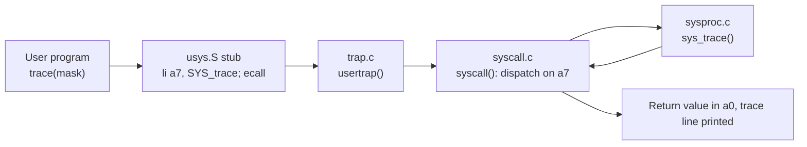

# HW2 Assignment Explanation — Adding the trace System Call

[Repository Guide](../../README.md) | [English](Assignment-Explanation.md) | [한국어](Assignment-Explanation.ko.md)

> **Last Updated:** 2026-11-16
>
> xv6: a simple, Unix-like teaching operating system, Cox, Kaashoek, and Morris, Ch 2, 4

> **Learning Objectives:**
> 1. Explain the path that a system call from a user program in xv6 takes to reach the handler in the kernel
> 2. List the steps of registering a new system call in the number definitions, the user stub, the declaration, the dispatch table, and the handler
> 3. Represent and test with a bitmask whether each system call is traced
> 4. Explain why per-process kernel state must be inherited across `fork()` and reset when a slot is reused
> 5. Explain how the kernel safely delivers information it has gathered to a buffer in user space

---

## Table of Contents

- [1. Assignment Overview](#1-assignment-overview)
- [2. Requirements](#2-requirements)
  - [2.1 The trace System Call](#21-the-trace-system-call)
  - [2.2 The sysinfo System Call (Bonus)](#22-the-sysinfo-system-call-bonus)
  - [2.3 Grading Criteria](#23-grading-criteria)
- [3. The Path of a System Call](#3-the-path-of-a-system-call)
- [4. Implementing trace](#4-implementing-trace)
  - [4.1 Number, User Stub, and Declaration](#41-number-user-stub-and-declaration)
  - [4.2 The Field in the Process Structure](#42-the-field-in-the-process-structure)
  - [4.3 The Handler](#43-the-handler)
  - [4.4 Dispatch Table and Trace Output](#44-dispatch-table-and-trace-output)
  - [4.5 fork and freeproc](#45-fork-and-freeproc)
- [5. Implementing sysinfo](#5-implementing-sysinfo)
  - [5.1 The Structure and Helper Functions](#51-the-structure-and-helper-functions)
  - [5.2 The Handler and the Kernel-User Boundary](#52-the-handler-and-the-kernel-user-boundary)
- [6. Build and Test](#6-build-and-test)
- [Summary](#summary)
- [Self-Check Questions](#self-check-questions)

---

<br>

## 1. Assignment Overview

> **Try It First:** This document contains the answers and solutions. Solve the problems in the [assignment handout](Original/Assignment.md) yourself before reading on.

The assignment, based on the System Calls lab of MIT 6.1810, adds system calls to xv6. The required task is `trace(int mask)`, which traces the system calls of the calling process, and the bonus task is `sysinfo(struct sysinfo *)`, which returns the amount of free memory and the number of processes in use. It builds on the system call path followed from the user program to the kernel in the Week 3 lab. The original problem is in the [assignment handout](Original/Assignment.md), and the distributed test program `trace_test.c` and the patch `trace.patch` with TODO comments are in `Original/` as distributed. The submission is a single file, `Solution/trace.patch`, the `git diff` of the xv6 working tree.

```text
Coursework/HW02_Process-2/
├── Assignment-Explanation.ko.md    # Assignment explanation (Korean)
├── Assignment-Explanation.md       # Assignment explanation (English, this document)
├── Code-Walkthrough.ko.md          # Code walkthrough (Korean)
├── Code-Walkthrough.md             # Code walkthrough (English)
├── Original/
│   ├── Assignment.ko.md            # Assignment handout (Korean)
│   ├── Assignment.md               # Assignment handout (English)
│   ├── trace.patch                 # Distributed patch (TODO comments)
│   └── trace_test.c                # Distributed test program
└── Solution/
    └── trace.patch                 # Submitted kernel patch
```

*Figure 1. Directory layout of HW2*

---

<br>

## 2. Requirements

### 2.1 The trace System Call

`trace(int mask)` enables system call tracing for the calling process. `mask` is a bitmask of the system calls to trace; to trace the system call with number `n`, bit `(1 << n)` is set. Each time a traced system call is invoked, the kernel must print a line of the form `<pid>: syscall <syscall_name> -> <return_value>`. A child created by `fork()` inherits the parent's mask, and `trace(0)` disables tracing.

The assignment gives a seven-step implementation guide. `SYS_trace` is defined as 22 (Step 1), the user-side stub and declaration are added to `user/usys.pl` and `user/user.h` (Step 2), and `struct proc` gets a `trace_mask` field (Step 3). `sys_trace()` reads the mask with `argint()`, stores it, and returns 0 (Step 4). `kernel/syscall.c` gets the prototype, the `syscalls[]` entry, and the name array `syscall_names[]`, and `syscall()` prints the trace line after running the handler if the corresponding bit is set (Step 5). Since the return value `p->trapframe->a0` is a `uint64`, it must be cast to `(int)` to be printed with `%d`; otherwise `-Werror` turns the warning into a compilation error. Finally, `kfork()` copies the mask to the child (Step 6), and `freeproc()` resets the mask to 0 (Step 7).

The distributed `Original/trace.patch` already contains Steps 1-3 (number, stub, declaration, field) and the prototype and table entry of Step 5, and puts only TODO comments in the places for the body of `sys_trace()`, the system call name array, the trace logic of `syscall()`, the copy in `kfork()`, and the reset in `freeproc()`. For testing, `trace_test.c` is copied to `user/`, added to `UPROGS` in the `Makefile`, and run in the xv6 shell, and all 4 tests must print `PASSED`.

### 2.2 The sysinfo System Call (Bonus)

`sysinfo(struct sysinfo *)` returns the current state of the system. A `struct sysinfo` with the `uint64` fields `freemem` (the number of bytes of available memory) and `nproc` (the number of processes whose state is not `UNUSED`) is defined in `kernel/sysinfo.h`, and `SYS_sysinfo` is registered as number 23. `freemem_count()` in `kernel/kalloc.c` traverses the free list and returns the number of free pages times `PGSIZE`, and `proc_count()` in `kernel/proc.c` returns the number of processes in `proc[]` that are not `UNUSED`. `sys_sysinfo()` copies the structure with `copyout()` to the user pointer received with `argaddr()`. The assignment suggests following the implementation pattern of `sys_fstat()`.

### 2.3 Grading Criteria

| Item | Score |
|:-----|-----:|
| Registration of the `trace` system call (compilation success) | 20 points |
| Implementation of `sys_trace()` and mask storage | 20 points |
| Trace output of `syscall()` in the correct format | 30 points |
| Inheritance of trace_mask on `fork()` | 20 points |
| Code style and comments | 10 points |
| (Bonus) `sysinfo` system call | +10 points |

*Table 1. Grading criteria*

---

<br>

## 3. The Path of a System Call

A call to `trace()` follows exactly the path traced in the Week 3 lab. When the user program calls `trace(mask)`, the stub in `usys.S`, generated by `usys.pl` at build time, puts the system call number in register a7 and executes `ecall`. `ecall` raises a trap from user mode to supervisor mode, and `usertrap()` in `trap.c` handles the trap and calls `syscall()` in `syscall.c`. `syscall()` reads a7 from the trapframe, calls `sys_trace()` in `sysproc.c` through the function pointer array `syscalls[]`, and puts the return value in a0 of the trapframe. On returning to the user program, a0 becomes the return value of `trace()`.



*Figure 2. Path of a trace() call to the kernel handler*

This structure is a concrete form of dual-mode operation. The system call interface provides a single controlled entry point into the kernel, so that unprivileged processes cannot execute privileged operations directly. All a user program can pass to the kernel is a number and arguments in registers, and the kernel's dispatch table decides what is executed.

---

<br>

## 4. Implementing trace

### 4.1 Number, User Stub, and Declaration

Steps 1 and 2 require giving the new system call a number and making it callable from user programs. The patch defines the two numbers in `kernel/syscall.h` (lines 183-184).

```diff
 #define SYS_link   19
 #define SYS_mkdir  20
 #define SYS_close  21
+#define SYS_trace  22
+#define SYS_sysinfo 23
```

The `entry("trace");` added to `user/usys.pl` (line 449) generates, at build time, an assembly stub that puts 22 in a7 and executes `ecall`, and `int trace(int);` in `user/user.h` (line 435) is the prototype that lets user programs call this function from C. The same places also hold the entry and declaration for the bonus `sysinfo` (lines 436-437 and 450).

### 4.2 The Field in the Process Structure

Step 3 requires a place to store a trace mask for each process. The patch appends `int trace_mask` to `struct proc` (line 112). Each bit position corresponds to a system call number, so setting bit 1, for example, traces `fork` (`SYS_fork = 1`).

```diff
@@ -104,4 +104,5 @@ struct proc {
   struct file *ofile[NOFILE];  // Open files
   struct inode *cwd;           // Current directory
   char name[16];               // Process name (debugging)
+  int trace_mask;              // Trace syscall mask
 };
```

`trace_mask` joins the state the kernel keeps for each process. The same structure holds `state`, which marks the life cycle (`UNUSED`, `USED`, `RUNNABLE`, `RUNNING`, `ZOMBIE`, and `SLEEPING` while waiting), `trapframe`, the saved user registers (the system call number in a7 and the return value in a0), `context`, the kernel registers used by `swtch()`, the open files `ofile[]`, and the parent pointer `parent`. All of this state must be cleaned up when the process returns to `UNUSED`, so that the next process to receive that slot starts from a clean state (Section 4.5).

### 4.3 The Handler

Step 4 requires `sys_trace()` to read the first argument, store it in the current process's `trace_mask`, and return 0.

```diff
+// sys_trace: set the trace mask for the current process
+uint64
+sys_trace(void)
+{
+  int mask;
+
+  argint(0, &mask);
+  myproc()->trace_mask = mask;
+  return 0;
+}
```

`argint(0, &mask)` reads the first argument, carried in register a0 of the trapframe, as an integer. This way of reading a single integer argument is the same as in `sys_kill()`. Since `myproc()` refers to the process currently running on this CPU, that is, the process that called `trace()`, the mask applies only to the calling process.

### 4.4 Dispatch Table and Trace Output

Step 5 requires registering the handler in the dispatch table, keeping a name array of the system calls, and printing the trace line in `syscall()`. The patch adds two prototype lines (lines 122-123), two entries in `syscalls[]` (lines 131-132), and below them the name array `syscall_names[]` (lines 135-160).

```diff
@@ -126,6 +128,35 @@ static uint64 (*syscalls[])(void) = {
 [SYS_link]    sys_link,
 [SYS_mkdir]   sys_mkdir,
 [SYS_close]   sys_close,
+[SYS_trace]   sys_trace,
+[SYS_sysinfo] sys_sysinfo,
+};
+
+// Syscall name string array (for trace output)
+static char *syscall_names[] = {
+[SYS_fork]    "fork",
+[SYS_exit]    "exit",
+[SYS_wait]    "wait",
+[SYS_pipe]    "pipe",
+[SYS_read]    "read",
+[SYS_kill]    "kill",
+[SYS_exec]    "exec",
+[SYS_fstat]   "fstat",
+[SYS_chdir]   "chdir",
+[SYS_dup]     "dup",
+[SYS_getpid]  "getpid",
+[SYS_sbrk]    "sbrk",
+[SYS_pause]   "pause",
+[SYS_uptime]  "uptime",
+[SYS_open]    "open",
+[SYS_write]   "write",
+[SYS_mknod]   "mknod",
+[SYS_unlink]  "unlink",
+[SYS_link]    "link",
+[SYS_mkdir]   "mkdir",
+[SYS_close]   "close",
+[SYS_trace]   "trace",
+[SYS_sysinfo] "sysinfo",
 };
```

The two arrays use designated initializers such as `[SYS_fork] "fork"`, so the system call number is the index and the same number finds both the handler and the name. Slot 0 is unused. The `};` appears twice in the diff because that is how the diff shows the new array inserted after the existing `};` that closes `syscalls[]`.

```diff
@@ -139,6 +170,11 @@ syscall(void)
     // Use num to lookup the system call function for num, call it,
     // and store its return value in p->trapframe->a0
     p->trapframe->a0 = syscalls[num]();
+
+    // Trace: if the bit for this syscall is set, print trace info
+    if(p->trace_mask & (1 << num)) {
+      printf("%d: syscall %s -> %d\n", p->pid, syscall_names[num], (int)p->trapframe->a0);
+    }
   } else {
     printf("%d %s: unknown sys call %d\n",
             p->pid, p->name, num);
```

The trace check comes after the handler returns (lines 168-171). Because the return value has already been stored in `p->trapframe->a0`, it can be printed as well. If `p->trace_mask & (1 << num)` is nonzero, the bit of that system call is set, and the `uint64` is cast to `(int)` to match `%d`. Thanks to this cast, the negative error code -1 is also printed as `-1`.

> **Note:** Since the output comes after the handler, system calls that do not return produce no trace line. `exit` ends the process and does not come back, so it prints nothing even when enabled with `trace`. For `fork`, only the parent's call returns into `syscall()`, while the child goes straight to user space from `forkret()`, so only one trace line, the parent's, appears.

### 4.5 fork and freeproc

Steps 6 and 7 require the child to inherit the parent's mask and the mask to be cleared when a process slot is reclaimed.

```diff
@@ -169,6 +169,7 @@ freeproc(struct proc *p)
   p->killed = 0;
   p->xstate = 0;
   p->state = UNUSED;
+  p->trace_mask = 0;
 }
 
 // Create a user page table for a given process, with no user memory,
@@ -282,6 +283,9 @@ kfork(void)
   // Cause fork to return 0 in the child.
   np->trapframe->a0 = 0;
 
+  // Copy trace_mask from parent to child
+  np->trace_mask = p->trace_mask;
+
   // increment reference counts on open file descriptors.
   for(i = 0; i < NOFILE; i++)
     if(p->ofile[i])
```

`kfork()` creates a child in five steps: `allocproc()` sets up a new slot, a PID, a kernel stack, and a trapframe; `uvmcopy()` duplicates the parent's page table and memory; the trapframe is copied and the child's a0 is set to 0 so that `fork()` returns 0 in the child; and finally the reference counts of the file descriptors are incremented. The patch inserts `np->trace_mask = p->trace_mask;` between the fourth and fifth steps (lines 75-76). Just as Unix `fork()` makes a near-exact copy of the parent, the mask is copied too, so the child keeps tracing the same system calls. This inheritance is needed to trace programs made of several processes, such as shell pipelines.

`p->trace_mask = 0;` in `freeproc()` (line 67) clears the field when the process returns to `UNUSED`. Without this line, the next process to receive the reclaimed slot could inherit the previous process's mask and print trace lines even though it never called `trace()`.

---

<br>

## 5. Implementing sysinfo

### 5.1 The Structure and Helper Functions

The bonus task requires `struct sysinfo` and two helper functions. The new header `kernel/sysinfo.h` defines the structure with two `uint64` fields (lines 191-194).

```diff
diff --git a/kernel/sysinfo.h b/kernel/sysinfo.h
new file mode 100644
index 0000000..d7eab3f
--- /dev/null
+++ b/kernel/sysinfo.h
@@ -0,0 +1,4 @@
+struct sysinfo {
+  uint64 freemem;   // Available memory (bytes)
+  uint64 nproc;     // Number of active processes (state != UNUSED)
+};
```

`freemem_count()` is added at the end of `kernel/kalloc.c` (lines 42-58).

```diff
@@ -80,3 +80,21 @@ kalloc(void)
     memset((char*)r, 5, PGSIZE); // fill with junk
   return (void*)r;
 }
+
+// Count the number of bytes of free memory
+uint64
+freemem_count(void)
+{
+  struct run *r;
+  uint64 count = 0;
+
+  acquire(&kmem.lock);
+  r = kmem.freelist;
+  while(r) {
+    count++;
+    r = r->next;
+  }
+  release(&kmem.lock);
+
+  return count * PGSIZE;
+}
```

`freemem_count()`, added to `kernel/kalloc.c`, takes the spinlock `kmem.lock` that protects the free page list, follows the singly linked list `kmem.freelist` counting free pages, then releases the lock and returns the count times `PGSIZE` (4,096 bytes). Because the lock is held during the traversal, `kalloc()` or `kfree()` on another CPU cannot change the list.

```diff
+// Count the number of active processes (state != UNUSED)
+uint64
+proc_count(void)
+{
+  struct proc *p;
+  uint64 count = 0;
+
+  for(p = proc; p < &proc[NPROC]; p++) {
+    acquire(&p->lock);
+    if(p->state != UNUSED)
+      count++;
+    release(&p->lock);
+  }
+  return count;
+}
```

`proc_count()`, added to `kernel/proc.c`, walks through the `proc[NPROC]` array, takes each process's lock to read its `state`, and counts the entries that are not `UNUSED`. The prototypes of the two functions are added to `kernel/defs.h` (lines 21 and 29).

### 5.2 The Handler and the Kernel-User Boundary

`sys_sysinfo()` must receive the user pointer, fill a local structure with the two helper functions, and copy it to user space.

```diff
+// sys_sysinfo: collect system information and copy to user space
+uint64
+sys_sysinfo(void)
+{
+  uint64 addr;
+  struct sysinfo info;
+  struct proc *p = myproc();
+
+  argaddr(0, &addr);
+
+  info.freemem = freemem_count();
+  info.nproc = proc_count();
+
+  if(copyout(p->pagetable, addr, (char *)&info, sizeof(info)) < 0)
+    return -1;
+  return 0;
+}
```

`argaddr(0, &addr)` reads the first argument as an address. This address is a virtual address of the user process, so the kernel cannot dereference it directly. `copyout()` walks the process's user page table to translate the virtual address into a physical address while copying the kernel data, and returns -1 if the address is not properly mapped in user space. The handler then returns -1, or 0 on success. This way of passing data from the kernel to the user is the same as in `sys_fstat()`, and it keeps the memory protection boundary between kernel mode and user mode. In the same vein, the two helper functions of Section 5.1 protect their traversals with spinlocks so as to access kernel data structures shared by several CPUs safely.

---

<br>

## 6. Build and Test

Since the patch is the `git diff` of the xv6 working tree, it is applied with `git apply` to xv6 at the same base commit; the `Coursework/xv6-riscv` submodule of this repository points to that commit (`5474d4b`), so it is applied from the repository root as follows. The patch adds `user/trace_test.c` as a new file and puts `$U/_trace_test` in `UPROGS` of the `Makefile` (line 9), so no separate copy is needed.

```bash
git submodule update --init Coursework/xv6-riscv
cd Coursework/xv6-riscv
git apply ../HW02_Process-2/Solution/trace.patch
make clean && make qemu
# In the xv6 shell
$ trace_test
```

> **Note:** With RISC-V compilers newer than the one used at the time of the assignment, an `unused-but-set-variable` warning in `user/usertests.c`, unrelated to the patch, can stop the build because of `-Werror`. Adding `-Wno-error=unused-but-set-variable` to `CFLAGS` in the `Makefile` then lets it build.

The output of running the patched xv6 on one CPU (`CPUS=1`) and entering `trace_test` is as follows.

```text
$ trace_test
========================================
  trace system call test suite
========================================

=== Test 1: trace fork ===
3: syscall fork -> 4
Test 1 PASSED

=== Test 2: trace read/write ===
3: syscall write -> 5
3: syscall read -> 5
Test 2 PASSED

=== Test 3: trace multiple syscalls ===
3: syscall getpid -> 3
m3: syscall write -> 1
y3: syscall write -> 1
 3: syscall write -> 1
p3: syscall write -> 1
i3: syscall write -> 1
d3: syscall write -> 1
 3: syscall write -> 1
i3: syscall write -> 1
s3: syscall write -> 1
 3: syscall write -> 1
33: syscall write -> 1

3: syscall write -> 1
3: syscall fork -> 5
Test 3 PASSED

=== Test 4: trace inheritance ===
6: syscall write -> 2
3: syscall read -> 2
Test 4 PASSED

=== Test 5: trace disabled ===
Test 5 PASSED (no trace output above means success)

All tests passed!
Test 5 PASSED (no trace output above means success)

All tests passed!
```

The 4 distributed tests and Test 5, which is also in the test program, all print `PASSED`. The trace line of Test 1 is the parent's (PID 3) `fork` returning the child's PID 4, and Test 2 shows the two calls that write and read 5 bytes through a pipe. In Test 4, `6: syscall write -> 2` is output from the child (PID 6), which never called `trace()`, so it shows that the mask was inherited through `fork()`.

Two features of the output come from the test program. In Test 3, when `printf("my pid is %d\n", pid)` is called with `write` enabled, the user-level `printf()` of xv6 calls `write()` once per character, so the 12 characters of `my pid is 3` and the newline appear one at a time between trace lines. Test 5 does not check the return value of `fork()`, so the child also runs the rest of `main()`, and the last two lines are printed once by the child and once by the parent.

The distributed test checks only `trace`; no program that checks `sysinfo` was distributed.

---

<br>

## Summary

| Concept | Key Summary |
|:-----|:-----|
| System call path | When the user stub puts the number in a7 and raises a trap with `ecall`, the handler in the dispatch table runs via `usertrap()` and `syscall()`, and the return value goes back in a0. |
| Registration steps | A new system call needs its number in `syscall.h`, a stub in `usys.pl`, a declaration in `user.h`, a prototype and table entry in `syscall.c`, and a handler in `sysproc.c`. |
| Bitmask | The system call number `n` is used as a bit position, and `trace_mask & (1 << n)` tests whether it is traced. |
| Trace output | It prints the value of a0 cast to `(int)` after the handler returns, so `exit`, which does not return, and the child side of `fork` produce no output. |
| Inheritance and reset | `kfork()` copies the mask to the child and `freeproc()` resets it to 0, so the child keeps tracing and a reused slot starts clean. |
| sysinfo | It counts the free list and `proc[]` while holding locks to fill the structure, and `copyout()` copies it to the user buffer while translating the address through the user page table. |
| Test results | On the patched xv6, all tests of `trace_test` pass, and the child's trace line confirms that the mask is inherited. |

---

<br>

## Self-Check Questions

1. **Computing a mask:** Write in hexadecimal the mask to pass to `trace()` to trace both `read` (number 5) and `write` (number 16).

   <details>
   <summary>Answer</summary>

   `(1 << 5) | (1 << 16)` = 0x20 | 0x10000 = 0x10020.

   </details>

2. **Where to trace:** State what goes wrong if the trace check is placed before the handler is called.

   <details>
   <summary>Answer</summary>

   The output format must include the return value, which does not yet exist before the handler is called. At that point `p->trapframe->a0` holds the first argument passed by the user, so the printed value would be the argument rather than the return value.

   </details>

3. **Reset in freeproc:** State what can happen if `p->trace_mask = 0;` is left out of `freeproc()`.

   <details>
   <summary>Answer</summary>

   When a process with tracing enabled ends and its slot returns to `UNUSED`, the mask remains. Because `allocproc()` does not initialize this field, the next process to receive that slot can print trace lines with the previous process's mask even though it never called `trace()`.

   </details>

4. **Why copyout is needed:** Explain why `sys_sysinfo()` must not copy with `*(struct sysinfo *)addr = info;` instead of `copyout()`.

   <details>
   <summary>Answer</summary>

   `addr` is a virtual address of the user process, and the kernel runs on the kernel page table, so dereferencing this address would point somewhere other than the user's buffer or cause a kernel panic for lack of a mapping. `copyout()` translates the address to a physical address through that process's user page table and returns -1 if the mapping is not valid, safely rejecting a bad pointer.

   </details>
