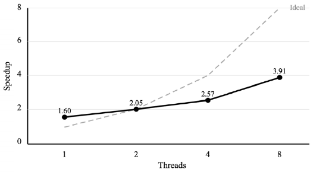

# HW3 과제 해설 — Pthreads 데이터 병렬성

[레포지토리 안내](../../README.ko.md) | [English](Assignment-Explanation.md) | [한국어](Assignment-Explanation.ko.md)

> **최종 수정일:** 2026-11-16
>
> Operating System Concepts, Silberschatz, Galvin, and Gagne, Ch 4 (4.1-4.4)

> **학습 목표:**
> 1. 데이터를 스레드 수만큼 나누고 Pthreads의 생성 루프와 조인 루프로 처리하는 구조를 구현할 수 있다
> 2. 여러 스레드가 같은 카운터를 증가시킬 때 생기는 문제와 그것을 피하는 자료 배치를 설명할 수 있다
> 3. 측정한 속도 향상에서 암달의 법칙으로 순차 비율을 구할 수 있다
> 4. 데이터 크기에 따라 스레드 생성과 조인의 고정 비용이 성능에 미치는 영향을 설명할 수 있다

---

## 목차

- [1. 과제 개요](#1-과제-개요)
- [2. 요구사항](#2-요구사항)
  - [2.1 구현 요구사항](#21-구현-요구사항)
  - [2.2 보고서 질문과 채점 기준](#22-보고서-질문과-채점-기준)
- [3. 구현](#3-구현)
  - [3.1 스레드의 작업](#31-스레드의-작업)
  - [3.2 데이터 분할과 스레드 생성](#32-데이터-분할과-스레드-생성)
  - [3.3 조인과 병합](#33-조인과-병합)
  - [3.4 측정 구간과 검증](#34-측정-구간과-검증)
- [4. 측정 결과](#4-측정-결과)
- [5. 보고서 질문의 답](#5-보고서-질문의-답)
  - [5.1 지역 히스토그램을 쓰는 이유](#51-지역-히스토그램을-쓰는-이유)
  - [5.2 속도 향상과 암달의 법칙](#52-속도-향상과-암달의-법칙)
  - [5.3 스레드 생성과 조인의 오버헤드](#53-스레드-생성과-조인의-오버헤드)
  - [5.4 실습 2와의 비교](#54-실습-2와의-비교)
- [요약](#요약)
- [점검 문제](#점검-문제)

---

<br>

## 1. 과제 개요

> **풀어 보기:** 이 문서는 정답과 풀이를 담고 있다. 먼저 [과제 안내문](Original/Assignment.ko.md)의 문제를 직접 풀어 본 뒤 읽는다.

과제는 0\~99의 값 1,000만 개로 히스토그램을 만드는 일을 Pthreads로 병렬화하고, 스레드 수에 따른 속도 향상을 측정하여 네 질문에 답하는 문제이다. 4주차 이론의 멀티코어 프로그래밍과 암달의 법칙, Pthreads, 그리고 4주차 실습 2의 병렬 배열 합이 바탕이 된다. 문제의 원문은 [과제 안내문](Original/Assignment.ko.md)에 있고, 배포된 시작 코드는 `Original/skeleton/histogram.c`에 원본 그대로 있다. 제출물은 TODO를 채운 `histogram.c`와 측정 결과, 질문의 답을 담은 보고서이며, 보고서의 내용은 이 문서의 4절과 5절에 옮겼다.

```text
Coursework/HW03_Thread-and-Concurrency-1/
├── Assignment-Explanation.ko.md    # 과제 해설 (한국어, 이 문서)
├── Assignment-Explanation.md       # 과제 해설 (영어)
├── Code-Walkthrough.ko.md          # 코드 총정리 (한국어)
├── Code-Walkthrough.md             # 코드 총정리 (영어)
├── Original/
│   ├── Assignment.ko.md            # 과제 안내문 (한국어)
│   ├── Assignment.md               # 과제 안내문 (영어)
│   └── skeleton/
│       └── histogram.c             # 배포된 시작 코드
└── Solution/
    └── histogram.c                 # 제출한 풀이
```

*그림 1. HW3 과제의 디렉토리 구성*

---

<br>

## 2. 요구사항

### 2.1 구현 요구사항

프로그램은 범위 `[0, NUM_BINS)`(`NUM_BINS = 100`)의 무작위 정수 `DEFAULT_SIZE`(1,000만)개를 만들고, 한 스레드로 세는 기준 구현 `histogram_sequential()`과 병렬 구현 `histogram_parallel()`의 시간을 비교한다. 병렬 구현에서 각 스레드는 자신이 맡을 범위(`start`, `end`)와 **지역 히스토그램 배열**을 받아 `data[start..end)`의 값을 세고, 공유 상태를 바꾸지 않은 채 반환한다. 메인 스레드는 스레드 `nthreads`개를 만들고 모두 조인한 뒤, 모든 스레드 t에 대해 `global_hist[i]`에 `local_hist[t][i]`를 더해 결과를 합친다. `main()`은 순차 버전과 스레드 1, 2, 4, 8개의 병렬 버전을 실행하여 경과 시간과 속도 향상을 출력하고, 병렬 결과가 순차 결과와 같은지 검증한다.

시작 코드는 데이터 생성, 순차 구현, 시간 측정, 검증, 출력을 모두 갖추고 있고, 세 군데에 TODO를 남겨 둔다. 스레드 함수 `hist_worker()`의 본문, `histogram_parallel()`의 스레드 생성 루프, 그리고 조인과 병합 루프이다. 빌드는 `gcc -Wall -pthread -O2`로 한다.

### 2.2 보고서 질문과 채점 기준

보고서는 다음 네 질문에 답해야 한다.

1. 각 스레드가 공유 히스토그램 대신 지역 히스토그램을 쓰는 이유는 무엇이며, 모든 스레드가 `global_hist[data[i]]++`를 직접 증가시키면 어떤 일이 생기는가
2. 스레드가 1, 2, 4, 8개일 때 속도 향상은 어떻게 변하며, 암달의 법칙의 예측과 맞는가, 순차 비율은 얼마인가
3. 스레드를 만들고 조인하는 오버헤드는 얼마이며, 1000개 정도의 작은 데이터에서도 병렬 버전이 더 빠른가
4. 이 패턴은 실습 2(병렬 배열 합)와 무엇이 같고 무엇이 다른가

| 항목 | 비중 |
|:-----|-----:|
| 범위를 나누어 스레드를 올바르게 생성 | 25% |
| 스레드별 지역 히스토그램 (공유 충돌 없음) | 25% |
| 지역 히스토그램의 올바른 병합 | 20% |
| 스레드 수별 성능 측정 | 20% |
| 보고서의 답 | 10% |

*표 1. 채점 기준*

---

<br>

## 3. 구현

### 3.1 스레드의 작업

첫 번째 TODO는 스레드가 자신의 지역 히스토그램을 0으로 비우고, 맡은 범위 `data[start..end)`의 값을 세도록 요구한다. `Solution/histogram.c`의 41\~46번 줄이 이 부분이다.

```c
void *hist_worker(void *arg)
{
    struct hist_arg *ha = (struct hist_arg *)arg;

    /* Zero out the local histogram */
    memset(ha->local_hist, 0, NUM_BINS * sizeof(int));

    /* Count values in this thread's chunk */
    for (int i = ha->start; i < ha->end; i++)
        ha->local_hist[data[i]]++;

    return NULL;
}
```

스레드 함수는 `void *` 하나를 받으므로, 메인 스레드가 넘긴 `struct hist_arg`의 주소로 되돌려 쓴다. 42번 줄의 `memset()`은 구조체 안의 배열 `local_hist`를 비우고, 45\~46번 줄은 각 값을 첨자로 써서 그 구간의 개수를 1씩 늘린다. 전역 배열 `data`는 모든 스레드가 읽기만 하고, 쓰는 곳은 각 스레드의 `local_hist`뿐이므로 스레드 사이에 쓰기 충돌이 없다. 따라서 세는 단계에는 뮤텍스 같은 동기화가 필요 없다.

### 3.2 데이터 분할과 스레드 생성

두 번째 TODO는 데이터를 스레드 수만큼 나누어 각 스레드의 인자를 채우고 스레드를 만들도록 요구한다. 74\~80번 줄이 이 부분이다.

```c
    /* Create threads, each processing a chunk of the data */
    int chunk = data_size / nthreads;
    for (int i = 0; i < nthreads; i++) {
        args[i].id    = i;
        args[i].start = i * chunk;
        args[i].end   = (i == nthreads - 1) ? data_size : (i + 1) * chunk;
        pthread_create(&threads[i], NULL, hist_worker, &args[i]);
    }
```

몫 `chunk`는 `data_size / nthreads`이고, 스레드 i는 `[i * chunk, (i + 1) * chunk)`를 맡는다. 나눗셈의 나머지가 있으면 그만큼이 남으므로, 마지막 스레드만 끝을 `data_size`로 두어 나머지를 흡수한다. 각 스레드에는 배열 `args`의 서로 다른 원소 `&args[i]`를 넘긴다. 하나의 변수를 고쳐 가며 그 주소를 넘기면 스레드가 값을 읽기 전에 다음 반복이 값을 바꿀 수 있는데, 원소를 따로 두면 그런 경쟁이 생기지 않는다. `args`는 `histogram_parallel()`의 지역 배열이지만, 함수가 모든 스레드를 조인한 뒤에 반환하므로 스레드가 실행되는 동안 유효하다.

### 3.3 조인과 병합

세 번째 TODO는 결과 배열을 비운 뒤, 스레드를 하나씩 조인하고 그 스레드의 지역 히스토그램을 결과에 더하도록 요구한다. 83\~88번 줄이 이 부분이다.

```c
    /* Join all threads and merge local histograms */
    memset(hist, 0, NUM_BINS * sizeof(int));
    for (int i = 0; i < nthreads; i++) {
        pthread_join(threads[i], NULL);
        for (int b = 0; b < NUM_BINS; b++)
            hist[b] += args[i].local_hist[b];
    }
```

`pthread_join()`이 반환하면 그 스레드는 끝났으므로, 그 스레드가 `args[i].local_hist`에 쓴 값은 메인 스레드에서 안전하게 읽을 수 있다. 병합은 스레드마다 구간 100개를 더하므로 비용은 스레드 수에 100을 곱한 만큼이고, 데이터 크기 1,000만에 비하면 무시할 수 있다. 앞 스레드를 기다리는 동안 뒤 스레드들은 계속 실행되므로, 차례대로 조인해도 병렬성이 줄지 않는다.

### 3.4 측정 구간과 검증

시작 코드는 `histogram_parallel()`의 앞뒤에서 `clock_gettime(CLOCK_MONOTONIC, ...)`으로 시각을 잰다(71, 90번 줄). 따라서 병렬 시간에는 스레드 생성, 세기, 조인, 병합이 모두 들어가고, 데이터 생성은 들어가지 않는다. `main()`은 병렬 결과를 순차 결과와 구간마다 비교하는 `verify()`로 검증하고, 모든 경우가 같으면 `Verification: ALL CORRECT`를 출력한다.

---

<br>

## 4. 측정 결과

보고서는 1,000만 개의 데이터로 다음 결과를 얻었다.

| 스레드 | 시간 (초) | 속도 향상 |
|:-----|-----:|-----:|
| 순차 | 0.0061 | 1.00x |
| 1 | 0.0038 | 1.60x |
| 2 | 0.0030 | 2.05x |
| 4 | 0.0024 | 2.57x |
| 8 | 0.0016 | 3.91x |

*표 2. 스레드 수에 따른 시간과 속도 향상 (N = 1,000만)*



*그림 2. 스레드 수에 따른 속도 향상 (점선은 이상적인 선형 속도 향상)*

프로그램은 속도 향상을 반올림하기 전의 시간으로 계산하므로, 표에서 소수점 넷째 자리로 반올림한 시간끼리 나눈 값과는 조금 다르다. 스레드가 하나인데도 속도 향상이 1.0x를 넘는 것은 캐시가 데워진 효과로 해석된다. 순차 기준 구현이 가장 먼저 40 MB의 데이터 배열을 차가운 캐시 상태에서 주 메모리로부터 읽고, 그 뒤의 병렬 실행들은 데이터 일부가 이미 CPU 캐시에 남아 있는 상태에서 시작한다. 스레드 수를 늘리면 속도 향상은 커지지만 선형보다 느리게 커지며, 이는 암달의 법칙과 맞는다(5.2절).

---

<br>

## 5. 보고서 질문의 답

### 5.1 지역 히스토그램을 쓰는 이유

질문 1은 각 스레드가 공유 히스토그램 대신 지역 히스토그램을 쓰는 이유와, 모든 스레드가 `global_hist[data[i]]++`를 직접 증가시키면 생기는 일을 묻는다.

`hist[b]++`는 값을 읽고, 1을 더하고, 다시 쓰는 세 단계(read-modify-write)로 실행된다. 여러 스레드가 같은 구간에 이 세 단계를 동시에 실행하면 **경쟁 조건(race condition)** 이 생긴다. 예를 들어 두 스레드가 같은 개수 5를 읽고 둘 다 6을 쓰면 증가 하나가 사라진다. 공유 배열을 증가마다 뮤텍스로 보호하면 결과는 맞지만, 세는 단계 전체가 직렬화되어 병렬성이 사라진다. 스레드별 지역 히스토그램은 쓰기 충돌을 모두 없애고, 스레드가 공유하는 자원은 읽기만 하는 `data` 배열뿐이므로 보호가 필요 없다. 실습 2의 `partial_sum[id]`와 같은 원리로, 각 스레드에 자신만의 출력 공간을 주면 동기화가 필요 없어진다.

### 5.2 속도 향상과 암달의 법칙

질문 2는 스레드 수에 따른 속도 향상의 변화가 암달의 법칙의 예측과 맞는지와, 순차 비율이 얼마인지를 묻는다.

4절의 결과에서 속도 향상은 선형보다 느리게 커진다. 순차 비율을 $f$, 스레드 수를 $N$이라 하면 암달의 법칙은 다음과 같다.

$$
S = \frac{1}{f + \frac{1 - f}{N}}
$$

스레드 8개의 결과 $S = 3.91$로 $f$를 구하면 다음과 같다.

$$
3.91 = \frac{1}{f + \frac{1 - f}{8}} \quad\Rightarrow\quad f + \frac{1 - f}{8} = 0.2558 \quad\Rightarrow\quad \frac{7}{8} f = 0.1308 \quad\Rightarrow\quad f \approx 0.15
$$

순차 비율은 약 15%이다. 보고서는 이 비율의 원인으로 병합 단계와 스레드 생성, 조인의 오버헤드를 든다.

> **참고:** 이렇게 구한 $f$는 병렬화되지 않는 코드뿐 아니라 스레드 수에 비례해 줄지 않는 모든 비용을 한 숫자에 담은 유효값이다. 여러 스레드가 함께 쓰는 메모리 대역폭의 한계도 여기에 들어간다. 또 암달의 법칙은 스레드 하나의 속도 향상을 1로 가정하지만 측정값은 1.60x이므로, 한 점으로 구한 $f$는 대략적인 추정이다. 데이터 생성은 4절의 두 측정 구간 밖에서 이루어지므로 측정된 속도 향상에는 영향을 주지 않는다.

### 5.3 스레드 생성과 조인의 오버헤드

질문 3은 스레드를 만들고 조인하는 오버헤드와, 작은 데이터에서도 병렬 버전이 더 빠른지를 묻는다. 보고서는 스레드 8개로 데이터 크기를 바꾸어 가며 측정했다.

| 데이터 크기 | 순차 시간 | 스레드 8개 시간 | 속도 향상 |
|-----:|-----:|-----:|-----:|
| 1,000 | < 1 μs | \~100 μs | < 0.01x |
| 10,000 | \~6 μs | \~100 μs | 0.06x |
| 100,000 | \~56 μs | \~100 μs | 0.56x |
| 10,000,000 | 6,100 μs | 1,600 μs | 3.91x |

*표 3. 데이터 크기에 따른 스레드 8개의 속도 향상*

데이터가 1,000개이면 스레드마다 125개만 처리하지만, `pthread_create()`와 `pthread_join()`의 한 쌍마다 커널의 스케줄링을 거치는 수십 마이크로초의 비용이 든다. 이 고정된 스레드 관리 비용이 작업량을 압도하므로 병렬 실행이 순차 실행보다 훨씬 느리다. 스레드 8개의 시간은 데이터가 10만 개일 때까지 약 100 μs로 거의 일정하며, 속도 향상은 대략 10만 개를 넘어 스레드마다의 작업이 생성과 조인의 비용보다 커진 뒤에야 1.0x를 넘는다. 이 결과는 암달의 법칙을 적용할 때 고정 오버헤드를 함께 고려해야 함을 보여 준다. $N$이 작으면 스레드 수와 상관없이 순차 비용이 지배한다.

### 5.4 실습 2와의 비교

질문 4는 이 패턴과 실습 2(병렬 배열 합)의 같은 점과 다른 점을 묻는다.

**같은 점.** 두 과제는 교재 4.2절의 같은 데이터 병렬 패턴을 쓴다. 메인 스레드가 입력을 같은 크기의 몫으로 나누고, 생성 루프로 만든 작업 스레드가 각자 부분 결과를 독립적으로 계산하며, 조인 루프 뒤에 결과를 합친다. 실습 2의 `partial_sum[id]`, 이 과제의 `local_hist[NUM_BINS]`처럼 둘 다 스레드별 저장 공간으로 동기화를 피하고, 계산하는 동안 스레드끼리 통신하지 않는 자명하게 병렬적인(embarrassingly parallel) 문제이다.

**다른 점.** 스레드가 내는 결과의 모양이 다르다. 실습 2에서 각 스레드는 스칼라 하나(부분 합)를 내므로 병합은 N개의 수를 더하는 것으로 끝난다. 히스토그램에서는 각 스레드가 원소 100개의 배열을 내므로 병합이 스레드마다 모든 구간을 돈다. 그래도 구간 수(100)가 데이터 크기(1,000만)에 비해 매우 작아 병합 비용은 무시할 수 있다. 또 배열 합은 원소마다 덧셈 하나를 하는 순차적인 메모리 접근이지만, 히스토그램은 `local_hist[data[i]]++`처럼 값에 따라 위치가 정해지는 쓰기를 하므로 캐시 미스가 더 생길 수 있다. 그런데도 두 경우 모두 자명하게 병렬적인 구조 덕분에 강한 확장성(strong scaling)을 보인다.

---

<br>

## 요약

| 개념 | 핵심 요약 |
|:-----|:-----|
| 데이터 분할 | `chunk = data_size / nthreads`로 나누고 마지막 스레드가 나머지를 흡수하며, 스레드마다 `args`의 서로 다른 원소를 인자로 넘긴다. |
| 지역 히스토그램 | 각 스레드가 자신의 `local_hist`에만 쓰므로 세는 단계에 동기화가 필요 없고, 공유 배열을 직접 증가시키면 read-modify-write 경쟁으로 증가가 사라진다. |
| 조인과 병합 | `pthread_join()` 뒤에 그 스레드의 구간 100개를 결과에 더하며, 병합 비용은 데이터 크기에 비해 무시할 수 있다. |
| 측정 결과 | 1,000만 개에서 스레드 1, 2, 4, 8개의 속도 향상은 1.60x, 2.05x, 2.57x, 3.91x이며, 스레드 하나의 1.0x 초과는 캐시가 데워진 효과로 해석된다. |
| 암달의 법칙 | 스레드 8개의 3.91x에서 순차 비율 $f \approx 0.15$를 얻으며, 이 값은 늘지 않는 비용을 모두 담은 유효값이다. |
| 고정 오버헤드 | 스레드 8개의 생성과 조인에 약 100 μs가 들어, 10만 개 이하의 데이터에서는 병렬 버전이 순차 버전보다 느리다. |
| 실습 2와의 비교 | 같은 데이터 병렬 패턴과 스레드별 저장 공간을 쓰지만, 결과가 스칼라가 아닌 배열이고 쓰기가 값에 따라 흩어진다. |

---

<br>

## 점검 문제

1. **나머지의 처리:** `data_size = 10`, `nthreads = 4`일 때 각 스레드가 맡는 범위를 쓰라.

   <details>
   <summary>정답</summary>

   `chunk = 10 / 4 = 2`이므로 스레드 0, 1, 2는 `[0, 2)`, `[2, 4)`, `[4, 6)`을 맡고, 마지막 스레드 3은 끝을 `data_size`로 두어 `[6, 10)`의 4개를 맡는다.

   </details>

2. **잃어버린 증가:** 두 스레드가 공유 배열의 같은 구간을 `hist[b]++`로 한 번씩 증가시켰는데 결과가 1만 늘어나는 실행 순서를 쓰라.

   <details>
   <summary>정답</summary>

   `hist[b]`가 5일 때 스레드 A가 5를 읽고, A가 쓰기 전에 스레드 B도 5를 읽는다. A가 6을 쓰고 B도 6을 쓴다. 두 번 증가했지만 결과는 7이 아니라 6이다.

   </details>

3. **암달의 상한:** 순차 비율이 0.15일 때 스레드를 무한히 늘려도 얻을 수 있는 속도 향상의 상한을 구하라.

   <details>
   <summary>정답</summary>

   $N \to \infty$이면 $(1 - f)/N \to 0$이므로 $S \to 1/f = 1/0.15 \approx 6.67$이다.

   </details>

4. **인자 전달:** 생성 루프에서 `&args[i]` 대신 루프 밖에 선언한 변수 하나 `struct hist_arg a`의 주소 `&a`를 매번 넘기면 어떤 문제가 생기는지 쓰라.

   <details>
   <summary>정답</summary>

   모든 스레드가 같은 구조체를 가리키므로, 앞 스레드가 `start`와 `end`를 읽기 전에 다음 반복이 값을 덮어쓸 수 있고, 모든 스레드가 같은 `local_hist`에 써서 경쟁 조건이 다시 생긴다. 병합할 때도 스레드별 결과가 따로 남지 않는다.

   </details>
