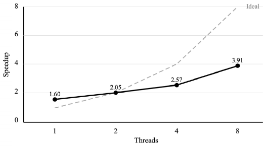

# HW3 Assignment Explanation — Pthreads Data Parallelism

[Repository Guide](../../README.md) | [English](Assignment-Explanation.md) | [한국어](Assignment-Explanation.ko.md)

> **Last Updated:** 2026-11-16
>
> Operating System Concepts, Silberschatz, Galvin, and Gagne, Ch 4 (4.1-4.4)

> **Learning Objectives:**
> 1. Implement a structure that splits data by the number of threads and processes it with the Pthreads create loop and join loop
> 2. Explain the problem that arises when several threads increment the same counter and a data layout that avoids it
> 3. Derive the serial fraction from a measured speedup with Amdahl's Law
> 4. Explain how the fixed cost of creating and joining threads affects performance depending on the data size

---

## Table of Contents

- [1. Assignment Overview](#1-assignment-overview)
- [2. Requirements](#2-requirements)
  - [2.1 Implementation Requirements](#21-implementation-requirements)
  - [2.2 Report Questions and Grading Criteria](#22-report-questions-and-grading-criteria)
- [3. Implementation](#3-implementation)
  - [3.1 The Thread's Work](#31-the-threads-work)
  - [3.2 Data Partitioning and Thread Creation](#32-data-partitioning-and-thread-creation)
  - [3.3 Join and Merge](#33-join-and-merge)
  - [3.4 Measured Interval and Verification](#34-measured-interval-and-verification)
- [4. Measurement Results](#4-measurement-results)
- [5. Answers to the Report Questions](#5-answers-to-the-report-questions)
  - [5.1 Why Local Histograms Are Used](#51-why-local-histograms-are-used)
  - [5.2 Speedup and Amdahl's Law](#52-speedup-and-amdahls-law)
  - [5.3 Overhead of Thread Creation and Join](#53-overhead-of-thread-creation-and-join)
  - [5.4 Comparison with Lab 2](#54-comparison-with-lab-2)
- [Summary](#summary)
- [Self-Check Questions](#self-check-questions)

---

<br>

## 1. Assignment Overview

> **Try It First:** This document contains the answers and solutions. Solve the problems in the [assignment handout](Original/Assignment.md) yourself before reading on.

The assignment asks to parallelize, with Pthreads, the building of a histogram of 10 million values in 0-99, to measure the speedup by thread count, and to answer four questions. It builds on multicore programming, Amdahl's Law, and Pthreads from the Week 4 lecture and on the parallel array sum of Lab 2 in the Week 4 lab. The original problem is in the [assignment handout](Original/Assignment.md), and the distributed starter code is in `Original/skeleton/histogram.c` as distributed. The submission consists of `histogram.c` with the TODOs filled in and a report with the measurements and the answers to the questions; the content of the report is carried over into Sections 4 and 5 of this document.

```text
Coursework/HW03_Thread-and-Concurrency-1/
├── Assignment-Explanation.ko.md    # Assignment explanation (Korean)
├── Assignment-Explanation.md       # Assignment explanation (English, this document)
├── Code-Walkthrough.ko.md          # Code walkthrough (Korean)
├── Code-Walkthrough.md             # Code walkthrough (English)
├── Original/
│   ├── Assignment.ko.md            # Assignment handout (Korean)
│   ├── Assignment.md               # Assignment handout (English)
│   └── skeleton/
│       └── histogram.c             # Distributed starter code
└── Solution/
    └── histogram.c                 # Submitted solution
```

*Figure 1. Directory layout of HW3*

---

<br>

## 2. Requirements

### 2.1 Implementation Requirements

The program generates `DEFAULT_SIZE` (10 million) random integers in the range `[0, NUM_BINS)` (`NUM_BINS = 100`) and compares the time of the single-threaded baseline `histogram_sequential()` with that of the parallel version `histogram_parallel()`. In the parallel version, each thread receives its range (`start`, `end`) and a **local histogram array**, counts the values in `data[start..end)`, and returns without modifying shared state. The main thread creates `nthreads` threads, joins them all, and merges the results by adding `local_hist[t][i]` to `global_hist[i]` for every thread t. `main()` runs the sequential version and the parallel version with 1, 2, 4, and 8 threads, prints the elapsed time and speedup of each, and verifies that the parallel results match the sequential result.

The starter code already provides data generation, the sequential version, timing, verification, and output, and leaves TODOs in three places: the body of the thread function `hist_worker()`, the thread creation loop of `histogram_parallel()`, and the join-and-merge loop. It is built with `gcc -Wall -pthread -O2`.

### 2.2 Report Questions and Grading Criteria

The report must answer the following four questions.

1. Why does each thread use a local histogram instead of a shared one, and what would happen if all threads incremented `global_hist[data[i]]++` directly?
2. How does the speedup change with 1, 2, 4, and 8 threads, does it match the prediction of Amdahl's Law, and what is the serial fraction?
3. What is the overhead of creating and joining threads, and is the parallel version still faster with a small dataset of about 1000 elements?
4. What is similar and what is different between this pattern and Lab 2 (parallel array sum)?

| Item | Weight |
|:-----|-----:|
| Correct thread creation with chunk splitting | 25% |
| Local histogram per thread (no sharing conflicts) | 25% |
| Correct merge of local histograms | 20% |
| Performance measurement across thread counts | 20% |
| Report answers | 10% |

*Table 1. Grading criteria*

---

<br>

## 3. Implementation

### 3.1 The Thread's Work

The first TODO requires each thread to clear its local histogram to 0 and count the values in its range `data[start..end)`. This is lines 41-46 of `Solution/histogram.c`.

```c
void *hist_worker(void *arg)
{
    struct hist_arg *ha = (struct hist_arg *)arg;

    /* Zero out the local histogram */
    memset(ha->local_hist, 0, NUM_BINS * sizeof(int));

    /* Count values in this thread's chunk */
    for (int i = ha->start; i < ha->end; i++)
        ha->local_hist[data[i]]++;

    return NULL;
}
```

The thread function receives a single `void *`, so it casts it back to the address of the `struct hist_arg` passed by the main thread. The `memset()` on line 42 clears the array `local_hist` inside the structure, and lines 45-46 use each value as an index and increment the count of that bin by 1. All threads only read the global array `data`, and the only place each thread writes is its own `local_hist`, so there are no write conflicts between threads. The counting phase therefore needs no synchronization such as a mutex.

### 3.2 Data Partitioning and Thread Creation

The second TODO requires splitting the data by the number of threads, filling in each thread's arguments, and creating the threads. This is lines 74-80.

```c
    /* Create threads, each processing a chunk of the data */
    int chunk = data_size / nthreads;
    for (int i = 0; i < nthreads; i++) {
        args[i].id    = i;
        args[i].start = i * chunk;
        args[i].end   = (i == nthreads - 1) ? data_size : (i + 1) * chunk;
        pthread_create(&threads[i], NULL, hist_worker, &args[i]);
    }
```

The quotient `chunk` is `data_size / nthreads`, and thread i takes `[i * chunk, (i + 1) * chunk)`. If the division has a remainder, that many elements would be left over, so only the last thread sets its end to `data_size` to absorb the remainder. Each thread receives a different element of the array `args`, `&args[i]`. If one variable were modified and its address passed each time, the next iteration could change the value before the thread reads it; keeping separate elements prevents such a race. `args` is a local array of `histogram_parallel()`, but since the function returns only after joining all threads, it remains valid while the threads run.

### 3.3 Join and Merge

The third TODO requires clearing the result array and then joining the threads one by one, adding each thread's local histogram to the result. This is lines 83-88.

```c
    /* Join all threads and merge local histograms */
    memset(hist, 0, NUM_BINS * sizeof(int));
    for (int i = 0; i < nthreads; i++) {
        pthread_join(threads[i], NULL);
        for (int b = 0; b < NUM_BINS; b++)
            hist[b] += args[i].local_hist[b];
    }
```

Once `pthread_join()` returns, that thread has finished, so the values it wrote to `args[i].local_hist` can be read safely by the main thread. The merge adds 100 bins per thread, so its cost is the number of threads times 100, which is negligible compared with the data size of 10 million. While the main thread waits for an earlier thread, the later threads keep running, so joining in order does not reduce parallelism.

### 3.4 Measured Interval and Verification

The starter code takes the time with `clock_gettime(CLOCK_MONOTONIC, ...)` before and after `histogram_parallel()` (lines 71 and 90). The parallel time therefore includes thread creation, counting, joining, and merging, but not data generation. `main()` verifies the parallel results with `verify()`, which compares them bin by bin with the sequential result, and prints `Verification: ALL CORRECT` if all cases match.

---

<br>

## 4. Measurement Results

The report obtained the following results with 10 million elements.

| Threads | Time (sec) | Speedup |
|:-----|-----:|-----:|
| Sequential | 0.0061 | 1.00x |
| 1 | 0.0038 | 1.60x |
| 2 | 0.0030 | 2.05x |
| 4 | 0.0024 | 2.57x |
| 8 | 0.0016 | 3.91x |

*Table 2. Time and speedup by thread count (N = 10 million)*



*Figure 2. Speedup by thread count (the dashed line is the ideal linear speedup)*

Because the program computes the speedup from the unrounded times, it differs slightly from dividing the times in the table, which are rounded to four decimal places. That the speedup exceeds 1.0x even with one thread is interpreted as a cache-warming effect: the sequential baseline runs first and reads the 40 MB data array from main memory with a cold cache, while the parallel runs that follow start with part of the data already resident in the CPU cache. As the number of threads grows, the speedup increases, but more slowly than linearly, which is consistent with Amdahl's Law (Section 5.2).

---

<br>

## 5. Answers to the Report Questions

### 5.1 Why Local Histograms Are Used

Question 1 asks why each thread uses a local histogram instead of a shared one and what would happen if all threads incremented `global_hist[data[i]]++` directly.

`hist[b]++` executes in three steps: read the value, add 1, and write it back (read-modify-write). If several threads execute these three steps on the same bin at the same time, a **race condition** arises. For example, if two threads both read the same count of 5 and both write back 6, one increment is lost. Protecting the shared array with a mutex on every increment gives the correct result but serializes the entire counting phase, destroying parallelism. Per-thread local histograms eliminate all write conflicts, and the only resource the threads share is the read-only `data` array, which needs no protection. As with `partial_sum[id]` in Lab 2, giving each thread its own output space removes the need for synchronization.

### 5.2 Speedup and Amdahl's Law

Question 2 asks whether the change of speedup with the number of threads matches the prediction of Amdahl's Law and what the serial fraction is.

In the results of Section 4, the speedup grows more slowly than linearly. With serial fraction $f$ and $N$ threads, Amdahl's Law states the following.

$$
S = \frac{1}{f + \frac{1 - f}{N}}
$$

Solving for $f$ from the 8-thread result $S = 3.91$ gives the following.

$$
3.91 = \frac{1}{f + \frac{1 - f}{8}} \quad\Rightarrow\quad f + \frac{1 - f}{8} = 0.2558 \quad\Rightarrow\quad \frac{7}{8} f = 0.1308 \quad\Rightarrow\quad f \approx 0.15
$$

The serial fraction is about 15%. The report attributes this fraction to the merge phase and the overhead of thread creation and join.

> **Note:** The $f$ obtained this way is an effective value that lumps into one number every cost that does not shrink in proportion to the number of threads, not only code that is not parallelized. The limit of memory bandwidth shared by the threads also falls into it. Moreover, Amdahl's Law assumes a speedup of 1 with one thread, while the measured value is 1.60x, so an $f$ derived from one point is a rough estimate. Data generation happens outside both measured intervals of Section 4, so it does not affect the measured speedup.

### 5.3 Overhead of Thread Creation and Join

Question 3 asks about the overhead of creating and joining threads and whether the parallel version is still faster with small data. The report measured with 8 threads while varying the data size.

| Data size | Seq. time | 8-thread time | Speedup |
|-----:|-----:|-----:|-----:|
| 1,000 | < 1 μs | \~100 μs | < 0.01x |
| 10,000 | \~6 μs | \~100 μs | 0.06x |
| 100,000 | \~56 μs | \~100 μs | 0.56x |
| 10,000,000 | 6,100 μs | 1,600 μs | 3.91x |

*Table 3. Speedup of 8 threads by data size*

With 1,000 elements, each thread processes only 125 elements, yet each pair of `pthread_create()` and `pthread_join()` costs tens of microseconds of kernel scheduling. This fixed thread management cost overwhelms the work, so parallel execution is much slower than sequential execution. The 8-thread time stays almost constant at about 100 μs up to 100,000 elements, and the speedup exceeds 1.0x only beyond roughly 100,000 elements, where the per-thread work outweighs the cost of creation and join. This result shows that Amdahl's Law must be applied together with the fixed overhead: when $N$ is small, the serial cost dominates regardless of the number of threads.

### 5.4 Comparison with Lab 2

Question 4 asks what is similar and what is different between this pattern and Lab 2 (parallel array sum).

**Similarities.** Both assignments use the same data-parallel pattern from Section 4.2 of the textbook: the main thread splits the input into equal chunks, worker threads created by the create loop each compute a partial result independently, and the results are merged after the join loop. Both avoid synchronization with per-thread storage, `partial_sum[id]` in Lab 2 and `local_hist[NUM_BINS]` here, and both are embarrassingly parallel problems with no communication between threads during the computation.

**Differences.** The shape of each thread's result differs. In Lab 2, each thread produces a single scalar (a partial sum), so the merge is just adding N numbers. In the histogram, each thread produces an array of 100 elements, so the merge iterates over all bins per thread. Still, the number of bins (100) is very small compared with the data size (10 million), so the merge cost is negligible. In addition, the array sum accesses memory sequentially with one addition per element, while the histogram performs writes whose location depends on the value, as in `local_hist[data[i]]++`, which can cause more cache misses. Even so, the embarrassingly parallel structure gives strong scaling in both cases.

---

<br>

## Summary

| Concept | Key Summary |
|:-----|:-----|
| Data partitioning | The data is split with `chunk = data_size / nthreads`, the last thread absorbs the remainder, and each thread receives a different element of `args` as its argument. |
| Local histograms | Each thread writes only to its own `local_hist`, so the counting phase needs no synchronization, whereas incrementing a shared array directly loses increments through read-modify-write races. |
| Join and merge | After `pthread_join()`, the thread's 100 bins are added to the result, and the merge cost is negligible relative to the data size. |
| Results | With 10 million elements, the speedups with 1, 2, 4, and 8 threads are 1.60x, 2.05x, 2.57x, and 3.91x, and the above-1.0x value with one thread is interpreted as a cache-warming effect. |
| Amdahl's Law | The 3.91x with 8 threads gives a serial fraction $f \approx 0.15$, an effective value that includes every cost that does not scale. |
| Fixed overhead | Creating and joining 8 threads costs about 100 μs, so the parallel version is slower than the sequential one for data of 100,000 elements or fewer. |
| Comparison with Lab 2 | It uses the same data-parallel pattern and per-thread storage, but the result is an array rather than a scalar and the writes are scattered by value. |

---

<br>

## Self-Check Questions

1. **Handling the remainder:** Write the range each thread takes when `data_size = 10` and `nthreads = 4`.

   <details>
   <summary>Answer</summary>

   Since `chunk = 10 / 4 = 2`, threads 0, 1, and 2 take `[0, 2)`, `[2, 4)`, and `[4, 6)`, and the last thread, 3, sets its end to `data_size` and takes the 4 elements of `[6, 10)`.

   </details>

2. **A lost increment:** Write an execution order in which two threads each increment the same bin of a shared array once with `hist[b]++`, yet the result grows by only 1.

   <details>
   <summary>Answer</summary>

   With `hist[b]` at 5, thread A reads 5, and before A writes, thread B also reads 5. A writes 6, and B also writes 6. There were two increments, but the result is 6 rather than 7.

   </details>

3. **Amdahl's bound:** With a serial fraction of 0.15, compute the upper bound on speedup even with infinitely many threads.

   <details>
   <summary>Answer</summary>

   As $N \to \infty$, $(1 - f)/N \to 0$, so $S \to 1/f = 1/0.15 \approx 6.67$.

   </details>

4. **Passing arguments:** State what goes wrong if, instead of `&args[i]`, the creation loop passed `&a`, the address of a single variable `struct hist_arg a` declared outside the loop, every time.

   <details>
   <summary>Answer</summary>

   All threads would point to the same structure, so the next iteration could overwrite `start` and `end` before an earlier thread reads them, and all threads would write to the same `local_hist`, reintroducing the race condition. No separate per-thread results would remain for the merge either.

   </details>
