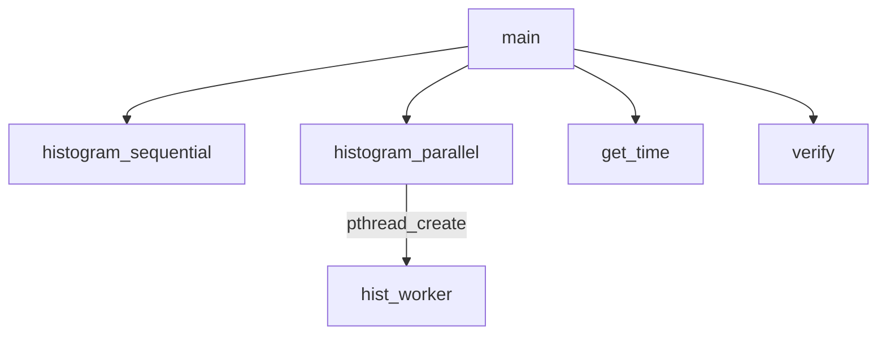

# HW3 코드 총정리 — Pthreads 데이터 병렬성

[레포지토리 안내](../../README.ko.md) | [English](Code-Walkthrough.md) | [한국어](Code-Walkthrough.ko.md)

> **최종 수정일:** 2026-11-16

> **학습 목표:**
> 1. `histogram.c`의 함수 구성을 설명하고 시작 코드에서 주어진 부분과 작성한 부분을 구분할 수 있다
> 2. 전역 데이터와 스레드 인자 구조체가 스레드 사이에서 공유되는 방식을 설명할 수 있다
> 3. 데이터 크기와 스레드 수가 주어지면 각 스레드가 맡는 범위를 계산할 수 있다
> 4. `main()`의 측정, 검증, 상위 5개 출력이 동작하는 방식과 컴파일러 경고의 원인을 설명할 수 있다

---

## 목차

- [1. 파일 구성](#1-파일-구성)
- [2. 헤더, 상수, 전역 변수, 구조체](#2-헤더-상수-전역-변수-구조체)
- [3. hist_worker](#3-hist_worker)
- [4. histogram_sequential](#4-histogram_sequential)
- [5. histogram_parallel](#5-histogram_parallel)
- [6. get_time과 verify](#6-get_time과-verify)
- [7. main](#7-main)
- [8. 범위 계산의 추적](#8-범위-계산의-추적)
- [요약](#요약)
- [점검 문제](#점검-문제)

---

<br>

## 1. 파일 구성

> **풀어 보기:** 이 문서는 작성한 코드 전체와 줄별 설명을 담고 있다. 먼저 [과제 안내문](Original/Assignment.ko.md)의 문제를 직접 풀어 본 뒤 읽는다.

짝이 되는 문서 [HW3 과제 해설](Assignment-Explanation.ko.md)은 요구사항, 세 TODO의 풀이, 측정 결과, 보고서 질문의 답을 정리한다. 이 문서는 `Solution/histogram.c`(177줄)를 처음부터 끝까지 읽는다. 이 파일은 배포된 `Original/skeleton/histogram.c`의 TODO 주석 세 개를 코드로 바꾼 것이며, 나머지 줄은 시작 코드와 같다.

| 줄 | 부분 | 시작 코드와의 관계 |
|:-----|:-----|:-----|
| 1\~32 | 머리 주석, 헤더, 상수, 전역 변수, `struct hist_arg` | 그대로 |
| 34\~49 | `hist_worker()` | 본문 작성 (TODO 1) |
| 51\~59 | `histogram_sequential()` | 그대로 |
| 61\~93 | `histogram_parallel()` | 생성 루프와 조인 루프 작성 (TODO 2, 3), 시간 측정은 그대로 |
| 95\~110 | `get_time()`, `verify()` | 그대로 |
| 112\~177 | `main()` | 그대로 |

*표 1. histogram.c의 구성과 시작 코드와의 관계*



*그림 1. histogram.c의 함수 호출 관계*

---

<br>

## 2. 헤더, 상수, 전역 변수, 구조체

```c
#include <stdio.h>
#include <stdlib.h>
#include <string.h>
#include <pthread.h>
#include <time.h>

#define NUM_BINS     100       /* histogram bins (values 0 to 99) */
#define DEFAULT_SIZE 10000000  /* 10 million */
#define MAX_THREADS  8

/* Global data array (read-only by threads) */
int *data;
int data_size;

/* Thread argument structure */
struct hist_arg {
    int id;
    int start;
    int end;
    int local_hist[NUM_BINS];  /* each thread has its own histogram */
};
```

`<string.h>`는 `memset()`을, `<pthread.h>`는 `pthread_create()`와 `pthread_join()`을, `<time.h>`는 `clock_gettime()`을 선언한다. `NUM_BINS`는 구간 수 100, `DEFAULT_SIZE`는 기본 데이터 크기 1,000만, `MAX_THREADS`는 스레드 배열의 크기 8이다.

전역 변수 `data`와 `data_size`는 한 프로세스의 모든 스레드가 공유하는 데이터 영역에 있다. 스레드는 이 둘을 읽기만 하므로 보호가 필요 없다. `struct hist_arg`는 스레드 하나에 넘기는 인자로, 스레드 번호와 범위에 더해 구간 100개의 지역 히스토그램을 구조체 안에 품는다. 지역 히스토그램을 인자 구조체에 넣었으므로 스레드가 끝난 뒤에도 메인 스레드가 그 결과를 읽을 수 있다. 구조체 하나의 크기는 정수 3개와 배열을 합한 412바이트이다.

> **참고:** `args[]`의 원소들은 메모리에 이어서 놓이므로 이웃한 두 스레드의 데이터가 한 캐시 라인을 함께 쓸 수 있다. 다만 각 `local_hist`는 400바이트로 64바이트 캐시 라인보다 훨씬 커서, 겹칠 수 있는 곳은 배열의 경계 부근뿐이고 그쪽의 `id`, `start`, `end`는 스레드가 시작할 때 한 번만 읽힌다. 거짓 공유(false sharing)의 영향은 작다.

---

<br>

## 3. hist_worker

```c
/*
 * hist_worker: Count values in data[start..end) into local_hist.
 */
void *hist_worker(void *arg)
{
    struct hist_arg *ha = (struct hist_arg *)arg;

    /* Zero out the local histogram */
    memset(ha->local_hist, 0, NUM_BINS * sizeof(int));

    /* Count values in this thread's chunk */
    for (int i = ha->start; i < ha->end; i++)
        ha->local_hist[data[i]]++;

    return NULL;
}
```

`pthread_create()`가 시작시키는 함수는 `void *(*)(void *)` 형이어야 하므로, `hist_worker()`는 `void *`를 받아 39번 줄에서 `struct hist_arg *`로 바꾼다. 42번 줄(TODO 1의 첫 단계)은 지역 히스토그램을 0으로 채운다. `args`는 `histogram_parallel()`의 지역 배열이라 초기화되지 않은 값이 들어 있으므로 이 단계가 필요하다. 45\~46번 줄(TODO 1의 둘째 단계)은 반열린 범위 `[start, end)`를 돌며 값 `data[i]`를 첨자로 그 구간을 1 늘린다. `data[i]`는 `rand() % NUM_BINS`로 만든 값이라 0\~99를 벗어나지 않으므로 첨자가 배열 범위 안에 있다. 48번 줄은 결과를 구조체에 남겼으므로 `NULL`을 반환한다.

---

<br>

## 4. histogram_sequential

```c
/*
 * histogram_sequential: Single-threaded baseline.
 */
void histogram_sequential(int *hist)
{
    memset(hist, 0, NUM_BINS * sizeof(int));
    for (int i = 0; i < data_size; i++)
        hist[data[i]]++;
}
```

기준 구현은 같은 일을 스레드 없이 전체 범위에 대해 한다. 안내문의 예시는 `histogram_sequential(int *data, int n, int *hist)`로 데이터와 크기를 인자로 받지만, 시작 코드는 전역 변수 `data`와 `data_size`를 쓰고 결과 배열만 받는다. 두 형태는 같은 결과를 낸다.

---

<br>

## 5. histogram_parallel

```c
/*
 * histogram_parallel: Multi-threaded version.
 * Returns elapsed time in seconds.
 */
double histogram_parallel(int nthreads, int *hist)
{
    pthread_t threads[MAX_THREADS];
    struct hist_arg args[MAX_THREADS];

    struct timespec t_start, t_end;
    clock_gettime(CLOCK_MONOTONIC, &t_start);

    /* Create threads, each processing a chunk of the data */
    int chunk = data_size / nthreads;
    for (int i = 0; i < nthreads; i++) {
        args[i].id    = i;
        args[i].start = i * chunk;
        args[i].end   = (i == nthreads - 1) ? data_size : (i + 1) * chunk;
        pthread_create(&threads[i], NULL, hist_worker, &args[i]);
    }

    /* Join all threads and merge local histograms */
    memset(hist, 0, NUM_BINS * sizeof(int));
    for (int i = 0; i < nthreads; i++) {
        pthread_join(threads[i], NULL);
        for (int b = 0; b < NUM_BINS; b++)
            hist[b] += args[i].local_hist[b];
    }

    clock_gettime(CLOCK_MONOTONIC, &t_end);
    return (t_end.tv_sec - t_start.tv_sec)
         + (t_end.tv_nsec - t_start.tv_nsec) / 1e9;
}
```

67\~68번 줄은 스레드 식별자와 인자를 담을 배열을 `MAX_THREADS` 크기로 둔다. 70\~71번 줄에서 시각을 잰 뒤, 74번 줄(TODO 2)은 몫 `chunk`를 정수 나눗셈으로 구한다. 75\~80번 줄의 생성 루프는 스레드 i의 번호, 시작, 끝을 채우고, 끝은 마지막 스레드만 `data_size`로 둔다. 79번 줄의 `pthread_create()`는 새 스레드가 `hist_worker(&args[i])`를 실행하게 하고, 기본 속성(`NULL`)을 쓰며, 반환값은 검사하지 않는다.

83번 줄(TODO 3)은 결과 배열 `hist`를 비우고, 84\~88번 줄은 스레드를 번호 순서대로 조인하면서 그 스레드의 지역 히스토그램을 구간마다 더한다. 90\~92번 줄은 끝 시각을 재어 초 단위의 차이를 반환한다. 나노초 부분의 차이가 음수가 될 수 있지만, 초 부분과 더하면 올바른 경과 시간이 된다.

---

<br>

## 6. get_time과 verify

```c
/* Helper: get wall-clock time */
double get_time(void)
{
    struct timespec ts;
    clock_gettime(CLOCK_MONOTONIC, &ts);
    return ts.tv_sec + ts.tv_nsec / 1e9;
}

/* Verify two histograms match */
int verify(int *expected, int *actual)
{
    for (int i = 0; i < NUM_BINS; i++)
        if (expected[i] != actual[i])
            return 0;
    return 1;
}
```

`get_time()`은 단조 시계(`CLOCK_MONOTONIC`)의 현재 시각을 초 단위 실수로 돌려준다. 단조 시계는 시스템 시각을 조정해도 거꾸로 가거나 건너뛰지 않으므로 구간을 재는 데 알맞다. 주석의 "wall-clock time"은 CPU 시간이 아니라 실제로 흐른 시간을 잰다는 뜻이다. `verify()`는 두 히스토그램을 구간마다 비교하여 모두 같을 때만 1을 반환한다.

---

<br>

## 7. main

```c
int main(int argc, char *argv[])
{
    data_size = (argc > 1) ? atoi(argv[1]) : DEFAULT_SIZE;
    int user_threads = (argc > 2) ? atoi(argv[2]) : 4;

    printf("=== Parallel Histogram ===\n");
    printf("Data size: %d, Bins: %d\n\n", data_size, NUM_BINS);

    /* Generate random data */
    data = malloc(data_size * sizeof(int));
    srand(42);
    for (int i = 0; i < data_size; i++)
        data[i] = rand() % NUM_BINS;

    /* Sequential baseline */
    int hist_seq[NUM_BINS];
    double t0 = get_time();
    histogram_sequential(hist_seq);
    double t1 = get_time();
    double seq_time = t1 - t0;
    printf("Sequential:           %.4f sec\n\n", seq_time);
```

114번 줄은 첫 번째 명령행 인자가 있으면 그 값을, 없으면 1,000만을 데이터 크기로 쓴다. 115번 줄은 두 번째 인자를 `user_threads`에 읽지만 이 변수는 어디에서도 쓰이지 않으므로, 프로그램은 두 번째 인자와 상관없이 항상 스레드 1, 2, 4, 8개를 시험한다. 121\~124번 줄은 데이터를 할당하고 `srand(42)`로 난수의 씨앗을 고정한 뒤 0\~99의 값으로 채운다. 씨앗이 고정되어 있으므로 실행할 때마다 같은 데이터가 만들어진다. 127\~132번 줄은 순차 버전의 시간을 잰다.

```c
    /* Parallel with varying thread counts */
    int thread_counts[] = {1, 2, 4, 8};
    int num_tests = 4;
    int hist_par[NUM_BINS];
    int all_correct = 1;

    for (int t = 0; t < num_tests; t++) {
        int nt = thread_counts[t];
        if (nt > MAX_THREADS) continue;

        double elapsed = histogram_parallel(nt, hist_par);
        int ok = verify(hist_seq, hist_par);
        if (!ok) all_correct = 0;

        printf("Parallel (%d thread%s): %.4f sec  Speedup: %.2fx  %s\n",
               nt, nt > 1 ? "s" : " ",
               elapsed, seq_time / elapsed,
               ok ? "" : "MISMATCH!");
    }

    printf("\nVerification: %s\n", all_correct ? "ALL CORRECT" : "ERRORS FOUND");
```

140\~152번 줄은 스레드 수 1, 2, 4, 8마다 병렬 버전을 실행하고, 결과를 검증하며, 시간과 속도 향상(`seq_time / elapsed`)을 출력한다. 149번 줄은 스레드가 하나이면 복수형 `s` 대신 공백을 넣어 줄을 맞추므로 출력은 `Parallel (1 thread ):`가 된다. 하나라도 결과가 다르면 `all_correct`가 0이 되고, 154번 줄이 최종 검증 결과를 출력한다.

```c
    /* Print top 5 most frequent values */
    printf("\n--- Top 5 most frequent values ---\n");
    for (int rank = 0; rank < 5; rank++) {
        int max_val = -1, max_count = -1;
        for (int i = 0; i < NUM_BINS; i++) {
            if (hist_seq[i] > max_count) {
                /* skip already-printed values */
                int skip = 0;
                /* simple check: already used values have been zeroed */
                max_count = hist_seq[i];
                max_val = i;
            }
        }
        if (max_val >= 0) {
            printf("Value %2d: %d occurrences\n", max_val, max_count);
            hist_seq[max_val] = -1;  /* mark as printed */
        }
    }

    free(data);
    return all_correct ? 0 : 1;
}
```

156\~173번 줄은 가장 많이 나온 값 5개를 출력한다. 매 순위마다 `hist_seq`에서 최댓값을 찾아 출력한 뒤 그 구간을 -1로 바꾸어, 다음 순위에서 다시 뽑히지 않게 한다. 163번 줄의 `skip`은 선언만 되고 쓰이지 않는다. `gcc -Wall`로 빌드하면 이 `skip`과 115번 줄의 `user_threads`에 대해 사용하지 않는 변수 경고가 나오는데, 두 줄 모두 시작 코드에 있던 줄이며 작성한 TODO 부분에서는 경고가 나오지 않는다. 175\~176번 줄은 데이터를 해제하고, 검증이 모두 맞으면 0, 아니면 1을 종료 코드로 돌려준다.

---

<br>

## 8. 범위 계산의 추적

| 데이터 크기 | 스레드 | chunk | 각 스레드의 범위 |
|-----:|-----:|-----:|:-----|
| 10,000,000 | 8 | 1,250,000 | `[0, 1250000)`, `[1250000, 2500000)`, ..., `[8750000, 10000000)` |
| 1,000 | 8 | 125 | `[0, 125)`, `[125, 250)`, ..., `[875, 1000)` |
| 10 | 4 | 2 | `[0, 2)`, `[2, 4)`, `[4, 6)`, `[6, 10)` |
| 10 | 8 | 1 | `[0, 1)`, ..., `[6, 7)`, `[7, 10)` |

*표 2. 데이터 크기와 스레드 수에 따른 범위*

기본 크기 1,000만은 1, 2, 4, 8로 나누어떨어지므로 모든 스레드가 같은 양을 맡는다. 나누어떨어지지 않으면 마지막 스레드가 `nthreads - 1`개까지의 나머지를 더 맡는다. 데이터 크기가 스레드 수보다 작으면 `chunk`가 0이 되어 마지막 스레드가 전체를 맡고 나머지 스레드는 빈 범위를 받지만, 결과는 여전히 맞다.

---

<br>

## 요약

| 개념 | 핵심 요약 |
|:-----|:-----|
| 작성한 부분 | 시작 코드의 TODO 세 개, 곧 `hist_worker()`의 본문과 `histogram_parallel()`의 생성 루프, 조인과 병합 루프만 작성했다. |
| 공유와 비공유 | `data`와 `data_size`는 모든 스레드가 읽기만 하는 전역 변수이고, 각 스레드는 자신의 `args[i].local_hist`에만 쓴다. |
| hist_worker | 인자를 구조체 포인터로 바꾸고 지역 히스토그램을 비운 뒤 `[start, end)`의 값을 세어 구조체에 남긴다. |
| histogram_parallel | `chunk`로 범위를 나누어 스레드를 만들고, 차례로 조인하며 구간마다 더한 뒤, 단조 시계로 잰 경과 시간을 반환한다. |
| main | 고정된 씨앗으로 데이터를 만들고, 순차와 스레드 1, 2, 4, 8개의 시간을 비교하며, 검증과 상위 5개를 출력한다. |
| 경고 | `-Wall` 경고 두 개(`user_threads`, `skip`)는 시작 코드의 사용하지 않는 변수에서 나온다. |

---

<br>

## 점검 문제

1. **두 번째 인자:** `./histogram 20000000 8`을 실행하면 시험하는 스레드 수는 무엇인지 쓰라.

   <details>
   <summary>정답</summary>

   데이터 크기는 2,000만이 되지만, 두 번째 인자를 읽은 `user_threads`는 쓰이지 않으므로 시험하는 스레드 수는 여전히 1, 2, 4, 8이다.

   </details>

2. **memset의 위치:** `hist_worker()`의 `memset()`을 빼면 어떤 문제가 생기는지 쓰라.

   <details>
   <summary>정답</summary>

   `args`는 함수의 지역 배열이라 `local_hist`에 초기화되지 않은 값이 들어 있다. 그 위에 개수를 더하면 결과가 틀리고 `verify()`가 실패할 수 있다. 또 `histogram_parallel()`을 여러 번 부르므로 이전 호출에서 같은 스택 위치에 남은 값이 섞일 수도 있다.

   </details>

3. **상위 5개와 검증:** 상위 5개를 출력하는 코드가 `hist_seq`의 구간을 -1로 바꾸어도 검증 결과에 영향이 없는 이유를 쓰라.

   <details>
   <summary>정답</summary>

   검증은 154번 줄에서 이미 끝났고, 상위 5개를 출력하는 코드는 그 뒤에 실행된다. `hist_seq`를 바꾸는 것은 출력을 위한 표시일 뿐이며 이후에 다시 검증에 쓰이지 않는다.

   </details>
