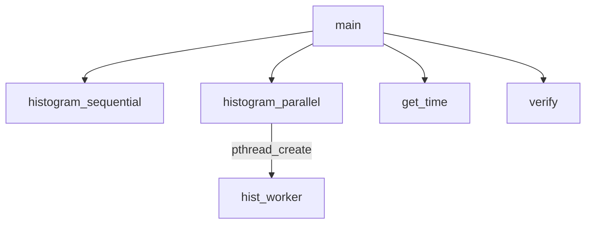

# HW3 Code Walkthrough — Pthreads Data Parallelism

[Repository Guide](../../README.md) | [English](Code-Walkthrough.md) | [한국어](Code-Walkthrough.ko.md)

> **Last Updated:** 2026-11-16

> **Learning Objectives:**
> 1. Describe the functions of `histogram.c` and distinguish the parts given in the starter code from the parts written for the assignment
> 2. Explain how the global data and the thread argument structure are shared between threads
> 3. Compute the range each thread takes for a given data size and thread count
> 4. Explain how the measurement, verification, and top-5 output of `main()` work and the cause of the compiler warnings

---

## Table of Contents

- [1. File Layout](#1-file-layout)
- [2. Includes, Constants, Globals, and the Structure](#2-includes-constants-globals-and-the-structure)
- [3. hist_worker](#3-hist_worker)
- [4. histogram_sequential](#4-histogram_sequential)
- [5. histogram_parallel](#5-histogram_parallel)
- [6. get_time and verify](#6-get_time-and-verify)
- [7. main](#7-main)
- [8. Tracing the Range Computation](#8-tracing-the-range-computation)
- [Summary](#summary)
- [Self-Check Questions](#self-check-questions)

---

<br>

## 1. File Layout

> **Try It First:** This document contains the complete code and line-by-line explanations. Solve the problems in the [assignment handout](Original/Assignment.md) yourself before reading on.

The companion document [HW3 Assignment Explanation](Assignment-Explanation.md) summarizes the requirements, the solutions of the three TODOs, the measurements, and the answers to the report questions. This document reads `Solution/histogram.c` (177 lines) from beginning to end. The file replaces the three TODO comments of the distributed `Original/skeleton/histogram.c` with code, and all other lines are the same as the starter code.

| Lines | Part | Relation to the starter code |
|:-----|:-----|:-----|
| 1-32 | Header comment, includes, constants, globals, `struct hist_arg` | Unchanged |
| 34-49 | `hist_worker()` | Body written (TODO 1) |
| 51-59 | `histogram_sequential()` | Unchanged |
| 61-93 | `histogram_parallel()` | Create loop and join loop written (TODOs 2 and 3); timing unchanged |
| 95-110 | `get_time()`, `verify()` | Unchanged |
| 112-177 | `main()` | Unchanged |

*Table 1. Structure of histogram.c and its relation to the starter code*



*Figure 1. Function call relations in histogram.c*

---

<br>

## 2. Includes, Constants, Globals, and the Structure

```c
#include <stdio.h>
#include <stdlib.h>
#include <string.h>
#include <pthread.h>
#include <time.h>

#define NUM_BINS     100       /* histogram bins (values 0 to 99) */
#define DEFAULT_SIZE 10000000  /* 10 million */
#define MAX_THREADS  8

/* Global data array (read-only by threads) */
int *data;
int data_size;

/* Thread argument structure */
struct hist_arg {
    int id;
    int start;
    int end;
    int local_hist[NUM_BINS];  /* each thread has its own histogram */
};
```

`<string.h>` declares `memset()`, `<pthread.h>` declares `pthread_create()` and `pthread_join()`, and `<time.h>` declares `clock_gettime()`. `NUM_BINS` is the number of bins, 100; `DEFAULT_SIZE` is the default data size, 10 million; and `MAX_THREADS` is the size of the thread arrays, 8.

The global variables `data` and `data_size` live in the data region shared by all threads of a process. The threads only read them, so no protection is needed. `struct hist_arg` is the argument passed to one thread; besides the thread number and range, it holds a local histogram of 100 bins inside the structure. Because the local histogram is inside the argument structure, the main thread can read the result even after the thread has finished. One structure takes 412 bytes, three integers plus the array.

> **Note:** The elements of `args[]` are laid out contiguously in memory, so the data of two neighboring threads can share a cache line. However, each `local_hist` is 400 bytes, much larger than a 64-byte cache line, so the only places that can overlap are near the array boundaries, and the `id`, `start`, and `end` there are read only once when a thread starts. The effect of false sharing is small.

---

<br>

## 3. hist_worker

```c
/*
 * hist_worker: Count values in data[start..end) into local_hist.
 */
void *hist_worker(void *arg)
{
    struct hist_arg *ha = (struct hist_arg *)arg;

    /* Zero out the local histogram */
    memset(ha->local_hist, 0, NUM_BINS * sizeof(int));

    /* Count values in this thread's chunk */
    for (int i = ha->start; i < ha->end; i++)
        ha->local_hist[data[i]]++;

    return NULL;
}
```

A function started by `pthread_create()` must have the type `void *(*)(void *)`, so `hist_worker()` takes a `void *` and converts it to `struct hist_arg *` on line 39. Line 42 (the first step of TODO 1) fills the local histogram with zeros. This step is needed because `args` is a local array of `histogram_parallel()` and contains uninitialized values. Lines 45-46 (the second step of TODO 1) walk the half-open range `[start, end)` and increment the bin indexed by the value `data[i]`. Since `data[i]` is produced by `rand() % NUM_BINS`, it never leaves 0-99, so the index stays within the array. Line 48 returns `NULL` because the result is left in the structure.

---

<br>

## 4. histogram_sequential

```c
/*
 * histogram_sequential: Single-threaded baseline.
 */
void histogram_sequential(int *hist)
{
    memset(hist, 0, NUM_BINS * sizeof(int));
    for (int i = 0; i < data_size; i++)
        hist[data[i]]++;
}
```

The baseline does the same work over the whole range without threads. The example in the handout, `histogram_sequential(int *data, int n, int *hist)`, takes the data and size as arguments, but the starter code uses the global variables `data` and `data_size` and takes only the result array. Both forms produce the same result.

---

<br>

## 5. histogram_parallel

```c
/*
 * histogram_parallel: Multi-threaded version.
 * Returns elapsed time in seconds.
 */
double histogram_parallel(int nthreads, int *hist)
{
    pthread_t threads[MAX_THREADS];
    struct hist_arg args[MAX_THREADS];

    struct timespec t_start, t_end;
    clock_gettime(CLOCK_MONOTONIC, &t_start);

    /* Create threads, each processing a chunk of the data */
    int chunk = data_size / nthreads;
    for (int i = 0; i < nthreads; i++) {
        args[i].id    = i;
        args[i].start = i * chunk;
        args[i].end   = (i == nthreads - 1) ? data_size : (i + 1) * chunk;
        pthread_create(&threads[i], NULL, hist_worker, &args[i]);
    }

    /* Join all threads and merge local histograms */
    memset(hist, 0, NUM_BINS * sizeof(int));
    for (int i = 0; i < nthreads; i++) {
        pthread_join(threads[i], NULL);
        for (int b = 0; b < NUM_BINS; b++)
            hist[b] += args[i].local_hist[b];
    }

    clock_gettime(CLOCK_MONOTONIC, &t_end);
    return (t_end.tv_sec - t_start.tv_sec)
         + (t_end.tv_nsec - t_start.tv_nsec) / 1e9;
}
```

Lines 67-68 set up the arrays for the thread identifiers and arguments with size `MAX_THREADS`. After the time is taken on lines 70-71, line 74 (TODO 2) computes the quotient `chunk` by integer division. The create loop on lines 75-80 fills in the number, start, and end of thread i, setting the end to `data_size` only for the last thread. `pthread_create()` on line 79 makes the new thread run `hist_worker(&args[i])` with the default attributes (`NULL`), and its return value is not checked.

Line 83 (TODO 3) clears the result array `hist`, and lines 84-88 join the threads in number order while adding each thread's local histogram bin by bin. Lines 90-92 take the end time and return the difference in seconds. The difference of the nanosecond parts can be negative, but adding it to the seconds part gives the correct elapsed time.

---

<br>

## 6. get_time and verify

```c
/* Helper: get wall-clock time */
double get_time(void)
{
    struct timespec ts;
    clock_gettime(CLOCK_MONOTONIC, &ts);
    return ts.tv_sec + ts.tv_nsec / 1e9;
}

/* Verify two histograms match */
int verify(int *expected, int *actual)
{
    for (int i = 0; i < NUM_BINS; i++)
        if (expected[i] != actual[i])
            return 0;
    return 1;
}
```

`get_time()` returns the current time of the monotonic clock (`CLOCK_MONOTONIC`) as a floating-point number of seconds. A monotonic clock does not go backward or jump when the system time is adjusted, so it suits measuring intervals. The comment's "wall-clock time" means that it measures real elapsed time rather than CPU time. `verify()` compares the two histograms bin by bin and returns 1 only if all of them match.

---

<br>

## 7. main

```c
int main(int argc, char *argv[])
{
    data_size = (argc > 1) ? atoi(argv[1]) : DEFAULT_SIZE;
    int user_threads = (argc > 2) ? atoi(argv[2]) : 4;

    printf("=== Parallel Histogram ===\n");
    printf("Data size: %d, Bins: %d\n\n", data_size, NUM_BINS);

    /* Generate random data */
    data = malloc(data_size * sizeof(int));
    srand(42);
    for (int i = 0; i < data_size; i++)
        data[i] = rand() % NUM_BINS;

    /* Sequential baseline */
    int hist_seq[NUM_BINS];
    double t0 = get_time();
    histogram_sequential(hist_seq);
    double t1 = get_time();
    double seq_time = t1 - t0;
    printf("Sequential:           %.4f sec\n\n", seq_time);
```

Line 114 uses the first command-line argument as the data size if given, and 10 million otherwise. Line 115 reads the second argument into `user_threads`, but this variable is never used, so the program always tests 1, 2, 4, and 8 threads regardless of the second argument. Lines 121-124 allocate the data, fix the random seed with `srand(42)`, and fill it with values in 0-99. Because the seed is fixed, the same data is generated on every run. Lines 127-132 time the sequential version.

```c
    /* Parallel with varying thread counts */
    int thread_counts[] = {1, 2, 4, 8};
    int num_tests = 4;
    int hist_par[NUM_BINS];
    int all_correct = 1;

    for (int t = 0; t < num_tests; t++) {
        int nt = thread_counts[t];
        if (nt > MAX_THREADS) continue;

        double elapsed = histogram_parallel(nt, hist_par);
        int ok = verify(hist_seq, hist_par);
        if (!ok) all_correct = 0;

        printf("Parallel (%d thread%s): %.4f sec  Speedup: %.2fx  %s\n",
               nt, nt > 1 ? "s" : " ",
               elapsed, seq_time / elapsed,
               ok ? "" : "MISMATCH!");
    }

    printf("\nVerification: %s\n", all_correct ? "ALL CORRECT" : "ERRORS FOUND");
```

Lines 140-152 run the parallel version for each of 1, 2, 4, and 8 threads, verify the result, and print the time and speedup (`seq_time / elapsed`). Line 149 puts a space instead of the plural `s` when there is one thread to keep the columns aligned, so the output reads `Parallel (1 thread ):`. If any result differs, `all_correct` becomes 0, and line 154 prints the final verification result.

```c
    /* Print top 5 most frequent values */
    printf("\n--- Top 5 most frequent values ---\n");
    for (int rank = 0; rank < 5; rank++) {
        int max_val = -1, max_count = -1;
        for (int i = 0; i < NUM_BINS; i++) {
            if (hist_seq[i] > max_count) {
                /* skip already-printed values */
                int skip = 0;
                /* simple check: already used values have been zeroed */
                max_count = hist_seq[i];
                max_val = i;
            }
        }
        if (max_val >= 0) {
            printf("Value %2d: %d occurrences\n", max_val, max_count);
            hist_seq[max_val] = -1;  /* mark as printed */
        }
    }

    free(data);
    return all_correct ? 0 : 1;
}
```

Lines 156-173 print the 5 most frequent values. For each rank, the code finds the maximum in `hist_seq`, prints it, and changes that bin to -1 so that it is not picked again at the next rank. `skip` on line 163 is declared but never used. Building with `gcc -Wall` produces unused-variable warnings for this `skip` and for `user_threads` on line 115; both lines come from the starter code, and the written TODO parts produce no warnings. Lines 175-176 free the data and return 0 as the exit code if all verifications passed, and 1 otherwise.

---

<br>

## 8. Tracing the Range Computation

| Data size | Threads | chunk | Range of each thread |
|-----:|-----:|-----:|:-----|
| 10,000,000 | 8 | 1,250,000 | `[0, 1250000)`, `[1250000, 2500000)`, ..., `[8750000, 10000000)` |
| 1,000 | 8 | 125 | `[0, 125)`, `[125, 250)`, ..., `[875, 1000)` |
| 10 | 4 | 2 | `[0, 2)`, `[2, 4)`, `[4, 6)`, `[6, 10)` |
| 10 | 8 | 1 | `[0, 1)`, ..., `[6, 7)`, `[7, 10)` |

*Table 2. Ranges by data size and thread count*

The default size of 10 million is divisible by 1, 2, 4, and 8, so every thread takes the same amount. If it is not divisible, the last thread takes up to `nthreads - 1` extra elements of remainder. If the data size is smaller than the number of threads, `chunk` becomes 0, so the last thread takes everything and the other threads receive empty ranges, but the result is still correct.

---

<br>

## Summary

| Concept | Key Summary |
|:-----|:-----|
| Written parts | Only the three TODOs of the starter code were written: the body of `hist_worker()` and the create loop and join-and-merge loop of `histogram_parallel()`. |
| Shared and private | `data` and `data_size` are globals that all threads only read, and each thread writes only to its own `args[i].local_hist`. |
| hist_worker | It converts the argument to a structure pointer, clears the local histogram, counts the values in `[start, end)`, and leaves the result in the structure. |
| histogram_parallel | It creates threads over ranges split by `chunk`, joins them in turn while adding bin by bin, and returns the elapsed time measured with the monotonic clock. |
| main | It generates data with a fixed seed, compares the times of the sequential version and 1, 2, 4, and 8 threads, and prints the verification and the top 5. |
| Warnings | The two `-Wall` warnings (`user_threads`, `skip`) come from unused variables in the starter code. |

---

<br>

## Self-Check Questions

1. **The second argument:** State which thread counts are tested when `./histogram 20000000 8` is run.

   <details>
   <summary>Answer</summary>

   The data size becomes 20 million, but `user_threads`, which reads the second argument, is never used, so the thread counts tested are still 1, 2, 4, and 8.

   </details>

2. **Where memset goes:** State what goes wrong if the `memset()` in `hist_worker()` is removed.

   <details>
   <summary>Answer</summary>

   `args` is a local array of the function, so `local_hist` contains uninitialized values. Adding counts on top of them gives wrong results, and `verify()` may fail. Moreover, since `histogram_parallel()` is called several times, values left at the same stack location by an earlier call could also be mixed in.

   </details>

3. **Top 5 and verification:** Explain why the top-5 code changing bins of `hist_seq` to -1 does not affect the verification result.

   <details>
   <summary>Answer</summary>

   Verification is already complete by line 154, and the top-5 code runs after it. Changing `hist_seq` only marks entries for printing, and the array is not used for verification afterward.

   </details>
