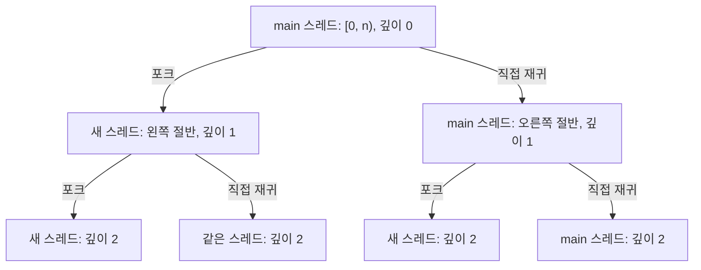

# HW4 과제 해설 — 암묵적 스레딩

[레포지토리 안내](../../README.ko.md) | [English](Assignment-Explanation.md) | [한국어](Assignment-Explanation.ko.md)

> **최종 수정일:** 2026-11-16
>
> Operating System Concepts, Silberschatz, Galvin, and Gagne, Ch 4 (4.5-4.7)

> **학습 목표:**
> 1. 분할 정복 알고리즘을 포크-조인 패턴으로 병렬화하고 스레드 수를 제한하는 기준을 설명할 수 있다
> 2. OpenMP 지시어로 반복문을 병렬화하고 포크-조인 방식과 비교할 수 있다
> 3. 측정한 속도 향상에서 암달의 법칙으로 순차 비율과 속도 향상의 상한을 구할 수 있다
> 4. 행렬 곱셈의 루프 순서가 메모리 접근 보폭과 캐시 성능에 미치는 영향을 설명할 수 있다
> 5. 스레드를 물리 코어보다 훨씬 많이 만들 때 성능이 나빠지는 원인을 설명할 수 있다

---

## 목차

- [1. 과제 개요](#1-과제-개요)
- [2. 요구사항](#2-요구사항)
  - [2.1 과제 1: 포크-조인 병렬 병합 정렬](#21-과제-1-포크-조인-병렬-병합-정렬)
  - [2.2 과제 2: OpenMP 행렬 곱셈](#22-과제-2-openmp-행렬-곱셈)
  - [2.3 질문과 채점 기준](#23-질문과-채점-기준)
- [3. 배경](#3-배경)
  - [3.1 포크-조인 병렬성](#31-포크-조인-병렬성)
  - [3.2 OpenMP와 암묵적 데이터 병렬성](#32-openmp와-암묵적-데이터-병렬성)
  - [3.3 암달의 법칙과 병렬성의 한계](#33-암달의-법칙과-병렬성의-한계)
  - [3.4 메모리 계층과 공간 지역성](#34-메모리-계층과-공간-지역성)
- [4. 구현](#4-구현)
  - [4.1 포크-조인 병합 정렬](#41-포크-조인-병합-정렬)
  - [4.2 OpenMP 행렬 곱셈](#42-openmp-행렬-곱셈)
- [5. 실험 환경](#5-실험-환경)
- [6. 결과](#6-결과)
- [7. 논의와 질문의 답](#7-논의와-질문의-답)
  - [7.1 병합 정렬에 적용한 암달의 법칙](#71-병합-정렬에-적용한-암달의-법칙)
  - [7.2 과잉 구독과 MAX_DEPTH의 최적점](#72-과잉-구독과-max_depth의-최적점)
  - [7.3 루프 순서와 캐시 동작](#73-루프-순서와-캐시-동작)
  - [7.4 루프 순서 너머: 루프라인과 캐시 블로킹](#74-루프-순서-너머-루프라인과-캐시-블로킹)
  - [7.5 Java의 ForkJoinPool과의 관계](#75-java의-forkjoinpool과의-관계)
  - [7.6 포크-조인과 OpenMP의 선택](#76-포크-조인과-openmp의-선택)
- [8. 핵심 정리](#8-핵심-정리)
- [요약](#요약)
- [점검 문제](#점검-문제)

---

<br>

## 1. 과제 개요

> **풀어 보기:** 이 문서는 정답과 풀이를 담고 있다. 먼저 [과제 안내문](Original/Assignment.ko.md)의 문제를 직접 풀어 본 뒤 읽는다.

과제는 5주차(스레드와 동시성 2)에서 배운 암묵적 스레딩의 두 모델을 다룬다. 필수 과제는 Pthreads로 포크-조인 병렬 병합 정렬을 구현하는 것이고, 보너스 과제는 OpenMP로 행렬 곱셈을 병렬화하고 최적화하는 것이다. 두 과제 모두 순차 버전과 시간을 비교하며, 질문에 답하는 보고서를 함께 낸다. 문제의 원문은 [과제 안내문](Original/Assignment.ko.md)에 있고, 배포된 시작 코드는 `Original/skeleton/`에 원본 그대로 있다. 제출한 보고서는 요구한 구현에 더해 깊이 임계값을 바꾸어 가며 잰 실험, 여섯 가지 루프 순서의 행렬 곱셈 비교, 루프라인과 캐시 블로킹에 관한 논의를 담았으며, 그 내용은 이 문서의 3절과 5\~8절에 옮겼다.

```text
Coursework/HW04_Thread-and-Concurrency-2/
├── Assignment-Explanation.ko.md    # 과제 해설 (한국어, 이 문서)
├── Assignment-Explanation.md       # 과제 해설 (영어)
├── Code-Walkthrough.ko.md          # 코드 총정리 (한국어)
├── Code-Walkthrough.md             # 코드 총정리 (영어)
├── Original/
│   ├── Assignment.ko.md            # 과제 안내문 (한국어)
│   ├── Assignment.md               # 과제 안내문 (영어)
│   └── skeleton/
│       ├── matmul.c                # 배포된 시작 코드 (과제 2)
│       └── mergesort.c             # 배포된 시작 코드 (과제 1)
└── Solution/
    ├── matmul.c                    # 과제 2의 풀이
    └── mergesort.c                 # 과제 1의 풀이
```

*그림 1. HW4 과제의 디렉토리 구성*

---

<br>

## 2. 요구사항

### 2.1 과제 1: 포크-조인 병렬 병합 정렬

교재 4.5.2절의 포크-조인 병렬성을 바탕으로, Pthreads로 병렬 병합 정렬을 구현한다. `merge_sort_parallel()`은 한 절반을 정렬할 새 스레드를 포크하고 나머지 절반은 현재 스레드가 정렬하며, 그 스레드를 조인한 뒤 정렬된 두 절반을 병합해야 한다. 스레드를 너무 많이 만들지 않도록 깊이 임계값 `MAX_DEPTH`를 두어, 재귀 깊이가 임계값에 이르면 `merge_sort_sequential()`로 돌아간다. 과제는 설계의 핵심으로 한 단계에서 스레드를 하나만 포크할 것과, `MAX_DEPTH`로 스레드 수를 `2^MAX_DEPTH`개로 제한할 것을 든다. `main()`은 무작위 정수 배열을 순차 버전과 병렬 버전으로 각각 정렬하여 시간과 속도 향상을 출력하고, 두 결과가 같은지 검증한다. 시작 코드는 `merge()`, `merge_sort_sequential()`, `main()`을 갖추고 `merge_sort_parallel()`의 본문만 TODO로 남긴다.

### 2.2 과제 2: OpenMP 행렬 곱셈

교재 4.5.3절의 OpenMP를 바탕으로 하는 보너스 과제(+20점)이다. 결과 행렬의 각 원소 `C[i][j] = sum(A[i][k] * B[k][j])`는 독립적으로 계산할 수 있으므로 `#pragma omp parallel for`에 알맞다. 행렬 곱셈을 세 가지로 구현하여 성능을 비교한다. 순차 버전은 i-j-k 순서의 3중 루프이고, 기본 OpenMP 버전은 가장 바깥 루프에 `#pragma omp parallel for`를 더하며, 최적화 버전은 부하 분산을 위한 `collapse(2)`와 캐시 지역성을 위한 루프 순서 바꾸기(i-k-j) 가운데 하나 이상을 적용한다. 시작 코드는 순차 버전과 측정, 검증 코드를 갖추고 두 OpenMP 버전을 TODO로 남긴다.

### 2.3 질문과 채점 기준

과제 1의 안내에는 생각해 볼 질문 네 개가, 선택 보고서 `report.md`의 작성 안내에는 가산점이 있는 질문 세 개가 있다. 이 문서는 질문을 다음 이름으로 부르며, 각 질문의 답이 있는 절을 함께 적는다.

| 질문 | 내용 | 답 |
|:-----|:-----|:-----|
| 질문 1 | `MAX_DEPTH`가 너무 크면 어떻게 되는가 | 7.2절 |
| 질문 2 | 각 단계에서 스레드를 두 개가 아니라 하나만 포크하는 이유는 무엇인가 | 4.1절 |
| 질문 3 | 교재의 Java `ForkJoinPool`과 어떤 관계가 있는가 | 7.5절 |
| 질문 4 | 속도 향상을 암달의 법칙과 비교하면 순차 비율은 얼마인가 | 7.1절 |
| 보고서 질문 1 | `MAX_DEPTH`는 성능에 어떤 영향을 주며, 자신의 컴퓨터에서 가장 좋은 값은 얼마인가 | 7.2절 |
| 보고서 질문 2 | 루프 순서를 i-k-j로 바꾸면 캐시 성능이 좋아지는 이유는 무엇인가 | 7.3절 |
| 보고서 질문 3 | 포크-조인 패턴과 OpenMP는 각각 언제 쓰는가 | 7.6절 |

*표 1. 질문과 답이 있는 절*

과제 1의 채점 비중은 포크와 조인을 갖춘 `merge_sort_parallel()` 30%, 스레드 수를 제한하는 깊이 임계값 20%, 올바른 병합 20%, 순차와 병렬의 성능 비교 20%, 코드 품질과 질문의 답 10%이다. 과제 2는 순차 행렬 곱셈 20%, 기본 OpenMP 버전 30%, 측정 가능한 개선이 있는 최적화 버전 30%, 성능 비교와 분석 20%이다.

---

<br>

## 3. 배경

**암묵적 스레딩(implicit threading)** 은 스레드 관리를 추상화하여, 프로그래머가 스레드를 어떻게 만들고 스케줄링할지보다 무엇을 병렬로 실행할 수 있는지에 집중하게 한다. 이 과제는 교재 4.5절의 두 모델, POSIX 스레드로 구현하는 포크-조인 패턴과 밀집 행렬 곱셈에 쓰는 OpenMP를 다룬다.

### 3.1 포크-조인 병렬성

포크-조인은 작업을 서로 독립인 하위 작업으로 재귀적으로 나누어(fork) 병렬로 실행하고, 모든 하위 작업이 끝나면 결과를 합치는(join) 구조적 패턴이다. 병합 정렬, 퀵 정렬, 트리 순회 같은 분할 정복 알고리즘에 자연스럽게 대응한다. 설계의 핵심 질문은 언제 포크를 멈출지이다. 재귀의 모든 단계에서 새 스레드를 만드는 단순한 구현은 수명이 짧은 스레드를 지수적으로 많이 만들어, 스레드 생성 비용이 실제 작업을 압도한다. 그래서 실제 구현은 깊이 임계값이나 작업 단위의 하한으로 병렬성의 정도를 제한한다.

### 3.2 OpenMP와 암묵적 데이터 병렬성

OpenMP(교재 4.5.3절)는 반복문과 코드 영역에 붙이는 `#pragma` 지시어로 병렬성을 더한다. `#pragma omp parallel for` 하나가 `for` 루프의 반복 공간을 런타임이 자동으로 관리하는 작업자 스레드 풀에 나누어 준다. 각 반복이 독립적인 데이터를 다루는 규칙적인 데이터 병렬성에 알맞으며, 포크-조인과는 두 가지가 다르다. 병렬성을 재귀적인 하위 작업이 아니라 반복 첨자로 나누고, 스레드 관리가 완전히 암묵적이어서 `pthread_create`도, 조인도, 인자 구조체도 없다. 프로그래머는 무엇을 병렬로 실행할 수 있는지만 지정하고, 어떻게 실행할지는 런타임이 정한다.

### 3.3 암달의 법칙과 병렬성의 한계

암달의 법칙은 병렬 속도 향상의 상한을 정한다. 스레드 하나의 실행 시간 $T(1)$을 병렬화할 수 없는 순차 부분 $`T_s`$와 병렬 부분 $`T_p`$로 나누면 $`T(1) = T_s + T_p`$이다. 순차 비율을 $`f = T_s / T(1)`$로 정의하면 $`T_s = f \cdot T(1)`$, $`T_p = (1 - f) \cdot T(1)`$이다. 스레드 $N$개에서 병렬 부분이 완벽하게 나뉜다고 하면 다음이 성립한다.

$$
T(N) = f \cdot T(1) + \frac{(1 - f) \cdot T(1)}{N}, \qquad S(N) = \frac{T(1)}{T(N)} = \frac{1}{f + \frac{1 - f}{N}}
$$

$N \to \infty$이면 $S(N) \to 1/f$이므로, 코어가 아무리 많아도 순차 비율이 속도 향상의 상한을 정한다. 작은 순차 비율도 결과를 크게 좌우하여, $f = 5\%$이면 속도 향상은 20배, $f = 1\%$이면 100배를 넘을 수 없다. 암달의 법칙은 문제 크기를 고정하고 스레드를 늘리는 강한 확장성(strong scaling)을 모델로 한다. 이와 짝을 이루는 구스타프슨의 법칙(Gustafson's Law)은 코어 수와 함께 문제를 키우는 약한 확장성(weak scaling)을 다루며, 이때는 늘어나는 병렬 작업에 비해 순차 비율이 줄어든다. 이 과제는 입력 크기(정수 1,000만 개, 1024 × 1024 행렬)를 고정하므로 암달의 법칙이 알맞은 관점이다.

### 3.4 메모리 계층과 공간 지역성

현대 CPU는 빠른 코어와 느린 DRAM 사이를 여러 단계의 캐시로 잇는다. L1은 수십 KB에 지연이 1\~4 사이클, L2는 몇 MB에 약 10 사이클, 있을 경우 L3는 수십 MB에 약 30 사이클이고, DRAM은 100\~300 사이클이다. 데이터는 고정 크기의 **캐시 라인(cache line)** 단위로 계층 사이를 오가며, 그 크기는 x86에서 64바이트, Apple Silicon의 성능 코어에서 128바이트이다.

캐시의 효율은 두 가지 지역성이 좌우한다. **공간 지역성(spatial locality)** 은 바이트 X에 접근하면 그 이웃도 곧 접근할 가능성이 높다는 성질로, 보폭 1의 순차 읽기에서는 캐시 라인을 한 번 채워 연속된 여러 접근을 처리한다. **시간 지역성(temporal locality)** 은 최근에 쓴 데이터를 다시 쓸 가능성이 높다는 성질로, 작업 집합을 L1보다 작게 유지하면 반복 접근이 DRAM까지 가지 않고 캐시에서 처리된다. C의 기본인 행 우선(row-major) 저장에서는 가장 안쪽 루프가 마지막(열) 첨자를 돌 때만 보폭 1의 접근이 되고, 다른 순서에서는 적어도 한 행렬에서 보폭 N의 대가를 치른다. 이것이 6절에서 측정한 루프 순서에 따른 약 14배 차이의 원인이다.

---

<br>

## 4. 구현

### 4.1 포크-조인 병합 정렬

2.1절의 요구는 한 단계에서 왼쪽 절반만 새 스레드로 포크하고, 오른쪽 절반은 현재 스레드가 정렬하며, 깊이 임계값에서 순차 정렬로 돌아가는 것이다. `Solution/mergesort.c`의 `merge_sort_parallel()`(76\~110번 줄)이 이를 구현한다.

```c
int max_depth;

void *merge_sort_parallel(void *arg)
{
    struct sort_arg *sa = (struct sort_arg *)arg;
    int left  = sa->left;
    int right = sa->right;
    int depth = sa->depth;

    if (left >= right)
        return NULL;

    /* Fall back to sequential when depth threshold is reached */
    if (depth >= max_depth) {
        merge_sort_sequential(sa->array, sa->temp, left, right);
        return NULL;
    }

    int mid = left + (right - left) / 2;

    /* FORK: create a thread for the left half */
    struct sort_arg left_arg = { sa->array, sa->temp, left, mid, depth + 1 };
    pthread_t tid;
    pthread_create(&tid, NULL, merge_sort_parallel, &left_arg);

    /* Sort the right half in the current thread */
    struct sort_arg right_arg = { sa->array, sa->temp, mid + 1, right, depth + 1 };
    merge_sort_parallel(&right_arg);

    /* JOIN: wait for the left-half thread */
    pthread_join(tid, NULL);

    /* MERGE: combine the two sorted halves */
    merge(sa->array, sa->temp, left, mid, right);

    return NULL;
}
```

함수는 부분 범위와 깊이를 담은 인자를 받는다. 깊이가 `max_depth` 이상이면 순차 병합 정렬로 돌아간다(87\~90번 줄). 그렇지 않으면 포크한다. `pthread_create`가 왼쪽 절반을 깊이 `depth + 1`에서 정렬할 스레드를 만들고(95\~97번 줄), 현재 스레드는 오른쪽 절반을 재귀로 정렬한다(100\~101번 줄). 오른쪽의 재귀가 반환하면 왼쪽 스레드를 `pthread_join`으로 기다리고(104번 줄), 정렬된 두 절반을 병합한다(107번 줄).

**한 단계에서 스레드를 하나만 포크하는 이유(질문 2).** 두 절반을 모두 포크하는 단순한 구현은 호출한 스레드를 `pthread_join` 안에서 놀게 한다. 그러면 그 하위 트리가 끝날 때까지 CPU 코어 하나를 낭비하고, 실행 전체에서 새로 만드는 스레드 수가 $2^d - 1$에서 $2^{d+1} - 2$로 두 배가 된다. 왼쪽 절반만 포크하고 오른쪽 절반을 호출한 스레드가 처리하면 살아 있는 모든 스레드가 일을 한다.

**깊이 임계값을 두는 이유.** 깊이가 $d$이면 재귀 트리의 잎에서 최대 $2^d$개의 스레드가 동시에 실행된다. 이 값이 너무 작으면 코어를 다 쓰지 못하고, 너무 크면 호출마다 수십 마이크로초가 드는 `pthread_create`의 오버헤드가 커지며 스레드마다 스택 하나(보통 macOS에서 512 KB, Linux에서 8 MB)를 예약한다. 기본값은 `max_depth = 3`(동시 스레드 최대 8개)이고, 실험으로 찾은 최적점은 6절에서 재고 7.2절에서 논의한다.



*그림 2. max_depth = 2일 때의 스레드 생성 (깊이 2의 네 호출은 순차 정렬을 실행)*

그림 2처럼 `max_depth = 2`이면 새 스레드는 $2^2 - 1 = 3$개 생기고, main 스레드를 합쳐 4개의 스레드가 깊이 2에서 각자 순차 정렬을 실행한다. 왼쪽 절반의 인자 `left_arg`는 포크한 함수의 지역 변수이지만, 그 함수는 `pthread_join`이 반환한 뒤에야 끝나므로 새 스레드가 실행되는 동안 유효하다.

### 4.2 OpenMP 행렬 곱셈

2.2절의 요구는 기본 버전에서 가장 바깥 루프를 OpenMP로 병렬화하고, 최적화 버전에서 `collapse(2)`나 루프 순서 바꾸기를 적용하는 것이다. `Solution/matmul.c`는 double 형의 1024 × 1024 밀집 행렬에 대해 세 버전을 구현한다.

```c
/*
 * matmul_openmp_basic: Add #pragma omp parallel for to outer loop.
 */
void matmul_openmp_basic(void)
{
    #pragma omp parallel for
    for (int i = 0; i < N; i++)
        for (int j = 0; j < N; j++)
            for (int k = 0; k < N; k++)
                C[IDX(i, j)] += A[IDX(i, k)] * B[IDX(k, j)];
}

/*
 * matmul_openmp_optimized: Loop reordering (i-k-j) + OpenMP.
 *
 * Why i-k-j? In the innermost loop (j), both C[i][j] and B[k][j]
 * are accessed with stride 1 (sequential memory access).
 * In i-j-k order, B[k][j] has stride N (cache-unfriendly).
 */
void matmul_openmp_optimized(void)
{
    #pragma omp parallel for
    for (int i = 0; i < N; i++)
        for (int k = 0; k < N; k++)
            for (int j = 0; j < N; j++)
                C[IDX(i, j)] += A[IDX(i, k)] * B[IDX(k, j)];
}
```

기본 버전(55\~62번 줄)은 순차 i-j-k 루프의 가장 바깥 i 루프 위에 `#pragma omp parallel for`를 붙인다. 행 i마다 결과 `C`의 다른 행을 쓰므로 스레드 사이에 쓰기 충돌이 없다. 최적화 버전(71\~78번 줄)은 루프 순서를 i-k-j로 바꾸고 같은 지시어를 붙이며, `collapse(2)`는 쓰지 않는다. i-k-j에서는 가장 안쪽 j 루프가 `B`와 `C`의 열 첨자를 보폭 1로 지나가므로, 세 행렬 가운데 두 행렬에서 공간 지역성을 함께 얻는다. 여섯 가지 루프 순서는 6절에서 비교하고 7.3절에서 분석한다.

---

<br>

## 5. 실험 환경

모든 측정은 Apple M2 Pro에서 했다. 코어는 12개로 성능 코어(P-core) 8개와 효율 코어(E-core) 4개이고 동시 멀티스레딩(SMT)은 없다. Apple Silicon의 성능 코어는 x86의 관례인 64바이트의 두 배인 128바이트 캐시 라인을 쓰므로, 보폭 1의 루프에서 캐시 라인 하나가 double 8개가 아니라 16개를 채운다.

| 구성 요소 | 값 |
|:-----|:-----|
| CPU | Apple M2 Pro (Mac14,10) |
| 코어 | 12개: 성능 코어 8개, 효율 코어 4개 (SMT 없음) |
| 성능 코어 클럭 | 약 3.5 GHz (기본), 최대 약 3.7 GHz |
| L1 명령어 캐시 (성능 코어) | 코어당 192 KB |
| L1 데이터 캐시 (성능 코어) | 코어당 128 KB |
| L2 (성능 코어 클러스터 공유) | 16 MB (클러스터당 성능 코어 4개) |
| L1 데이터 캐시 (효율 코어) | 코어당 64 KB |
| L2 (효율 코어 클러스터 공유) | 4 MB |
| 캐시 라인 크기 | 성능 코어에서 128바이트 (double 16개) |
| 통합 메모리 | 16 GB LPDDR5, 대역폭 약 200 GB/s |
| 커널 | Darwin 25.4.0 (macOS), arm64 |
| C 컴파일러 (mergesort) | Apple clang 21.0.0, arm64 네이티브 |
| C 컴파일러 (matmul) | Homebrew GCC 15.2.0 (libgomp), Rosetta 2 위의 x86_64 |
| 컴파일 옵션 | `-Wall -O2` (mergesort는 `-pthread`, matmul은 `-fopenmp` 추가) |

*표 2. 실험에 쓴 하드웨어와 소프트웨어*

`mergesort.c`는 Apple clang 21로 네이티브 arm64 바이너리로 빌드했다. `matmul.c`는 Homebrew GCC 15와 libgomp로 x86_64 바이너리를 빌드해 Rosetta 2 위에서 실행했으며, Rosetta 2는 대략 15\~25%의 오버헤드를 더한다. 그래서 7.4절의 절대 GFLOP/s 값은 보수적이지만, 모든 행렬 곱셈 버전이 같은 변환 계층 위에서 실행되므로 버전 사이의 상대 비교에는 영향이 없다. OpenMP는 기본값 `OMP_NUM_THREADS = 12`를 썼다. 각 설정은 세 번 실행하여 중앙값을 보고한다.

---

<br>

## 6. 결과

정수 1,000만 개, `max_depth = 3`에서 세 번 실행한 중앙값은 다음과 같다.

| 버전 | 시간 (초) | 속도 향상 |
|:-----|-----:|-----:|
| 순차 | 0.5320 | 1.00× |
| 병렬 (스레드 8개) | 0.1027 | 5.18× |

*표 3. 병합 정렬의 순차와 포크-조인 병렬 비교*

포크-조인 버전은 동시에 실행되는 잎 스레드 8개로 5.18×에 이르며, 이는 이상적인 선형 확장의 약 65%이다. 최적의 깊이를 찾기 위해 `max_depth`를 0(순수 순차)부터 14(잎 스레드 16384개)까지 바꾸며 깊이마다 세 번씩 쟀다.

| max_depth (최대 스레드) | 병렬 (초) | 속도 향상 |
|:-----|-----:|-----:|
| 0 (1) | 0.5291 | 1.01× |
| 1 (2) | 0.2815 | 1.89× |
| 2 (4) | 0.1587 | 3.35× |
| 3 (8) | 0.0985 | 5.43× |
| 4 (16) | 0.0925 | 5.78× |
| 5 (32) | 0.0902 | 5.93× |
| 6 (64) | 0.0868 | 6.10× |
| 7 (128) | 0.0867 | 6.11× |
| 8 (256) | 0.0858 | 6.22× |
| 10 (1024) | 0.0922 | 5.81× |
| 12 (4096) | 0.2439 | 2.22× |
| 14 (16384) | 1.8520 | 0.28× |

*표 4. 깊이 임계값에 따른 병합 정렬의 시간과 속도 향상*

결과는 전형적인 U자 모양을 그리며, 해석은 7.2절에 있다. 행렬 곱셈은 1024 × 1024, `OMP_NUM_THREADS = 12`에서 다음과 같다.

| 버전 | 시간 (초) | 속도 향상 |
|:-----|-----:|-----:|
| 순차 (i-j-k) | 5.5671 | 1.00× |
| OpenMP 기본 (i-j-k) | 0.7800 | 7.14× |
| OpenMP 최적화 (i-k-j) | 0.0576 | 96.64× |

*표 5. 행렬 곱셈의 세 버전 비교*

기본 OpenMP는 스레드 12개로 7.14×에 이른다. OpenMP 위에 i-k-j 루프 순서 바꾸기를 더한 최적화 버전은 96.64×로 스레드 수를 훨씬 넘는다. 그 차이는 7.3절에서 분석한다. 여섯 가지 루프 순서를 OpenMP 없이 순수한 순차 C로 1024 × 1024에서 두 번씩 잰 중앙값은 다음과 같다.

| 순서 | 시간 (초) | i-j-k 대비 | 가장 안쪽 루프의 보폭 |
|:-----|-----:|-----:|:-----|
| i-k-j | 0.181 | 14.1× | A 고정, B 보폭 1, C 보폭 1 |
| k-i-j | 0.209 | 12.2× | A 고정, B 보폭 1, C 보폭 1 |
| i-j-k | 2.555 | 1.00× | A 보폭 1, B 보폭 N, C 고정 |
| j-i-k | 5.254 | 0.49× | A 보폭 1, B 보폭 N, C 고정 |
| k-j-i | 7.348 | 0.35× | A 보폭 N, B 고정, C 보폭 N |
| j-k-i | 12.76 | 0.20× | A 보폭 N, B 고정, C 보폭 N |

*표 6. 여섯 가지 루프 순서의 순차 행렬 곱셈*

여섯 순서는 가장 안쪽 루프의 첨자에 따라 세 무리로 나뉘고, 가장 빠른 것과 가장 느린 것의 차이는 70배가 넘는다. 이 무리 짓기는 7.3절에서 캐시 라인의 동작으로 설명한다.

---

<br>

## 7. 논의와 질문의 답

### 7.1 병합 정렬에 적용한 암달의 법칙

질문 4는 측정한 속도 향상을 암달의 법칙과 비교하여 순차 비율을 구하라고 한다. $N = 8$, $S = 5.18$을 3.3절의 식에 넣으면 다음과 같다.

$$
\frac{1}{5.18} = 0.1931 = f + \frac{1 - f}{8} \quad\Rightarrow\quad \frac{7}{8} f = 0.0681 \quad\Rightarrow\quad f \approx 0.078
$$

벽시계 시간의 약 8%(7.8%)가 본질적으로 순차적이다. 이 순차 시간은 대부분 마지막 병합 단계에서 나온다. 두 절반을 최종 정렬 결과로 합치는 가장 바깥의 병합은 구조상 스레드 하나로 $O(N)$ 시간 동안 실행된다. 나머지는 스레드 생성과 조인의 오버헤드이다. 같은 컴퓨터에서 4주차 히스토그램 과제(HW3)는 $f \approx 15\%$였는데, 병합 정렬은 오버헤드에 비해 계산량이 많아 순차 비율이 더 낮다.

### 7.2 과잉 구독과 MAX_DEPTH의 최적점

질문 1은 `MAX_DEPTH`가 너무 크면 어떻게 되는지를, 보고서 질문 1은 `MAX_DEPTH`가 성능에 주는 영향과 가장 좋은 값을 묻는다. 6절의 깊이 실험은 뚜렷한 U자 곡선을 그린다. 깊이 0에서 3까지는 잎 스레드가 두 배가 될 때마다 성능 코어 8개의 한계까지 병렬성이 대략 두 배가 되므로, 속도 향상이 거의 선형으로 오른다(1.01×에서 5.43×). 깊이 3에서 8까지는 6.1\~6.2×에서 포화한다. 물리 코어보다 많은 스레드를 더해도 얻는 것은 매우 작다. 깊이 10에서 14까지는 곡선이 무너진다. 깊이 12(스레드 4096개)에서는 이미 최고 성능보다 약 3배 느리고, 깊이 14(스레드 16384개)에서는 속도 향상이 0.28×로 스레드 하나의 기준보다 3배 넘게 느리다. `pthread_create`와 `pthread_join`의 오버헤드, 스택 메모리의 압박, 스케줄러의 경합이 병렬성의 이득을 완전히 없앤다. 스레드를 물리 코어보다 훨씬 많이 만드는 이런 상태를 **과잉 구독(oversubscription)** 이라 한다.

실험으로 찾은 최적점은 깊이 6\~8로, $`\log_2(\text{코어 수}) \approx 3.6`$보다 조금 위에 있다. 최고값 6.2×가 성능 코어 8개의 이상값 8×에 못 미친다는 사실 자체도 의미가 있다. 모자란 1.8×는 7.1절에서 밝힌 순차적인 마지막 병합과, 공유 L2 캐시를 둘러싼 메모리 대역폭 경합에 쓰인다. 암달의 순차 비율과 메모리 계층의 대역폭 상한이 같은 숫자 하나에 함께 나타난다.

### 7.3 루프 순서와 캐시 동작

보고서 질문 2는 루프 순서를 i-k-j로 바꾸면 캐시 성능이 좋아지는 이유를 묻는다. 6절의 여섯 순서는 가장 안쪽에서 변하는 첨자에 따라 무리 짓는다.

- **가장 안쪽이 j인 경우** (i-k-j, k-i-j, 0.18\~0.21초): j가 행 우선 저장의 열 첨자를 늘리므로 `B[k][j]`와 `C[i][j]`가 모두 보폭 1이고, `A[i][k]`는 루프 안에서 변하지 않아 레지스터에 올려 둔다. 가장 좋은 경우이다.
- **가장 안쪽이 k인 경우** (i-j-k, j-i-k, 2.5\~5.3초): `A[i][k]`는 보폭 1이지만, k가 B의 행 첨자를 늘리므로 `B[k][j]`는 보폭 N이 되어 B의 거의 모든 읽기가 캐시 미스를 낸다. 가장 좋은 무리보다 약 15\~30배 느리다. i-j-k(2.55초)와 j-i-k(5.25초)의 차이는 A의 한 행을 시간적으로 재사용하느냐에서 나오며, i-j-k는 이를 활용하고 j-i-k는 잃는다.
- **가장 안쪽이 i인 경우** (j-k-i, k-j-i, 7.3\~12.8초): `A[i][k]`와 `C[i][j]`가 모두 보폭 N이어서 A의 모든 읽기와 C의 모든 읽기-수정-쓰기가 캐시 미스를 낸다. 가장 좋은 무리보다 최대 약 70배 느리다.

i-k-j(0.18초)와 j-k-i(12.76초)는 산술 연산이 똑같은 3중 루프의 순서만 바꾼 것이므로, 속도 차이는 모두 메모리 접근 순서에서 나온다. 현대 CPU에서는 부동소수점 연산의 수보다 메모리 접근 패턴이 더 중요하다. 여기서 잰 i-j-k와 i-k-j의 약 14배 차이는 6절에서 기본 OpenMP와 최적화 OpenMP 사이의 약 14배 차이와 맞아떨어지므로, 최적화 버전의 이점은 OpenMP가 다르게 하는 무엇이 아니라 루프 순서 바꾸기에서 전부 나온다.

### 7.4 루프 순서 너머: 루프라인과 캐시 블로킹

루프 순서 바꾸기는 국소적인 해결책으로, 가장 나쁜 보폭 문제를 없애지만 최고 연산 성능에는 가까이 가지 못한다. 루프라인 관점에서 간단히 확인하면, 1024 × 1024 행렬 곱셈은 약 $2 \times 1024^3 \approx 2.15 \times 10^9$번의 부동소수점 연산이므로 측정 시간으로 환산하면 순차 0.39 GFLOP/s, 기본 OpenMP 2.75 GFLOP/s, 최적화 OpenMP 37 GFLOP/s이다. M2 Pro 성능 코어 하나의 최고 성능은 약 14 GFLOP/s(3.5 GHz에서 128비트 NEON의 배정밀도 FMA)이므로, 네이티브 arm64에서 성능 코어 8개의 연산 상한은 약 110 GFLOP/s이다. 37 GFLOP/s는 그 약 3분의 1이며, 잘 튜닝된 BLAS 라이브러리는 레지스터 블로킹, 캐시 블로킹, 손으로 다듬은 SIMD로 최고 성능의 70\~90%에 이른다.

루프 순서 다음의 최적화는 **캐시 블로킹(cache blocking)**, 곧 타일링이다. 각 행렬을 B × B 크기의 부분 블록으로 나누되 블록 세 개(A, B, C에서 하나씩)가 동시에 L1에 들어가도록 크기를 정하고, 출력 블록을 하나씩 계산하여 재사용되는 블록이 영향을 주는 모든 출력에 기여할 때까지 캐시에 머무르게 한다. M2의 성능 코어에서 B를 약 64로 잡으면 $3 \times 64^2 \times 8$바이트 ≈ 96 KB로 128 KB의 L1 데이터 캐시에 들어가며, 보통 2\~4배의 속도 향상을 더 얻는다. 상용 라이브러리는 블로킹을 여러 단계(레지스터, L1, L2)로 겹치고 가장 안쪽의 마이크로 커널을 손으로 다듬은 SIMD 어셈블리로 쓰므로, 최고 성능 가까이에 이른다.

### 7.5 Java의 ForkJoinPool과의 관계

질문 3은 이 구현이 교재에서 다룬 Java의 `ForkJoinPool`과 어떤 관계인지 묻는다. `ForkJoinPool`(교재 4.5.2절)은 이 Pthreads 코드와 같은 포크-조인 패턴을 구현하지만 두 가지가 다르다. 첫째는 **관리되는 스레드 풀**이다. 정해진 수의 작업자를 풀을 시작할 때 만들어 여러 작업에 다시 쓰므로, 포크와 조인마다 `pthread_create`와 `pthread_join`의 오버헤드가 들지 않는다. 둘째는 **작업 훔치기(work stealing)** 이다. 각 작업자는 대기 중인 작업을 담은 자신의 덱을 두고, 할 일이 없으면 다른 작업자의 덱에서 작업을 훔쳐 와, 불규칙한 재귀 트리의 부하를 자동으로 고르게 나눈다. 이 Pthreads 구현은 첫째 성질을 `MAX_DEPTH`로 흉내 내지만 작업 훔치기는 없으므로, 부하의 불균형은 고정된 포크-조인 구조가 그대로 떠안는다.

### 7.6 포크-조인과 OpenMP의 선택

보고서 질문 3은 포크-조인 패턴과 OpenMP를 각각 언제 쓰는지 묻는다. 명시적인 Pthreads의 포크-조인은 불규칙하고 재귀적인 병렬성(분할 정복 알고리즘, 트리와 그래프 순회, 적응형 구적법)에 알맞으며, 프로그래머가 스레드 생성, 동기화, 작업 단위를 직접 조절한다. OpenMP는 독립적인 반복을 지시어 하나로 나눌 수 있는 규칙적인 데이터 병렬성(밀집 선형대수, 이미지 처리, 수치 격자)에 알맞고, 풀 관리와 스케줄링은 런타임이 맡는다. 실용적인 규칙은 다음과 같다. 병렬성이 반복이 서로 독립인 `for` 루프로 자연스럽게 표현되면 OpenMP를 쓰고, 노드마다 하위 호출이 두 번 있는 재귀 함수로 표현되면 포크-조인을 쓴다.

---

<br>

## 8. 핵심 정리

1. **암달의 법칙을 먼저 잰다.** 코어를 더하기 전에 순차 비율 $f$를 구한다. 상한 $1/f$는 코어 수보다 더 빡빡한 경우가 많다. 이 과제의 병합 정렬은 $f \approx 7.8\%$이므로, 스레드를 아무리 많이 써도 속도 향상이 약 13배 근처에서 막힌다.
2. **과잉 구독은 치명적이다.** 알맞은 스레드 수는 큰 수가 아니라 대략 물리 코어 수이다. 깊이 실험에서 스레드 16384개는 스레드 하나보다 3배 넘게 느렸다. 스레드마다의 생성 비용과 스택 비용은 선형으로 늘지만 병렬성의 이득은 스레드 약 8개 뒤에 포화하기 때문이다.
3. **현대 CPU에서는 메모리 접근 패턴이 연산 횟수보다 중요하다.** 루프 순서 하나를 바꾸는 것(i-j-k에서 i-k-j로)만으로 산술 연산을 바꾸지 않고 약 14배 빨라진다. 가장 안쪽 루프의 행 우선 보폭 1 접근은 SIMD와 블로킹에 앞서는 가장 중요한 행렬 곱셈 최적화이다.
4. **문제의 모양에 따라 병렬화 모델을 고른다.** 반복이 독립인 규칙적인 `for` 루프에는 OpenMP(지시어 하나, 풀 관리 자동)를, 재귀적인 분할 정복 구조에는 포크-조인(명시적인 Pthreads나 작업 훔치기 런타임)을 쓴다.

---

<br>

## 요약

| 개념 | 핵심 요약 |
|:-----|:-----|
| 포크-조인 병합 정렬 | 단계마다 왼쪽 절반만 새 스레드로 포크하고 오른쪽 절반은 현재 스레드가 정렬한 뒤, 조인하고 병합하며, 깊이가 `max_depth`에 이르면 순차 정렬로 돌아간다. |
| 스레드 수 | 깊이 $d$에서 새 스레드는 $2^d - 1$개, 동시 스레드는 최대 $2^d$개이며, 두 절반을 모두 포크하면 새 스레드가 $2^{d+1} - 2$개로 늘어난다. |
| OpenMP 행렬 곱셈 | 기본 버전은 바깥 i 루프에 `#pragma omp parallel for`를 붙이고, 최적화 버전은 루프 순서를 i-k-j로 바꾸어 B와 C를 보폭 1로 접근한다. |
| 측정 결과 | 병합 정렬은 깊이 3에서 5.18×, 깊이 6\~8에서 최고 약 6.2×이고, 행렬 곱셈은 기본 OpenMP 7.14×, 최적화 OpenMP 96.64×이다. |
| 암달의 법칙 | 병합 정렬의 5.18×에서 $f \approx 0.078$을 얻으며, 순차 시간은 주로 가장 바깥의 단일 스레드 병합에서 나온다. |
| 과잉 구독 | 물리 코어보다 훨씬 많은 스레드는 생성과 조인, 스택, 스케줄러의 비용으로 성능을 무너뜨려 깊이 14에서 0.28×가 된다. |
| 루프 순서 | 가장 안쪽 첨자가 j, k, i인 순서로 세 무리가 생기며, i-k-j와 i-j-k의 약 14배 차이가 최적화 OpenMP의 이점 전부를 설명한다. |
| 루프라인과 블로킹 | 최적화 버전의 37 GFLOP/s는 성능 코어 8개 상한의 약 3분의 1이며, 다음 단계는 L1에 맞춘 캐시 블로킹이다. |
| 모델의 선택 | 독립적인 반복의 규칙적인 루프에는 OpenMP, 재귀적인 분할 정복에는 포크-조인이 알맞으며, `ForkJoinPool`은 스레드 풀과 작업 훔치기를 더한다. |

---

<br>

## 점검 문제

1. **스레드 수:** `max_depth = 4`일 때 `merge_sort_parallel()`이 새로 만드는 스레드 수와 깊이 4에서 순차 정렬을 실행하는 스레드 수를 쓰라.

   <details>
   <summary>정답</summary>

   깊이 0\~3의 호출마다 스레드를 하나씩 포크하므로 새 스레드는 $1 + 2 + 4 + 8 = 2^4 - 1 = 15$개이다. 깊이 4의 호출은 $2^4 = 16$개이고, main 스레드를 포함한 16개의 스레드가 각자 순차 정렬을 실행한다.

   </details>

2. **암달의 상한:** 순차 비율이 7.8%일 때 스레드를 무한히 늘려 얻을 수 있는 속도 향상의 상한을 구하라.

   <details>
   <summary>정답</summary>

   $1/f = 1/0.078 \approx 12.8$이므로 약 13배이다.

   </details>

3. **보폭:** 1024 × 1024 double 행렬을 행 우선으로 저장할 때, i-j-k 순서의 가장 안쪽 루프에서 `B[k][j]`의 연속된 두 접근은 메모리에서 몇 바이트 떨어져 있는지 쓰라.

   <details>
   <summary>정답</summary>

   가장 안쪽 루프에서 k가 1씩 늘면 B의 한 행만큼 건너뛰므로, 두 접근은 $1024 \times 8 = 8192$바이트 떨어져 있다. 128바이트 캐시 라인 하나는 그중 한 원소에만 쓰이고 나머지 15개의 double은 다음 접근에 쓰이지 않는다.

   </details>

4. **과잉 구독:** 깊이 14에서 병렬 버전이 순차 버전보다 느려지는 원인을 세 가지 쓰라.

   <details>
   <summary>정답</summary>

   스레드 16384개를 만들고 조인하는 `pthread_create`와 `pthread_join`의 오버헤드, 스레드마다 예약하는 스택이 일으키는 메모리 압박, 물리 코어 12개를 두고 수많은 스레드가 다투는 스케줄러의 경합이다. 잎마다의 작업은 원소 약 600개로 작아 이 비용을 덮지 못한다.

   </details>
