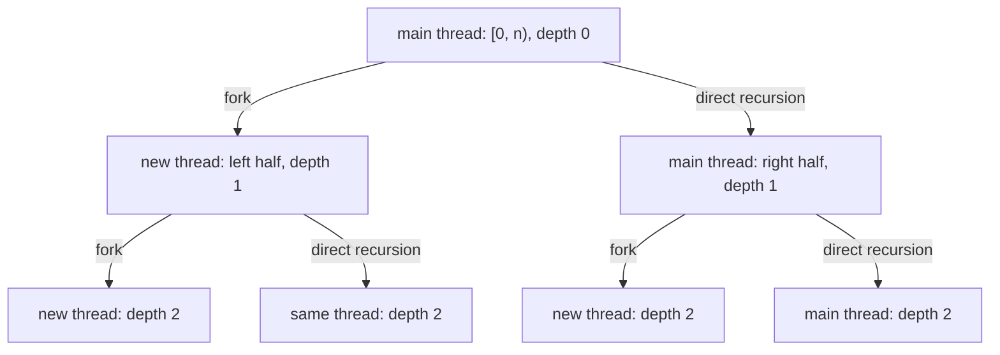

# HW4 Assignment Explanation — Implicit Threading

[Repository Guide](../../README.md) | [English](Assignment-Explanation.md) | [한국어](Assignment-Explanation.ko.md)

> **Last Updated:** 2026-11-16
>
> Operating System Concepts, Silberschatz, Galvin, and Gagne, Ch 4 (4.5-4.7)

> **Learning Objectives:**
> 1. Parallelize a divide-and-conquer algorithm with the fork-join pattern and explain the criterion that limits the number of threads
> 2. Parallelize a loop with an OpenMP directive and compare it with the fork-join approach
> 3. Derive the serial fraction and the upper bound on speedup from a measured speedup with Amdahl's Law
> 4. Explain how the loop order of matrix multiplication affects the memory access stride and cache performance
> 5. Explain why performance degrades when far more threads than physical cores are created

---

## Table of Contents

- [1. Assignment Overview](#1-assignment-overview)
- [2. Requirements](#2-requirements)
  - [2.1 Assignment 1: Fork-Join Parallel Merge Sort](#21-assignment-1-fork-join-parallel-merge-sort)
  - [2.2 Assignment 2: OpenMP Matrix Multiplication](#22-assignment-2-openmp-matrix-multiplication)
  - [2.3 Questions and Grading Criteria](#23-questions-and-grading-criteria)
- [3. Background](#3-background)
  - [3.1 Fork-Join Parallelism](#31-fork-join-parallelism)
  - [3.2 OpenMP and Implicit Data Parallelism](#32-openmp-and-implicit-data-parallelism)
  - [3.3 Amdahl's Law and the Limits of Parallelism](#33-amdahls-law-and-the-limits-of-parallelism)
  - [3.4 Memory Hierarchy and Spatial Locality](#34-memory-hierarchy-and-spatial-locality)
- [4. Implementation](#4-implementation)
  - [4.1 Fork-Join Merge Sort](#41-fork-join-merge-sort)
  - [4.2 OpenMP Matrix Multiplication](#42-openmp-matrix-multiplication)
- [5. Experimental Setup](#5-experimental-setup)
- [6. Results](#6-results)
- [7. Discussion and Answers to the Questions](#7-discussion-and-answers-to-the-questions)
  - [7.1 Amdahl's Law Applied to Merge Sort](#71-amdahls-law-applied-to-merge-sort)
  - [7.2 Oversubscription and the Sweet Spot of MAX_DEPTH](#72-oversubscription-and-the-sweet-spot-of-max_depth)
  - [7.3 Loop Order and Cache Behavior](#73-loop-order-and-cache-behavior)
  - [7.4 Beyond Loop Reordering: Roofline and Cache Blocking](#74-beyond-loop-reordering-roofline-and-cache-blocking)
  - [7.5 Relation to Java's ForkJoinPool](#75-relation-to-javas-forkjoinpool)
  - [7.6 Choosing Between Fork-Join and OpenMP](#76-choosing-between-fork-join-and-openmp)
- [8. Key Takeaways](#8-key-takeaways)
- [Summary](#summary)
- [Self-Check Questions](#self-check-questions)

---

<br>

## 1. Assignment Overview

> **Try It First:** This document contains the answers and solutions. Solve the problems in the [assignment handout](Original/Assignment.md) yourself before reading on.

The assignment deals with two models of implicit threading from Week 5 (Thread and Concurrency 2). The required task is to implement a fork-join parallel merge sort with Pthreads, and the bonus task is to parallelize and optimize matrix multiplication with OpenMP. Both compare the time against a sequential version, and a report answering questions is submitted with them. The original problem is in the [assignment handout](Original/Assignment.md), and the distributed starter code is in `Original/skeleton/` as distributed. Besides the required implementation, the submitted report includes an experiment sweeping the depth threshold, a comparison of matrix multiplication in all six loop orders, and a discussion of the roofline and cache blocking; that content is carried over into Sections 3 and 5-8 of this document.

```text
Coursework/HW04_Thread-and-Concurrency-2/
├── Assignment-Explanation.ko.md    # Assignment explanation (Korean)
├── Assignment-Explanation.md       # Assignment explanation (English, this document)
├── Code-Walkthrough.ko.md          # Code walkthrough (Korean)
├── Code-Walkthrough.md             # Code walkthrough (English)
├── Original/
│   ├── Assignment.ko.md            # Assignment handout (Korean)
│   ├── Assignment.md               # Assignment handout (English)
│   └── skeleton/
│       ├── matmul.c                # Distributed starter code (Assignment 2)
│       └── mergesort.c             # Distributed starter code (Assignment 1)
└── Solution/
    ├── matmul.c                    # Solution of Assignment 2
    └── mergesort.c                 # Solution of Assignment 1
```

*Figure 1. Directory layout of HW4*

---

<br>

## 2. Requirements

### 2.1 Assignment 1: Fork-Join Parallel Merge Sort

Based on the fork-join parallelism of Section 4.5.2 of the textbook, a parallel merge sort is implemented with Pthreads. `merge_sort_parallel()` must fork a new thread to sort one half while the current thread sorts the other half, then join that thread and merge the two sorted halves. A depth threshold `MAX_DEPTH` keeps it from creating too many threads: when the recursion depth reaches the threshold, it falls back to `merge_sort_sequential()`. As key design decisions, the assignment specifies forking only one thread per level and limiting the number of threads to `2^MAX_DEPTH` with `MAX_DEPTH`. `main()` sorts a random integer array with both the sequential and the parallel version, prints the times and the speedup, and verifies that the two results match. The starter code provides `merge()`, `merge_sort_sequential()`, and `main()`, and leaves only the body of `merge_sort_parallel()` as a TODO.

### 2.2 Assignment 2: OpenMP Matrix Multiplication

This is the bonus task (+20 points), based on OpenMP from Section 4.5.3 of the textbook. Each element of the result matrix, `C[i][j] = sum(A[i][k] * B[k][j])`, can be computed independently, which suits `#pragma omp parallel for`. Matrix multiplication is implemented in three versions and their performance is compared: the sequential version is a triple loop in i-j-k order, the basic OpenMP version adds `#pragma omp parallel for` to the outermost loop, and the optimized version applies at least one of `collapse(2)` for load balancing and loop reordering (i-k-j) for cache locality. The starter code provides the sequential version and the timing and verification code, and leaves the two OpenMP versions as TODOs.

### 2.3 Questions and Grading Criteria

The guide for Assignment 1 has four questions to consider, and the writing guide for the optional report `report.md` has three questions worth bonus points. This document refers to the questions by the following names and lists the section where each answer is.

| Question | Content | Answer |
|:-----|:-----|:-----|
| Question 1 | What happens if `MAX_DEPTH` is too large? | Section 7.2 |
| Question 2 | Why fork only one thread instead of two at each level? | Section 4.1 |
| Question 3 | How does this relate to Java's `ForkJoinPool` in the textbook? | Section 7.5 |
| Question 4 | Comparing the speedup with Amdahl's Law, what is the serial fraction? | Section 7.1 |
| Report question 1 | How does `MAX_DEPTH` affect performance, and what is the optimal value on your machine? | Section 7.2 |
| Report question 2 | Why does reordering the loops to i-k-j improve cache performance? | Section 7.3 |
| Report question 3 | When would you use the fork-join pattern and when OpenMP? | Section 7.6 |

*Table 1. Questions and the sections with their answers*

The grading weights of Assignment 1 are `merge_sort_parallel()` with fork and join 30%, a depth threshold that limits the thread count 20%, a correct merge 20%, the sequential-versus-parallel performance comparison 20%, and code quality and answers to the questions 10%. Assignment 2 weights the sequential matrix multiplication 20%, the basic OpenMP version 30%, an optimized version with measurable improvement 30%, and the performance comparison and analysis 20%.

---

<br>

## 3. Background

**Implicit threading** abstracts away thread management so that the programmer can focus on what can run in parallel rather than on how threads are created and scheduled. This assignment exercises two such models from Section 4.5 of the textbook: the fork-join pattern implemented with POSIX threads and OpenMP for dense matrix multiplication.

### 3.1 Fork-Join Parallelism

Fork-join is a structural pattern in which a task is recursively split (forked) into independent subtasks that run in parallel, and their results are merged (joined) once all subtasks finish. It maps naturally onto divide-and-conquer algorithms such as merge sort, quicksort, and tree traversal. The key design question is when to stop forking: a naive implementation that spawns a fresh thread at every recursion level creates an exponential number of short-lived threads whose creation cost dominates the actual work, so practical implementations cap parallelism with a depth threshold or a task granularity limit.

### 3.2 OpenMP and Implicit Data Parallelism

OpenMP (Section 4.5.3 of the textbook) adds parallelism through `#pragma` annotations on loops and code regions. A single directive, `#pragma omp parallel for`, partitions the iteration space of a `for` loop across a pool of worker threads managed automatically by the runtime. It fits regular data parallelism where each iteration operates on independent data, and it differs from fork-join in two ways: parallelism is divided by iteration index rather than by recursive subtask, and thread management is fully implicit, with no `pthread_create`, no join, and no argument packing. The programmer specifies what can run in parallel; the runtime decides how.

### 3.3 Amdahl's Law and the Limits of Parallelism

Amdahl's Law sets the upper bound on parallel speedup. Let the single-threaded time $T(1)$ be decomposed into a serial part $`T_s`$ that cannot be parallelized and a parallel part $`T_p`$, so that $`T(1) = T_s + T_p`$. Defining the serial fraction as $`f = T_s / T(1)`$ gives $`T_s = f \cdot T(1)`$ and $`T_p = (1 - f) \cdot T(1)`$. With $N$ threads and a perfectly divisible parallel part, the following holds.

$$
T(N) = f \cdot T(1) + \frac{(1 - f) \cdot T(1)}{N}, \qquad S(N) = \frac{T(1)}{T(N)} = \frac{1}{f + \frac{1 - f}{N}}
$$

As $N \to \infty$, $S(N) \to 1/f$, so the serial fraction sets a hard upper bound regardless of the number of cores. Small serial fractions matter enormously: $f = 5\%$ caps the speedup at 20 times, and $f = 1\%$ at 100 times. Amdahl's Law models strong scaling, with a fixed problem size and more threads. Its complement, Gustafson's Law, describes weak scaling, in which the problem grows with the number of cores and the serial fraction shrinks relative to the growing parallel work. This assignment uses fixed input sizes (10 million integers and a 1024 × 1024 matrix), so Amdahl's Law is the appropriate lens.

### 3.4 Memory Hierarchy and Spatial Locality

Modern CPUs bridge fast cores and slow DRAM through a stack of caches: L1 (tens of KB, 1-4 cycle latency), L2 (a few MB, about 10 cycles), an optional L3 (tens of MB, about 30 cycles), and DRAM itself (100-300 cycles). Data move through the hierarchy in fixed-size **cache lines**, 64 bytes on x86 and 128 bytes on the performance cores of Apple Silicon.

Two forms of locality govern cache efficiency. **Spatial locality** is the property that if byte X is accessed, its neighbors are likely to be accessed soon, so stride-1 sequential reads let one cache-line fill serve many consecutive accesses. **Temporal locality** is the property that recently used data are likely to be reused, so keeping the working set smaller than L1 means that repeated accesses hit the cache instead of returning to DRAM. In row-major storage, the default in C, access is stride-1 only when the innermost loop iterates over the last (column) index; any other order pays a stride-N penalty on at least one matrix. This is the mechanism behind the roughly 14-fold difference by loop order measured in Section 6.

---

<br>

## 4. Implementation

### 4.1 Fork-Join Merge Sort

The requirement of Section 2.1 is to fork only the left half into a new thread at each level, sort the right half in the current thread, and fall back to sequential sorting at the depth threshold. `merge_sort_parallel()` in `Solution/mergesort.c` (lines 76-110) implements this.

```c
int max_depth;

void *merge_sort_parallel(void *arg)
{
    struct sort_arg *sa = (struct sort_arg *)arg;
    int left  = sa->left;
    int right = sa->right;
    int depth = sa->depth;

    if (left >= right)
        return NULL;

    /* Fall back to sequential when depth threshold is reached */
    if (depth >= max_depth) {
        merge_sort_sequential(sa->array, sa->temp, left, right);
        return NULL;
    }

    int mid = left + (right - left) / 2;

    /* FORK: create a thread for the left half */
    struct sort_arg left_arg = { sa->array, sa->temp, left, mid, depth + 1 };
    pthread_t tid;
    pthread_create(&tid, NULL, merge_sort_parallel, &left_arg);

    /* Sort the right half in the current thread */
    struct sort_arg right_arg = { sa->array, sa->temp, mid + 1, right, depth + 1 };
    merge_sort_parallel(&right_arg);

    /* JOIN: wait for the left-half thread */
    pthread_join(tid, NULL);

    /* MERGE: combine the two sorted halves */
    merge(sa->array, sa->temp, left, mid, right);

    return NULL;
}
```

The function takes an argument holding a subrange and a depth. If the depth is at least `max_depth`, it falls back to the sequential merge sort (lines 87-90). Otherwise it forks: `pthread_create` spawns a thread to sort the left half at depth `depth + 1` (lines 95-97), while the current thread recursively sorts the right half (lines 100-101). After the right-half recursion returns, it waits for the left-half thread with `pthread_join` (line 104) and merges the two sorted halves (line 107).

**Why fork only one thread per level (Question 2).** A naive implementation that forks both halves leaves the calling thread idle inside `pthread_join`. That wastes a CPU core for the duration of the subtree and doubles the total number of new threads over the whole run, from $2^d - 1$ to $2^{d+1} - 2$. Forking only the left half and processing the right half in the caller keeps every live thread busy.

**Why a depth threshold.** With depth $d$, up to $2^d$ threads run concurrently at the leaves of the recursion tree. Too low a value under-utilizes the cores; too high a value incurs the overhead of `pthread_create`, tens of microseconds per call, and reserves one stack per thread (typically 512 KB on macOS and 8 MB on Linux). The default is `max_depth = 3` (up to 8 concurrent threads); the empirical sweet spot is measured in Section 6 and discussed in Section 7.2.



*Figure 2. Thread creation with max_depth = 2 (the four calls at depth 2 run the sequential sort)*

With `max_depth = 2`, as in Figure 2, $2^2 - 1 = 3$ new threads are created, and together with the main thread, 4 threads each run a sequential sort at depth 2. The left-half argument `left_arg` is a local variable of the forking function, but that function ends only after `pthread_join` returns, so it stays valid while the new thread runs.

### 4.2 OpenMP Matrix Multiplication

The requirement of Section 2.2 is to parallelize the outermost loop with OpenMP in the basic version and to apply `collapse(2)` or loop reordering in the optimized version. `Solution/matmul.c` implements the three versions for 1024 × 1024 dense matrices of doubles.

```c
/*
 * matmul_openmp_basic: Add #pragma omp parallel for to outer loop.
 */
void matmul_openmp_basic(void)
{
    #pragma omp parallel for
    for (int i = 0; i < N; i++)
        for (int j = 0; j < N; j++)
            for (int k = 0; k < N; k++)
                C[IDX(i, j)] += A[IDX(i, k)] * B[IDX(k, j)];
}

/*
 * matmul_openmp_optimized: Loop reordering (i-k-j) + OpenMP.
 *
 * Why i-k-j? In the innermost loop (j), both C[i][j] and B[k][j]
 * are accessed with stride 1 (sequential memory access).
 * In i-j-k order, B[k][j] has stride N (cache-unfriendly).
 */
void matmul_openmp_optimized(void)
{
    #pragma omp parallel for
    for (int i = 0; i < N; i++)
        for (int k = 0; k < N; k++)
            for (int j = 0; j < N; j++)
                C[IDX(i, j)] += A[IDX(i, k)] * B[IDX(k, j)];
}
```

The basic version (lines 55-62) puts `#pragma omp parallel for` above the outermost i loop of the sequential i-j-k loop. Each row i writes a different row of the result `C`, so there are no write conflicts between threads. The optimized version (lines 71-78) reorders the loops to i-k-j and applies the same directive, without `collapse(2)`. In i-k-j, the innermost j loop walks the column indices of both `B` and `C` with stride 1, exploiting spatial locality on two of the three matrices at once. The six possible loop orders are compared in Section 6 and analyzed in Section 7.3.

---

<br>

## 5. Experimental Setup

All measurements were taken on an Apple M2 Pro: 12 cores, 8 performance cores (P-cores) and 4 efficiency cores (E-cores), with no simultaneous multithreading (SMT). The performance cores of Apple Silicon use 128-byte cache lines, twice the 64-byte x86 convention, so in a stride-1 loop each line fill serves 16 consecutive doubles rather than 8.

| Component | Value |
|:-----|:-----|
| CPU | Apple M2 Pro (Mac14,10) |
| Cores | 12 total: 8 Performance + 4 Efficiency (no SMT) |
| P-core clock | About 3.5 GHz (base), up to about 3.7 GHz boost |
| L1 instruction (P-core) | 192 KB per core |
| L1 data (P-core) | 128 KB per core |
| L2 (P-cluster, shared) | 16 MB (4 P-cores per cluster) |
| L1d (E-core) | 64 KB per core |
| L2 (E-cluster, shared) | 4 MB |
| Cache line size | 128 bytes on P-cores (16 doubles) |
| Unified memory | 16 GB LPDDR5, about 200 GB/s bandwidth |
| Kernel | Darwin 25.4.0 (macOS), arm64 |
| C compiler (mergesort) | Apple clang 21.0.0, native arm64 |
| C compiler (matmul) | Homebrew GCC 15.2.0 (libgomp), x86_64 via Rosetta 2 |
| Compile flags | `-Wall -O2` (plus `-pthread` for mergesort and `-fopenmp` for matmul) |

*Table 2. Hardware and software used in the experiments*

`mergesort.c` was built as a native arm64 binary with Apple clang 21. `matmul.c` was built as an x86_64 binary with Homebrew GCC 15 and libgomp and runs under Rosetta 2, which adds roughly 15-25% overhead. The absolute GFLOP/s values in Section 7.4 are therefore conservative, but relative comparisons between the matrix multiplication versions are unaffected because all of them run under the same translation layer. OpenMP used the default `OMP_NUM_THREADS = 12`. Each configuration was run three times, and the median is reported.

---

<br>

## 6. Results

With 10 million integers and `max_depth = 3`, the medians of three runs are as follows.

| Version | Time (sec) | Speedup |
|:-----|-----:|-----:|
| Sequential | 0.5320 | 1.00× |
| Parallel (8 threads) | 0.1027 | 5.18× |

*Table 3. Sequential versus fork-join parallel merge sort*

The fork-join version reaches 5.18× with 8 concurrent leaf threads, about 65% of ideal linear scaling. To locate the optimal depth, `max_depth` was swept from 0 (purely sequential) to 14 (16384 leaf threads), with three trials per depth.

| max_depth (max threads) | Parallel (s) | Speedup |
|:-----|-----:|-----:|
| 0 (1) | 0.5291 | 1.01× |
| 1 (2) | 0.2815 | 1.89× |
| 2 (4) | 0.1587 | 3.35× |
| 3 (8) | 0.0985 | 5.43× |
| 4 (16) | 0.0925 | 5.78× |
| 5 (32) | 0.0902 | 5.93× |
| 6 (64) | 0.0868 | 6.10× |
| 7 (128) | 0.0867 | 6.11× |
| 8 (256) | 0.0858 | 6.22× |
| 10 (1024) | 0.0922 | 5.81× |
| 12 (4096) | 0.2439 | 2.22× |
| 14 (16384) | 1.8520 | 0.28× |

*Table 4. Merge sort time and speedup by depth threshold*

The data trace a classic U-shape; the interpretation is in Section 7.2. Matrix multiplication at 1024 × 1024 with `OMP_NUM_THREADS = 12` gives the following.

| Version | Time (sec) | Speedup |
|:-----|-----:|-----:|
| Sequential (i-j-k) | 5.5671 | 1.00× |
| OpenMP basic (i-j-k) | 0.7800 | 7.14× |
| OpenMP optimized (i-k-j) | 0.0576 | 96.64× |

*Table 5. Comparison of the three matrix multiplication versions*

Basic OpenMP reaches 7.14× across 12 threads. The optimized version, which adds i-k-j loop reordering on top of OpenMP, reaches 96.64×, far exceeding the thread count; the gap is analyzed in Section 7.3. The medians of two runs of all six loop orders as pure sequential C without OpenMP at 1024 × 1024 are as follows.

| Order | Time (s) | vs i-j-k | Innermost stride pattern |
|:-----|-----:|-----:|:-----|
| i-k-j | 0.181 | 14.1× | A fixed, B stride 1, C stride 1 |
| k-i-j | 0.209 | 12.2× | A fixed, B stride 1, C stride 1 |
| i-j-k | 2.555 | 1.00× | A stride 1, B stride N, C fixed |
| j-i-k | 5.254 | 0.49× | A stride 1, B stride N, C fixed |
| k-j-i | 7.348 | 0.35× | A stride N, B fixed, C stride N |
| j-k-i | 12.76 | 0.20× | A stride N, B fixed, C stride N |

*Table 6. Sequential matrix multiplication in the six loop orders*

The six orders cluster into three groups by the innermost loop index, and the spread between the best and the worst is more than 70 times. Section 7.3 explains the grouping in terms of cache-line behavior.

---

<br>

## 7. Discussion and Answers to the Questions

### 7.1 Amdahl's Law Applied to Merge Sort

Question 4 asks to compare the measured speedup with Amdahl's Law and find the serial fraction. Substituting $N = 8$ and $S = 5.18$ into the formula of Section 3.3 gives the following.

$$
\frac{1}{5.18} = 0.1931 = f + \frac{1 - f}{8} \quad\Rightarrow\quad \frac{7}{8} f = 0.0681 \quad\Rightarrow\quad f \approx 0.078
$$

Almost 8% (7.8%) of the wall-clock time is inherently serial. This serial time comes mostly from the final merge passes: the outermost merge, which combines the two halves into the final sorted output, is by construction single-threaded and runs in $O(N)$ time. Thread creation and join overhead contribute the rest. For comparison, the Week 4 histogram assignment (HW3) measured $f \approx 15\%$ on the same machine; merge sort's lower $f$ reflects its higher ratio of computation to overhead.

### 7.2 Oversubscription and the Sweet Spot of MAX_DEPTH

Question 1 asks what happens if `MAX_DEPTH` is too large, and report question 1 asks how `MAX_DEPTH` affects performance and what the best value is. The depth sweep in Section 6 traces a sharp U-curve. From depth 0 to 3, the speedup climbs nearly linearly (from 1.01× to 5.43×) because each doubling of leaf threads roughly doubles the parallelism up to the limit of the 8 performance cores. From depth 3 to 8, it saturates at 6.1-6.2×; adding more threads than there are physical cores yields only tiny gains. From depth 10 to 14, the curve collapses. At depth 12 (4096 threads) the program is already about 3 times slower than its peak, and at depth 14 (16384 threads) the speedup is 0.28×, more than 3 times slower than the single-threaded baseline: the overhead of `pthread_create` and `pthread_join`, stack memory pressure, and scheduler contention completely wipe out the benefit of parallelism. This state of creating far more threads than physical cores is called **oversubscription**.

The empirical optimum is depth 6-8, sitting just above $`\log_2(\text{cores}) \approx 3.6`$. That the peak of 6.2× falls short of the ideal 8× of the eight performance cores is itself informative: the missing 1.8× is spent on the sequential final merges identified in Section 7.1 and on memory bandwidth contention around the shared L2 cache. Both Amdahl's serial fraction and the bandwidth ceiling of the memory hierarchy show up in the same single number.

### 7.3 Loop Order and Cache Behavior

Report question 2 asks why reordering the loops to i-k-j improves cache performance. The six orders of Section 6 group by which index varies innermost.

- **Innermost j** (i-k-j, k-i-j, 0.18-0.21 s): both `B[k][j]` and `C[i][j]` are stride 1 because j increments the column index in row-major storage, and `A[i][k]` is loop-invariant and hoisted into a register. This is the best case.
- **Innermost k** (i-j-k, j-i-k, 2.5-5.3 s): `A[i][k]` is stride 1, but `B[k][j]` is stride N because k advances the row index of B, so nearly every load of B misses the cache. It is roughly 15-30 times slower than the best group. The spread between i-j-k (2.55 s) and j-i-k (5.25 s) comes from temporal reuse of a row of A, which i-j-k exploits and j-i-k loses.
- **Innermost i** (j-k-i, k-j-i, 7.3-12.8 s): both `A[i][k]` and `C[i][j]` are stride N, so every read of A and every read-modify-write of C misses. It is up to about 70 times slower than the best group.

i-k-j (0.18 s) and j-k-i (12.76 s) are a single permutation of three nested loops with identical arithmetic, so every bit of the speed difference comes from memory access order alone. On modern CPUs, memory access patterns matter more than the number of floating-point operations. The roughly 14-fold gap between i-j-k and i-k-j measured here matches the roughly 14-fold gap between basic and optimized OpenMP in Section 6, confirming that the entire advantage of the optimized version comes from loop reordering, not from anything OpenMP does differently.

### 7.4 Beyond Loop Reordering: Roofline and Cache Blocking

Loop reordering is a local fix: it removes the worst stride pathology but does not approach peak compute. A quick roofline check: 1024 × 1024 matrix multiplication is about $2 \times 1024^3 \approx 2.15 \times 10^9$ floating-point operations, so the measured times give 0.39 GFLOP/s sequential, 2.75 GFLOP/s for basic OpenMP, and 37 GFLOP/s for optimized OpenMP. The peak of one M2 Pro performance core is about 14 GFLOP/s (double-precision FMA at 3.5 GHz with 128-bit NEON), so the compute ceiling of the 8 performance cores is about 110 GFLOP/s for native arm64. 37 GFLOP/s is roughly a third of that; tuned BLAS libraries reach 70-90% of peak through register blocking, cache blocking, and hand-tuned SIMD.

The next optimization beyond loop reordering is **cache blocking**, or tiling: each matrix is partitioned into B × B sub-blocks sized so that three blocks (one each from A, B, and C) fit in L1 at the same time, and one output block is computed at a time, keeping each reused block hot in the cache until it has contributed to every output it affects. With B of about 64 on the M2 performance core, $3 \times 64^2 \times 8$ bytes ≈ 96 KB fits in the 128 KB L1 data cache, and another 2-4 times speedup is typical. Production libraries nest several levels of blocking (registers, L1, L2) and write the innermost micro-kernel in hand-tuned SIMD assembly, which is why they come close to peak performance.

### 7.5 Relation to Java's ForkJoinPool

Question 3 asks how this implementation relates to Java's `ForkJoinPool` discussed in the textbook. `ForkJoinPool` (Section 4.5.2 of the textbook) implements the same fork-join pattern as this Pthreads code, but with two key differences. The first is a **managed thread pool**: a fixed set of workers is created when the pool starts and reused across tasks, so fork and join operations do not incur the per-call overhead of `pthread_create` and `pthread_join`. The second is **work stealing**: each worker keeps its own deque of pending tasks and, when idle, steals tasks from other workers' deques, balancing the load of irregular recursion trees automatically. This Pthreads implementation approximates the first property through `MAX_DEPTH` but has no work stealing, so any load imbalance is absorbed by the fixed fork-join structure.

### 7.6 Choosing Between Fork-Join and OpenMP

Report question 3 asks when to use the fork-join pattern and when OpenMP. Fork-join with explicit Pthreads fits irregular, recursive parallelism (divide-and-conquer algorithms, tree and graph traversals, adaptive quadrature): the programmer controls thread creation, synchronization, and granularity explicitly. OpenMP fits regular data parallelism where independent loop iterations can be distributed with a single directive (dense linear algebra, image processing, numerical grids); pooling and scheduling are handled by the runtime. A practical rule: if the parallelism naturally expresses itself as a `for` loop with independent iterations, write OpenMP; if it expresses itself as a recursive function with two sub-calls per node, write fork-join.

---

<br>

## 8. Key Takeaways

1. **Amdahl's Law is the first thing to measure.** Solve for the serial fraction $f$ before adding cores: the upper bound $1/f$ is often tighter than the core count. The merge sort in this assignment has $f \approx 7.8\%$, capping the speedup near 13 times regardless of how many threads are used.
2. **Oversubscription is catastrophic.** The right thread count is roughly the number of physical cores, not a large number. In the depth sweep, 16384 threads ran more than 3 times slower than a single thread, because the per-thread creation and stack costs grow linearly while the payoff of parallelism saturates after about 8 threads.
3. **Memory access patterns dominate operation counts on modern CPUs.** A single loop permutation (from i-j-k to i-k-j) produces a roughly 14-fold speedup without changing any arithmetic. Row-major stride-1 access in the innermost loop is the single most important matrix multiplication optimization before SIMD and blocking.
4. **Choose the parallelism model by the shape of the problem.** Use OpenMP (one directive, automatic pooling) for regular `for` loops with independent iterations, and fork-join (explicit Pthreads or a work-stealing runtime) for recursive divide-and-conquer structures.

---

<br>

## Summary

| Concept | Key Summary |
|:-----|:-----|
| Fork-join merge sort | At each level it forks only the left half into a new thread, sorts the right half in the current thread, then joins and merges, falling back to sequential sorting when the depth reaches `max_depth`. |
| Thread count | At depth $d$ there are $2^d - 1$ new threads and at most $2^d$ concurrent threads; forking both halves would raise the new threads to $2^{d+1} - 2$. |
| OpenMP matrix multiplication | The basic version puts `#pragma omp parallel for` on the outer i loop, and the optimized version reorders the loops to i-k-j to access B and C with stride 1. |
| Results | Merge sort reaches 5.18× at depth 3 and a peak of about 6.2× at depth 6-8, and matrix multiplication reaches 7.14× with basic OpenMP and 96.64× with optimized OpenMP. |
| Amdahl's Law | The 5.18× of merge sort gives $f \approx 0.078$, and the serial time comes mainly from the outermost single-threaded merge. |
| Oversubscription | Far more threads than physical cores collapse performance through creation, join, stack, and scheduler costs, down to 0.28× at depth 14. |
| Loop order | The orders form three groups by innermost index j, k, and i, and the roughly 14-fold gap between i-k-j and i-j-k explains the entire advantage of optimized OpenMP. |
| Roofline and blocking | The 37 GFLOP/s of the optimized version is about a third of the 8-performance-core ceiling, and the next step is cache blocking sized to L1. |
| Choice of model | OpenMP suits regular loops with independent iterations and fork-join suits recursive divide and conquer, while `ForkJoinPool` adds a thread pool and work stealing. |

---

<br>

## Self-Check Questions

1. **Thread count:** With `max_depth = 4`, state how many new threads `merge_sort_parallel()` creates and how many threads run the sequential sort at depth 4.

   <details>
   <summary>Answer</summary>

   Each call at depths 0-3 forks one thread, so there are $1 + 2 + 4 + 8 = 2^4 - 1 = 15$ new threads. There are $2^4 = 16$ calls at depth 4, and 16 threads, including the main thread, each run a sequential sort.

   </details>

2. **Amdahl's bound:** With a serial fraction of 7.8%, compute the upper bound on speedup with infinitely many threads.

   <details>
   <summary>Answer</summary>

   $1/f = 1/0.078 \approx 12.8$, so about 13 times.

   </details>

3. **Stride:** When a 1024 × 1024 matrix of doubles is stored in row-major order, state how many bytes apart in memory two consecutive accesses to `B[k][j]` are in the innermost loop of the i-j-k order.

   <details>
   <summary>Answer</summary>

   Each increment of k in the innermost loop skips one row of B, so the two accesses are $1024 \times 8 = 8192$ bytes apart. A 128-byte cache line is used for only one of its elements, and the other 15 doubles are not used by the next access.

   </details>

4. **Oversubscription:** State three causes of the parallel version becoming slower than the sequential version at depth 14.

   <details>
   <summary>Answer</summary>

   The overhead of `pthread_create` and `pthread_join` for creating and joining 16384 threads, the memory pressure from the stack reserved for each thread, and scheduler contention among many threads competing for 12 physical cores. The work per leaf is small, about 600 elements, and cannot cover these costs.

   </details>
