# Week 1 Lecture — Introduction to Operating Systems

[Repository Guide](../../README.md) | [English](Concepts_Lecture.md) | [한국어](Concepts_Lecture.ko.md)

> **Last Updated:** 2026-10-18
>
> Operating System Concepts, Silberschatz, Ch 1, 2

> **Learning Objectives:**
> 1. Define what an operating system is and explain its core roles
> 2. Explain dual-mode operation and why it exists
> 3. Describe how system calls bridge user programs and the kernel
> 4. Outline the major topics covered in an operating systems course

---

## Table of Contents

- [1. What is an Operating System?](#1-what-is-an-operating-system)
  - [1.1 Definition](#11-definition)
  - [1.2 Where the OS Sits](#12-where-the-os-sits)
  - [1.3 Two Roles of the OS](#13-two-roles-of-the-os)
  - [1.4 Dual-Mode Operation](#14-dual-mode-operation)
  - [1.5 System Calls](#15-system-calls)
  - [1.6 How a Computer System Works](#16-how-a-computer-system-works)
  - [1.7 Storage-Device Hierarchy](#17-storage-device-hierarchy)
  - [1.8 OS Structure](#18-os-structure)
  - [1.9 xv6](#19-xv6)
- [2. Semester Preview](#2-semester-preview)
  - [2.1 Processes (Weeks 2-3)](#21-processes-weeks-2-3)
  - [2.2 Threads & Concurrency (Weeks 4-5)](#22-threads--concurrency-weeks-4-5)
  - [2.3 CPU Scheduling (Weeks 6-7)](#23-cpu-scheduling-weeks-6-7)
  - [2.4 Synchronization (Week 9)](#24-synchronization-week-9)
  - [2.5 Deadlocks (Week 10)](#25-deadlocks-week-10)
  - [2.6 Memory Management (Weeks 11-12)](#26-memory-management-weeks-11-12)
  - [2.7 File Systems & Security (Week 13)](#27-file-systems--security-week-13)
- [Summary](#summary)
- [Self-Check Questions](#self-check-questions)

---

<br>

## 1. What is an Operating System?

### 1.1 Definition

The kernel is the core program that starts when your computer boots and keeps running until the system shuts down; it manages all hardware resources and provides services to applications.

- The **one program running at all times** on the computer is the **kernel**.
- Everything else is either a **system program** or an **application program**.

> **Note:** **The OS is like a government.** The OS itself does not perform useful functions; rather, it provides an **environment** in which other programs can do useful work.

> **Note:** **Exam tip.** If asked "What is an OS?", you must include the keyword **kernel**. Programs outside the kernel (shell, compiler, GUI, etc.) are system programs, while word processors, games, etc. are application programs.

### 1.2 Where the OS Sits

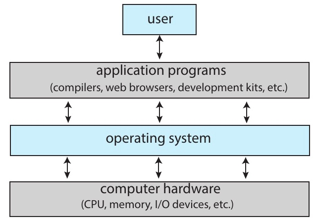

*Figure 1. Abstract view of the components of a computer system*

- The OS sits **between** hardware and applications.
- It directly controls hardware and provides a **clean interface** to programs.

> **Definition:** **Abstraction** means hiding complex internal details and providing a simplified interface to the layer above. For example, a driver lets you control a car without understanding the engine internals.

> **[Computer Architecture]** A computer system is layered as hardware → OS → applications → users. Each layer hides the complex details of the layer below and provides a simplified interface upward, which is called **abstraction**. Representative abstractions provided by the OS are processes (CPU), virtual memory (memory), and files (disk).

### 1.3 Two Roles of the OS

**Resource Allocator:**

Manages and distributes **limited resources** efficiently and fairly:
- **CPU time**: decides which process runs when.
- **Memory space**: allocates memory to each process.
- **Storage & I/O**: manages disk access and device sharing.

**Control Program:**

Controls the execution of user programs and prevents errors and misuse:
- **Execution management**: starts, stops, and schedules programs.
- **Error prevention**: catches illegal operations.
- **Isolation guarantee**: ensures mutual protection between processes.

> **Note:** **Exam tip.** The resource allocator and the control program are two perspectives on the role of the OS. The resource allocator focuses on how to divide resources, while the control program focuses on how to execute programs safely. When asked to describe the roles of the OS on an exam, it is best to mention both.

### 1.4 Dual-Mode Operation

**Dual-Mode Operation** means the CPU distinguishes between user mode and kernel mode when executing code.

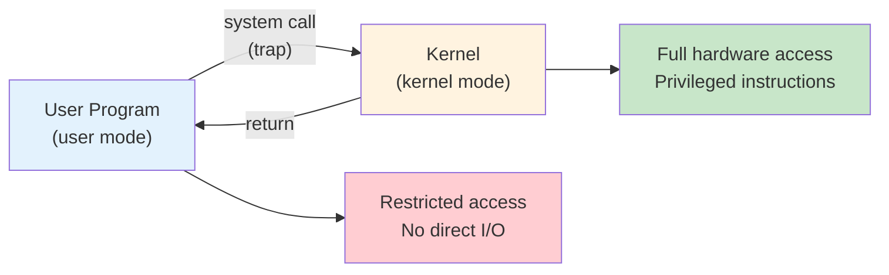

*Figure 2. System call transitions between user mode and kernel mode*

| Mode | Mode Bit | Executing Entity |
|:-----|:---------|:-----------------|
| **Kernel mode** | 0 | OS kernel (full hardware access) |
| **User mode** | 1 | Applications (restricted access) |

*Table 1. Mode bit and executing entity of kernel mode and user mode*

> **Definition:** A **trap** is a software-generated interrupt caused either by an error (e.g., division by zero or an invalid memory access) or by a program intentionally requesting help from the kernel (e.g., via a system call).

> **Note:** **Analogy.** Consider a bank. Employees (kernel mode) have vault access and can handle any operation. Customers (user mode) can only interact through the counter window (system calls). A customer who tries to jump over the counter is stopped immediately. This is the same principle as the hardware trapping a user-mode program that attempts a privileged instruction.

> **Definition:** A **register** is a tiny, ultra-fast memory slot built directly into the CPU, used to hold values the CPU is currently working with. A **status register** is a special register that stores flags indicating the CPU's current state (e.g., which mode it is in).

> **[Computer Architecture]** The mode bit is typically stored in the CPU's **status register (PSW: Program Status Word)**. In RISC-V, the current mode is not directly visible in a register; when a trap occurs, the hardware records the mode before the trap in the SPP (Supervisor Previous Privilege) bit of the `sstatus` register, and `sret` uses it to decide which mode to return to. Since the hardware automatically changes the mode upon a trap, software cannot arbitrarily switch to kernel mode.

Privileged instructions are CPU instructions that could harm the system if misused, so the hardware physically prevents them from executing outside kernel mode.

> **[Computer Architecture]** CPUs have regular instructions and **privileged instructions**. Privileged instructions (e.g., I/O instructions, interrupt control, timer configuration) can only be executed in kernel mode. If execution is attempted in user mode, the hardware generates a **trap** and transfers control to the OS. This is the core mechanism for OS self-protection.

### 1.5 System Calls

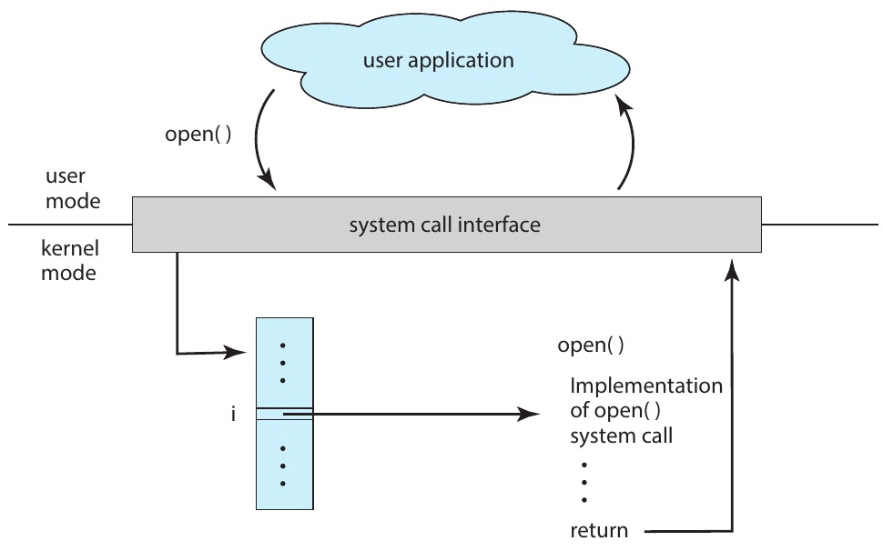

*Figure 3. A user application invoking the open() system call*

- A **system call** is the **only way** a user program can request OS services.
- A call proceeds as user program → C library → `syscall` instruction (trap) → kernel handling → return.
- The `syscall` instruction (on x86-64; RISC-V uses `ecall`) is a special CPU-level command, not a C function, that tells the hardware to stop executing user code and immediately hand control to the OS kernel.
- Even a simple `cp in.txt out.txt` command generates many system calls, reaching **thousands** when the file is large.

> **Note:** **Analogy.** Consider a restaurant. Customers order from a menu (API) but cannot walk into the kitchen. The waiter (system call) takes the order and delivers it to the kitchen (kernel), which prepares the dish using equipment the customer never touches (hardware). The menu defines what you can order; the system call interface defines what services you can request.

> **[Systems Programming]** The commonly used `printf()` in C is not a system call; it is a C library function. Internally, `printf()` buffers data and then calls the `write()` system call. In other words, library functions execute in user mode, and at the point where actual hardware access is needed, they switch to kernel mode via system calls. On Linux, the `strace` command can be used to view the list of system calls a program invokes.

> **Note:** System calls are identified by **system call numbers**. When a user program invokes a system call, the corresponding number is stored in a designated register (RISC-V uses `a7`, x86 uses `eax`, and x86-64 uses `rax`) and then a trap occurs. `a7` and `eax` are names of specific CPU registers; think of them as agreed-upon slots from which the kernel reads the system call number. The kernel reads this number and looks up the corresponding handler function in the **system call table**. The xv6 system call table (`syscall.c`) is examined directly in the Week 3 lab.

### 1.6 How a Computer System Works

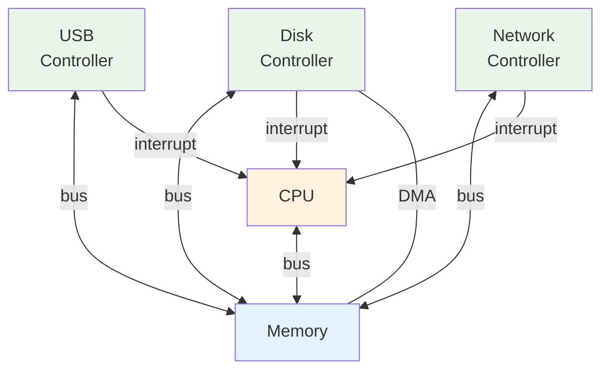

*Figure 4. Bus, interrupts, and DMA connecting the CPU, memory, and device controllers*

> **Definition:** A **bus** is a communication pathway inside the computer that transfers data between components (CPU, memory, I/O devices).

- Devices notify the CPU of completed work via **interrupts**.
- **DMA (Direct Memory Access)** is a method for transferring large amounts of data without CPU intervention.

An ISR (Interrupt Service Routine) is the kernel function that runs in response to a specific interrupt. The IVT (Interrupt Vector Table) is a lookup table that maps each interrupt number to its corresponding ISR.

> **[Computer Architecture]** An **interrupt** is a mechanism by which a device sends a signal to the CPU to report an event such as task completion and request handling. The CPU pauses its current work and executes the corresponding Interrupt Service Routine (ISR) by consulting the Interrupt Vector Table (IVT). Without **DMA**, the CPU would have to transfer data byte by byte, which is highly inefficient. The DMA controller handles data transfer instead, and upon completion, notifies the CPU via an interrupt.

### 1.7 Storage-Device Hierarchy

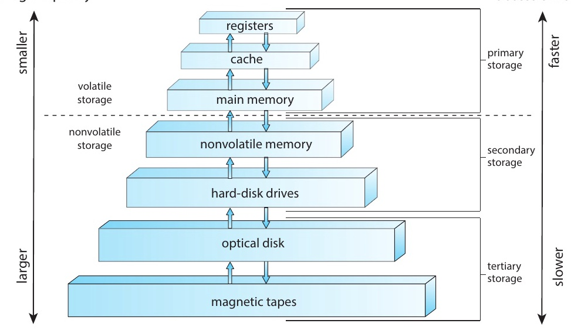

*Figure 5. Storage-device hierarchy*

| Level | Size | Access Time | Managed By |
|:------|:-----|:-----------|:-----------|
| **Registers** | < 1 KB | ~0.3 ns | Hardware |
| **Cache (L1/L2)** | < 64 MB | ~1-25 ns | Hardware |
| **Main Memory** | < 64 GB | ~100 ns | **OS** |
| **SSD** | < 4 TB | ~50 us | **OS** |
| **HDD** | < 20 TB | ~5 ms | **OS** |

*Table 2. Size, access time, and manager of each storage level*

> **[Computer Architecture]** Higher levels are faster, more expensive, and smaller in capacity. This hierarchy works because of the **locality** principle. **Temporal locality**: recently accessed data is likely to be accessed again soon. **Spatial locality**: data near recently accessed data is likely to be accessed soon. Think of reading a book: after reading page 50, you are likely to read page 51 next (spatial locality) and may re-read page 50 again soon (temporal locality). Cache memory exploits this predictability. The OS manages storage devices at and below main memory, actively leveraging this hierarchy in virtual memory (Weeks 11-12).

### 1.8 OS Structure

| Structure | Core Idea | Example |
|:----------|:----------|:--------|
| **Monolithic** | All functions in a single kernel binary | Linux, traditional UNIX |
| **Microkernel** | Minimal kernel + user-space services | Mach, QNX |
| **Hybrid** | A mix of both | macOS (Mach + BSD), Windows |
| **Loadable Modules** | Core kernel + dynamic modules | Linux (LKM) |

*Table 3. Core idea and examples of each OS structure*

Most modern OSes are **hybrid**, taking a pragmatic approach rather than adhering to pure theory.


*Figure 6. Tux, the Linux mascot*

> **Definition:** **Context switching** is saving the state (registers, PC, etc.) of the currently running process and restoring the state of another process so it can resume execution. The PC (Program Counter) is the register that tracks which instruction the CPU will execute next.

> **Note:** A monolithic kernel runs all services in kernel space, making it fast, but a single bug can crash the entire system. A microkernel keeps only minimal functionality (IPC, scheduling) in the kernel and runs the rest in user space, making it more stable but incurring greater context-switching overhead. Here, IPC (Inter-Process Communication) is how separate processes pass data to each other. Linux is monolithic but also provides modular flexibility through LKMs.

### 1.9 xv6

- **xv6** is a simple Unix-like educational OS created by MIT.
- Written in **C** for the **RISC-V** architecture.
- Its code is approximately 10,000 lines, small enough to read in its entirety.
- It implements processes, virtual memory, a file system, and a shell.
- We will **read, modify, and extend** xv6 throughout the semester.


*Figure 7. RISC-V logo*

```bash
git clone https://github.com/mit-pdos/xv6-riscv
cd xv6-riscv
make qemu    # Boot xv6 in the QEMU emulator
```

> **Note:** To build xv6, the following tools must be pre-installed:
> - **RISC-V cross compiler**: `riscv64-unknown-elf-gcc` (or `riscv64-linux-gnu-gcc`) translates C source code into RISC-V machine code. It is needed because xv6 targets RISC-V while the host computer may use x86 or ARM.
> - **QEMU**: `qemu-system-riscv64` emulates RISC-V hardware to run xv6.
> - **make, git**: the build system and source control tools.
>
> Ubuntu/Debian: `sudo apt install gcc-riscv64-linux-gnu qemu-system-misc`
> macOS (Homebrew): `brew install riscv-tools qemu`

> **Note:** xv6 was originally developed for x86, but the RISC-V version is now primarily used. While the actual Linux kernel comprises tens of millions of lines, xv6 covers all core OS concepts in only about 10,000 lines, making it highly suitable for learning. Using it alongside the MIT 6.1810 (formerly 6.S081) course can greatly enhance understanding.

---

<br>

## 2. Semester Preview

### 2.1 Processes (Weeks 2-3)

Without processes, the computer could only run one program at a time. For example, you would have to close your browser to open a text editor.

A **process** is a program in execution, with its own memory and state.

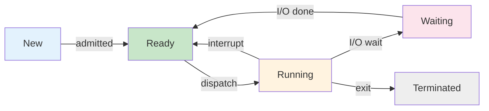

*Figure 8. The five process states and their transitions*

- The key system calls are **`fork()`**, **`exec()`**, **`wait()`**, and **`exit()`**.
- `fork()` creates a **copy** of the current process (parent → child).
- `exec()` **replaces** the process image with a new program. A process image is the complete contents of a running process in memory, that is, its code, data, stack, and state. `exec()` discards all of this and loads an entirely new program in its place.
- In xv6, `kernel/proc.c` implements the process table and state transitions.

> **Note:** When `fork()` returns 0, it is the child process; when it returns a positive value (the child's PID), it is the parent process; when it returns a negative value (-1), process creation has failed. This return value is used to branch the execution flow between parent and child. The pattern of calling `exec()` after `fork()` is the fundamental way Unix/Linux shells execute commands.

> **Note:** If processes only ran independently, it would be difficult to build useful systems. Most real systems have multiple processes that cooperate by exchanging data, which is called **Interprocess Communication (IPC)**. IPC mechanisms such as shared memory, message passing, pipes, and sockets are covered in detail in Week 3.

### 2.2 Threads & Concurrency (Weeks 4-5)

A single-threaded program cannot take advantage of multi-core CPUs. Threads allow a single program to do multiple things in parallel, like downloading a file while updating the UI.

A **thread** is a lightweight execution unit that shares a process's address space.

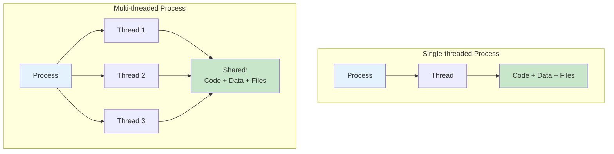

*Figure 9. Single-threaded and multi-threaded processes*

- Multiple threads within a single process achieve **parallelism** on multi-core CPUs.
- The challenge is **race conditions** that arise when threads access shared data concurrently.

> **Note:** The key difference between processes and threads is as follows. Processes have independent address spaces, but threads within the same process **share** code, data, and files. Each thread has only its own stack and register set. While shared memory makes inter-thread communication fast, synchronization issues can arise.

### 2.3 CPU Scheduling (Weeks 6-7)

With dozens of processes competing for a limited number of CPU cores, the OS needs a strategy to decide who runs when. A poor strategy means some programs starve while others hog the CPU.

The OS decides **which process to run next** on the CPU.

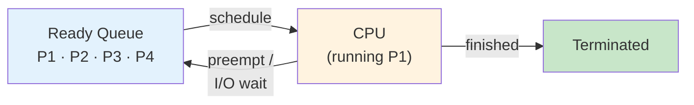

*Figure 10. Scheduling flow between the ready queue and the CPU*

**Scheduling algorithms** balance competing goals:

| Algorithm | Idea | Trade-off |
|:----------|:-----|:----------|
| **FCFS** | First Come, First Served | Simple but suffers from the convoy effect |
| **SJF** | Shortest Job First | Optimal average wait time but hard to predict |
| **Round Robin** | Fixed time slice, cyclic | Fair with good response time |
| **Priority** | Highest priority first | Risk of starvation |

*Table 4. Idea and trade-off of representative CPU scheduling algorithms*

> **[Algorithms]** SJF is theoretically the optimal algorithm for minimizing average wait time, but in practice, the next job's CPU burst time cannot be known exactly. Therefore, prediction is done using exponential averaging based on past data. In Round Robin, if the time slice is too large, it becomes equivalent to FCFS; if too small, context-switching overhead increases.

### 2.4 Synchronization (Week 9)

Without synchronization, concurrent threads can corrupt shared data in subtle ways, causing bugs that appear only once in a million runs and are extremely difficult to debug.

When multiple threads share data, **coordination** is needed.

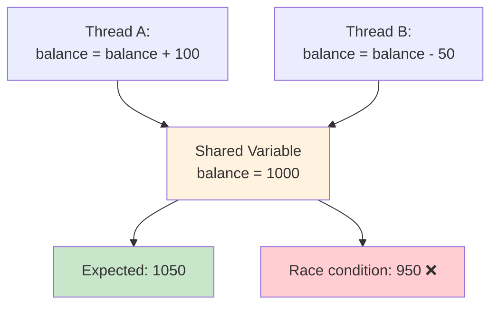

*Figure 11. Race condition between two threads on the shared variable balance*

- A **critical section** is a code region that accesses shared resources.
- A **lock (mutex)** ensures that only one thread can enter at a time.
- **Semaphores** and **condition variables** are more flexible coordination tools.
- Classic problems include producer-consumer, readers-writers, and dining philosophers.

> **Note:** The reason balance can become 950 in Figure 11 is as follows. Thread A reads balance (1000), then Thread B also reads the same value (1000). If Thread B stores 950 first and then Thread A stores 1100, the result is 1100; if stored in the opposite order, the result is 950. This nondeterministic outcome is a race condition. To resolve this, **mutual exclusion** over the critical section is needed.

### 2.5 Deadlocks (Week 10)

Locks solve race conditions, but careless locking introduces a new problem. This problem is deadlock, where the entire system freezes because everyone is waiting for everyone else.

**Deadlock** is a state where two or more processes are waiting for each other to release resources.

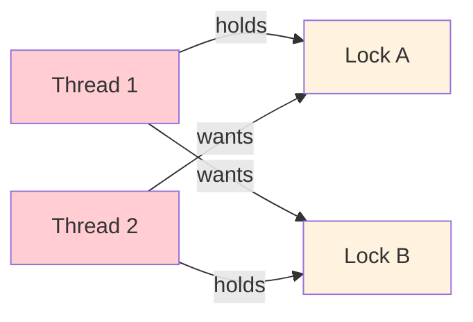

*Figure 12. Deadlock in which two threads wait for each other's lock*

**Four conditions** must all hold for deadlock: Mutual Exclusion, Hold and Wait, No Preemption, and **Circular Wait**.

**Solutions:** lock ordering, `trylock` with back-off, and deadlock detection and recovery.

> **[Discrete Mathematics]** Deadlocks can be modeled using a **Resource Allocation Graph**. If a **cycle** exists in this graph, deadlock may occur (when each resource type has a single instance, a cycle means deadlock). Breaking any one of the four conditions prevents deadlock; in practice, **preventing circular wait** (fixing the lock acquisition order) is most commonly used.

### 2.6 Memory Management (Weeks 11-12)

Without virtual memory, one program could overwrite another's memory, making the entire system unstable. Virtual memory also lets you run programs larger than physical RAM.

**Virtual Memory** gives each process its own independent address space.

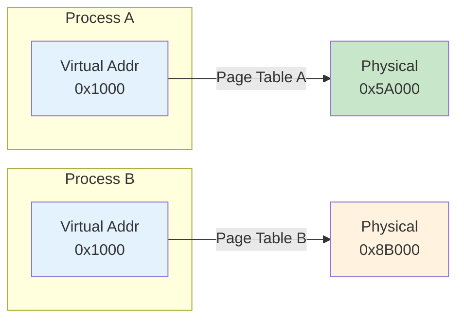

*Figure 13. Per-process page tables mapping the same virtual address to different physical addresses*

- The same virtual address maps to **different** physical locations in different processes, so the processes are isolated from each other.
- A **page table** maps virtual pages to physical frames for each process.

> **Definition:** **Lazy allocation** means the OS does not actually allocate physical memory when requested, but waits until the memory is first accessed.

- Page tables enable **COW fork**, **lazy allocation**, **memory-mapped files**, and more.
- xv6 implements virtual memory with the RISC-V **Sv39** scheme. The details are covered in Weeks 11-12; here it suffices to note that Sv39 uses a 3-level page table and 39-bit virtual addresses.

> **[Computer Architecture]** To translate virtual addresses to physical addresses, the page table in memory must be consulted each time, which can double (or more) memory access latency. To solve this, CPUs include a cache called the **TLB (Translation Lookaside Buffer)** that stores recent translation results. COW (Copy-On-Write) fork is an optimization where during `fork()`, physical pages are shared read-only instead of actually copying memory, and a page is copied only when a write to it occurs.

### 2.7 File Systems & Security (Week 13)

Without a file system, data would be lost every time the computer powers off, and there would be no organized way to store, retrieve, or share information.

**File Systems** organize persistent data hierarchically.

| Layer | Component | Key Functions |
|:------|:----------|:-------------|
| 6 | **File Descriptors** | `open()`, `read()`, `write()`, `close()` |
| 5 | **Pathnames** | `namei()`: resolves `/path/to/file` |
| 4 | **Directories** | `dirlookup()`, `dirlink()` |
| 3 | **Inodes** | `ialloc()`, `readi()`, `writei()` |
| 2 | **Logging** | Crash safety through WAL (Write-Ahead Log) |
| 1 | **Buffer Cache** | `bread()`, `bwrite()`: disk block caching |
| 0 | **Disk** | Physical block device |

*Table 5. Layers and key functions of the xv6 file system*

- Each layer depends **only on the layer below**, which makes the design clean and modular.
- **Security** is covered in Week 14 and includes protection rings, access control, and encryption.

> **[Data Structures]** The directory structure of a file system is a **tree** starting from the root `/`. An inode is a data structure that stores file metadata (size, permissions, data block locations, etc.), while file names are stored in directory entries. The reason a single file can have multiple names (hard links) is precisely because of this separated structure; with hard links, the directory structure is strictly an acyclic graph rather than a tree.

---

<br>

## Summary

| Concept | Key Summary |
|:--------|:-----------|
| OS and kernel | The core of the OS is the kernel, an always-running program that manages hardware resources. |
| Two Roles of the OS | The OS is both a resource allocator that distributes resources fairly and a control program that runs programs safely. |
| Dual Mode | Separating user mode (restricted) from kernel mode (full access) protects the OS. |
| System Calls | System calls are the only interface through which applications request services from the kernel. |
| Interrupts and DMA | An interrupt is the mechanism by which devices notify the CPU of completion, and DMA transfers bulk data without CPU intervention. |
| Storage Hierarchy | Storage forms the hierarchy registers → cache → memory → SSD → HDD, where higher levels are faster, more expensive, and smaller. |
| OS Structure | OS structures include monolithic, microkernel, hybrid, and loadable modules, and most modern OSes are hybrid. |
| xv6 | xv6 is an MIT educational OS of about 10,000 lines written in C for RISC-V and is used throughout the semester. |
| Key Topics | The key topics of operating systems are processes, threads, scheduling, synchronization, memory, file systems, and security. |
| Textbook | The textbook is Operating System Concepts by Silberschatz. |

---

<br>

## Self-Check Questions

1. What is the kernel, and how does it differ from system programs and application programs?

   <details>
   <summary>Answer</summary>

   The **kernel** is the core of the OS, resident in memory from boot to shutdown and responsible for hardware resource allocation and servicing system calls. **System programs** (shells, compilers, utilities) ship with the OS but run in user mode and provide the user environment. **Application programs** are ordinary user-installed software. Only the kernel runs in kernel mode.

   </details>

2. Why does the CPU need two modes (user mode and kernel mode)? What would go wrong with only one mode?

   <details>
   <summary>Answer</summary>

   Dual-mode isolates user processes from privileged instructions (I/O, memory-mapping changes, halt) so that buggy or malicious programs cannot corrupt kernel data or other processes. With a single mode, any program could overwrite another process's memory, directly drive devices, or disable interrupts, so one faulty program would crash the whole system.

   </details>

3. Explain the sequence of events that occur when a user program calls `open()`, from the user program to the kernel and back.

   <details>
   <summary>Answer</summary>

   ① User calls the libc `open()` wrapper → ② wrapper places the syscall number and arguments in registers and executes a trap instruction (e.g., RISC-V `ecall`) → ③ CPU switches to kernel mode and jumps to the trap handler → ④ `sys_open()` looks up the inode and allocates a file descriptor → ⑤ result is placed in a register and the kernel executes `sret` to return to user mode → ⑥ the wrapper returns the value to the user program.

   </details>

4. What is the difference between a trap and a hardware interrupt?

   <details>
   <summary>Answer</summary>

   A **trap** is a **synchronous** event raised by software, such as a system call or an exception (divide-by-zero or page fault), and is always tied to a specific instruction. A **hardware interrupt** is an **asynchronous** signal from an external device (timer, disk, keyboard) that arrives independently of the currently executing instruction.

   </details>

5. Without virtual memory, what problems would arise when running multiple programs simultaneously?

   <details>
   <summary>Answer</summary>

   ① Two programs using the same physical addresses would overwrite each other's memory. ② No program can exceed physical memory size. ③ No isolation: one program could read/modify another's data or kernel memory. ④ Memory fragmentation would quickly waste free space since relocation is difficult.

   </details>

---
