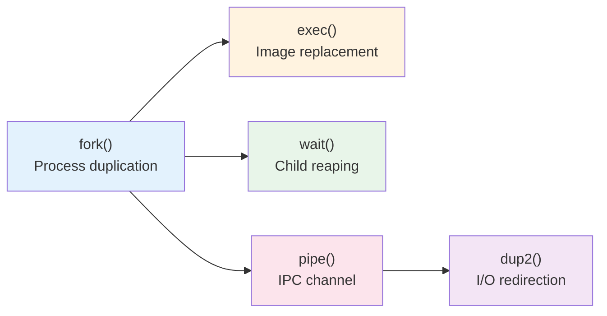
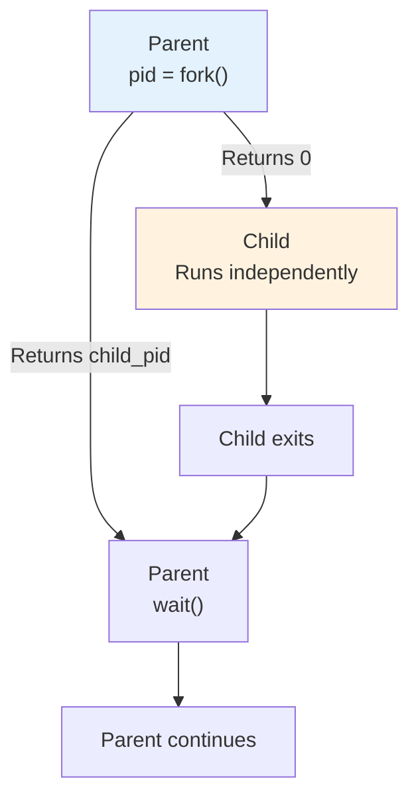
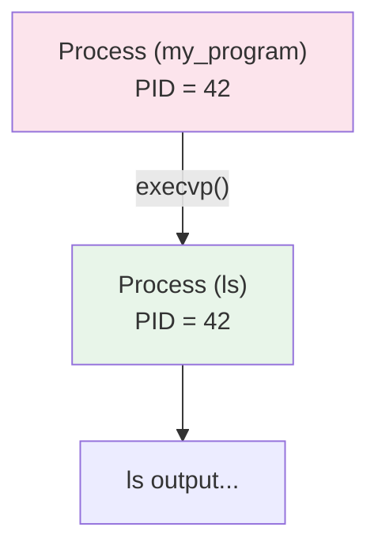
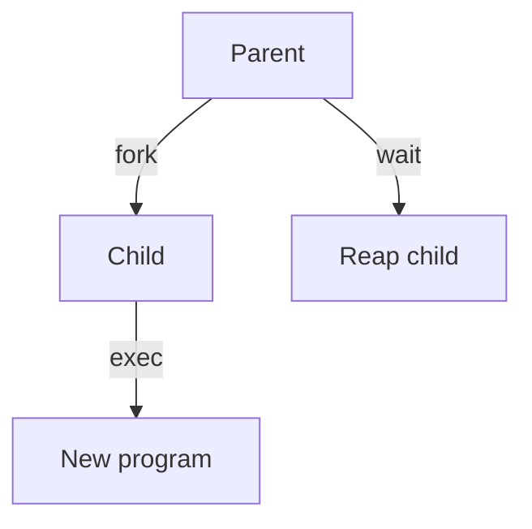
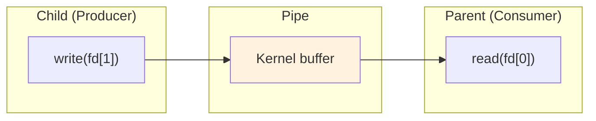
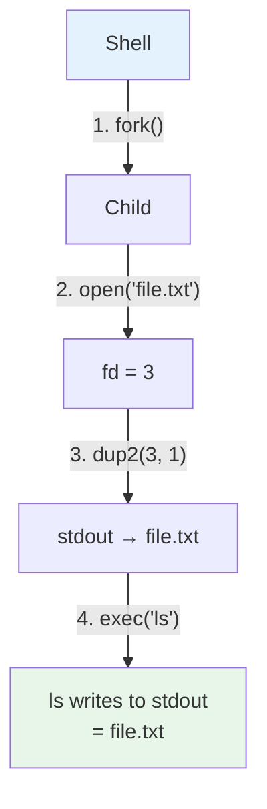
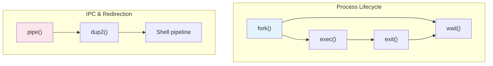

# Week 2 Lab — Process System Calls

[Repository Guide](../../README.md) | [English](Concepts_Lab.md) | [한국어](Concepts_Lab.ko.md)

> **Last Updated:** 2026-10-18

> **Learning Objectives:**
> 1. Use fork()/wait() to create and manage child processes
> 2. Replace a process image using exec()
> 3. Establish inter-process communication using pipe()
> 4. Implement shell-style I/O redirection using dup2()

---

## Table of Contents

- [1. Lab Overview](#1-lab-overview)
- [2. Lab 1: fork() and wait()](#2-lab-1-fork-and-wait)
- [3. Lab 2: exec()](#3-lab-2-exec)
- [4. Lab 3: pipe()](#4-lab-3-pipe)
- [5. Lab 4: dup2() and I/O Redirection](#5-lab-4-dup2-and-io-redirection)
- [Summary](#summary)
- [Self-Check Questions](#self-check-questions)

---

<br>

## 1. Lab Overview

- **Objective**: Practice core UNIX process system calls through C programs.
- **Duration**: Approximately 50 minutes, 4 labs
- **Topics**: `fork()`, `exec()`, `wait()`, `pipe()`, `dup()`



*Figure 1. Relationship among the process system calls covered in the lab*

---

<br>

## 2. Lab 1: fork() and wait()

`fork()` duplicates the calling process. The child process receives a **copy** of the parent's address space.

```c
pid_t pid = fork();
if (pid == 0) {
    // Child process
    printf("Child PID: %d\n", getpid());
} else {
    // Parent process
    wait(NULL);
    printf("Parent: child finished\n");
}
```

> **Definition:** `pid_t` is a typedef for an integer type (defined in `<sys/types.h>`) used for process IDs. It is used instead of `int` to ensure portability across systems where PID sizes may vary.



*Figure 2. Execution flow of the parent and child after fork()*

- `fork()` returns **0** to the child and the **child's PID** to the parent.
- `wait(NULL)` blocks until a child process terminates.

> **Definition:** In `wait(NULL)`, the `NULL` argument means the caller does not care about the child's exit status. If you pass a pointer to an `int` instead (e.g., `wait(&status)`), the kernel writes the child's exit status into that variable.

- **Exercise**: What happens if you remove `wait()`?

> **Note:** When `fork()` is called, the parent's memory space is copied to the child. In actual implementations, the **COW (Copy-On-Write)** technique is used to defer physical page copying until a write occurs. If `wait()` is not called, even after the child terminates, the PCB is not reclaimed, and the child becomes a **zombie process**.

> **Definition:** COW (Copy-On-Write) means the parent and child initially share the same physical memory pages after `fork()`. Only when either process tries to **write** to a page does the kernel copy that specific page, saving both memory and time. This is why `fork()` followed immediately by `exec()` is very cheap: the child's pages are about to be replaced anyway.

---

<br>

## 3. Lab 2: exec()

`exec()` replaces the current process image with a new program. The PID does **not** change.

```c
printf("Before exec\n");

char *args[] = {"ls", "-l", NULL};
execvp("ls", args);

// This line is never reached if exec succeeds
printf("After exec\n");
```



*Figure 3. The PID kept and the program replaced across exec()*

**Common pattern**: `fork()` + `exec()`



*Figure 4. The common pattern combining fork(), exec(), and wait()*

> **Key Point:** Upon success, `exec()` completely overwrites the calling process's code, data, heap, and stack with the new program, so code after the call is never executed. It returns -1 only on failure. The `fork()` → `exec()` → `wait()` pattern is the core operating principle of UNIX shells and must be thoroughly understood.

---

<br>

## 4. Lab 3: pipe()

`pipe()` creates a **unidirectional** communication channel between two file descriptors.

```c
int fd[2];
pipe(fd);  // fd[0]=read, fd[1]=write

if (fork() == 0) {
    close(fd[0]);  // Close read end
    char *msg = "hello from child";
    write(fd[1], msg, strlen(msg));  /* strlen(msg), not sizeof(msg) — see note below */
    close(fd[1]);
} else {
    close(fd[1]);  // Close write end
    char buf[64] = {0};
    read(fd[0], buf, sizeof(buf));
    printf("Received: %s\n", buf);
    close(fd[0]);
}
```

> **Note:** `strlen(msg)` is used here (not `sizeof(msg)`) because `msg` is a pointer, and `sizeof` on a pointer gives the pointer's byte size (4 or 8 bytes), not the string length.



*Figure 5. Pipe data flow from the child through the kernel buffer to the parent*

**Rules**:
- Always close the **unused** end.
- Pipes follow the **producer-consumer** pattern.
- When all write ends are closed, the read side receives EOF.

> **Definition:** EOF (End of File) signals that there is no more data to read. For pipes, this occurs when **all** write-end file descriptors are closed. This is why every process that holds a copy of the write-end fd must close it.

> **[Systems Programming]** A file descriptor is a non-negative integer assigned by the kernel to a process to identify an open file. 0=standard input (stdin), 1=standard output (stdout), and 2=standard error (stderr) are assigned by default. The fd[0] and fd[1] created by `pipe()` are also registered in this file descriptor table.

> **Key Point:** The fact that pipes are manipulated using file I/O functions like `read()`/`write()` is based on the core UNIX design philosophy **"Everything is a file"**. In UNIX, regular files, directories, pipes, sockets, and devices (keyboard, disk, etc.) are all accessed through **file descriptors**, mostly with the same interface (`open/read/write/close`). This means that knowing just one API lets you work with many different resources, keeping programming concise.

> **[Data Structures]** A pipe is a classic implementation of the producer-consumer pattern. One side (the child) writes data and the other side (the parent) reads it, synchronized through a bounded buffer inside the kernel. When the buffer is full, `write()` blocks; when it is empty, `read()` blocks.

> **Note:** A specific scenario when `close()` is omitted is as follows. If the parent does not close `fd[1]` (the write end) and calls `read(fd[0])`, even after the child finishes writing and closes `fd[1]`, the parent itself still holds `fd[1]`, so the kernel considers the write end still open. As a result, `read()` never receives EOF and **blocks forever**, causing the program to hang. This is the most common bug in pipe programming.

---

<br>

## 5. Lab 4: dup2() and I/O Redirection

`dup2(oldfd, newfd)` makes `newfd` point to the same file as `oldfd` and is used for redirection in shells.

```c
int fd = open("output.txt",
    O_WRONLY | O_CREAT | O_TRUNC, 0644);  /* O_WRONLY|O_CREAT|O_TRUNC = write-only, create if missing, clear contents */
dup2(fd, STDOUT_FILENO);
close(fd);

// This output goes to output.txt
printf("Redirected!\n");
```

> **Note:** The `open()` flags are as follows:
> - `O_WRONLY`: open for writing only (no reading).
> - `O_CREAT`: create the file if it does not exist.
> - `O_TRUNC`: if the file already exists, truncate its contents to make it empty.
> - `0644`: file permissions (owner: read+write, group/others: read only). In octal notation, this corresponds to `rw-r--r--`. The permissions actually granted are this value with the umask applied.
>
> This combination is equivalent to the `> file.txt` redirection in a shell. To implement `>>` (append mode), use `O_APPEND` instead of `O_TRUNC`.

**How `ls > file.txt` works:**



*Figure 6. How the shell executes ls > file.txt*

**Exercise**: Combine `fork()` + `pipe()` + `dup2()` to implement `ls | wc -l`.

> **Note:** When `dup2(oldfd, newfd)` is called and `newfd` is already open, it is automatically closed before duplication. The full sequence when the shell executes `ls > file.txt` is as follows. (1) `fork()` to create a child → (2) the child calls `open()` to open the file, getting fd=3 → (3) `dup2(3, 1)` redirects stdout (fd=1) to the file → (4) `close(3)` cleans up the original fd → (5) `exec("ls")` replaces the program. After this, when `ls` outputs via `printf()`/`write(1,...)`, it is automatically written to the file.

> **Note:** `ls | wc -l` is implemented in the following steps:
> 1. The parent calls `pipe(fd)` to create a pipe → `fd[0]` (read), `fd[1]` (write)
> 2. First `fork()` → **Child 1** (ls role):
>    - `dup2(fd[1], STDOUT_FILENO)`: redirect stdout to the pipe's write end.
>    - `close(fd[0])`, `close(fd[1])`: close all original fds.
>    - `execlp("ls", "ls", NULL)`: run ls.
> 3. Second `fork()` → **Child 2** (wc role):
>    - `dup2(fd[0], STDIN_FILENO)`: redirect stdin to the pipe's read end.
>    - `close(fd[0])`, `close(fd[1])`: close all original fds.
>    - `execlp("wc", "wc", "-l", NULL)`: run wc -l.
> 4. **Parent**: `close(fd[0])`, `close(fd[1])`, so the parent also closes all pipe fds (required).
> 5. **Parent**: call `wait(NULL)` twice to reap both children.
>
> The key is that unused pipe fds must be closed in **all processes** including the parent for EOF to be properly delivered.



*Figure 7. Relationship between the process lifecycle system calls and the IPC and redirection system calls*

---

<br>

## Summary

| Concept | Key Summary |
|:------------|:--------|
| `fork()` | It creates a child process as a copy of the parent and returns 0 to the child and the child's PID to the parent. |
| `exec()` | It replaces the process image with a new program, keeping the PID and not returning on success. |
| `wait()` | It blocks until a child terminates and reaps zombie processes. |
| `pipe()` | It creates a unidirectional IPC channel in which fd[0] is the read end and fd[1] is the write end. |
| `dup2()` | It redirects file descriptors and is the core of shell redirection. |
| Shell pipeline | `cmd1 \| cmd2` is implemented by combining fork, pipe, dup2, exec (twice), and wait. |

---

<br>

## Self-Check Questions

1. **Pipe EOF:** In a fork+pipe program, the parent forgets to close `fd[1]` before calling `read(fd[0])`. The child writes data and closes `fd[1]`. Will the parent's `read()` ever return? Why or why not?

   <details>
   <summary>Answer</summary>

   While the data written by the child is in the pipe, `read()` reads it and returns, but once all the data has been read, the next `read()` never receives EOF and will **block forever**. `read()` on a pipe only returns EOF (0) when **all** write-end file descriptors are closed. Because the parent still holds its own copy of `fd[1]`, the kernel considers the pipe still writable. The parent must close its `fd[1]` too.

   </details>

2. **dup2 Behavior:** After `dup2(fd, STDOUT_FILENO)`, what happens when the process calls `printf()`? Why is it important to `close(fd)` afterward?

   <details>
   <summary>Answer</summary>

   `STDOUT_FILENO` (1) now points to the same open-file entry as `fd`, so `printf()` output goes to that file (or pipe) instead of the terminal. Closing `fd` afterward releases the redundant descriptor. Otherwise the descriptor slot is wasted, a program started by `exec()` inherits the unneeded fd, and if `fd` is the write end of a pipe, the reader never receives EOF.

   </details>

3. **fork + exec Pattern:** If `exec()` succeeds, will the line `perror("exec failed")` ever execute? What does it mean when you see that error message?

   <details>
   <summary>Answer</summary>

   **No**. A successful `exec()` replaces the entire process image, so control never returns to the code after the call. Seeing the error message means `exec()` itself failed (bad path, missing permissions, wrong architecture, etc.).

   </details>

4. **wait(NULL) vs wait(&status):** Explain the difference. When would you use one over the other?

   <details>
   <summary>Answer</summary>

   `wait(NULL)` waits for a child to terminate but **discards** the exit status. `wait(&status)` fills `status` with the child's termination info; use `WIFEXITED(status)` / `WEXITSTATUS(status)` to inspect it. Use `&status` whenever the parent needs to know whether the child succeeded or failed; use `NULL` only when you are just reaping the child.

   </details>

5. **Pipeline Implementation:** In the `ls | wc -l` implementation, why must the parent close **both** `fd[0]` and `fd[1]` even though it does not read from or write to the pipe?

   <details>
   <summary>Answer</summary>

   The parent does not use the pipe, but if it keeps the write end `fd[1]` open, the kernel will not signal EOF to the read end, so `wc` will never see EOF and will block forever. The parent must also close the read end `fd[0]` so that the writer can detect failure through SIGPIPE once all read ends are closed, and so that no fd is wasted. Closing both ends in the parent ensures that when the writer (`ls`) finishes, the reader (`wc`) observes EOF and exits.

   </details>

---
