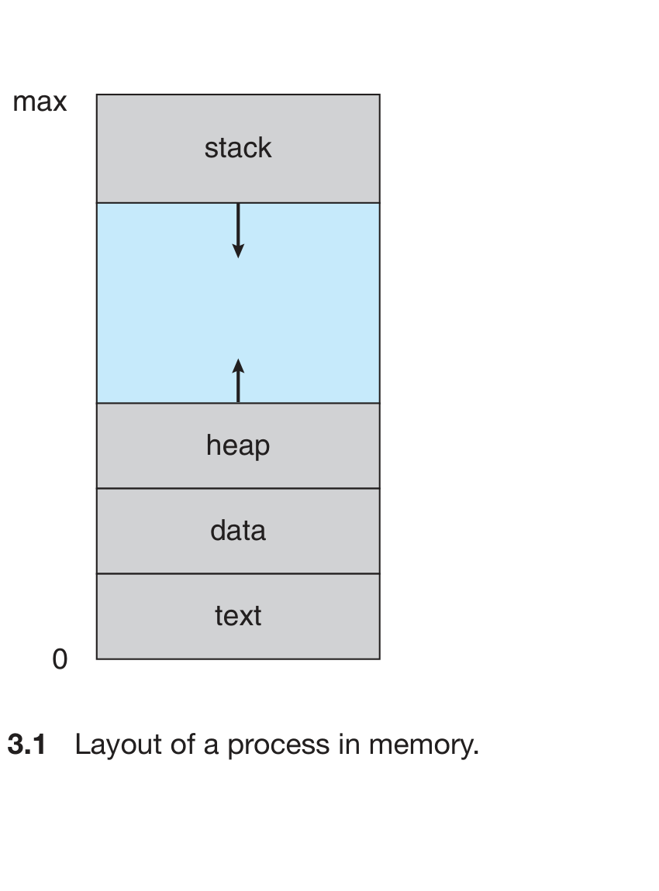
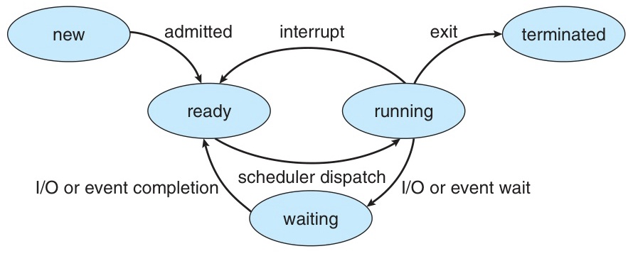
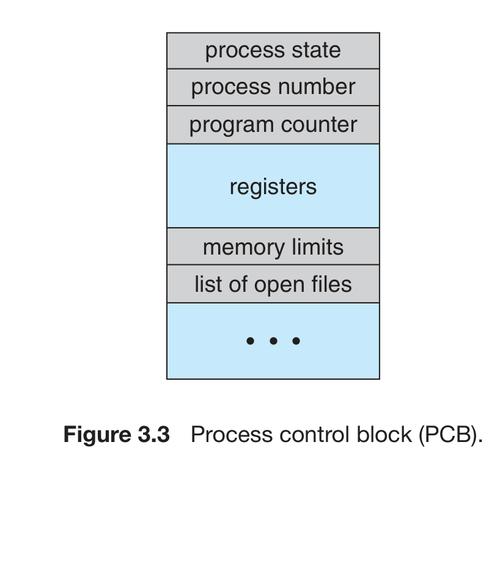
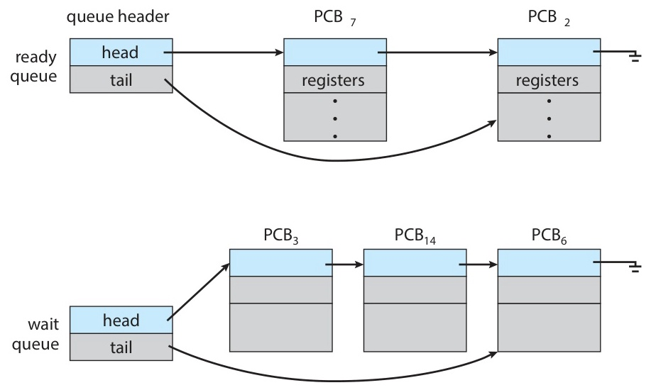
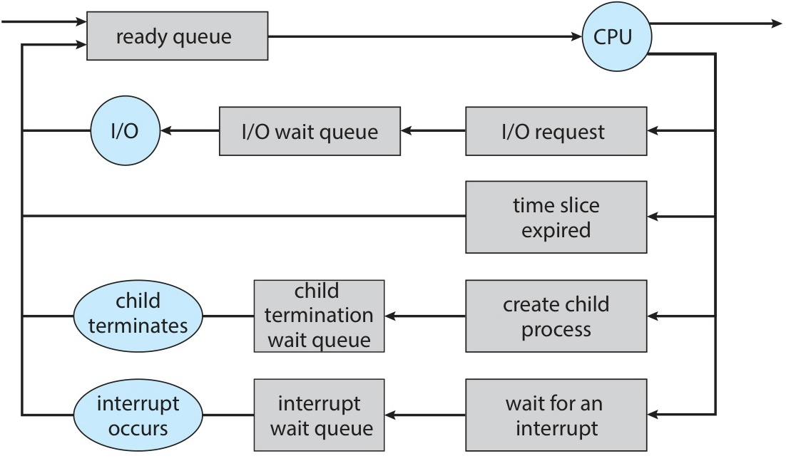
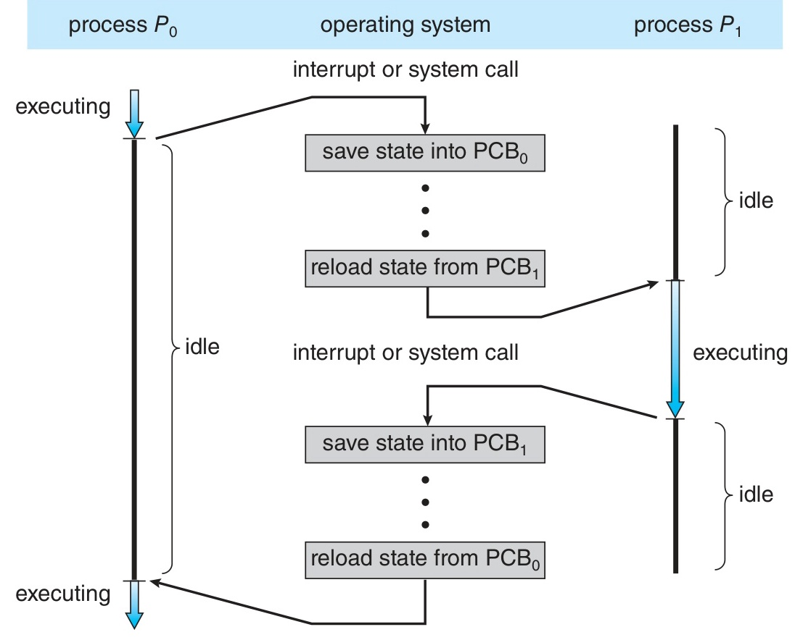
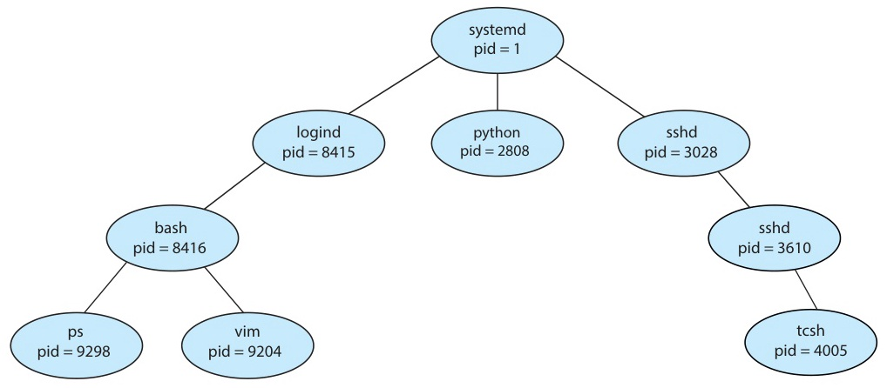

# Week 2 Lecture — Process (1)

[Repository Guide](../../README.md) | [English](Concepts_Lecture.md) | [한국어](Concepts_Lecture.ko.md)

> **Last Updated:** 2026-10-20
>
> Operating System Concepts, Silberschatz, Galvin, and Gagne, Ch 3 (3.1-3.3)

> **Learning Objectives:**
> 1. Describe the structure of a process (memory layout, PCB, states)
> 2. Explain how fork(), exec(), and wait() work together
> 3. Trace process state transitions through a lifecycle diagram
> 4. Identify and explain zombie and orphan processes

---

## Table of Contents

- [1. Process Concepts](#1-process-concepts)
  - [1.1 What is a Process?](#11-what-is-a-process)
  - [1.2 Memory Layout](#12-memory-layout)
  - [1.3 Dynamic Growth of Stack and Heap](#13-dynamic-growth-of-stack-and-heap)
  - [1.4 Memory Layout of a C Program](#14-memory-layout-of-a-c-program)
  - [1.5 Program vs Process](#15-program-vs-process)
  - [1.6 Process States](#16-process-states)
  - [1.7 Process Control Block (PCB)](#17-process-control-block-pcb)
  - [1.8 PCB in Linux: task_struct](#18-pcb-in-linux-task_struct)
  - [1.9 Thread Overview](#19-thread-overview)
- [2. Process Scheduling](#2-process-scheduling)
  - [2.1 Why is it Needed?](#21-why-is-it-needed)
  - [2.2 Degree of Multiprogramming and Process Types](#22-degree-of-multiprogramming-and-process-types)
  - [2.3 Scheduling Queues](#23-scheduling-queues)
  - [2.4 CPU Scheduling](#24-cpu-scheduling)
  - [2.5 Context Switch](#25-context-switch)
  - [2.6 Multitasking on Mobile Systems](#26-multitasking-on-mobile-systems)
- [3. Process Operations](#3-process-operations)
  - [3.1 Process Creation](#31-process-creation)
  - [3.2 fork() in UNIX/Linux](#32-fork-in-unixlinux)
  - [3.3 exec() after fork()](#33-exec-after-fork)
  - [3.4 fork() Code Example](#34-fork-code-example)
  - [3.5 Process Creation: Windows Comparison](#35-process-creation-windows-comparison)
  - [3.6 Process Termination](#36-process-termination)
  - [3.7 Zombie and Orphan Processes](#37-zombie-and-orphan-processes)
  - [3.8 Android Process Hierarchy](#38-android-process-hierarchy)
  - [3.9 Chrome Multi-Process Architecture](#39-chrome-multi-process-architecture)
- [4. Practice: fork(), exec(), wait()](#4-practice-fork-exec-wait)
  - [4.1 Basic Usage of fork()](#41-basic-usage-of-fork)
  - [4.2 Creating Multiple Children with fork()](#42-creating-multiple-children-with-fork)
  - [4.3 Running a New Program with exec()](#43-running-a-new-program-with-exec)
  - [4.4 Comparison of exec() Function Variants](#44-comparison-of-exec-function-variants)
  - [4.5 Detailed Behavior of wait()](#45-detailed-behavior-of-wait)
  - [4.6 How a Simple Shell Works](#46-how-a-simple-shell-works)
- [Summary](#summary)
- [Self-Check Questions](#self-check-questions)

---

<br>

## 1. Process Concepts

### 1.1 What is a Process?

A **process** is a program in execution.

- Early computers ran only one program at a time.
- In modern computers, multiple programs are loaded into memory and run **concurrently**.
- This evolution demanded stricter control and compartmentalization, giving rise to the **process** concept.

> **Key Point:** The textbook defines it as follows: "A process is the unit of work in a modern computing system."

- From the OS's perspective, there exist both processes executing user code and processes executing OS code.
- The CPU(s) are **multiplexed** among these processes.

> **Definition:** Multiplexing means the CPU is shared among multiple processes by rapidly switching between them, giving the illusion of simultaneous execution.

> **Key Point:** The heart of the definition of a process is "a program in execution." An executable file stored on disk is a program (a passive entity), and when it is loaded into memory and given CPU time to run, it becomes a process (an active entity).

### 1.2 Memory Layout

A process's memory layout is divided into several **sections**:



*Figure 1. Layout of a process in memory*

- **Text**: holds the executable code.
- **Data**: holds global variables.
- **Heap**: memory dynamically allocated at runtime (`malloc`, `new`).
- **Stack**: holds temporary data during function calls (parameters, return addresses, local variables).

> **Note:** The name "text" is used for the code section because it originates from early assembly language. The `.text` directive in assembly indicated that the following content was machine instructions, that is, the body (text) of the program. It is a historical convention derived from the metaphor of a program's body (text).

Text and data are **fixed** in size, while stack and heap **dynamically** expand and contract.

> **[Computer Programming]** Recall the memory regions from C programming. Global variables are stored in the data section, memory allocated with `malloc()` goes in the heap section, and function local variables reside on the stack. The stack grows from high to low addresses, and the heap grows from low to high addresses; the OS manages them so they do not collide.

### 1.3 Dynamic Growth of Stack and Heap

**Stack growth:**
- Each time a function is called, an **activation record** (function parameters, local variables, return address) is pushed onto the stack. An activation record, also called a **stack frame**, is the block of memory pushed onto the stack each time a function is called; it holds the function's local variables, parameters, and the address to return to when the function finishes.
- When a function returns, the activation record is popped.
- On most architectures, the stack grows **from high addresses toward low addresses** (downward).

**Heap growth:**
- The heap grows when memory is dynamically allocated via `malloc()`, `new`, etc.
- It shrinks when freed via `free()`, `delete`.
- The heap grows **from low addresses toward high addresses** (upward).

**Role of the OS:** Since the stack and heap grow toward each other, the OS must ensure they do **not overlap**.

> **[Data Structures]** The LIFO (Last In, First Out) principle of the stack data structure is applied here. If function A calls function B, and B calls function C, the return order is C → B → A, so the last function called returns first. This is managed through stack frames (activation records).

### 1.4 Memory Layout of a C Program

```c
#include <stdio.h>
#include <stdlib.h>

int x;            // Uninitialized data (BSS)
int y = 15;       // Initialized data

int main(int argc, char *argv[]) {   // argc, argv section
    int *values;   // Local variable → stack
    int i;         // Local variable → stack

    values = (int *)malloc(sizeof(int)*5);  // Dynamic allocation → heap
    for (i = 0; i < 5; i++)
        values[i] = i;
    return 0;
}
```

The `size` command can be used to check the size of each section:

```text
   text    data     bss     dec     hex
   1158     284       8    1450     5aa
```

The `dec` and `hex` columns show the total size of all sections combined, in decimal and hexadecimal respectively. Run `size ./your_program` after compiling to see these values for your own programs.

- **data** holds initialized global variables, and **bss** (block started by symbol) holds uninitialized global variables.

> **Note:** The reason BSS is separated from data is **to reduce the executable file size**. Variables in the data section (`int y = 15`) must store their initial value of 15 in the executable, but variables in the BSS section (`int x`) will be initialized to 0 anyway, so the executable only needs to record the BSS size (8 bytes in this example). In other words, BSS does not store actual data on disk, making the executable smaller. When the program is loaded, the OS fills the BSS region with zeros.

### 1.5 Program vs Process

| Aspect | Program | Process |
|:-------|:--------|:--------|
| Nature | **Passive** entity | **Active** entity |
| Form | Executable file stored on disk | Execution unit with a program counter (PC) and associated resources |
| Conversion | An executable becomes a process when loaded into memory | |

*Table 1. Comparison of a program and a process*

**Key differences:**
- The same program can be run as multiple processes.
  - For example, multiple users can run the same web browser simultaneously.
  - The text section is the same, but **data, heap, and stack are each separate**.
- A process itself can serve as the execution environment for other code.
  - For example, the JVM runs as a single process and interprets and executes Java programs.

### 1.6 Process States

A process changes **state** during its execution:

| State | Description |
|:------|:------------|
| **New** | The process is being created |
| **Running** | Instructions are being executed |
| **Waiting** | The process is waiting for a specific event (I/O completion, signal, etc.) |
| **Ready** | The process is waiting to be assigned to a processor |
| **Terminated** | The process has finished execution |

*Table 2. The five process states*

**Important:** At any given time, only **one process** can be in the running state on a single processor core. However, multiple processes can be in the ready or waiting states simultaneously.



*Figure 2. Diagram of process state*

**State transition details:**

| Transition | Cause |
|:-----------|:------|
| **New → Ready** | admitted: OS approves process creation; memory allocation complete |
| **Ready → Running** | scheduler dispatch: CPU scheduler selects and assigns the process to a CPU core |
| **Running → Ready** | interrupt: time slice expired (or a similar event), CPU is preempted |
| **Running → Waiting** | I/O or event wait: an I/O request is issued or a specific event is awaited |
| **Waiting → Ready** | I/O or event completion: the awaited I/O or event has completed |
| **Running → Terminated** | exit: the process finishes execution and terminates |

*Table 3. Process state transitions and their causes*

> **Definition:** A **time slice** (or quantum) is the fixed amount of CPU time the OS allocates to each process before preempting it.

> **Key Point:** Running → Ready is an **involuntary** transition caused by time slice expiration, whereas Running → Waiting is a **voluntary** transition caused by an I/O request.

### 1.7 Process Control Block (PCB)

Each process is represented in the OS by a **PCB (Process Control Block)**. It is also known as a **task control block**.



*Figure 3. Process control block (PCB)*

The PCB serves as a repository for all data needed to **start or restart** a process.

| Field | Description |
|:------|:------------|
| **Process state** | Current state (new, ready, running, waiting, terminated) |
| **Program counter** | Address of the next instruction to execute |
| **CPU registers** | Accumulator, index registers, stack pointer, general-purpose registers, condition codes (flags set by the CPU after arithmetic operations to indicate properties of the last result, e.g., zero flag, carry flag), etc. |
| **CPU scheduling info** | Process priority, scheduling queue pointers, other parameters |
| **Memory management info** | Base/limit register values, page table or segment table |
| **Accounting info** | CPU time used, elapsed real time, time limits, process number |
| **I/O status info** | List of allocated I/O devices, list of open files |

*Table 4. Fields of the PCB and their contents*

> **Note:** **Why these fields?** Among these fields, the **program counter** and **process state** are the most critical, because they determine where execution resumes and whether the process is ready to run.

> **[Computer Architecture]** The **base register** stores the **starting address** of memory a process can access, and the **limit register** stores the **size (range)** of that process's memory. When the CPU accesses memory, the hardware automatically checks whether the address falls within the [base, base+limit) range, preventing access to another process's memory. This was the memory protection method before virtual memory (page tables) emerged, and more advanced methods are covered in Week 11.

> **Key Point:** The PCB is the core data structure through which the OS manages processes. When a context switch occurs, the current process's PC and register values are saved to its PCB, and values are restored from the new process's PCB. Without the PCB, it would be impossible to pause a process and later resume its execution.

### 1.8 PCB in Linux: task_struct

In the Linux kernel, the PCB is represented by the **`task_struct`** C structure, which is defined in `<include/linux/sched.h>`.

```c
long state;                    /* process state */
struct sched_entity se;        /* scheduling information */
struct task_struct *parent;    /* parent process */
struct list_head children;     /* list of child processes */
struct files_struct *files;    /* list of open files */
struct mm_struct *mm;          /* address space (memory management) */
```

- All active processes are managed as a **doubly linked list**.
- The `current` pointer points to the `task_struct` of the currently running process.

```c
current->state = new_state;  // Change the current process's state
```

> **Note:** The `->` operator accesses a field through a pointer. `current->state` means the `state` field of the struct that `current` points to.

> **[Data Structures]** The reason the Linux kernel manages processes as a doubly linked list is that insertions and deletions of processes occur frequently, making O(1) insertion/deletion performance important. Managing them with an array would incur O(n) movement cost on insertion/deletion.

### 1.9 Thread Overview

The process model discussed so far assumes a **single thread of execution**.
- A process can only perform one task at a time.
- For example, in a word processor, typing and spell-checking cannot happen simultaneously.

A **thread** is a unit of execution within a process.

Modern OSes allow **multi-threaded execution**:
- A single process can perform multiple tasks simultaneously.
- **Parallel execution** is possible on multi-core systems.

**Example: Multithreaded Word Processor.** Thread 1 manages user input while Thread 2 runs the spell checker, allowing both tasks to proceed concurrently. This overcomes the single-thread limitation described above.

**What threads of the same process share:** text section, data section, heap, open files, signals, etc.

**What is independent per thread:** program counter (PC), register set, stack

> **Note:** In systems that support threads, the PCB is extended to include information for each thread. System-wide changes are needed to support threads.

> **Note:** Details on threads are covered in **Week 4**.

---

<br>

## 2. Process Scheduling

### 2.1 Why is it Needed?

**Goal of multiprogramming:** Maximize **CPU utilization** by ensuring some process is always running.

**Goal of time sharing:** Switch the CPU core frequently among processes so users can **interact** with each program.

The **Process Scheduler** selects a process from the available processes for execution on a CPU core.

- On a single core, only one process can run at a time.
- On multiple cores, multiple processes can run simultaneously.
- When the number of processes exceeds the number of cores, the rest must wait.

### 2.2 Degree of Multiprogramming and Process Types

The **Degree of Multiprogramming** is the number of processes currently in memory.

| Type | Characteristics |
|:-----|:----------------|
| **I/O-bound process** | Spends more time on I/O than computation; frequent I/O requests |
| **CPU-bound process** | Spends more time on computation than I/O; infrequent I/O requests |

*Table 5. Characteristics of I/O-bound and CPU-bound processes*

A proper mix of I/O-bound and CPU-bound processes is important for efficient scheduling.

> **Note:** **Why a proper mix matters.** If only I/O-bound processes exist, the ready queue empties and the CPU idles. If only CPU-bound processes exist, the wait queue empties and I/O devices idle.

### 2.3 Scheduling Queues

When a process enters the system, it is placed in a **scheduling queue**.

- The **Ready Queue** is a queue of processes waiting for the CPU and is typically implemented as a **linked list**.
- A **Wait Queue** is a queue of processes waiting for a specific event (e.g., I/O completion).



*Figure 4. Ready queue and wait queues*



*Figure 5. Queueing-diagram representation of process scheduling*

A process repeats the cycle in Figure 5 until it terminates. Upon termination, it is removed from all queues, and its PCB and resources are deallocated.

### 2.4 CPU Scheduling

**Role of the CPU scheduler:** Select one process from the ready queue and assign it to a CPU core.

**Scheduling frequency:** The CPU scheduler typically runs at least every **100 ms**.

> **Note:** I/O-bound processes execute for only a few milliseconds before waiting for I/O. CPU-bound processes execute longer, but the scheduler forcibly reclaims the CPU.

**Swapping:**
- Moving a process from memory to disk (**swap out**) and later reloading it (**swap in**).
- Reduces the degree of multiprogramming to relieve memory pressure.
- Only needed when memory is **overcommitted** (i.e., the total memory demanded by all running processes exceeds the available physical RAM). The details are covered in Week 11.

> **Definition:** Swapping moves an entire process out of main memory to disk (swap out) and back (swap in) to free memory for other processes.

### 2.5 Context Switch

**Context:** Represented in a process's PCB. Includes CPU register values, process state, memory management information, etc.

**Context Switch:** The task of switching a CPU core to a different process. Consists of **saving the state** of the current process + **restoring the state** of the new process.



*Figure 6. Context switch from process to process*

> **Key Point:** The context switch is a core OS mechanism. Users perceive multiple programs running simultaneously because the OS performs context switches between processes extremely quickly. However, no useful work is performed during a context switch, so it is pure overhead.

> **Note:** **Analogy.** Consider taking an exam and needing to switch to a different test paper. You save your current answers (register state), put away the current sheet (save PCB), and pick up the new one (restore PCB). The time you spend shuffling papers is wasted (overhead), but it lets you proceed as if you were working on multiple tests simultaneously.

> **Note:** A concrete example is as follows. While Process A (word processor) is running and a timer interrupt occurs, the OS (1) saves A's PC, register values, stack pointer, etc. to A's PCB, (2) selects Process B (web browser) from the ready queue, and (3) restores the PC, register values, etc. previously saved in B's PCB to the CPU. This entire process completes within microseconds, making the user perceive A and B as running simultaneously.

**Context switch overhead:**
- A context switch typically takes **a few microseconds**.
- Factors affecting speed include memory speed, the number of registers to copy, and the availability of special instructions.
- Some processors provide **multiple sets of registers** to reduce context switch cost.

> **[Computer Architecture]** Registers are the fastest storage inside the CPU. During a context switch, all register values must be saved to memory (PCB) and restored, so the more registers there are, the higher the context switch cost. Some CPUs (e.g., SPARC) use the register window technique to reduce this overhead.

### 2.6 Multitasking on Mobile Systems

**iOS:**
- Early iOS did not support multitasking for user apps (only the foreground app ran; others were suspended).
- From iOS 4, limited multitasking (1 foreground + multiple background) was supported.
- iPad can run two foreground apps simultaneously via split screen.
- Later iOS versions introduced richer multitasking support as hardware capabilities improved.

**Android:**
- Supported multitasking from the start, with no restrictions on background app types.
- Uses **Services** (separate app components) for background processing.
  - Services have no UI and use less memory.
  - Even if a background app is suspended, its service continues running.

---

<br>

## 3. Process Operations

### 3.1 Process Creation

A process can create several new processes during its execution.

| Term | Description |
|:-----|:------------|
| **Parent process** | A process that creates another process |
| **Child process** | The newly created process |
| **Process tree** | The tree structure formed by parent-child relationships |
| **Process ID (pid)** | A unique identifier for each process (typically an integer) |

*Table 6. Terms related to process creation*



*Figure 7. A tree of processes on a typical Linux system*

- **systemd** (pid = 1) is the **root parent** of all user processes and the first user process created during system boot. It creates processes for additional services such as web servers, SSH servers, etc.
- In traditional UNIX, **init** (pid = 1) performed this role.

> **Definition:** `systemd` (or `init` in older systems) is the first user-space program the Linux kernel launches at boot; it then starts all other services, so every user process is ultimately a descendant of PID 1.

> **[Data Structures]** The process tree is literally a tree structure. The root node is the first process (systemd, pid=1 on Linux), and each node can have child nodes (child processes). The clear parent-child relationship enables systematic process management (termination, resource reclamation, etc.).

**Resource and execution options:**

How a child process obtains resources:
1. The child acquires resources directly from the OS.
2. The child receives a subset of the parent's resources.

Execution options:
1. The parent continues executing **concurrently** with the child.
2. The parent **waits** until the child terminates.

Address space options:
1. The child is a **duplicate** of the parent (same program and data).
2. A **new program** is loaded into the child.

> **Note:** Resource limits prevent excessive child process creation.

### 3.2 fork() in UNIX/Linux

In UNIX, new processes are created using the **`fork()`** system call.

**How fork() works:**
1. Creates a new process as a **copy of the calling process's address space**.
2. **Both** parent and child continue execution from the instruction after fork().
3. The child inherits the parent's privileges, scheduling attributes, open files, etc.

> **Note:** **Why copy the entire address space?** So that the child can continue running the same program with the same data right after fork() and can communicate easily with the parent. Actual implementations optimize this copy with COW (Copy-On-Write, Week 12). Pages are initially shared and copied only on write, which makes fork() very cheap when followed immediately by exec().

**Return values of fork():**

| Return Value | Meaning |
|:-------------|:--------|
| **0** | Child process (the newly created process) |
| **Positive (> 0)** | Parent process (the child's pid is returned) |
| **-1** | fork failed (error) |

*Table 7. Return values of fork() and their meanings*

> **Key Point:** After fork(), both parent and child execute the same code but receive different return values, and the program uses this return value to separate the parent's and child's execution paths.

### 3.3 exec() after fork()

The **exec()** system call **replaces** the process's memory space with a new program.

```text
fork() → Child process created (copy of parent)
         │
    Child: calls exec()
         │
    Child's memory image is replaced with the new program
    (original program is destroyed)
```

*Figure 8. The child loading a new program with exec() after fork()*

- If exec() succeeds, it does **not return** to the original code (memory is overwritten).
- If exec() fails, control returns (error handling possible).

### 3.4 fork() Code Example

```c
#include <sys/types.h>
#include <stdio.h>
#include <unistd.h>
#include <sys/wait.h>

int main() {
    pid_t pid;

    /* Fork a child process */
    pid = fork();

    if (pid < 0) {          /* Error occurred */
        fprintf(stderr, "Fork Failed");
        return 1;
    }
    else if (pid == 0) {    /* Child process */
        execlp("/bin/ls", "ls", NULL);
    }
    else {                  /* Parent process */
        /* Parent waits for child to complete */
        wait(NULL);
        printf("Child Complete");
    }

    return 0;
}
```

> **Note:** In `execlp("/bin/ls", "ls", NULL)`, the first argument `"/bin/ls"` is the **file path** to execute, and the arguments from the second onward are the **argv array** passed to the program. By UNIX convention, `argv[0]` should be the program's own name. Therefore, `"ls"` is passed as `argv[0]`. Ignoring this convention still allows execution, but since many programs use `argv[0]` to print error messages, it is proper to always include it. The final `NULL` marks the end of the argument list.

**fork() + exec() + wait() flow:**

```text
Parent Process
    │
    ├── fork() called
    │       │
    │       ├── [Child process created]
    │       │       │
    │       │       ├── pid == 0 (child)
    │       │       │       │
    │       │       │       └── execlp("/bin/ls", "ls", NULL)
    │       │       │               → ls command runs
    │       │       │               → terminates via exit()
    │       │
    │       ├── pid > 0 (parent)
    │       │       │
    │       │       └── wait(NULL)  ← waits for child to finish
    │       │               │
    │       │               └── prints "Child Complete"
    │
    └── return 0
```

*Figure 9. Execution flow of fork(), exec(), and wait()*

This is the fundamental operating principle of UNIX shells.

**In-depth analysis of fork() return values:**

```c
pid_t pid = fork();
// At this point, 2 processes exist!

printf("pid = %d\n", pid);
```

Output (execution order is not guaranteed):
```text
pid = 3456    ← Parent: prints the child's actual pid
pid = 0       ← Child: prints 0
```

Why is it designed this way?
- Parent: needs the child's pid for management purposes (wait, kill, etc.).
- Child: can obtain its own pid via `getpid()` and the parent's pid via `getppid()`.

### 3.5 Process Creation: Windows Comparison

| Comparison | UNIX fork() | Windows CreateProcess() |
|:-----------|:-----------|:------------------------|
| Address space | **Duplicates** parent's address space | **Specifies and loads** a new program |
| Parameters | None (0) | **10+** required |
| Waiting for child | `wait()` | `WaitForSingleObject()` |
| Process info | pid (integer) | `PROCESS_INFORMATION` structure |

*Table 8. Comparison of UNIX fork() and Windows CreateProcess()*

> **Note:** **Windows structures.** `STARTUPINFO` specifies the new process's window size, appearance, and standard I/O handles. `PROCESS_INFORMATION` contains handles and identifiers for the created process and thread.

### 3.6 Process Termination

**Normal termination:**
- A process executes its last statement and asks the OS to delete it via the `exit()` system call.
- The status value is delivered to the **waiting parent** via `wait()`.
- The OS reclaims all of the process's resources.

**Forced termination by parent (abort):**
1. The child has **exceeded its allocated resources**
2. The **task assigned to the child is no longer needed**
3. The **parent is terminating** and the OS does not allow orphan processes

**Process termination code examples:**

```c
exit(1);  // child returns status to parent
```

```c
pid = wait(&status);  // parent collects child's exit status
```

> **Note:** To forcibly terminate a process in Linux, use the `kill` command or the `kill()` system call. In Windows, use the `TerminateProcess()` API.

**Cascading Termination:** A scheme in which all children must be terminated when the parent terminates. Typically initiated by the OS.

> **Note:** Linux does **not** implement cascading termination by default. Orphaned children are re-parented to init/systemd instead (see Section 3.7).

### 3.7 Zombie and Orphan Processes

**Zombie Process:**
- A child process has **exited**, but the parent has not yet **called wait()**.
- The process has finished executing but its **process table entry remains**.
- All processes briefly pass through the zombie state upon termination.
- If the parent never calls `wait()`, zombies accumulate and waste system resources.

**Orphan Process:**
- An orphan is a child process left behind because its parent **terminated first** without calling `wait()`.
- In UNIX/Linux, init/systemd becomes the new parent of orphan processes and cleans them up.
- **Orphan cleanup procedure:** 1. Parent terminates → 2. Orphan is adopted by init/systemd → 3. init/systemd periodically calls wait() → 4. Process table entry is released.
- Linux also allows processes other than systemd to inherit and manage orphan processes.

| Aspect | Zombie Process | Orphan Process |
|:-------|:---------------|:---------------|
| State | Child is **terminated** | Child is **still running** (parent terminated first) |
| Cause | Parent has **not called wait()** | Parent **terminated first** |
| Resources | Only occupies a process table entry | Running normally |
| Resolution | Parent calls wait() | init/systemd adopts and manages |

*Table 9. Comparison of zombie and orphan processes*

> **Key Point:** A **zombie** is a child process that has terminated but has not been reaped (wait) by its parent; an **orphan** is a child process left alone because its parent terminated first. Which of the two a situation produces is decided by who terminated first and whether the parent called wait().

> **Note:** **Analogy.** A zombie is a process that is dead but still listed in the process table (like a zombie that will not lie down). An orphan is a process whose parent disappeared, so it is adopted by init/systemd (like an orphanage taking in a child).

> **Note:** When viewing the process list with `ps aux`, processes with status `Z` are zombie processes. Zombies themselves do not consume CPU or memory, but they occupy process table entries, reducing the number of processes the system can create.

> **Definition:** A **signal** is a software notification the OS sends to a process to trigger a specific action. `SIGCHLD` is automatically sent to a parent whenever one of its children terminates.

> **Note:** How to remove zombie processes:
> 1. **Send SIGCHLD signal to the parent**: `kill -SIGCHLD <parent_PID>` prompts the parent to call `wait()` in its signal handler. This works only if the parent has such a handler.
> 2. **Kill the parent process**: killing the parent changes the zombie's parent to init/systemd, which automatically calls `wait()` to reap the zombie.
> 3. **Code-level prevention**: setting `signal(SIGCHLD, SIG_IGN)` causes the OS to automatically reap zombies upon child termination (POSIX standard).
>
> Removing a zombie directly with `kill` is impossible, because it is already a terminated process. It must always be resolved through the parent.

### 3.8 Android Process Hierarchy

Android determines the termination order based on an **importance hierarchy**:

| Rank | Type | Description | Termination Priority |
|:-----|:-----|:------------|:--------------------|
| 1 | **Foreground process** | Currently visible and being interacted with by the user | Terminated last |
| 2 | **Visible process** | Not directly visible but performing an activity referenced by a foreground app | |
| 3 | **Service process** | Performing background activity perceived by the user (e.g., music) | |
| 4 | **Background process** | Performing activity not visible to the user | |
| 5 | **Empty process** | Not associated with any app component | Terminated first |

*Table 10. Importance hierarchy and termination priority of Android processes*

> **Note:** If a process serves multiple roles, the highest rank applies.

### 3.9 Chrome Multi-Process Architecture

**Problem:** In a tab-based web browser, if a web app in one tab crashes, the entire browser crashes.

**Chrome's solution:** Multi-process architecture

| Process Type | Role | Count |
|:-------------|:-----|:------|
| **Browser** | UI management, disk/network I/O | 1 |
| **Renderer** | Web page rendering (HTML, JS, images) | 1 per tab |
| **Plug-in** | Plugin code execution | 1 per type |

*Table 11. Process types of the Chrome multi-process architecture*

**Advantages:** Websites are **isolated** from each other, so a crash in one site only affects its renderer. Renderer processes run in a **sandbox** to minimize the impact of security vulnerabilities.

> **Note:** Chrome's multi-process architecture is a great example of how process isolation and independent address spaces are applied in practice. If you check Chrome's processes in the task manager, you can see multiple processes that grow with the number of tabs.

---

<br>

## 4. Practice: fork(), exec(), wait()

### 4.1 Basic Usage of fork()

```c
#include <stdio.h>
#include <unistd.h>
#include <sys/wait.h>

int main() {
    pid_t pid;

    printf("Before fork: pid = %d\n", getpid());

    pid = fork();

    if (pid < 0) {
        perror("fork failed");
        return 1;
    } else if (pid == 0) {
        /* Child process */
        printf("Child: my pid = %d, parent pid = %d\n",
               getpid(), getppid());
    } else {
        /* Parent process */
        printf("Parent: my pid = %d, child pid = %d\n",
               getpid(), pid);
        wait(NULL);
    }

    printf("Process %d exiting\n", getpid());
    return 0;
}
```

### 4.2 Creating Multiple Children with fork()

```c
#include <stdio.h>
#include <unistd.h>
#include <sys/wait.h>

int main() {
    pid_t pid;
    int i;

    for (i = 0; i < 3; i++) {
        pid = fork();
        if (pid == 0) {
            printf("Child %d: pid = %d, parent pid = %d\n",
                   i, getpid(), getppid());
            return 0;  // Child exits here (important!)
        }
    }
    // Parent: wait for all children to finish
    for (i = 0; i < 3; i++) {
        wait(NULL);
    }
    printf("Parent: all children finished\n");
    return 0;
}
```

> **Caution:** If `return 0` is omitted in the child process, the child also calls fork() in the remaining iterations. In this example, the 3 iterations create $2^3 = 8$ processes including the original, and with a large iteration count or an infinite loop, the number of processes grows exponentially, creating a risk of a **fork bomb**.

> **Note:** A fork bomb is an attack where a process infinitely replicates itself to exhaust system resources. A famous fork bomb command in Linux is `:(){ :|:& };:`, which defines a function that recursively calls itself twice and then executes it.

### 4.3 Running a New Program with exec()

```c
#include <stdio.h>
#include <unistd.h>
#include <sys/wait.h>

int main() {
    pid_t pid = fork();

    if (pid == 0) {
        /* Child: run the ls -l command */
        printf("Child: about to exec ls -l\n");
        execlp("ls", "ls", "-l", NULL);

        /* If exec() succeeds, the code below is never executed */
        perror("exec failed");
        return 1;
    } else if (pid > 0) {
        /* Parent: wait for child to finish */
        wait(NULL);
        printf("Parent: child has finished\n");
    }
    return 0;
}
```

### 4.4 Comparison of exec() Function Variants

| Function | Argument Passing | Path Search | Environment Variables |
|:---------|:----------------|:------------|:---------------------|
| `execl()` | List (l) | Full path | Inherited |
| `execlp()` | List (l) | PATH search (p) | Inherited |
| `execle()` | List (l) | Full path | Specified (e) |
| `execv()` | Array (v) | Full path | Inherited |
| `execvp()` | Array (v) | PATH search (p) | Inherited |
| `execve()` | Array (v) | Full path | Specified (e) |

*Table 12. Argument passing, path search, and environment handling of the exec() family*

- **l** (list): passed as a variadic argument list (e.g., `execlp("ls", "ls", "-l", NULL)`).
- **v** (vector): passed as a string array (e.g., `execvp("ls", args)`).
- **p** (path): searches for the executable in the PATH environment variable. The `PATH` environment variable is a colon-separated list of directories the OS searches when you type a command name without a full path (e.g., typing `ls` works because `/bin` is in PATH).
- **e** (environment): explicitly specifies environment variables.

### 4.5 Detailed Behavior of wait()

```c
#include <stdio.h>
#include <stdlib.h>
#include <unistd.h>
#include <sys/wait.h>

int main() {
    pid_t pid = fork();

    if (pid == 0) {
        printf("Child: working...\n");
        sleep(2);
        exit(42);  // Exit with status 42
    } else {
        int status;
        pid_t child_pid = wait(&status);

        if (WIFEXITED(status)) {
            printf("Child %d exited with status %d\n",
                   child_pid, WEXITSTATUS(status));
        }
    }
    return 0;
}
```

- `WIFEXITED(status)`: checks if the child terminated normally.
- `WEXITSTATUS(status)`: extracts the exit status value (0-255).
- `WIFSIGNALED(status)`: checks if the child was terminated by a signal.

> **Note:** The OS encodes multiple pieces of information (normal exit vs signal kill, exit code, signal number) into different bit ranges of the single `status` integer. The `W*` macros extract the specific piece you need, so you never have to inspect the bits manually.

### 4.6 How a Simple Shell Works

```c
#include <stdio.h>
#include <string.h>
#include <unistd.h>
#include <sys/wait.h>

int main() {
    char command[256];

    while (1) {
        printf("myshell> ");
        if (fgets(command, sizeof(command), stdin) == NULL)
            break;
        command[strlen(command) - 1] = '\0';  // Remove newline

        if (strcmp(command, "exit") == 0)
            break;

        pid_t pid = fork();
        if (pid == 0) {
            execlp(command, command, NULL);
            perror("Command not found");
            return 1;
        } else {
            wait(NULL);  // Wait for child to finish → this is the shell's basic behavior!
        }
    }
    return 0;
}
```

**The shell = repeated fork() + exec() + wait()**

```text
Shell (parent process)
    │
    ├── Display prompt "myshell> "
    ├── Read user input (e.g., "ls")
    ├── fork() → create child process
    │       └── [Child] execlp("ls", "ls", NULL) → run ls → exit()
    ├── [Parent] wait() → wait for child to finish
    ├── Confirm child termination
    └── Loop back to the beginning for the next command
```

*Figure 10. The loop in which a simple shell processes one command*

> **Note:** Real shells like bash and zsh also fundamentally use this fork() + exec() + wait() pattern. When you append `&` after a command in the shell, the parent (shell) does not call wait() and can immediately accept the next command; this is the principle behind background execution.

**Practice key summary:**

| Function | Role | Key Characteristic |
|:---------|:-----|:-------------------|
| **fork()** | Create a copy of the current process | Parent: returns child pid, Child: returns 0 |
| **exec()** | Replace memory image with a new program | Does not return to original code on success |
| **wait()** | Wait for a child process to terminate | Collects exit status; prevents zombies |
| **exit()** | Terminate the process | Passes exit status to parent |

*Table 13. Roles and key characteristics of fork(), exec(), wait(), and exit()*

**Combination patterns:**
- `fork() + exec()` runs a new program.
- `fork() + exec() + wait()` is the basic shell behavior.
- `fork()` alone creates a child running the same code as the parent.

---

<br>

## Summary

| Concept | Key Summary |
|:--------|:-----------|
| Process | A process is a program in execution; a program is a passive entity and a process is an active entity. |
| Memory layout | Memory is divided into text (code), data (globals), heap (dynamic allocation), and stack (function calls); text and data are fixed in size, while heap and stack change dynamically. |
| Process states | There are five states, New, Ready, Running, Waiting, and Terminated, and at most one process is Running on a single core. |
| State transitions | Running → Ready is an involuntary transition caused by the timer, and Running → Waiting is a voluntary transition caused by I/O. |
| PCB | The PCB is the data structure that stores all process information, including state, PC, registers, scheduling, memory, and I/O information. |
| Linux task_struct | It is the Linux implementation of the PCB, managed as a doubly linked list, with the `current` pointer pointing to the running process. |
| Threads | A thread is an execution unit within a process that shares code, data, and files but has its own PC, registers, and stack. |
| Scheduling queues | There are the ready queue (CPU wait) and wait queues (event wait), implemented as linked lists. |
| Context switch | It saves the current process state and restores the new process state, taking a few microseconds of pure overhead. |
| fork() | It duplicates a process and returns the child pid to the parent and 0 to the child. |
| exec() | It replaces the memory image with a new program and does not return on success. |
| wait() | It waits for child termination and collects the exit status, preventing zombies. |
| Zombie process | It is a terminated child whose parent did not call wait(), so only its process table entry remains. |
| Orphan process | It is a process whose parent terminated first, and init/systemd adopts and cleans it up. |
| Android hierarchy | Importance runs Foreground > Visible > Service > Background > Empty process, and processes are terminated in reverse order. |
| Chrome | Chrome uses a separate renderer process per tab to gain isolation and sandbox security. |
| Shell operation | A shell repeats fork() + exec() + wait(). |
| Textbook scope | The textbook scope is Silberschatz Ch 3, Sections 3.1-3.3. |

---

<br>

## Self-Check Questions

1. **Process States:** A process is currently waiting for disk I/O to complete. What state is it in? What event will move it to the Ready state?

   <details>
   <summary>Answer</summary>

   The process is in the **Waiting (Blocked)** state. When the disk raises an I/O-completion interrupt, the kernel's ISR marks the waiting process as **Ready** and places it back on the ready queue for the scheduler to pick.

   </details>

2. **fork() Return Values:** After `pid = fork()`, what value does `pid` hold in the parent process and in the child process? How can the child obtain its own PID?

   <details>
   <summary>Answer</summary>

   In the **parent**, `pid` holds the child's PID (a positive integer). In the **child**, `pid` is **0**. The child can retrieve its own PID by calling `getpid()`.

   </details>

3. **Zombie vs Orphan:** Process A creates child process B and then enters an infinite loop without calling `wait()`. Process B finishes execution. Is B a zombie or an orphan? What changes if A terminates before B finishes?

   <details>
   <summary>Answer</summary>

   B becomes a **zombie**: it has exited, but its process table entry (PCB) and exit status persist because the parent never called `wait()`. If instead **A terminates first**, B is reparented to `init` (PID 1); B is then an **orphan**, and init automatically calls `wait()` when B exits, preventing the zombie state.

   </details>

4. **Context Switch Cost:** Why is a context switch considered pure overhead? Name two hardware features that can reduce context switch time.

   <details>
   <summary>Answer</summary>

   During a context switch the CPU saves/restores registers and address-space state; no user work is performed, so the time is pure overhead. Hardware features that help: ① **multiple register sets or register windows** (SPARC) so registers need not be spilled to memory; ② **tagged TLB with ASIDs (Address Space Identifiers)** so the TLB need not be flushed when switching address spaces.

   </details>

5. **fork + exec:** Explain why shells use the `fork()` + `exec()` + `wait()` pattern instead of a single create-and-run system call. What advantage does separating fork and exec provide?

   <details>
   <summary>Answer</summary>

   Between `fork()` and `exec()`, the child (a copy of the parent) can reconfigure its environment (redirect file descriptors with `dup2()`, set environment variables, change working directory, install signal handlers) before loading the new program. A single combined `spawn()` call would require the parent to pre-specify every possible customization as options. The fork/exec split provides a simple, composable interface that customizes the environment and then loads the program.

   </details>

---
