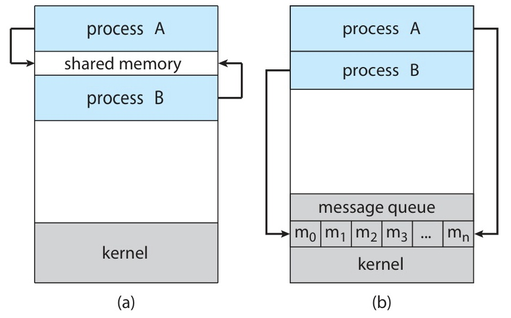
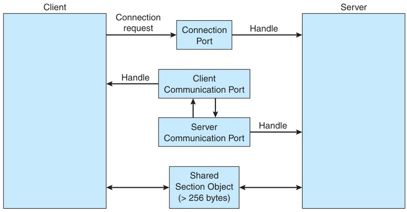
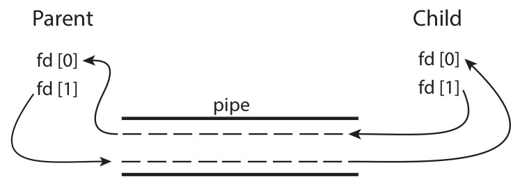
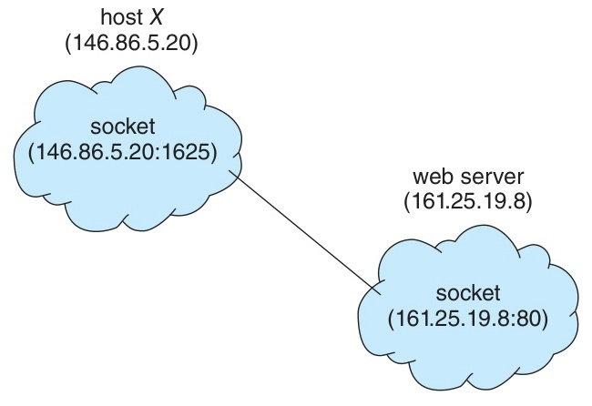
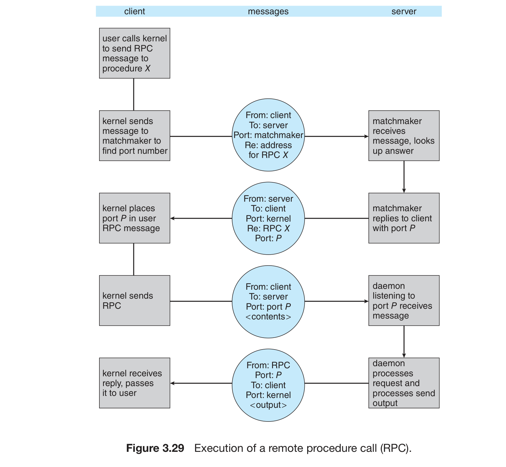
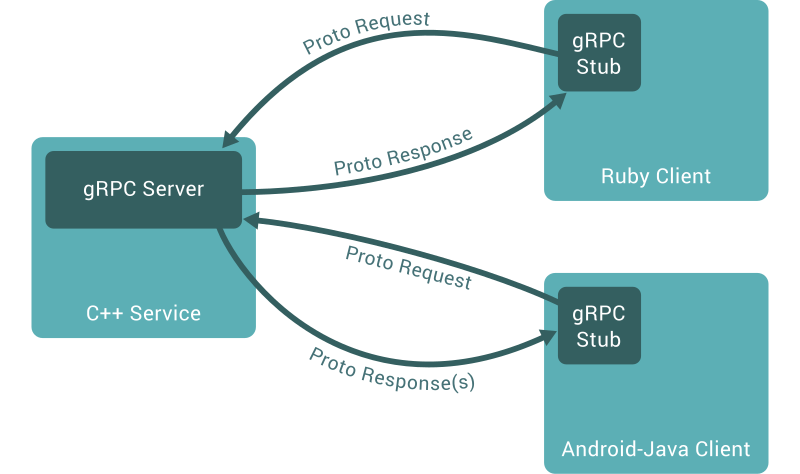

# Week 3 Lecture — Process (2)

[Repository Guide](../../README.md) | [English](Concepts_Lecture.md) | [한국어](Concepts_Lecture.ko.md)

> **Last Updated:** 2026-10-20
>
> Operating System Concepts, Silberschatz, Galvin, and Gagne, Ch 3 (3.4-3.8)

> **Learning Objectives:**
> 1. Compare the shared memory and message passing IPC models
> 2. Explain the producer-consumer problem and the bounded buffer
> 3. Describe how pipes and sockets enable interprocess communication
> 4. Outline RPC mechanisms and their execution semantics

---

## Table of Contents

- [1. Interprocess Communication (IPC) Overview](#1-interprocess-communication-ipc-overview)
  - [1.1 Independent vs Cooperating Processes](#11-independent-vs-cooperating-processes)
  - [1.2 Reasons for Process Cooperation](#12-reasons-for-process-cooperation)
  - [1.3 What is IPC?](#13-what-is-ipc)
- [2. Shared Memory Systems](#2-shared-memory-systems)
  - [2.1 Shared Memory IPC](#21-shared-memory-ipc)
  - [2.2 The Producer-Consumer Problem](#22-the-producer-consumer-problem)
  - [2.3 Bounded Buffer Implementation](#23-bounded-buffer-implementation)
- [3. Message Passing Systems](#3-message-passing-systems)
  - [3.1 Message Passing Overview](#31-message-passing-overview)
  - [3.2 Naming: Direct vs Indirect Communication](#32-naming-direct-vs-indirect-communication)
  - [3.3 Synchronization](#33-synchronization)
  - [3.4 Buffering](#34-buffering)
- [4. IPC Case Studies](#4-ipc-case-studies)
  - [4.1 POSIX Shared Memory](#41-posix-shared-memory)
  - [4.2 Mach Message Passing](#42-mach-message-passing)
  - [4.3 Windows ALPC](#43-windows-alpc)
- [5. Pipes](#5-pipes)
  - [5.1 Ordinary Pipes](#51-ordinary-pipes)
  - [5.2 Named Pipes (FIFO)](#52-named-pipes-fifo)
- [6. Client-Server Communication](#6-client-server-communication)
  - [6.1 Sockets](#61-sockets)
  - [6.2 Remote Procedure Calls (RPC)](#62-remote-procedure-calls-rpc)
  - [6.3 Android RPC](#63-android-rpc)
  - [6.4 Modern RPC: gRPC](#64-modern-rpc-grpc)
- [7. Practice: pipe and POSIX Shared Memory](#7-practice-pipe-and-posix-shared-memory)
  - [7.1 Lab 1: Passing Data Between Parent and Child with pipe()](#71-lab-1-passing-data-between-parent-and-child-with-pipe)
  - [7.2 Lab 2: Producer-Consumer (Using pipe)](#72-lab-2-producer-consumer-using-pipe)
  - [7.3 Lab 3: POSIX Shared Memory](#73-lab-3-posix-shared-memory)
- [Summary](#summary)
- [Self-Check Questions](#self-check-questions)
- [References](#references)

---

<br>

## 1. Interprocess Communication (IPC) Overview

### 1.1 Independent vs Cooperating Processes

Processes running concurrently in an OS fall into two categories.

**Independent process:**
- Cannot affect or be affected by the execution of other processes.
- Does not share data with other processes.

**Cooperating process:**
- Can affect or be affected by the execution of other processes.
- Any process that shares data with other processes belongs to this category.

> **Note:** Most real-world systems consist of cooperating processes.

### 1.2 Reasons for Process Cooperation

1. **Information sharing:** Multiple processes access the same data concurrently (e.g., copy-paste).
2. **Computation speedup:** Executing tasks in parallel speeds up processing, which is effective on multi-core systems.
3. **Modularity:** System functions are designed as separate processes or threads.
4. **Convenience:** Users perform multiple tasks simultaneously (editing, music playback, web browsing, etc.).

**Real-world IPC examples:**

IPC is used everywhere in modern software.

| Application | IPC Mechanism | Role |
|:------------|:-------------|:-----|
| **Shell pipeline** `cat log \| grep err` | Pipe | Process output → input chaining |
| **Google Chrome** | Shared memory + IPC | Tab ↔ browser process isolation |
| **Docker** | Named pipes, sockets | Container ↔ host communication |
| **PostgreSQL** | Shared memory | Shared buffer cache across connections |
| **Slack / Discord** | Sockets (WebSocket) | Real-time messaging |
| **Android apps** | Binder (RPC) | Activity ↔ Service communication |

*Table 1. IPC mechanisms in real-world applications*

> **Key Point:** Whenever two programs exchange data, some form of IPC is at work.

### 1.3 What is IPC?

**Interprocess Communication (IPC)** is a mechanism for cooperating processes to exchange data.

The two fundamental IPC models are as follows.

| | Shared Memory | Message Passing |
|:--|:-------------|:----------------|
| Method | Read/write to a shared memory region | Send/receive messages |
| Performance | Fast (minimal kernel involvement) | Relatively slow (system calls) |
| Synchronization | Programmer's responsibility | Managed by OS |
| Best suited for | Large data exchange | Small data, distributed systems |

*Table 2. Comparison of the shared memory and message passing models*

> **Note:** Most operating systems provide **both models**.



*Figure 1. Two IPC models: (a) shared memory, (b) message passing*

> **Key Point:** Shared memory involves the kernel only during initial setup, and afterwards operates as fast as regular memory access. However, the programmer bears the burden of handling synchronization. In contrast, message passing involves the kernel mediating through system calls each time, making it slower, but the OS manages synchronization, making programming relatively simpler.

**Chrome browser's use of IPC:**
- Chrome is composed of a browser process (1), renderer processes (one per tab), and plugin processes (one per type).
- Since each tab is a separate process, a crash in one tab does not affect others.

> **Note:** Chrome currently applies a **Site Isolation** policy that uses a separate renderer process for each site and also places cross-site iframes in separate processes, further enhancing security.


*Figure 2. Chrome's multiprocess architecture with a separate process per tab*

Modern applications that adopt similar multi-process/multi-component architectures include the following.

- **VS Code / Electron apps:** They consist of a main process and one renderer process per window, and perform IPC via message passing.
- **Android:** Each app runs in its own process, and services use Binder IPC.
- **Microservices:** Independent processes communicate via REST, gRPC, or message queues.
- **Container orchestration (Kubernetes):** Pods communicate via network sockets.

> **Key Point:** The current trend is to **isolate components into separate processes for fault tolerance and security** and connect them via IPC.

---

<br>

## 2. Shared Memory Systems

### 2.1 Shared Memory IPC

Shared memory IPC works as follows.
1. Processes that want to communicate **establish a shared memory region**.
2. The shared region typically resides in the address space of the creating process.
3. Other processes **attach** the shared memory to their own address space.
4. Data is exchanged through read/write operations.

The key characteristics are as follows.
- The OS normally **prohibits** inter-process memory access, but this restriction must be explicitly lifted to use shared memory.
- The format and location of data are **determined by the processes** (the OS is not involved).
- **Synchronization is the programmer's responsibility**.

> **Note:** Shared memory is implemented by the OS manipulating virtual memory page tables so that virtual addresses in different processes point to the same physical memory frame. Subsequent access is identical to normal memory access, so there is no kernel involvement, making it fast.

> **Note:** The points at which the kernel is and is not involved in shared memory are as follows.
> - **Kernel involved:** `shm_open()` (creating a shared memory object), `mmap()` (setting up page table mapping), and `shm_unlink()` (deleting the object); these system calls execute in kernel mode.
> - **Kernel not involved:** Read/write operations like `ptr[i] = value` after mapping are identical to normal memory access and bypass the kernel (except for handling the page fault on the first access to a page).
>
> Therefore, after the initial setup cost, it is much faster than message passing. In contrast, message passing requires a system call for every `send()`/`receive()`.

### 2.2 The Producer-Consumer Problem

The producer-consumer problem is a classic paradigm of cooperating processes.
- **Producer:** a process that produces information.
- **Consumer:** a process that consumes information.

Real-world examples include compiler (producer) → assembler (consumer) and web server (producer) → web browser (consumer).

**Two types of buffers:**

| | Unbounded Buffer | Bounded Buffer |
|:--|:-----------------|:---------------|
| Size | Unlimited | **Fixed** |
| Consumer waits | When buffer is empty | When buffer is empty |
| Producer waits | Never waits | When buffer is full |

*Table 3. Comparison of unbounded and bounded buffers*

> **Note:** In practice, bounded buffers are far more common and give rise to synchronization issues.

**Bounded buffers in real life:**

- **Keyboard → OS:** Keystrokes enter a fixed-size input buffer, and the OS consumes them.
- **Video streaming:** A network thread fills the playback buffer, and the player consumes it.
- **Print spooler:** Applications enqueue print jobs, and the printer consumes them.
- **Web server:** Incoming HTTP requests are queued in a bounded buffer (e.g., Nginx worker queue).
- **Audio recording:** The microphone fills a ring buffer, and the app reads and encodes it.

```text
  ┌───┬───┬───┬───┬───┐
  │ A │ B │ C │   │   │
  └───┴───┴───┴───┴───┘
    ↑               ↑
   out             in
  (consumer)      (producer)

 Circular array (wraps around)
```

*Figure 3. Bounded buffer as a circular array with in and out positions*

> **Key Point:** When the buffer is full, the producer waits; when it is empty, the consumer waits. In Figure 3, A, B, and C occupy slots 0-2, so the next write position `in` precisely points to slot 3 (the fourth slot).

### 2.3 Bounded Buffer Implementation

The data shared between the producer and consumer is as follows.

```c
#define BUFFER_SIZE 10

typedef struct {
    /* ... */
} item;

item buffer[BUFFER_SIZE];
int in = 0;    /* Next write position (producer) */
int out = 0;   /* Next read position (consumer) */
```

- It is implemented as a **circular array**.
- The buffer is empty when `in == out`.
- The buffer is full when `((in + 1) % BUFFER_SIZE) == out`.
- With this approach, at most **BUFFER_SIZE - 1** items can be stored.

> **Note:** In practice, `item` would be whatever data the producer generates. For example, `typedef struct { int value; } item;` could represent a sensor reading or a message.

> **[Data Structures]** A **circular queue** is a FIFO queue that wraps its indices with the modulo operation so that the first slot of the array follows the last one, and this bounded buffer has the same structure. `in` corresponds to rear, `out` to front, and the reason for leaving one slot empty is to distinguish between the empty and full states.

**Producer code (Figure 3.12):**

```c
item next_produced;

while (true) {
    /* produce an item in next_produced */

    while (((in + 1) % BUFFER_SIZE) == out)
        ; /* busy wait -- buffer full */

    buffer[in] = next_produced;
    in = (in + 1) % BUFFER_SIZE;
}
```

**Consumer code (Figure 3.13):**

```c
item next_consumed;

while (true) {
    while (in == out)
        ; /* busy wait -- buffer empty */

    next_consumed = buffer[out];
    out = (out + 1) % BUFFER_SIZE;

    /* consume the item in next_consumed */
}
```

> **Note:** Busy waiting is a method where the CPU continuously loops checking a condition, wasting CPU resources. Synchronization tools that improve on this, such as semaphores and mutexes, are covered in textbook Chapter 6 and Week 9. This example does not address concurrent access issues.

> **Note:** The alternative to busy waiting is a **blocking (sleep) approach**. If the condition is not met, the process transitions to the **Waiting state**, releasing the CPU, and another process **wakes it up** when the condition is satisfied. Representative implementations are as follows.
> - **Semaphore:** decrements the value on `wait()`, and if the result is negative, the process sleeps (Week 9).
> - **Mutex:** if the lock is held when entering a critical section, the process sleeps (Week 9).
> - **Condition Variable:** sleeps until a specific condition becomes true (Week 9).
>
> While busy waiting is useful for conceptual explanation, actual code mostly replaces it with these blocking synchronization tools. Spinlocks in multiprocessor kernel code with very short critical sections are an exception.

---

<br>

## 3. Message Passing Systems

### 3.1 Message Passing Overview

Message passing is a method for interprocess communication without shared memory.

The two basic operations are as follows.
- **send(message):** sends a message.
- **receive(message):** receives a message.

The characteristics are as follows.
- The processes do not share the same address space.
- It is particularly useful in **distributed environments** (different computers connected via a network).

The three considerations for the **logical implementation** of communication links are as follows.
1. **Naming:** How is the communication partner identified?
2. **Synchronization:** Is it synchronous or asynchronous?
3. **Buffering:** What is the capacity of the message queue?

### 3.2 Naming: Direct vs Indirect Communication

**Direct Communication:**
- The communication partner is explicitly specified.
- In the symmetric form, `send(P, message)` / `receive(Q, message)`, both sides specify the partner.
- In the asymmetric form, `send(P, message)` / `receive(id, message)`, the receiver accepts from any process, and `id` is set to the sender.

> **Note:** Asymmetric communication is useful in the **server pattern**. For example, a web server cannot know in advance which client will send a request, so the asymmetric approach of receiving from any process (`receive(id, message)`) is appropriate. After receiving, the `id` is checked to respond to that client with `send(id, response)`. The symmetric approach is suited for fixed 1:1 communication where the partner is predetermined.

- Links are established **automatically** between communicating processes.
- **Exactly one link** exists between each pair of processes.
- Drawback: if a process identifier changes, all references must be updated, so **modularity is limited**.

**Indirect Communication:**
- Messages are exchanged through **mailboxes (ports)**.

> **Definition:** A **mailbox** (or **port**) is a message queue with a unique name. Like a physical mailbox, any process that knows the name can send to it, and who may receive from it depends on the ownership described below.

- `send(A, message)` / `receive(A, message)` communicate through mailbox A.
- Two processes must **share a common mailbox** for a link to exist.
- A single link can be associated with **more than two** processes.
- **Multiple links** can exist between a pair of processes.

> **Note:** **Mailbox ownership.**
> - **Process-owned mailbox:** only the owner can receive, and the mailbox is destroyed when the process terminates.
> - **OS-owned mailbox:** it exists independently, and the OS provides system calls for creation, deletion, send, and receive.

**Multiple receiver problem:** P1 sends a message to mailbox A, and both P2 and P3 call `receive()`. Who gets the message?
The solutions are (1) to allow a link to be associated with at most two processes, (2) to allow only one process at a time to execute `receive()`, or (3) to let the system select the receiver arbitrarily.

### 3.3 Synchronization

| Operation | Blocking (Synchronous) | Non-blocking (Asynchronous) |
|:----------|:----------------------|:---------------------------|
| **send** | Waits until receiver accepts | Sends and continues immediately |
| **receive** | Waits until a message arrives | Receives if available, otherwise returns null |

*Table 4. Behavior of blocking and non-blocking send and receive*

**Rendezvous:** The combination of blocking send and blocking receive. The sender and receiver wait for each other, and the producer-consumer problem is solved simply.

```c
/* Producer: blocking send */
while (true) {
    /* produce an item in next_produced */
    send(next_produced);    /* waits until received */
}

/* Consumer: blocking receive */
while (true) {
    receive(next_consumed); /* waits until a message arrives */
    /* consume the item in next_consumed */
}
```

> **Note:** The blocking approach is simple to implement but processes may enter a waiting state. The non-blocking approach has good responsiveness but introduces the complexity of polling for message arrival or handling callbacks.

### 3.4 Buffering

Messages are stored in a **temporary queue** attached to the communication link.

| Method | Queue Capacity | Sender Behavior |
|:-------|:---------------|:----------------|
| **Zero capacity** | No pending messages | Sender **must wait** until receiver accepts (rendezvous) |
| **Bounded capacity** | Maximum of n | Waits if full, otherwise proceeds immediately |
| **Unbounded capacity** | Unlimited | **Never waits** |

*Table 5. Message buffering by queue capacity*

> **Note:** Zero capacity means no buffering, so the sender must block. Non-zero capacity is called automatic buffering.

---

<br>

## 4. IPC Case Studies

### 4.1 POSIX Shared Memory

POSIX provides a shared memory API based on **memory-mapped files**.

**3-step procedure:**

```c
/* Step 1: Create a shared memory object */
int fd = shm_open(name, O_CREAT | O_RDWR, 0666);

/* Step 2: Set the size */
ftruncate(fd, 4096);

/* Step 3: Map into the address space */
char *ptr = (char *)mmap(0, 4096, PROT_READ | PROT_WRITE,
                          MAP_SHARED, fd, 0);
```

> **Note:** **`shm_open()` parameters.** `name` is the shared-memory object name used by processes to access the same object. `O_CREAT` creates the object if it does not exist, and `O_RDWR` allows reading and writing. The return value is a file descriptor, which is an integer.

> **Note:** `ftruncate(fd, SIZE)` sets the size of the newly created shared memory object to `SIZE` bytes. A new `shm_open` object has zero length by default, so this step is mandatory before writing.

> **[Systems Programming]** `mmap()` is a system call that maps a file or shared memory object directly into a process's virtual address space. After mapping, data can be accessed via pointers like regular memory, enabling data exchange without `read()`/`write()` system calls.

**Producer (Figure 3.16):**

```c
#include <stdio.h>
#include <stdlib.h>
#include <string.h>
#include <fcntl.h>
#include <sys/shm.h>
#include <sys/stat.h>
#include <sys/mman.h>

int main()
{
    const int SIZE = 4096;
    const char *name = "OS";
    const char *message_0 = "Hello";
    const char *message_1 = "World!";

    int fd;
    char *ptr;

    fd = shm_open(name, O_CREAT | O_RDWR, 0666);
    ftruncate(fd, SIZE);  /* see note above */
    ptr = (char *)mmap(0, SIZE, PROT_READ | PROT_WRITE,
                        MAP_SHARED, fd, 0);

    sprintf(ptr, "%s", message_0);
    ptr += strlen(message_0);
    sprintf(ptr, "%s", message_1);
    ptr += strlen(message_1);

    return 0;
}
```

**Consumer (Figure 3.17):**

```c
#include <stdio.h>
#include <stdlib.h>
#include <fcntl.h>
#include <sys/shm.h>
#include <sys/stat.h>
#include <sys/mman.h>

int main()
{
    const int SIZE = 4096;
    const char *name = "OS";

    int fd;
    char *ptr;

    fd = shm_open(name, O_RDONLY, 0666);
    ptr = (char *)mmap(0, SIZE, PROT_READ, MAP_SHARED, fd, 0);

    printf("%s", (char *)ptr);

    shm_unlink(name);

    return 0;
}
```

Compile: `gcc producer.c -o producer -lrt`

> **Note:** `-lrt` is an option to link the **POSIX real-time library (librt)**. Functions like `shm_open()` and `shm_unlink()` are implemented in this library. `-l` is the option to link the library whose name follows, and `rt` is the library name (librt.so). Since glibc 2.34, these functions have been integrated into the standard C library (libc), so compilation may succeed without `-lrt`, but specifying it explicitly is safer for portability.

**Flow summary:**

```text
          Producer                           Consumer
          ────────                           ────────
  shm_open("OS", O_CREAT|O_RDWR)
  ftruncate(fd, 4096)
  mmap(..., MAP_SHARED, fd, 0)
              ↓
  sprintf(ptr, "Hello")
  sprintf(ptr, "World!")
              ↓
            Exit                      shm_open("OS", O_RDONLY)
                                      mmap(..., MAP_SHARED, fd, 0)
                                                 ↓
                                      printf("%s", ptr)
                                      → Outputs "HelloWorld!"
                                                 ↓
                                      shm_unlink("OS")
```

*Figure 4. Execution flow of the POSIX shared memory producer and consumer*

**Real-world shared memory use cases:**

| System | Usage | Why Shared Memory |
|:-------|:------|:-----------------|
| **PostgreSQL** | Shared buffer pool across connections | Avoids copying 8KB pages per query |
| **Redis** (fork persistence) | Parent ↔ child share pages via COW | Snapshot without blocking clients |
| **Chromium** | Renderer ↔ GPU share textures | Zero-copy web page rendering |
| **Video editors** | Decode ↔ preview share frames | 60fps 4K real-time playback |
| **NGINX** | Shared cache region among workers | Fast caching without duplication |

*Table 6. Real-world uses of shared memory*

> **Key Point:** Shared memory excels when **data volume is large and low latency is required**. However, the programmer must handle **synchronization** directly (textbook Chapters 6-7, Week 9).

> **Note:** Mach in Section 4.2 and Windows ALPC in Section 4.3 are case studies for comparison. Understanding the general message-passing concepts is what matters; implementation details are secondary.

### 4.2 Mach Message Passing

Mach is the microkernel underlying macOS and iOS.

The core concept of Mach is that **everything is a message**.
- Even system calls are implemented as messages.

**Ports (mailboxes):**
- Message queues with bounded capacity.
- They are **unidirectional**, so bidirectional communication requires a separate reply port.
- Multiple senders are allowed, but only **one receiver** is permitted.

**Special Ports:**
- **Task Self port:** used to send messages to the kernel.
- **Notify port:** used by the kernel to notify the task of events.

**Port creation:**

> **Note:** The Mach code below uses Mach-specific types. `mach_port_t` is a handle to a port (like a file descriptor for messages), and `mach_task_self()` returns a reference to the calling task (analogous to `getpid()` in POSIX). The flow of allocating a port for a task and granting it a receive right matters more than the exact API names.

```c
mach_port_t port;
mach_port_allocate(
    mach_task_self(),           /* reference to the task itself */
    MACH_PORT_RIGHT_RECEIVE,    /* receive right */
    &port);                     /* port name */
```

**Message structure:** A message consists of a fixed-size header containing the message size and the source and destination ports, and a variable-size body containing the actual data.

**Sending and receiving messages:**

```c
/* Sending a message */
mach_msg(message, MACH_SEND_MSG, size, 0, MACH_PORT_NULL,
         MACH_MSG_TIMEOUT_NONE, MACH_PORT_NULL);

/* Receiving a message */
mach_msg(message, MACH_RCV_MSG, 0, size, port,
         MACH_MSG_TIMEOUT_NONE, MACH_PORT_NULL);
```

**Options when the queue is full:** The sender can (1) wait indefinitely, (2) wait with a timeout, (3) return immediately, or (4) temporarily cache the message (entrust it to the OS).

> **Note:** With the temporary cache option, the message is handed to the OS, and the sender receives a notification when space becomes available. Only one pending message per thread is allowed.

**Performance optimization:** Messages within the same system use **virtual memory mapping** to deliver without actual copying.

### 4.3 Windows ALPC

ALPC is a communication mechanism for processes on the same machine in Windows.

**Connection procedure:**
1. The client sends a connection request to the server's **connection port**.
2. The server creates a **channel**, which consists of communication ports on both the client and server sides.
3. The client and server communicate bidirectionally through the channel.

**Message delivery methods (by size):**
1. **Small (≤256 bytes):** uses the port's message queue and delivers by copying.
2. **Large:** uses a **section object (shared memory)**. A section object is a Windows kernel-managed shared memory region roughly equivalent to POSIX `shm_open` plus `mmap`.
3. **Very large:** the server directly reads and writes the client's address space.



*Figure 5. Advanced local procedure calls (ALPC) in Windows*

> **Note:** ALPC is not directly exposed through the Windows API. Applications use standard RPC, and ALPC handles the communication internally.

---

<br>

## 5. Pipes

The considerations when implementing pipes are as follows.
1. Is it bidirectional or unidirectional?
2. If bidirectional, is it half-duplex or full-duplex?
3. Is a parent-child relationship required?
4. Can it communicate over a network?

### 5.1 Ordinary Pipes

A **pipe** is a **conduit** through which two processes can communicate. It is one of the oldest IPC mechanisms, present since early UNIX systems. A pipe is a special file accessed via `read()` and `write()`.

- The producer writes to the **write end**, and the consumer reads from the **read end**.
- A pipe is **unidirectional**, so bidirectional communication requires two pipes.



*Figure 6. File descriptors for an ordinary pipe*

```c
int fd[2];
pipe(fd);
```
- `fd[0]` is the **read end**, and `fd[1]` is the **write end**.
- Children **inherit** the pipe through `fork()`.

> **Note:** This code uses `fork()`. How `fork()` creates a child process is covered in detail in [Week 2 Lecture](../Week02_Process-1/Concepts_Lecture.md).

**Code example (Figures 3.21-3.22):**

```c
#include <sys/types.h>
#include <stdio.h>
#include <string.h>
#include <unistd.h>

#define BUFFER_SIZE 25
#define READ_END    0
#define WRITE_END   1

int main(void)
{
    char write_msg[BUFFER_SIZE] = "Greetings";
    char read_msg[BUFFER_SIZE];
    int fd[2];
    pid_t pid;

    if (pipe(fd) == -1) {
        fprintf(stderr, "Pipe failed");
        return 1;
    }

    pid = fork();

    if (pid > 0) {           /* Parent process */
        close(fd[READ_END]);
        write(fd[WRITE_END], write_msg, strlen(write_msg) + 1);
        close(fd[WRITE_END]);
    }
    else if (pid == 0) {     /* Child process */
        close(fd[WRITE_END]);
        read(fd[READ_END], read_msg, BUFFER_SIZE);
        printf("read %s", read_msg);
        close(fd[READ_END]);
    }
    return 0;
}
```

> **Note:** The `+1` in `strlen(write_msg) + 1` is to include the **null terminator (`\0`)** at the end of the string. In C, `strlen()` returns the number of characters excluding `\0`, so to transmit `\0` as well, 1 must be added. The receiving side's `printf("read %s", read_msg)` requires `\0` to be present in `read_msg` to work correctly. Without `\0`, the receiving side cannot determine where the string ends and may print garbage values.

**Key rules:**
1. **Unused ends must be closed with close().**
2. **Reason:** Only when all write ends are closed does the reading side receive EOF(0). If not closed, the reading side may enter a permanent blocking state.
3. Ordinary pipes are **not accessible outside** the process that created them.

> **Key Point:** The EOF mechanism of pipes follows from the reference count of the write end. After `fork()`, both parent and child have copies of `fd[0]` and `fd[1]`, so if unused write ends are not closed, the reference count of the write end never reaches 0 and EOF is never generated.

**Usage in shells:**

```text
ls -l | less                          # ls's stdout is piped to less's stdin
cat file.txt | grep "error" | wc -l   # pipe chain
```

> **Note:** Windows also uses pipes (e.g., `dir | more`).

### 5.2 Named Pipes (FIFO)

Named pipes overcome the following limitations of ordinary pipes.

| Property | Ordinary Pipe | Named Pipe (FIFO) |
|:---------|:-------------|:-------------------|
| Process relationship | Parent-child required | No relationship required |
| Lifetime | Destroyed when process exits | Exists in file system, persists until explicitly deleted |
| Direction | Unidirectional | Bidirectional possible (UNIX: half-duplex) |
| Identification | fd[0], fd[1] | File system path |

*Table 7. Comparison of ordinary and named pipes*

```c
/* Creation */
mkfifo("/tmp/my_fifo", 0666);  /* see note below */

/* Writer process */
int fd = open("/tmp/my_fifo", O_WRONLY);
write(fd, "Hello", 6);

/* Reader process (separate program) */
int fd = open("/tmp/my_fifo", O_RDONLY);
read(fd, buf, 6);
```

> **Note:** `0666` is a Unix permission mask in octal, meaning the file is readable and writable by all users (owner, group, and others). The actual permissions are this value with the process's umask applied.

**UNIX vs Windows named pipes:**

| | UNIX (FIFO) | Windows |
|:--|:-----------|:--------|
| Direction | Half-duplex | **Full-duplex** |
| Data | Byte-oriented only | Byte + message-oriented |
| Scope | Same machine only | **Between different machines** possible |

*Table 8. Comparison of UNIX and Windows named pipes*

**Real-world pipe usage:**

Pipes are used far beyond simple shell commands.

**DevOps / CI-CD Pipelines** (the name reflects the same idea)

```text
  Build → Test → Lint → Deploy   (each stage = a process, data flows through pipes between stages)
```

*Figure 7. Stages of a CI/CD pipeline*

- **Docker:** The daemon and CLI communicate over a UNIX domain socket (`/var/run/docker.sock`), and on Windows they use a named pipe.
- **Log processing:** `journalctl | grep error | wc -l` chains 3 processes.
- **CGI web servers:** Early web servers communicated with CGI scripts via pipes.

```text
  HTTP request → Web server ──pipe──▷ CGI script (Python/Perl)
                   ◁──pipe── HTML response
```

*Figure 8. Pipe communication between a web server and a CGI script*

- **Shell job control:** `|` creates anonymous pipes between processes.

```bash
# 3 processes connected by 2 pipes
find / -name "*.log" 2>/dev/null | xargs grep "ERROR" | sort -u
```

> **Note:** Pipes act as the glue that connects programs in the UNIX philosophy. The UNIX philosophy advises making each program do one thing well and connecting such programs with pipes to handle larger tasks.

---

<br>

## 6. Client-Server Communication

### 6.1 Sockets

A **socket** is an **endpoint** for communication, identified by an **IP address and port number**.



*Figure 9. Communication using sockets*

- The client is assigned a random port greater than 1024.
- The server listens on a **well-known port** (HTTP=80, SSH=22, FTP=21).
- Every connection consists of a **unique pair of sockets**.

| Port | Service |
|:-----|:--------|
| 22 | SSH |
| 21 | FTP |
| 80 | HTTP |
| 443 | HTTPS |

*Table 9. Well-known ports and services*

The **loopback address 127.0.0.1** is a special IP address that refers to the local machine itself.

The communication methods are as follows.
- **TCP:** connection-oriented, providing a reliable byte stream.
- **UDP:** connectionless, with no reliability guarantee, but fast.

> **Note:** A connection-oriented protocol (TCP) first performs a handshake to establish a connection before sending data, like picking up the phone before talking. A connectionless protocol (UDP) sends packets directly without prior setup, like dropping a letter in a mailbox with no confirmation.

> **[Computer Networks]** A socket is the interface between the application layer and the transport layer. TCP sockets are connection-oriented and are used on the client side in the sequence `connect()` → `send()`/`recv()` → `close()`, while UDP sockets are connectionless and use `sendto()`/`recvfrom()`.

**Date server socket example (Java, Figure 3.27):**

> **Note:** The textbook provides socket examples in Java because Java's socket API is more concise than C, allowing focus on the IPC concepts themselves. Writing the same server in C would require more system calls like `socket()`, `bind()`, `listen()`, `accept()`, `send()`, `close()` and error handling. At the OS level, Java's `ServerSocket` internally calls these C system calls. Detailed C socket programming is covered in the Computer Networks course.

```java
import java.net.*;
import java.io.*;

public class DateServer {
    public static void main(String[] args) {
        try {
            ServerSocket sock = new ServerSocket(6013);
            while (true) {
                Socket client = sock.accept();
                PrintWriter pout = new
                    PrintWriter(client.getOutputStream(), true);
                pout.println(new java.util.Date().toString());
                client.close();
            }
        }
        catch (IOException ioe) {
            System.err.println(ioe);
        }
    }
}
```

> **Note:** **Key lines.** `ServerSocket(6013)` listens on port 6013, and `accept()` blocks until a connection request arrives.

**Date client socket example (Java, Figure 3.28):**

```java
import java.net.*;
import java.io.*;

public class DateClient {
    public static void main(String[] args) {
        try {
            Socket sock = new Socket("127.0.0.1", 6013);
            InputStream in = sock.getInputStream();
            BufferedReader bin = new
                BufferedReader(new InputStreamReader(in));
            String line;
            while ((line = bin.readLine()) != null)
                System.out.println(line);
            sock.close();
        }
        catch (IOException ioe) {
            System.err.println(ioe);
        }
    }
}
```

> **Note:** **Key line.** `Socket("127.0.0.1", 6013)` connects to port 6013 of the server running on the local machine.

**Sockets in everyday applications:**

| Application | Protocol | How Sockets Are Used |
|:------------|:---------|:--------------------|
| **ChatGPT / AI chatbots** | HTTP streaming (SSE) or WebSocket (TCP) | Token-by-token streaming responses |
| **Multiplayer games** | UDP | Low-latency position updates |
| **Zoom / Google Meet** | UDP (WebRTC) | Real-time audio/video streaming |
| **Web browsers** | TCP (HTTP/S) | Socket connections used for every page load |
| **SSH terminal** | TCP | Encrypted bidirectional byte stream |
| **Database clients** | TCP / UNIX socket | `psql`, `mysql` connect via sockets |

*Table 10. Socket use in everyday applications*

> **Note:** When chatting with ChatGPT, the browser maintains a streaming connection such as **SSE (Server-Sent Events) or WebSocket** with the server, receiving tokens one at a time in real time.

**Limitations of sockets:** Sockets exchange only unstructured byte streams, and imposing structure on the data is the application's responsibility. A higher-level abstraction is therefore needed, and **RPC** is the representative example.

> **Definition:** **Serialization** is the process of converting in-memory data structures into a byte stream. JSON and Protocol Buffers are representative serialization formats.

### 6.2 Remote Procedure Calls (RPC)

**RPC** is a mechanism for calling procedures on a remote system connected via a network.

**Key components:**

1. **Stub:** a client-side proxy. It acts on behalf of the server's actual procedure, packing parameters and sending them to the server.
2. **Marshalling:** converting data into a format suitable for network transmission. Standards like **XDR** are used to resolve the difference between big-endian and little-endian representations.

> **Definition:** **Marshalling** is the process of converting data into a standardized format (like XDR or JSON) for transmission between different systems that may have different internal representations.



*Figure 10. Execution of a remote procedure call (RPC)*

> **Note:** Stubs exist on both the client and server sides. The client stub marshals parameters and sends them over the network, while the server stub (skeleton) unmarshals the received data and calls the actual procedure.

> **[Computer Architecture]** **Endianness** refers to the byte order in which multi-byte data is stored in memory. For example, the integer `0x12345678` is stored as follows.
> - **Big-endian:** stores the most significant byte first → `12 34 56 78` (network byte order)
> - **Little-endian:** stores the least significant byte first → `78 56 34 12` (x86, RISC-V, etc.)
>
> When the client (little-endian) and server (big-endian) use different architectures, the same byte sequence is interpreted differently, corrupting data. To prevent this, RPC marshals data into an intermediate representation like **XDR (External Data Representation)**, ensuring both sides interpret the data identically.

**Execution semantics:**

Network packets can be lost, causing the sender to retransmit. This retransmission can cause the server to receive and execute the same request twice. RPC semantics exist to handle this.

> **Note:** Network messages can be lost or duplicated. Imagine mailing a letter that might get lost, so you resend it, but the recipient might then receive two copies. RPC semantics define how to handle this.

| Semantics | Description |
|:--|:----------|
| **At most once** | Ignores duplicate messages via timestamps; executed at most once |
| **Exactly once** | At most once + ACK; most ideal but most complex to implement |

*Table 11. RPC execution semantics*

> **Key Point:** Besides the two semantics in Table 11, there is **at-least-once** semantics, which retransmits until an ACK is received without duplicate checking. At least once is sufficient for idempotent operations such as balance inquiries, while exactly once is needed for non-idempotent operations such as money transfers.

**Binding methods:**
- **Fixed port address:** A fixed port number is assigned to the RPC at compile time. This is simple but inflexible.
- **Dynamic binding:** The OS provides a matchmaker daemon; the client first queries the service port, then makes the actual RPC call. A daemon (pronounced "dee-mon") is a background process that runs continuously, waiting to respond to requests, like a receptionist always at the front desk.

### 6.3 Android RPC

Android uses the **binder framework** to use RPC as IPC within the same system.

**AIDL (Android Interface Definition Language):**

```java
/* RemoteService.aidl */
interface RemoteService {
    boolean remoteMethod(int x, double y);
}
```

- Stub code is auto-generated from AIDL files.
- The client calls `service.remoteMethod(3, 0.14);` like a local method.
- Internally, the binder framework handles marshalling and inter-process delivery.

> **Note:** Android's binder delivers data with only one copy through the Linux kernel's `/dev/binder` driver, achieving excellent performance. Nearly all system services in Android communicate via binder.

> **Definition:** An **Android Service** is a component with no UI that runs in the background. A client binds to a service with `bindService()`. Communication happens via message passing or RPC.

### 6.4 Modern RPC: gRPC

**gRPC** is an RPC framework developed by Google that is widely used in modern cloud systems.

- Marshalling uses **Protocol Buffers** (binary, compact, fast).
- Transport uses **HTTP/2** (multiplexing, streaming).
- **Stub code is auto-generated** in 10+ languages.

```protobuf
// weather.proto
service WeatherService {
   rpc GetForecast (Location)
      returns (Forecast);
}
```

The client calls `GetForecast()` as if it were a local function, and gRPC automatically handles marshalling, network transport, and unmarshalling [1].



*Figure 11. gRPC architecture*

gRPC is used by companies such as Netflix, Spotify, and Uber and by projects such as Kubernetes and gRPC-Web.

> **Note:** gRPC is the modern implementation of the traditional RPC concepts covered in the textbook. Since everything from stub auto-generation to marshalling (Protocol Buffers) to network transport is abstracted by the framework, developers only need to define interfaces in `.proto` files.

---

<br>

## 7. Practice: pipe and POSIX Shared Memory

### 7.1 Lab 1: Passing Data Between Parent and Child with pipe()

```c
#include <stdio.h>
#include <string.h>
#include <unistd.h>
#include <sys/wait.h>

#define READ_END  0
#define WRITE_END 1

int main() {
    int fd[2];
    char write_msg[] = "Hello from parent!";
    char read_msg[100];

    pipe(fd);

    if (fork() == 0) {
        /* Child: read from pipe */
        close(fd[WRITE_END]);
        read(fd[READ_END], read_msg, sizeof(read_msg));
        printf("Child received: %s\n", read_msg);
        close(fd[READ_END]);
    } else {
        /* Parent: write to pipe */
        close(fd[READ_END]);
        write(fd[WRITE_END], write_msg, strlen(write_msg) + 1);
        close(fd[WRITE_END]);
        wait(NULL);
    }
    return 0;
}
```

**Execution flow:**

```text
1. pipe(fd) → fd[0]=read, fd[1]=write created
2. fork() → both parent and child have fd[0], fd[1]
3. Parent: close(READ_END) → write → close(WRITE_END) → wait
4. Child: close(WRITE_END) → read → printf → close(READ_END)
```

### 7.2 Lab 2: Producer-Consumer (Using pipe)

```c
#include <stdio.h>
#include <unistd.h>
#include <sys/wait.h>

#define READ_END  0
#define WRITE_END 1

int main() {
    int fd[2];
    pipe(fd);

    if (fork() == 0) {
        /* Producer (child) */
        close(fd[READ_END]);
        for (int i = 0; i < 5; i++) {
            int item = i * 10;
            write(fd[WRITE_END], &item, sizeof(int));
            printf("Produced: %d\n", item);
        }
        close(fd[WRITE_END]);
    } else {
        /* Consumer (parent) */
        close(fd[WRITE_END]);
        int item;
        while (read(fd[READ_END], &item, sizeof(int)) > 0) {
            printf("Consumed: %d\n", item);
        }
        close(fd[READ_END]);
        wait(NULL);
    }
    return 0;
}
```

**Behavior analysis:** When the producer closes the write end, the consumer's `read()` returns 0, terminating the loop.

**Expected output:**

```text
Produced: 0
Produced: 10
Consumed: 0
Produced: 20
Consumed: 10
Produced: 30
Consumed: 20
Produced: 40
Consumed: 30
Consumed: 40
```

> **Note:** The actual output may be interleaved differently from the above depending on scheduling.

### 7.3 Lab 3: POSIX Shared Memory

**Producer:**

```c
#include <stdio.h>
#include <string.h>
#include <fcntl.h>
#include <sys/mman.h>
#include <unistd.h>

#define SHM_NAME "/os_lab_shm"
#define SHM_SIZE 4096

int main() {
    int shm_fd = shm_open(SHM_NAME, O_CREAT | O_RDWR, 0666);
    ftruncate(shm_fd, SHM_SIZE);
    void *ptr = mmap(0, SHM_SIZE,
                     PROT_READ | PROT_WRITE,
                     MAP_SHARED, shm_fd, 0);
    sprintf(ptr, "Operating Systems is fun!");
    printf("Producer: wrote to shared memory\n");
    return 0;
}
```

**Consumer:**

```c
#include <stdio.h>
#include <fcntl.h>
#include <sys/mman.h>
#include <unistd.h>

#define SHM_NAME "/os_lab_shm"
#define SHM_SIZE 4096

int main() {
    int shm_fd = shm_open(SHM_NAME, O_RDONLY, 0666);
    void *ptr = mmap(0, SHM_SIZE,
                     PROT_READ,
                     MAP_SHARED, shm_fd, 0);
    printf("Consumer read: %s\n", (char *)ptr);
    munmap(ptr, SHM_SIZE);
    shm_unlink(SHM_NAME);
    return 0;
}
```

**Key flags:**
- `O_CREAT`: creates the object if it does not exist.
- `O_RDWR` / `O_RDONLY`: open for read-write or read-only, respectively.
- `PROT_READ` / `PROT_WRITE`: memory protection attributes of the mapping that determine whether reading and writing are allowed.
- `MAP_SHARED`: changes are visible to other processes that map the same object.

**Key API summary:**

| Function | Role |
|:---------|:-----|
| `shm_open(name, flags, mode)` | Create/open a shared memory object |
| `ftruncate(fd, size)` | Set shared memory size |
| `mmap(addr, length, prot, flags, fd, offset)` | Map into the address space |
| `munmap(addr, length)` | Unmap |
| `shm_unlink(name)` | Delete the shared memory object |

*Table 12. Key POSIX shared memory APIs*

**Lab Key Takeaways:**
- **Pipe:** `pipe()` creates a unidirectional channel. Unused ends must always be closed, and EOF is generated when all write ends are closed.
- **POSIX shared memory:** `shm_open()`, `ftruncate()`, and `mmap()` form the standard sequence, and it is the fastest IPC method because there is no copying through the kernel after setup.
- **Common consideration:** Synchronization is important for both methods. A pipe provides basic synchronization because the kernel blocks `read()`, while shared memory requires the programmer to handle synchronization directly.

---

<br>

## Summary

| Concept | Key Summary |
|:--------|:-----------|
| IPC | A mechanism for cooperating processes to exchange data, with two models: shared memory and message passing. |
| Shared memory | Minimal kernel involvement makes it fast, but synchronization is the programmer's responsibility, and it is used in the producer-consumer pattern. |
| Bounded buffer | It is implemented as a circular array, where `in == out` means empty and `(in + 1) % BUFFER_SIZE == out` means full. |
| Message passing | It uses send and receive operations and considers naming (direct/indirect), synchronization (blocking/non-blocking), and buffering (0/bounded/unbounded). |
| Rendezvous | The combination of blocking send and blocking receive, which requires no shared buffer. |
| POSIX shared memory | It is set up in the order `shm_open()` → `ftruncate()` → `mmap()` and deleted with `shm_unlink()` after use. |
| Mach | A microkernel in which everything is a message, using unidirectional ports (mailboxes). |
| Windows ALPC | By message size, small messages are copied, large ones use a section object, and very large ones use direct reads and writes. |
| Ordinary pipes | A unidirectional channel requiring a parent-child relationship, where fd[0] is the read end and fd[1] is the write end, and unused ends must be closed. |
| Named pipes (FIFO) | They are created in the file system with `mkfifo()`, and unrelated processes can communicate through them. |
| Sockets | A communication endpoint identified by IP address and port, with TCP (connection-oriented) and UDP (connectionless), and the loopback address is 127.0.0.1. |
| RPC | A mechanism for calling remote procedures as if local, using stubs and marshalling and defining execution semantics (at most once, exactly once). |
| Android binder | Defining an interface with AIDL auto-generates stubs, and binder provides high-performance IPC with a single copy. |
| gRPC | A modern RPC framework developed by Google that uses Protocol Buffers and HTTP/2 and auto-generates stubs. |

---

<br>

## Self-Check Questions

1. **Shared memory vs Message passing:** A video streaming application needs to pass 4K frames (several MB each) between a decoder process and a renderer process on the same machine. Which IPC model would you choose and why?

   <details>
   <summary>Answer</summary>

   **Shared memory**. 4K frames are several MB, so message passing would incur huge kernel-buffer copy costs (user → kernel → user) on every frame. Shared memory lets both processes map the same physical frame and access it with **zero copies**, which is ideal for high-bandwidth, low-latency streaming. Synchronization (who is producing and who is consuming) is handled separately via semaphores or mutexes.

   </details>

2. **Bounded buffer:** In the circular buffer implementation, why can only `BUFFER_SIZE - 1` items be stored instead of `BUFFER_SIZE`? What would go wrong if we tried to use all slots?

   <details>
   <summary>Answer</summary>

   If all slots were used, the empty and full states would both satisfy `in == out` and be indistinguishable. Leaving one slot unused distinguishes them unambiguously: full is `(in + 1) % BUFFER_SIZE == out`, and empty is `in == out`. Using all slots would require an extra counter or flag, complicating the implementation.

   </details>

3. **Pipes and EOF:** After `fork()`, both the parent and child hold copies of `fd[0]` and `fd[1]`. The writing side has finished writing and closed its write end, but the reading side never closed its unused `fd[WRITE_END]`. Explain why the reading side's `read()` blocks forever.

   <details>
   <summary>Answer</summary>

   EOF is only signalled when **all** write-end file descriptors are closed. If any process (parent or child) still holds an open `fd[WRITE_END]`, the kernel treats the pipe as still having a writer and the `read()` blocks indefinitely. The reader's own open write end counts too, so every process must close every end it does not use. Conversely, if the writer forgets to close its unused `fd[READ_END]`, the reader does not block, but the writer receives no `SIGPIPE` even after all readers exit, so it can stall in `write()` once the pipe fills.

   </details>

4. **RPC semantics:** A banking application exposes a `transfer(from, to, amount)` RPC. Should it use at-most-once or exactly-once semantics? What could go wrong with at-least-once semantics?

   <details>
   <summary>Answer</summary>

   **Exactly once**. At least once can retransmit on network failures and execute the transfer twice, causing a double withdrawal or deposit. At most once can fail to execute the transfer at all if a message is lost. Banking tolerates neither duplication nor omission, so the server must deduplicate retries using a **unique transaction ID** to implement exactly once.

   </details>

5. **Direct vs Indirect communication:** Give one advantage of indirect communication (mailboxes) over direct communication in a system where new worker processes are frequently created and destroyed.

   <details>
   <summary>Answer</summary>

   Senders do not need to know a worker's PID or address; they just post to a named mailbox. As workers are added or removed, sender code stays unchanged. Multiple workers can share a mailbox to provide natural load balancing, with each worker pulling the next message.

   </details>

---

<br>

## References

1. The gRPC Authors, "Introduction to gRPC," *gRPC Documentation*. https://grpc.io/docs/what-is-grpc/introduction/
