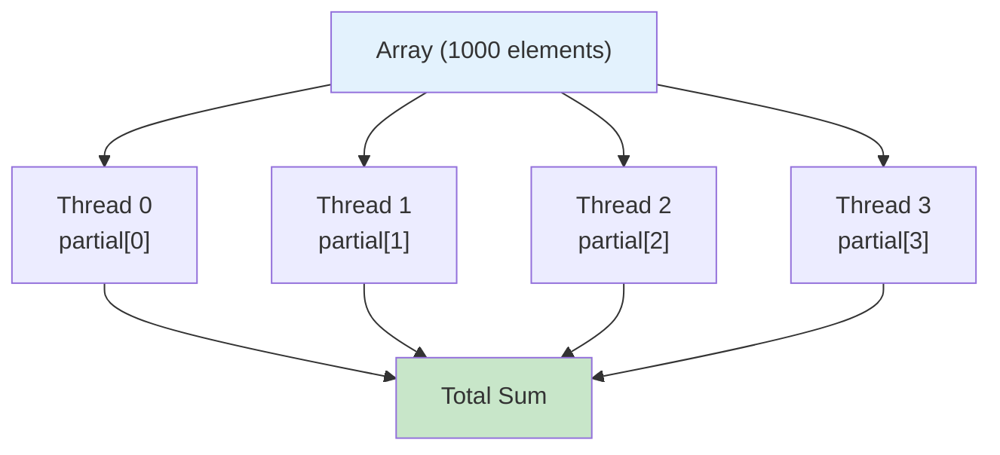
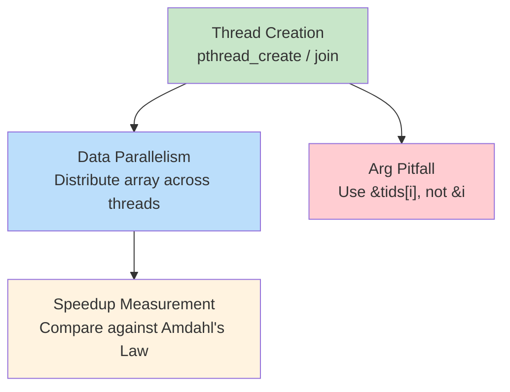

# 4주차 실습 — Pthreads: 스레드 생성, 데이터 병렬성, 속도 향상

[레포지토리 안내](../../README.ko.md) | [English](Concepts_Lab.md) | [한국어](Concepts_Lab.ko.md)

> **최종 수정일:** 2026-10-18

> **학습 목표:**
> 1. `pthread_create`와 `pthread_join`을 사용하여 스레드를 생성하고 합류(join)시킬 수 있다
> 2. 부분 결과(partial result)를 활용한 데이터 병렬 계산을 구현할 수 있다
> 3. 스레드 인자 전달에서 흔히 생기는 함정을 피할 수 있다
> 4. 측정한 속도 향상을 암달의 법칙(Amdahl's Law)과 비교하여 해석할 수 있다

---

## 목차

- [1. 실습 개요](#1-실습-개요)
- [2. 실습 1: Hello 스레드](#2-실습-1-hello-스레드)
  - [2.1 스레드 생명주기](#21-스레드-생명주기)
- [3. 실습 2: 데이터 병렬 배열 합계](#3-실습-2-데이터-병렬-배열-합계)
  - [3.1 핵심 코드 패턴](#31-핵심-코드-패턴)
- [4. 실습 3: 스레드 인자 전달 함정](#4-실습-3-스레드-인자-전달-함정)
  - [4.1 왜 이런 일이 발생하는가](#41-왜-이런-일이-발생하는가)
- [5. 실습 4: 속도 향상과 암달의 법칙](#5-실습-4-속도-향상과-암달의-법칙)
  - [5.1 이상 vs 현실](#51-이상-vs-현실)
- [6. 실습 종합](#6-실습-종합)
- [요약](#요약)
- [점검 문제](#점검-문제)

---

<br>

## 1. 실습 개요

- **목표:** 스레드 생성, 데이터 병렬성, 속도 향상 측정을 통해 Pthreads의 기초를 실습한다.
- **소요 시간:** 실습 4개에 약 50분이 걸린다.
- **주제:** `pthread_create`, `pthread_join`, 데이터 병렬성(Data Parallelism), 인자 전달, 암달의 법칙(Amdahl's Law)을 다룬다.


*그림 1. 네 실습의 진행 순서*

**전체 빌드:**

```bash
cd examples/
gcc -Wall -pthread -o lab1_hello_threads lab1_hello_threads.c
gcc -Wall -pthread -o lab2_parallel_sum  lab2_parallel_sum.c
gcc -Wall -pthread -o lab3_arg_pitfall   lab3_arg_pitfall.c
gcc -Wall -O2 -pthread -o lab4_speedup   lab4_speedup.c
```

> **참고:** `-pthread` 플래그는 컴파일러에 POSIX 스레드 라이브러리를 링크하도록 지시한다. 이 플래그가 없으면 환경에 따라 `pthread_create`와 `pthread_join` 호출에서 링커 에러가 발생한다. glibc 2.34부터는 Pthreads 함수가 기본 C 라이브러리(libc)에 통합되어 플래그 없이도 링크되는 경우가 있지만, 이식성을 위해 명시하는 것이 안전하다.

---

<br>

## 2. 실습 1: Hello 스레드

**목표:** `pthread_create`와 `pthread_join`을 사용하여 스레드를 생성하고 합류(join)시킨다.

```bash
./lab1_hello_threads        # 4개 스레드 (기본값)
./lab1_hello_threads 8      # 8개 스레드
```

**핵심 API** (교재 4.4절):

```c
pthread_create(&tid, NULL, func, arg);   // 스레드 생성
pthread_join(tid, NULL);                 // 스레드 종료 대기
```

> **[컴퓨터프로그래밍]** `pthread_create`의 세 번째 인자는 **함수 포인터(function pointer)** 이다. `void *(*func)(void *)`는 `void *` 매개변수를 받고 `void *`를 반환하는 함수를 가리키는 포인터를 뜻한다. 새 스레드가 어떤 함수를 진입점으로 실행할지 알려 주는 역할을 한다.

### 2.1 스레드 생명주기

```text
 메인 스레드         스레드 0        스레드 1        스레드 2        스레드 3
    |
    |--create()---> 시작
    |--create()-----------------> 시작
    |--create()-------------------------------> 시작
    |--create()----------------------------------------------> 시작
    |                |             |             |              |
    |                      (동시 실행 — 순서는 스케줄러에 따라 결정)
    |                |              |            |              |
    |                |              |    printf("Hello 2!")     |
    |         printf("Hello 0!")    |            |              |
    |                |              |            |      printf("Hello 3!")
    |                |      printf("Hello 1!")   |              |
    |                |              |            |              |
    |--join(T0)----> 완료            |            |              |
    |--join(T1)------------------> 완료           |              |
    |--join(T2)-------------------------------> 완료             |
    |--join(T3)----------------------------------------------> 완료
    |
 "모든 스레드가 종료되었습니다."
```

*그림 2. 메인 스레드가 네 스레드를 생성하고 합류시키는 과정*

**관찰:** 프로그램을 여러 번 실행해 보면 출력 순서가 **비결정적(non-deterministic)** 이다. 스레드는 OS에 의해 독립적으로 스케줄링되기 때문이다.

> **핵심:** 메인 스레드가 `pthread_join()` 없이 `main()`에서 반환하면 자식 스레드가 끝나기 전에 전체 프로세스가 종료될 수 있다. `fork()` 이후 좀비 프로세스를 막기 위해 `wait()`가 필요한 것과 유사하게, 생성한 스레드는 분리(detach)한 경우가 아니면 모두 join해야 한다.

---

<br>

## 3. 실습 2: 데이터 병렬 배열 합계

**목표:** 배열을 여러 스레드에 나누어 맡기고, 각 스레드가 **부분 합(partial sum)** 을 계산한다.

```text
배열: [1, 2, 3, ..., 1000]

스레드 0: 합계 [  1 ~ 250 ] = 31375
스레드 1: 합계 [251 ~ 500 ] = 93875
스레드 2: 합계 [501 ~ 750 ] = 156375
스레드 3: 합계 [751 ~ 1000] = 218875
                           ──────
전체 합계                   = 500500 ✓
```



*그림 3. 네 스레드의 부분 합을 전체 합으로 모으는 구조*

동일한 연산을 서로 다른 데이터 부분집합에 적용하는 이러한 방식을 **데이터 병렬성(data parallelism)** 이라 한다(교재 4.2절).

### 3.1 핵심 코드 패턴

```c
/* 각 스레드가 자기 담당 구간을 계산 — 공유 충돌 없음 */
void *sum_array(void *arg)
{
    int id    = ((struct thread_arg *)arg)->id;
    int chunk = ARRAY_SIZE / nthreads;
    int start = id * chunk;
    int end   = (id == nthreads - 1) ? ARRAY_SIZE : start + chunk;

    partial_sum[id] = 0;                        // 스레드마다 별도 인덱스 사용
    for (int i = start; i < end; i++)
        partial_sum[id] += array[i];

    return NULL;
}
```

`arg` 매개변수는 `struct thread_arg *`로 캐스팅한다. `struct thread_arg { int id; };`는 스레드에 할당된 ID를 저장하는 간단한 구조체이며, 전체 소스 파일에 정의되어 있다. 각 스레드는 `chunk`개짜리 연속 구간 `[start, end)`를 맡고, 마지막 스레드(`id == nthreads - 1`)는 `ARRAY_SIZE`가 `nthreads`로 나누어떨어지지 않을 때 남는 원소까지 처리한다.

> **참고:** **왜 공유 변수 대신 `partial_sum[id]`를 사용하는가?**
> - 각 스레드는 **자신만의 인덱스**에 기록하므로 충돌이 없다.
> - 모든 스레드가 하나의 `total` 변수에 기록하면 **경쟁 조건(race condition)** 이 발생한다. 경쟁 조건은 동시에 실행되는 스레드들이 공유 데이터에 접근하는 예측 불가능한 타이밍에 따라 프로그램 결과가 달라지는 버그이며, 교재 6장과 9주차에서 자세히 다룬다.

> **[알고리즘]** 여기서 사용하는 분할 정복 방식은 병합 정렬(merge sort)과 유사하다. 데이터를 나누고, 각 부분을 독립적으로 처리한 뒤, 결과를 합친다. 핵심 차이는 분할 단계와 처리 단계가 여러 코어에서 **병렬로** 실행된다는 것이다.

---

<br>

## 4. 실습 3: 스레드 인자 전달 함정

**흔한 버그:** 반복문 변수의 주소 `&i`를 `pthread_create`에 전달하는 것이다.

**잘못된 코드:**

```c
for (int i = 0; i < 4; i++)
    pthread_create(&t[i], NULL,
                   func, &i);  // 모두 &i를 공유!
```

출력 (비결정적):

```text
Thread received id = 2
Thread received id = 4
Thread received id = 4
Thread received id = 4
```

**올바른 코드:**

```c
int tids[4];
for (int i = 0; i < 4; i++) {
    tids[i] = i;               // 별도 복사본
    pthread_create(&t[i], NULL,
                   func, &tids[i]);
}
```

출력 (항상 정확):

```text
Thread received id = 0
Thread received id = 1
Thread received id = 2
Thread received id = 3
```

> **핵심:** 모든 스레드가 동일한 `&i` 주소를 공유한다. 스레드가 이 값을 읽을 때쯤이면 `i`가 이미 변경되었을 수 있다. 반복문이 끝나면 `i`의 수명도 끝나므로 그 뒤에 포인터로 `i`를 읽는 것은 정의되지 않은 동작이며, 위 출력의 4는 반복문이 끝난 시점의 값이 그 자리에 남아 있어서 나타난 것이다.

### 4.1 왜 이런 일이 발생하는가

```text
메인 (반복문)            스레드 0             스레드 1
    |
  i = 0
    |--create(&i)-----> 시작
  i = 1                  |
    |--create(&i)-------------------------> 시작
  i = 2                  |                   |
    :                id = *(&i)          id = *(&i)
    :                 2를 읽음!             2를 읽음!
    :                    |                   |
    :                   둘 다 0, 1 대신 id=2를 받음!
```

*그림 4. 반복문 변수 i의 주소를 공유한 두 스레드가 같은 값을 읽는 과정*

**해결 방법:** 각 값을 **별도의 메모리 위치**(`tids[i]`)에 저장하면, 반복문이 진행되어도 각 스레드의 포인터가 가리키는 값이 안정적으로 유지된다.

> **참고:** **시험 팁.** 이 인자 전달 함정은 자주 출제되는 주제이다. `pthread_create`는 **비동기적(asynchronous)** 이다. 새 스레드는 호출한 코드의 다음 줄이 실행되기 전에 반드시 시작되는 것이 아니라, 이후 어느 시점에든 실행을 시작할 수 있다. 근본 원인은 새 스레드가 즉시 실행되지 않을 수 있다는 것이다. 스레드가 포인터를 역참조할 때 이미 가리키는 값이 바뀌어 있을 수 있으며, 이것은 메인 스레드의 반복문과 자식 스레드의 포인터 역참조 사이의 경쟁 조건이다.

---

<br>

## 5. 실습 4: 속도 향상과 암달의 법칙

**목표:** 스레드 수에 따른 속도 향상을 측정한다.

```bash
./lab4_speedup
```

**예상 출력** (머신에 따라 다름):

| 스레드 수 | 시간 (초) | 속도 향상 |
|-----------|----------|----------|
| 1 | 0.12 | 1.00배 |
| 2 | 0.07 | ~1.7배 |
| 4 | 0.04 | ~3.0배 |
| 8 | 0.03 | ~4.0배 |

*표 1. 스레드 수에 따른 실행 시간과 속도 향상의 예*

**암달의 법칙(Amdahl's Law)** (교재 4.2절): 속도 향상 $\leq \frac{1}{S + \frac{1-S}{N}}$

> **참고:** 이 수식에서 **S**는 프로그램 중 반드시 **직렬로 실행되어야 하는 비율**(병렬화 불가능 부분)이고, **N**은 처리 코어 수이다. S = 0(완전 병렬)이면 이상적 속도 향상 = N이다. S = 10%이고 N = 8(스레드 8개)이면 최대 속도 향상은 $\frac{1}{0.1 + 0.9/8} = \frac{1}{0.2125} \approx 4.71$, 즉 **4.71배**이다(8배가 아님). 아무리 작은 직렬 비율이라도 성능 향상에 한계를 두게 된다.

### 5.1 이상 vs 현실

| 스레드 수 | 이상적 (S=0) | 현실 (S>0) |
|-----------|-------------|-----------|
| 1 | 1.0배 | 1.0배 |
| 2 | 2.0배 | ~1.7배 |
| 4 | 4.0배 | ~3.0배 |
| 8 | **8.0배** | **~4.0배** |

*표 2. 스레드 수에 따른 이상적 속도 향상과 실제 속도 향상*

**실제 속도 향상이 이상적 값보다 낮은 이유는 다음과 같다.**

1. **스레드 생성과 합류의 오버헤드**가 직렬 부분으로 더해진다.
2. **메모리 버스 경합:** 스레드들이 RAM 대역폭을 놓고 경쟁한다.
3. **캐시 효과:** 여러 코어에 분산된 데이터가 캐시 미스(cache miss)를 유발할 수 있다.
4. 암달의 법칙에 따라 아무리 작은 직렬 비율이라도 성능 향상에 한계를 둔다.

> **[컴퓨터구조]** 메모리 버스 경합(memory bus contention)은 여러 코어가 동시에 주 메모리에 접근할 때 병목이 된다. 각 코어의 L1/L2 캐시는 데이터를 빠르게 로컬로 제공할 수 있지만, 스레드들이 캐시에 다 들어가지 않는 큰 배열의 서로 다른 부분에 접근하면 캐시 미스가 발생하여 더 느린 공유 메모리 버스로의 접근이 반복된다.

---

<br>

## 6. 실습 종합

네 실습의 개념은 다음과 같이 이어진다. 스레드 생성과 합류를 바탕으로 데이터 병렬 계산과 올바른 인자 전달 방법을 익히고, 데이터 병렬 계산의 속도 향상을 암달의 법칙과 비교한다.



*그림 5. 네 실습에서 다룬 개념의 관계*

**전체 실습에서 사용한 Pthreads 패턴:**

```c
for (int i = 0; i < N; i++) {
    tids[i] = i;
    pthread_create(&threads[i], NULL, func, &tids[i]);
}
for (int i = 0; i < N; i++)
    pthread_join(threads[i], NULL);
```

첫 번째 반복문은 스레드마다 별도 저장소 `tids[i]`에 ID를 넣고 그 주소를 인자로 넘겨 스레드를 생성하며, 두 번째 반복문은 생성한 모든 스레드를 합류시킨다.

---

<br>

## 요약

| 개념 | 핵심 요약 |
|:-----|:---------|
| 스레드 생성과 합류 (실습 1, Hello 스레드) | `pthread_create`로 스레드를 생성하고 `pthread_join`으로 종료를 기다리며, 스레드의 출력 순서는 비결정적이다. |
| 데이터 병렬 합계 (실습 2, 병렬 합계) | 스레드마다 `partial_sum[id]`에 부분 합을 따로 기록하는 데이터 병렬 계산으로 공유 쓰기 충돌을 피한다. |
| 인자 전달 함정 (실습 3) | 반복문에서 `&i`를 넘기지 않고, 스레드마다 별도 저장소(`tids[i]`)의 주소를 넘긴다. |
| 속도 향상 (실습 4) | 직렬 오버헤드와 암달의 법칙 때문에 실제 속도 향상은 이상적 값보다 작다. |

---

<br>

## 점검 문제

1. **반복문 변수의 주소 전달:** for 반복문에서 `&i`를 `pthread_create`에 전달하면 왜 잘못된 동작이 발생하는가?

   <details>
   <summary>정답</summary>

   모든 스레드가 같은 메모리 주소 `&i`를 공유하고, 반복문은 `pthread_create` 이후에도 계속 `i`를 변경한다. 스레드가 `*arg`를 읽을 때쯤이면 반복문이 이미 진행된 상태일 수 있어, 여러 스레드가 같은(혹은 오래된) `i` 값을 보게 되는 **경쟁 조건(race condition)** 이 발생한다. 해결 방법은 스레드마다 별도 복사본을 주는 것이다(`int tid[N]; tid[i] = i; pthread_create(..., &tid[i]);`).

   </details>

2. **부분 합 배열:** 왜 하나의 공유 `total` 변수 대신 `partial_sum[id]`를 사용하는가?

   <details>
   <summary>정답</summary>

   여러 스레드가 동시에 `total += x`를 수행하면 읽기, 수정, 쓰기(read-modify-write)가 원자적이지 않아 **경쟁 조건**이 발생하고 업데이트가 유실된다. `partial_sum[id]`를 쓰면 각 스레드가 자신만의 슬롯에 기록하므로 경합이 없고, 메인 스레드가 join 후 합산하면 안전하고 올바른 결과를 얻는다.

   </details>

3. **속도 향상의 한계:** 실제 속도 향상이 이상적 속도 향상에 미치지 못하는 요인은 무엇인가?

   <details>
   <summary>정답</summary>

   ① 직렬 부분(암달의 법칙), ② 스레드 생성과 join 오버헤드, ③ 캐시 미스와 거짓 공유(false sharing), ④ 메모리 버스와 공유 자원 경합, ⑤ 락 대기 시간, ⑥ OS 스케줄링 지연과 문맥 교환 오버헤드가 있다.

   </details>

4. **join 없는 종료:** 메인 스레드가 모든 자식 스레드에 `pthread_join`을 호출하기 전에 종료하면 어떻게 되는가?

   <details>
   <summary>정답</summary>

   메인 스레드가 `main()`에서 반환하거나 `exit()`를 호출하면 프로세스가 종료되고 **모든 스레드가 강제 종료**된다. 진행 중이던 작업과 아직 기록되지 않은 출력이 사라지고, 파일 핸들과 네트워크 소켓 같은 자원이 급하게 닫히므로 결과를 신뢰할 수 없다. `main()`이 반환하기 전에 항상 `pthread_join`을 호출해야 하며, 분리(detach)는 결과를 기다릴 필요가 없는 스레드에만 의도적으로 쓴다. 분리한 스레드도 프로세스가 끝나면 함께 종료되고, 메인 스레드가 `pthread_exit()`로 끝나는 경우에만 프로세스가 유지되어 나머지 스레드가 계속 실행된다.

   </details>

---
