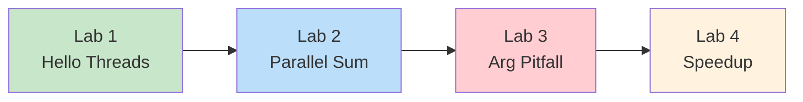
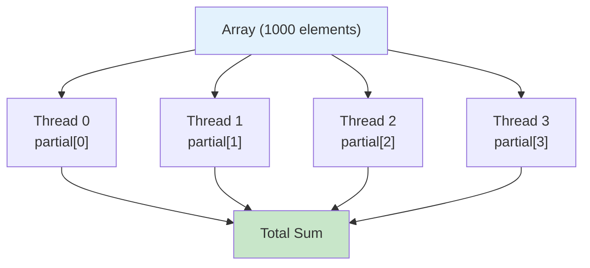
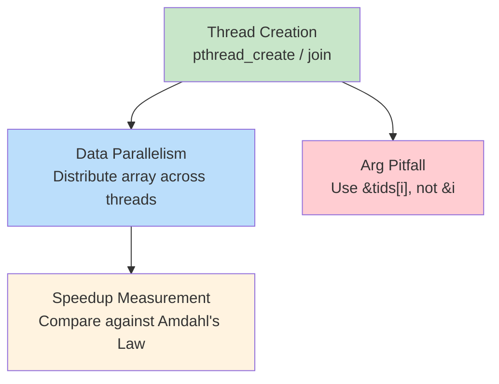

# Week 4 Lab — Pthreads: Thread Creation, Data Parallelism, and Speedup

[Repository Guide](../../README.md) | [English](Concepts_Lab.md) | [한국어](Concepts_Lab.ko.md)

> **Last Updated:** 2026-10-20

> **Learning Objectives:**
> 1. Create and join threads using `pthread_create` and `pthread_join`
> 2. Implement data-parallel computation with partial results
> 3. Avoid the common thread argument-passing pitfall
> 4. Measure speedup and interpret it against Amdahl's Law

---

## Table of Contents

- [1. Lab Overview](#1-lab-overview)
- [2. Lab 1: Hello Threads](#2-lab-1-hello-threads)
  - [2.1 Thread Lifecycle](#21-thread-lifecycle)
- [3. Lab 2: Data-Parallel Array Sum](#3-lab-2-data-parallel-array-sum)
  - [3.1 Core Code Pattern](#31-core-code-pattern)
- [4. Lab 3: Thread Argument Pitfall](#4-lab-3-thread-argument-pitfall)
  - [4.1 Why This Happens](#41-why-this-happens)
- [5. Lab 4: Speedup and Amdahl's Law](#5-lab-4-speedup-and-amdahls-law)
  - [5.1 Ideal vs Reality](#51-ideal-vs-reality)
- [6. Putting the Labs Together](#6-putting-the-labs-together)
- [Summary](#summary)
- [Self-Check Questions](#self-check-questions)

---

<br>

## 1. Lab Overview

- **Objective:** Practice Pthreads fundamentals through thread creation, data parallelism, and speedup measurement.
- **Duration:** The 4 labs take approximately 50 minutes.
- **Topics:** The labs cover `pthread_create`, `pthread_join`, data parallelism, argument passing, and Amdahl's Law.



*Figure 1. Sequence of the four labs*

**Build all labs:**

```bash
cd examples/
gcc -Wall -pthread -o lab1_hello_threads lab1_hello_threads.c
gcc -Wall -pthread -o lab2_parallel_sum  lab2_parallel_sum.c
gcc -Wall -pthread -o lab3_arg_pitfall   lab3_arg_pitfall.c
gcc -Wall -O2 -pthread -o lab4_speedup   lab4_speedup.c
```

> **Note:** The `-pthread` flag tells the compiler to link against the POSIX threads library. Without it, calls to `pthread_create` and `pthread_join` cause linker errors on some systems. Since glibc 2.34, the Pthreads functions are part of the standard C library (libc), so linking may succeed without the flag, but specifying it explicitly is safer for portability.

---

<br>

## 2. Lab 1: Hello Threads

**Goal:** Create and join threads using `pthread_create` and `pthread_join`.

```bash
./lab1_hello_threads        # 4 threads (default)
./lab1_hello_threads 8      # 8 threads
```

**Core API** (Textbook Section 4.4):

```c
pthread_create(&tid, NULL, func, arg);   // Create a thread
pthread_join(tid, NULL);                 // Wait for a thread to finish
```

> **[Computer Programming]** `pthread_create` takes a **function pointer** as its third argument. `void *(*func)(void *)` denotes a pointer to a function that takes a `void *` parameter and returns `void *`. It tells the new thread which function to run as its entry point.

### 2.1 Thread Lifecycle

```text
Main Thread          Thread 0        Thread 1        Thread 2        Thread 3
    |
    |--create()-----> Start
    |--create()---------------------> Start
    |--create()-------------------------------------> Start
    |--create()------------------------------------------------------> Start
    |                   |               |               |                |
    |                  (concurrent execution: order decided by scheduler)
    |                   |               |               |                |
    |                   |               |       printf("Hello 2!")       |
    |           printf("Hello 0!")      |               |                |
    |                   |               |               |        printf("Hello 3!")
    |                   |         printf("Hello 1!")    |                |
    |                   |               |               |                |
    |--join(T0)-----> Done              |               |                |
    |--join(T1)----------------------> Done             |                |
    |--join(T2)--------------------------------------> Done              |
    |--join(T3)------------------------------------------------------> Done
    |
 "All threads finished."
```

*Figure 2. Main thread creating and joining four threads*

**Observation:** If you run the program multiple times, the print order is **non-deterministic** because threads are independently scheduled by the OS.

> **Key Point:** If the main thread returns from `main()` without `pthread_join()`, the entire process may terminate before child threads finish. Just as `wait()` is necessary after `fork()` to prevent zombie processes, every thread you create must be joined unless it has been detached.

---

<br>

## 3. Lab 2: Data-Parallel Array Sum

**Goal:** Distribute an array across threads so that each thread computes a **partial sum**.

```text
Array: [1, 2, 3, ..., 1000]

Thread 0: sum [  1 ~ 250 ] = 31375
Thread 1: sum [251 ~ 500 ] = 93875
Thread 2: sum [501 ~ 750 ] = 156375
Thread 3: sum [751 ~ 1000] = 218875
                              ──────
Total                       = 500500 ✓
```



*Figure 3. Combining the partial sums of four threads into the total sum*

Applying the same operation to different subsets of data in this way is called **data parallelism** (Textbook Section 4.2).

### 3.1 Core Code Pattern

```c
/* Each thread computes its own range: no shared-write conflict */
void *sum_array(void *arg)
{
    int id    = ((struct thread_arg *)arg)->id;
    int chunk = ARRAY_SIZE / nthreads;
    int start = id * chunk;
    int end   = (id == nthreads - 1) ? ARRAY_SIZE : start + chunk;

    partial_sum[id] = 0;                        // Each thread writes to its own index
    for (int i = start; i < end; i++)
        partial_sum[id] += array[i];

    return NULL;
}
```

The `arg` parameter is cast to `struct thread_arg *`. `struct thread_arg { int id; };` is a simple struct holding the thread's assigned ID, and it is defined in the full source file. Each thread handles a contiguous range `[start, end)` of `chunk` elements, and the last thread (`id == nthreads - 1`) also processes the leftover elements when `ARRAY_SIZE` is not divisible by `nthreads`.

> **Note:** **Why `partial_sum[id]` instead of a shared variable?**
> - Each thread writes to **its own index**, so there is no conflict.
> - If all threads wrote to a single `total` variable, a **race condition** would occur. A race condition is a bug where the program's output depends on the unpredictable timing of concurrent threads accessing shared data, and it is covered in detail in textbook Chapter 6 and Week 9.

> **[Algorithms]** **Divide and conquer** is an algorithm design technique that splits a problem into smaller subproblems, solves each, and combines the results, with merge sort as a classic example. The approach here has the same structure: it splits the data, processes each part independently, and combines the results (unlike merge sort, it splits in a single step without recursion). The key difference is that the split and process phases run **in parallel** across multiple cores.

---

<br>

## 4. Lab 3: Thread Argument Pitfall

**A common bug:** passing the address of a loop variable `&i` to `pthread_create`.

**Wrong code:**

```c
for (int i = 0; i < 4; i++)
    pthread_create(&t[i], NULL,
                   func, &i);  // All threads share &i!
```

Output (non-deterministic):

```text
Thread received id = 2
Thread received id = 4
Thread received id = 4
Thread received id = 4
```

**Correct code:**

```c
int tids[4];
for (int i = 0; i < 4; i++) {
    tids[i] = i;               // Separate copy
    pthread_create(&t[i], NULL,
                   func, &tids[i]);
}
```

Output (always correct):

```text
Thread received id = 0
Thread received id = 1
Thread received id = 2
Thread received id = 3
```

> **Key Point:** All threads share the same `&i` address. By the time a thread reads it, `i` may have already advanced. Once the loop ends, the lifetime of `i` also ends, so reading `i` through the pointer afterwards is undefined behavior; the 4s in the output above appear because the value at loop exit happened to remain in that location.

### 4.1 Why This Happens

```text
Main (loop)              Thread 0             Thread 1
    |
  i = 0
    |--create(&i)-------> Start
  i = 1                     |
    |--create(&i)----------------------------> Start
  i = 2                     |                    |
    :                   id = *(&i)           id = *(&i)
    :                    Reads 2!             Reads 2!
    :                       |                    |
    :                   Both get id=2 instead of 0, 1!
```

*Figure 4. Two threads sharing the address of loop variable i and reading the same value*

**Solution:** Store each value in a **separate memory location** (`tids[i]`), so the value each thread's pointer refers to remains stable even as the loop advances.

> **Key Point:** `pthread_create` is **asynchronous**. The new thread may start running at any later point, not necessarily before the next line of the calling code executes. By the time it dereferences the pointer, the pointed-to value may therefore have changed. This is a race condition between the main thread's loop and each child thread's pointer dereference.

---

<br>

## 5. Lab 4: Speedup and Amdahl's Law

**Goal:** Measure speedup as thread count increases.

```bash
./lab4_speedup
```

**Expected output** (varies by machine):

| Threads | Time (s) | Speedup |
|---------|----------|---------|
| 1 | 0.12 | 1.00x |
| 2 | 0.07 | ~1.7x |
| 4 | 0.04 | ~3.0x |
| 8 | 0.03 | ~4.0x |

*Table 1. Example execution time and speedup by thread count*

**Amdahl's Law** (Textbook Section 4.2): Speedup $\leq \frac{1}{S + \frac{1-S}{N}}$

> **Note:** In this formula, **S** is the fraction of the program that must run **serially** (cannot be parallelized), and **N** is the number of processing cores. When S = 0 (fully parallel), ideal speedup = N. When S = 10% and N = 8 (8 threads), the maximum speedup is $\frac{1}{0.1 + 0.9/8} = \frac{1}{0.2125} \approx 4.71$, that is, **4.71x** (not 8x). Even a small serial fraction places a hard ceiling on performance gains.

### 5.1 Ideal vs Reality

| Threads | Ideal (S=0) | Real (S>0) |
|---------|-------------|------------|
| 1 | 1.0x | 1.0x |
| 2 | 2.0x | ~1.7x |
| 4 | 4.0x | ~3.0x |
| 8 | **8.0x** | **~4.0x** |

*Table 2. Ideal and real speedup by thread count*

**Real speedup is lower than ideal for the following reasons.**

1. **Thread creation and join overhead** adds to the serial portion.
2. **Memory bus contention:** threads compete for RAM bandwidth.
3. **Cache effects:** data spread across cores may cause cache misses.
4. By Amdahl's Law, even a tiny serial fraction caps the maximum speedup.

> **[Computer Architecture]** Memory bus contention becomes a bottleneck when multiple cores simultaneously access main memory. Each core's L1/L2 cache can serve data locally and fast, but when threads access different parts of a large array that does not fit in the cache, **cache misses** force repeated trips to the slower shared memory bus.

---

<br>

## 6. Putting the Labs Together

The concepts of the four labs connect as follows. Building on thread creation and joining, the labs practice data-parallel computation and correct argument passing, and then compare the speedup of data-parallel computation against Amdahl's Law.



*Figure 5. Relationships among the concepts covered in the four labs*

**Complete Pthreads pattern used across all labs:**

```c
for (int i = 0; i < N; i++) {
    tids[i] = i;
    pthread_create(&threads[i], NULL, func, &tids[i]);
}
for (int i = 0; i < N; i++)
    pthread_join(threads[i], NULL);
```

The first loop stores each thread's ID in separate storage `tids[i]` and passes that address as the argument when creating the thread, and the second loop joins all the created threads.

---

<br>

## Summary

| Concept | Key Summary |
|:--------|:------------|
| Thread creation and joining (Lab 1, Hello Threads) | `pthread_create` creates a thread and `pthread_join` waits for it to finish, and the threads' output order is non-deterministic. |
| Data-parallel sum (Lab 2, Parallel Sum) | Each thread records its partial sum in its own `partial_sum[id]`, a data-parallel computation that avoids shared-write conflicts. |
| Argument pitfall (Lab 3) | Do not pass `&i` from a loop; pass the address of separate storage per thread (`tids[i]`) instead. |
| Speedup (Lab 4) | Real speedup is lower than ideal because of serial overhead and Amdahl's Law. |

---

<br>

## Self-Check Questions

1. **Passing a loop variable's address:** Why does passing `&i` from a for loop to `pthread_create` cause incorrect behavior?

   <details>
   <summary>Answer</summary>

   All threads share the same memory address `&i`, and the loop keeps mutating `i` after each `pthread_create` call. By the time a thread reads `*arg`, the loop may have moved on, so multiple threads often see the same (or stale) value of `i`, causing a **race condition** on the thread ID. The fix is to give each thread its own copy (`int tids[N]; tids[i] = i; pthread_create(..., &tids[i]);`).

   </details>

2. **Partial-sum array:** Why do we use `partial_sum[id]` instead of a single shared `total` variable?

   <details>
   <summary>Answer</summary>

   Multiple threads doing `total += x` concurrently have a non-atomic read-modify-write cycle, which creates a **race condition** and loses updates. Writing to `partial_sum[id]` gives each thread its own slot with no contention, and the main thread sums the partials after `join`, which is safe and correct.

   </details>

3. **Limits of speedup:** What factors cause real speedup to fall short of ideal speedup?

   <details>
   <summary>Answer</summary>

   ① Serial portions of the code (Amdahl's Law), ② thread creation and join overhead, ③ cache misses and false sharing, ④ memory-bus or shared-resource contention, ⑤ lock wait time, and ⑥ OS scheduling delays and context-switch overhead.

   </details>

4. **Exiting without join:** What happens if the main thread exits before calling `pthread_join` on all child threads?

   <details>
   <summary>Answer</summary>

   If the main thread returns from `main()` or calls `exit()`, the process exits and **all threads are forcibly terminated**. Work in progress and output not yet written are lost, and resources such as file handles and network sockets are abruptly closed, so the results cannot be trusted. Always call `pthread_join` before letting `main()` return, and detach only threads whose results need not be awaited. A detached thread also ends when the process ends; only when the main thread finishes with `pthread_exit()` does the process stay alive so that the remaining threads keep running.

   </details>

---
