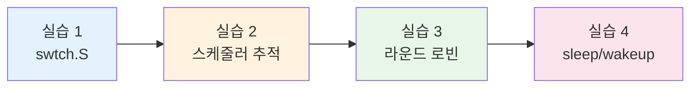
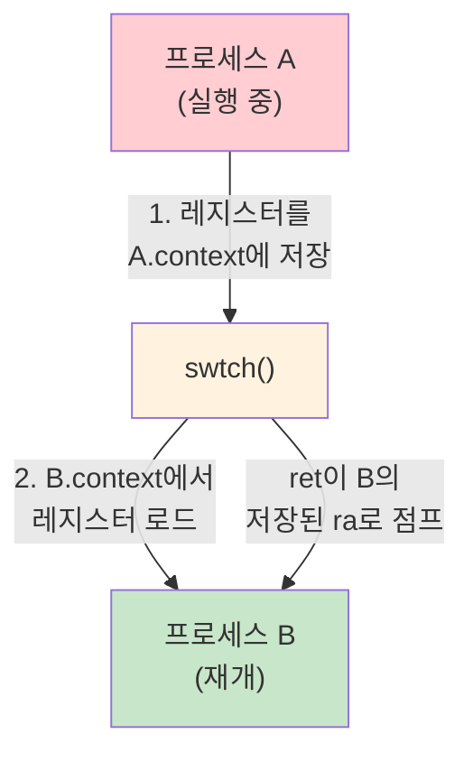
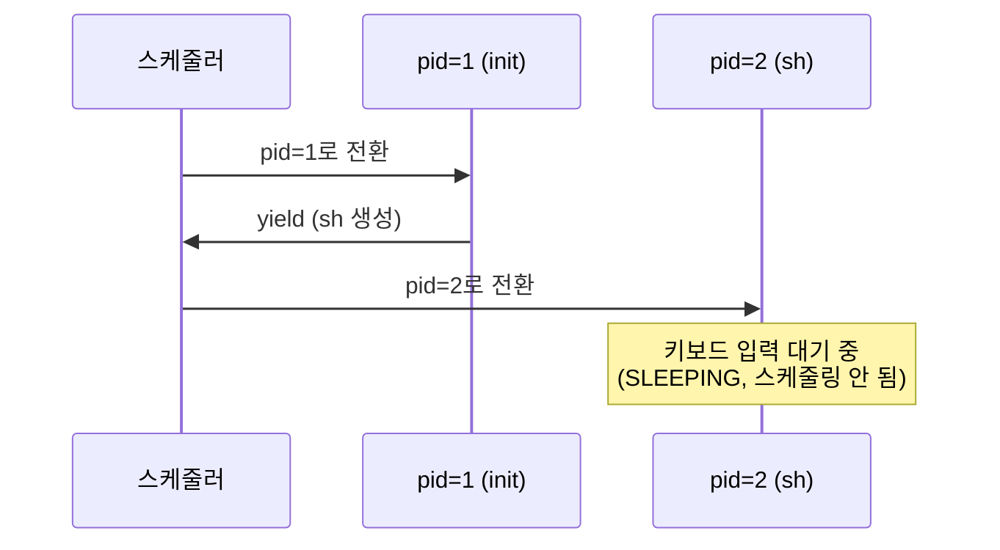
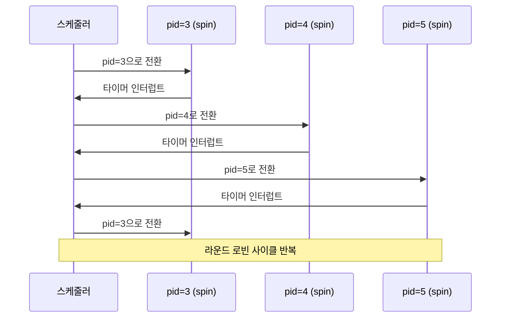
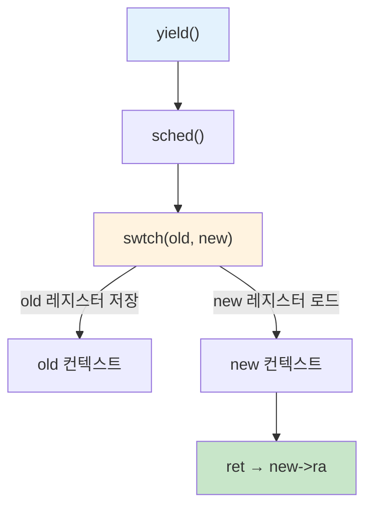
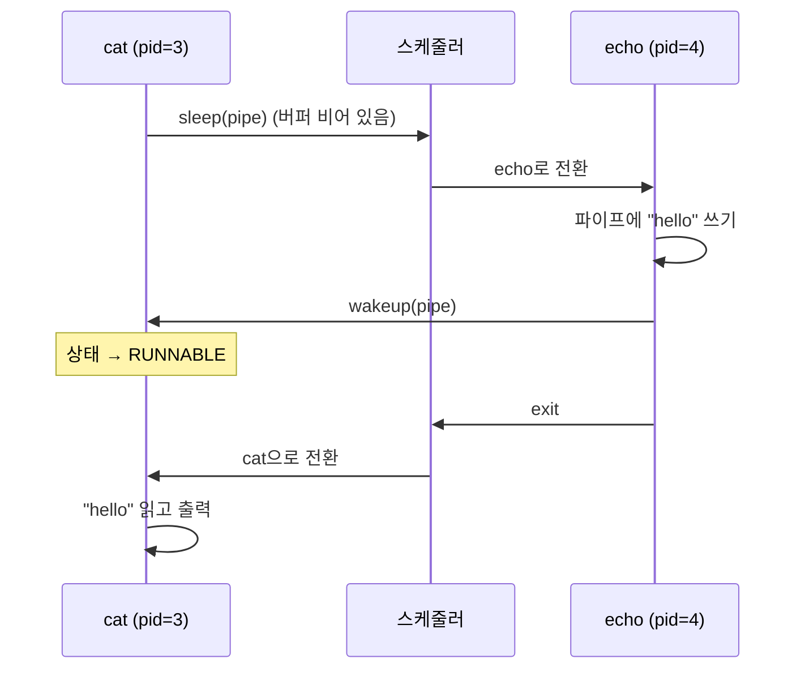

# 6주차 실습 — 문맥 교환

[레포지토리 안내](../../README.ko.md) | [English](Concepts_Lab.md) | [한국어](Concepts_Lab.ko.md)

> **최종 수정일:** 2026-10-20

> **학습 목표:**
> 1. `swtch.S`를 읽고 문맥 교환 시 어떤 레지스터가 저장/복원되는지 설명할 수 있다
> 2. xv6 스케줄러에 printf 기반 추적을 추가하고 출력을 해석할 수 있다
> 3. 여러 CPU 집약적 프로세스에서 라운드 로빈 스케줄링 동작을 관찰할 수 있다
> 4. 블로킹 I/O 파이프라인을 통해 sleep/wakeup 메커니즘을 추적할 수 있다

---

## 목차

- [1. 실습 개요](#1-실습-개요)
  - [1.1 문맥 교환(Context Switch)이란?](#11-문맥-교환context-switch이란)
- [2. 실습 1: swtch.S 분석](#2-실습-1-swtchs-분석)
  - [2.1 배경 지식: 호출자 저장 vs 피호출자 저장 레지스터](#21-배경-지식-호출자-저장-vs-피호출자-저장-레지스터)
  - [2.2 struct context: 피호출자 저장 레지스터와 ra](#22-struct-context-피호출자-저장-레지스터와-ra)
  - [2.3 swtch(old, new) 어셈블리](#23-swtchold-new-어셈블리)
  - [2.4 문맥 교환 흐름](#24-문맥-교환-흐름)
  - [2.5 새 프로세스의 부트스트랩](#25-새-프로세스의-부트스트랩)
- [3. 실습 2: 스케줄러 추적](#3-실습-2-스케줄러-추적)
  - [3.1 추적 코드 추가](#31-추적-코드-추가)
  - [3.2 빌드 및 실행](#32-빌드-및-실행)
  - [3.3 예상 출력](#33-예상-출력)
- [4. 실습 3: 라운드 로빈 관찰](#4-실습-3-라운드-로빈-관찰)
  - [4.1 여러 프로세스 실행](#41-여러-프로세스-실행)
  - [4.2 예상 스케줄링 패턴](#42-예상-스케줄링-패턴)
  - [4.3 전체 문맥 교환 경로](#43-전체-문맥-교환-경로)
  - [4.4 왜 라운드 로빈인가?](#44-왜-라운드-로빈인가)
  - [4.5 미묘한 편향](#45-미묘한-편향)
  - [4.6 다중 CPU 실험](#46-다중-cpu-실험)
- [5. 실습 4: sleep/wakeup 추적](#5-실습-4-sleepwakeup-추적)
  - [5.1 추적 코드 추가](#51-추적-코드-추가)
  - [5.2 파이프로 테스트](#52-파이프로-테스트)
  - [5.3 예상 출력](#53-예상-출력)
  - [5.4 wakeup은 프로세스를 즉시 실행하지 않는다](#54-wakeup은-프로세스를-즉시-실행하지-않는다)
- [요약](#요약)
- [점검 문제](#점검-문제)

---

<br>

## 1. 실습 개요

- **목표**: 어셈블리 코드 읽기, 스케줄러 추적, 프로세스 상태 전이 관찰을 통해 xv6의 문맥 교환 메커니즘을 이해한다.
- **소요 시간**: 약 50분, 실습 4개
- **주제**: `swtch.S`, 스케줄러 추적, 라운드 로빈 스케줄링, `sleep`/`wakeup`

### 1.1 문맥 교환(Context Switch)이란?

CPU는 한 번에 하나의 프로세스만 실행할 수 있다. 여러 프로그램이 동시에 실행되는 것처럼 보이게 하려면, OS가 프로세스들을 초당 수십 번씩 빠르게 전환해야 한다. 이 전환을 **문맥 교환(Context Switch)** 이라 한다:

1. **저장**: 현재 실행 중인 프로세스의 CPU 레지스터(문맥)를 메모리에 저장한다.
2. **로드**: 다음 프로세스의 저장된 레지스터를 메모리에서 CPU로 로드한다.
3. **재개**: CPU가 다음 프로세스를 멈춘 적 없는 것처럼 계속 실행한다.

비유하자면, 읽던 책에 책갈피를 꽂고 다른 책을 집어 드는 것과 같다. 책갈피는 저장된 레지스터 상태이고, 각 책은 서로 다른 프로세스이다.



*그림 1. 네 실습의 진행 순서*

**사전 준비**:

```bash
cd xv6-riscv && make qemu   # 정상 부팅 확인
```

> **참고:** 모든 실습은 xv6 커널 소스 파일을 수정하거나 검사한다. 커널 코드를 편집한 후 `make clean && make qemu` (또는 단일 CPU 출력을 위해 `make CPUS=1 qemu`)를 실행하여 다시 빌드하고 테스트한다.

---

<br>

## 2. 실습 1: swtch.S 분석

**목표**: xv6 문맥 교환 어셈블리를 읽고 어떤 레지스터가 저장되고 복원되는지 이해한다.

**파일**: `kernel/swtch.S`, `kernel/proc.h`

### 2.1 배경 지식: 호출자 저장 vs 피호출자 저장 레지스터

RISC-V 호출 규약(calling convention)에서 CPU 레지스터는 두 그룹으로 나뉜다:

| 그룹 | 레지스터 | 누가 저장하는가? | 언제? |
|------|---------|-----------------|-------|
| **호출자 저장(caller-saved)** | `ra` (반환 주소), `a0`\~`a7` (인자), `t0`\~`t6` (임시) | **호출자** (다른 함수를 호출하는 함수) | 호출 전에 스택에 푸시 |
| **피호출자 저장(callee-saved)** | `sp` (스택 포인터), `s0`~`s11` | **피호출자** (호출당하는 함수) | 반환 전에 반드시 원래 값으로 복원 |

*표 1. RISC-V 호출 규약의 레지스터 분류*

비유: 책상을 다른 사람에게 빌려준다고 하자. **호출자 저장** 레지스터는 빌려주기 전에 내가 직접 치워두는 물건이다. **피호출자 저장** 레지스터는 빌린 사람이 쓰고 난 뒤 반드시 원래 자리에 돌려놓겠다고 약속한 물건이다.

### 2.2 struct context: 피호출자 저장 레지스터와 ra

`kernel/proc.h`의 `struct context`는 **피호출자 저장(callee-saved)** 레지스터(`sp`, `s0`~`s11`)와 반환 주소 `ra`만 저장한다. C 컴파일러가 `swtch`를 호출하기 전에 필요한 호출자 저장 레지스터를 스택에 저장하는 코드를 이미 생성하므로, 명시적으로 저장해야 할 것은 피호출자 저장 레지스터뿐이다. `ra`는 호출 규약상 호출자 저장 레지스터이지만, `swtch`가 `ret`으로 돌아갈 위치를 바꾸는 데 쓰이므로 함께 저장한다:

```c
struct context {
  uint64 ra;  // 반환 주소
  uint64 sp;  // 스택 포인터
  uint64 s0;  // s0-s11
  uint64 s1;
  /* ... s2부터 s11까지 ... */
};
```

### 2.3 swtch(old, new) 어셈블리

`swtch` 함수는 두 개의 포인터를 받는다: **old** 컨텍스트(저장 대상)와 **new** 컨텍스트(복원 대상). RISC-V에서 첫 번째 함수 인자는 `a0` 레지스터에, 두 번째는 `a1` 레지스터에 전달된다:

```asm
swtch:
  sd ra, 0(a0)   # old->ra에 ra 저장    (sd = "store doubleword", 8바이트 저장)
  sd sp, 8(a0)   # old->sp에 sp 저장    (오프셋 8 = 다음 필드)
  sd s0, 16(a0)  # old->s0에 s0 저장
  ...
  ld ra, 0(a1)   # new->ra를 ra에 로드  (ld = "load doubleword", 8바이트 로드)
  ld sp, 8(a1)   # new->sp를 sp에 로드
  ld s0, 16(a1)  # new->s0를 s0에 로드
  ...
  ret             # ra에 있는 주소로 점프 (이제 new->ra의 값)
```

어셈블리를 한 줄씩 읽어보면:
- `sd ra, 0(a0)`: 레지스터 `ra`의 8바이트 값을 메모리 주소 `a0 + 0`에 저장한다. `a0`는 old 컨텍스트 구조체를 가리키므로, 오프셋 0은 `ra` 필드이다.
- `ld ra, 0(a1)`: 메모리 주소 `a1 + 0`에서 8바이트를 `ra` 레지스터에 로드한다. `a1`은 new 컨텍스트 구조체를 가리키므로, new 프로세스가 저장해 둔 반환 주소를 로드한다.
- `ret`: `ra`에 현재 들어 있는 주소로 점프한다. 위의 로드 명령들 이후 `ra`에는 new 프로세스의 저장된 반환 주소가 들어 있으므로, new 프로세스가 마지막으로 `swtch`를 호출했던 지점에서 실행이 재개된다.

### 2.4 문맥 교환 흐름



*그림 2. swtch()를 통한 프로세스 A에서 B로의 문맥 교환*

### 2.5 새 프로세스의 부트스트랩

`allocproc()`가 새 프로세스를 생성할 때 `p->context.ra = forkret`으로 설정한다. `swtch`가 `ret`(= `ra`로 점프)으로 끝나므로, 새 프로세스로의 **첫 번째** `swtch`는 이전 호출 지점으로 돌아가지 않고 `forkret()`으로 점프한다. `forkret()`은 새 프로세스의 일회성 초기화(예: 프로세스 락 해제)를 수행한 후 `usertrapret()`을 호출하여 사용자 공간으로 점프하고 프로그램 실행을 시작한다.

> **참고:** **왜 피호출자 저장 레지스터만 저장하는가?** 호출자 저장 레지스터(`a0`\~`a7`, `t0`\~`t6`)는 `swtch`가 호출되기 전에 C 호출 규약에 따라 필요하면 이미 스택에 저장된다. 피호출자 저장 레지스터와 `ra`만 저장함으로써, xv6는 컨텍스트 구조체 크기를 최소화하면서도(14개 레지스터 × 8바이트 = 112바이트) 실행 상태를 정확하게 복원할 수 있다.

> **핵심:** `swtch`는 프로그램 카운터(PC)를 직접 저장/복원하지 **않는다**. 대신 `ra`(반환 주소 레지스터)를 저장한다. `ret`이 실행되면 `ra`에 있는 주소로 제어가 이전되므로, 사실상 새 프로세스가 중단된 바로 그 지점에서 재개된다.

---

<br>

## 3. 실습 2: 스케줄러 추적

**목표**: `printf` 계측을 추가하여 스케줄러를 가시화한다.

### 3.1 추적 코드 추가

`kernel/proc.c`의 `scheduler()` 함수 안에서, 문맥 교환 전에 `printf`를 추가한다:

```c
if (p->state == RUNNABLE) {
    printf("[sched] cpu%d: switch to pid=%d name=%s\n",
           cpuid(), p->pid, p->name);   // ← 이 줄 추가
    p->state = RUNNING;
    c->proc = p;
    swtch(&c->context, &p->context);
```

변수 설명:
- `c`: 현재 CPU의 `struct cpu` 포인터이다. 각 CPU는 자체 스케줄러 컨텍스트(`c->context`)와 현재 실행 중인 프로세스를 가리키는 포인터(`c->proc`)를 갖는다.
- `p`: `struct proc`(프로세스 구조체) 포인터이다. `p->state`는 스케줄링 상태, `p->pid`는 프로세스 ID, `p->name`은 프로세스 이름이다.
- `swtch(&c->context, &p->context)`: 스케줄러의 레지스터를 저장하고 프로세스의 레지스터를 로드한다. 이 호출 이후 CPU는 스케줄러가 아닌 해당 프로세스를 실행한다.

또는 미리 만들어진 패치를 적용할 수 있다: `git apply scheduler_trace.patch`

### 3.2 빌드 및 실행

```bash
make clean && make CPUS=1 qemu   # 읽기 쉬운 출력을 위해 단일 CPU
```

`CPUS=1`을 사용하면 스케줄러를 실행하는 CPU가 하나뿐이므로 출력이 순차적이고 따라가기 쉽다.

### 3.3 예상 출력



*그림 3. CPUS=1로 부팅할 때의 스케줄러 전환 순서*

`CPUS=1`로 xv6를 부팅하면 다음을 관찰할 수 있다:
1. 스케줄러가 최초의 사용자 프로세스인 `pid=1`(`init`)로 전환한다.
2. `init`이 셸(`sh`)을 생성하고 양보(yield)한다.
3. 스케줄러가 `pid=2`(`sh`)로 전환한다.
4. 셸이 키보드 입력을 기다리며 블로킹되고(상태가 `SLEEPING`이 됨), 무언가 `RUNNABLE`이 될 때까지 스케줄러 출력이 멈춘다.

> **핵심:** 스케줄러는 각 CPU에서 무한 루프로 실행된다. 프로세스 테이블을 스캔하여 `RUNNABLE` 프로세스를 찾는다. 하나를 찾으면 **스케줄러 컨텍스트에서 프로세스 컨텍스트로** 문맥 교환을 수행한다. 프로세스가 양보하거나 블로킹되면 또 다른 `swtch` 호출을 통해 스케줄러로 제어가 돌아온다.

---

<br>

## 4. 실습 3: 라운드 로빈 관찰

**목표**: xv6 스케줄러가 여러 CPU 집약적 프로세스에 CPU 시간을 어떻게 분배하는지 관찰한다.

### 4.1 여러 프로세스 실행

실습 2의 스케줄러 추적이 활성화된 상태에서 xv6 셸에서 여러 백그라운드 프로세스를 시작한다:

```text
$ spin &
$ spin &
$ spin &
```

(`spin`은 무한 루프를 실행하는 간단한 프로그램이다. xv6 빌드에 없다면 I/O 대기 없이 계속 연산만 수행하는 아무 CPU 집약적(CPU-bound) 사용자 프로그램을 사용하면 된다.)

### 4.2 예상 스케줄링 패턴



*그림 4. 세 spin 프로세스의 라운드 로빈 스케줄링*

각 프로세스는 **타이머 인터럽트**가 발생할 때까지 실행된다. 타이머 인터럽트란 클록 장치가 일정 간격(예: 수 밀리초)마다 CPU에 보내는 하드웨어 신호이다. 이 신호가 발생하면 CPU는 하던 일을 강제로 중단하고 인터럽트 핸들러를 실행하며, 이 핸들러가 `yield()` → `sched()` → `swtch()`를 호출하여 스케줄러로 제어를 돌려보낸다. 스케줄러는 배열에서 다음 `RUNNABLE` 프로세스를 선택한다.

### 4.3 전체 문맥 교환 경로



*그림 5. yield()에서 swtch()까지의 전체 문맥 교환 경로*

**전체 문맥 교환 경로**: 타이머 인터럽트로 시작된 문맥 교환은 `yield()` → `sched()` → `swtch()` (스케줄러로) → `swtch()` (다음 프로세스로) 순서로 진행되고, 그 뒤 다음 프로세스가 재개된다.

### 4.4 왜 라운드 로빈인가?

xv6 스케줄러는 프로세스 테이블의 단순한 **선형 스캔**을 사용한다:

```c
for (p = proc; p < &proc[NPROC]; p++) {
    if (p->state == RUNNABLE) { /* 실행 */ }
}
```

라운드 로빈 동작이 나타나는 이유는 다음과 같다:
1. 스케줄러는 배열을 앞에서부터 차례로 스캔한다. 프로세스가 양보하면 `swtch`가 스케줄러 루프의 원래 위치로 돌아오므로 그다음 인덱스부터 스캔을 이어 가고, 끝에 닿으면 다시 처음부터 시작한다.
2. 각 프로세스는 타이머 틱 하나만큼 실행된 후 양보한다.
3. 모든 CPU 집약적 프로세스는 항상 `RUNNABLE` 상태이다.

### 4.5 미묘한 편향

`proc[]`에서 낮은 인덱스의 프로세스가 매 스캔 사이클마다 먼저 검사된다. 프로세스 정리나 생성 패턴이 배열 위치에 영향을 미치면, 일부 프로세스가 다른 프로세스보다 약간 더 많은 CPU 시간을 받을 수 있다.

### 4.6 다중 CPU 실험

다중 CPU로 다시 빌드하여 병렬 스케줄링을 관찰한다:

```bash
make clean && make CPUS=3 qemu
```

`CPUS=3`이면 여러 CPU가 동시에 서로 다른 프로세스를 선택한다. 추적 출력이 뒤섞여서, 서로 다른 CPU가 동시에 다른 프로세스를 실행할 수 있음을 보여준다.

> **참고:** **CPU 스케줄링.** xv6 스케줄러는 우선순위, 타임 퀀텀 조정, 프로세스별 통계가 없는 선형 스캔으로, 가장 단순한 스케줄링 알고리즘을 구현한다. 실제 운영체제는 공정성과 응답성을 위해 더 정교한 알고리즘(Linux의 CFS, FreeBSD의 MLFQ)을 사용하며, 이는 7주차에서 다룬다.

> **핵심:** xv6의 라운드 로빈 공정성은 (1) 고정된 타이머 인터럽트 간격과 (2) 프로세스 테이블의 선형 스캔의 조합에서 비롯된다. 각 `RUNNABLE` 프로세스는 스케줄링 사이클마다 한 번 선택되어 최대 타이머 틱 하나만큼 실행된다.

---

<br>

## 5. 실습 4: sleep/wakeup 추적

**목표**: 블로킹(`sleep`)과 언블로킹(`wakeup`) 경로를 통해 프로세스를 추적한다.

### 5.1 추적 코드 추가

`kernel/proc.c`의 `sleep()` 함수 안에서, 상태 전이 전후에 `printf`를 추가한다:

```c
printf("[sleep]  pid=%d name=%s chan=%p\n", p->pid, p->name, chan);
p->state = SLEEPING;
sched();
printf("[wakeup] pid=%d name=%s\n", p->pid, p->name);
```

코드 설명:
- `chan`(channel의 줄임말)은 **수면 식별자**로 사용되는 포인터이다. 어떤 주소든 될 수 있으며, 예를 들어 파이프 구조체의 포인터를 쓴다. 같은 `chan` 값으로 `sleep`을 호출한 모든 프로세스는 같은 이벤트를 기다리는 것이다. `%p`는 포인터의 메모리 주소를 출력한다.
- 첫 번째 `printf`는 프로세스가 수면에 들어가려 할 때 출력된다.
- `sched()`는 `swtch()`를 호출하여 이 프로세스에서 전환한다. 이 시점에서 이 함수의 실행이 **일시 정지** 된다.
- 두 번째 `printf`는 프로세스가 **다시 스케줄링될 때** (잠재적으로 한참 후에) 출력된다. 프로세스 입장에서는 `sched()`가 아무 일 없었던 것처럼 반환하지만, 실제로는 그 사이에 CPU가 다른 프로세스들을 실행하고 있었다.

### 5.2 파이프로 테스트

xv6 셸에서 파이프라인을 실행한다:

```text
$ echo hello | cat
```

### 5.3 예상 출력



*그림 6. 파이프라인 실행 중 cat과 echo의 sleep, wakeup 순서*

순서는 다음과 같다:
1. `cat`이 파이프에서 읽으려 하지만 파이프 버퍼가 비어 있다.
2. `cat`이 `sleep(pipe)`를 호출하여 상태를 `SLEEPING`으로 설정하고 스케줄러에 양보한다.
3. 스케줄러가 `echo`를 선택하고, `echo`는 파이프에 `"hello"`를 쓴다.
4. `echo`가 `wakeup(pipe)`를 호출하여 파이프 채널에서 수면 중인 `cat`을 찾아 상태를 `RUNNABLE`로 설정한다.
5. `echo`가 종료한다.
6. 스케줄러가 `cat`(이제 `RUNNABLE`)을 선택하고, `cat`이 재개되어 `"hello"`를 읽는다.

### 5.4 wakeup은 프로세스를 즉시 실행하지 않는다

중요한 세부 사항: `wakeup(chan)`은 수면 중인 프로세스의 상태를 `RUNNABLE`로 설정하기만 한다. 해당 프로세스로 즉시 전환하지 **않는다**. 깨어난 프로세스는 다음 스케줄링 사이클에서 스케줄러가 선택할 때까지 기다려야 한다.

```text
wakeup(chan):
    각 프로세스 p에 대해:
        if p->state == SLEEPING && p->chan == chan:
            p->state = RUNNABLE     ← 상태만 변경
                                    ← swtch를 호출하지 않음
```

이는 **깨우기 즉시 전환(wake-and-switch)** 의미론을 가진 시스템과 다르다. xv6에는 우선순위가 없으며, 깨어난 프로세스는 단순히 스케줄링 대상이 될 뿐이다.

> **참고:** **조건 동기화.** `sleep`/`wakeup` 메커니즘은 xv6의 **조건 동기화(condition synchronization)** 구현이다. `chan`(채널) 매개변수는 조건 변수의 식별자 역할을 하며, `wakeup`은 같은 채널에서 수면 중인 모든 프로세스를 깨운다. 5주차 실습의 `pthread_cond_wait`/`pthread_cond_signal`과 비교할 만하다.

> **핵심:** `sleep`/`wakeup` 쌍은 핵심 블로킹 I/O 패턴을 구현한다: 진행할 수 없는 프로세스(빈 파이프, 디스크 I/O 대기)가 채널에서 수면하고, 이벤트 생산자가 해당 채널에서 대기 중인 모든 프로세스를 깨운다. 바쁜 대기(busy-waiting)를 피하면서도 데이터가 준비되면 프로세스가 재개됨을 보장한다.

---

<br>

## 요약

| 개념 | 핵심 요약 |
|:-----|:-----|
| swtch.S (실습 1) | 피호출자 저장 레지스터와 `ra`를 저장하고 새 레지스터를 로드한 뒤 `ret`으로 `new->ra`에 점프한다. |
| 스케줄러 추적 (실습 2) | 스케줄러는 `proc[]`를 선형 스캔하여 RUNNABLE 프로세스를 찾으며, 그 결과 단순한 라운드 로빈이 된다. |
| 라운드 로빈 (실습 3) | 타이머 인터럽트와 선형 스캔이 결합되어 CPU 집약적 프로세스마다 거의 균등한 CPU 시간이 돌아간다. |
| sleep/wakeup (실습 4) | `sleep(chan)`은 프로세스를 SLEEPING으로, `wakeup(chan)`은 RUNNABLE로 바꿀 뿐이며 깨어난 프로세스를 즉시 실행하지는 않는다. |
| 전체 문맥 교환 경로 | `yield()` → `sched()` → `swtch()`(스케줄러로) → `swtch()`(다음 프로세스로) 순서를 거쳐 다음 프로세스가 재개된다. |

---

<br>

## 점검 문제

1. `struct context`가 피호출자 저장 레지스터만 저장하는 이유는 무엇인가? 문맥 교환 시 호출자 저장 레지스터는 어떻게 되는가?

   <details>
   <summary>정답</summary>

   `swtch`는 C 함수 호출이므로, RISC-V 호출 규약상 호출자 저장(caller-saved) 레지스터는 호출자가 필요하면 이미 스택에 저장해 둔 상태이다. 따라서 호출 전후로 보존되어야 하는 **피호출자 저장(callee-saved)** 레지스터(`s0`~`s11`, `sp`)만 보존하면 되며, `struct context`는 이것들과 `ret`이 돌아갈 주소인 `ra`만 담는다.

   </details>

2. `allocproc()`가 `p->context.ra`를 무엇으로 설정하며, 그 이유는? 새 프로세스로의 첫 번째 `swtch`에서 무슨 일이 일어나는가?

   <details>
   <summary>정답</summary>

   `allocproc()`은 `ra`를 **`forkret`** 주소로 설정한다. 스케줄러가 새 프로세스의 커널 스레드로 처음 `swtch`할 때 `ret`(`ra` 사용)이 `forkret`으로 점프하고, `forkret`은 초기 락을 해제한 뒤 `usertrapret`을 통해 사용자 모드로 돌아가는 경로를 준비한다.

   </details>

3. 스케줄러를 추적할 때 `CPUS=1`을 사용하는 이유는 무엇인가? `CPUS=3`을 사용하면 무엇이 달라지는가?

   <details>
   <summary>정답</summary>

   단일 CPU에서는 스케줄링 이벤트가 순차적으로 발생하므로 `printf` 추적이 명확하다. `CPUS=3`이면 여러 CPU가 동시에 `swtch`, 상태 변경, `printf`를 수행하므로, 출력 순서가 인과관계를 반영하지 못해 해석이 어려워진다.

   </details>

4. xv6 스케줄러가 라운드 로빈 동작을 만들어내는 원인은 무엇인가? 현재 구현에 존재하는 미묘한 편향은 무엇인가?

   <details>
   <summary>정답</summary>

   스케줄러가 **`proc[]` 배열을 선형으로 순회하면서** RUNNABLE 항목을 찾으므로 자연스럽게 프로세스를 순환한다. **편향**: 매 스캔 사이클에서 배열 앞쪽 프로세스가 먼저 검사되므로, 엄격하게 공정한 라운드 로빈이 아니라 낮은 인덱스 슬롯이 약간 유리할 수 있다.

   </details>

5. 실습 4에서 `echo`가 파이프에 쓰기 전에 `cat`이 수면 상태에 들어가는 이유는 무엇인가? `echo`가 먼저 실행되면 어떻게 되는가?

   <details>
   <summary>정답</summary>

   `cat`의 첫 `read()`가 빈 파이프에서 돌려줄 데이터가 없으므로 `cat`은 `sleep(channel)`로 들어가 대기한다. `echo`가 먼저 실행되면 `cat`이 `read()`를 호출하는 시점에 파이프 버퍼에 이미 데이터가 있어 `read()`가 즉시 반환하고, sleep과 wakeup 경로가 실행되지 않는다.

   </details>

6. `wakeup()`이 깨어난 프로세스로 즉시 전환하지 않는 이유를 설명하라. 이것이 `pthread_cond_signal`과 어떻게 다른가?

   <details>
   <summary>정답</summary>

   `wakeup()`은 대기자 상태를 SLEEPING에서 RUNNABLE로 바꿀 뿐이고, 현재 프로세스는 다음 스케줄링 지점(타이머 인터럽트, `yield`)까지 계속 실행한다. 즉시 전환하면 호출자의 임계 구역을 깨뜨릴 수 있다. `pthread_cond_signal`도 본질적으로 같다. 대기자가 언젠가 실행되도록 신호를 보낼 뿐이며, 실제로 언제 실행될지는 스케줄러가 결정한다. 다만 `wakeup()`은 같은 채널에서 수면 중인 모든 프로세스를 깨우므로 `pthread_cond_broadcast`에 더 가깝고, `pthread_cond_signal`은 대기자 중 적어도 하나를 깨운다.

   </details>
