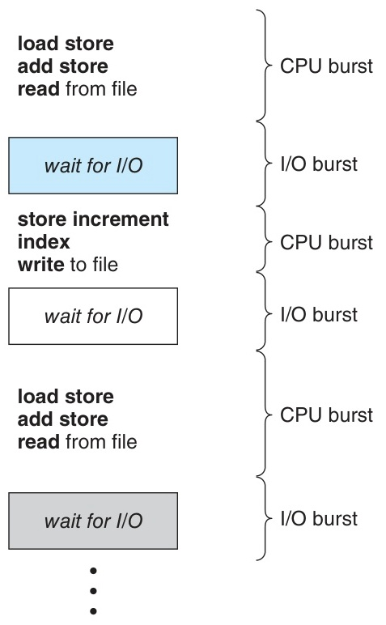
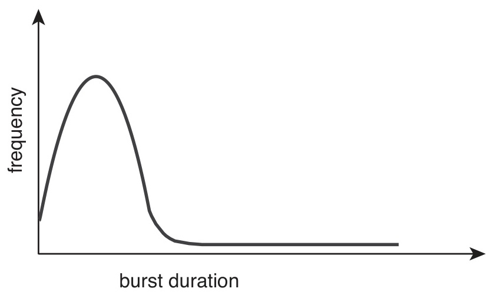
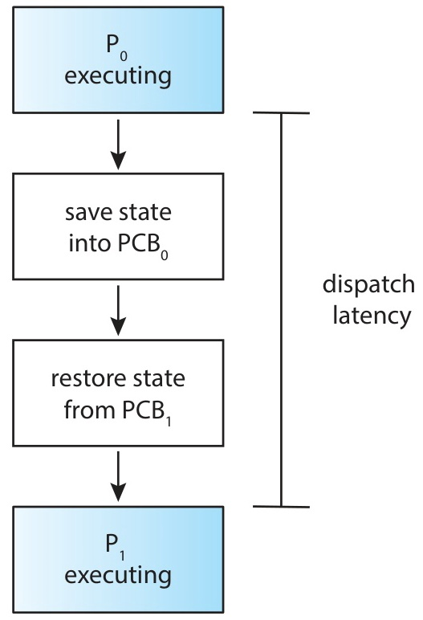
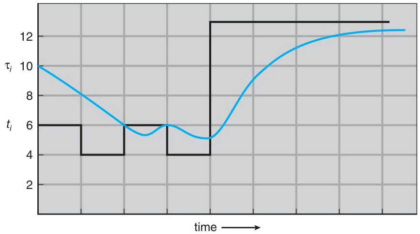
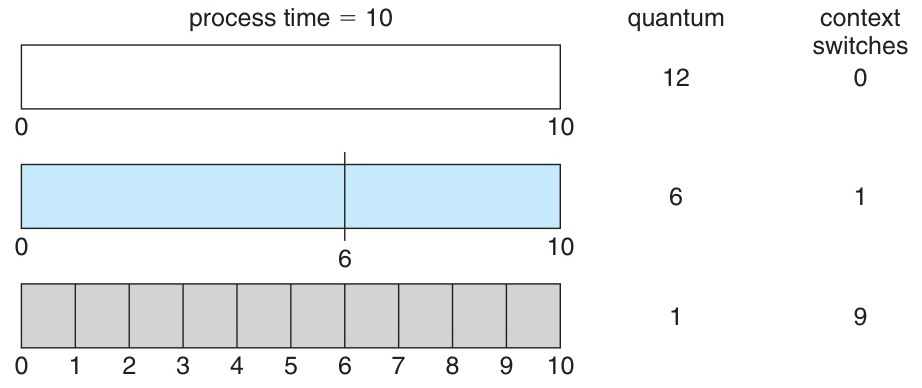
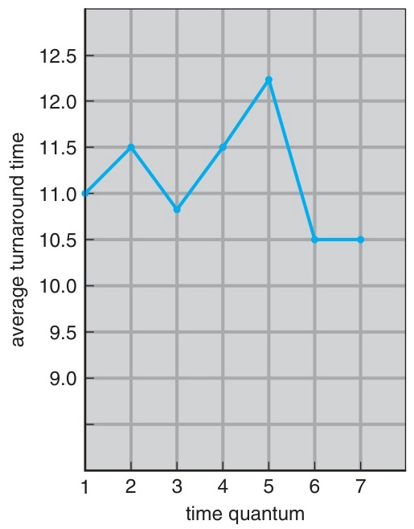

# 6주차 이론 — CPU 스케줄링 (1)

[레포지토리 안내](../../README.ko.md) | [English](Concepts_Lecture.md) | [한국어](Concepts_Lecture.ko.md)

> **최종 수정일:** 2026-10-20
>
> Operating System Concepts, Silberschatz, Galvin, and Gagne, Ch 5 (5.1-5.3)

> **학습 목표:**
> 1. CPU-I/O 버스트 사이클을 이해하고 스케줄링의 필요성을 설명할 수 있다
> 2. 선점형 스케줄링과 비선점형 스케줄링을 구분할 수 있다
> 3. 디스패처의 역할과 디스패치 지연을 설명할 수 있다
> 4. 5가지 스케줄링 기준을 나열하고 설명할 수 있다
> 5. FCFS, SJF, SRTF, RR 알고리즘을 이해하고 간트 차트를 그릴 수 있다
> 6. 지수 평균을 사용하여 CPU 버스트를 예측할 수 있다

---

## 목차

- [1. 기본 개념](#1-기본-개념)
  - [1.1 다중 프로그래밍과 CPU 스케줄링](#11-다중-프로그래밍과-cpu-스케줄링)
  - [1.2 CPU-I/O 버스트 사이클](#12-cpu-io-버스트-사이클)
  - [1.3 CPU 버스트 분포](#13-cpu-버스트-분포)
  - [1.4 I/O 바운드 vs CPU 바운드 프로세스](#14-io-바운드-vs-cpu-바운드-프로세스)
  - [1.5 CPU 스케줄러 (단기 스케줄러)](#15-cpu-스케줄러-단기-스케줄러)
  - [1.6 스케줄링이 발생하는 4가지 상황](#16-스케줄링이-발생하는-4가지-상황)
  - [1.7 비선점형 vs 선점형 스케줄링](#17-비선점형-vs-선점형-스케줄링)
  - [1.8 선점형 스케줄링의 문제점](#18-선점형-스케줄링의-문제점)
  - [1.9 디스패처](#19-디스패처)
  - [1.10 디스패치 지연](#110-디스패치-지연)
- [2. 스케줄링 기준](#2-스케줄링-기준)
  - [2.1 스케줄링 기준: 개요](#21-스케줄링-기준-개요)
  - [2.2 CPU 이용률과 처리량](#22-cpu-이용률과-처리량)
  - [2.3 반환 시간과 대기 시간](#23-반환-시간과-대기-시간)
  - [2.4 응답 시간](#24-응답-시간)
  - [2.5 스케줄링 기준: 요약](#25-스케줄링-기준-요약)
- [3. FCFS 스케줄링](#3-fcfs-스케줄링)
  - [3.1 FCFS (선입선처리)](#31-fcfs-선입선처리)
  - [3.2 FCFS: 예제 1 (도착 순서: P1, P2, P3)](#32-fcfs-예제-1-도착-순서-p1-p2-p3)
  - [3.3 FCFS: 예제 2 (도착 순서: P2, P3, P1)](#33-fcfs-예제-2-도착-순서-p2-p3-p1)
  - [3.4 FCFS: 호위 효과](#34-fcfs-호위-효과)
  - [3.5 FCFS: 특성 요약](#35-fcfs-특성-요약)
- [4. SJF 스케줄링](#4-sjf-스케줄링)
  - [4.1 SJF (최단 작업 우선)](#41-sjf-최단-작업-우선)
  - [4.2 SJF: 최적성 증명](#42-sjf-최적성-증명)
  - [4.3 SJF: 예제 (비선점형)](#43-sjf-예제-비선점형)
  - [4.4 다음 버스트 길이 예측](#44-다음-버스트-길이-예측)
  - [4.5 지수 평균: 공식](#45-지수-평균-공식)
  - [4.6 지수 평균: 전개](#46-지수-평균-전개)
  - [4.7 지수 평균: 계산 예제](#47-지수-평균-계산-예제)
  - [4.8 지수 평균: 알파 값 비교](#48-지수-평균-알파-값-비교)
- [5. SRTF: 선점형 SJF](#5-srtf-선점형-sjf)
  - [5.1 SRTF (최단 잔여 시간 우선)](#51-srtf-최단-잔여-시간-우선)
  - [5.2 SRTF: 단계별 예제](#52-srtf-단계별-예제)
  - [5.3 SRTF: 간트 차트와 계산](#53-srtf-간트-차트와-계산)
  - [5.4 SJF vs SRTF: 동일 데이터 비교](#54-sjf-vs-srtf-동일-데이터-비교)
- [6. 라운드 로빈 스케줄링](#6-라운드-로빈-스케줄링)
  - [6.1 라운드 로빈 (RR)](#61-라운드-로빈-rr)
  - [6.2 RR: 공정성 보장](#62-rr-공정성-보장)
  - [6.3 RR: 예제 (q = 4ms)](#63-rr-예제-q--4ms)
  - [6.4 RR: 타임 퀀텀이 너무 크거나 작을 때](#64-rr-타임-퀀텀이-너무-크거나-작을-때)
  - [6.5 RR: 타임 퀀텀과 반환 시간](#65-rr-타임-퀀텀과-반환-시간)
  - [6.6 RR: 상세 예제 (4개 프로세스)](#66-rr-상세-예제-4개-프로세스)
- [7. 알고리즘 비교](#7-알고리즘-비교)
  - [7.1 동일 데이터에 대한 세 알고리즘](#71-동일-데이터에-대한-세-알고리즘)
  - [7.2 종합 특성 비교](#72-종합-특성-비교)
- [8. 실습: 스케줄링 알고리즘 시뮬레이터](#8-실습-스케줄링-알고리즘-시뮬레이터)
  - [8.1 실습: 자료 구조](#81-실습-자료-구조)
  - [8.2 실습: FCFS 구현](#82-실습-fcfs-구현)
  - [8.3 실습: SJF 구현 (비선점형)](#83-실습-sjf-구현-비선점형)
  - [8.4 실습: RR 구현](#84-실습-rr-구현)
  - [8.5 실습: 테스트 및 결과 비교](#85-실습-테스트-및-결과-비교)
- [요약](#요약)
- [점검 문제](#점검-문제)

---

<br>

## 1. 기본 개념

### 1.1 다중 프로그래밍과 CPU 스케줄링

CPU 스케줄링의 핵심 아이디어는 CPU를 항상 바쁘게 유지하여 **이용률을 최대화**하는 것이다.

- 단일 CPU 코어 시스템에서는 한 번에 하나의 프로세스만 실행할 수 있다.
- 프로세스가 I/O를 기다리는 동안 CPU는 **유휴 상태**가 되어 낭비된다.
- **다중 프로그래밍(Multiprogramming)** 은 여러 프로세스를 메모리에 유지하고, 하나가 대기하면 다른 프로세스에 CPU를 할당한다.
- CPU 스케줄링은 운영체제의 **가장 근본적인 기능** 중 하나이다.

> **참고:** **비유.** CPU 스케줄링은 화구(CPU)가 하나인 레스토랑 주방에 비유할 수 있다. 셰프가 요리를 오븐에 넣고(I/O 버스트) 서서 기다리기만 하면 시간이 낭비된다. 좋은 주방 매니저(스케줄러)는 첫 번째 요리가 구워지는 동안 셰프에게 다른 요리를 준비하도록 배정한다(다른 프로세스의 CPU 버스트). 다중 프로그래밍은 화구가 항상 사용되도록 보장한다.

### 1.2 CPU-I/O 버스트 사이클

프로세스 실행은 **CPU 버스트**와 **I/O 버스트**가 번갈아 반복되는 사이클로 구성된다(그림 1, 교재 Figure 5.1).



*그림 1. CPU 버스트와 I/O 버스트가 번갈아 나타나는 실행 순서*

- **CPU 버스트**는 CPU가 명령어를 실행하는 구간이다.
- **I/O 버스트**는 프로세스가 I/O 완료를 기다리는 구간이다.
- 마지막 CPU 버스트에서 프로세스는 **시스템 콜을 통해 종료를 요청**한다.

```c
// 프로세스 실행 패턴 (의사코드)
while (process_not_terminated) {
    // === CPU 버스트 ===
    execute_instructions();   // load, store, add, ...

    // === I/O 버스트 ===
    request_io();             // 파일 읽기, 파일 쓰기, ...
    wait_for_io_completion(); // 블로킹
}
terminate();                  // 마지막 CPU 버스트 후 종료
```

- 모든 프로세스가 이 패턴을 따르지만 **버스트 길이와 빈도**가 다르다.
- 이 차이가 스케줄링 알고리즘을 선택하는 핵심 근거이다.

> **핵심:** CPU-I/O 버스트 사이클은 프로세스 실행의 근본적인 리듬이다. 모든 프로세스는 생각하기(CPU 버스트)와 대기하기(I/O 버스트)를 번갈아 한다. 스케줄링 알고리즘의 역할은 그 빈틈을 효율적으로 채우는 것이다. 한 프로세스가 I/O 버스트에 진입하면 다른 프로세스가 CPU 버스트를 시작할 준비가 되어 있어야 한다.

### 1.3 CPU 버스트 분포

CPU 버스트 길이의 분포는 **지수적 또는 초지수적(hyperexponential)** 감소 패턴을 따른다(그림 2, 교재 Figure 5.2). 초지수 분포는 평균이 같은 지수 분포보다 변동이 커서, 버스트가 짧은 쪽에 더 강하게 몰리면서도 드물게 매우 긴 버스트가 나타나는(꼬리가 두꺼운) 분포이다.

- **짧은 CPU 버스트**가 매우 빈번하여, 대부분의 버스트는 짧다.
- **긴 CPU 버스트**는 드물게 발생한다.



*그림 2. CPU 버스트 지속 시간의 히스토그램*

> **참고:** 이 분포는 SJF 같은 알고리즘의 설계를 정당화하므로 중요하다. 대부분의 버스트가 짧으므로 짧은 버스트를 우선하면 대부분의 프로세스가 빠르게 서비스되고, 드문 긴 버스트 프로세스만 더 오래 기다린다.

### 1.4 I/O 바운드 vs CPU 바운드 프로세스

CPU 버스트 분포에 따라 프로세스를 다음과 같이 분류한다.

| 범주 | I/O 바운드 프로세스 | CPU 바운드 프로세스 |
|------|---------------------|---------------------|
| CPU 버스트 | 많은 **짧은** 버스트 | 적은 **긴** 버스트 |
| I/O 버스트 | 빈번한 I/O 요청 | 드문 I/O 요청 |
| 예시 | 웹 서버, 데이터베이스 | 과학 계산, 비디오 인코딩 |
| 스케줄링 요구 | 빠른 응답 시간 | 긴 CPU 할당 시간 |

*표 1. I/O 바운드 프로세스와 CPU 바운드 프로세스의 비교*

- **스케줄링 알고리즘**은 두 유형을 모두 효율적으로 처리해야 한다.
- 이 분포 특성은 SJF와 RR 같은 알고리즘의 이론적 근거가 된다.

> **핵심:** 프로세스를 I/O 바운드와 CPU 바운드로 구분하면 스케줄링 알고리즘마다 유리한 워크로드가 다른 이유를 설명할 수 있다. FCFS는 CPU 바운드 프로세스에 유리하고(긴 무중단 실행을 얻는다), RR은 I/O 바운드 프로세스에 유리하다(빠르고 빈번한 CPU 접근을 얻는다).

### 1.5 CPU 스케줄러 (단기 스케줄러)

CPU가 유휴 상태가 되면 **준비 큐(ready queue)** 에서 다음에 실행할 프로세스를 선택한다.

```text
                  +------------+
  새 프로세스 --->   | 준비 큐     |  ---> CPU 스케줄러 ---> CPU
                  +------------+       선택 알고리즘
                         ^
                         |
                     I/O 완료 등
```

*그림 3. 준비 큐에서 CPU 스케줄러를 거쳐 CPU로 가는 프로세스 흐름*

- **CPU 스케줄러**는 단기 스케줄러(Short-term Scheduler)라고도 한다.
- 준비 큐는 반드시 FIFO일 필요가 없다.
  - FIFO 큐, **우선순위 큐**, 트리, 연결 리스트 등으로 구현할 수 있다.
- 큐의 레코드는 일반적으로 **PCB(프로세스 제어 블록)** 이다.
  - 2주차에서 다룬 PCB(프로세스 제어 블록)는 프로세스의 모든 상태 정보(레지스터, 프로그램 카운터, 우선순위 등)를 저장하여 문맥 교환 후 정확히 중단된 지점에서 재개할 수 있게 한다.
- 큐의 내부 순서는 스케줄링 알고리즘이 결정한다.

> **핵심:** 준비 큐는 이름과 달리 반드시 자료 구조 의미의 큐인 것은 아니다. 준비 큐는 실행 준비가 된 프로세스의 모음이며, 스케줄링 알고리즘이 그 모음의 정렬 방식을 결정한다. FCFS는 FIFO 큐를 사용하고, SJF는 버스트 길이로 정렬된 우선순위 큐를 사용한다. 이를 큐라고 부르는 것은 역사적 관례이다.

### 1.6 스케줄링이 발생하는 4가지 상황

CPU 스케줄링 결정이 필요한 **4가지 상황**은 다음과 같다.

| 번호 | 상태 전이 | 예시 | 선택 |
|------|----------|------|------|
| **1** | 실행 -> 대기 | I/O 요청, wait() 호출 | 선택 없음 |
| **2** | 실행 -> 준비 | 인터럽트 발생 (타이머 등) | **선택 있음** |
| **3** | 대기 -> 준비 | I/O 완료 | **선택 있음** |
| **4** | 종료 | 프로세스 종료 | 선택 없음 |

*표 2. CPU 스케줄링 결정이 일어나는 네 가지 상황*

- 상황 **1, 4**에서는 반드시 새 프로세스를 선택해야 하므로 스케줄링 여부를 고를 여지가 없다(선택 없음).
- 상황 **2, 3**에서는 스케줄링 방식에 따라 스케줄링 여부가 달라진다(선택 있음).

> **핵심:** 이 네 가지 상황을 이해해야 선점형과 비선점형 스케줄링의 차이를 이해할 수 있다. 상황 1과 4는 필수 스케줄링 지점으로, 실행 중인 프로세스가 더 이상 CPU를 사용할 수 없다. 상황 2와 3은 선택적이며, 선점형 시스템에서만 스케줄링 결정을 발생시킨다.

### 1.7 비선점형 vs 선점형 스케줄링

| 범주 | 비선점형 | 선점형 |
|------|---------|--------|
| 스케줄링 시점 | **1, 4**에서만 | **1, 2, 3, 4** (전부) |
| CPU 반환 | 프로세스가 **자발적**으로 반환 | OS가 **강제로** 회수 가능 |
| 다른 이름 | 협력적(Cooperative) 스케줄링 | - |
| 사용 | 초기 OS | **대부분의 현대 OS** |

*표 3. 비선점형 스케줄링과 선점형 스케줄링의 비교*

- **비선점형**에서는 프로세스가 자발적으로 CPU를 반환한다(종료 또는 I/O 대기).
- **선점형**에서는 OS가 타이머 인터럽트 등을 통해 강제로 CPU를 회수할 수 있다.
- Windows, macOS, Linux, UNIX는 모두 **선점형** 스케줄링을 사용한다.

> **핵심:** 비선점형은 상황 1, 4에서만, 선점형은 네 가지 상황 모두에서 스케줄링한다는 점이 두 방식을 가르는 기준이다. 비선점형을 협력적(cooperative) 스케줄링이라고도 부르는 이유는 프로세스가 자발적으로 CPU를 양보하며 협력하기 때문이다.

### 1.8 선점형 스케줄링의 문제점

선점형 스케줄링은 강력하지만 다음과 같은 **주의사항**이 있다.

**1. 경쟁 조건(Race Condition)**
- 공유 데이터를 수정하는 도중에 선점되면 다른 프로세스가 일관성 없는 데이터를 읽을 수 있다.
- 따라서 **동기화 메커니즘**(뮤텍스, 세마포어 등)이 필요하다(9주차에서 자세히 다룬다).

**경쟁 조건(Race Condition)** 은 두 프로세스가 공유 데이터를 동시에 읽고 쓸 때 발생하며, 데이터가 잘못된 상태로 남을 수 있다. **뮤텍스(Mutex, 상호 배제 락)** 는 한 번에 하나의 프로세스만 **임계 구역(Critical Section)**, 즉 공유 데이터에 접근하는 코드 부분에 진입하도록 하여 이를 방지한다.

**2. 커널 모드에서의 선점**
- 시스템 콜 안에서 커널 자료 구조를 수정하는 도중에 선점되면 커널이 불일치 상태가 될 수 있다.
- **비선점형 커널**은 시스템 콜이 끝날 때까지 문맥 교환을 미룬다(단순하지만 실시간 처리에 부적합하다).
- **선점형 커널**은 뮤텍스 락 등으로 커널 데이터를 보호한다(대부분의 현대 OS).

**3. 인터럽트 처리**
- 인터럽트는 언제든 발생할 수 있으므로 임계 구역에서는 인터럽트를 비활성화한다.

> **참고:** 이러한 문제들은 9주차의 동기화 주제로 이어진다. 핵심은 선점이 동시성 문제를 도입한다는 점이다. OS가 어느 시점에서든 프로세스를 중단할 수 있다면, 다른 프로세스가 읽을 때 공유 데이터가 일관성 없는 상태일 수 있다. 이것이 동기화 메커니즘이 존재하는 근본적인 이유이다.

### 1.9 디스패처

**디스패처(Dispatcher)** 는 스케줄러가 선택한 프로세스에 실제로 CPU 제어권을 넘겨주는 모듈이다.

디스패처는 다음 세 가지 역할을 한다(그림 4, 교재 Figure 5.3).
1. **문맥 교환**을 수행한다. 현재 프로세스의 상태를 저장하고 새 프로세스의 상태를 복원한다.
2. **사용자 모드**로 전환한다.
3. 새 프로세스의 적절한 위치로 점프한다. 이 위치는 PC(프로그램 카운터, 다음 명령어의 주소를 저장하는 레지스터)가 가리킨다.



*그림 4. 디스패처의 역할*

> **참고:** **스케줄러와 디스패처.** 스케줄러는 다음에 어떤 프로세스를 실행할지 **결정**하고, 디스패처는 그 결정을 **실행**한다. 스케줄러를 다음에 일할 직원을 고르는 관리자로, 디스패처를 실제 서류 작업과 사무실 재배정을 처리하는 인사 담당자로 생각할 수 있다. 둘은 책임이 다른 별개의 구성 요소이므로 이 구분이 중요하다.

### 1.10 디스패치 지연

**디스패치 지연(Dispatch Latency)** 은 디스패처가 한 프로세스를 중단하고 다른 프로세스를 시작하는 데 걸리는 시간이다.

- 모든 문맥 교환마다 발생하므로 **가능한 한 짧아야** 한다.

Linux에서는 다음 명령으로 문맥 교환 횟수를 확인할 수 있다.

```bash
# 시스템 전체 문맥 교환 횟수 (1초 간격, 3회)
vmstat 1 3

# 특정 프로세스의 문맥 교환 횟수
cat /proc/<PID>/status | grep ctxt
# voluntary_ctxt_switches:    150   (자발적: I/O 대기 등)
# nonvoluntary_ctxt_switches: 8     (비자발적: 타임 슬라이스 만료 등)
```

- **자발적 문맥 교환**은 프로세스가 지금 사용할 수 없는 자원을 기다리느라(I/O 대기 등) 스스로 CPU를 반환할 때 일어난다.
- **비자발적 문맥 교환**은 타임 슬라이스 만료 등으로 OS가 강제로 전환할 때 일어난다.

> **참고:** 현대 시스템에서 문맥 교환은 보통 1~10 마이크로초가 걸린다. 이는 미미해 보이지만 누적된다. 초당 수천 번의 문맥 교환을 수행하는 바쁜 서버는 디스패치 지연으로 상당한 CPU 시간을 잃을 수 있다. 이것이 라운드 로빈 스케줄링에서 타임 퀀텀을 신중하게 선택해야 하는 이유이다. 퀀텀이 너무 작으면 문맥 교환이 너무 많아진다.

---

<br>

## 2. 스케줄링 기준

### 2.1 스케줄링 기준: 개요

스케줄링 알고리즘을 **비교**하고 **평가**하기 위한 다섯 가지 기준은 다음과 같다.

| 기준 | 설명 | 최적화 방향 |
|------|------|------------|
| **CPU 이용률(CPU Utilization)** | CPU 사용률 (%) | **최대화** |
| **처리량(Throughput)** | 단위 시간당 완료된 프로세스 수 | **최대화** |
| **반환 시간(Turnaround Time)** | 제출에서 완료까지의 총 시간 | **최소화** |
| **대기 시간(Waiting Time)** | 준비 큐에서 대기한 총 시간 | **최소화** |
| **응답 시간(Response Time)** | 제출에서 첫 응답까지의 시간 | **최소화** |

*표 4. 다섯 가지 스케줄링 기준과 최적화 방향*

### 2.2 CPU 이용률과 처리량

**CPU 이용률**
- CPU가 유용한 작업을 수행하는 시간의 비율이다.
- 이론적 범위는 0%에서 100%이다.
- 실제 시스템에서는 가벼운 부하에서 약 **40%**, 높은 부하에서 약 **90%** 이다.
- Linux에서는 `top` 명령으로 확인할 수 있다.

**처리량**
- 단위 시간당 완료된 프로세스 수이다.
- 긴 프로세스는 몇 초에 하나씩 완료될 수 있다.
- 짧은 트랜잭션은 초당 수십 개가 완료될 수 있다.

- 목표는 두 기준을 모두 **최대화**하는 것이다.
- 두 기준은 서로 트레이드오프 관계일 수 있다(문맥 교환 오버헤드).

### 2.3 반환 시간과 대기 시간

**반환 시간(Turnaround Time)**
- 프로세스 **제출**부터 **완료**까지의 총 시간이다.
- 준비 큐 대기, CPU 실행, I/O 대기 시간의 합과 같다.

```text
반환 시간 = 완료 시각 - 도착 시각
```

**대기 시간(Waiting Time)**
- 준비 큐에서 **대기**한 총 시간이다.
- 스케줄링 알고리즘이 **직접 영향을 미치는** 유일한 시간이다.
- CPU 실행 시간과 I/O 시간은 알고리즘과 무관하다.

```text
대기 시간 = 반환 시간 - 버스트 시간
         (단일 버스트, I/O 없는 경우)
```

> **핵심:** 대기 시간은 스케줄링 알고리즘의 효과만 분리해 보여 주므로, 알고리즘을 비교할 때 가장 많이 사용하는 지표이다. 반환 시간에는 어떤 알고리즘을 사용하든 같은 CPU 실행 시간과 I/O 시간이 포함된다. 대기 시간은 스케줄링 결정으로 생긴 지연*만*을 포착한다.

### 2.4 응답 시간

**응답 시간(Response Time)**
- 프로세스 **제출**부터 **첫 응답이 생성되는** 순간까지의 시간이다.
- 대화형 시스템에서 가장 중요한 기준이다.

```text
응답 시간 = 첫 실행 시각 - 도착 시각
```

반환 시간과 응답 시간을 비교하면 다음과 같다.

| 비교 | 반환 시간 | 응답 시간 |
|------|----------|----------|
| 측정 구간 | 제출에서 **완료**까지 | 제출에서 **첫 응답**까지 |
| 중요한 시스템 | 배치 시스템 | **대화형** 시스템 |
| 예시 | 작업 완료까지 30초 | 첫 출력까지 0.5초 |

*표 5. 반환 시간과 응답 시간의 비교*

- 대화형 시스템에서는 응답 시간의 **분산을 최소화**하는 것이 중요하다.
- 응답 시간의 평균을 줄이는 것보다 **예측 가능한** 응답 시간이 사용자 만족도에 더 유리하다.

### 2.5 스케줄링 기준: 요약

```text
+----------------------------------+
|               최대화               |
|  +------------+  +------------+  |
|  |  CPU 이용률  |  |   처리량    |   |
|  +------------+  +------------+  |
+----------------------------------+
|               최소화               |
|  +------------+  +------------+  |
|  |  반환 시간   |  |   대기 시간   |  |
|  +------------+  +------------+  |
|  +------------+                  |
|  |  응답 시간   |                  |
|  +------------+                  |
+----------------------------------+
```

*그림 5. 최대화할 기준과 최소화할 기준*

- 대부분의 경우 **평균**을 최적화한다.
- 일부 경우에는 **최솟값**이나 **최댓값**을 최적화한다(예: 최대 응답 시간 최소화).

---

<br>

## 3. FCFS 스케줄링

### 3.1 FCFS (선입선처리)

FCFS(First-Come, First-Served)는 **가장 간단한** CPU 스케줄링 알고리즘으로, 프로세스를 **도착 순서**대로 실행한다.

- **FIFO 큐**로 구현한다.
- 프로세스가 준비 큐에 도착하면 **꼬리(tail)** 에 추가한다.
- CPU가 비면 **머리(head)** 의 프로세스에 CPU를 할당한다.
- **비선점형** 스케줄링이다.

```text
준비 큐 (FIFO):

  head ---> [ P1 ] ---> [ P2 ] ---> [ P3 ] <--- tail
              |
              v
           CPU 할당
```

*그림 6. FIFO 준비 큐에서 머리의 프로세스에 CPU를 할당하는 구조*

### 3.2 FCFS: 예제 1 (도착 순서: P1, P2, P3)

프로세스는 P1, P2, P3 순서로 도착하며, 모두 시각 0에 도착한다.

| 프로세스 | 버스트 시간 |
|---------|-----------|
| P1 | 24 ms |
| P2 | 3 ms |
| P3 | 3 ms |

*표 6. FCFS 예제의 프로세스와 버스트 시간*

스케줄링에서 **간트 차트(Gantt Chart)** 는 각 막대가 주어진 시간 간격 동안 어떤 프로세스가 CPU를 사용하는지 보여 주는 수평 막대 다이어그램이다. 하단의 숫자는 시각을 나타낸다.

```text
간트 차트
+-------------------------+----+----+
|            P1           | P2 | P3 |
+-------------------------+----+----+
0                         24   27   30
```

*그림 7. 도착 순서가 P1, P2, P3인 FCFS의 간트 차트*

| 프로세스 | 대기 시간 | 반환 시간 |
|---------|----------|----------|
| P1 | 0 | 24 |
| P2 | 24 | 27 |
| P3 | 27 | 30 |
| **평균** | **(0+24+27)/3 = 17** | **(24+27+30)/3 = 27** |

*표 7. 도착 순서가 P1, P2, P3일 때의 대기 시간과 반환 시간*

### 3.3 FCFS: 예제 2 (도착 순서: P2, P3, P1)

같은 프로세스가 P2, P3, P1 순서로 도착하는 경우는 다음과 같다.

```text
간트 차트:
+----+----+-------------------------+
| P2 | P3 |            P1           |
+----+----+-------------------------+
0    3    6                         30
```

*그림 8. 도착 순서가 P2, P3, P1인 FCFS의 간트 차트*

| 프로세스 | 대기 시간 | 반환 시간 |
|---------|----------|----------|
| P1 | 6 | 30 |
| P2 | 0 | 3 |
| P3 | 3 | 6 |
| **평균** | **(6+0+3)/3 = 3** | **(30+3+6)/3 = 13** |

*표 8. 도착 순서가 P2, P3, P1일 때의 대기 시간과 반환 시간*

- 순서만 바꿨는데 평균 대기 시간이 **17에서 3으로** 극적으로 감소한다.
- FCFS 성능은 도착 순서에 따라 **크게 변한다**.

### 3.4 FCFS: 호위 효과

**호위 효과(Convoy Effect)** 는 긴 CPU 버스트를 가진 단일 프로세스 뒤에 짧은 프로세스들이 줄을 서는 현상이다.

```text
시나리오: 1개의 CPU 바운드 프로세스 + 여러 I/O 바운드 프로세스

시간 ->  ==========================================================>

CPU:  [ CPU 바운드 (긴 버스트) ............][ I/O-1 ][ I/O-2 ][ I/O-3 ]
I/O:  [    유휴 (I/O 장치가 놀고 있음)      ][  사용  ][  사용  ][  사용  ]
                                       ^
                                       |
                               I/O 바운드 프로세스들이
                               CPU 바운드 뒤에서 대기
```

*그림 9. CPU 바운드 프로세스 하나가 I/O 바운드 프로세스들을 지연시키는 호위 효과*

- CPU 바운드 프로세스가 CPU를 독점하면 I/O 바운드 프로세스들은 준비 큐에서 대기한다.
- 그동안 **I/O 장치는 유휴 상태**이므로 CPU와 I/O 장치 모두 **이용률이 떨어진다**.
- 단일 프로세스가 장시간 CPU를 독점할 수 있으므로 **대화형 시스템에 부적합**하다.

> **참고:** **비유.** 호위 효과는 단일 차선 도로의 느린 트럭에 비유된다. 모든 빠른 자동차(짧은 프로세스)가 그 뒤에서 기다려야 한다. 스케줄링 관점에서는 CPU와 I/O 장치가 모두 과소 활용된다. I/O 바운드 프로세스가 CPU를 기다리는 동안 I/O 장치는 놀고, 나중에 모든 I/O 바운드 프로세스가 동시에 I/O를 할 때는 CPU가 논다.

### 3.5 FCFS: 특성 요약

| 특성 | 설명 |
|------|------|
| 유형 | **비선점형** |
| 구현 | FIFO 큐, 매우 간단 |
| 평균 대기 시간 | 일반적으로 **길다** (최적이 아님) |
| 호위 효과 | **발생** (CPU 바운드가 I/O 바운드를 차단) |
| 대화형 적합성 | **부적합** (일정 간격으로 CPU를 분배할 수 없음) |
| 장점 | 구현이 간단하고 이해하기 쉬움 |
| 단점 | 성능이 도착 순서에 크게 의존 |

*표 9. FCFS의 특성*

---

<br>

## 4. SJF 스케줄링

### 4.1 SJF (최단 작업 우선)

SJF(Shortest-Job-First)는 **다음 CPU 버스트가 가장 짧은** 프로세스를 먼저 선택한다.

- 더 정확한 이름은 **최단 다음 CPU 버스트(Shortest-Next-CPU-Burst)** 알고리즘이다.
- 버스트 길이가 같으면 **FCFS**로 순서를 결정한다.
- 비선점형과 선점형 버전이 모두 존재한다.

**핵심 속성**: SJF는 주어진 프로세스 집합에 대해 **최소 평균 대기 시간**을 보장하므로 **최적(Optimal)** 이다.

**근본적 문제**: 다음 CPU 버스트 길이를 **정확히 알 수 없다**.

### 4.2 SJF: 최적성 증명

**왜 SJF가 최적인가?**

```text
경우 1: 긴 것 먼저 (버스트: 10, 3)
+-----------+----+
|   P1(10)  | P2 |   P1 대기=0, P2 대기=10  -> 평균 = 5
+-----------+----+
0           10   13

경우 2: 짧은 것 먼저 (버스트: 3, 10)  <- SJF
+----+-----------+
| P2 |   P1(10)  |   P2 대기=0, P1 대기=3   -> 평균 = 1.5
+----+-----------+
0    3           13
```

*그림 10. 긴 작업을 먼저 실행할 때와 짧은 작업을 먼저 실행할 때의 대기 시간 비교*

- **짧은 프로세스**를 앞으로 옮기면 그 프로세스의 대기 시간이 **크게 감소**한다.
- **긴 프로세스의** 대기 시간은 **약간 증가**한다.
- 결과적으로 전체 평균 대기 시간이 **감소**한다.
- 이를 일반화하면 SJF가 **증명 가능하게 최적**임을 보일 수 있다.

> **[알고리즘]** 증명은 교환 논증(Exchange Argument)을 사용한다. SJF 순서가 아닌 어떤 스케줄에서도 긴 작업이 짧은 작업 바로 앞에 오는 인접 쌍을 찾을 수 있다. 그 둘을 교환하면 다른 작업의 대기 시간에는 영향을 주지 않으면서 총 대기 시간이 줄어든다. 이러한 교환을 반복하면 결국 SJF 순서가 된다. 이는 버스트 시간 순으로 정렬하면 총 완료 시간이 최소화된다는 정렬 논법과 동등하다.

### 4.3 SJF: 예제 (비선점형)

모든 프로세스가 시각 0에 도착하는 비선점형 SJF 예제는 다음과 같다.

| 프로세스 | 버스트 시간 |
|---------|-----------|
| P1 | 6 ms |
| P2 | 8 ms |
| P3 | 7 ms |
| P4 | 3 ms |

*표 10. 비선점형 SJF 예제의 프로세스와 버스트 시간*

```text
간트 차트 (SJF 순서: P4 -> P1 -> P3 -> P2):
+----+--------+----------+------------+
| P4 |   P1   |    P3    |     P2     |
+----+--------+----------+------------+
0    3        9         16            24
```

*그림 11. 비선점형 SJF의 간트 차트*

| 프로세스 | 대기 시간 |
|---------|----------|
| P1 | 3 |
| P2 | 16 |
| P3 | 9 |
| P4 | 0 |
| **평균** | **(3+16+9+0)/4 = 7** |

*표 11. 비선점형 SJF의 대기 시간*

같은 프로세스를 FCFS(P1, P2, P3, P4 순서)로 실행하면 평균 대기 시간은 (0+6+14+21)/4 = **10.25**이다.

### 4.4 다음 버스트 길이 예측

SJF는 **최적**이지만 CPU 스케줄링 수준에서 그대로 구현할 수 없다. **다음 CPU 버스트 길이를 알 수 없기** 때문이다.

해결책은 과거 버스트 이력을 기반으로 다음 버스트를 **예측**하는 것이다.

- 과거 CPU 버스트는 비슷한 길이로 반복되는 경향이 있다.
- 예측에는 **지수 평균(Exponential Averaging)** 을 사용한다.

### 4.5 지수 평균: 공식

핵심 아이디어는 가장 최근 관측된 버스트와 이전 예측값 사이의 **가중 평균**을 구하는 것이다. 이렇게 하면 과거 이력도 최신 측정값도 완전히 무시되지 않는다.

다음 CPU 버스트를 예측하는 공식은 다음과 같다.

```text
tau(n+1) = alpha * t(n) + (1 - alpha) * tau(n)
```

| 기호 | 의미 |
|------|------|
| `t(n)` | n번째 **실제** CPU 버스트 길이 (가장 최근 관측값) |
| `tau(n)` | n번째 **예측값** (이전 예측) |
| `tau(n+1)` | 다음 CPU 버스트 **예측값** |
| `alpha` | 가중치 (0 <= alpha <= 1) |

*표 12. 지수 평균 공식의 기호*

**alpha에 따른 특성:**

| alpha 값 | 의미 |
|----------|------|
| alpha = 0 | `tau(n+1) = tau(n)`: 최근 관측을 무시하고 과거 예측만 사용 |
| alpha = 1 | `tau(n+1) = t(n)`: 마지막 관측만 사용하고 과거 예측은 무시 |
| alpha = 1/2 | 최근 값과 과거 값의 **균형** (일반적인 선택) |

*표 13. alpha 값에 따른 예측의 특성*

### 4.6 지수 평균: 전개

공식을 반복 대입으로 전개하면 다음과 같다.

```text
tau(n+1) = alpha * t(n)
         + (1-alpha) * alpha * t(n-1)
         + (1-alpha)^2 * alpha * t(n-2)
         + ...
         + (1-alpha)^j * alpha * t(n-j)
         + ...
         + (1-alpha)^(n+1) * tau(0)
```

- 0 < alpha < 1이면 **(1 - alpha)** 도 0과 1 사이의 값이므로 과거로 갈수록 가중치가 **지수적으로 감소**한다.
- 가장 최근 관측값이 예측에 **가장 큰 영향**을 미친다.
- 가중치가 지수적으로 감쇠하므로 **지수 평균**이라는 이름이 붙었다.

> **[확률및통계]** 지수 평균은 신호 처리와 시계열 분석에서 널리 사용되는 지수 가중 이동 평균(EWMA)을 CPU 버스트 예측에 적용한 것이다. 매개변수 alpha는 추정기의 기억 길이를 제어한다. alpha가 높으면 기억이 짧아 변화에 빠르게 반응하고, alpha가 낮으면 기억이 길어 예측이 더 안정적이다. 네트워킹에서 TCP는 왕복 시간을 추정할 때 유사한 접근법을 사용한다.

### 4.7 지수 평균: 계산 예제

alpha = 0.5, tau(0) = 10으로 시작하면 예측값은 표 14와 같고, 이를 그래프로 나타내면 그림 12(교재 Figure 5.4)와 같다.

| n | t(n) | tau(n) | 계산 |
|---|------|--------|------|
| 0 | 6 | **10** | 초기값 |
| 1 | 4 | **8** | 0.5*6 + 0.5*10 |
| 2 | 6 | **6** | 0.5*4 + 0.5*8 |
| 3 | 4 | **6** | 0.5*6 + 0.5*6 |
| 4 | 13 | **5** | 0.5*4 + 0.5*6 |
| 5 | 13 | **9** | 0.5*13 + 0.5*5 |
| 6 | 13 | **11** | 0.5*13 + 0.5*9 |
| 7 | - | **12** | 0.5*13 + 0.5*11 |

*표 14. alpha = 0.5, tau(0) = 10일 때의 지수 평균 계산*



*그림 12. 실제 CPU 버스트와 지수 평균 예측값의 변화*

- 실제 버스트가 갑자기 변해도 예측값은 점진적으로 따라간다.
- 같은 값이 연속으로 반복되면 예측이 그 값으로 수렴한다.

### 4.8 지수 평균: 알파 값 비교

같은 버스트 시퀀스(tau(0) = 10, 버스트 = [6, 4, 6])에 대해 alpha를 달리하면 예측값이 다음과 같이 달라진다.

```text
               alpha = 0.2    alpha = 0.5    alpha = 0.8
tau(0) = 10        10             10             10
t(0) = 6
tau(1)             9.2            8.0            6.8
t(1) = 4
tau(2)             8.16           6.0            4.56
t(2) = 6
tau(3)             7.73           6.0            5.71
```

- **alpha가 작을 때**는 예측값이 **느리게** 변한다(이력에 더 의존한다).
- **alpha가 클 때**는 예측값이 최근 값에 **빠르게 반응**한다.
- 실무에서는 **alpha = 0.5** 근처 값이 일반적으로 사용된다.

---

<br>

## 5. SRTF: 선점형 SJF

### 5.1 SRTF (최단 잔여 시간 우선)

SRTF(Shortest-Remaining-Time-First)는 **SJF의 선점형 버전**이다.

작동 방식은 다음과 같다.
- 새 프로세스가 도착할 **때마다 비교**를 수행한다.
- 새 프로세스의 버스트가 현재 프로세스의 **잔여 버스트**보다 짧으면 **선점(교체)** 한다.
- 그렇지 않으면 현재 프로세스가 계속 실행된다.

| 비교 | SJF (비선점형) | SRTF (선점형) |
|------|---------------|--------------|
| 비교 시점 | CPU가 비었을 때만 | 새 프로세스가 도착할 **때마다** |
| 비교 대상 | 전체 버스트 길이 | **잔여** 버스트 길이 |
| 선점 | 없음 | 있음 |

*표 15. 비선점형 SJF와 SRTF의 비교*

### 5.2 SRTF: 단계별 예제

| 프로세스 | 도착 시각 | 버스트 시간 |
|---------|----------|-----------|
| P1 | 0 | 8 |
| P2 | 1 | 4 |
| P3 | 2 | 9 |
| P4 | 3 | 5 |

*표 16. SRTF 예제의 도착 시각과 버스트 시간*

**시각 0**: P1만 도착했으므로 P1이 실행을 시작한다(잔여 8).

**시각 1**: P2가 도착한다(버스트 4). P1의 잔여 7보다 짧으므로(4 < 7) **P1을 선점하고 P2를 실행**한다.

**시각 2**: P3이 도착한다(버스트 9). P2의 잔여 3보다 길므로(9 > 3) **P2가 계속 실행**된다.

**시각 3**: P4가 도착한다(버스트 5). P2의 잔여 2보다 길므로(5 > 2) **P2가 계속 실행**된다.

**시각 5**: P2가 완료된다. 준비 상태인 P1(잔여 7), P3(9), P4(5) 중 가장 짧은 **P4를 선택**한다.

**시각 10**: P4가 완료된다. P1(잔여 7)과 P3(9) 중 **P1을 선택**한다.

**시각 17**: P1이 완료된다. 남은 **P3을 선택**한다(9).

**시각 26**: P3이 완료되어 모든 프로세스가 종료된다.

> **핵심:** SRTF 스케줄은 새 프로세스가 도착할 때마다 선점 여부를 확인하여 구한다. 도착 시점의 비교는 새 프로세스의 *전체* 버스트와 현재 프로세스의 *잔여* 버스트 사이에서 이루어진다. 새 프로세스가 도착하지 않는 동안에는 현재 프로세스가 완료될 때까지 계속 실행되고, 완료되면 준비 상태인 프로세스 중 잔여 버스트가 가장 짧은 프로세스를 고른다.

### 5.3 SRTF: 간트 차트와 계산

```text
간트 차트:
+----+----------+------------+-----------------+--------------------+
| P1 |    P2    |     P4     |       P1        |         P3         |
+----+----------+------------+-----------------+--------------------+
0    1          5            10                17                   26
```

*그림 13. SRTF의 간트 차트*

| 프로세스 | 도착 | 버스트 | 완료 | 반환 시간 | 대기 시간 |
|---------|------|-------|------|----------|----------|
| P1 | 0 | 8 | 17 | 17-0 = 17 | 17-8 = **9** |
| P2 | 1 | 4 | 5 | 5-1 = 4 | 4-4 = **0** |
| P3 | 2 | 9 | 26 | 26-2 = 24 | 24-9 = **15** |
| P4 | 3 | 5 | 10 | 10-3 = 7 | 7-5 = **2** |

*표 17. SRTF의 완료 시각, 반환 시간, 대기 시간*

```text
평균 대기 시간    = (9 + 0 + 15 + 2) / 4 = 26/4 = 6.5 ms
평균 반환 시간    = (17 + 4 + 24 + 7) / 4 = 52/4 = 13.0 ms
```

### 5.4 SJF vs SRTF: 동일 데이터 비교

같은 데이터(P1: 0, 8 / P2: 1, 4 / P3: 2, 9 / P4: 3, 5)를 비선점형 SJF로 스케줄링하면 다음과 같다.

```text
비선점형 SJF:
+------------------+----------+------------+--------------------+
|        P1        |    P2    |     P4     |         P3         |
+------------------+----------+------------+--------------------+
0                  8         12           17                   26
```

*그림 14. 같은 데이터에 대한 비선점형 SJF의 간트 차트*

| 알고리즘 | P1 대기 | P2 대기 | P3 대기 | P4 대기 | **평균** |
|---------|--------|--------|--------|--------|---------|
| **SJF** | 0 | 7 | 15 | 9 | **7.75** |
| **SRTF** | 9 | 0 | 15 | 2 | **6.5** |

*표 18. 비선점형 SJF와 SRTF의 대기 시간 비교*

- SRTF가 평균 대기 시간에서 **우수**하다(6.5 < 7.75).
- 선점을 통해 짧은 프로세스를 더 빠르게 처리할 수 있다.

---

<br>

## 6. 라운드 로빈 스케줄링

### 6.1 라운드 로빈 (RR)

라운드 로빈(Round-Robin)은 각 프로세스에 **고정된 타임 퀀텀(q)** 을 할당하고 순환하며 실행한다.

1. 준비 큐를 **원형 큐**로 관리한다.
2. 각 프로세스는 최대 **q 시간 단위** 동안 CPU를 사용한다.
3. q 시간이 지나도 실행 중이면 **선점**되어 준비 큐의 **끝**으로 이동한다.
4. CPU 버스트가 q보다 짧으면 프로세스가 자발적으로 CPU를 반환한다.

- **선점형** 스케줄링이다.
- 본질적으로 **선점**이 추가된 FCFS이다.

> **참고:** **비유.** 라운드 로빈은 스케줄링에서 차례로 돌아가며 하는 방식이다. 학생들이 5분씩 돌아가며 발표하듯이, 프로세스들은 q 시간 단위씩 돌아가며 CPU를 사용한다. 어떤 프로세스도 CPU를 독점할 수 없고, 모든 프로세스가 공정한 몫을 받는다. 이 때문에 RR은 데스크톱과 서버 같은 대화형 시스템에 자연스러운 선택이다.

### 6.2 RR: 공정성 보장

프로세스가 n개이고 타임 퀀텀이 q일 때 다음이 성립한다.

```text
각 프로세스는 CPU 시간의 1/n을 받는다 (최대 q 단위의 청크로)

최대 대기 시간: (n - 1) * q

예시: n = 5, q = 20ms
-> 각 프로세스가 100ms마다 최대 20ms의 CPU를 받음
-> 다시 CPU를 받기까지 최대 80ms 대기
```

- 어떤 프로세스도 **(n-1) * q** 이상 대기하지 않는다.
- **응답 시간**을 보장하는 데 유리하다.
- 모든 프로세스에 CPU를 **공정하게** 할당한다.

### 6.3 RR: 예제 (q = 4ms)

모든 프로세스가 시각 0에 도착하고 타임 퀀텀은 4ms이다.

| 프로세스 | 버스트 시간 |
|---------|-----------|
| P1 | 24 ms |
| P2 | 3 ms |
| P3 | 3 ms |

*표 19. q = 4ms인 RR 예제의 프로세스와 버스트 시간*

```text
간트 차트:
+------+----+----+------+------+------+------+------+
|  P1  | P2 | P3 |  P1  |  P1  |  P1  |  P1  |  P1  |
+------+----+----+------+------+------+------+------+
0      4    7    10     14     18     22     26     30
```

*그림 15. q = 4ms인 RR의 간트 차트*

- P1은 4ms 실행 후 선점되고, P2는 3ms(< q) 실행 후 자발적으로 CPU를 반환하며, P3도 3ms 실행 후 반환한다. 이후 P1이 반복 실행된다.

| 프로세스 | 실행 구간 | 대기 시간 | 반환 시간 |
|---------|----------|----------|----------|
| P1 | 0\~4, 10\~14, 14\~18, 18\~22, 22\~26, 26\~30 | 10-4 = **6** | **30** |
| P2 | 4~7 | **4** | **7** |
| P3 | 7~10 | **7** | **10** |

*표 20. q = 4ms인 RR의 실행 구간, 대기 시간, 반환 시간*

```text
평균 대기 시간 = (6 + 4 + 7) / 3 = 17/3 = 5.67 ms
```

- FCFS(P1, P2, P3 순서)의 평균 대기 시간은 **17 ms**이다.
- RR(q = 4)의 평균 대기 시간은 **5.67 ms**로 크게 개선된다.

### 6.4 RR: 타임 퀀텀이 너무 크거나 작을 때

**q가 매우 클 때**(모든 버스트보다 클 때)는 다음과 같다.

```text
q = 100일 때 (모든 버스트 < 100):
+----------------------------+-----+-----+
|            P1(24)          |P2(3)|P3(3)|
+----------------------------+-----+-----+
0                            24    27    30

-> FCFS와 완전히 동일하게 동작!
-> 선점이 절대 발생하지 않음
```

*그림 16. q = 100인 RR의 간트 차트*

- 타임 퀀텀이 **모든 CPU 버스트보다 크면** RR은 FCFS와 같아진다.
- 응답 시간 개선 효과가 사라진다.

**q가 매우 작을 때**(예: q = 1ms)는 문맥 교환이 늘어난다. 그림 17(교재 Figure 5.5)처럼 처리 시간이 10인 프로세스는 퀀텀이 12이면 문맥 교환이 0번, 6이면 1번, 1이면 9번 일어난다.



*그림 17. 타임 퀀텀이 작을수록 문맥 교환이 늘어나는 모습*

- 문맥 교환 횟수가 **급격히 증가**하여 오버헤드가 커진다.
- 문맥 교환 시간이 퀀텀의 약 10%이면 CPU 시간의 약 10%가 문맥 교환에 쓰이므로 **비효율적**이다.
- 실제 시스템에서 문맥 교환은 **10 μs** 미만, 퀀텀은 **10~100 ms**이다.

### 6.5 RR: 타임 퀀텀과 반환 시간

q가 반환 시간에 미치는 영향은 그림 18(교재 Figure 5.6)과 같다. 이 그래프는 버스트가 6, 3, 1, 7인 프로세스 4개의 평균 반환 시간을 q = 1에서 7까지 나타낸다. 평균 반환 시간은 q = 1에서 11.0, q = 5에서 12.25이고, q가 6 이상이면 10.5가 된다. q가 7 이상이면 모든 버스트가 한 퀀텀 안에 끝나고, q = 6에서는 버스트가 7인 프로세스만 한 번 더 실행되지만 그 프로세스가 마지막에 끝나므로 평균이 같다.



*그림 18. 타임 퀀텀에 따른 평균 반환 시간의 변화*

**경험 법칙(Rule of Thumb)** 은 다음과 같다.
- 이상적으로는 CPU 버스트의 **80%** 가 타임 퀀텀 안에 끝나야 한다.
- q가 너무 작으면 문맥 교환 오버헤드로 반환 시간이 악화된다.
- q가 너무 크면 FCFS처럼 동작하여 응답 시간이 악화된다.
- 따라서 적절한 q를 선택하는 것이 **매우 중요**하다.

> **핵심:** 80% 규칙은 타임 퀀텀을 정하는 핵심 경험 법칙이다. 타임 퀀텀은 대부분의 프로세스가 한 퀀텀 안에 CPU 버스트를 끝낼 수 있을 만큼 커야 하고(불필요한 선점 방지), 긴 버스트 프로세스가 CPU를 독점하지 않을 만큼 작아야 한다. 실제 시스템에서 일반적인 값은 10~100 ms이다.

### 6.6 RR: 상세 예제 (4개 프로세스)

q = 3ms이고 모든 프로세스가 시각 0에 도착한다.

| 프로세스 | 버스트 시간 |
|---------|-----------|
| P1 | 8 ms |
| P2 | 5 ms |
| P3 | 3 ms |
| P4 | 6 ms |

*표 21. q = 3ms인 RR 상세 예제의 프로세스와 버스트 시간*

```text
간트 차트 (q = 3):
+-----+-----+-----+-----+-----+-----+-----+----+
| P1  | P2  | P3  | P4  | P1  | P2  | P4  | P1 |
+-----+-----+-----+-----+-----+-----+-----+----+
0     3     6     9     12    15    17    20   22
```

*그림 19. q = 3인 RR의 간트 차트*

- P3은 버스트가 3으로 q와 같으므로 한 턴에 완료된다.
- P2는 버스트가 5이므로 두 턴에 완료된다(3 + 2).
- P4는 버스트가 6이므로 두 턴에 완료된다(3 + 3).
- P1은 버스트가 8이므로 세 턴에 완료된다(3 + 3 + 2).

| 프로세스 | 버스트 | 완료 | 반환 시간 | 대기 시간 |
|---------|-------|------|----------|----------|
| P1 | 8 | 22 | 22 | **14** |
| P2 | 5 | 17 | 17 | **12** |
| P3 | 3 | 9 | 9 | **6** |
| P4 | 6 | 20 | 20 | **14** |

*표 22. q = 3인 RR의 완료 시각, 반환 시간, 대기 시간*

```text
평균 대기 시간    = (14 + 12 + 6 + 14) / 4 = 46/4 = 11.5 ms
평균 반환 시간    = (22 + 17 + 9 + 20) / 4 = 68/4 = 17.0 ms
```

- RR은 SJF보다 평균 반환 시간이 길지만 **응답 시간은 우수**하다.
- 모든 프로세스가 비교적 **공정하게** CPU를 사용한다.

---

<br>

## 7. 알고리즘 비교

### 7.1 동일 데이터에 대한 세 알고리즘

데이터는 P1(0,24), P2(0,3), P3(0,3)이며 모두 시각 0에 도착한다. 모든 프로세스가 동시에 도착하면 이후 도착이 선점을 일으킬 일이 없으므로 SRTF는 SJF와 같은 결과를 낸다.

| 알고리즘 | P1 대기 | P2 대기 | P3 대기 | **평균 WT** | 비고 |
|---------|--------|--------|--------|-----------|------|
| FCFS (P1->P2->P3) | 0 | 24 | 27 | **17.0** | 최악의 경우 |
| FCFS (P2->P3->P1) | 6 | 0 | 3 | **3.0** | 순서 의존적 |
| SJF | 6 | 0 | 3 | **3.0** | 최적 |
| RR (q=4) | 6 | 4 | 7 | **5.67** | 공정성 |

*표 23. 같은 데이터에 대한 FCFS, SJF, RR의 대기 시간*

- **SJF**는 평균 대기 시간에서 최적이다.
- **RR**은 응답 시간 면에서 유리하다.
- **FCFS**는 도착 순서에 따라 성능 변동이 크다.

### 7.2 종합 특성 비교

| 특성 | FCFS | SJF | SRTF | RR |
|------|------|-----|------|-----|
| 선점 | 아니오 | 아니오 | **예** | **예** |
| 최적 WT | 아니오 | **예** | **예** (선점형) | 아니오 |
| 기아* | 아니오 | 가능 | 가능 | **아니오** |
| 응답 시간 | 나쁨 | 보통 | 보통 | **우수** |
| 구현 복잡도 | 매우 간단 | 버스트 예측 필요 | 버스트 예측 필요 | 타이머 필요 |
| 호위 효과 | **발생** | 없음 | 없음 | 없음 |

*표 24. FCFS, SJF, SRTF, RR의 종합 특성 비교*

**기아(Starvation)** 란 우선순위가 높거나 더 짧은 프로세스가 계속 도착하여 항상 먼저 스케줄링되기 때문에 어떤 프로세스가 무기한 대기하는 것을 말한다.

> **핵심:** 이 표는 네 알고리즘의 트레이드오프를 보여 준다. SJF와 SRTF는 대기 시간에서 최적이지만 기아(starvation)를 유발할 수 있다(짧은 프로세스가 계속 도착하면 긴 프로세스가 무한정 대기할 수 있다). RR은 기아를 방지하고 응답 시간이 우수하지만 평균 대기 시간이 더 길다. FCFS는 간단하지만 전반적인 특성이 가장 나쁘다. 이러한 트레이드오프가 7주차의 더 고급 알고리즘(우선순위 스케줄링, Multilevel Queue)의 동기가 된다.

---

<br>

## 8. 실습: 스케줄링 알고리즘 시뮬레이터

### 8.1 실습: 자료 구조

```python
class Process:
    def __init__(self, pid, arrival, burst):
        self.pid = pid
        self.arrival = arrival
        self.burst = burst
        self.remaining = burst    # SRTF, RR에서 사용
        self.completion = 0
        self.waiting = 0
        self.turnaround = 0
        self.first_run = -1       # 응답 시간 계산용

def print_gantt(timeline):
    """timeline: [(pid, start, end), ...]"""
    header = "|"
    footer = ""
    for pid, start, end in timeline:
        width = max(len(f" P{pid} "), end - start)
        header += f" P{pid} ".center(width) + "|"
    print(header)
    # 시간 표시
    print("0", end="")
    for pid, start, end in timeline:
        print(f"{'':>{end - start + 2}}{end}", end="")
    print()
```

### 8.2 실습: FCFS 구현

```python
def fcfs(processes):
    """선입선처리 스케줄링"""
    # 도착 순서로 정렬
    procs = sorted(processes, key=lambda p: p.arrival)
    time = 0
    timeline = []

    for p in procs:
        if time < p.arrival:
            time = p.arrival  # CPU 유휴

        start = time
        time += p.burst
        p.completion = time
        p.turnaround = p.completion - p.arrival
        p.waiting = p.turnaround - p.burst
        timeline.append((p.pid, start, time))

    return timeline

# 테스트
procs = [Process(1,0,24), Process(2,0,3), Process(3,0,3)]
fcfs(procs)
# -> 평균 대기 시간 = 17.0
```

### 8.3 실습: SJF 구현 (비선점형)

```python
def sjf(processes):
    """최단 작업 우선 (비선점형)"""
    procs = [p for p in processes]  # 복사
    n = len(procs)
    completed = 0
    time = 0
    done = [False] * n
    timeline = []

    while completed < n:
        # 도착한 프로세스 중 가장 짧은 버스트 선택
        candidates = [(i, procs[i]) for i in range(n)
                      if not done[i] and procs[i].arrival <= time]

        if not candidates:
            time += 1
            continue

        idx, p = min(candidates, key=lambda x: x[1].burst)
        start = time
        time += p.burst
        p.completion = time
        p.turnaround = p.completion - p.arrival
        p.waiting = p.turnaround - p.burst
        done[idx] = True
        completed += 1
        timeline.append((p.pid, start, time))

    return timeline
```

### 8.4 실습: RR 구현

```python
from collections import deque

def round_robin(processes, quantum):
    """라운드 로빈 스케줄링"""
    procs = sorted(processes, key=lambda p: p.arrival)
    for p in procs:
        p.remaining = p.burst

    queue = deque()  # deque = 양방향 큐; popleft()가 O(1)로 앞에서 제거하므로 FIFO 준비 큐에 효율적
    time = 0
    idx = 0
    timeline = []

    # 시각 0에 도착하는 프로세스 추가
    while idx < len(procs) and procs[idx].arrival <= time:
        queue.append(procs[idx])
        idx += 1

    while queue:
        p = queue.popleft()
        run_time = min(quantum, p.remaining)
        start = time
        time += run_time
        p.remaining -= run_time

        # 이 구간 동안 도착한 프로세스 추가
        while idx < len(procs) and procs[idx].arrival <= time:
            queue.append(procs[idx])
            idx += 1

        if p.remaining > 0:
            queue.append(p)  # 미완료 -> 뒤로 이동
        else:
            p.completion = time
            p.turnaround = p.completion - p.arrival
            p.waiting = p.turnaround - p.burst

        timeline.append((p.pid, start, time))

    return timeline
```

### 8.5 실습: 테스트 및 결과 비교

```python
# 테스트 데이터
data = [(1, 0, 10), (2, 1, 5), (3, 2, 8), (4, 3, 6)]

print("=== FCFS ===")
procs = [Process(*d) for d in data]
fcfs(procs)
for p in procs:
    print(f"P{p.pid}: WT={p.waiting}, TT={p.turnaround}")

print("\n=== SJF ===")
procs = [Process(*d) for d in data]
sjf(procs)
for p in procs:
    print(f"P{p.pid}: WT={p.waiting}, TT={p.turnaround}")

print("\n=== RR (q=4) ===")
procs = [Process(*d) for d in data]
round_robin(procs, 4)
for p in procs:
    print(f"P{p.pid}: WT={p.waiting}, TT={p.turnaround}")
```

테스트 데이터 P1(0,10), P2(1,5), P3(2,8), P4(3,6)으로 세 알고리즘의 결과를 비교한다. 실행하면 평균 대기 시간은 FCFS 10.5, SJF 10.0, RR(q = 4) 16.75이다.

> **참고:** **이전 실습과의 비교.** 4~5주차에서는 스레드를 사용하여 계산을 병렬화했다. 이 절에서는 OS 자체의 스케줄링 로직을 구현한다. 알고리즘 선택에 따라 프로세스 동작이 극적으로 바뀐다는 점에 주목할 필요가 있다. 같은 프로세스 집합도 어떤 알고리즘을 쓰느냐에 따라 대기 시간과 반환 시간이 크게 달라진다. 이것이 CPU 스케줄링을 가장 중요한 OS 설계 결정 중 하나로 여기는 이유이다.

---

<br>

## 요약

| 개념 | 핵심 요약 |
|:-----|:---------|
| CPU-I/O 버스트 | 프로세스는 CPU 버스트와 I/O 버스트를 교대로 수행한다. |
| CPU 스케줄러 | 단기 스케줄러로서 준비 큐에서 다음에 실행할 프로세스를 선택한다. |
| 선점형 vs 비선점형 | 대부분의 현대 OS는 네 가지 상황 모두에서 스케줄링하는 선점형 방식을 사용한다. |
| 디스패처 | 문맥 교환을 수행하고, 사용자 모드로 전환한 뒤, 새 프로세스의 PC로 점프한다. |
| 스케줄링 기준 | CPU 이용률과 처리량은 최대화하고, 반환 시간, 대기 시간, 응답 시간은 최소화한다. |
| FCFS | 구현이 간단하지만 호위 효과가 발생한다. |
| SJF | 평균 대기 시간이 최적이지만 다음 버스트를 알 수 없어 지수 평균으로 예측해야 한다. |
| SRTF | SJF의 선점형 버전으로, 잔여 버스트가 가장 짧은 프로세스를 실행한다. |
| RR | 타임 퀀텀으로 CPU를 공정하게 분배하며 응답 시간이 좋다. |

---


<br>

## 점검 문제

1. **CPU-I/O 버스트 사이클:** CPU-I/O 버스트 사이클이란 무엇인가? 이것이 CPU 스케줄링의 근거를 어떻게 형성하는지 설명하라.

   <details>
   <summary>정답</summary>

   프로세스 실행은 **CPU 버스트**(명령어 실행)와 **I/O 버스트**(장치 대기)가 교대로 이어진다. 한 프로세스가 I/O를 기다리는 동안 CPU가 놀지 않도록 OS는 다음에 실행할 프로세스를 결정해야 하며, 이것이 CPU 스케줄링이다. 관측된 버스트 분포(짧은 버스트 다수, 긴 버스트 소수)는 SJF 같은 알고리즘의 이론적 근거가 된다.

   </details>

2. **스케줄링 결정 시점:** CPU 스케줄링 결정이 이루어지는 네 가지 상황은 무엇인가? 이 중 선점형 스케줄링에서만 존재하는 것은 어떤 것인가?

   <details>
   <summary>정답</summary>

   네 가지 상황은 ① 실행 → 대기(I/O 요청 등), ② 실행 → 준비(타이머 인터럽트), ③ 대기 → 준비(I/O 완료), ④ 종료이다. **②와 ③에서의 스케줄링 선택은 선점형에만 존재**하며, 비선점형에서는 이 경우 현재 프로세스가 CPU를 계속 사용한다.

   </details>

3. **선점형과 비선점형:** 선점형과 비선점형 스케줄링을 구분하라. 거의 모든 현대 운영체제가 선점형 스케줄링을 사용하는 이유는 무엇인가?

   <details>
   <summary>정답</summary>

   **비선점형**에서는 프로세스가 자발적으로 CPU를 놓을 때(종료나 I/O 대기)만 스케줄링한다. **선점형**에서는 OS가 타이머 인터럽트 등으로 CPU를 강제로 회수할 수 있다. 현대 OS가 선점형을 쓰는 이유는 ① 대화형 반응성을 보장하고, ② 무한 루프에 빠진 프로세스가 CPU를 독점하지 못하게 하며, ③ 실시간 및 멀티태스킹 워크로드를 지원하기 위해서이다.

   </details>

4. **스케줄러와 디스패처:** CPU 스케줄러와 디스패처의 차이점은 무엇인가? 디스패처의 세 가지 기능은 무엇인가?

   <details>
   <summary>정답</summary>

   **스케줄러**는 다음에 실행할 프로세스를 *선택*하는 정책을 담당하고, **디스패처**는 그 프로세스에 실제로 CPU를 넘기는 메커니즘을 담당한다. 디스패처의 세 가지 기능은 ① 문맥 교환 수행, ② 사용자 모드로 전환, ③ 새 프로세스의 PC로 점프하여 실행 재개이다.

   </details>

5. **스케줄링 기준:** 다섯 가지 스케줄링 기준을 나열하고 설명하라. 어떤 것을 최대화하고 어떤 것을 최소화해야 하는가?

   <details>
   <summary>정답</summary>

   최대화할 기준은 **CPU 이용률**(CPU가 유용한 일을 하는 시간 비율)과 **처리량**(단위 시간당 완료 프로세스 수)이다. 최소화할 기준은 **반환 시간**(제출부터 완료까지), **대기 시간**(준비 큐에서 기다린 시간), **응답 시간**(제출부터 첫 응답까지)이다.

   </details>

6. **FCFS와 SJF 계산:** 버스트 시간이 24, 3, 3인 세 프로세스(모두 시각 0에 도착)가 주어졌을 때, FCFS와 SJF에서의 평균 대기 시간을 계산하라. 호위 효과란 무엇인가?

   <details>
   <summary>정답</summary>

   **FCFS**(P1, P2, P3 순)의 대기 시간은 0, 24, 27이므로 평균은 51/3 = **17 ms**이다. **SJF**(짧은 순서 P2, P3, P1)의 대기 시간은 P1이 6, P2가 0, P3이 3이므로 평균은 9/3 = **3 ms**이다. **호위 효과**는 FCFS에서 긴 CPU 바운드 프로세스 뒤에 짧은 I/O 바운드 프로세스들이 줄지어 밀려 CPU와 I/O 장치의 이용률이 모두 떨어지는 현상이다.

   </details>

7. **SJF와 지수 평균:** SJF가 최적인 이유는 무엇인가? 최적이라면 왜 실제로 그대로 사용되지 않는가? 지수 평균을 설명하고 이 한계를 어떻게 해결하는지 설명하라.

   <details>
   <summary>정답</summary>

   SJF는 짧은 작업을 먼저 실행하면 그 뒤에서 기다리는 작업들의 대기 시간이 줄어들기 때문에 **평균 대기 시간에 대해 증명 가능하게 최적**이다. 그러나 다음 CPU 버스트 길이를 미리 알 수 없으므로 그대로 쓸 수 없다. **지수 평균**은 과거 이력으로 다음 버스트를 예측한다. 공식은 `tau(n+1) = alpha * t(n) + (1 - alpha) * tau(n)`이며, `t(n)`은 가장 최근 버스트, `alpha`(0 <= alpha <= 1)는 최근 값의 가중치이다. 이 예측값을 버스트가 짧은지 판단하는 기준으로 사용한다.

   </details>

8. **SJF와 SRTF 간트 차트:** 프로세스 P1(0,8), P2(1,4), P3(2,9), P4(3,5)가 주어졌을 때, SJF와 SRTF 모두에 대해 간트 차트를 그리고 평균 대기 시간을 계산하라.

   <details>
   <summary>정답</summary>

   - **SJF(비선점형)**: 0\~8에 P1을 실행한 뒤, 도착한 P2(4), P3(9), P4(5) 중 P2를 골라 8\~12에 실행하고, 12\~17에 P4, 17\~26에 P3을 실행한다. 대기 시간은 P1 = 0, P2 = 7, P3 = 15, P4 = 9이고 평균은 31/4 = **7.75 ms**이다.
   - **SRTF(선점형)**: 0\~1에 P1을 실행한다(잔여 7). 시각 1에 도착한 P2(4 < 7)가 P1을 선점하여 1\~5에 실행된다. 시각 5에 잔여가 가장 짧은 P4(5, 도착 3)를 5\~10에 실행하고, 10\~17에 P1(잔여 7), 17\~26에 P3(9)을 실행한다. 대기 시간은 P1 = 10 - 1 = 9, P2 = 0, P3 = 15, P4 = 2이고 평균은 26/4 = **6.5 ms**이다.

   </details>

9. **RR의 공정성:** 라운드 로빈 스케줄링은 공정성을 어떻게 보장하는가? n개의 프로세스와 퀀텀 q에서 프로세스의 최대 대기 시간은 얼마인가?

   <details>
   <summary>정답</summary>

   모든 프로세스가 최대 한 퀀텀만 사용하고 큐 뒤로 이동하므로 어떤 프로세스도 CPU를 독점하거나 기아 상태에 빠지지 않는다. 다음 실행까지의 최대 대기 시간은 나머지 프로세스가 각각 한 퀀텀을 모두 사용하는 경우인 **(n-1) * q**이다.

   </details>

10. **타임 퀀텀 선택:** 라운드 로빈에서 타임 퀀텀이 매우 크면 어떻게 되는가? 매우 작으면? 적절한 퀀텀을 선택하기 위한 경험 법칙은 무엇인가?

    <details>
    <summary>정답</summary>

    **너무 크면** RR이 FCFS로 퇴화하여 반응성이 떨어진다. **너무 작으면** 문맥 교환 오버헤드가 실제 작업을 압도하여 처리량이 크게 떨어진다. 경험 법칙은 **CPU 버스트의 약 80%가 한 퀀텀 안에 끝나도록** 설정하는 것이며, 보통 10~100 ms이다.

    </details>

---
