# Week 7 Lecture — CPU Scheduling (2)

[Repository Guide](../../README.md) | [English](Concepts_Lecture.md) | [한국어](Concepts_Lecture.ko.md)

> **Last Updated:** 2026-10-18
>
> Operating System Concepts, Silberschatz, Ch 5 (5.3.4-5.8)

> **Learning Objectives:**
> 1. Explain priority scheduling with its starvation and aging mechanisms, and compare Multilevel Queue with Multilevel Feedback Queue (MLFQ)
> 2. Distinguish PCS (Process-Contention Scope) and SCS (System-Contention Scope) in thread scheduling
> 3. Explain SMP, processor affinity, NUMA, load balancing, and HMP (big.LITTLE)
> 4. Apply and compare real-time scheduling algorithms (Rate-Monotonic, EDF, Proportional Share)
> 5. Describe Linux CFS (vruntime and red-black tree) and Windows priority-based scheduling
> 6. List and compare the four algorithm evaluation methods (Deterministic, Queueing, Simulation, Implementation)

---

## Table of Contents

- [1. Priority Scheduling](#1-priority-scheduling)
  - [1.1 Priority Scheduling: Concept](#11-priority-scheduling-concept)
  - [1.2 Priority Scheduling: Example](#12-priority-scheduling-example)
  - [1.3 Priority + Round-Robin (Tie-Breaking)](#13-priority--round-robin-tie-breaking)
  - [1.4 Starvation and Aging](#14-starvation-and-aging)
- [2. Multilevel Queue and MLFQ](#2-multilevel-queue-and-mlfq)
  - [2.1 Multilevel Queue Scheduling](#21-multilevel-queue-scheduling)
  - [2.2 Multilevel Feedback Queue (MLFQ)](#22-multilevel-feedback-queue-mlfq)
  - [2.3 MLFQ Design Parameters](#23-mlfq-design-parameters)
  - [2.4 MLFQ Operation Example](#24-mlfq-operation-example)
- [3. Thread Scheduling](#3-thread-scheduling)
  - [3.1 Contention Scope: PCS vs SCS](#31-contention-scope-pcs-vs-scs)
  - [3.2 PCS vs SCS: Comparison](#32-pcs-vs-scs-comparison)
  - [3.3 Pthread Scheduling API](#33-pthread-scheduling-api)
- [4. Multi-Processor Scheduling](#4-multi-processor-scheduling)
  - [4.1 Multiprocessor Architectures](#41-multiprocessor-architectures)
  - [4.2 SMP: Ready Queue Organization](#42-smp-ready-queue-organization)
  - [4.3 Multicore and Memory Stall](#43-multicore-and-memory-stall)
  - [4.4 Chip Multithreading (CMT)](#44-chip-multithreading-cmt)
  - [4.5 Coarse-grained vs Fine-grained Multithreading](#45-coarse-grained-vs-fine-grained-multithreading)
  - [4.6 Two Levels of Scheduling](#46-two-levels-of-scheduling)
  - [4.7 Processor Affinity](#47-processor-affinity)
  - [4.8 NUMA and Processor Affinity](#48-numa-and-processor-affinity)
  - [4.9 Load Balancing](#49-load-balancing)
  - [4.10 Heterogeneous Multiprocessing (HMP)](#410-heterogeneous-multiprocessing-hmp)
- [5. Real-Time CPU Scheduling](#5-real-time-cpu-scheduling)
  - [5.1 Soft vs Hard Real-Time](#51-soft-vs-hard-real-time)
  - [5.2 Event Latency](#52-event-latency)
  - [5.3 Periodic Task Model](#53-periodic-task-model)
  - [5.4 Rate-Monotonic Scheduling](#54-rate-monotonic-scheduling)
  - [5.5 Rate-Monotonic: Success Example](#55-rate-monotonic-success-example)
  - [5.6 Rate-Monotonic: Failure Example](#56-rate-monotonic-failure-example)
  - [5.7 Rate-Monotonic CPU Utilization Bound](#57-rate-monotonic-cpu-utilization-bound)
  - [5.8 Earliest-Deadline-First (EDF)](#58-earliest-deadline-first-edf)
  - [5.9 EDF: Solving the Rate-Monotonic Failure Case](#59-edf-solving-the-rate-monotonic-failure-case)
  - [5.10 Rate-Monotonic vs EDF](#510-rate-monotonic-vs-edf)
  - [5.11 Proportional Share Scheduling](#511-proportional-share-scheduling)
- [6. Operating System Examples](#6-operating-system-examples)
  - [6.1 Linux CFS: Overview and History](#61-linux-cfs-overview-and-history)
  - [6.2 Linux Priority Ranges](#62-linux-priority-ranges)
  - [6.3 CFS: vruntime Concept](#63-cfs-vruntime-concept)
  - [6.4 CFS: vruntime Step-by-Step Example](#64-cfs-vruntime-step-by-step-example)
  - [6.5 CFS: Target Latency and Time Slice](#65-cfs-target-latency-and-time-slice)
  - [6.6 CFS: Red-Black Tree](#66-cfs-red-black-tree)
  - [6.7 CFS: Load Balancing and NUMA](#67-cfs-load-balancing-and-numa)
  - [6.8 Windows Scheduling](#68-windows-scheduling)
  - [6.9 Windows: Priority Classes](#69-windows-priority-classes)
  - [6.10 Windows: Variable Priority Behavior](#610-windows-variable-priority-behavior)
  - [6.11 Windows: Multiprocessor Support](#611-windows-multiprocessor-support)
- [7. Algorithm Evaluation](#7-algorithm-evaluation)
  - [7.1 Four Evaluation Methods: Overview](#71-four-evaluation-methods-overview)
  - [7.2 Deterministic Modeling](#72-deterministic-modeling)
  - [7.3 Queueing Models: Little's Formula](#73-queueing-models-littles-formula)
  - [7.4 Simulation and Implementation](#74-simulation-and-implementation)
- [8. Lab: MLFQ Simulator](#8-lab-mlfq-simulator)
  - [8.1 Lab: Queue Configuration and Rules](#81-lab-queue-configuration-and-rules)
  - [8.2 Lab: Data Structure and Skeleton](#82-lab-data-structure-and-skeleton)
  - [8.3 Lab: Core Execution Logic](#83-lab-core-execution-logic)
  - [8.4 Lab: Sample Output](#84-lab-sample-output)
- [Summary](#summary)
- [Self-Check Questions](#self-check-questions)

---

<br>

## 1. Priority Scheduling

### 1.1 Priority Scheduling: Concept

Each process is assigned a **priority (integer)**, and the CPU is allocated to the process with the **highest priority** first.

- Generally, a **smaller number means higher priority** (the Silberschatz textbook convention).
  - Note: Linux sometimes reverses this convention when it shows real-time priority values to users (larger = higher). Section 6.2 follows the textbook convention. Always check which convention is being used.
- Both **preemptive** and **nonpreemptive** variants exist.
  - **Preemptive**: If a higher-priority process arrives, the currently running process is **forcibly preempted**.
  - **Nonpreemptive**: The scheduler waits until the current process voluntarily releases the CPU, then picks the highest-priority ready process.
- **SJF is a special case of priority scheduling**. The priority is the inverse of the predicted next CPU burst (shortest burst = highest priority).

> **Key Point:** Priority scheduling is a *framework*, not a single algorithm. The designer chooses how priorities are assigned (external: specified by a user or administrator; internal: computed from burst time, memory usage, and so on). SJF, SRTF, and most real-time algorithms are all priority schemes that differ only in how they define priority.

### 1.2 Priority Scheduling: Example

All processes arrive at time 0, and a **smaller number means higher priority**.

| Process | Burst Time | Priority |
|---------|-----------|----------|
| P1 | 10 | 3 |
| P2 | 1  | 1 |
| P3 | 2  | 4 |
| P4 | 1  | 5 |
| P5 | 5  | 2 |

*Table 1. Burst times and priorities for the priority scheduling example*

The execution order by priority is **P2 (1) → P5 (2) → P1 (3) → P3 (4) → P4 (5)**.

```text
Gantt Chart:
+----+--------+------------------+------+----+
| P2 |   P5   |        P1        |  P3  | P4 |
+----+--------+------------------+------+----+
0    1        6                 16      18   19
```

*Figure 1. Gantt chart of priority scheduling*

| Process | Waiting Time |
|---------|--------------|
| P1 | 6 |
| P2 | 0 |
| P3 | 16 |
| P4 | 18 |
| P5 | 1 |
| **Average** | **(6+0+16+18+1)/5 = 8.2 ms** |

*Table 2. Waiting times under priority scheduling*

### 1.3 Priority + Round-Robin (Tie-Breaking)

Processes with the **same priority** are scheduled using **Round-Robin (RR)**, so no single process monopolizes the CPU within its priority level.

| Process | Burst | Priority |
|---------|-------|----------|
| P1 | 4 | 3 |
| P2 | 5 | 2 |
| P3 | 8 | 2 |
| P4 | 7 | 1 |
| P5 | 3 | 3 |

*Table 3. Bursts and priorities for the example combining priority and RR*

The time quantum is 2 ms, and a smaller number means higher priority.

```text
Gantt Chart:
| P4          | P2 | P3 | P2 | P3 | P2 | P3     | P1 | P5 | P1 | P5 |
0             7    9   11   13   15   16   20     22   24   26  27
```

*Figure 2. Gantt chart with RR applied within each priority level*

The execution flow is as follows.
- **Priority 1 (P4)**: It is the only process at this level, so it runs first to completion.
- **Priority 2 (P2, P3)**: They alternate via RR (quantum = 2).
- **Priority 3 (P1, P5)**: They alternate via RR last.

> **Note:** **Why Combine Priority and RR.** Pure priority scheduling makes all processes at the same priority run in arrival order, so a single long process at priority 2 delays every other priority-2 process. Adding RR ensures **fairness within each priority class**.

### 1.4 Starvation and Aging

**Starvation (Indefinite Blocking)** is a pathology of priority scheduling.
- A low-priority process may **never get to execute** because higher-priority processes keep arriving.
- *Reported anecdote*: When MIT shut down an IBM 7094 mainframe in 1973, it reportedly found a low-priority job that had been submitted in **1967** and had never run. It had waited 6 years.

**Aging** is the standard solution to starvation.
- It **gradually increases** the priority of a process the longer it waits in the ready queue.
- Example: If priorities range from 0 (highest) to 127 (lowest) and the priority increases by 1 every second, a process starting at 127 reaches the highest priority in **127 seconds, about 2 minutes**.
- It guarantees that every process will **eventually** be selected, no matter how low its initial priority.

> **Note:** **Exam Tip.** Starvation and aging are a matched pair. Whenever a priority-based algorithm is described, starvation must be addressed, and aging should be given as the standard remedy. The same pattern reappears in MLFQ (lower-queue promotion) and CFS (vruntime naturally favors waiting tasks).

---

<br>

## 2. Multilevel Queue and MLFQ

### 2.1 Multilevel Queue Scheduling

The ready queue is split into multiple **separate queues** according to process type (Figure 3). Figure 4 is textbook Figure 5.8, which shows the same structure.

```text
     Highest priority
     +-----------------------------+
 --> | System processes            |  -->
     +-----------------------------+
     +-----------------------------+
 --> | Interactive processes       |  -->
     +-----------------------------+
     +-----------------------------+
 --> | Interactive editing procs   |  -->
     +-----------------------------+
     +-----------------------------+
 --> | Batch processes             |  -->
     +-----------------------------+
     +-----------------------------+
 --> | Student processes           |  -->
     +-----------------------------+
     Lowest priority
```

*Figure 3. Five ready queues separated by process type*

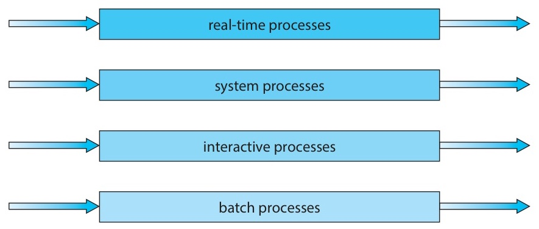

*Figure 4. Multilevel queue scheduling by priority*

There are two common policies for **scheduling between queues**.
- **Fixed priority**: A lower queue runs only when **all higher queues are empty**. Lower queues risk starvation.
- **Time-slice allocation**: Each queue gets a fixed percentage of CPU time (e.g., foreground 80%, background 20%).

**Key restriction**: Processes **cannot move between queues**. Queue assignment is **fixed** at creation and kept for the lifetime of the process.

> **Note:** **When to Use Multilevel Queue.** It is used when processes can be classified cleanly at creation time (e.g., an interactive user program, a batch job, a daemon). The rigid separation is a strength when the classification is correct and a critical weakness when it is not. This weakness is why MLFQ was introduced.

### 2.2 Multilevel Feedback Queue (MLFQ)

The **key difference** from a plain multilevel queue is that **processes can move between queues** based on observed behavior. Figure 5 shows this structure in simplified form, and Figure 6 is textbook Figure 5.9.

```text
                      quantum = 8
     +--------+
 --> |   Q0   | -------> CPU
     +--------+   (exhausted)
         |  demote
         v
                      quantum = 16
     +--------+
 --> |   Q1   | -------> CPU
     +--------+   (exhausted)
         |  demote
         v
                      FCFS
     +--------+
 --> |   Q2   | -------> CPU
     +--------+
```

*Figure 5. Three-level MLFQ that demotes a process exhausting its quantum to a lower queue*

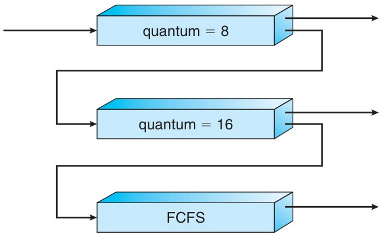

*Figure 6. Multilevel feedback queues*

**Movement rules:**
- **Demotion**: If a process uses its **entire time quantum** in a given queue, it is demoted to a lower queue. Such a process can be regarded as CPU-bound, so demoting it keeps it out of the way of short, responsive processes.
- **Promotion (Aging)**: If a process waits too long in a lower queue, it is promoted to a higher queue. This prevents starvation.

**Natural behavior:**
- **I/O-bound processes** have **short CPU bursts**, so they release the CPU before exhausting their quantum and **stay in upper (high-priority) queues**. Their response time is therefore good.
- **CPU-bound processes** consume their full quantum and **sink to lower queues**. They still get CPU time but do not block interactive work.

> **Note:** **Why MLFQ Is Powerful.** MLFQ **automatically classifies** processes as I/O-bound or CPU-bound without any hints from the programmer. The scheduler learns from behavior, and a process's queue level is effectively a learned estimate of its future CPU burst length.

### 2.3 MLFQ Design Parameters

To fully define an MLFQ, the following must be decided.

| Parameter | Description |
|-----------|-------------|
| Number of queues | How many priority levels? (typically 3-5) |
| Algorithm per queue | RR (with what quantum)? FCFS for the bottom queue? |
| Demotion criteria | When does a process drop? (quantum exhaustion is typical) |
| Promotion criteria | When does a process rise? (aging threshold) |
| Initial queue assignment | Where do new processes start? (usually the top queue) |

*Table 4. Design parameters of MLFQ*

MLFQ is the **most general and flexible** scheduling algorithm, but because all these parameters interact, it is also the **hardest to tune**. Modern schedulers such as Windows variable priority are refinements of MLFQ ideas, while CFS reaches the same goal of favoring short-burst interactive tasks through a different mechanism, vruntime.

### 2.4 MLFQ Operation Example

Suppose process **P** has a CPU burst of 30 ms and enters an MLFQ configured as follows.
- **Q0** is RR with quantum 8, **Q1** is RR with quantum 16, and **Q2** is FCFS (no quantum).

```text
Step 1: P runs 8 ms in Q0 (RR, q=8)
        remaining burst = 22 ms, quantum exhausted -> demoted to Q1

Step 2: P runs 16 ms in Q1 (RR, q=16)
        remaining burst = 6 ms, quantum exhausted -> demoted to Q2

Step 3: P runs 6 ms in Q2 (FCFS)
        remaining burst = 0 -> completed
```

Processes are classified as follows based on total burst length.
- A burst ≤ 8 ms finishes entirely in **Q0** (top priority, best response).
- A burst with 8 < burst ≤ 24 ms is demoted only to **Q1**.
- A burst > 24 ms sinks all the way to **Q2** (FCFS).

**Net effect**: MLFQ **favors short processes** (they never leave the top queue) while still **ensuring that long processes eventually execute** (they finish in Q2).

---

<br>

## 3. Thread Scheduling

### 3.1 Contention Scope: PCS vs SCS

Thread scheduling is categorized by **contention scope**, the set of threads competing for a CPU.

**PCS (Process-Contention Scope)**
- It schedules **user-level threads**, and the scheduling is performed by the **thread library**, not the kernel.
- Threads **within the same process** compete for the kernel-scheduled entities assigned to that process.
- It is used in the **Many-to-One** and **Many-to-Many** threading models.
  - *(Recall from Week 4: Many-to-One maps many user threads onto one kernel thread; Many-to-Many maps N user threads onto M ≤ N kernel threads.)*

**SCS (System-Contention Scope)**
- It schedules **kernel-level threads**, and the scheduling is performed by the **OS kernel**.
- Threads compete with **all other threads in the system**, not just those within the same process.
- It is used in the **One-to-One** model.
- Modern operating systems (**Linux, Windows, macOS**) all use One-to-One, so they effectively **support only SCS**.

> **Note:** **Why Contention Scope Matters.** In PCS where a process has only one kernel thread, as in the Many-to-One model, if one user thread blocks on a system call, *the process's entire kernel thread blocks*, and the library cannot schedule other user threads. In SCS, each thread has its own kernel thread, so one blocking does not affect the others. This is why modern operating systems prefer One-to-One and SCS despite the higher per-thread cost.

### 3.2 PCS vs SCS: Comparison

| Property | PCS | SCS |
|----------|-----|-----|
| Scheduling entity | Thread library (in user space) | OS kernel |
| Contention scope | Within a single process | System-wide (all threads) |
| Thread model | Many-to-One, Many-to-Many | One-to-One |
| Priority adjustment | Set by programmer; library does not adjust dynamically | Kernel can **dynamically adjust** (e.g., boost on I/O) |
| Time slicing | Not guaranteed among same-priority threads | Guaranteed by kernel timer |

*Table 5. Comparison of PCS and SCS*

Because modern operating systems use One-to-One, in practice **only SCS is supported**. PCS is a concept from historical and embedded systems.

### 3.3 Pthread Scheduling API

POSIX threads let a program query and set the contention scope per thread through an **attribute**.

```c
#include <pthread.h>
#include <stdio.h>
#define NUM_THREADS 5

int main(int argc, char *argv[]) {
    int i, scope;
    pthread_t tid[NUM_THREADS];
    pthread_attr_t attr;

    pthread_attr_init(&attr);

    /* Query the current contention scope */
    if (pthread_attr_getscope(&attr, &scope) != 0)
        fprintf(stderr, "Unable to get scheduling scope\n");
    else {
        if (scope == PTHREAD_SCOPE_PROCESS)
            printf("PTHREAD_SCOPE_PROCESS\n");
        else if (scope == PTHREAD_SCOPE_SYSTEM)
            printf("PTHREAD_SCOPE_SYSTEM\n");
    }

    /* Request SCS (system-wide contention) */
    pthread_attr_setscope(&attr, PTHREAD_SCOPE_SYSTEM);

    for (i = 0; i < NUM_THREADS; i++)
        pthread_create(&tid[i], &attr, runner, NULL);
    for (i = 0; i < NUM_THREADS; i++)
        pthread_join(tid[i], NULL);
    pthread_exit(0);
}
```

- `PTHREAD_SCOPE_PROCESS` requests PCS, and `PTHREAD_SCOPE_SYSTEM` requests SCS.
- **On Linux and macOS, only `PTHREAD_SCOPE_SYSTEM` is allowed**, and requesting `PROCESS` returns an error. This is because these kernels use the One-to-One thread model.

---

<br>

## 4. Multi-Processor Scheduling

### 4.1 Multiprocessor Architectures

The term multiprocessor now encompasses many different hardware configurations.

- **Multicore CPUs**: Multiple cores sit on a single chip (today's norm).
- **Multithreaded cores**: Each core has multiple hardware threads (e.g., Intel Hyper-Threading).
- **NUMA systems**: In Non-Uniform Memory Access, different cores have different memory latencies.
- **Heterogeneous multiprocessing (HMP)**: Cores differ in performance and power (e.g., ARM big.LITTLE).

There are two high-level scheduling approaches.

- **Asymmetric Multiprocessing (ASMP)**: A single **master processor** makes all scheduling decisions, and the other processors run user code only. *It is simple, but the master becomes a bottleneck.*
- **Symmetric Multiprocessing (SMP)**: **Every processor schedules independently**. Each processor picks a process from a queue and runs it. *It is the dominant modern approach (Linux, Windows, macOS).*

### 4.2 SMP: Ready Queue Organization

Under SMP, there are two main ways to organize ready queues, as shown in Figure 7 (textbook Figure 5.11).

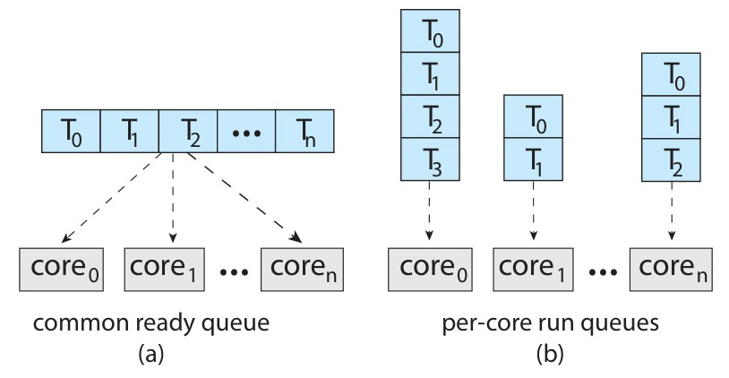

*Figure 7. Common ready queue and per-processor ready queues*

| Approach | Pros | Cons |
|----------|------|------|
| **Common (shared) ready queue** | Automatic load balancing (no CPU is idle while another has work) | **Lock contention** on every access; cache-unfriendly (a process may jump between CPUs) |
| **Per-processor queue** | No locks needed; cache-friendly (a process stays on one CPU) | Possible **load imbalance** (one CPU idle while another is overloaded) |

*Table 6. Pros and cons of a common ready queue and per-processor queues*

**Modern SMP systems (Linux CFS, Windows) use per-processor queues** and solve imbalance via **load balancing** (Section 4.9).

### 4.3 Multicore and Memory Stall

**Memory Stall**
- It is the time the CPU must wait for data to arrive when it accesses memory that is not in cache.
- A single cache miss can cost **tens to hundreds of CPU cycles**.
- In memory-intensive workloads, a core can spend **up to 50% of its time stalled** (Figure 8, textbook Figure 5.12).

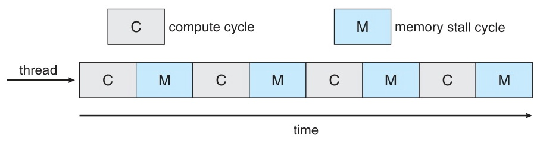

*Figure 8. Memory stall with alternating compute and memory stall cycles*

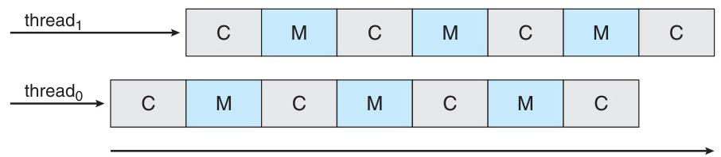

*Figure 9. Multithreaded multicore system with two interleaved hardware threads*

**The solution is hardware multithreading.** When one thread enters a memory stall, the core **switches to another hardware thread** that has work ready. This keeps the execution units busy and greatly improves core utilization (Figure 9, textbook Figure 5.13).

> **Key Point:** Memory stalls are a *hardware-level* scheduling problem. The core's solution (CMT, SMT, next section) is a miniature scheduler that runs below the awareness of the OS scheduler. The OS sees each hardware thread as a full logical processor and does not need to know about stalls.

### 4.4 Chip Multithreading (CMT)

Multiple **hardware threads** are placed on a single physical core (Figures 10 and 11, textbook Figure 5.14).

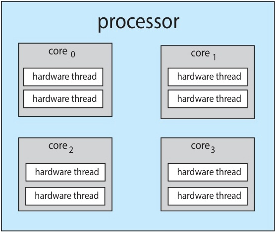

*Figure 10. Chip multithreading processor with four cores of two hardware threads each*

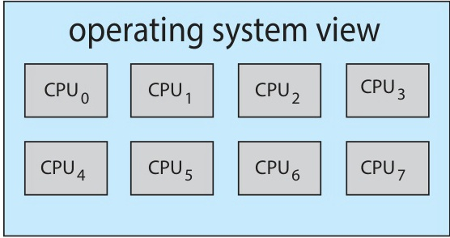

*Figure 11. Eight logical CPUs as seen by the operating system*

Examples are as follows.
- **Intel Hyper-Threading (SMT)**: Each core has 2 hardware threads.
- **Oracle SPARC M7**: 8 hardware threads per core × 8 cores = **64 logical CPUs**.

Each hardware thread appears to the OS as a **logical processor**. So on a quad-core CPU with Hyper-Threading, Linux reports **8 CPUs** in `/proc/cpuinfo`, even though only 4 are physical.

### 4.5 Coarse-grained vs Fine-grained Multithreading

The two strategies for when the hardware switches between hardware threads are as follows.

| Property | Coarse-grained | Fine-grained |
|----------|---------------|-------------|
| Thread switch trigger | Only on **long-latency events** (memory stall, etc.) | At **every instruction cycle boundary** |
| Switch cost | **High** (pipeline must be flushed) | **Low** (switch logic is built directly into the pipeline) |
| Pros | Simpler hardware design | Very fast switching; high core utilization |
| Cons | Pipeline flush overhead is wasteful | More complex hardware |

*Table 7. Comparison of coarse-grained and fine-grained multithreading*

> **[Computer Architecture]** What is a pipeline? Modern CPUs process instructions in an assembly-line fashion. While instruction 1 is being executed, instruction 2 is being decoded and instruction 3 is being fetched, and so on, typically 5 to 20 stages deep. This pipeline is what lets a CPU complete roughly one instruction per cycle even though each instruction actually takes many cycles. A **pipeline flush** means throwing away all the partially processed instructions in the pipeline (e.g., when switching threads, the old thread's in-flight instructions cannot be kept). Every flush wastes the work already done in those stages, which is why coarse-grained switching is costly.

Modern Intel and SPARC designs use **fine-grained** multithreading (or a hybrid) to keep cores busy at instruction-cycle granularity.

### 4.6 Two Levels of Scheduling

On a **multithreaded multicore** processor, scheduling happens at two levels (Figure 12, textbook Figure 5.15).

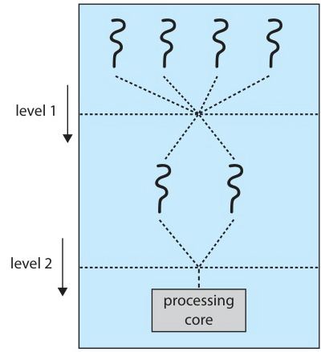

*Figure 12. Two levels of scheduling for software and hardware threads*

**Level 1 (OS scheduler)**: It assigns **software threads** to **logical processors** (hardware threads). CFS, the Windows scheduler, and similar schedulers handle this level.

**Level 2 (Core hardware)**: It decides which hardware thread on a core runs in each cycle. The approaches are as follows.
- **Round-robin** (UltraSPARC T3): It cycles through all hardware threads fairly.
- **Dynamic urgency** (Intel Itanium): Each hardware thread has an urgency value (0-7) that rises during stalls and falls when instructions complete. The most urgent thread is picked.

> **Note:** **Why Two Levels.** The OS cannot make decisions at cycle granularity. It does not have the timing information, and a system call per cycle would cost more than the work done. So the OS does coarse-grained placement, and the hardware fills in the gaps at cycle granularity.

### 4.7 Processor Affinity

**Affinity** is the tendency of a process to **stay on the same processor** once it has started running there.

**Why it matters:**
- Every CPU has its own **cache**. A process running on CPU 0 fills CPU 0's cache with its working set.
- If the OS moves that process to CPU 1, the cached data is **invalidated** and must be re-fetched from memory on CPU 1 (a **warm-up cost**).

| Type | Description |
|------|-------------|
| **Soft Affinity** | OS *tries* to keep a process on the same CPU, but does not guarantee it |
| **Hard Affinity** | The process (or admin) **explicitly specifies** a set of CPUs it may run on, and the OS will not migrate it elsewhere |

*Table 8. Soft affinity and hard affinity*

On Linux, hard affinity is set via the `sched_setaffinity()` system call (or the `taskset` command).

### 4.8 NUMA and Processor Affinity

**NUMA (Non-Uniform Memory Access)** is a multi-socket architecture in which each CPU (socket) has its own **local memory bank** but can also access **other sockets' memory** across an interconnect (Figure 13, textbook Figure 5.16).

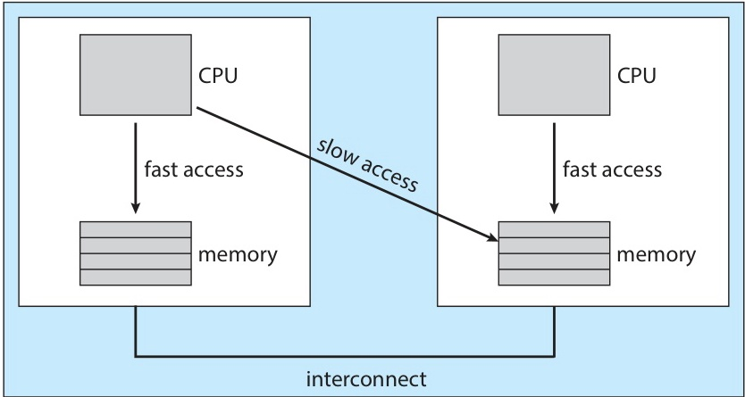

*Figure 13. NUMA architecture and CPU scheduling*

- **Local memory access** is fast (low latency).
- **Remote memory access** is slow because it must traverse the interconnect.

**NUMA-aware scheduling**: Each process is placed on a CPU that is **local to** the memory it allocated. On Linux, CFS considers NUMA via a **scheduling domain hierarchy** (see Section 6.7).

> **Note:** **Practical Impact.** Ignoring NUMA on a multi-socket server can cause a **2× performance drop** on memory-intensive workloads. This is why high-performance database and HPC code often uses `numactl` or explicit NUMA APIs.

### 4.9 Load Balancing

With per-processor queues, processors can become imbalanced, with one CPU having a long run queue while another is idle. **Load balancing** redistributes work.

| Approach | Description |
|----------|-------------|
| **Push migration** | A periodic task checks every CPU's load and **pushes** tasks from overloaded CPUs to idle ones |
| **Pull migration** | An idle CPU actively **pulls** a task from a busy CPU's queue |

*Table 9. Push migration and pull migration*

Most systems **use both together** (e.g., Linux CFS).

**Conflict between load balancing and processor affinity**:
- **Load balancing** wants to move processes around to even out load.
- **Affinity** wants to keep processes on the same CPU to preserve cache state.

The OS balances the two. It migrates only when the imbalance is **large enough** that the rebalancing benefit outweighs the cache warm-up cost.

### 4.10 Heterogeneous Multiprocessing (HMP)

Heterogeneous multiprocessing is a system whose cores have the **same instruction set (ISA)** but **different clock speeds and power profiles**.

The **ARM big.LITTLE architecture** (used in most modern smartphones) consists of the following two kinds of cores.
- **big core**: It has high performance and high power and is well suited to short interactive tasks (touch response, app launch).
- **LITTLE core**: It has low performance and low power and is well suited to background tasks (polling, music playback).

**Scheduling strategy:**
- Interactive and foreground apps are placed on **big cores**.
- Background tasks are placed on **LITTLE cores**.
- In battery-saver mode, the big cores are disabled entirely and only the LITTLE cores are used.

**Key distinction from ASMP**: Unlike asymmetric multiprocessing, in HMP **all cores can run both user and system tasks**. The asymmetry lies in performance and power, not in role.

---

<br>

## 5. Real-Time CPU Scheduling

### 5.1 Soft vs Hard Real-Time

| Category | Soft Real-Time | Hard Real-Time |
|----------|----------------|----------------|
| Deadline | Misses **allowed** (performance degrades gracefully) | Deadlines **must be met** (missing one is a system failure) |
| Guarantee | Priority-based preferential treatment | Guaranteed completion within deadline |
| Examples | Video playback, VoIP, online games | Aircraft flight control, ABS brakes, pacemakers |

*Table 10. Comparison of soft and hard real-time*

**Real-time scheduling requirements:**
- The scheduler **must be preemptive** (a higher-priority real-time task must be able to preempt any task).
- **Interrupt latency** and **dispatch latency** must be **bounded and small** (microseconds, not milliseconds).

### 5.2 Event Latency

**Event latency** is the total time from event occurrence to service completion (Figure 14, textbook Figure 5.17).

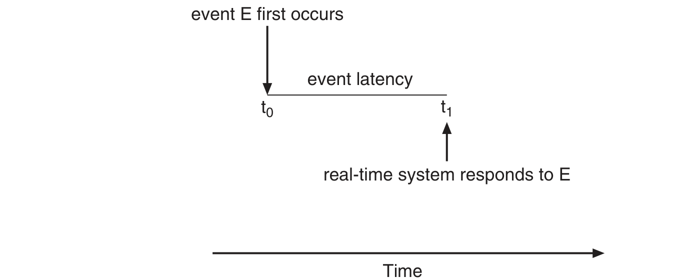

*Figure 14. Event latency from event occurrence to response*

For real-time systems, two components of latency matter.

1. **Interrupt Latency**: It is the time from interrupt arrival to the start of the **ISR** (Interrupt Service Routine).
   - The CPU completes the current instruction → determines the interrupt type → saves the context.

2. **Dispatch Latency**: It is the time for the scheduler to switch from the currently running process to the target real-time process.
   - **Conflict phase**: Preempt the process running in the kernel and release any resources the preempted process holds.
   - **Dispatch phase**: Load the high-priority process onto the CPU (context restore, jump to PC).

For hard real-time, both latencies must be **bounded within a few microseconds**.

### 5.3 Periodic Task Model

Real-time workloads are commonly modeled as **periodic tasks**. A periodic task repeats the same work every *p* units of time (Figure 15, textbook Figure 5.20).

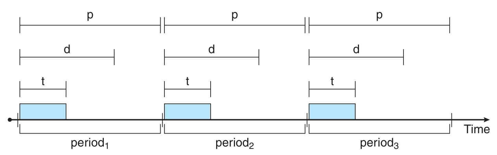

*Figure 15. Periodic task with processing time t, deadline d, and period p*

- **t**: It is the processing time (CPU burst per period).
- **d**: It is the deadline (by when this period's work must be done).
- **p**: It is the period (how often the task repeats).
- **Relationship**: `0 ≤ t ≤ d ≤ p`. There must be enough time to finish processing before the deadline within the period.
- **Task rate** = 1/p (how often per second it fires).
- **CPU utilization** of the task = t/p (fraction of the CPU it demands).

> **Note:** **Mental Model.** Suppose a video decoder must decode one frame every 33 ms (for 30 FPS). The period is 33 ms, the deadline is 33 ms, and the burst is however long decoding takes (say 10 ms). If the scheduler misses the deadline even once, the user sees a dropped frame.

### 5.4 Rate-Monotonic Scheduling

**Rate-Monotonic (RM)** is a fixed-priority, preemptive algorithm.

- It assigns **higher priority to tasks with shorter periods** (the shorter the period, the more urgent).
- Priority = 1 / period.
- Priority is **static** and never changes during execution.
- Each periodic instance must complete within its period's deadline.

**Optimality**:
- Rate-Monotonic is **optimal among fixed-priority algorithms**.
- That is, if a set of periodic tasks cannot be scheduled by RM, then **no fixed-priority algorithm can schedule it**.

### 5.5 Rate-Monotonic: Success Example

- **P1**: period 50, burst 20.
- **P2**: period 100, burst 35.

**CPU utilization** is 20/50 + 35/100 = 0.40 + 0.35 = **75%**.

Under Rate-Monotonic, P1 has the shorter period and therefore the higher priority (**P1 > P2**).

Within 0-200, the deadlines are 50, 100, 150, and 200 for P1 and 100 and 200 for P2. The hyperperiod is the least common multiple of 50 and 100, which is 100, so this interval covers two hyperperiods.

```text
Gantt chart (period 0 - 100):

|<-- P1 (20) -->|<------ P2 (30) ------>|<-- P1 (20) -->|<P2(5)>|<--- idle (25) --->|
0              20                      50              70      75                  100
                                                       ^
                                                   P1's new period starts at 50
                                                   -> P1 preempts P2
```

*Figure 16. Gantt chart of the Rate-Monotonic success example (first 100 ms)*

The step-by-step explanation is as follows.
- **0-20**: P1 runs (all 20 ms done). P1's deadline 50 is met. ✓
- **20-50**: P2 runs for 30 ms of its 35 ms.
- **50**: P1's **next period** begins (new deadline 100). Because RM gives P1 a higher fixed priority, P1 **preempts** P2.
- **50-70**: P1 runs (all 20 ms done). P1's deadline 100 is met. ✓
- **70-75**: P2 resumes for the remaining 5 ms. It completes at 75, well before its deadline of 100. ✓
- **75-100**: The CPU is idle (no runnable task until P1's next period starts at 100).

**All deadlines are met.**

### 5.6 Rate-Monotonic: Failure Example

- **P1**: period 50, burst 25.
- **P2**: period 80, burst 35.

**CPU utilization** is 25/50 + 35/80 = 0.50 + 0.4375 = **93.75%**.

The theoretical RM upper bound for N = 2 tasks is $N(2^{1/N} - 1) = 2(\sqrt{2} - 1) \approx 82.8\%$.

Since **93.75% > 82.8%**, RM may fail. Checking the schedule gives the following.

```text
 |<-- P1(25ms) -->|<-- P2(25ms) -->| P1 preempts|<P2(10ms)>|
 0               25               50       75        85
                                                    ^
                                          P2's deadline = 80
                                          MISSED!
```

*Figure 17. Rate-Monotonic failure example in which P2 misses its deadline of 80*

- **P1**: It runs during 0-25 (done) and 50-75 (done) and meets its deadlines.
- **P2**: It runs during 25-50 (25 ms), is preempted by P1, resumes at 75, and finishes at **85**.
- **But P2's deadline was 80**, so it **misses its deadline**.

Because the utilization exceeds the RM bound, RM cannot guarantee schedulability.

### 5.7 Rate-Monotonic CPU Utilization Bound

The worst-case CPU utilization bound for N tasks under RM is as follows.

$$U = N\left(2^{1/N} - 1\right)$$

| N (number of tasks) | Utilization bound |
|:-------------------:|:-----------------:|
| 1 | 100% |
| 2 | 82.8% |
| 3 | 78.0% |
| 4 | 75.7% |
| 5 | 74.3% |
| N → ∞ | **69.3%** (= ln 2) |

*Table 11. RM utilization bound by number of tasks*

**If total utilization ≤ this bound, RM guarantees that all deadlines are met.**

Above the bound, RM may still succeed (the bound is sufficient, not necessary), but success is not guaranteed.

> **Note:** **Intuition.** The bound gets tighter as N grows because, with many tasks of different periods, preemptions can pile up in unlucky ways. In the limit, about 30% of the CPU must be left empty to absorb these worst-case overlaps.

### 5.8 Earliest-Deadline-First (EDF)

**EDF** is a dynamic-priority, preemptive algorithm.

- At any moment, it runs the task whose **deadline is closest**.
- When deadlines shift (each time a periodic task completes, a new deadline starts), priority **changes dynamically**.
- It works for both **periodic and aperiodic** tasks.
- **It can theoretically schedule up to 100% CPU utilization**, and in this sense EDF is optimal.

**In practice**: Context switch overhead and interrupt handling mean that 100% cannot actually be reached. Even so, EDF often outperforms RM on utilization substantially.

### 5.9 EDF: Solving the Rate-Monotonic Failure Case

The same task set that RM failed on is scheduled with EDF.
- **P1**: period 50, burst 25.
- **P2**: period 80, burst 35.

The EDF trace is as follows.

```text
 Time 0:  P1 deadline=50, P2 deadline=80  -> P1 first (deadline closer)
 Time 25: P1 done; P2 starts
 Time 50: P1 new period, P1 deadline=100, P2 deadline=80 (still)
          P2's deadline is closer -> P2 continues! (unlike RM which would preempt)
 Time 60: P2 done (35 ms total executed); P1 starts
 Time 85: P1 done (25 ms executed)
```

```text
 |<-- P1(25) -->|<----- P2(35) ----->|<-- P1(25) -->|
 0             25                    60             85
```

*Figure 18. Gantt chart of EDF scheduling the RM failure case*

- **P1**: It meets deadline 50 at time 25 and deadline 100 at time 85. ✓
- **P2**: It meets deadline 80 at time 60. ✓

**All deadlines are met.** By letting P2 keep the CPU while its deadline was closer, EDF handled the case that RM could not.

### 5.10 Rate-Monotonic vs EDF

| Property | Rate-Monotonic | EDF |
|----------|---------------|-----|
| Priority | **Fixed** (period-based) | **Dynamic** (deadline-based) |
| CPU utilization bound | About 69.3% (as N → ∞) | **100%** (theoretical) |
| Implementation complexity | **Low** | High |
| Overhead | **Low** | High (recompute priority on each deadline event) |
| Task types supported | Periodic tasks only | Both periodic and aperiodic |
| Optimality | Optimal among **fixed-priority** algorithms | **Theoretically optimal** overall |
| Practical use | Aviation, automotive (**predictability** valued) | Less common (harder to analyze formally) |

*Table 12. Comparison of Rate-Monotonic and EDF*

> **Note:** **Why RM Is Preferred in Safety-Critical Systems.** RM is **predictable and easy to certify**. If utilization is under the bound, it can be proven by hand that all deadlines will be met. EDF's dynamic priorities are harder to reason about formally, which is a serious liability when a failure can cost human lives.

### 5.11 Proportional Share Scheduling

A total of **T shares** is distributed among applications, and each application gets CPU time in proportion to its shares.

**Example**: With T = 100 shares, the allocation is as follows.
- Process A has 50 shares and gets **50%** of CPU time.
- Process B has 15 shares and gets **15%** of CPU time.
- Process C has 20 shares and gets **20%** of CPU time.
- The remaining 15 shares are surplus.

**Admission Control**:
- A new process requests 30 shares.
- The shares in use are 50 + 15 + 20 = 85, and 15 remain.
- Since 15 < 30, the request is **rejected**.

The scheduler admits new work only when enough shares are available, so it provides a **guaranteed proportional** share of CPU time to every admitted process. No process can starve another.

> **Note:** **Modern Derivatives.** Linux cgroups' CPU quota and CFS weights, container CPU limits (Docker, Kubernetes), and hypervisor CPU shares (VMware) are all derived from proportional sharing. Cloud providers use such schemes to guarantee a fixed fraction of a vCPU.

---

<br>

## 6. Operating System Examples

### 6.1 Linux CFS: Overview and History

**CFS (Completely Fair Scheduler)** has been the default Linux scheduler since kernel **2.6.23** (2007).

**History:**
- Before Linux 2.5, a traditional UNIX scheduler was used (simple, but with poor SMP scaling).
- **Linux 2.5** introduced the **O(1) scheduler** (constant-time operations, good SMP support).
- **Linux 2.6.23 and later** use **CFS** (better interactive response, cleaner theory).

**Core goal**: It divides CPU time completely fairly among runnable tasks, weighted by priority.

**Scheduling classes** (Linux separates real-time and normal workloads):
- **Real-time class**: `SCHED_FIFO` and `SCHED_RR`, with priorities 0-99 (always higher than any normal task).
- **Normal class**: **CFS**, with priorities 100-139, controlled by the **nice** value (−20 to +19).

### 6.2 Linux Priority Ranges

Linux priority ranges are shown in Figure 19 (textbook Figure 5.26).

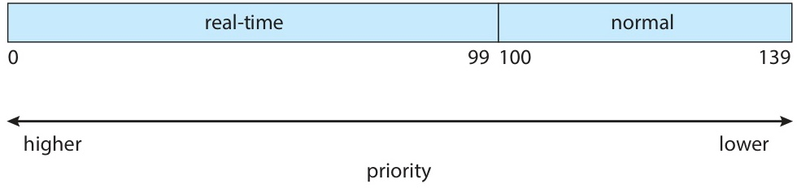

*Figure 19. Scheduling priority ranges on a Linux system*

- **A smaller number means higher priority** (textbook convention).
- Real-time tasks (0-99) **always preempt** normal tasks (100-139).
- The priority of a normal task is `100 + (nice + 20) = 120 + nice`.
  - `nice = −20` gives priority 100 (highest among normal tasks).
  - `nice =   0` gives priority 120 (default).
  - `nice = +19` gives priority 139 (lowest).

> **Note:** **Origin of the Name nice.** Historically, a nice process is one that is *willing to yield to others*. That is why raising the nice value lowers the priority. The `nice` and `renice` commands adjust it from the shell.

### 6.3 CFS: vruntime Concept

CFS tracks **vruntime (virtual runtime)**. vruntime is an abstract measure of how much CPU time each task has used up fairly.

- CFS always runs the **task with the smallest vruntime**.
- vruntime increases as a task runs, and the increase is **weighted by the nice value**.

| nice value | vruntime increase rate |
|:----------:|:----------------------:|
| Low nice (−20, high priority) | Increases **slower** than real time |
| nice = 0 (default) | Increases at the **same** rate as real time |
| High nice (+19, low priority) | Increases **faster** than real time |

*Table 13. vruntime increase rate by nice value*

**Example**:
- A task with `nice = 0` that runs for 200 ms of real time increases its vruntime by about 200.
- A task with `nice = −5` that runs for 200 ms of real time increases its vruntime by less than 200.

Because CFS always picks the smallest vruntime, **high-priority tasks (whose vruntime grows slowly) get more real CPU time**.

### 6.4 CFS: vruntime Step-by-Step Example

There are three tasks: A (nice = 0), B (nice = 0), and C (nice = 5).
The initial vruntimes are A = 0, B = 0, C = 0.

```text
 Step 1: A runs (10 ms)  -> A.vruntime = 10
         vruntimes: A=10, B=0, C=0  -> B has min (tied with C, pick B) -> B selected

 Step 2: B runs (10 ms)  -> B.vruntime = 10
         vruntimes: A=10, B=10, C=0  -> C has min -> C selected

 Step 3: C runs (10 ms)  -> C.vruntime = 15  (increases faster due to nice=5)
         vruntimes: A=10, B=10, C=15  -> A (tied with B, pick A) -> A selected

 Step 4: A runs (10 ms)  -> A.vruntime = 20
         vruntimes: A=20, B=10, C=15  -> B has min -> B selected
```

This example assumes, for simplicity, that the vruntime of C (nice = 5) grows at 1.5 times real time. The observations are as follows.
- Higher-priority tasks accumulate vruntime slowly, so they are picked more often.
- **I/O-bound tasks naturally win**: they run briefly and then block for I/O. While they are blocked, their vruntime **does not advance**, while other runnable tasks' vruntimes climb. When an I/O-bound task wakes up, its vruntime is below everyone else's, so it **runs immediately**. No explicit I/O boost is needed.

### 6.5 CFS: Target Latency and Time Slice

CFS **does not use a fixed time quantum**. Instead, it computes the time slice dynamically.

**Target latency** is the time window in which every runnable task should get to run **once**.
- Example: With a target latency of 20 ms and 4 tasks, each gets roughly 5 ms.

**Minimum granularity** is a floor on how short a time slice can become.
- It prevents unreasonably short slices when many tasks are runnable.
- Example: The minimum is set to 1 ms.

**Time slice calculation**: The target latency is **distributed in weighted proportions** according to nice values.
- High priority (low nice) gets a **longer** time slice.
- Low priority (high nice) gets a **shorter** time slice.

> **Note:** **Why Dynamic Slices Beat Fixed Quanta.** With a fixed quantum q, once there are N tasks, a task must wait (N - 1) × q before it runs again. With target latency, every task runs once within the target latency while the number of tasks is moderate, and once the slice shrinks to the minimum granularity, the context switch rate is capped from then on. This is why CFS scales smoothly from 2 tasks to 2000.

### 6.6 CFS: Red-Black Tree

CFS stores runnable tasks in a **red-black tree** keyed by **vruntime**.

```text
                    T3 (vruntime=25)
                   /                \
           T1 (vruntime=15)    T5 (vruntime=35)
           /        \              /        \
    T0 (vr=10)  T2 (vr=20)  T4 (vr=30)  T6 (vr=40)
     ^
     |
   leftmost node
   = smallest vruntime
   = NEXT to run
```

*Figure 20. CFS red-black tree keyed by vruntime*

- The **leftmost node** has the smallest vruntime and is the next task to execute.
- The kernel caches this node in the variable `rb_leftmost`, so picking the next task is **O(1)**.
- Insertion and deletion are **O(log N)**.
- When a task **blocks** (e.g., waits for I/O), it is **removed** from the tree, and when it becomes runnable again, it is **inserted** back.

> **[Data Structures]** A heap finds the minimum in O(1), and a red-black tree also finds it in O(1) when its leftmost node is cached. Both support insertion in O(log N). CFS, however, also needs arbitrary removal and priority updates. Finding an arbitrary task in a heap when it blocks requires an external index, and vruntime keeps growing while a task runs. A red-black tree supports these operations in O(log N), and CFS caches a `leftmost` pointer to find the next task in O(1).

### 6.7 CFS: Load Balancing and NUMA

CFS load balancing uses a **scheduling domain hierarchy** that matches the machine's memory topology (Figure 21, textbook Figure 5.27).

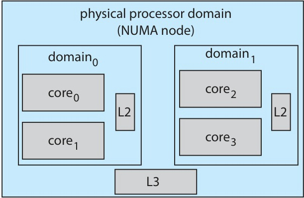

*Figure 21. NUMA-aware load balancing with the Linux CFS scheduler*

**Strategy**: Migrations are considered from low cost to high cost.
1. **Within a domain** (cores sharing an L2 cache): The cost is low, so tasks migrate freely.
2. **Across domains** (cores sharing an L3 cache): The cost is medium.
3. **Across NUMA nodes** (different memory banks): The cost is high, so tasks migrate **only under extreme imbalance**.

CFS defines **load = priority × CPU utilization ratio**, so on the same CPU a high-priority task contributes more to the load than a low-priority one.

> **Key Point:** CFS does more than simply pick the smallest vruntime. On a real multi-socket server, CFS is a layered system in which the single-CPU algorithm (vruntime and RB tree) is wrapped by a multi-CPU balancer that respects cache and memory locality.

### 6.8 Windows Scheduling

Windows uses **priority-based preemptive scheduling**.

The priority structure has **32 levels**.
- **0**: It is a thread used for memory management.
- **1-15**: This is the variable class (normal user and system work).
- **16-31**: This is the real-time class.

**Dispatcher**: It always runs the highest-priority ready thread. If no thread is ready, it runs the idle thread.

The behavior details are as follows.
- **Round-Robin** is applied among threads of the **same priority**.
- In the **variable class**, a thread's priority **decreases** when its time quantum expires (but never below its base priority).
- **Priority boost**: On events such as I/O completion or keyboard input, the priority is raised so that interactive threads become responsive quickly.

### 6.9 Windows: Priority Classes

The Windows API groups priorities into **6 priority classes**, and within each class, **7 relative priority levels**.

| Priority Class | Base Priority |
|----------------|:-------------:|
| REALTIME_PRIORITY_CLASS | 24 |
| HIGH_PRIORITY_CLASS | 13 |
| ABOVE_NORMAL_PRIORITY_CLASS | 10 |
| NORMAL_PRIORITY_CLASS | 8 |
| BELOW_NORMAL_PRIORITY_CLASS | 6 |
| IDLE_PRIORITY_CLASS | 4 |

*Table 14. Base priority of each Windows priority class*

The relative priorities within each class are IDLE, LOWEST, BELOW_NORMAL, **NORMAL**, ABOVE_NORMAL, HIGHEST, and TIME_CRITICAL.

**Example**: `ABOVE_NORMAL_PRIORITY_CLASS` (base 10) with the NORMAL relative priority gives **priority 10**.

The related APIs are as follows.
- `SetPriorityClass()`: It changes a process's priority class.
- `SetThreadPriority()`: It changes the relative priority of a thread within its class.

### 6.10 Windows: Variable Priority Behavior

Windows adjusts thread priorities dynamically based on behavior.

```text
 Base Priority = 8 (NORMAL class, NORMAL relative)

 Time quantum exhausted
 --> priority decreases (e.g., 8 -> 7)
 --> never drops below base priority

 I/O completion (keyboard input)
 --> large priority boost (e.g., 8 -> 14)

 I/O completion (disk)
 --> medium priority boost (e.g., 8 -> 10)

 Foreground window
 --> time quantum is tripled
```

**The goal** is to give **good response time to interactive threads** (they get big boosts when user events arrive) and to **keep I/O devices busy** (threads that complete I/O are scheduled fast). Meanwhile, CPU-bound threads that exhaust their quantum drift toward their base priority. Such threads still run, but not at the expense of interactive work.

### 6.11 Windows: Multiprocessor Support

An **SMT set** is a group of hardware threads that live on the **same core**.
- Example: With 4 cores and 2 threads per core, the SMT sets are `{0,1}`, `{2,3}`, `{4,5}`, `{6,7}`.
- Keeping a thread inside its SMT set gives **better cache efficiency** (shared L1/L2).

**Ideal Processor**: Each thread is assigned a **preferred CPU number**.
- It starts from a per-process **seed value** and is incremented as each new thread is created.
- It is distributed across **different SMT sets**: 0, 2, 4, 6, 0, 2, ...
- Different processes use different seeds, so threads are spread evenly across cores system-wide.

> **Note:** **Why Not Pick Any Idle CPU.** On a multicore system with SMT, *which* idle CPU is chosen matters. Putting a new thread on a free SMT sibling shares the L1 cache, while putting it on a different socket incurs remote memory costs. Ideal Processor codifies a policy of preferring this CPU first, then its SMT sibling, then nearby CPUs, and finally distant ones.

---

<br>

## 7. Algorithm Evaluation

### 7.1 Four Evaluation Methods: Overview

| Method | Description | Accuracy |
|--------|-------------|----------|
| **Deterministic Modeling** | Analytical calculation with a specific workload | Low (covers only specific cases) |
| **Queueing Models** | Mathematical models (Little's formula, etc.) | Medium (approximation) |
| **Simulation** | Computer simulation of the scheduler | High |
| **Implementation** | Implement in a real OS and measure | Highest (true environment) |

*Table 15. Four algorithm evaluation methods and their accuracy*

**Trade-off**: Higher accuracy comes with higher cost and complexity.

### 7.2 Deterministic Modeling

A **specific workload** is assumed, and the exact performance of each algorithm is calculated.

| Process | Burst Time |
|---------|-----------|
| P1 | 10 |
| P2 | 29 |
| P3 | 3  |
| P4 | 7  |
| P5 | 12 |

*Table 16. Burst times for the deterministic modeling example*

All processes arrive at time 0.

| Algorithm | Average Waiting Time |
|-----------|---------------------|
| FCFS | (0 + 10 + 39 + 42 + 49) / 5 = **28 ms** |
| SJF | (10 + 32 + 0 + 3 + 20) / 5 = **13 ms** |
| RR (q = 10) | (0 + 32 + 20 + 23 + 40) / 5 = **23 ms** |

*Table 17. Average waiting time of each algorithm by deterministic modeling*

**Pros**: It is simple, fast, and precise for the given workload.
**Cons**: Its conclusions apply **only to that specific workload**. Real workloads vary.

### 7.3 Queueing Models: Little's Formula

The system is modeled as a **network of servers and queues**.

**Little's Formula:**

**n = λ × W**

- **n**: It is the average number of processes in the queue (queue length).
- **λ**: It is the average arrival rate (processes per second).
- **W**: It is the average waiting time (seconds per process).

**Example**: With λ = 7 processes per second and n = 14 processes, the result is as follows.
- W = n / λ = 14 / 7 = **2 seconds**.

**Limitations**: Little's formula is a general identity, but computing `n` and `λ` for realistic scheduling policies often requires distributions that are **mathematically intractable**. Independence assumptions (uncorrelated arrivals and services) also may not hold.

> **Note:** **Why Little's Formula Is Beautiful.** In a steady state, the formula requires no assumptions about the distribution of arrival or service times; it simply expresses conservation of flow. Whenever two of the three quantities are known, the third can be derived.

### 7.4 Simulation and Implementation

**Simulation**
- A software model of the computer system is built, and the scheduler is run against synthetic workloads.
- The workload sources are as follows.
  - **Random number generation**: It is convenient but may not match real usage.
  - **Trace files**: They record sequences of events from real systems and reproduce real behavior exactly, so their accuracy is much higher.
- **Cons** are development cost, long execution time, and storage space for traces.

**Implementation**
- The algorithm is actually implemented in a real OS and deployed on real hardware with real users.
- It is the **only completely accurate** evaluation method.
- **Cons** are as follows.
  - Implementation and testing costs are high.
  - **User behavior changes with the environment**. Once users notice that the scheduler favors certain patterns, they may game it (e.g., splitting jobs to get the short-job discount).

> **Note:** **A Famous Cautionary Tale.** In an early multi-user OS, the scheduler boosted jobs that did lots of I/O. Users quickly discovered this and added useless I/O calls to their CPU-bound jobs to trick the scheduler. The evaluation that looked great in simulation collapsed in deployment. This is why real-world evaluation is irreplaceable.

---

<br>

## 8. Lab: MLFQ Simulator

### 8.1 Lab: Queue Configuration and Rules

This lab implements a **3-level Multilevel Feedback Queue** simulator.

**Queue configuration**:

| Queue | Algorithm | Time Quantum |
|:-----:|-----------|:------------:|
| Q0 | Round-Robin | 8 |
| Q1 | Round-Robin | 16 |
| Q2 | FCFS | None (run until completion) |

*Table 18. Queue configuration of the MLFQ simulator*

**Rules**:
- New processes enter **Q0**.
- If a process does not complete within Q0's quantum, it is demoted to **Q1**.
- If it does not complete within Q1's quantum, it is demoted to **Q2**.
- **Aging**: If a process waits more than a threshold (e.g., 30 time units) in Q2, it is promoted back to **Q0**.

### 8.2 Lab: Data Structure and Skeleton

```python
from collections import deque

class Process:
    def __init__(self, pid, arrival, burst):
        self.pid = pid
        self.arrival = arrival
        self.burst = burst
        self.remaining = burst
        self.queue_level = 0
        self.wait_time = 0
        self.start_time = -1
        self.finish_time = -1

def mlfq_scheduler(processes, quanta=[8, 16]):
    queues = [deque(), deque(), deque()]
    time = 0
    completed = []
    gantt = []

    while not all_done(processes, completed):
        # 1. Insert arriving processes into Q0
        # 2. Check aging: promote processes that have waited too long in Q2 back to Q0
        # 3. Select a runnable process in order Q0 -> Q1 -> Q2
        # 4. Execute according to the selected queue's algorithm
        # 5. On quantum exhaustion demote; on completion record finish time
        # 6. Record Gantt chart and statistics
        pass

    return gantt, compute_statistics(completed)
```

### 8.3 Lab: Core Execution Logic

```python
def run_process(proc, queue_level, quanta, time):
    """Run the selected process for the queue's quantum."""
    if queue_level < 2:            # Q0 or Q1 -> RR
        quantum = quanta[queue_level]
        run_time = min(proc.remaining, quantum)
    else:                          # Q2 -> FCFS, no quantum
        run_time = proc.remaining

    proc.remaining -= run_time
    new_time = time + run_time

    if proc.remaining == 0:
        # Process completed
        proc.finish_time = new_time
        return new_time, 'completed'
    else:
        # Quantum exhausted -> demote
        proc.queue_level = min(queue_level + 1, 2)
        return new_time, 'demoted'
```

The test data are `P1(arrival=0, burst=30), P2(2, 12), P3(4, 6), P4(6, 20), P5(8, 4)`.

### 8.4 Lab: Sample Output

The Gantt chart is as follows.

```text
| P1(Q0) | P2(Q0) | P3(Q0) | P4(Q0) | P5(Q0) | P2(Q1) | P4(Q1) | P1(Q1) | P1(Q2) |
0        8       16       22       30       34       38       50       66       72
```

*Figure 22. Sample MLFQ Gantt chart that runs Q1 in order of shortest remaining burst*

The statistics are as follows.

| Process | Arrival | Burst | Finish | Turnaround | Waiting |
|---------|:-------:|:-----:|:------:|:----------:|:-------:|
| P1 | 0 | 30 | 72 | 72 | 42 |
| P2 | 2 | 12 | 38 | 36 | 24 |
| P3 | 4 | 6  | 22 | 18 | 12 |
| P4 | 6 | 20 | 50 | 44 | 24 |
| P5 | 8 | 4  | 34 | 26 | 22 |

*Table 19. Finish, turnaround, and waiting times for the execution order of Figure 22*

- **Average Turnaround** = (72 + 36 + 18 + 44 + 26) / 5 = **39.2 ms**.
- **Average Waiting** = (42 + 24 + 12 + 24 + 22) / 5 = **24.8 ms**.

The short jobs (P3, P5) finish entirely in Q0 with top priority and fast response, while the longest job (P1) sinks to Q2 and finishes last. This is MLFQ favoring short processes as designed.

> **Note:** **Execution Order Within Q1.** The sample above runs Q1 in order of shortest remaining burst: P2 (4), P4 (12), P1 (22). If Q1 is run as Round-Robin in arrival (FIFO) order, as the rules in Section 8.1 state, P1, which was demoted first at time 8, is at the front of Q1, and the execution order is as shown in Figure 23. P2 and P4 then finish at 54 and 66, their turnaround times are 52 and 60, and both wait 40, so the average turnaround time is 45.6 ms and the average waiting time is 31.2 ms. The results for P1, P3, and P5 are the same.

```text
| P1(Q0) | P2(Q0) | P3(Q0) | P4(Q0) | P5(Q0) | P1(Q1) | P2(Q1) | P4(Q1) | P1(Q2) |
0        8       16       22       30       34       50       54       66       72
```

*Figure 23. MLFQ Gantt chart that runs Q1 in FIFO order as the rules in Section 8.1 state*

---

<br>

## Summary

| Concept | Key Summary |
|:--------|:-----------|
| Priority Scheduling | It runs processes by priority (smaller number = higher) and solves starvation with aging. |
| Multilevel Queue | It splits the ready queue into multiple queues with different algorithms, and queue assignment is fixed. |
| MLFQ | Processes move between queues through demotion (quantum exhaustion) and promotion (aging), which automatically classifies I/O-bound and CPU-bound processes. |
| Thread Scheduling | In PCS the library schedules within a process, in SCS the kernel schedules system-wide, and modern operating systems support only SCS. |
| SMP | It uses per-processor queues with load balancing, while an asymmetric master processor becomes a bottleneck. |
| Processor Affinity | Soft affinity only tries to keep a process on the same CPU while hard affinity pins it explicitly, and both conflict with load balancing. |
| NUMA | Local and remote memory have different access costs, so processes are placed near their memory, and CFS uses a scheduling domain hierarchy. |
| Multicore / CMT | During memory stalls, SMT (Hyper-Threading) keeps cores busy with another hardware thread, and scheduling happens at two levels (OS and core hardware). |
| HMP (big.LITTLE) | Cores share one ISA but differ in power and performance, with big cores taking interactive work and LITTLE cores taking background work. |
| Real-Time | Soft real-time is best-effort while hard real-time requires meeting deadlines, and both need a preemptive kernel with bounded latency. |
| Rate-Monotonic | It uses the inverse of the period as a fixed priority, its utilization bound approaches about 69.3% as N grows, and it is optimal among fixed-priority algorithms. |
| EDF | It dynamically gives the highest priority to the closest deadline, can theoretically schedule up to 100% utilization, and also handles aperiodic tasks. |
| Proportional Share | It distributes T shares, and admission control rejects a request when shares are insufficient. |
| Linux CFS | It uses vruntime and a red-black tree, uses target latency instead of a fixed quantum, and is NUMA-aware. |
| Windows | It divides 32 priority levels into a variable class (1-15) and a real-time class (16-31), boosts priority on I/O, and uses Ideal Processor and SMT sets. |
| Algorithm Evaluation | Cost and accuracy increase in the order Deterministic, Queueing (Little's formula n = λW), Simulation, and Implementation. |

---

<br>

## Self-Check Questions

1. **Priority scheduling and SJF:** What is priority scheduling, and how does it relate to SJF? Which convention does Silberschatz use, a smaller or a larger number for higher priority?

   <details>
   <summary>Answer</summary>

   Each process is assigned an integer priority, and the scheduler runs the highest-priority ready process. SJF is a special case in which the priority is the inverse of the predicted next CPU burst. **The Silberschatz convention is that a smaller number means higher priority** (some systems reverse it, as in the user-facing Linux real-time priority values).

   </details>

2. **Starvation and aging:** What is starvation in priority scheduling? Describe aging and explain precisely how it resolves starvation. Given priorities 0 (high) to 127 (low) and a 1-unit-per-second increase, how long does a priority-127 process take to reach the highest priority?

   <details>
   <summary>Answer</summary>

   **Starvation** is the phenomenon in which a low-priority process never runs because higher-priority processes keep arriving. **Aging** gradually raises the priority of a waiting process over time so that it eventually reaches the top. Going from 127 to 0 at 1 per second takes **127 seconds, about 2 minutes**.

   </details>

3. **Multilevel Queue and MLFQ:** Compare Multilevel Queue and Multilevel Feedback Queue (MLFQ). What exactly is the key difference, and why does it matter? List the five MLFQ design parameters.

   <details>
   <summary>Answer</summary>

   **The key difference** is that MLFQ allows processes to **move between queues** based on observed behavior, so it automatically classifies I/O-bound and CPU-bound processes. Multilevel Queue has fixed queue assignment. The five parameters are ① the number of queues, ② the algorithm per queue, ③ the demotion criteria, ④ the promotion (aging) criteria, and ⑤ the initial queue placement of new processes.

   </details>

4. **MLFQ classification:** In the MLFQ example of Section 2.4 (Q0: RR q=8, Q1: RR q=16, Q2: FCFS), classify a process with a burst of 12 ms and one with a burst of 30 ms. Which queues will each visit, and when does each complete (ignore contention)?

   <details>
   <summary>Answer</summary>

   - **12 ms**: It uses 8 ms in Q0 and is demoted, then runs 4 ms in Q1 and completes. The queues visited are **Q0 → Q1**, and it completes at **12 ms**.
   - **30 ms**: It runs 8 ms in Q0, 16 ms in Q1, and 6 ms in Q2 (8 + 16 + 6 = 30). The queues visited are **Q0 → Q1 → Q2**, and it completes at **30 ms**.

   </details>

5. **PCS and SCS:** Distinguish PCS and SCS in thread scheduling. Why do Linux and macOS support only PTHREAD_SCOPE_SYSTEM?

   <details>
   <summary>Answer</summary>

   In **PCS** (Process-Contention Scope), the thread library schedules among the threads within one process (Many-to-One, Many-to-Many models). In **SCS** (System-Contention Scope), the kernel schedules among all threads system-wide (One-to-One model). Linux and macOS use only the One-to-One model, so only SCS is meaningful.

   </details>

6. **SMP ready queues:** Compare the common-ready-queue and per-processor-queue designs in SMP. Which do modern systems use, and how do they address the downsides of that choice?

   <details>
   <summary>Answer</summary>

   A common queue balances load automatically, but it suffers from lock contention and is cache-unfriendly. Per-processor queues need no locks and are cache-friendly, but they can become imbalanced. Modern systems use **per-processor queues** and resolve imbalance with **push/pull load balancing**.

   </details>

7. **Processor affinity:** What is processor affinity, and why does it exist? Distinguish soft affinity and hard affinity. How does affinity conflict with load balancing, and how is the conflict resolved?

   <details>
   <summary>Answer</summary>

   Affinity is the tendency to keep a process on the same CPU to preserve cache state. Under **soft** affinity, the OS tries to keep a process on the same CPU but does not guarantee it; under **hard** affinity, the process (or administrator) explicitly specifies the set of CPUs it may run on. Load balancing wants to migrate processes while affinity wants to keep them in place, so the two conflict. The OS migrates only when the imbalance is large enough that the rebalancing benefit outweighs the cache warm-up cost.

   </details>

8. **NUMA:** Explain NUMA and why NUMA-aware scheduling matters for performance. How does Linux CFS handle NUMA?

   <details>
   <summary>Answer</summary>

   In NUMA (Non-Uniform Memory Access), each CPU socket has fast local memory and can also reach slower remote memory via an interconnect. NUMA-aware scheduling places a process near its allocated memory. Otherwise, memory-intensive workloads can slow down by 2×. Linux CFS uses a **scheduling domain hierarchy** (same L2, same L3, different NUMA node) to prefer cheap migrations, and it migrates across NUMA nodes only under extreme imbalance.

   </details>

9. **Periodic tasks and RM:** State the periodic task model (t, d, p). For P1(t=20, p=50) and P2(t=35, p=100), compute the total CPU utilization and decide whether RM will succeed (show the utilization bound).

   <details>
   <summary>Answer</summary>

   **t** is the processing time per period, **d** is the deadline, and **p** is the period, with `0 ≤ t ≤ d ≤ p`. The utilization is 20/50 + 35/100 = 0.4 + 0.35 = **75%**. The RM bound for N = 2 is 2(√2 - 1) ≈ **82.8%**. Since 75% < 82.8%, **RM guarantees all deadlines**.

   </details>

10. **RM failure and EDF success:** Given P1(t=25, p=50) and P2(t=35, p=80), show that RM fails but EDF succeeds. Walk through the time-step reasoning for both algorithms.

    <details>
    <summary>Answer</summary>

    The utilization is 0.5 + 0.4375 = 93.75%, which exceeds 82.8%, so RM may fail.
    - **RM**: P1 runs during 0-25 and P2 during 25-50 (25 ms of its 35 ms). At time 50, P1 preempts and runs during 50-75, and P2 runs its last 10 ms during 75-85. P2's deadline is 80 but it finishes at 85, so it **misses its deadline**.
    - **EDF**: P1 (deadline 50) runs during 0-25 and P2 (deadline 80) during 25-50. At time 50, P1's new period (deadline 100) is compared with P2 (deadline 80); P2 is closer, so P2 keeps running and completes during 50-60, and P1 completes during 60-85. **All deadlines are met**.

    </details>

11. **RM and EDF comparison:** Compare RM and EDF in terms of priority type, utilization bound, overhead, and optimality. Why is RM still preferred in safety-critical systems despite its lower utilization?

    <details>
    <summary>Answer</summary>

    RM uses a **fixed** priority (by period), its utilization bound is about 69.3% (N → ∞), its overhead is **low**, and it is optimal among fixed-priority algorithms. EDF uses a **dynamic** priority (by deadline), its utilization bound is 100%, its overhead is **higher**, and it is theoretically optimal overall. **RM is preferred in safety-critical systems** because its static nature makes **formal proof and certification tractable**. EDF's dynamic priorities make worst-case behavior harder to analyze, which is a liability in fields where a failure can cost human lives.

    </details>

12. **vruntime in CFS:** Explain the vruntime mechanism in CFS. Why does an I/O-bound task naturally get good response time without any explicit I/O boost?

    <details>
    <summary>Answer</summary>

    vruntime is a weighted cumulative record of the CPU time each task has used up fairly, and CFS always picks the **minimum-vruntime** task. While an I/O-bound task is blocked, its vruntime does not advance, while other runnable tasks' vruntimes keep climbing. When it wakes, it has the smallest vruntime and is picked immediately, so no explicit boost is needed.

    </details>

13. **Red-black tree in CFS:** Why does CFS use a red-black tree keyed by vruntime? What operations does it need to support, and what are their complexities?

    <details>
    <summary>Answer</summary>

    The scheduler needs four operations: finding the minimum task in O(1) using the cached `rb_leftmost`, inserting a new or waking task in O(log N), removing a blocked task in O(log N), and updating a priority in O(log N). Heaps make arbitrary removal awkward, while red-black trees support all four operations cleanly.

    </details>

14. **Windows priorities:** Describe Windows priority classes and the priority boost mechanism. Why does Windows boost the priority of a thread that just completed I/O?

    <details>
    <summary>Answer</summary>

    There are six priority classes (REALTIME 24, HIGH 13, ABOVE_NORMAL 10, NORMAL 8, BELOW_NORMAL 6, IDLE 4), each with seven relative levels. A boost temporarily raises a thread's priority when certain events occur (a large boost for keyboard I/O, a medium one for disk I/O, and so on). The I/O-completion boost ① improves **interactive responsiveness** because blocked threads run soon after their data arrives, and ② keeps **I/O devices busy** because the thread can promptly issue its next I/O.

    </details>

15. **Algorithm evaluation and Little's formula:** Name the four scheduling algorithm evaluation methods in order of increasing cost and accuracy. State Little's formula and explain what each symbol means.

    <details>
    <summary>Answer</summary>

    In order of increasing cost and accuracy, the methods are Deterministic Modeling, Queueing Model, Simulation, and Implementation. **Little's formula is n = λ × W**, where **n** is the average number of processes waiting in the queue, **λ** is the average arrival rate, and **W** is the average waiting time.

    </details>

---
