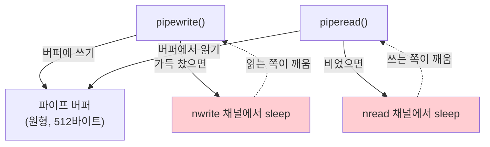
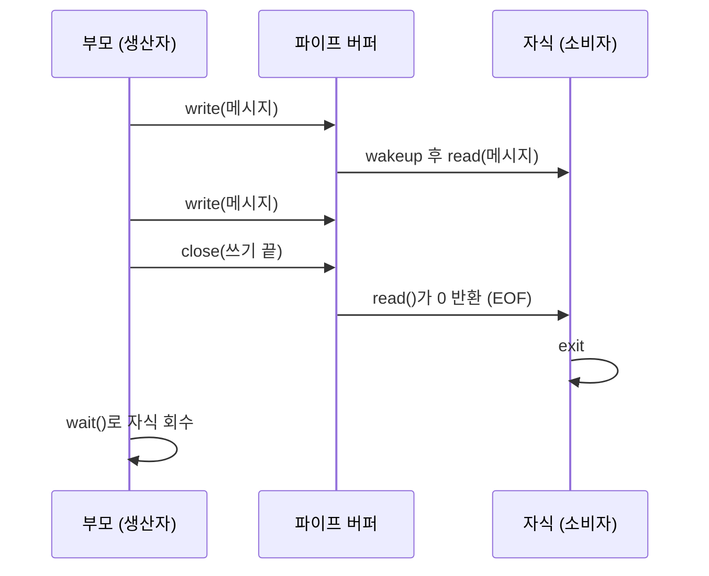

# 9주차 실습 — sleep/wakeup과 파이프

[레포지토리 안내](../../README.ko.md) | [English](Concepts_Lab.md) | [한국어](Concepts_Lab.ko.md)

> **최종 수정일:** 2026-11-18

> **학습 목표:**
> 1. xv6의 `sleep()`과 `wakeup()`이 조건 대기를 구현하는 방식과 두 함수가 락을 주고받는 순서를 설명할 수 있다
> 2. xv6 파이프의 원형 버퍼와 `pipewrite()`, `piperead()`의 흐름 제어를 분석할 수 있다
> 3. 파이프로 생산자-소비자 프로그램을 작성해 xv6에서 실행하고 출력을 해석할 수 있다
> 4. 잃어버린 깨우기(lost wakeup) 문제가 생기는 이유와 `sleep()`에 조건 락을 넘겨 이를 막는 원리를 설명할 수 있다

---

## 목차

- [1. 실습 개요](#1-실습-개요)
  - [1.1 조건을 기다리는 방법](#11-조건을-기다리는-방법)
  - [1.2 채널](#12-채널)
- [2. 실습 1: sleep()과 wakeup() 분석](#2-실습-1-sleep과-wakeup-분석)
  - [2.1 sleep(chan, lk)](#21-sleepchan-lk)
  - [2.2 락을 주고받는 순서](#22-락을-주고받는-순서)
  - [2.3 wakeup(chan)](#23-wakeupchan)
- [3. 실습 2: 파이프 구현 분석](#3-실습-2-파이프-구현-분석)
  - [3.1 struct pipe와 원형 버퍼](#31-struct-pipe와-원형-버퍼)
  - [3.2 pipewrite()](#32-pipewrite)
  - [3.3 piperead()](#33-piperead)
  - [3.4 pipeclose()와 EOF](#34-pipeclose와-eof)
  - [3.5 채널 정리](#35-채널-정리)
- [4. 실습 3: 파이프로 만드는 생산자-소비자](#4-실습-3-파이프로-만드는-생산자-소비자)
  - [4.1 프로그램 구조](#41-프로그램-구조)
  - [4.2 길이 접두 프로토콜](#42-길이-접두-프로토콜)
  - [4.3 xv6에 사용자 프로그램 추가](#43-xv6에-사용자-프로그램-추가)
  - [4.4 실행 결과](#44-실행-결과)
  - [4.5 실행 순서에 따른 동작](#45-실행-순서에-따른-동작)
- [5. 실습 4: 잃어버린 깨우기 문제](#5-실습-4-잃어버린-깨우기-문제)
  - [5.1 잘못된 구현](#51-잘못된-구현)
  - [5.2 문제가 되는 실행 순서](#52-문제가-되는-실행-순서)
  - [5.3 xv6의 해법](#53-xv6의-해법)
  - [5.4 파이프 블로킹 관찰](#54-파이프-블로킹-관찰)
- [요약](#요약)
- [점검 문제](#점검-문제)

---

<br>

## 1. 실습 개요

- **목표:** xv6 커널의 동기화 기본 연산인 `sleep()`, `wakeup()`과 이를 사용하는 파이프 구현을 소스 코드 수준에서 분석한다.
- **주제:** `sleep`/`wakeup` 코드 분석, 파이프 구현 분석, 파이프로 만드는 생산자-소비자, 잃어버린 깨우기 문제
- **관련 파일:** `kernel/proc.c`, `kernel/pipe.c`, `kernel/file.c`


*그림 1. 네 실습의 진행 순서*

### 1.1 조건을 기다리는 방법

운영체제에서는 프로세스가 어떤 조건이 성립할 때까지 기다려야 하는 경우가 많다. 파이프에 데이터가 도착하기를 기다리는 읽는 쪽, 파이프 버퍼에 빈 공간이 생기기를 기다리는 쓰는 쪽, 자식 프로세스가 종료하기를 기다리는 부모 프로세스가 그 예이다.

조건을 계속 검사하는 반복문으로 기다리면 조건이 성립할 때까지 CPU를 낭비한다. 이것이 9주차 4.2절의 바쁜 대기(busy waiting)이다. xv6는 이 문제를 **sleep/wakeup** 메커니즘으로 해결한다.

- `sleep(chan, lk)`: 현재 프로세스를 `SLEEPING` 상태로 바꾸고, 채널 `chan`에서 깨워질 때까지 CPU를 양보한다. `lk`는 기다리는 조건을 보호하는 락이다.
- `wakeup(chan)`: 채널 `chan`에서 잠든 모든 프로세스를 `RUNNABLE` 상태로 바꾼다.

이 쌍은 9주차 6.3절의 조건 변수가 제공하는 `wait`과 `signal`(정확히는 모두를 깨우는 broadcast)을 커널 내부에서 구현한 것이다. 6주차 실습 5절에서는 두 함수에 추적 출력을 넣어 상태 전이를 관찰했고, 이 실습에서는 두 함수의 코드와 이를 사용하는 파이프 구현을 읽는다.

### 1.2 채널

> **용어 정의:** **채널(channel)** 은 sleep/wakeup에서 프로세스가 기다리는 사건을 식별하는 임의의 주소 값이다. xv6는 보통 관련 자료 구조의 주소를 채널로 쓰며(예: `&pi->nread`), 어떤 채널로 `wakeup()`을 호출하면 그 채널에서 잠든 프로세스가 모두 깨어난다.

채널은 식별자로만 쓰이며, 커널은 채널 주소가 가리키는 메모리를 읽거나 쓰지 않는다. 사건마다 서로 다른 주소를 쓰기만 하면 되므로, 파이프 하나에서도 "읽을 데이터가 생김"에는 `&pi->nread`, "쓸 공간이 생김"에는 `&pi->nwrite`처럼 필드마다 다른 채널을 만들 수 있다.

---

<br>

## 2. 실습 1: sleep()과 wakeup() 분석

**목표:** `kernel/proc.c`의 `sleep()`과 `wakeup()`을 읽고 두 함수가 락을 주고받는 순서를 이해한다.

### 2.1 sleep(chan, lk)

```c
// 채널 chan에서 잠들며 조건 락 lk를 해제
// 깨어나면 lk를 다시 획득
void
sleep(void *chan, struct spinlock *lk)
{
  struct proc *p = myproc();

  // p->state를 바꾸고 sched를 호출하려면
  // p->lock 획득이 필요
  // p->lock을 쥐고 있으면 어떤 wakeup도
  // 놓치지 않음이 보장되므로
  // (wakeup은 p->lock을 획득)
  // lk를 해제해도 무방

  acquire(&p->lock);  //DOC: sleeplock1
  release(lk);

  // 잠들기
  p->chan = chan;
  p->state = SLEEPING;

  sched();

  // 정리
  p->chan = 0;

  // 원래의 락 재획득
  release(&p->lock);
  acquire(lk);
}
```

두 매개변수의 뜻은 다음과 같다.

- `chan`(`void *`): 잠드는 채널이다. 이 프로세스가 어떤 사건을 기다리는지 식별한다.
- `lk`(`struct spinlock *`): 기다리는 조건을 보호하는 락이다. 호출자는 조건을 검사할 때부터 이 락을 쥐고 있다가 그대로 `sleep()`을 호출한다.

`p->chan`과 `p->state`를 설정한 뒤 호출하는 `sched()`는 현재 프로세스의 문맥을 저장하고 그 CPU의 스케줄러 문맥으로 전환한다(6주차 실습 2절). 스케줄러는 다른 `RUNNABLE` 프로세스를 골라 실행하며, 잠든 프로세스는 누군가 `wakeup(chan)`을 호출해 `RUNNABLE`이 되고 스케줄러가 다시 고를 때까지 실행되지 않는다. 깨어난 뒤의 `p->chan = 0`은 정리 단계로, 이 프로세스가 더 이상 어떤 채널도 기다리지 않음을 나타낸다.


*그림 2. sleep() 안에서 일어나는 일의 순서*

### 2.2 락을 주고받는 순서

`sleep()` 안에서 락은 다음 순서로 바뀐다.

1. `acquire(&p->lock)`: 프로세스 자신의 락을 획득한다.
2. `release(lk)`: 조건 락을 해제한다.
3. `sched()`로 잠들었다가 깨어난다.
4. `release(&p->lock)`: 프로세스 락을 해제한다.
5. `acquire(lk)`: 조건 락을 다시 획득한다.

`sched()`는 `p->lock`을 쥔 상태에서만 호출할 수 있으며, 스케줄러는 전환을 마친 뒤 이 락을 해제한다. 나중에 스케줄러가 이 프로세스를 다시 고를 때는 `p->lock`을 획득한 채로 전환하므로, `sched()`에서 돌아온 시점의 프로세스는 다시 `p->lock`을 쥐고 있다. 4단계에서 `p->lock`을 해제하는 이유가 이것이다.

> **핵심:** `sleep()`은 조건 락 `lk`를 해제하기 **전에** `p->lock`을 먼저 획득한다. 두 락 중 적어도 하나를 항상 쥐고 있으므로 "조건 검사"와 "잠들기" 사이에 다른 CPU가 끼어들 틈이 생기지 않는다. 이 순서가 필요한 이유는 5절의 잃어버린 깨우기 문제에서 다룬다.

### 2.3 wakeup(chan)

```c
// 채널 chan에서 잠든 모든 프로세스를 깨움
// 호출자는 조건 락을 쥐고 있어야 함
void
wakeup(void *chan)
{
  struct proc *p;

  for(p = proc; p < &proc[NPROC]; p++) {
    if(p != myproc()){
      acquire(&p->lock);
      if(p->state == SLEEPING && p->chan == chan) {
        p->state = RUNNABLE;
      }
      release(&p->lock);
    }
  }
}
```

`wakeup()`은 프로세스 테이블 전체를 훑으며 상태가 `SLEEPING`이고 채널이 일치하는 프로세스를 모두 `RUNNABLE`로 바꾼다. 코드의 세부는 다음과 같다.

- **`p != myproc()` 조건:** `wakeup()`을 호출한 프로세스는 실행 중이므로 잠들어 있을 수 없다. 자기 자신을 건너뛰면 쓸데없는 검사를 줄이고, 호출자가 자신의 `p->lock`을 쥔 상태라도 같은 락을 두 번 획득하지 않게 된다.
- **각 프로세스의 `p->lock` 획득:** `p->state`와 `p->chan`을 안전하게 읽고 바꾸기 위해서이다. 그 프로세스 자신(`sleep()` 안)이나 다른 CPU의 스케줄러가 같은 프로세스의 상태를 동시에 바꾸지 못하게 한다.
- **깨우기만 하고 실행하지 않음:** 상태를 `RUNNABLE`로 바꿀 뿐이며, 깨어난 프로세스는 스케줄러가 고를 때 실행된다(6주차 실습 5.4절).

채널이 일치하는 프로세스를 **모두** 깨우는 방식은 구현이 단순하고, `wakeup()`이 정확히 어느 프로세스를 깨울지 알 필요가 없다는 장점이 있다. 반면 실제로는 하나만 진행할 수 있는 상황에서도 모두를 깨우게 된다.

> **용어 정의:** 한 사건을 기다리던 여러 프로세스가 한꺼번에 깨어나지만 실제로는 그중 하나만 진행할 수 있어, 나머지는 조건을 다시 검사한 뒤 다시 잠드는 현상을 **썬더링 허드(thundering herd)** 라고 한다. 불필요한 문맥 교환과 락 경쟁으로 성능이 떨어진다.

깨어난 프로세스는 자신이 기다리던 조건이 실제로 성립했는지 알 수 없다. 다른 프로세스가 먼저 깨어나 데이터를 가져갔을 수도 있기 때문이다. 그래서 xv6의 모든 `sleep()` 호출은 조건을 다시 검사하는 `while` 반복문 안에 있다.

> **핵심:** 조건 대기는 항상 `while (조건 불성립) sleep(chan, lk);` 형태로 쓴다. 깨어났다는 사실은 "조건이 바뀌었을 수 있다"는 뜻일 뿐이므로, 반복문으로 조건을 다시 확인해야 한다. 5주차 실습에서 `pthread_cond_wait()`를 `while` 안에서 호출한 것과 같은 원칙이다.

---

<br>

## 3. 실습 2: 파이프 구현 분석

**목표:** `kernel/pipe.c`에서 sleep/wakeup이 생산자-소비자 패턴을 지원하는 방식을 분석한다.

### 3.1 struct pipe와 원형 버퍼

```c
#define PIPESIZE 512

struct pipe {
  struct spinlock lock;
  char data[PIPESIZE];
  uint nread;     // 읽은 바이트 수
  uint nwrite;    // 쓴 바이트 수
  int readopen;   // 읽기 fd가 아직 열려 있음
  int writeopen;  // 쓰기 fd가 아직 열려 있음
};
```

파이프 버퍼는 512바이트 크기의 원형 버퍼이다. `nread`와 `nwrite`는 버퍼 안의 위치가 아니라 지금까지 읽은 바이트 수와 쓴 바이트 수를 세는 **단조 증가 카운터**이며, 실제 위치는 나머지 연산으로 구한다.

- 쓸 위치: `pi->data[pi->nwrite % PIPESIZE]`
- 읽을 위치: `pi->data[pi->nread % PIPESIZE]`
- 버퍼가 가득 참: `nwrite == nread + PIPESIZE`(쓴 양이 읽은 양보다 정확히 `PIPESIZE`만큼 앞섬)
- 버퍼가 빔: `nread == nwrite`(읽은 양과 쓴 양이 같음)

```text
data[]   0   1   2   3   4   5   6   7   8           511
       +---+---+---+---+---+---+---+---+---+-- ... --+---+
       |   |   | h | e | l | l | o |   |   |         |   |
       +---+---+---+---+---+---+---+---+---+-- ... --+---+
                 ^                   ^
          nread % 512 = 2     nwrite % 512 = 7

  저장된 바이트 수 = nwrite - nread             = 5
  남은 공간       = PIPESIZE - (nwrite - nread) = 507
```

*그림 3. 단조 증가 카운터로 관리하는 파이프의 원형 버퍼*

> **[자료구조]** 원형 버퍼를 머리와 꼬리 인덱스로만 관리하면 가득 찬 상태와 빈 상태에서 두 인덱스가 같아지므로, 칸 하나를 비워 두거나 개수를 따로 세야 한다. 단조 증가 카운터 두 개를 쓰면 차이 `nwrite - nread`가 곧 저장된 바이트 수이므로 두 상태를 바로 구분할 수 있다. `uint` 카운터가 2³²을 넘어 0으로 돌아가도 부호 없는 덧셈과 뺄셈은 2³²을 법으로 계산되고, 2³²이 512의 배수이므로 `% PIPESIZE`로 구한 위치와 두 카운터의 차이가 그대로 유지된다.

### 3.2 pipewrite()

```c
int
pipewrite(struct pipe *pi, uint64 addr, int n)
{
  int i = 0;
  struct proc *pr = myproc();

  acquire(&pi->lock);
  while(i < n){
    if(pi->readopen == 0 || killed(pr)){
      release(&pi->lock);
      return -1;
    }
    if(pi->nwrite == pi->nread + PIPESIZE){ //DOC: pipewrite-full
      wakeup(&pi->nread);
      sleep(&pi->nwrite, &pi->lock);
    } else {
      char ch;
      if(copyin(pr->pagetable, &ch, addr + i, 1) == -1)
        break;
      pi->data[pi->nwrite++ % PIPESIZE] = ch;
      i++;
    }
  }
  wakeup(&pi->nread);
  release(&pi->lock);

  return i;
}
```

쓰는 쪽은 `pi->lock`을 쥔 채 사용자 메모리에서 한 바이트씩 `copyin()`으로 가져와 버퍼에 넣는다. 버퍼가 가득 차면 다음 순서로 기다린다.

1. `wakeup(&pi->nread)`: 데이터를 읽어 공간을 비워 줄 읽는 쪽을 깨운다.
2. `sleep(&pi->nwrite, &pi->lock)`: 채널 `&pi->nwrite`에서 잠든다. `sleep()` 안에서 `pi->lock`이 해제되므로 읽는 쪽이 이 락을 얻어 진행할 수 있다.
3. 읽는 쪽이 데이터를 읽고 `wakeup(&pi->nwrite)`를 호출하면 깨어나, `while` 반복문의 처음으로 돌아가 조건을 다시 검사한다.

채널로 `&pi->nwrite`를 쓰는 것은 이 주소가 "이 파이프에 쓸 공간이 생기기를 기다림"을 나타내는 고유한 값이기 때문이며, 읽는 쪽이 같은 주소로 `wakeup(&pi->nwrite)`를 호출해 짝을 맞춘다. 반복문이 끝난 뒤 다시 호출하는 `wakeup(&pi->nread)`는 새 데이터가 생겼음을 읽는 쪽에 알린다. 읽는 쪽이 모두 닫혔거나(`readopen == 0`) 프로세스가 kill되었으면 -1을 반환하고, `copyin()`이 실패하면 그때까지 쓴 바이트 수를 반환한다.

### 3.3 piperead()

```c
int
piperead(struct pipe *pi, uint64 addr, int n)
{
  int i;
  struct proc *pr = myproc();
  char ch;

  acquire(&pi->lock);
  while(pi->nread == pi->nwrite && pi->writeopen){  //DOC: pipe-empty
    if(killed(pr)){
      release(&pi->lock);
      return -1;
    }
    sleep(&pi->nread, &pi->lock); //DOC: piperead-sleep
  }
  for(i = 0; i < n; i++){  //DOC: piperead-copy
    if(pi->nread == pi->nwrite)
      break;
    ch = pi->data[pi->nread % PIPESIZE];
    if(copyout(pr->pagetable, addr + i, &ch, 1) == -1) {
      if(i == 0)
        i = -1;
      break;
    }
    pi->nread++;
  }
  wakeup(&pi->nwrite);  //DOC: piperead-wakeup
  release(&pi->lock);
  return i;
}
```

`while`의 조건은 두 부분으로 이루어진다.

- `pi->nread == pi->nwrite`: 버퍼가 비어 읽을 데이터가 없다.
- `pi->writeopen`: 쓰기 끝이 아직 열려 있어 앞으로 데이터가 올 수 있다.

두 조건이 모두 참일 때만 잠든다. `writeopen`이 0이면 더 이상 데이터가 올 수 없으므로 기다리지 않고 바로 아래로 내려가며, 버퍼가 비어 있으면 0을 반환한다. 이 0이 EOF이다.

`while`을 빠져나오는 경우는 버퍼에 데이터가 있는 경우와 쓰기 끝이 닫힌 경우 두 가지이다. 두 번째 경우에는 버퍼가 비어 있을 수도, 데이터가 남아 있을 수도 있다. 그래서 `for` 반복문은 한 바이트씩 읽을 때마다 `nread == nwrite`를 다시 검사해 버퍼가 비면 멈춘다. 같은 이유로 버퍼에 남은 데이터가 요청한 `n`보다 적으면 `read()`는 요청보다 적은 바이트 수를 반환한다. 읽기를 마친 뒤에는 공간이 생겼으므로 `wakeup(&pi->nwrite)`로 쓰는 쪽을 깨운다.

### 3.4 pipeclose()와 EOF

파이프의 한쪽 끝을 가리키는 마지막 파일 참조가 닫히면 `fileclose()`가 `pipeclose()`를 호출한다.

```c
void
pipeclose(struct pipe *pi, int writable)
{
  acquire(&pi->lock);
  if(writable){
    pi->writeopen = 0;
    wakeup(&pi->nread);
  } else {
    pi->readopen = 0;
    wakeup(&pi->nwrite);
  }
  if(pi->readopen == 0 && pi->writeopen == 0){
    release(&pi->lock);
    kfree((char*)pi);
  } else
    release(&pi->lock);
}
```

쓰기 끝이 닫히면 `writeopen`을 0으로 만들고 `&pi->nread`에서 잠든 읽는 쪽을 깨운다. 깨어난 읽는 쪽은 `while` 조건이 거짓이 되어 빠져나오고, 버퍼가 비어 있으면 0(EOF)을 반환한다. 읽기 끝이 닫히면 `readopen`을 0으로 만들고 쓰는 쪽을 깨우며, 쓰는 쪽의 `pipewrite()`는 -1을 반환한다. 양쪽이 모두 닫히면 `pipealloc()`이 `kalloc()`으로 할당했던 파이프 페이지를 해제한다.

`fileclose()`는 파일의 참조 횟수가 0이 될 때만 `pipeclose()`를 호출한다. `fork()`로 쓰기 끝의 사본을 물려받은 프로세스가 하나라도 그 사본을 닫지 않으면 `writeopen`이 1로 남아 읽는 쪽이 EOF를 받지 못하는 이유가 여기에 있다(3주차 강의 노트의 파이프 EOF).

### 3.5 채널 정리

| 상황 | 잠드는 호출 | 채널 | 깨우는 쪽 |
|:-----|:-----|:-----|:-----|
| 빈 버퍼에서 기다리는 읽는 쪽 | `sleep(&pi->nread, &pi->lock)` | `&pi->nread` | 쓰는 쪽의 `wakeup(&pi->nread)`(`pipewrite()`, `pipeclose()`) |
| 가득 찬 버퍼에서 기다리는 쓰는 쪽 | `sleep(&pi->nwrite, &pi->lock)` | `&pi->nwrite` | 읽는 쪽의 `wakeup(&pi->nwrite)`(`piperead()`, `pipeclose()`) |

*표 1. 파이프에서 sleep과 wakeup이 짝을 이루는 채널*



*그림 4. 파이프의 읽는 쪽과 쓰는 쪽이 서로를 깨우는 관계*

> **핵심:** 파이프는 커널 수준의 생산자-소비자 구현이다. 버퍼가 가득 차면 쓰는 쪽이, 비면 읽는 쪽이 자동으로 잠들어 흐름이 제어되고, 쓰기 끝을 닫으면 읽는 쪽의 `read()`가 0을 반환한다. 9주차 8.1절의 유한 버퍼 문제를 세마포어 대신 sleep/wakeup으로 푼 것이다.

---

<br>

## 4. 실습 3: 파이프로 만드는 생산자-소비자

**목표:** 파이프로 생산자-소비자 패턴을 구현한 xv6 사용자 프로그램을 작성하고 실행한다. 부모 프로세스가 생산자로서 파이프에 메시지를 쓰고, 자식 프로세스가 소비자로서 메시지를 읽어 출력한다.

### 4.1 프로그램 구조

```c
#include "kernel/types.h"
#include "kernel/stat.h"
#include "user/user.h"

int
main(int argc, char *argv[])
{
  int fds[2];
  int pid;

  // 파이프 생성
  if(pipe(fds) < 0){
    printf("pipe() failed\n");
    exit(1);
  }

  pid = fork();
  if(pid < 0){
    printf("fork() failed\n");
    exit(1);
  }

  if(pid == 0){
    // 자식 프로세스 (소비자)
    close(fds[1]);  // 쓰기 끝 닫기
    // ... fds[0]에서 읽기 ...
    close(fds[0]);
    exit(0);
  } else {
    // 부모 프로세스 (생산자)
    close(fds[0]);  // 읽기 끝 닫기
    // ... fds[1]에 쓰기 ...
    close(fds[1]);
    wait(0);
    exit(0);
  }
}
```

각 프로세스는 쓰지 않는 끝을 먼저 닫는다. 생산자는 쓰기를 마치면 쓰기 끝을 닫아 소비자에게 EOF를 알리고, `wait(0)`으로 소비자가 끝나기를 기다린다. xv6의 `main()`은 `return` 대신 `exit()`로 끝낸다.

### 4.2 길이 접두 프로토콜

파이프는 메시지 경계가 없는 바이트 스트림이다. 그래서 생산자는 메시지마다 길이 1바이트를 먼저 보내고 본문을 이어 보내며, 소비자는 길이를 먼저 읽은 뒤 그 길이만큼 찰 때까지 `read()`를 반복한다. 한 번의 `read()`가 요청한 것보다 적은 바이트를 반환할 수 있기 때문이다(3.3절의 `for` 반복문).

```c
#define NUM_MESSAGES 5   // 생산자가 보낼 메시지 수
#define MSG_SIZE 64      // 메시지 버퍼의 최대 크기

static void
consumer(int readfd)
{
  char buf[MSG_SIZE];
  int n;

  printf("[Consumer] Reading from pipe...\n");
  while(1){
    // 1단계: 메시지 길이(1바이트) 읽기, 파이프가 비어 있으면 잠듦
    char lenbuf;
    n = read(readfd, &lenbuf, 1);
    if(n <= 0)
      break;  // EOF 또는 오류

    int msglen = (int)lenbuf;
    if(msglen <= 0 || msglen >= MSG_SIZE)
      break;  // 비정상 길이

    // 2단계: 본문을 길이만큼 다 찰 때까지 반복해서 읽기
    int total = 0;
    while(total < msglen){
      n = read(readfd, buf + total, msglen - total);
      if(n <= 0)
        break;
      total += n;
    }
    if(total < msglen)
      break;  // 불완전한 메시지

    buf[total] = '\0';
    printf("[Consumer] Received: %s\n", buf);
  }
  printf("[Consumer] Pipe closed by producer (read returned 0). Exiting.\n");
}

static void
producer(int writefd)
{
  char buf[MSG_SIZE];

  printf("[Producer] Sending %d messages through pipe...\n", NUM_MESSAGES);
  for(int i = 0; i < NUM_MESSAGES; i++){
    int msglen = make_message(i, buf, MSG_SIZE);  // "msg i: hello from producer"

    char lenbuf = (char)msglen;
    write(writefd, &lenbuf, 1);   // 1단계: 길이
    write(writefd, buf, msglen);  // 2단계: 본문
    printf("[Producer] Sent: %s\n", buf);
  }
  printf("[Producer] Done. Closing write end.\n");
}
```

xv6에는 `sprintf()`가 없으므로 `make_message()`는 정수를 문자열로 바꾸는 보조 함수를 이용해 `"msg 0: hello from producer"` 같은 문자열을 직접 이어 붙인다. `main()`은 4.1절의 구조에서 자식이 `consumer(fds[0])`, 부모가 `producer(fds[1])`을 호출한다.

### 4.3 xv6에 사용자 프로그램 추가

새 사용자 프로그램은 다음 순서로 xv6에 넣는다.

1. 소스 파일을 `user/` 디렉토리에 복사한다.
2. `Makefile`의 `UPROGS` 목록에 `$U/_이름\` 한 줄을 추가한다.
3. 다시 빌드하고 xv6 셸에서 실행한다.

```bash
cp lab3_producer_consumer.c xv6-riscv/user/prodcons.c
```

```makefile
UPROGS=\
    ...
    $U/_prodcons\
```

```bash
make clean && make qemu
```

> **주의:** xv6의 디렉토리 엔트리는 파일 이름을 `DIRSIZ`(14)바이트까지만 담는다(`kernel/fs.h`의 `struct dirent`). `mkfs`는 `fs.img`를 만들 때 `user/_` 뒤의 이름이 14바이트를 넘으면 `Assertion failed: (strlen(shortname) <= DIRSIZ)`로 중단하므로, `lab3_producer_consumer`(22바이트)나 `producer_consumer`(17바이트) 같은 이름은 쓸 수 없고 `prodcons`처럼 짧은 이름을 써야 한다.

### 4.4 실행 결과

CPU를 하나로 두고(`make CPUS=1 qemu`) 실행하면 다음과 같이 출력된다.

```text
$ prodcons
[Producer] Sending 5 messages through pipe...
[Producer] Sent: msg 0: hello from producer
[Producer] Sent: msg 1: hello from producer
[Producer] Sent: msg 2: hello from producer
[Producer] Sent: msg 3: hello from producer
[Producer] Sent: msg 4: hello from producer
[Producer] Done. Closing write end.
[Consumer] Reading from pipe...
[Consumer] Received: msg 0: hello from producer
[Consumer] Received: msg 1: hello from producer
[Consumer] Received: msg 2: hello from producer
[Consumer] Received: msg 3: hello from producer
[Consumer] Received: msg 4: hello from producer
[Consumer] Pipe closed by producer (read returned 0). Exiting.
```

단일 CPU에서는 `fork()` 뒤에 부모가 계속 실행된다. 부모는 다섯 메시지(길이 1바이트와 본문 26바이트씩, 모두 135바이트)를 512바이트 버퍼에 모두 쓰고 쓰기 끝을 닫은 다음 `wait()`에서 잠든다. 그제야 자식이 실행되므로 소비자는 버퍼에 이미 있는 데이터를 읽기만 하고 빈 버퍼에서 잠들지 않는다. 마지막 `read()`는 `writeopen`이 0이고 버퍼가 비어 있으므로 0을 반환한다.

CPU가 여럿이면(`make CPUS=3 qemu`) 부모와 자식이 서로 다른 CPU에서 동시에 실행되어 두 프로세스의 출력이 섞인다. xv6의 사용자 `printf()`는 한 글자마다 `write()`를 한 번씩 호출하므로(`user/printf.c`의 `putc()`) 출력은 줄 단위가 아니라 글자 단위로 섞인다.

```text
$ prodcons
[Pr[oCondusumceer]r Re] Saedingn fdriomng pi pe5.. .m
essages through pipe...
```

### 4.5 실행 순서에 따른 동작

- **소비자가 먼저 실행되는 경우:** 소비자의 `read()`가 빈 버퍼를 만나 커널의 `piperead()` 안에서 `sleep(&pi->nread, &pi->lock)`을 호출하고 `SLEEPING`이 된다. 생산자가 데이터를 쓰면 `pipewrite()`의 `wakeup(&pi->nread)`가 소비자를 깨운다.
- **생산자가 쓰기 끝을 닫는 경우:** `pipeclose()`가 `writeopen`을 0으로 만들고 소비자를 깨운다. 소비자는 `while`을 빠져나오고, 버퍼가 비어 있으면 `for` 반복문을 한 번도 돌지 않은 채 0을 반환한다(EOF).
- **512바이트보다 큰 데이터를 한 번에 쓰는 경우:** 버퍼가 가득 차는 순간 생산자는 `sleep(&pi->nwrite, &pi->lock)`으로 잠든다. 소비자가 데이터를 읽어 공간이 생기면 `wakeup(&pi->nwrite)`로 깨어나 나머지를 쓴다. 데이터는 잃어버리지 않으며 흐름 제어가 자동으로 이루어진다.



*그림 5. 파이프로 연결된 생산자와 소비자의 상호 작용*

> **주의:** 소비자(자식)가 `fork()`로 물려받은 쓰기 끝 `fds[1]`을 닫지 않으면, 생산자가 자신의 쓰기 끝을 닫아도 쓰기 끝을 가리키는 파일 참조가 남아 `pipeclose()`가 호출되지 않는다. 그러면 `writeopen`이 1로 남아 소비자는 빈 버퍼에서 영원히 잠든다.

---

<br>

## 5. 실습 4: 잃어버린 깨우기 문제

**목표:** sleep/wakeup을 잘못 구현했을 때 생기는 잃어버린 깨우기 문제를 이해하고, xv6가 이를 막는 방법을 분석한다.

> **용어 정의:** **잃어버린 깨우기(lost wakeup)** 는 깨우기 신호가 대상 프로세스가 잠들기 전에 도착해 무시되고, 그 뒤로는 잠든 프로세스를 깨울 신호가 오지 않아 프로세스가 영원히 잠드는 버그이다.

### 5.1 잘못된 구현

`sleep()`이 락 매개변수를 받지 않는 단순한 형태라고 하자.

```c
// 잘못된 sleep 구현 (락 매개변수 없음)
void broken_sleep(void *chan)
{
  struct proc *p = myproc();
  acquire(&p->lock);
  p->chan = chan;
  p->state = SLEEPING;
  sched();
  p->chan = 0;
  release(&p->lock);
}
```

이 함수로 `piperead()`를 쓰면 조건 락을 직접 해제한 뒤 잠들어야 한다.

```c
// 잘못된 piperead: 잃어버린 깨우기 발생 가능
int broken_piperead(struct pipe *pi, uint64 addr, int n)
{
  acquire(&pi->lock);
  while(pi->nread == pi->nwrite && pi->writeopen){
    release(&pi->lock);        // (A) 락 해제
    // <-- 여기서 wakeup이 일어나면? -->
    broken_sleep(&pi->nread);  // (B) 잠들기
  }
  // ... 데이터 읽기 ...
  release(&pi->lock);
}
```

### 5.2 문제가 되는 실행 순서

두 CPU에서 다음 순서로 실행된다고 하자.

```text
시점  읽는 쪽 (CPU 0)                   쓰는 쪽 (CPU 1)
----  --------------------------------  --------------------------------
 1    버퍼가 비었는지 검사 (참)
 2    release(&pi->lock)   // (A)
 3                                      acquire(&pi->lock)
 4                                      버퍼에 데이터 쓰기
 5                                      wakeup(&pi->nread)
 6                                      // 읽는 쪽이 아직 SLEEPING이 아니므로 무시됨
 7                                      release(&pi->lock)
 8    broken_sleep(&pi->nread) // (B)
 9    // 깨워 줄 사람이 없어 영원히 잠듦
```

*그림 6. 잘못된 구현에서 깨우기 신호를 잃는 실행 순서*

락을 해제한 (A)와 실제로 `SLEEPING`이 되는 (B) 사이에 **틈**이 있다. 쓰는 쪽이 이 틈에 `wakeup()`을 호출하면 읽는 쪽은 아직 잠들지 않았으므로 신호가 무시된다. 그 뒤 읽는 쪽이 잠들면, 쓰는 쪽은 이미 할 일을 마쳤으므로 깨워 줄 프로세스가 없다. 버퍼에 데이터가 있는데도 읽는 쪽은 영원히 잠든다.

### 5.3 xv6의 해법

xv6의 `sleep()`은 조건 락을 매개변수로 받아 이 틈을 없앤다.

```c
void
sleep(void *chan, struct spinlock *lk)
{
  struct proc *p = myproc();

  acquire(&p->lock);   // (1) 프로세스 락 획득
  release(lk);         // (2) 조건 락 해제

  p->chan = chan;
  p->state = SLEEPING; // (3) SLEEPING 상태로 설정

  sched();             // (4) 스케줄러로 전환

  p->chan = 0;

  release(&p->lock);
  acquire(lk);
}
```

동작 원리는 다음과 같다.

1. `release(lk)`는 `acquire(&p->lock)` 뒤에 수행된다.
2. 읽는 쪽이 `p->lock`을 쥔 채 `lk`를 해제하므로, 쓰는 쪽이 `wakeup()`을 호출해도 `p->lock`을 얻지 못해 읽는 쪽의 상태를 검사할 수 없다.
3. `p->lock`은 읽는 쪽이 `p->state = SLEEPING`을 마치고 `sched()`로 CPU를 양보한 **뒤에야** 스케줄러 안에서 해제된다.
4. 그제야 쓰는 쪽의 `wakeup()`이 `p->lock`을 얻어 읽는 쪽을 깨운다.

```text
시점  읽는 쪽 (CPU 0)                   쓰는 쪽 (CPU 1)
----  --------------------------------  --------------------------------
 1    버퍼가 비었는지 검사 (참)
 2    acquire(&p->lock)
 3    release(&pi->lock)
 4    p->state = SLEEPING               acquire(&pi->lock)
 5    sched() -> p->lock 해제           버퍼에 데이터 쓰기
 6                                      wakeup(&pi->nread)
 7                                        acquire(&p->lock)   // 이제 성공
 8                                        p->state = RUNNABLE // 깨어남
 9                                        release(&p->lock)
```

*그림 7. xv6의 sleep()에서 깨우기 신호가 전달되는 실행 순서*

쓰는 쪽도 규칙을 지킨다. `pipewrite()`는 `pi->lock`을 쥔 채 데이터를 쓰고 `wakeup()`을 호출하며, 읽는 쪽은 `pi->lock`을 쥔 채 조건을 검사하고 `sleep()` 안에서 `p->lock`을 얻은 뒤에야 `pi->lock`을 놓는다. 따라서 쓰는 쪽의 `wakeup()`은 읽는 쪽이 조건을 검사하기 전에 실행되거나(그러면 읽는 쪽은 데이터를 보고 잠들지 않는다), 읽는 쪽이 `SLEEPING`이 된 뒤에 실행될 수밖에 없다. `wakeup()`의 주석이 "호출자는 조건 락을 쥐고 있어야 한다"고 요구하는 이유이다.

> **핵심:** `sleep()`에 조건 락을 넘기는 규칙은 "조건 검사"에서 "잠든 상태로 전환"까지를 `p->lock`으로 보호해 사실상 원자적으로 만든다. 조건 락과 `p->lock`이 겹쳐 쥐어지는 구간이 있으므로 `wakeup()`이 끼어들 틈이 없다.

### 5.4 파이프 블로킹 관찰

`lab1_wakeup_demo.c`는 파이프의 블로킹 동작으로 커널의 sleep/wakeup을 관찰하는 xv6 사용자 프로그램이다. 4.3절과 같은 방법으로 `user/wakeup_demo.c`로 복사하고 `UPROGS`에 `$U/_wakeup_demo\`를 추가해 실행한다. 세 데모는 모두 `pipe()`와 `fork()`로 자식(읽는 쪽)과 부모(쓰는 쪽)를 만들고, 시간 차를 두기 위해 `pause()`를 쓴다.

`pause(n)`은 n틱 동안 잠드는 xv6 시스템 콜이다. 커널의 `sys_pause()`는 `tickslock`을 쥔 채 `while(ticks - ticks0 < n) sleep(&ticks, &tickslock);`으로 기다리며, 타이머 인터럽트 처리기가 틱마다 `wakeup(&ticks)`를 호출한다. QEMU에서 xv6의 한 틱은 약 0.1초이다.

**데모 1: 읽는 쪽이 쓰는 쪽을 기다린다.** 부모가 `pause(10)`으로 기다리는 동안 자식의 `read()`가 빈 파이프에서 `&pi->nread` 채널에 잠든다. 부모가 `write()`를 호출하면 `pipewrite()`의 `wakeup(&pi->nread)`가 자식을 깨운다.

```c
if(pid == 0){                          // 자식: 읽는 쪽
  close(fds[1]);
  printf("[Reader] Calling read()... (pipe is empty, will block)\n");
  int n = read(fds[0], buf, sizeof(buf) - 1);  // piperead()에서 잠듦
  ...
} else {                               // 부모: 쓰는 쪽
  close(fds[0]);
  printf("[Writer] Waiting 10 ticks before sending data...\n");
  pause(10);                           // 읽는 쪽이 먼저 잠들 시간을 줌
  write(fds[1], msg, strlen(msg));     // wakeup(&pi->nread)
  close(fds[1]);
  wait(0);
}
```

**데모 2: 버퍼가 가득 차면 쓰는 쪽이 잠든다.** 부모는 `PIPESIZE`(512)보다 큰 600바이트를 한 번의 `write()`로 쓰고, 자식은 `pause(10)` 뒤에 읽기 시작한다. 512바이트를 쓴 시점에 버퍼가 가득 차므로 부모는 `&pi->nwrite`에서 잠들고, 자식이 읽어 공간이 생기면 깨어나 나머지 88바이트를 쓴다.

```c
// 부모: 600바이트를 한 번에 쓰기
char bigbuf[600];
for(int i = 0; i < 600; i++)
  bigbuf[i] = 'A' + (i % 26);
int written = write(fds[1], bigbuf, 600);   // 512바이트 뒤 sleep(&pi->nwrite)

// 자식: 10틱 뒤에 128바이트씩 읽기
pause(10);
while((n = read(fds[0], buf, sizeof(buf))) > 0)
  total += n;                               // 읽을 때마다 wakeup(&pi->nwrite)
```

**데모 3: 쓰기 끝을 닫으면 EOF가 전달된다.** 부모는 메시지 하나를 쓰고 `pause(10)` 뒤에 쓰기 끝을 닫는다. 자식은 첫 `read()`로 메시지를 받고, 두 번째 `read()`에서 다시 잠든다. 부모의 `close()`가 `pipeclose()`를 거쳐 `writeopen = 0`과 `wakeup(&pi->nread)`를 수행하면 자식은 깨어나 0을 반환받는다.

`make CPUS=1 qemu`로 실행한 결과는 다음과 같다.

```text
$ wakeup_demo

========================================
  Sleep/Wakeup Demo via Pipe Blocking
========================================

=== Demo 1: Reader blocks until Writer sends data ===
[Writer] Waiting 10 ticks before sending data...
[Reader] Calling read()... (pipe is empty, will block)
[Writer] Writing "wakeup!" to pipe...
[Writer] Data sent. Reader should wake up now.
[Reader] Woke up! Received 7 bytes: "wakeup!"
=== Demo 1 complete ===

=== Demo 2: Writer blocks when pipe buffer is full ===
[Writer] Trying to write 600 bytes (PIPESIZE=512)...
[Reader] Waiting 10 ticks before reading...
[Reader] Starting to read (Writer may be blocked)...
[Writer] Successfully wrote 600 bytes
[Reader] Total bytes read: 600
=== Demo 2 complete ===

=== Demo 3: Pipe close triggers EOF for reader ===
[Writer] Sent "last message"
[Reader] Waiting for data...
[Reader] Got: "last message"
[Reader] Calling read() again... waiting for more data or EOF
[Writer] Closing write end of pipe...
[Reader] read() returned 0 (0 = EOF)
=== Demo 3 complete ===

All demos completed.
```

데모 2에서 `[Writer] Successfully wrote 600 bytes`가 `[Reader] Starting to read` 뒤에 나오는 것은, 쓰는 쪽의 `write()`가 512바이트를 쓴 뒤 잠들어 있다가 읽는 쪽이 읽기 시작한 뒤에야 끝났음을 보여 준다.

> **참고:** `pause()`로 실행 순서를 맞추는 방법은 시간에 기대므로 순서를 보장하지 않는다. CPU가 여럿이면 부모와 자식이 동시에 실행되어 4.4절처럼 출력이 글자 단위로 섞이고, 시스템이 바쁘면 `pause()`가 끝난 뒤에도 상대가 아직 잠들지 않았을 수 있다. 순서가 필요하면 파이프 자체처럼 sleep/wakeup에 기반한 동기화를 써야 한다.

---

<br>

## 요약

| 개념 | 핵심 요약 |
|:-----|:-----|
| sleep(chan, lk) | 현재 프로세스를 채널 `chan`에서 `SLEEPING`으로 만들고, `p->lock`을 먼저 얻은 뒤 조건 락 `lk`를 해제하며, 깨어나면 `lk`를 다시 획득한다. |
| wakeup(chan) | 채널 `chan`에서 잠든 모든 프로세스를 `RUNNABLE`로 바꾸기만 하므로, 깨어난 프로세스는 `while` 반복문으로 조건을 다시 검사해야 한다. |
| 채널 | 기다리는 사건을 식별하는 임의의 주소이며, 파이프는 `&pi->nread`와 `&pi->nwrite`를 서로 다른 채널로 쓴다. |
| 파이프 버퍼 | 512바이트 원형 버퍼를 단조 증가 카운터 `nread`, `nwrite`로 관리하며, 가득 참은 `nwrite == nread + PIPESIZE`, 빔은 `nread == nwrite`이다. |
| 흐름 제어와 EOF | 버퍼가 가득 차면 쓰는 쪽이, 비면 읽는 쪽이 잠들고, 쓰기 끝을 가리키는 마지막 참조가 닫히면 `read()`가 0을 반환한다. |
| 잃어버린 깨우기 | 조건 검사와 잠들기 사이의 틈에 도착한 `wakeup()`이 무시되는 버그이며, 조건 락을 `sleep()`에 넘겨 `p->lock`과 겹쳐 쥐면 막을 수 있다. |
| DIRSIZ 제한 | xv6 파일 이름은 14바이트까지이므로 `UPROGS`에 추가하는 프로그램 이름도 14바이트 이하여야 한다. |

---

<br>

## 점검 문제

1. `sleep()`이 조건 락 `lk`를 해제하기 전에 `p->lock`을 먼저 획득하는 이유는 무엇인가?

   <details>
   <summary>정답</summary>

   `wakeup()`은 각 프로세스의 상태를 검사하기 전에 그 프로세스의 `p->lock`을 획득한다. `sleep()`이 `p->lock`을 쥔 채 `lk`를 해제하면, 다른 CPU가 `lk`를 얻어 조건을 바꾸고 `wakeup()`을 호출하더라도 `p->lock`을 얻지 못해 기다리게 된다. `p->lock`은 프로세스가 `SLEEPING`이 되고 `sched()`로 CPU를 넘긴 뒤에야 스케줄러에서 해제되므로, `wakeup()`은 반드시 잠든 상태를 보게 되어 깨우기 신호를 잃지 않는다.

   </details>

2. `wakeup()`이 채널이 일치하는 프로세스를 모두 깨우는 방식의 장점과 단점을 쓰고, 깨어난 프로세스가 조건을 다시 검사해야 하는 이유를 설명하라.

   <details>
   <summary>정답</summary>

   장점은 구현이 단순하고 `wakeup()`이 정확히 어느 프로세스를 깨울지 알 필요가 없다는 것이다. 단점은 하나만 진행할 수 있는 상황에서도 모두를 깨우는 썬더링 허드 현상으로 불필요한 문맥 교환과 락 경쟁이 생긴다는 것이다. 먼저 깨어난 프로세스가 데이터를 가져갔을 수 있으므로, 깨어났다는 사실이 조건이 성립했음을 보장하지 않는다. 그래서 `sleep()`은 조건을 다시 검사하는 `while` 반복문 안에서 호출해야 한다.

   </details>

3. 파이프 버퍼가 가득 찬 조건과 빈 조건을 `nread`, `nwrite`로 쓰고, 위치 인덱스 대신 단조 증가 카운터를 쓰는 이점을 설명하라.

   <details>
   <summary>정답</summary>

   가득 참은 `nwrite == nread + PIPESIZE`, 빔은 `nread == nwrite`이다. 실제 위치는 `% PIPESIZE`로 구한다. 머리와 꼬리 인덱스만 쓰면 가득 찬 상태와 빈 상태에서 두 인덱스가 같아 구분하려면 칸 하나를 비우거나 개수를 따로 세야 하지만, 카운터의 차이 `nwrite - nread`는 곧 저장된 바이트 수이므로 두 상태를 바로 구분할 수 있다. `uint` 카운터가 넘쳐도 2³²이 512의 배수이므로 위치와 차이 계산이 그대로 유지된다.

   </details>

4. `pipewrite()`는 버퍼가 가득 찼을 때 `sleep(&pi->nwrite, &pi->lock)` 앞에서 `wakeup(&pi->nread)`를 호출한다. 이 호출이 없으면 어떤 일이 생길 수 있는가?

   <details>
   <summary>정답</summary>

   읽는 쪽은 쓰는 쪽이 쓰기를 시작하기 전에 빈 버퍼에서 `&pi->nread`에 잠들었을 수 있다. `pipewrite()`는 반복문 도중에는 읽는 쪽을 깨우지 않으므로, 버퍼가 가득 찼을 때 깨우지 않고 바로 잠들면 쓰는 쪽은 공간을, 읽는 쪽은 데이터를 기다리며 둘 다 영원히 잠든다. 잠들기 전에 읽는 쪽을 깨워야 읽는 쪽이 데이터를 비우고 `wakeup(&pi->nwrite)`로 쓰는 쪽을 깨울 수 있다.

   </details>

5. 생산자가 `close(fds[1])`을 호출했는데도 소비자의 `read()`가 0을 반환하지 않고 영원히 기다리는 경우는 언제인가?

   <details>
   <summary>정답</summary>

   소비자(자식)가 `fork()`로 물려받은 쓰기 끝 `fds[1]`을 닫지 않은 경우이다. `fileclose()`는 파일의 참조 횟수가 0이 될 때만 `pipeclose()`를 호출하므로, 소비자가 가진 쓰기 끝 사본이 남아 있으면 `writeopen`이 1로 유지된다. 그러면 `piperead()`의 `while (nread == nwrite && writeopen)` 조건이 계속 참이 되어 소비자는 빈 버퍼에서 영원히 잠든다.

   </details>

6. `make CPUS=1 qemu`로 `prodcons`를 실행하면 소비자가 `piperead()`에서 한 번도 잠들지 않는 이유는 무엇인가? CPU가 셋이면 출력은 어떻게 달라지는가?

   <details>
   <summary>정답</summary>

   단일 CPU에서는 `fork()` 뒤 부모가 계속 실행되어 135바이트의 메시지를 512바이트 버퍼에 모두 쓰고, 쓰기 끝을 닫은 뒤 `wait()`에서 잠든다. 그때 처음 실행되는 소비자는 이미 버퍼에 있는 데이터를 읽기만 하면 되고, 마지막 `read()`는 `writeopen`이 0이므로 잠들지 않고 0을 반환한다. CPU가 셋이면 부모와 자식이 동시에 실행되고, xv6의 `printf()`가 글자마다 `write()`를 호출하므로 두 프로세스의 출력이 글자 단위로 섞인다.

   </details>
