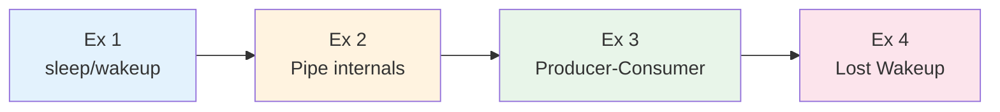
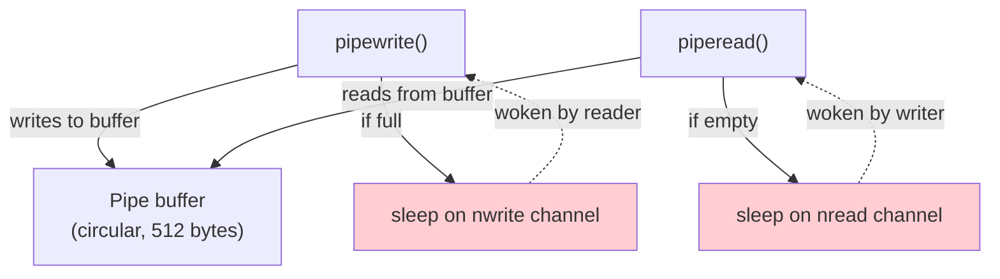
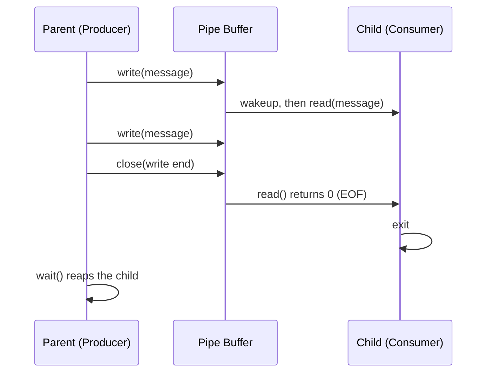

# Week 9 Lab — sleep/wakeup and Pipes

[Repository Guide](../../README.md) | [English](Concepts_Lab.md) | [한국어](Concepts_Lab.ko.md)

> **Last Updated:** 2026-11-18

> **Learning Objectives:**
> 1. Explain how xv6's `sleep()` and `wakeup()` implement condition waiting and in what order the two functions exchange locks
> 2. Analyze the circular buffer of the xv6 pipe and the flow control of `pipewrite()` and `piperead()`
> 3. Write a producer-consumer program with a pipe, run it in xv6, and interpret its output
> 4. Explain why the lost wakeup problem arises and how passing the condition lock to `sleep()` prevents it

---

## Table of Contents

- [1. Lab Overview](#1-lab-overview)
  - [1.1 How to Wait for a Condition](#11-how-to-wait-for-a-condition)
  - [1.2 Channels](#12-channels)
- [2. Exercise 1: Analyzing sleep() and wakeup()](#2-exercise-1-analyzing-sleep-and-wakeup)
  - [2.1 sleep(chan, lk)](#21-sleepchan-lk)
  - [2.2 The Order of Lock Exchanges](#22-the-order-of-lock-exchanges)
  - [2.3 wakeup(chan)](#23-wakeupchan)
- [3. Exercise 2: Analyzing the Pipe Implementation](#3-exercise-2-analyzing-the-pipe-implementation)
  - [3.1 struct pipe and the Circular Buffer](#31-struct-pipe-and-the-circular-buffer)
  - [3.2 pipewrite()](#32-pipewrite)
  - [3.3 piperead()](#33-piperead)
  - [3.4 pipeclose() and EOF](#34-pipeclose-and-eof)
  - [3.5 Channel Summary](#35-channel-summary)
- [4. Exercise 3: Producer-Consumer with a Pipe](#4-exercise-3-producer-consumer-with-a-pipe)
  - [4.1 Program Structure](#41-program-structure)
  - [4.2 A Length-Prefix Protocol](#42-a-length-prefix-protocol)
  - [4.3 Adding a User Program to xv6](#43-adding-a-user-program-to-xv6)
  - [4.4 Execution Result](#44-execution-result)
  - [4.5 Behavior by Execution Order](#45-behavior-by-execution-order)
- [5. Exercise 4: The Lost Wakeup Problem](#5-exercise-4-the-lost-wakeup-problem)
  - [5.1 An Incorrect Implementation](#51-an-incorrect-implementation)
  - [5.2 The Problematic Interleaving](#52-the-problematic-interleaving)
  - [5.3 The xv6 Solution](#53-the-xv6-solution)
  - [5.4 Observing Pipe Blocking](#54-observing-pipe-blocking)
- [Summary](#summary)
- [Self-Check Questions](#self-check-questions)

---

<br>

## 1. Lab Overview

- **Objective:** Analyze, at the source-code level, the xv6 kernel's synchronization primitives `sleep()` and `wakeup()` and the pipe implementation that uses them.
- **Topics:** `sleep`/`wakeup` code analysis, pipe implementation analysis, producer-consumer with a pipe, the lost wakeup problem
- **Files:** `kernel/proc.c`, `kernel/pipe.c`, `kernel/file.c`



*Figure 1. Order of the four exercises*

### 1.1 How to Wait for a Condition

In an operating system, a process often has to wait until some condition holds. Examples are a reader waiting for data to arrive in a pipe, a writer waiting for free space in a pipe buffer, and a parent process waiting for a child process to exit.

Waiting in a loop that checks the condition over and over wastes the CPU until the condition holds. This is the busy waiting of Week 9, Section 4.2. xv6 solves this problem with the **sleep/wakeup** mechanism.

- `sleep(chan, lk)`: Changes the current process to the `SLEEPING` state and yields the CPU until it is woken on channel `chan`. `lk` is the lock that protects the awaited condition.
- `wakeup(chan)`: Changes every process sleeping on channel `chan` to the `RUNNABLE` state.

This pair implements, inside the kernel, the `wait` and `signal` (more precisely, a broadcast that wakes everyone) offered by the condition variables of Week 9, Section 6.3. The Week 6 Lab, Section 5, added trace output to the two functions to observe state transitions; this lab reads the code of the two functions and the pipe implementation that uses them.

### 1.2 Channels

> **Definition:** A **channel** is an arbitrary address value that, in sleep/wakeup, identifies the event a process is waiting for. xv6 usually uses the address of a related data structure as the channel (for example, `&pi->nread`), and calling `wakeup()` on a channel wakes every process sleeping on that channel.

A channel serves only as an identifier; the kernel never reads or writes the memory the channel address points to. Since each event only needs a distinct address, even a single pipe can create different channels from different fields, such as `&pi->nread` for "data became available to read" and `&pi->nwrite` for "space became available to write".

---

<br>

## 2. Exercise 1: Analyzing sleep() and wakeup()

**Objective:** Read `sleep()` and `wakeup()` in `kernel/proc.c` and understand the order in which the two functions exchange locks.

### 2.1 sleep(chan, lk)

```c
// Sleep on channel chan, releasing condition lock lk.
// Re-acquires lk when awakened.
void
sleep(void *chan, struct spinlock *lk)
{
  struct proc *p = myproc();

  // Must acquire p->lock in order to
  // change p->state and then call sched.
  // Once we hold p->lock, we can be
  // guaranteed that we won't miss any wakeup
  // (wakeup locks p->lock),
  // so it's okay to release lk.

  acquire(&p->lock);  //DOC: sleeplock1
  release(lk);

  // Go to sleep.
  p->chan = chan;
  p->state = SLEEPING;

  sched();

  // Tidy up.
  p->chan = 0;

  // Reacquire original lock.
  release(&p->lock);
  acquire(lk);
}
```

The two parameters mean the following.

- `chan` (`void *`): The channel to sleep on. It identifies which event this process is waiting for.
- `lk` (`struct spinlock *`): The lock that protects the awaited condition. The caller holds this lock from the moment it checks the condition and calls `sleep()` while still holding it.

After setting `p->chan` and `p->state`, `sleep()` calls `sched()`, which saves the current process's context and switches to the scheduler context of that CPU (Week 6 Lab, Section 2). The scheduler picks and runs another `RUNNABLE` process, and the sleeping process does not run until someone calls `wakeup(chan)` to make it `RUNNABLE` and the scheduler picks it again. The `p->chan = 0` after waking up is a tidy-up step indicating that this process no longer waits on any channel.


*Figure 2. Sequence of events inside sleep()*

### 2.2 The Order of Lock Exchanges

Inside `sleep()`, the locks change in the following order.

1. `acquire(&p->lock)`: Acquire the process's own lock.
2. `release(lk)`: Release the condition lock.
3. Go to sleep through `sched()` and later wake up.
4. `release(&p->lock)`: Release the process lock.
5. `acquire(lk)`: Re-acquire the condition lock.

`sched()` may be called only while holding `p->lock`, and the scheduler releases this lock after the switch completes. When the scheduler later picks this process again, it switches while holding `p->lock`, so the process that returns from `sched()` holds `p->lock` again. This is why step 4 releases `p->lock`.

> **Key Point:** `sleep()` acquires `p->lock` **before** it releases the condition lock `lk`. Because at least one of the two locks is always held, no other CPU can slip in between "checking the condition" and "going to sleep". Section 5, on the lost wakeup problem, explains why this order is necessary.

### 2.3 wakeup(chan)

```c
// Wake up all processes sleeping on channel chan.
// Caller should hold the condition lock.
void
wakeup(void *chan)
{
  struct proc *p;

  for(p = proc; p < &proc[NPROC]; p++) {
    if(p != myproc()){
      acquire(&p->lock);
      if(p->state == SLEEPING && p->chan == chan) {
        p->state = RUNNABLE;
      }
      release(&p->lock);
    }
  }
}
```

`wakeup()` scans the entire process table and changes every process whose state is `SLEEPING` and whose channel matches to `RUNNABLE`. The details of the code are as follows.

- **The `p != myproc()` condition:** The process that calls `wakeup()` is running, so it cannot be asleep. Skipping itself avoids a useless check and, even if the caller holds its own `p->lock`, avoids acquiring that lock twice.
- **Acquiring each process's `p->lock`:** This is needed to read and modify `p->state` and `p->chan` safely. It prevents the process itself (inside `sleep()`) or the scheduler on another CPU from changing the same process's state at the same time.
- **Waking without running:** `wakeup()` only changes the state to `RUNNABLE`; the woken process runs when the scheduler picks it (Week 6 Lab, Section 5.4).

Waking **all** processes whose channel matches keeps the implementation simple and spares `wakeup()` from knowing exactly which process to wake. On the other hand, it wakes everyone even when only one of them can actually proceed.

> **Definition:** The **thundering herd** is the phenomenon in which several processes waiting for one event all wake up at once, but only one of them can actually proceed, so the others recheck the condition and go back to sleep. The needless context switches and lock contention degrade performance.

A woken process cannot know whether the condition it was waiting for actually holds, because another process may have woken first and taken the data. For this reason, every `sleep()` call in xv6 sits inside a `while` loop that rechecks the condition.

> **Key Point:** A condition wait is always written as `while (condition does not hold) sleep(chan, lk);`. Waking up only means "the condition may have changed", so the loop must check the condition again. This is the same principle as calling `pthread_cond_wait()` inside a `while` loop in the Week 5 Lab.

---

<br>

## 3. Exercise 2: Analyzing the Pipe Implementation

**Objective:** Analyze how sleep/wakeup supports the producer-consumer pattern in `kernel/pipe.c`.

### 3.1 struct pipe and the Circular Buffer

```c
#define PIPESIZE 512

struct pipe {
  struct spinlock lock;
  char data[PIPESIZE];
  uint nread;     // number of bytes read
  uint nwrite;    // number of bytes written
  int readopen;   // read fd is still open
  int writeopen;  // write fd is still open
};
```

The pipe buffer is a circular buffer of 512 bytes. `nread` and `nwrite` are not positions in the buffer but **monotonically increasing counters** of the bytes read and written so far, and the actual position is obtained with a modulo operation.

- Write position: `pi->data[pi->nwrite % PIPESIZE]`
- Read position: `pi->data[pi->nread % PIPESIZE]`
- Buffer full: `nwrite == nread + PIPESIZE` (the amount written is exactly `PIPESIZE` ahead of the amount read)
- Buffer empty: `nread == nwrite` (the amount read equals the amount written)

```text
data[]   0   1   2   3   4   5   6   7   8           511
       +---+---+---+---+---+---+---+---+---+-- ... --+---+
       |   |   | h | e | l | l | o |   |   |         |   |
       +---+---+---+---+---+---+---+---+---+-- ... --+---+
                 ^                   ^
          nread % 512 = 2     nwrite % 512 = 7

  bytes stored = nwrite - nread             = 5
  free space   = PIPESIZE - (nwrite - nread) = 507
```

*Figure 3. The circular buffer of a pipe managed with monotonically increasing counters*

> **[Data Structures]** If a circular buffer is managed only with head and tail indices, the two indices are equal both when the buffer is full and when it is empty, so one slot must be left unused or the count must be tracked separately. With two monotonically increasing counters, the difference `nwrite - nread` is exactly the number of bytes stored, so the two states are distinguished directly. Even when a `uint` counter passes 2³² and wraps to 0, unsigned addition and subtraction are computed modulo 2³², and since 2³² is a multiple of 512, the position obtained with `% PIPESIZE` and the difference between the two counters stay correct.

### 3.2 pipewrite()

```c
int
pipewrite(struct pipe *pi, uint64 addr, int n)
{
  int i = 0;
  struct proc *pr = myproc();

  acquire(&pi->lock);
  while(i < n){
    if(pi->readopen == 0 || killed(pr)){
      release(&pi->lock);
      return -1;
    }
    if(pi->nwrite == pi->nread + PIPESIZE){ //DOC: pipewrite-full
      wakeup(&pi->nread);
      sleep(&pi->nwrite, &pi->lock);
    } else {
      char ch;
      if(copyin(pr->pagetable, &ch, addr + i, 1) == -1)
        break;
      pi->data[pi->nwrite++ % PIPESIZE] = ch;
      i++;
    }
  }
  wakeup(&pi->nread);
  release(&pi->lock);

  return i;
}
```

While holding `pi->lock`, the writer fetches one byte at a time from user memory with `copyin()` and places it in the buffer. When the buffer becomes full, it waits in the following order.

1. `wakeup(&pi->nread)`: Wake the reader, which will read data and free up space.
2. `sleep(&pi->nwrite, &pi->lock)`: Sleep on channel `&pi->nwrite`. `pi->lock` is released inside `sleep()`, so the reader can acquire it and proceed.
3. When the reader reads data and calls `wakeup(&pi->nwrite)`, the writer wakes up, returns to the top of the `while` loop, and checks the condition again.

The channel is `&pi->nwrite` because this address is a unique value meaning "waiting for space to write into this pipe", and the reader pairs with it by calling `wakeup(&pi->nwrite)` on the same address. The `wakeup(&pi->nread)` called again after the loop tells the reader that new data is available. If all readers have closed (`readopen == 0`) or the process has been killed, the function returns -1, and if `copyin()` fails, it returns the number of bytes written so far.

### 3.3 piperead()

```c
int
piperead(struct pipe *pi, uint64 addr, int n)
{
  int i;
  struct proc *pr = myproc();
  char ch;

  acquire(&pi->lock);
  while(pi->nread == pi->nwrite && pi->writeopen){  //DOC: pipe-empty
    if(killed(pr)){
      release(&pi->lock);
      return -1;
    }
    sleep(&pi->nread, &pi->lock); //DOC: piperead-sleep
  }
  for(i = 0; i < n; i++){  //DOC: piperead-copy
    if(pi->nread == pi->nwrite)
      break;
    ch = pi->data[pi->nread % PIPESIZE];
    if(copyout(pr->pagetable, addr + i, &ch, 1) == -1) {
      if(i == 0)
        i = -1;
      break;
    }
    pi->nread++;
  }
  wakeup(&pi->nwrite);  //DOC: piperead-wakeup
  release(&pi->lock);
  return i;
}
```

The `while` condition has two parts.

- `pi->nread == pi->nwrite`: The buffer is empty, so there is no data to read.
- `pi->writeopen`: The write end is still open, so data may still arrive.

The reader sleeps only when both are true. If `writeopen` is 0, no more data can arrive, so the reader does not wait and proceeds immediately, returning 0 if the buffer is empty. This 0 is EOF.

The `while` loop exits in two cases: when the buffer has data and when the write end is closed. In the second case, the buffer may be empty or may still hold data. Therefore the `for` loop rechecks `nread == nwrite` for every byte it reads and stops when the buffer becomes empty. For the same reason, if fewer bytes remain in the buffer than the requested `n`, `read()` returns fewer bytes than requested. After reading, space has been freed, so `wakeup(&pi->nwrite)` wakes the writer.

### 3.4 pipeclose() and EOF

When the last file reference to one end of a pipe is closed, `fileclose()` calls `pipeclose()`.

```c
void
pipeclose(struct pipe *pi, int writable)
{
  acquire(&pi->lock);
  if(writable){
    pi->writeopen = 0;
    wakeup(&pi->nread);
  } else {
    pi->readopen = 0;
    wakeup(&pi->nwrite);
  }
  if(pi->readopen == 0 && pi->writeopen == 0){
    release(&pi->lock);
    kfree((char*)pi);
  } else
    release(&pi->lock);
}
```

When the write end is closed, `pipeclose()` sets `writeopen` to 0 and wakes the readers sleeping on `&pi->nread`. A woken reader finds the `while` condition false, leaves the loop, and returns 0 (EOF) if the buffer is empty. When the read end is closed, it sets `readopen` to 0 and wakes the writers, whose `pipewrite()` then returns -1. When both ends are closed, it frees the pipe page that `pipealloc()` allocated with `kalloc()`.

`fileclose()` calls `pipeclose()` only when the file's reference count reaches 0. This is why, if even one process that inherited a copy of the write end through `fork()` leaves that copy open, `writeopen` stays 1 and the reader never receives EOF (the pipe EOF in the Week 3 lecture notes).

### 3.5 Channel Summary

| Situation | Sleeping call | Channel | Woken by |
|:-----|:-----|:-----|:-----|
| Reader waiting on an empty buffer | `sleep(&pi->nread, &pi->lock)` | `&pi->nread` | The writer's `wakeup(&pi->nread)` (`pipewrite()`, `pipeclose()`) |
| Writer waiting on a full buffer | `sleep(&pi->nwrite, &pi->lock)` | `&pi->nwrite` | The reader's `wakeup(&pi->nwrite)` (`piperead()`, `pipeclose()`) |

*Table 1. Channels on which sleep and wakeup pair up in a pipe*



*Figure 4. How the reader and writer of a pipe wake each other*

> **Key Point:** A pipe is a kernel-level producer-consumer implementation. When the buffer is full the writer sleeps, and when it is empty the reader sleeps, so flow is controlled automatically, and closing the write end makes the reader's `read()` return 0. It solves the bounded-buffer problem of Week 9, Section 8.1, with sleep/wakeup instead of semaphores.

---

<br>

## 4. Exercise 3: Producer-Consumer with a Pipe

**Objective:** Write and run an xv6 user program that implements the producer-consumer pattern with a pipe. The parent process, as the producer, writes messages to the pipe, and the child process, as the consumer, reads and prints them.

### 4.1 Program Structure

```c
#include "kernel/types.h"
#include "kernel/stat.h"
#include "user/user.h"

int
main(int argc, char *argv[])
{
  int fds[2];
  int pid;

  // Create pipe
  if(pipe(fds) < 0){
    printf("pipe() failed\n");
    exit(1);
  }

  pid = fork();
  if(pid < 0){
    printf("fork() failed\n");
    exit(1);
  }

  if(pid == 0){
    // Child process (Consumer)
    close(fds[1]);  // Close write end
    // ... read from fds[0] ...
    close(fds[0]);
    exit(0);
  } else {
    // Parent process (Producer)
    close(fds[0]);  // Close read end
    // ... write to fds[1] ...
    close(fds[1]);
    wait(0);
    exit(0);
  }
}
```

Each process first closes the end it does not use. When the producer finishes writing, it closes the write end to signal EOF to the consumer and waits for the consumer to finish with `wait(0)`. In xv6, `main()` ends with `exit()` instead of `return`.

### 4.2 A Length-Prefix Protocol

A pipe is a byte stream with no message boundaries. Therefore the producer sends a one-byte length before each message and then the body, and the consumer first reads the length and then repeats `read()` until that many bytes have arrived. This is necessary because a single `read()` may return fewer bytes than requested (the `for` loop of Section 3.3).

```c
#define NUM_MESSAGES 5   // Number of messages the Producer will send
#define MSG_SIZE 64      // Maximum message buffer size

static void
consumer(int readfd)
{
  char buf[MSG_SIZE];
  int n;

  printf("[Consumer] Reading from pipe...\n");
  while(1){
    // Step 1: Read the message length (1 byte). Sleeps if the pipe is empty.
    char lenbuf;
    n = read(readfd, &lenbuf, 1);
    if(n <= 0)
      break;  // EOF or error

    int msglen = (int)lenbuf;
    if(msglen <= 0 || msglen >= MSG_SIZE)
      break;  // Abnormal length

    // Step 2: Read the body repeatedly until the full length has arrived.
    int total = 0;
    while(total < msglen){
      n = read(readfd, buf + total, msglen - total);
      if(n <= 0)
        break;
      total += n;
    }
    if(total < msglen)
      break;  // Incomplete message

    buf[total] = '\0';
    printf("[Consumer] Received: %s\n", buf);
  }
  printf("[Consumer] Pipe closed by producer (read returned 0). Exiting.\n");
}

static void
producer(int writefd)
{
  char buf[MSG_SIZE];

  printf("[Producer] Sending %d messages through pipe...\n", NUM_MESSAGES);
  for(int i = 0; i < NUM_MESSAGES; i++){
    int msglen = make_message(i, buf, MSG_SIZE);  // "msg i: hello from producer"

    char lenbuf = (char)msglen;
    write(writefd, &lenbuf, 1);   // Step 1: length
    write(writefd, buf, msglen);  // Step 2: body
    printf("[Producer] Sent: %s\n", buf);
  }
  printf("[Producer] Done. Closing write end.\n");
}
```

Because xv6 has no `sprintf()`, `make_message()` builds strings such as `"msg 0: hello from producer"` by hand, using a helper that converts an integer to a string. In the structure of Section 4.1, `main()` has the child call `consumer(fds[0])` and the parent call `producer(fds[1])`.

### 4.3 Adding a User Program to xv6

A new user program is added to xv6 in the following order.

1. Copy the source file into the `user/` directory.
2. Add a line `$U/_name\` to the `UPROGS` list in the `Makefile`.
3. Rebuild and run the program from the xv6 shell.

```bash
cp lab3_producer_consumer.c xv6-riscv/user/prodcons.c
```

```makefile
UPROGS=\
    ...
    $U/_prodcons\
```

```bash
make clean && make qemu
```

> **Caution:** An xv6 directory entry holds a file name of at most `DIRSIZ` (14) bytes (`struct dirent` in `kernel/fs.h`). When `mkfs` builds `fs.img`, it aborts with `Assertion failed: (strlen(shortname) <= DIRSIZ)` if the name after `user/_` exceeds 14 bytes, so names such as `lab3_producer_consumer` (22 bytes) or `producer_consumer` (17 bytes) cannot be used, and a short name such as `prodcons` is required.

### 4.4 Execution Result

With a single CPU (`make CPUS=1 qemu`), the program prints the following.

```text
$ prodcons
[Producer] Sending 5 messages through pipe...
[Producer] Sent: msg 0: hello from producer
[Producer] Sent: msg 1: hello from producer
[Producer] Sent: msg 2: hello from producer
[Producer] Sent: msg 3: hello from producer
[Producer] Sent: msg 4: hello from producer
[Producer] Done. Closing write end.
[Consumer] Reading from pipe...
[Consumer] Received: msg 0: hello from producer
[Consumer] Received: msg 1: hello from producer
[Consumer] Received: msg 2: hello from producer
[Consumer] Received: msg 3: hello from producer
[Consumer] Received: msg 4: hello from producer
[Consumer] Pipe closed by producer (read returned 0). Exiting.
```

On a single CPU, the parent keeps running after `fork()`. It writes all five messages (a one-byte length plus a 26-byte body each, 135 bytes in total) into the 512-byte buffer, closes the write end, and sleeps in `wait()`. Only then does the child run, so the consumer just reads data already in the buffer and never sleeps on an empty buffer. The last `read()` returns 0 because `writeopen` is 0 and the buffer is empty.

With several CPUs (`make CPUS=3 qemu`), the parent and child run simultaneously on different CPUs and the output of the two processes is mixed. Because xv6's user `printf()` calls `write()` once per character (`putc()` in `user/printf.c`), the output is mixed character by character rather than line by line.

```text
$ prodcons
[Pr[oCondusumceer]r Re] Saedingn fdriomng pi pe5.. .m
essages through pipe...
```

### 4.5 Behavior by Execution Order

- **When the consumer runs first:** The consumer's `read()` finds an empty buffer, calls `sleep(&pi->nread, &pi->lock)` inside the kernel's `piperead()`, and becomes `SLEEPING`. When the producer writes data, the `wakeup(&pi->nread)` in `pipewrite()` wakes the consumer.
- **When the producer closes the write end:** `pipeclose()` sets `writeopen` to 0 and wakes the consumer. The consumer leaves the `while` loop and, if the buffer is empty, returns 0 without running the `for` loop even once (EOF).
- **When more than 512 bytes are written at once:** The moment the buffer becomes full, the producer sleeps with `sleep(&pi->nwrite, &pi->lock)`. When the consumer reads data and frees space, `wakeup(&pi->nwrite)` wakes the producer, which writes the rest. No data is lost, and flow control happens automatically.



*Figure 5. Interaction between a producer and a consumer connected by a pipe*

> **Caution:** If the consumer (child) does not close the write end `fds[1]` it inherited through `fork()`, then even after the producer closes its own write end, a file reference to the write end remains and `pipeclose()` is never called. `writeopen` then stays 1, and the consumer sleeps forever on an empty buffer.

---

<br>

## 5. Exercise 4: The Lost Wakeup Problem

**Objective:** Understand the lost wakeup problem that arises when sleep/wakeup is implemented incorrectly, and analyze how xv6 prevents it.

> **Definition:** A **lost wakeup** is a bug in which a wakeup signal arrives before the target process has gone to sleep and is ignored, and afterward no signal comes to wake the sleeping process, so the process sleeps forever.

### 5.1 An Incorrect Implementation

Suppose `sleep()` has a simple form that takes no lock parameter.

```c
// Incorrect sleep implementation (no lock parameter)
void broken_sleep(void *chan)
{
  struct proc *p = myproc();
  acquire(&p->lock);
  p->chan = chan;
  p->state = SLEEPING;
  sched();
  p->chan = 0;
  release(&p->lock);
}
```

Writing `piperead()` with this function requires releasing the condition lock explicitly and then sleeping.

```c
// Incorrect piperead: a lost wakeup can occur
int broken_piperead(struct pipe *pi, uint64 addr, int n)
{
  acquire(&pi->lock);
  while(pi->nread == pi->nwrite && pi->writeopen){
    release(&pi->lock);        // (A) Release lock
    // <-- What if wakeup happens here? -->
    broken_sleep(&pi->nread);  // (B) Enter sleep
  }
  // ... read data ...
  release(&pi->lock);
}
```

### 5.2 The Problematic Interleaving

Suppose the two CPUs execute in the following order.

```text
Time  Reader (CPU 0)                    Writer (CPU 1)
----  --------------------------------  --------------------------------
 1    Check buffer empty (true)
 2    release(&pi->lock)   // (A)
 3                                      acquire(&pi->lock)
 4                                      Write data to buffer
 5                                      wakeup(&pi->nread)
 6                                      // reader not SLEEPING yet: ignored
 7                                      release(&pi->lock)
 8    broken_sleep(&pi->nread) // (B)
 9    // sleeps forever: nobody to wake it
```

*Figure 6. Interleaving that loses the wakeup signal in the incorrect implementation*

There is a **gap** between point (A), where the lock is released, and point (B), where the process actually becomes `SLEEPING`. If the writer calls `wakeup()` in this gap, the reader has not yet gone to sleep, so the signal is ignored. When the reader then goes to sleep, the writer has already finished its work, so no process is left to wake it. Even though the buffer holds data, the reader sleeps forever.

### 5.3 The xv6 Solution

xv6's `sleep()` removes this gap by taking the condition lock as a parameter.

```c
void
sleep(void *chan, struct spinlock *lk)
{
  struct proc *p = myproc();

  acquire(&p->lock);   // (1) Acquire process lock
  release(lk);         // (2) Release condition lock

  p->chan = chan;
  p->state = SLEEPING; // (3) Set SLEEPING state

  sched();             // (4) Switch to scheduler

  p->chan = 0;

  release(&p->lock);
  acquire(lk);
}
```

It works as follows.

1. `release(lk)` is performed after `acquire(&p->lock)`.
2. Because the reader releases `lk` while holding `p->lock`, even if the writer calls `wakeup()`, it cannot acquire `p->lock` and therefore cannot examine the reader's state.
3. `p->lock` is released inside the scheduler only **after** the reader has completed `p->state = SLEEPING` and yielded the CPU with `sched()`.
4. Only then can the writer's `wakeup()` acquire `p->lock` and wake the reader.

```text
Time  Reader (CPU 0)                    Writer (CPU 1)
----  --------------------------------  --------------------------------
 1    Check buffer empty (true)
 2    acquire(&p->lock)
 3    release(&pi->lock)
 4    p->state = SLEEPING               acquire(&pi->lock)
 5    sched() -> p->lock released       Write data to buffer
 6                                      wakeup(&pi->nread)
 7                                        acquire(&p->lock)   // now succeeds
 8                                        p->state = RUNNABLE // woken up
 9                                        release(&p->lock)
```

*Figure 7. Interleaving in which xv6's sleep() delivers the wakeup signal*

The writer follows the rule as well. `pipewrite()` writes data and calls `wakeup()` while holding `pi->lock`, and the reader checks the condition while holding `pi->lock` and lets go of `pi->lock` only after acquiring `p->lock` inside `sleep()`. Therefore the writer's `wakeup()` can run only before the reader checks the condition (in which case the reader sees the data and does not sleep) or after the reader has become `SLEEPING`. This is why the comment on `wakeup()` requires that "Caller should hold the condition lock".

> **Key Point:** The rule of passing the condition lock to `sleep()` protects everything from "checking the condition" to "switching to the sleeping state" with `p->lock`, making it effectively atomic. Because there is an interval in which the condition lock and `p->lock` are held at the same time, `wakeup()` has no gap to slip into.

### 5.4 Observing Pipe Blocking

`lab1_wakeup_demo.c` is an xv6 user program that observes the kernel's sleep/wakeup through the blocking behavior of pipes. As in Section 4.3, copy it to `user/wakeup_demo.c`, add `$U/_wakeup_demo\` to `UPROGS`, and run it. All three demos create a child (reader) and a parent (writer) with `pipe()` and `fork()` and use `pause()` to introduce a time gap.

`pause(n)` is the xv6 system call that sleeps for n ticks. The kernel's `sys_pause()` waits with `while(ticks - ticks0 < n) sleep(&ticks, &tickslock);` while holding `tickslock`, and the timer interrupt handler calls `wakeup(&ticks)` on every tick. In QEMU, one xv6 tick is about 0.1 seconds.

**Demo 1: The reader waits for the writer.** While the parent waits with `pause(10)`, the child's `read()` sleeps on channel `&pi->nread` on the empty pipe. When the parent calls `write()`, the `wakeup(&pi->nread)` in `pipewrite()` wakes the child.

```c
if(pid == 0){                          // child: reader
  close(fds[1]);
  printf("[Reader] Calling read()... (pipe is empty, will block)\n");
  int n = read(fds[0], buf, sizeof(buf) - 1);  // sleeps in piperead()
  ...
} else {                               // parent: writer
  close(fds[0]);
  printf("[Writer] Waiting 10 ticks before sending data...\n");
  pause(10);                           // give the reader time to sleep first
  write(fds[1], msg, strlen(msg));     // wakeup(&pi->nread)
  close(fds[1]);
  wait(0);
}
```

**Demo 2: The writer sleeps when the buffer is full.** The parent writes 600 bytes, more than `PIPESIZE` (512), in a single `write()`, and the child starts reading after `pause(10)`. The buffer becomes full once 512 bytes have been written, so the parent sleeps on `&pi->nwrite`, and when the child reads and frees space, the parent wakes and writes the remaining 88 bytes.

```c
// parent: writes 600 bytes at once
char bigbuf[600];
for(int i = 0; i < 600; i++)
  bigbuf[i] = 'A' + (i % 26);
int written = write(fds[1], bigbuf, 600);   // sleep(&pi->nwrite) after 512 bytes

// child: reads 128 bytes at a time after 10 ticks
pause(10);
while((n = read(fds[0], buf, sizeof(buf))) > 0)
  total += n;                               // wakeup(&pi->nwrite) on every read
```

**Demo 3: Closing the write end delivers EOF.** The parent writes one message and closes the write end after `pause(10)`. The child receives the message with its first `read()` and sleeps again in its second `read()`. When the parent's `close()` performs `writeopen = 0` and `wakeup(&pi->nread)` through `pipeclose()`, the child wakes up and gets 0 as the return value.

The result of running with `make CPUS=1 qemu` is as follows.

```text
$ wakeup_demo

========================================
  Sleep/Wakeup Demo via Pipe Blocking
========================================

=== Demo 1: Reader blocks until Writer sends data ===
[Writer] Waiting 10 ticks before sending data...
[Reader] Calling read()... (pipe is empty, will block)
[Writer] Writing "wakeup!" to pipe...
[Writer] Data sent. Reader should wake up now.
[Reader] Woke up! Received 7 bytes: "wakeup!"
=== Demo 1 complete ===

=== Demo 2: Writer blocks when pipe buffer is full ===
[Writer] Trying to write 600 bytes (PIPESIZE=512)...
[Reader] Waiting 10 ticks before reading...
[Reader] Starting to read (Writer may be blocked)...
[Writer] Successfully wrote 600 bytes
[Reader] Total bytes read: 600
=== Demo 2 complete ===

=== Demo 3: Pipe close triggers EOF for reader ===
[Writer] Sent "last message"
[Reader] Waiting for data...
[Reader] Got: "last message"
[Reader] Calling read() again... waiting for more data or EOF
[Writer] Closing write end of pipe...
[Reader] read() returned 0 (0 = EOF)
=== Demo 3 complete ===

All demos completed.
```

In Demo 2, `[Writer] Successfully wrote 600 bytes` appears after `[Reader] Starting to read`, which shows that the writer's `write()` slept after writing 512 bytes and finished only after the reader had started reading.

> **Note:** Ordering execution with `pause()` relies on timing and therefore does not guarantee the order. With several CPUs, the parent and child run simultaneously and their output is mixed character by character as in Section 4.4, and on a busy system the other process may still not be asleep when `pause()` returns. When an order is required, synchronization based on sleep/wakeup, such as the pipe itself, must be used.

---

<br>

## Summary

| Concept | Key Summary |
|:-----|:-----|
| sleep(chan, lk) | Makes the current process `SLEEPING` on channel `chan`, acquires `p->lock` before releasing the condition lock `lk`, and re-acquires `lk` on waking. |
| wakeup(chan) | Only changes every process sleeping on channel `chan` to `RUNNABLE`, so a woken process must recheck its condition in a `while` loop. |
| Channel | An arbitrary address that identifies the awaited event; the pipe uses `&pi->nread` and `&pi->nwrite` as separate channels. |
| Pipe buffer | A 512-byte circular buffer managed with the monotonically increasing counters `nread` and `nwrite`; full is `nwrite == nread + PIPESIZE`, and empty is `nread == nwrite`. |
| Flow control and EOF | The writer sleeps when the buffer is full and the reader sleeps when it is empty, and `read()` returns 0 once the last reference to the write end is closed. |
| Lost wakeup | A bug in which a `wakeup()` arriving in the gap between checking the condition and sleeping is ignored; passing the condition lock to `sleep()` so that it overlaps with `p->lock` prevents it. |
| DIRSIZ limit | xv6 file names are at most 14 bytes, so the name of a program added to `UPROGS` must also be 14 bytes or fewer. |

---

<br>

## Self-Check Questions

1. Why does `sleep()` acquire `p->lock` before releasing the condition lock `lk`?

   <details>
   <summary>Answer</summary>

   `wakeup()` acquires each process's `p->lock` before examining that process's state. If `sleep()` releases `lk` while holding `p->lock`, then even when another CPU acquires `lk`, changes the condition, and calls `wakeup()`, it cannot acquire `p->lock` and must wait. `p->lock` is released in the scheduler only after the process has become `SLEEPING` and handed over the CPU with `sched()`, so `wakeup()` always sees the sleeping state and the wakeup signal is never lost.

   </details>

2. State the advantage and disadvantage of `wakeup()` waking every process whose channel matches, and explain why a woken process must recheck its condition.

   <details>
   <summary>Answer</summary>

   The advantage is that the implementation is simple and `wakeup()` need not know exactly which process to wake. The disadvantage is the thundering herd: everyone is woken even when only one can proceed, which causes needless context switches and lock contention. A process that woke earlier may have taken the data, so waking up does not guarantee that the condition holds. Therefore `sleep()` must be called inside a `while` loop that rechecks the condition.

   </details>

3. Write the full and empty conditions of the pipe buffer in terms of `nread` and `nwrite`, and explain the advantage of using monotonically increasing counters instead of position indices.

   <details>
   <summary>Answer</summary>

   Full is `nwrite == nread + PIPESIZE`, and empty is `nread == nwrite`. The actual position is obtained with `% PIPESIZE`. With only head and tail indices, the two indices are equal in both the full and the empty state, so distinguishing them requires leaving one slot empty or tracking the count separately; the counter difference `nwrite - nread`, however, is exactly the number of bytes stored, so the two states are distinguished directly. Even if a `uint` counter overflows, the position and difference calculations remain correct because 2³² is a multiple of 512.

   </details>

4. When the buffer is full, `pipewrite()` calls `wakeup(&pi->nread)` before `sleep(&pi->nwrite, &pi->lock)`. What could happen without this call?

   <details>
   <summary>Answer</summary>

   The reader may have gone to sleep on `&pi->nread` on an empty buffer before the writer started writing. Since `pipewrite()` does not wake the reader in the middle of its loop, if it went straight to sleep when the buffer became full, the writer would wait for space and the reader for data, and both would sleep forever. Waking the reader before sleeping lets the reader drain data and wake the writer with `wakeup(&pi->nwrite)`.

   </details>

5. When does the consumer's `read()` wait forever instead of returning 0 even though the producer has called `close(fds[1])`?

   <details>
   <summary>Answer</summary>

   It happens when the consumer (child) has not closed the write end `fds[1]` it inherited through `fork()`. `fileclose()` calls `pipeclose()` only when the file's reference count reaches 0, so as long as the consumer's copy of the write end remains, `writeopen` stays 1. Then the condition `while (nread == nwrite && writeopen)` in `piperead()` stays true, and the consumer sleeps forever on an empty buffer.

   </details>

6. Why does the consumer never sleep in `piperead()` when `prodcons` runs with `make CPUS=1 qemu`? How does the output change with three CPUs?

   <details>
   <summary>Answer</summary>

   On a single CPU, the parent keeps running after `fork()`, writes all 135 bytes of messages into the 512-byte buffer, closes the write end, and sleeps in `wait()`. The consumer, which runs for the first time at that point, only needs to read data already in the buffer, and its last `read()` returns 0 without sleeping because `writeopen` is 0. With three CPUs, the parent and child run simultaneously, and because xv6's `printf()` calls `write()` for every character, the output of the two processes is mixed character by character.

   </details>
