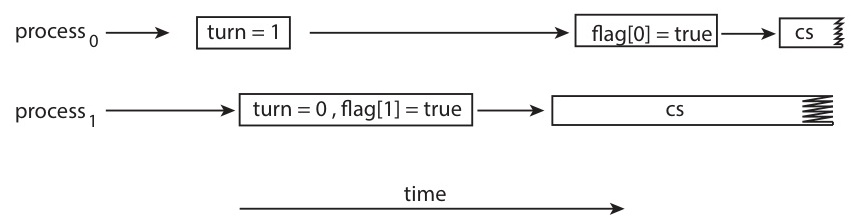
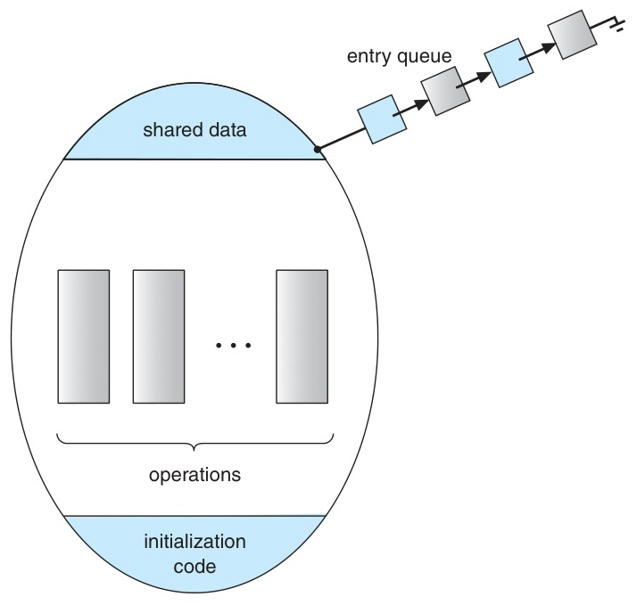
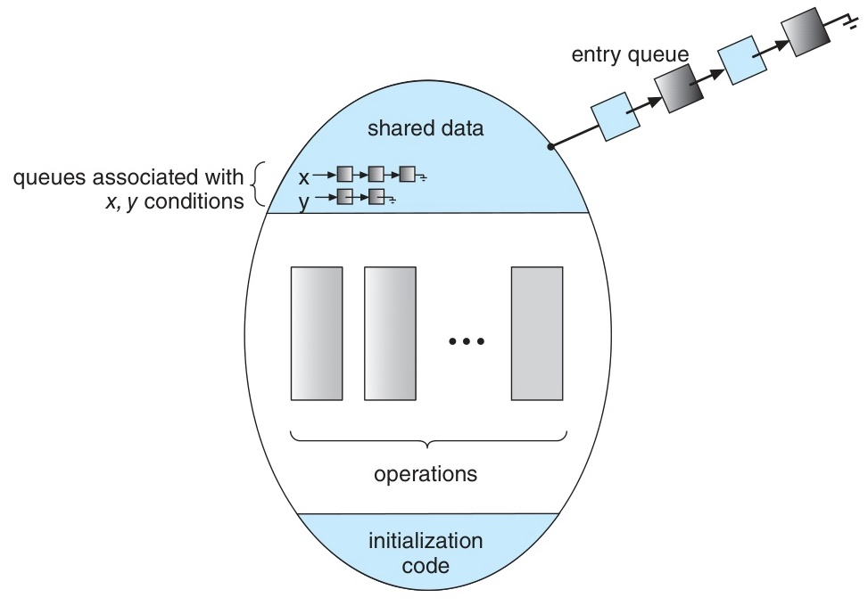
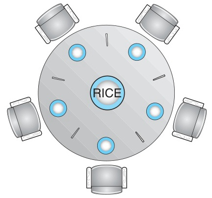

# Week 9 Lecture — Synchronization

[Repository Guide](../../README.md) | [English](Concepts_Lecture.md) | [한국어](Concepts_Lecture.ko.md)

> **Last Updated:** 2026-10-20
>
> Operating System Concepts, Silberschatz, Galvin, and Gagne, Ch 6, 7

> **Learning Objectives:**
> 1. Define a race condition and explain the three requirements of the Critical-Section Problem (mutual exclusion, progress, bounded waiting)
> 2. Explain why Peterson's Solution can break on modern hardware that reorders instructions, and describe the hardware support that addresses it (memory barriers, test_and_set, compare_and_swap, atomic variables)
> 3. Use mutex locks and counting and binary semaphores, and explain the spinlock versus sleeping-lock trade-off and the implementation difference with and without a waiting queue
> 4. Explain how monitors and condition variables work (wait/signal, signal-and-wait versus signal-and-continue)
> 5. Identify liveness failures such as deadlock and priority inversion, and explain the priority-inheritance protocol
> 6. Solve the bounded-buffer, readers-writers, and dining-philosophers problems, and map the abstract concepts to Windows, Linux, POSIX, and Java

---

## Table of Contents

- [1. Background and the Critical-Section Problem](#1-background-and-the-critical-section-problem)
  - [1.1 Cooperating Processes and Data Inconsistency](#11-cooperating-processes-and-data-inconsistency)
  - [1.2 Race Condition](#12-race-condition)
  - [1.3 Race Conditions in the Kernel](#13-race-conditions-in-the-kernel)
  - [1.4 The Critical-Section Problem](#14-the-critical-section-problem)
  - [1.5 Preemptive vs Nonpreemptive Kernels](#15-preemptive-vs-nonpreemptive-kernels)
- [2. Peterson's Solution](#2-petersons-solution)
  - [2.1 Algorithm](#21-algorithm)
  - [2.2 Correctness Proof](#22-correctness-proof)
  - [2.3 Limitations on Modern Architectures](#23-limitations-on-modern-architectures)
- [3. Hardware Support for Synchronization](#3-hardware-support-for-synchronization)
  - [3.1 Memory Barriers (Memory Fences)](#31-memory-barriers-memory-fences)
  - [3.2 test_and_set](#32-test_and_set)
  - [3.3 compare_and_swap (CAS)](#33-compare_and_swap-cas)
  - [3.4 CAS: Ensuring Bounded Waiting](#34-cas-ensuring-bounded-waiting)
  - [3.5 Atomic Variables](#35-atomic-variables)
- [4. Mutex Locks](#4-mutex-locks)
  - [4.1 Mutex Lock: Basics](#41-mutex-lock-basics)
  - [4.2 Spinlocks and Busy Waiting](#42-spinlocks-and-busy-waiting)
- [5. Semaphores](#5-semaphores)
  - [5.1 Definition (wait / signal)](#51-definition-wait--signal)
  - [5.2 Semaphore Types and Usage](#52-semaphore-types-and-usage)
  - [5.3 Eliminating Busy Waiting (Waiting Queue)](#53-eliminating-busy-waiting-waiting-queue)
  - [5.4 Atomicity of Semaphore Implementation](#54-atomicity-of-semaphore-implementation)
- [6. Monitors](#6-monitors)
  - [6.1 Difficulty of Using Semaphores](#61-difficulty-of-using-semaphores)
  - [6.2 Monitor: Structure](#62-monitor-structure)
  - [6.3 Condition Variables](#63-condition-variables)
  - [6.4 Implementing a Monitor with Semaphores](#64-implementing-a-monitor-with-semaphores)
  - [6.5 ResourceAllocator Monitor Example](#65-resourceallocator-monitor-example)
- [7. Liveness](#7-liveness)
  - [7.1 Deadlock](#71-deadlock)
  - [7.2 Priority Inversion and Priority Inheritance](#72-priority-inversion-and-priority-inheritance)
  - [7.3 Evaluating Synchronization Tools](#73-evaluating-synchronization-tools)
- [8. Classic Problems of Synchronization](#8-classic-problems-of-synchronization)
  - [8.1 Bounded-Buffer Problem](#81-bounded-buffer-problem)
  - [8.2 Bounded-Buffer: Producer/Consumer Code](#82-bounded-buffer-producerconsumer-code)
  - [8.3 Readers-Writers Problem](#83-readers-writers-problem)
  - [8.4 Readers-Writers: First Problem Solution](#84-readers-writers-first-problem-solution)
  - [8.5 Reader-Writer Locks](#85-reader-writer-locks)
  - [8.6 Dining-Philosophers Problem](#86-dining-philosophers-problem)
  - [8.7 Dining-Philosophers: Semaphore Solution and Deadlock](#87-dining-philosophers-semaphore-solution-and-deadlock)
  - [8.8 Dining-Philosophers: Deadlock-Avoidance Strategies](#88-dining-philosophers-deadlock-avoidance-strategies)
  - [8.9 Dining-Philosophers: Monitor Solution](#89-dining-philosophers-monitor-solution)
- [9. Synchronization in Real Systems](#9-synchronization-in-real-systems)
  - [9.1 Windows Synchronization](#91-windows-synchronization)
  - [9.2 Linux Synchronization](#92-linux-synchronization)
  - [9.3 POSIX Mutex Locks](#93-posix-mutex-locks)
  - [9.4 POSIX Semaphores (Named and Unnamed)](#94-posix-semaphores-named-and-unnamed)
  - [9.5 POSIX Condition Variables](#95-posix-condition-variables)
- [10. Java Synchronization](#10-java-synchronization)
  - [10.1 Java Monitors: `synchronized`, `wait()`/`notify()`](#101-java-monitors-synchronized-waitnotify)
  - [10.2 How Java Monitors Work Internally](#102-how-java-monitors-work-internally)
  - [10.3 ReentrantLock and Semaphore](#103-reentrantlock-and-semaphore)
  - [10.4 Java Condition Variables](#104-java-condition-variables)
- [11. Lab: Dining-Philosophers Implementation](#11-lab-dining-philosophers-implementation)
  - [11.1 Lab: Naive pthread Implementation](#111-lab-naive-pthread-implementation)
  - [11.2 Lab: Asymmetric Solution](#112-lab-asymmetric-solution)
  - [11.3 Lab: Monitor Solution with POSIX Condition Variables](#113-lab-monitor-solution-with-posix-condition-variables)
- [Summary](#summary)
- [Self-Check Questions](#self-check-questions)

---

<br>

## 1. Background and the Critical-Section Problem

### 1.1 Cooperating Processes and Data Inconsistency

A **cooperating process** is one that can affect, or be affected by, the execution of other processes. Cooperation requires **shared state**, which can be exchanged in the following ways.

- **Shared memory**: multiple processes map the same memory region.
- **Message passing**: processes exchange messages explicitly.
- **Logical address space sharing**: multiple threads in a single process all share the same address space.

The fundamental problem is that **concurrent access to shared data can produce inconsistent results**. Without a discipline that orders these accesses, the final state of the shared data depends on how the instructions interleave.

> **Note:** **Why this underlies every synchronization tool.** Every synchronization tool covered below (locks, semaphores, monitors) exists for one reason: to impose **orderly execution** on concurrent accesses to shared data, so that correctness no longer depends on luck.

### 1.2 Race Condition

A **race condition** occurs when two or more processes (or threads) access shared data concurrently, and the **final result depends on the order in which the accesses interleave**.

**Classic example.** A producer thread executes `count++` while a consumer executes `count--`, with the initial value `count = 5`. Both `++` and `--` decompose into **load → modify → store**, so an unfortunate interleaving loses one of the updates.

```text
T0: producer  register1 = count        {register1 = 5}
T1: producer  register1 = register1+1  {register1 = 6}
T2: consumer  register2 = count        {register2 = 5}
T3: consumer  register2 = register2-1  {register2 = 4}
T4: producer  count = register1        {count = 6}
T5: consumer  count = register2        {count = 4}  ← incorrect!
```

*Figure 1. Execution order in which a producer-consumer interleaving loses one update*

The correct final value is `count = 5` (one increment and one decrement). Depending on the interleaving, the result can become **4** (the consumer writes last) or **6** (the producer writes last). This **lost update**, which leaves the value off by one, depends on timing and is therefore extremely hard to reproduce.

**The fix:** identify and protect the region of code that touches shared data, the **critical section**, so that only one thread is inside it at a time.

> **Note:** **Why race conditions are feared in practice.** Race conditions depend on timing, so they often pass every test in development and only manifest in production under load. The defect in the Therac-25 radiation-therapy machine that killed patients in 1985-87 was a race condition in operator-input handling. Synchronization is not a stylistic concern but a **correctness** concern.

### 1.3 Race Conditions in the Kernel

The kernel manipulates extensive shared state on behalf of all processes, so race conditions in the kernel can corrupt the entire system.

- **`fork()`** maintains a `next_available_pid` counter. If two simultaneous `fork()` calls read the same value before either updates it, **two processes share one PID**.
- When multiple processes open files concurrently, modifications to the **open file table** can collide.
- **Memory allocator** bookkeeping (free lists, zone counts) can be corrupted.
- **Process list** updates during `fork()` and `exit()` and **interrupt handlers** that touch shared structures are similarly vulnerable.

Kernel developers must **systematically prevent** these race conditions, and user-space programmers benefit from that discipline.

### 1.4 The Critical-Section Problem

Each process is structured around a critical section as follows.

```c
while (true) {
    /* entry section */
        /* critical section */
    /* exit section */
        /* remainder section */
}
```

A correct solution to the Critical-Section Problem must satisfy all of the following **three requirements**.

1. **Mutual Exclusion**: at most one process is in its critical section at any time.
2. **Progress**: if no process is in the critical section and some processes wish to enter, the choice of which one enters cannot be postponed indefinitely. (Processes in the remainder section do not block anyone.)
3. **Bounded Waiting**: once a process requests entry, there is an **upper bound** on the number of times other processes may enter the critical section before the request is granted.

> **Note:** **What each requirement protects against.**
> - Without **mutual exclusion**, race conditions return.
> - Without **progress**, the system can deadlock by design, stalling even though the critical section is empty.
> - Without **bounded waiting**, starvation can occur: a particular process may never enter while others keep entering.

### 1.5 Preemptive vs Nonpreemptive Kernels

A kernel must decide whether one of its own threads can be preempted while running in kernel mode.

- **Nonpreemptive kernel**: kernel-mode code runs until it blocks, exits, or yields. On a single CPU no other kernel thread can interleave, so race conditions on kernel data are **inherently avoided**. The drawback is **poor responsiveness** (high-priority user tasks may have to wait until the kernel finishes).
- **Preemptive kernel**: kernel-mode code itself can be preempted. It is more responsive and more suitable for real-time work, but it must be carefully designed to prevent race conditions, especially in **SMP** systems.

Two points matter in practice.
- **Single processor** systems can implement mutual exclusion cheaply just by **disabling interrupts** for the critical section.
- **Multiprocessor** systems cannot afford to disable interrupts on every core, so they need other mechanisms such as memory barriers, atomic instructions, and locks.

> **Note:** **Historical note.** The Linux kernel was nonpreemptive before version 2.6 and became fully preemptive with 2.6 (2003). Modern Linux, Windows, and macOS are all preemptive kernels designed to scale across many cores.

---

<br>

## 2. Peterson's Solution

### 2.1 Algorithm

Peterson's Solution is a classic **software-only** solution to the Critical-Section Problem for **two processes (P0 and P1)**. It uses the following two shared variables.

```c
int     turn;       /* whose turn it is to enter */
boolean flag[2];    /* flag[i] = true means process i wants to enter */
```

Each process Pi (with its partner Pj, where `j = 1 - i`) executes the following.

```c
while (true) {
    flag[i] = true;        /* announce: I want in */
    turn = j;              /* yield: it's your turn */
    while (flag[j] && turn == j)
        ;                  /* wait while the other wants in AND it's their turn */

    /* critical section */

    flag[i] = false;       /* I am done */

    /* remainder section */
}
```

Intuitively, **`flag[i]`** means that Pi wants to enter, and **`turn`** means that the process yields the turn to its partner first. A process enters the critical section when its partner does not want to enter (`flag[j] == false`) or its partner has already yielded (`turn == i`).

### 2.2 Correctness Proof

**1. Mutual Exclusion.** For Pi to leave the entry-section loop, either `flag[j] == false` or `turn == i` must hold. If both processes are in the critical section simultaneously, both `flag[0]` and `flag[1]` are `true`, so both must have left through the `turn` condition. But `turn` holds only one of the values 0 and 1, so `turn == 0` and `turn == 1` cannot hold at the same time. This is a contradiction, so mutual exclusion holds.

**2. Progress.** If Pj is in the remainder section, `flag[j] == false`, so Pi enters immediately. If Pj has set `flag[j] = true` and is in its entry section, `turn` decides. Since `turn` holds a single value, exactly one of the two enters.

**3. Bounded Waiting.** Suppose Pi is waiting. When Pj exits the critical section, it sets `flag[j] = false`, and Pi enters. If Pj wants to re-enter, it must first set `turn = i`, so Pi enters before Pj does. Pj can therefore enter ahead of Pi **at most once**, and the **bound is 1**.

> **Note:** **Why Peterson's Solution is famous despite being unused in practice.** It shows that mutual exclusion is achievable with **only ordinary loads and stores** on shared memory (in theory, without special hardware instructions). That theoretical clarity is why operating-systems textbooks widely include it.

### 2.3 Limitations on Modern Architectures

The correctness proof of Peterson's Solution assumes that statements execute **in program order** and that a write becomes visible to other CPUs immediately. **Modern processors and compilers violate both assumptions.** For performance they routinely **reorder** independent loads and stores, and a write may sit in a per-core write buffer for some time before becoming globally visible.

```text
/* Peterson's entry section */
flag[i] = true;     /* ① */
turn = j;           /* ② */
```

If a CPU executes ② before ①, both processes may pass the entry check and enter the critical section simultaneously; that is, **mutual exclusion is broken**. Since the two writes target unrelated memory, a compiler reordering can have the same effect.



*Figure 2. The effects of instruction reordering in Peterson's solution*

In Figure 2 (Figure 6.4 of the textbook), reordering makes process0 write `turn = 1` first and `flag[0] = true` later. In between, process1 writes `turn = 0` and `flag[1] = true`, and since `flag[0]` is still `false`, it enters the critical section (cs). When process0 then writes `flag[0] = true` and performs the entry check, `turn` is 0, so it enters the critical section without waiting, and both processes are in the critical section at the same time.

**The fix:** insert **memory barriers** (Section 3.1) that prevent the hardware and compiler from reordering across the boundary. With proper barriers, Peterson's algorithm works correctly on modern hardware. In practice, however, programmers use higher-level primitives (locks, atomic variables) that hide this complexity.

> **[Computer Architecture]** An algorithm proved correct under **sequential consistency** can fail on real hardware that uses a **relaxed memory model**. A memory model defines which load and store reorderings the CPU and compiler may perform. x86 is relatively strong because of TSO (total store order), while ARM and POWER allow more reordering. Synchronization code must account for this with **memory barriers** or higher-level primitives that insert them.

---

<br>

## 3. Hardware Support for Synchronization

### 3.1 Memory Barriers (Memory Fences)

The **memory model** of a system describes what the hardware guarantees about how memory operations become visible and in what order they appear across CPUs.

- **Strongly ordered**: a write by one processor is **immediately** visible to all other processors, in program order. It is easy to reason about but slower.
- **Weakly ordered**: writes can become visible **out of order or after a delay**. Because it is faster, it is the dominant choice in modern multicore designs; ARM is a typical example, and x86 also permits some reordering (a later load performed before an earlier store).

A **memory barrier** (or **memory fence**) is a special instruction that **enforces ordering**. From the viewpoint of other processors, all loads and stores **before** the barrier must complete before any load or store **after** the barrier.

```c
/* Thread 1 */                       /* Thread 2 */
while (!flag)                        x = 100;
    ;                                memory_barrier();
memory_barrier();                    flag = true;
print x;  /* guaranteed to print 100 */
```

Without the barriers, Thread 2's write to `x` could become visible **after** its write to `flag`, so Thread 1 might see `flag == true` while `x == 0`. The barriers force the program order to hold globally as well.

- Memory barriers are a **very low-level** primitive used mostly by **kernel and library writers**. Most application programmers use locks or atomic variables, which insert the necessary barriers internally and automatically.
- With appropriate barriers, **Peterson's Solution also works correctly on modern hardware**.

> **[Computer Architecture]** **A mental model for memory barriers.** Each CPU core can be thought of as having a **store buffer** between its pipeline and the cache-coherent memory system. A `store` instruction *retires* into this buffer immediately so the pipeline can keep moving, and the buffer drains to memory later in an order chosen by the hardware. Because of this delayed drain, one core's writes can appear out of order to another core. A memory barrier (`mfence`/`sfence` on x86, `dmb`/`dsb` on ARM) is the instruction that tells the core to drain its store buffer before doing anything else and not to let later operations overtake earlier ones.

### 3.2 test_and_set

`test_and_set` is an **atomic** instruction that returns the old value of a memory cell and unconditionally writes `true` to it. Both actions are performed as a single, indivisible operation.

```c
boolean test_and_set(boolean *target) {
    boolean rv = *target;
    *target = true;
    return rv;             /* old value */
}
```

**Mutual exclusion implemented with `test_and_set`** (the lock is initialized to `false`) looks as follows.

```c
do {
    while (test_and_set(&lock))
        ;                  /* busy wait until the returned old value is false */

    /* critical section */

    lock = false;

    /* remainder section */
} while (true);
```

The first thread to call `test_and_set` sees `false`, changes the value to `true`, and enters. Every subsequent caller sees `true` and spins. Even if two CPUs call `test_and_set` at exactly the same moment, the hardware **serializes** the calls, so only one of them reads `false`.

### 3.3 compare_and_swap (CAS)

**Compare-and-swap**, a more general atomic primitive, atomically tests whether a memory cell holds an expected value and, if so, replaces it with a new value.

```c
int compare_and_swap(int *value, int expected, int new_value) {
    int temp = *value;
    if (*value == expected)
        *value = new_value;
    return temp;           /* always returns the original value */
}
```

**Mutual exclusion using CAS** (the lock is initialized to 0, where 0 means free and 1 means held) looks as follows.

```c
while (true) {
    while (compare_and_swap(&lock, 0, 1) != 0)
        ;                  /* spin until lock was 0 */

    /* critical section */

    lock = 0;

    /* remainder section */
}
```

- On Intel x86, CAS is implemented with the **`lock cmpxchg`** instruction. The `lock` prefix on the `cmpxchg` (compare-and-exchange) instruction locks the bus while the destination operand is being updated.
- CAS is the primitive underlying most modern lock-free data structures such as lock-free queues, and it is also used by memory-reclamation techniques such as hazard pointers.

> **Note:** **Why CAS is more powerful than test_and_set.** `test_and_set` works only on booleans, while CAS works on arbitrary integers and can express an update that happens only if the value still equals the value last read. This is the foundation of **optimistic concurrency**, where a thread reads a value, computes a new one, and commits only if no other thread has changed the value in the meantime.

### 3.4 CAS: Ensuring Bounded Waiting

The plain CAS spin lock above guarantees mutual exclusion but **does not guarantee bounded waiting**, because an unlucky thread can repeatedly lose the lock. The following extension uses a `waiting[]` flag array to ensure that every requester is served after seeing at most `n - 1` critical-section entries by other threads.

```c
/* Shared: boolean waiting[n] = {false}, int lock = 0 */

while (true) {
    waiting[i] = true;                          /* I am waiting */
    key = 1;
    while (waiting[i] && key == 1)
        key = compare_and_swap(&lock, 0, 1);    /* try to grab lock */
    waiting[i] = false;

    /* critical section */

    j = (i + 1) % n;
    while ((j != i) && !waiting[j])
        j = (j + 1) % n;                        /* find next waiter */

    if (j == i)
        lock = 0;                               /* nobody waiting */
    else
        waiting[j] = false;                     /* hand the lock to next */

    /* remainder section */
}
```

When a thread exits the critical section, it scans `waiting[]` **cyclically** starting from its successor and hands the lock to the first waiter found. Every requester is therefore served after seeing at most `n - 1` other entries, which is **bounded waiting**.

### 3.5 Atomic Variables

**Atomic variables** are a higher-level abstraction built on CAS that provides race-free updates of single integers without writing the CAS loop yourself.

A canonical CAS-based atomic increment looks as follows.

```c
void increment(atomic_int *v) {
    int temp;
    do {
        temp = *v;
    } while (temp != compare_and_swap(v, temp, temp + 1));
}
```

If another thread changed the value in the meantime, the CAS fails and the loop retries with the fresh value.

**Linux kernel API:**

```c
atomic_t counter;
atomic_set(&counter, 5);                /* counter = 5  */
atomic_add(10, &counter);               /* counter = 15 */
atomic_sub(4, &counter);                /* counter = 11 */
atomic_inc(&counter);                   /* counter = 12 */
int val = atomic_read(&counter);        /* val     = 12 */
```

> **Caution:** Atomic variables protect updates to **a single variable** only. Invariants that span multiple variables, such as the bounded-buffer invariant `0 ≤ count ≤ n` together with the `in` and `out` indices, need a **mutex** or **semaphore** that protects the whole critical section.

> **Note:** **A useful rule of thumb.** If all you need is to increment a counter or set a flag, use an atomic variable. If you must update **two or more related fields together** so that no observer ever sees them out of sync, use a lock.

---

<br>

## 4. Mutex Locks

### 4.1 Mutex Lock: Basics

A **mutex lock** (**mut**ual **ex**clusion) is the simplest synchronization tool, consisting of a Boolean `available` flag and two operations.

```c
acquire() {
    while (!available)
        ;                  /* busy wait */
    available = false;
}

release() {
    available = true;
}
```

The usage pattern is as follows.

```c
acquire(lock);
    /* critical section */
release(lock);
```

The textbook formulation leaves two requirements implicit.

- `acquire()` and `release()` themselves must be **atomic**. They are typically implemented on top of `test_and_set` or CAS.
- The lock variable is a **Boolean** with exactly two states (held, free).

A mutex's job is to make the critical section appear **as if it executed in isolation**.

### 4.2 Spinlocks and Busy Waiting

A **spinlock** is a mutex whose `acquire()` **busy-waits** (loops) until the lock is free instead of putting the thread to sleep.

| Property | Spinlock | Sleeping lock |
|----------|----------|---------------|
| Wait strategy | **Spin** in a loop | **Block** (sleep) |
| Wakeup cost | None (already running) | Two context switches (sleep + wake) |
| Best when | Lock held for a **very short** time | Lock held for a **longer** time |
| Risk | Wastes CPU on a uniprocessor; spinning is productive only on a multicore, where another core can release the lock | Higher latency to acquire |

*Table 1. Comparison of spinlocks and sleeping locks*

**Spinlock advantages:**
- **No context-switch overhead.** When the lock is released, the spinning thread sees it on the next loop iteration and continues.
- **Especially useful in multicore systems.** While core A holds the lock, core B can spin productively, and the moment A releases it, B grabs it without involving the scheduler.
- **Rule of thumb:** use a spinlock when the expected hold time is **shorter than two context switches**.

**Spinlock disadvantages:**
- Spinning wastes CPU cycles. On a **uniprocessor** with no other useful work, spinning is pure waste (the holder cannot release the lock while the spinner occupies the CPU).
- When many threads contend for the same lock, high **lock contention** severely degrades performance.

**Lock contention terminology:**
- **Uncontended lock**: one thread tries to acquire it and succeeds immediately.
- **Contended (blocked) lock**: multiple threads try to acquire it simultaneously, and some must wait.

> **Note:** **The deeper picture.** Choosing between spinlocks and sleeping locks is a *time-cost* trade-off. Sleeping pays a fixed cost of two context switches, while spinning pays a cost proportional to the wait time. Whichever is smaller wins, which is why kernels often use spinlocks for very short kernel-data critical sections and sleeping locks (mutexes) for longer user-level work.

---

<br>

## 5. Semaphores

### 5.1 Definition (wait / signal)

A **semaphore** S is an integer variable accessed only through two **atomic** operations, originally proposed by Edsger Dijkstra.

**`wait(S)`** is also called **P** (Dutch *proberen*, "to test").

```c
wait(S) {
    while (S <= 0)
        ;          /* busy wait */
    S--;
}
```

**`signal(S)`** is also called **V** (Dutch *verhogen*, "to increment").

```c
signal(S) {
    S++;
}
```

There are two atomicity requirements that are easy to miss.
- The modifications to `S` (`S--` and `S++`) must be atomic because they decompose into read-modify-write sequences.
- In `wait`, **the test of `S` and the decrement together must be indivisible**. Otherwise two threads can both observe `S = 1` and both decrement, ending up with `S = -1`, and two threads enter where only one should have.

### 5.2 Semaphore Types and Usage

**Counting semaphore.**
- Its range is any non-negative integer.
- It models a **resource pool of N identical resources**.
- `wait(S)` acquires one resource (S decreases), and `signal(S)` releases one (S increases).
- When `S = 0`, all resources are in use, so further `wait()` calls block.

**Binary semaphore.**
- Its range is 0 or 1.
- It behaves **almost identically to a mutex lock**: it is initialized to 1, and `wait` serves as lock and `signal` as unlock.

**Execution-order control with a semaphore.** A semaphore can also enforce that one statement executes before another. With `synch` initialized to 0, the code is as follows.

```text
P1:                           P2:
    S1;                           wait(synch);
    signal(synch);                S2;
```

`P2` blocks at `wait(synch)` until `P1` calls `signal(synch)` after executing `S1`. So **S2 is guaranteed to execute after S1**, regardless of the order in which P1 and P2 are scheduled.

> **Key Point:** **Generalization over mutexes.** A counting semaphore is the natural tool whenever there are **N indistinguishable resources** (database connections, thread-pool slots, free buffer slots, and so on). A mutex allows only one access at a time, while a counting semaphore allows at most N accesses at a time.

### 5.3 Eliminating Busy Waiting (Waiting Queue)

The textbook definition of `wait()` busy-waits, which is wasteful when the critical section is long. Real implementations attach a **waiting queue** of blocked processes to each semaphore.

```c
typedef struct {
    int value;
    struct process *list;     /* waiting queue */
} semaphore;

wait(semaphore *S) {
    S->value--;
    if (S->value < 0) {
        /* enqueue this process on S->list */
        sleep();              /* block until woken */
    }
}

signal(semaphore *S) {
    S->value++;
    if (S->value <= 0) {
        /* dequeue some process P from S->list */
        wakeup(P);
    }
}
```

Two consequences are worth remembering.

- When `S->value` is **negative**, its **absolute value equals the number of processes blocked on this semaphore**.
- A **FIFO** waiting queue gives **bounded waiting** (blocked processes are woken in order).

Note that `wait` in this implementation decrements first and then checks. This order matches the negative-value bookkeeping above.

### 5.4 Atomicity of Semaphore Implementation

For `wait()` and `signal()` to behave correctly, their bodies must execute **atomically**.

- **Single processor**: just **disable interrupts** while the wait/signal body runs. This is cheap and effective.
- **Multiprocessor**: disabling interrupts on every CPU is expensive and bad for latency. Implementations use **CAS** or a **spinlock** internally to make the wait/signal body atomic across cores.

This approach **does not eliminate busy waiting completely**. It merely shrinks the busy waiting from the application's potentially long critical section down to the few instructions inside `wait`/`signal`. The application still benefits from sleep/wakeup, because *its own* critical section no longer requires busy waiting.

> **Note:** **The picture to keep in mind.** Synchronization primitives form a **stack**. At the bottom is the hardware (CAS, fences), above it a tiny internal spinlock, and above that the semaphore, which exposes a sleep/wake interface. Each layer hides the busy waiting of the layer below.

---

<br>

## 6. Monitors

### 6.1 Difficulty of Using Semaphores

Semaphores are powerful but **error-prone**. A misuse causes a timing bug that may only manifest under specific interleavings, which makes debugging very hard. Common mistakes are as follows.

- **Order reversal**: writing `signal(mutex); CS; wait(mutex);` lets multiple processes enter the critical section at once, so **mutual exclusion is violated**.
- **Duplicate wait**: writing `wait(mutex); CS; wait(mutex);` blocks forever at the second `wait`, causing **deadlock**.
- **Omitted wait or signal**: the critical section is left unprotected, or no one is ever woken up.

These bugs share three properties: (1) the code looks reasonable, (2) tests usually pass, and (3) failures are rare and timing-dependent. The remedy is to use a higher-level construct such as the **monitor**, which hides the explicit `wait`/`signal` calls.

### 6.2 Monitor: Structure

A **monitor** is an **abstract data type (ADT)** that automatically provides mutual exclusion among its operations. At any moment, at most one thread is executing inside the monitor.

```text
monitor monitor_name {
    /* shared variable declarations (private) */

    function P1(...) { ... }
    function P2(...) { ... }
    ...
    function Pn(...) { ... }

    initialization_code(...) { ... }
}
```



*Figure 3. Schematic view of a monitor*

In Figure 3 (Figure 6.12 of the textbook), a monitor consists of shared data at the top, operations in the middle, and initialization code at the bottom, and threads that want to enter the monitor wait their turn in the entry queue outside it.

Its main properties are as follows.
- **Only one thread at a time** can be active inside the monitor. The compiler or runtime, not the programmer, inserts the lock/unlock around each function.
- The internal variables are accessible **only through the monitor's functions**, so no outsider can corrupt them.
- The programmer does not write `wait(mutex)`/`signal(mutex)` for the monitor lock.

> **Note:** **Why this is a leap forward.** With semaphores, mutual exclusion is a programmer **convention** that every piece of code touching X calls wait first. With monitors, mutual exclusion is a **structural** property of the ADT. There is no way to access X without going through a monitor function, and the monitor function is automatically protected.

### 6.3 Condition Variables

Mutual exclusion alone is sometimes not enough. A thread inside the monitor may need to wait for a **condition** that another monitor function will establish. **Condition variables** play this role.

```text
condition x, y;

x.wait();      /* the calling thread is suspended on x */
x.signal();    /* wake up one thread waiting on x */
```

There are two essential differences from semaphores.

- `x.signal()` has **no effect** if no thread is waiting on `x`. A semaphore's `signal` always changes the value.
- A thread that calls `x.wait()` **releases the monitor** so other threads can enter. Otherwise the monitor would deadlock.

**What happens after `x.signal()` if both the signaler P and the awakened Q want to be inside the monitor?** Three policies exist.

- **Signal-and-wait**: P waits, and Q runs immediately (Hoare's original definition).
- **Signal-and-continue**: P continues until it leaves the monitor, and Q runs afterward.
- **Compromise**: P leaves the monitor immediately after signaling, and Q resumes.



*Figure 4. Monitor with condition variables*

Figure 4 (Figure 6.13 of the textbook) shows the structure of Figure 3 with a waiting queue attached to the shared-data area for each of the conditions x and y. A thread that calls `x.wait()` waits in the queue for x, and a thread that calls `y.wait()` waits in the queue for y.

> **Note:** **Why condition variables exist.** Condition variables let a thread that is waiting for a state change (for example, the buffer becoming non-empty) **give up the monitor**, and let another thread **wake** that waiter when it changes the state. Without condition variables, a waiting thread would either spin and waste CPU or block while still holding the monitor lock and deadlock.

### 6.4 Implementing a Monitor with Semaphores

Monitors can be built on semaphores. The following is the **signal-and-wait** version. Every external monitor function `F` is wrapped as follows.

```text
semaphore mutex      = 1;     /* protects monitor entry */
semaphore next       = 0;     /* signaler waits here */
int       next_count = 0;     /* # signalers blocked on next */

/* Body of every external function F */
wait(mutex);
    ... body of F ...
if (next_count > 0)
    signal(next);             /* wake a waiting signaler */
else
    signal(mutex);            /* otherwise release the monitor lock */
```

Each condition variable `x` needs its own semaphore `x_sem` and counter `x_count`.

```text
/* x.wait() */                          /* x.signal() */
x_count++;                              if (x_count > 0) {
if (next_count > 0)                         next_count++;
    signal(next);                            signal(x_sem);
else                                         wait(next);
    signal(mutex);                           next_count--;
wait(x_sem);                            }
x_count--;
```

The bookkeeping is intricate, which is precisely the *point*: the monitor abstraction hides this complexity from the programmer, and the compiler or runtime only has to implement it correctly once.

### 6.5 ResourceAllocator Monitor Example

The following monitor allocates a single resource and gives priority to the requester that needs it for the **shortest** time. It uses a priority wait of the form `condition.wait(time)`.

```text
monitor ResourceAllocator {
    boolean   busy;
    condition x;

    void acquire(int time) {
        if (busy)
            x.wait(time);     /* time = priority; smaller = sooner */
        busy = true;
    }

    void release() {
        busy = false;
        x.signal();           /* wake the waiter with smallest time */
    }

    initialization_code() {
        busy = false;
    }
}
```

The usage is as follows.

```text
R.acquire(t);
    ... use the resource ...
R.release();
```

`x.wait(c)` stores the priority value `c` for the caller, and `x.signal()` resumes the waiter with the **smallest** stored value. This is a **conditional-wait** variant supported by some monitor implementations.

---

<br>

## 7. Liveness

A **liveness** failure is a state in which individual processes are alive but the system never makes progress on what they want to do. If mutual exclusion is a **safety** property, liveness is a property about **eventually getting your turn**.

### 7.1 Deadlock

**Deadlock** is a state where every process in a set is waiting for an event that **only another process in the same set** can cause. No process can proceed.

The classic two-process deadlock with two semaphores S and Q (both initialized to 1) is as follows.

```text
P0                          P1
wait(S);                    wait(Q);
wait(Q);                    wait(S);
...                         ...
signal(S);                  signal(Q);
signal(Q);                  signal(S);
```

If P0 acquires S and is preempted right before `wait(Q)`, and P1 acquires Q and is preempted right before `wait(S)`, then **each holds what the other needs**, so neither can proceed.

- Deadlock most often arises around **resource acquisition and release**.
- Diagnosis, prevention, avoidance, detection, and recovery for deadlock are covered in detail in **Week 10**.

> **Note:** **The four necessary conditions for deadlock (preview of Week 10).** They are mutual exclusion, hold and wait, no preemption, and circular wait. Eliminating any one of them is enough to prevent deadlock, which makes this a useful framing once you know what to look for.

### 7.2 Priority Inversion and Priority Inheritance

**Priority inversion** is a subtle liveness bug in which a **lower-priority** process indirectly **blocks** a **higher-priority** one.

Suppose there are three processes with priorities **L** (low) < **M** (medium) < **H** (high).

1. **L** acquires semaphore S.
2. **H** becomes runnable and tries to acquire S, but it blocks and waits for L.
3. **M** becomes runnable. M has higher priority than L, so M **preempts L**.
4. While M runs, L cannot release S, and H cannot proceed.

As a result, **H is delayed by M**, even though H has higher priority than M.

**Priority Inheritance Protocol:**
- While L holds a lock that H is waiting for, **temporarily raise L to H's priority**.
- M can no longer preempt L, so L finishes its critical section quickly and releases S.
- After L releases the lock, it reverts to its original priority.

> **Note:** **A famous real incident: Mars Pathfinder, 1997.** The lander suffered repeated, unexplained system resets on Mars. The cause was priority inversion in **VxWorks RTOS**. A low-priority meteorological task held a mutex that a high-priority bus-management task needed, and a medium-priority communications task kept preempting the low-priority task. As a result, a watchdog timer expired and reset the system. JPL engineers fixed the problem remotely by **enabling priority inheritance** on the offending mutex. The incident shows that synchronization errors can have serious consequences in real systems.

### 7.3 Evaluating Synchronization Tools

The **performance** of synchronization tools depends on the degree of **lock contention**.

| Contention level | CAS-based (optimistic) | Locking (pessimistic) |
|------------------|------------------------|-----------------------|
| **Uncontended** | Fast (slight edge) | Fast |
| **Moderate** | **Much faster** (no context switch) | Slower (pays context-switch cost) |
| **High** | Slow (many CAS retries) | Fast (queue-based ordering) |

*Table 2. Performance of CAS-based and lock-based synchronization by contention level*

Classified by level of abstraction, the tools are as follows.

| Level | Tools | Typical user |
|-------|-------|--------------|
| **Low** | Hardware (CAS, test_and_set, fences) | Mostly used as the *foundation* of higher tools |
| **Mid** | Mutex locks, semaphores | Most common in kernels and applications |
| **High** | Monitors, condition variables | Language-level support (Java, C# `lock`, and so on) |

*Table 3. Synchronization tools by level of abstraction*

> **Note:** **Practical implication.** No synchronization primitive is best in every situation. The right choice depends on the **expected contention**, the **length of the critical section**, and whether **multi-resource** or **single-flag** semantics are needed.

---

<br>

## 8. Classic Problems of Synchronization

Three classic problems recur throughout systems software, and each illustrates a distinct synchronization pattern.

### 8.1 Bounded-Buffer Problem

A **bounded buffer of size n** is shared between **producers** that insert items and **consumers** that remove them. Three semaphores are used.

| Semaphore | Init | Role |
|-----------|------|------|
| `mutex` | 1 | Protects the buffer (binary). |
| `empty` | n | Number of empty slots (counting). |
| `full`  | 0 | Number of filled slots (counting). |

*Table 4. Semaphores and initial values in the bounded-buffer problem*

The shared declarations are as follows.

```c
int n;
semaphore mutex = 1;
semaphore empty = n;
semaphore full  = 0;
```

`empty` and `full` are **counting** semaphores, and `mutex` is a **binary** semaphore for buffer access.

### 8.2 Bounded-Buffer: Producer/Consumer Code

```c
/* Producer */                       /* Consumer */
while (true) {                       while (true) {
    /* produce an item */                wait(full);
                                         wait(mutex);
    wait(empty);
    wait(mutex);                         /* remove item from buffer */
                                         /* into next_consumed       */
    /* add item to buffer */
                                         signal(mutex);
    signal(mutex);                       signal(empty);
    signal(full);
}                                        /* consume next_consumed */
                                     }
```

There are two non-obvious correctness points.

- **Wait order matters.** Always call `wait(empty)` or `wait(full)` **before** `wait(mutex)`. If a producer changes the order to `wait(mutex); wait(empty);`, then when the buffer is full the producer blocks on `empty` while holding `mutex`, and the consumer cannot acquire `mutex` to free a slot. The result is **deadlock**.
- The producer and consumer are **structurally symmetric** (`empty` ↔ `full`). In this kind of pattern, checking the symmetry is often the easiest correctness check.

> **Note:** **Why three semaphores instead of a single mutex.** A single mutex can ensure mutual exclusion on the buffer, but it cannot make a producer **wait** until an empty slot appears. The two counting semaphores express the *availability* of slots, and the mutex serializes the *act* of inserting and removing.

### 8.3 Readers-Writers Problem

A shared dataset is accessed by two kinds of processes.

- **Readers**: only read the data.
- **Writers**: read and modify the data.

The synchronization rules are as follows.

- **Many readers may read concurrently** (they do not conflict).
- **A writer needs exclusive access.** No other writer and no reader may access the data at the same time.

The two variants of the problem differ in which side is favored.

- **First Readers-Writers Problem (readers priority).** A reader may enter even while writers are waiting. Writers can **starve**.
- **Second Readers-Writers Problem (writers priority).** Once a writer is waiting, no new reader may enter. Readers can **starve**.

Both versions allow **starvation**; only the victim differs. A **reader-writer lock** generalizes the mutex to distinguish **read mode (shared)** and **write mode (exclusive)**, leaving the priority policy as a parameter.

### 8.4 Readers-Writers: First Problem Solution

The shared variables are as follows.

```c
semaphore rw_mutex = 1;     /* writer-vs-readers exclusion */
semaphore mutex    = 1;     /* protects read_count        */
int       read_count = 0;
```

The code is as follows.

```c
/* Writer */                            /* Reader */
while (true) {                          while (true) {
    wait(rw_mutex);                         wait(mutex);
                                            read_count++;
    /* writing is performed */              if (read_count == 1)
                                                wait(rw_mutex);
    signal(rw_mutex);                       signal(mutex);
}
                                            /* reading is performed */

                                            wait(mutex);
                                            read_count--;
                                            if (read_count == 0)
                                                signal(rw_mutex);
                                            signal(mutex);
                                        }
```

The protocol works as follows.

- The **first reader** acquires `rw_mutex` to lock out writers, and subsequent readers do not acquire `rw_mutex` again.
- The **last reader** releases `rw_mutex`, letting any waiting writer in.
- `mutex` protects only the `read_count` counter and is held briefly.

If a writer is in the critical section and n readers are waiting, one reader waits on `rw_mutex` and the other n − 1 readers wait on `mutex`. When the writer executes `signal(rw_mutex)`, the scheduler decides whether to resume the waiting readers or a single waiting writer.

### 8.5 Reader-Writer Locks

A **reader-writer lock** is the generalization of a mutex that makes the distinction between reading and writing a first-class concept.

- **Read mode**: multiple threads may hold the lock simultaneously.
- **Write mode**: only one thread may hold the lock, and no reader may hold it meanwhile.

Reader-writer locks pay off in the following cases.
- Read and write operations can be clearly distinguished in the code.
- **Readers vastly outnumber writers.** The cost of the more complex lock is repaid by the higher concurrency among readers.

API examples are as follows.
- POSIX: `pthread_rwlock_t`.
- Java: `java.util.concurrent.locks.ReentrantReadWriteLock`.
- Windows: **Slim Reader/Writer (SRW) Lock**.

### 8.6 Dining-Philosophers Problem

Five philosophers sit around a circular table. Between every pair of adjacent philosophers there is one chopstick, five chopsticks in total. Each philosopher alternates between **thinking** and **eating**, and to eat she must **hold both adjacent chopsticks**.

The rules are as follows.
- A philosopher picks up only one chopstick at a time.
- Both the left and right chopsticks must be available before eating begins.
- After eating, the philosopher puts both chopsticks down.



*Figure 5. The dining philosophers*

In Figure 5 (Figure 7.5 of the textbook), a bowl of rice sits in the center of the round table, each of the five chairs faces its own plate, and one chopstick lies between every two neighboring plates.

The dining-philosophers problem is a representative example of **the difficulty of allocating multiple resources to multiple processes without deadlock or starvation**.

### 8.7 Dining-Philosophers: Semaphore Solution and Deadlock

Each chopstick is represented as a binary semaphore initialized to 1.

```c
semaphore chopstick[5];   /* each initialized to 1 */

/* Philosopher i */
while (true) {
    wait(chopstick[i]);              /* left  */
    wait(chopstick[(i + 1) % 5]);    /* right */

    /* eat for a while */

    signal(chopstick[i]);
    signal(chopstick[(i + 1) % 5]);

    /* think for a while */
}
```

This solution is **incorrect**. If all five philosophers simultaneously execute `wait(chopstick[i])` (each picks up her left chopstick), every chopstick value becomes 0, and each philosopher then blocks on `wait(chopstick[(i+1)%5])`. **Circular wait causes deadlock**, and no one can eat.

### 8.8 Dining-Philosophers: Deadlock-Avoidance Strategies

There are three classic remedies.

- **Method 1: limit the number of philosophers at the table to at most 4.** Add a semaphore `seats` initialized to 4. With at most 4 philosophers competing for 5 chopsticks, at least one can always pick up both.
- **Method 2: pick up chopsticks only when both are available.** Perform the check and the pickup in a single critical section so no philosopher ever holds just one chopstick. This is the approach the monitor solution takes.
- **Method 3: use an asymmetric protocol.** Odd-numbered philosophers pick up the **left first**, and even-numbered philosophers pick up the **right first**. This breaks the **circular wait** condition (the four conditions for deadlock are covered in Week 10).

> **Caution:** **Deadlock-free does not imply starvation-free.** A philosopher whose neighbors are both extremely hungry could in principle never eat. Eliminating starvation requires additional fairness mechanisms.

### 8.9 Dining-Philosophers: Monitor Solution

The monitor solution turns the rule of picking up chopsticks only when both are available into a structurally enforced invariant.

```text
monitor DiningPhilosophers {
    enum {THINKING, HUNGRY, EATING} state[5];
    condition self[5];

    void pickup(int i) {
        state[i] = HUNGRY;
        test(i);
        if (state[i] != EATING)
            self[i].wait();
    }

    void putdown(int i) {
        state[i] = THINKING;
        test((i + 4) % 5);    /* re-check left neighbor  */
        test((i + 1) % 5);    /* re-check right neighbor */
    }

    void test(int i) {
        if (state[(i + 4) % 5] != EATING &&
            state[i] == HUNGRY &&
            state[(i + 1) % 5] != EATING) {
            state[i] = EATING;
            self[i].signal();
        }
    }

    initialization_code() {
        for (int i = 0; i < 5; i++)
            state[i] = THINKING;
    }
}
```

Each philosopher i invokes the monitor as follows.

```text
DiningPhilosophers.pickup(i);
    ...
    /* eat */
    ...
DiningPhilosophers.putdown(i);
```

It works as follows.

- `pickup(i)` sets the state to HUNGRY and calls `test(i)`. If neither neighbor is EATING, the state becomes EATING and the philosopher proceeds. Otherwise `self[i].wait()` blocks her.
- `putdown(i)` sets the state to THINKING and calls `test()` again for both neighbors. If a neighbor is hungry and that neighbor's own neighbors are not eating, that neighbor's wait is signaled.
- **Deadlock-free.** A philosopher eats only when **both** chopsticks are available, so no one holds just one chopstick.
- **Starvation is possible.** If the neighbors keep alternating, an unlucky philosopher could be skipped indefinitely (left as an exercise in the textbook).

---

<br>

## 9. Synchronization in Real Systems

### 9.1 Windows Synchronization

Windows distinguishes the single-processor and multiprocessor cases and offers both kernel-side and user-side primitives.

- **Single processor**: the kernel protects global state by **masking interrupts**.
- **Multiprocessor**: the kernel uses **spinlocks** for very short kernel critical sections. A thread is **not preempted** while holding a spinlock (otherwise a spinner could waste CPU for a long time while the holder is suspended).

**Dispatcher Objects** are kernel objects exposed to user threads for synchronization.
- Examples include **Mutex Lock**, **Semaphore**, **Event**, and **Timer**.
- Each object has two states: **signaled** (available) and **nonsignaled** (in use).
- A thread that requests a nonsignaled object is **blocked** and placed on the object's waiting queue.
- When the object becomes signaled, one waiting thread (mutex) or several (event) move to the **ready** state, depending on the object type.

A **Critical-Section Object** is a user-mode mutex optimized for the common case.
- It first tries to acquire with a **spinlock**, avoiding a kernel call.
- If the spin takes too long, it allocates a **kernel mutex** and blocks.
- In the **uncontended** case, both acquire and release happen entirely in user mode, which is very fast.

### 9.2 Linux Synchronization

Linux has been **fully preemptive** since kernel **2.6** (it was nonpreemptive before).

| Tool | Purpose | Notes |
|------|---------|-------|
| `atomic_t`     | Atomic integer ops | Counters, sequence generators |
| `spinlock_t`   | Short kernel CS (SMP) | On a uniprocessor, replaced by **disable preemption** |
| `mutex`        | Longer CS | **Sleeping** lock (blocks rather than spins) |
| `semaphore`    | Counting semaphore | Suitable for long waits |

*Table 5. Synchronization tools in the Linux kernel*

The spinlock primitive behaves differently on a single CPU and on SMP, as follows.

```c
/* Single Processor          | Multiple Processors    */
/* Disable kernel preempt    | Acquire spin lock      */
/* ... critical section ...                           */
/* Enable kernel preempt     | Release spin lock      */
```

Linux spinlocks and mutexes have two important properties.

- **Nonrecursive**: a thread that already holds a lock will **deadlock** if it tries to acquire the same lock again.
- The kernel maintains a per-task `preempt_count` and allows preemption only when `preempt_count == 0`. Acquiring a spinlock increments this counter, and releasing it decrements the counter.

### 9.3 POSIX Mutex Locks

POSIX (UNIX, Linux, macOS) provides synchronization primitives at the **user level** through `pthread`.

```c
#include <pthread.h>

pthread_mutex_t mutex;
pthread_mutex_init(&mutex, NULL);

pthread_mutex_lock(&mutex);
    /* critical section */
pthread_mutex_unlock(&mutex);
```

This is the standard mutex idiom commonly seen in pthread programs.

### 9.4 POSIX Semaphores (Named and Unnamed)

POSIX provides two kinds of semaphores with different sharing scopes.

**Named semaphores** are identified by a string name and can be shared between **unrelated processes**.

```c
#include <semaphore.h>

sem_t *sem;
sem = sem_open("SEM", O_CREAT, 0666, 1);

sem_wait(sem);
    /* critical section */
sem_post(sem);
```

**Unnamed semaphores** are initialized with `sem_init(&sem, 0, 1)` and are shared among **threads of the same process** (or among related processes through shared memory).

| Type | API | Sharing scope |
|------|-----|---------------|
| Named   | `sem_open` / `sem_wait` / `sem_post` | Across **unrelated processes** |
| Unnamed | `sem_init` / `sem_wait` / `sem_post` | Within a **single process** (or via shared memory) |

*Table 6. Comparison of POSIX named and unnamed semaphores*

### 9.5 POSIX Condition Variables

Because C has no built-in monitor, POSIX condition variables are used explicitly paired with a mutex.

The setup is as follows.

```c
pthread_mutex_t  mutex;
pthread_cond_t   cond_var;
pthread_mutex_init(&mutex, NULL);
pthread_cond_init(&cond_var, NULL);
```

The code of the waiting thread is as follows.

```c
pthread_mutex_lock(&mutex);
while (a != b)
    pthread_cond_wait(&cond_var, &mutex);   /* atomically: release mutex + sleep */
pthread_mutex_unlock(&mutex);
```

The code of the signaling thread is as follows.

```c
pthread_mutex_lock(&mutex);
a = b;
pthread_cond_signal(&cond_var);             /* wake one waiter */
pthread_mutex_unlock(&mutex);
```

A pthread programmer must know three rules.

- `pthread_cond_wait()` **atomically releases the mutex and blocks**. On wakeup it **reacquires** the mutex before returning.
- `pthread_cond_signal()` does **not** release the mutex. The signaling thread must call `unlock()` itself.
- The condition test must always be inside a **`while`** loop, not an `if`. The standard permits spurious wakeups, and another thread may have changed the state between the wakeup and the reacquisition of the mutex.

> **Note:** **The "always while, never if" rule.** Writing `if (a != b) pthread_cond_wait(...)` is a classic bug. Even if no spurious wakeup ever happens, another waiter may take the resource before the awakened thread re-checks the condition, and the thread would then proceed on a false premise. The `while` re-checks the predicate every time the thread wakes.

---

<br>

## 10. Java Synchronization

Java provides monitor-like synchronization at the **language level**. The `synchronized` keyword is the primary tool, and richer primitives are available in `java.util.concurrent`.

### 10.1 Java Monitors: `synchronized`, `wait()`/`notify()`

A bounded buffer using Java's built-in monitor is as follows.

```java
public class BoundedBuffer<E> {
    private static final int BUFFER_SIZE = 5;
    private int count, in, out;
    private E[] buffer;

    public synchronized void insert(E item) {
        while (count == BUFFER_SIZE) {
            try { wait(); }
            catch (InterruptedException ie) { }
        }
        buffer[in] = item;
        in = (in + 1) % BUFFER_SIZE;
        count++;
        notify();
    }

    public synchronized E remove() {
        while (count == 0) {
            try { wait(); }
            catch (InterruptedException ie) { }
        }
        E item = buffer[out];
        out = (out + 1) % BUFFER_SIZE;
        count--;
        notify();
        return item;
    }
}
```

The `synchronized` keyword **automatically** acquires the receiver object's monitor lock on method entry and releases it on exit (even when an exception is thrown).

### 10.2 How Java Monitors Work Internally

- Every Java object owns **one lock**, an **entry set** (threads waiting for the lock), and a **wait set** (threads blocked in `wait()`).

**When a thread calls `wait()`:**
1. It releases the object's lock.
2. It transitions to the **blocked** state.
3. It joins the **wait set**.

**When a thread calls `notify()`:**
1. An **arbitrary** thread T is picked from the wait set.
2. T is moved from the wait set into the **entry set**.
3. T is marked runnable.
4. When T eventually reacquires the lock, its `wait()` call returns.

`notifyAll()` does the same as `notify()` but for **every** thread in the wait set. Use `notifyAll()` when more than one type of waiting condition shares the same lock. Then only the threads whose condition has actually been satisfied proceed past their `while` loop.

### 10.3 ReentrantLock and Semaphore

`java.util.concurrent.locks.ReentrantLock` is a more flexible lock than `synchronized`.

```java
Lock key = new ReentrantLock();
key.lock();
try {
    /* critical section */
} finally {
    key.unlock();    /* MUST release in finally */
}
```

Its notable features are as follows.
- A **fairness parameter** (`new ReentrantLock(true)`) makes the lock favor the longest-waiting thread.
- **Reentrant**: a thread that already holds the lock may acquire it again without deadlocking (the lock counts the nesting depth).

> **[Computer Programming]** In Java's `try`-`catch`-`finally` statement, the `finally` block always runs, whether the `try` block finishes normally or exits through an exception. Wrapping the critical section after `lock()` in `try` and placing `unlock()` in `finally` therefore releases the lock even if the critical section throws, so other threads never wait forever on a lock whose holder has left. The `catch (InterruptedException ie)` clause in each example handles the checked exception thrown by `wait()`, `acquire()`, and `await()`. This exception signals that a waiting thread was interrupted, and the Java compiler requires checked exceptions to be handled or declared.

`java.util.concurrent.Semaphore` is the standard semaphore.

```java
Semaphore sem = new Semaphore(1);
try {
    sem.acquire();
    /* critical section */
} catch (InterruptedException ie) { }
finally {
    sem.release();
}
```

### 10.4 Java Condition Variables

`Condition` objects associated with a `Lock` let a thread wait on **named** conditions, so a *specific* waiter can be woken instead of an arbitrary thread as with `notify()`.

```java
Lock lock = new ReentrantLock();
Condition[] condVars = new Condition[5];
for (int i = 0; i < 5; i++)
    condVars[i] = lock.newCondition();

public void doWork(int threadNumber) {
    lock.lock();
    try {
        if (threadNumber != turn)
            condVars[threadNumber].await();

        /* do some work */

        turn = (turn + 1) % 5;
        condVars[turn].signal();
    } catch (InterruptedException ie) { }
    finally {
        lock.unlock();
    }
}
```

- `await()` releases the lock and blocks (the counterpart of `pthread_cond_wait()` and Java `Object.wait()`).
- `signal()` wakes the **specific** waiter on that named condition. This is the principal advantage over the single anonymous `notify()` of built-in monitors.

> **Note:** **When named condition variables matter.** In a bounded buffer, the condition that the buffer is not full and the condition that the buffer is not empty are distinct. With a single anonymous `notify()`, a producer that fills the last slot might wake another *producer* waiting for an empty slot, which immediately blocks again, wasting the wakeup. With named condition variables, the producer can signal the consumers' condition precisely, eliminating the wasted round trip.

---

<br>

## 11. Lab: Dining-Philosophers Implementation

This section implements the dining-philosophers problem with POSIX threads to put the concepts covered above into code.

### 11.1 Lab: Naive pthread Implementation

Each chopstick is a `pthread_mutex_t`, and each philosopher is a thread that repeatedly thinks, picks up the left chopstick, picks up the right chopstick, eats, and puts the chopsticks down.

```c
#include <pthread.h>
#include <stdio.h>
#include <unistd.h>
#include <stdlib.h>
#define N 5

pthread_mutex_t chopstick[N];

void *philosopher(void *arg) {
    int id = *(int *)arg;
    while (1) {
        printf("Philosopher %d is thinking\n", id);
        usleep(rand() % 1000000);

        pthread_mutex_lock(&chopstick[id]);
        pthread_mutex_lock(&chopstick[(id + 1) % N]);

        printf("Philosopher %d is eating\n", id);
        usleep(rand() % 1000000);

        pthread_mutex_unlock(&chopstick[id]);
        pthread_mutex_unlock(&chopstick[(id + 1) % N]);
    }
    return NULL;
}
```

This implementation behaves as follows.
- When the program runs, it can **deadlock** in the situation where every philosopher holds her left chopstick.
- Implementing one of the classic remedies (asymmetric protocol, at most 4 diners, or monitor) makes the deadlock disappear.

### 11.2 Lab: Asymmetric Solution

Even-numbered philosophers pick up the **right** chopstick first, and odd-numbered philosophers pick up the **left** chopstick first. This breaks the circular-wait condition.

```c
void *philosopher_asymmetric(void *arg) {
    int id = *(int *)arg;
    int first, second;

    if (id % 2 == 0) {
        first  = (id + 1) % N;     /* right first */
        second = id;
    } else {
        first  = id;               /* left first */
        second = (id + 1) % N;
    }

    while (1) {
        printf("Philosopher %d is thinking\n", id);
        usleep(rand() % 1000000);

        pthread_mutex_lock(&chopstick[first]);
        pthread_mutex_lock(&chopstick[second]);

        printf("Philosopher %d is eating\n", id);
        usleep(rand() % 1000000);

        pthread_mutex_unlock(&chopstick[first]);
        pthread_mutex_unlock(&chopstick[second]);
    }
    return NULL;
}
```

> **Note:** **Why the asymmetric solution works.** Deadlock requires a *cycle* in which P0 waits for P1's chopstick, P1 waits for P2's, ..., and P4 waits for P0's. In the asymmetric protocol, an odd-numbered philosopher and the even-numbered philosopher to her right both pick up the chopstick between them second. Whoever holds that chopstick already holds her first chopstick and can eat, so the cycle cannot close.

### 11.3 Lab: Monitor Solution with POSIX Condition Variables

A direct translation of the textbook monitor of Section 8.9 into POSIX is as follows.

```c
#include <pthread.h>
#define N 5

enum {THINKING, HUNGRY, EATING} state[N];
pthread_mutex_t monitor_lock = PTHREAD_MUTEX_INITIALIZER;
pthread_cond_t  self[N];

void test(int i) {
    if (state[(i + 4) % N] != EATING &&
        state[i] == HUNGRY &&
        state[(i + 1) % N] != EATING) {
        state[i] = EATING;
        pthread_cond_signal(&self[i]);
    }
}

void pickup(int i) {
    pthread_mutex_lock(&monitor_lock);
    state[i] = HUNGRY;
    test(i);
    while (state[i] != EATING)
        pthread_cond_wait(&self[i], &monitor_lock);
    pthread_mutex_unlock(&monitor_lock);
}

void putdown(int i) {
    pthread_mutex_lock(&monitor_lock);
    state[i] = THINKING;
    test((i + 4) % N);
    test((i + 1) % N);
    pthread_mutex_unlock(&monitor_lock);
}
```

Note the use of `while (state[i] != EATING)` around `pthread_cond_wait`. It is exactly the pattern from Section 9.5 and defends against spurious wakeups.

---

<br>

## Summary

| Concept | Key Summary |
|:--------|:-----------|
| Race Condition | It arises when shared data is accessed concurrently without coordination, and the result depends on the interleaving order. |
| Critical-Section Problem | A solution must satisfy the three requirements of **mutual exclusion**, **progress**, and **bounded waiting**. |
| Preemptive vs Nonpreemptive Kernel | A nonpreemptive kernel avoids race conditions on kernel data on a single CPU but is less responsive, and modern kernels (Linux 2.6 and later, Windows, macOS) are preemptive. |
| Peterson's Solution | It is a provably correct software-only solution for two processes, but it **breaks under instruction reordering** without memory barriers. |
| Memory Barrier | It forces the ordering of loads and stores across CPUs and is the foundation of modern locks and atomic variables. |
| `test_and_set` / `compare_and_swap` | They are hardware atomic primitives, and CAS is the building block of most modern lock-free data structures. |
| Atomic Variables | They update a single variable without race conditions but are **insufficient** for invariants that span multiple variables. |
| Mutex Lock | It is the simplest protection tool, and `acquire()` and `release()` must be atomic. |
| Spinlock vs Sleeping Lock | A spinlock avoids context switches but wastes CPU, while a sleeping lock suits long critical sections, so the choice depends on the expected hold time. |
| Semaphore | It is accessed through atomic `wait`/`signal`; a **counting** semaphore models resource pools, a **binary** semaphore behaves like a mutex, and a semaphore can also enforce execution order. |
| Waiting Queue | It eliminates application-level busy waiting, and when `value` is negative, its absolute value is the number of waiters. |
| Monitor | It is a high-level ADT with automatic mutual exclusion that replaces error-prone explicit `wait`/`signal` calls. |
| Condition Variable | It waits for and announces conditions with `wait`/`signal` inside a monitor, under either the signal-and-wait or the signal-and-continue policy. |
| Deadlock | It is a state in which every process in a set waits for an event that only another process in the set can cause, and its diagnosis, prevention, avoidance, detection, and recovery are covered in Week 10. |
| Priority Inversion | A lower-priority task indirectly blocks a higher-priority one, and **priority inheritance** fixes it (Mars Pathfinder, 1997). |
| Bounded-Buffer | It uses the `mutex`, `empty`, and `full` semaphores and calls **wait on a counting semaphore before wait on mutex** to avoid deadlock. |
| Readers-Writers | Either many readers or one writer may access the data, the first and second variants allow writer and reader starvation respectively, and reader-writer locks generalize the idea. |
| Dining-Philosophers | The naive solution with 5 chopsticks and 5 philosophers deadlocks, and the remedies are limiting the table to 4, the asymmetric protocol, and a monitor. |
| Windows | It provides kernel spinlocks, Dispatcher Objects with signaled/nonsignaled states, and user-mode Critical-Section objects. |
| Linux | It provides `atomic_t`, `spinlock_t`, sleeping `mutex`, and `semaphore`, its locks are nonrecursive, and `preempt_count` gates kernel preemption. |
| POSIX | It provides `pthread_mutex`, named/unnamed semaphores, and condition variables, whose conditions are always tested inside `while`. |
| Java | It provides `synchronized` with `wait`/`notify(All)`, `ReentrantLock` (fair, reentrant), `Semaphore`, and named `Condition` objects. |

---

<br>

## Self-Check Questions

1. **Race condition:** Define a race condition and explain it with the producer/consumer `count++`/`count--` example. Why is the symptom timing-dependent?

   <details>
   <summary>Answer</summary>

   A race condition occurs when two or more threads access shared data concurrently and the **result depends on the interleaving order**. With `count = 5`, `count++` and `count--` each decompose into load → modify → store, and an interleaving in which one thread's store overwrites the other's loses an update, leaving `count = 4` or `count = 6` instead of `5`. Whether the bad interleaving happens depends on scheduling, so the bug appears intermittently and is easy to miss in testing.

   </details>

2. **Three requirements of the Critical-Section Problem:** State the three requirements of the Critical-Section Problem. What goes wrong when each one is missing?

   <details>
   <summary>Answer</summary>

   **Mutual exclusion** allows at most one process in the critical section at a time; without it, race conditions occur. **Progress** requires that, when the critical section is empty, one of the processes wishing to enter be selected without indefinite delay; without it, the system can deadlock even though the critical section is empty. **Bounded waiting** limits how many other processes may enter before a waiting process is admitted; without it, starvation can occur.

   </details>

3. **Preemptive and nonpreemptive kernels:** Compare preemptive and nonpreemptive kernels. Why does a multiprocessor preemptive kernel need more careful synchronization than a single-CPU nonpreemptive kernel?

   <details>
   <summary>Answer</summary>

   In a **single-CPU nonpreemptive** kernel, no other kernel thread can run until the current one yields, so race conditions on kernel data inherently cannot occur. In a **preemptive** kernel, another thread (even on **another core**) can interleave at any moment, so every shared kernel structure needs explicit protection. Disabling interrupts is enough on a uniprocessor but not across the cores of an SMP system.

   </details>

4. **Peterson's Solution:** Explain why Peterson's Solution satisfies mutual exclusion and why it can break on modern hardware.

   <details>
   <summary>Answer</summary>

   Each process Pi sets `flag[i] = true` and then `turn = j`, and waits while `flag[j] && turn == j`. **Mutual exclusion**: if both processes were inside the critical section, both `flag[0]` and `flag[1]` would be `true`, so each could have left only when `turn` held its own number. But `turn` holds a single value, which is a contradiction. **Modern hardware** can reorder the writes `flag[i] = true` and `turn = j`; if `turn = j` becomes visible first, both processes can pass the entry check. The fix is to insert a memory barrier between the two writes.

   </details>

5. **test_and_set and CAS:** Give pseudocode for `test_and_set` and `compare_and_swap`, and show how each implements a lock. Why is CAS more powerful?

   <details>
   <summary>Answer</summary>

   - `test_and_set(target)` atomically reads `*target`, sets it to `true`, and returns the old value. Lock: spin while `test_and_set(&lock)` returns `true`.
   - `compare_and_swap(value, expected, new_value)` atomically writes `new_value` only if `*value == expected` and returns the original value. Lock: spin while `compare_and_swap(&lock, 0, 1) != 0`.
   - CAS works on **arbitrary integers**, not just booleans, and can express an update that happens only if the value is unchanged since it was last read. This property is the basis of optimistic concurrency and lock-free data structures, which is why CAS is more powerful.

   </details>

6. **Atomic variables:** What is an atomic variable, and what is it **not** good for?

   <details>
   <summary>Answer</summary>

   An atomic variable, typically built on CAS, provides race-free **single-variable** updates (e.g., `atomic_inc(&counter)`). It is **not** sufficient for invariants that span multiple variables. For example, the `count`, `in`, and `out` fields of a bounded buffer must be updated together, so unless they are protected by a single mutex or semaphore, an observer can see them in an inconsistent state.

   </details>

7. **Spinlocks and sleeping mutexes:** Compare a spinlock and a sleeping mutex. When is each preferable, and what is the rule of thumb?

   <details>
   <summary>Answer</summary>

   A **spinlock** waits in a busy loop, and a **sleeping mutex** blocks (two context switches). Spinlocks are preferable when the lock is held very briefly, especially on multicore systems where one core can spin while another finishes the critical section. Sleeping locks win for long-held locks because the sleeping waiter gives up its CPU. The **rule of thumb** is to use a spinlock when the expected hold time is **shorter than two context switches**.

   </details>

8. **Semaphore operations:** State the semaphore `wait` and `signal` operations. Why must they be atomic?

   <details>
   <summary>Answer</summary>

   `wait(S)` spins while `S <= 0` and then performs `S--`, and `signal(S)` performs `S++`. They must be atomic because the test of `S` and the update must happen as one indivisible step. Otherwise two threads can both read `S = 1`, both decrement, and both conclude that they entered, leaving `S = -1` with two threads in the critical section at the same time.

   </details>

9. **Negative value of a waiting-queue semaphore:** With a semaphore implemented with a waiting queue, what does a **negative** value of `S->value` mean?

   <details>
   <summary>Answer</summary>

   It means that its absolute value **equals the number of processes blocked on the semaphore**. Each `wait` decrements first and, if the result is negative, enqueues the caller. Each `signal` increments and, if the result is 0 or less, dequeues one waiter and wakes it.

   </details>

10. **Semaphore misuse:** List three common semaphore-misuse bugs. Why are these bugs hard to debug?

    <details>
    <summary>Answer</summary>

    Reversing the order (`signal(mutex); CS; wait(mutex)`) admits multiple threads to the critical section. Calling `wait` twice (`wait(mutex); CS; wait(mutex)`) deadlocks at the second call. Omitting `wait` or `signal` leaves the critical section unprotected or fails to wake a waiter. These errors appear only under particular execution orders, so they easily pass ordinary tests. Using a higher-level construct such as a monitor reduces the risk.

    </details>

11. **Monitors and condition variables:** What is a monitor, and how does it differ from semaphores? Why are condition variables needed in addition?

    <details>
    <summary>Answer</summary>

    A monitor is an **ADT that automatically enforces mutual exclusion** on its operations. Only one thread can be inside at a time, and the runtime, not the programmer, inserts the lock and unlock. **Condition variables** (`x.wait()`, `x.signal()`) are needed because mutual exclusion alone cannot express behavior such as waiting until the buffer becomes non-empty. `wait` releases the monitor so other threads can change the state, and `signal` wakes a waiter when the state has changed.

    </details>

12. **Signal policies:** Distinguish the **signal-and-wait** and **signal-and-continue** policies for monitors. What problem do these policies solve?

    <details>
    <summary>Answer</summary>

    When a thread P inside a monitor calls `x.signal()` and another thread Q is waiting on `x`, both want to be the active thread inside the monitor, but only one can be. Under **signal-and-wait**, P pauses and Q runs immediately. Under **signal-and-continue**, P keeps running until it leaves the monitor, and then Q runs. Different languages pick different policies. Under signal-and-continue, another thread may have changed the condition again by the time Q runs, so the condition predicate must be re-checked in a `while` loop.

    </details>

13. **Deadlock:** Define **deadlock** and give an example that uses two semaphores.

    <details>
    <summary>Answer</summary>

    A **deadlock** is a state where every process in a set is waiting for an event that only another process in the set can cause. As an example with semaphores S and Q (both 1), P0 executes `wait(S); wait(Q);` and P1 executes `wait(Q); wait(S);`. If P0 acquires S and is preempted, P1 then acquires Q and tries `wait(S)`, and P0 tries `wait(Q)`, each holds what the other needs.

    </details>

14. **Priority inversion:** Explain priority inversion with three priorities L < M < H. How does the priority-inheritance protocol fix it, and what real-world incident made the problem widely known?

    <details>
    <summary>Answer</summary>

    While L holds a lock, H requests the lock and blocks; when M becomes runnable and preempts L (since M > L), H is delayed by M. **Priority inheritance** temporarily raises L to H's priority while L holds the lock H needs, so M cannot preempt L. L finishes its critical section, releases the lock, and reverts to its original priority. In **Mars Pathfinder (1997)**, repeated system resets were traced to priority inversion in VxWorks, and JPL fixed the problem remotely by enabling priority inheritance.

    </details>

15. **Bounded buffer:** Solve the Bounded-Buffer Problem with three semaphores. Why does the order of `wait` calls matter?

    <details>
    <summary>Answer</summary>

    Use `mutex = 1` (binary), `empty = n`, and `full = 0` (counting). The producer executes `wait(empty); wait(mutex); insert; signal(mutex); signal(full)`, and the consumer executes `wait(full); wait(mutex); remove; signal(mutex); signal(empty)`. **Why the order matters**: if a producer reverses the order to `wait(mutex); wait(empty)`, then when the buffer is full the producer blocks on `empty` *while still holding* `mutex`, and the consumer cannot enter to free a slot, causing **deadlock**.

    </details>

16. **Readers-Writers variants:** Distinguish the first and second Readers-Writers Problems. Can starvation be eliminated?

    <details>
    <summary>Answer</summary>

    The **first** problem gives readers priority. A reader may enter even while writers are waiting, so **writer starvation** can occur. The **second** problem gives writers priority. Once a writer is waiting, no new reader may enter, so **reader starvation** can occur. Both variants permit starvation of the disfavored side, and eliminating it requires an additional fairness mechanism, such as a queue that admits readers and writers alternately.

    </details>

17. **Deadlock in dining philosophers:** Explain why the naive semaphore solution deadlocks, and list three remedies.

    <details>
    <summary>Answer</summary>

    If every philosopher simultaneously executes `wait(chopstick[i])` (her left), all five chopsticks become 0, and each philosopher then blocks on her right chopstick, so **circular wait causes deadlock**. The remedies are **(1) at most 4 diners** at a time (limiting the cycle), **(2) picking up both chopsticks atomically** in a critical section (e.g., the monitor solution), and **(3) an asymmetric protocol** (odd-numbered philosophers pick up the left first, even-numbered philosophers the right first) that breaks circular wait.

    </details>

18. **Windows synchronization objects:** Compare Windows Dispatcher Objects and Critical-Section Objects. When is each used?

    <details>
    <summary>Answer</summary>

    **Dispatcher Objects** (Mutex, Semaphore, Event, Timer) are kernel objects with signaled/nonsignaled states, and a thread that tries to acquire a nonsignaled object blocks in the kernel. **Critical-Section Objects** are user-mode mutexes that **first try a spinlock** in user space and fall back to a kernel mutex only when heavy contention makes the spin too long. In the common uncontended case they avoid the kernel, so they are much faster.

    </details>

19. **Locks in Linux:** Compare Linux's `spinlock_t` and `mutex`. What does it mean that both locks are **nonrecursive**?

    <details>
    <summary>Answer</summary>

    `spinlock_t` busy-waits and is suited to very short kernel critical sections, while `mutex` is a **sleeping** lock for longer waits. **Nonrecursive** means that a thread that already holds the lock will deadlock if it tries to acquire the same lock again. The lock has no internal counter recording that its owner already holds it. If recursive acquisition seems necessary, the code must be structured so that the same lock is never acquired again.

    </details>

20. **Rules for POSIX condition variables:** State the three rules to follow when using POSIX condition variables.

    <details>
    <summary>Answer</summary>

    1. `pthread_cond_wait()` atomically releases the mutex and blocks, and it reacquires the mutex on wakeup.
    2. `pthread_cond_signal()` does not release the mutex, so the signaling thread must call `pthread_mutex_unlock()` itself.
    3. Always test the predicate inside a **`while`** loop, not an `if`. The standard permits spurious wakeups, and another thread may have changed the state between the wakeup and the reacquisition of the mutex.

    </details>

21. **Named conditions in Java:** Why do Java named `Condition` objects created with `ReentrantLock.newCondition()` help the bounded-buffer pattern compared to a single anonymous `notify()`?

    <details>
    <summary>Answer</summary>

    A bounded buffer has two separate conditions: the buffer not being full, which producers wait on, and the buffer not being empty, which consumers wait on. With a single anonymous `notify()`, the runtime might wake a producer when in fact a consumer's condition has been satisfied (or vice versa), and the awakened thread checks its `while` condition and goes back to sleep, wasting the wakeup. **Named conditions** let the signaling thread target the **specific** condition that has been satisfied, eliminating the wasted round trip.

    </details>

