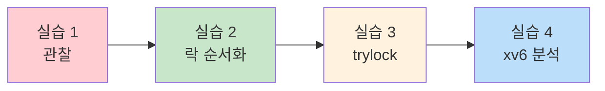
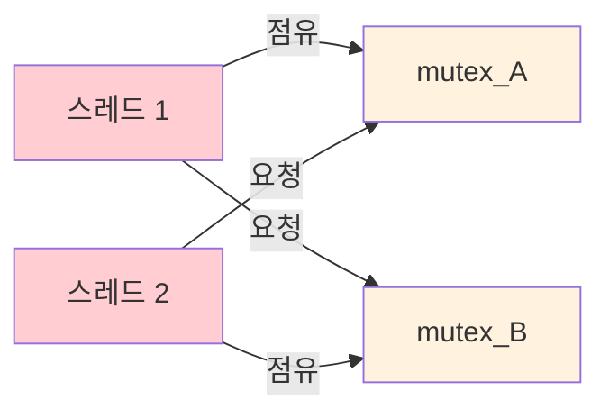
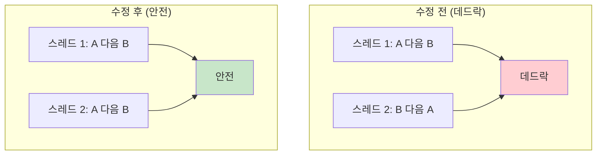
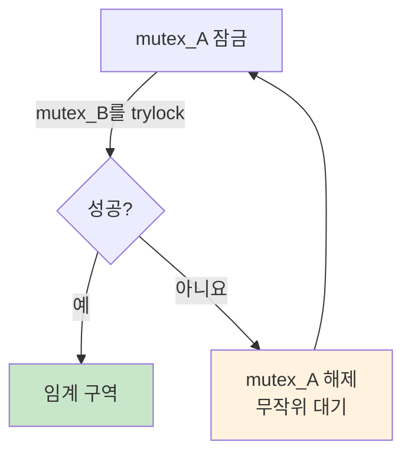
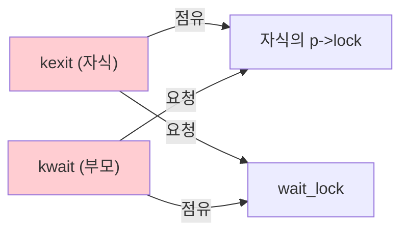
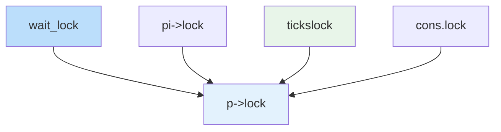

# 10주차 실습 — 데드락

[레포지토리 안내](../../README.ko.md) | [English](Concepts_Lab.md) | [한국어](Concepts_Lab.ko.md)

> **최종 수정일:** 2026-11-18

> **학습 목표:**
> 1. 데드락의 네 가지 필요 조건이 실제 코드에서 각각 어떻게 성립하는지 찾아낼 수 있다
> 2. pthread 뮤텍스로 데드락을 재현하고 그 원인을 분석할 수 있다
> 3. 락 순서화와 `trylock` 후퇴로 데드락을 예방하고 두 방법의 장단점을 비교할 수 있다
> 4. xv6 커널 소스에서 락 순서 규칙이 지켜지는 방식을 분석할 수 있다
> 5. xv6의 프로세스 kill과 스핀락 획득이 데드락을 피하도록 설계된 이유를 설명할 수 있다

---

## 목차

- [1. 실습 개요](#1-실습-개요)
  - [1.1 데드락의 네 가지 필요 조건](#11-데드락의-네-가지-필요-조건)
- [2. 실습 1: 데드락 관찰](#2-실습-1-데드락-관찰)
  - [2.1 코드](#21-코드)
  - [2.2 빌드와 실행](#22-빌드와-실행)
  - [2.3 분석](#23-분석)
- [3. 실습 2: 락 순서화](#3-실습-2-락-순서화)
  - [3.1 원리](#31-원리)
  - [3.2 코드 변경](#32-코드-변경)
  - [3.3 순환 대기가 생기지 않는 이유](#33-순환-대기가-생기지-않는-이유)
  - [3.4 실행 결과](#34-실행-결과)
- [4. 실습 3: trylock과 후퇴](#4-실습-3-trylock과-후퇴)
  - [4.1 pthread_mutex_trylock()](#41-pthread_mutex_trylock)
  - [4.2 코드](#42-코드)
  - [4.3 실행 결과](#43-실행-결과)
  - [4.4 장단점](#44-장단점)
- [5. 실습 4: xv6 커널의 락 순서](#5-실습-4-xv6-커널의-락-순서)
  - [5.1 xv6의 주요 락](#51-xv6의-주요-락)
  - [5.2 wait_lock은 p->lock보다 먼저](#52-wait_lock은-p-lock보다-먼저)
  - [5.3 조건 락은 p->lock보다 먼저](#53-조건-락은-p-lock보다-먼저)
  - [5.4 프로세스 kill과 락](#54-프로세스-kill과-락)
  - [5.5 acquire()와 인터럽트](#55-acquire와-인터럽트)
- [6. 데드락 조건과 해결 전략 정리](#6-데드락-조건과-해결-전략-정리)
- [요약](#요약)
- [점검 문제](#점검-문제)

---

<br>

## 1. 실습 개요

- **목표:** 사용자 공간의 pthread 프로그램과 xv6 커널에서 데드락을 관찰하고, 해결하고, 예방하는 방법을 익힌다.
- **주제:** `pthread_mutex`로 데드락 관찰, 락 순서화, `trylock`과 후퇴, xv6의 락 순서 분석
- **관련 파일:** `lab1_deadlock_demo.c`, `lab2_deadlock_fix_ordering.c`, `lab3_deadlock_fix_trylock.c`, `kernel/proc.c`, `kernel/spinlock.c`, `kernel/trap.c`



*그림 1. 네 실습의 진행 순서*

### 1.1 데드락의 네 가지 필요 조건

데드락은 둘 이상의 프로세스나 스레드가 각자 상대가 점유한 자원을 기다려 어느 쪽도 진행하지 못하는 상태이다(10주차 1.2절). 데드락이 생기려면 다음 네 조건이 **동시에** 성립해야 한다.

| 조건 | 설명 |
|:-----|:-----|
| 상호 배제(Mutual Exclusion) | 한 자원을 한 번에 한 프로세스만 사용 |
| 점유 후 대기(Hold and Wait) | 자원을 점유한 프로세스가 다른 자원을 대기 |
| 비선점(No Preemption) | 프로세스가 점유한 자원을 강제로 빼앗을 수 없음 |
| 순환 대기(Circular Wait) | 프로세스들이 원형 사슬을 이루어 각자 다음 프로세스가 점유한 자원을 대기 |

*표 1. 데드락의 네 가지 필요 조건*

네 조건 중 하나라도 깨면 데드락을 예방할 수 있다. 이 실습은 순환 대기를 깨는 락 순서화(실습 2)와 점유 후 대기를 깨는 `trylock` 후퇴(실습 3)를 다룬다. 두 스레드가 락 두 개를 반대 순서로 얻으려 할 때의 상황은 다음과 같다.

```text
스레드 1                     스레드 2
   |                            |
   | lock(A) -- 성공            | lock(B) -- 성공
   |                            |
   | lock(B) -- 대기...         | lock(A) -- 대기...
   |     ^                      |     ^
   |     |______________________|_____|
   |                            |
   +-- 스레드 2가 B를           +-- 스레드 1이 A를
       놓기를 기다림                놓기를 기다림

   ==> 어느 쪽도 진행할 수 없음 (데드락)
```

*그림 2. 두 스레드가 서로의 락을 기다리는 데드락*

---

<br>

## 2. 실습 1: 데드락 관찰

**목표:** 실제 데드락으로 프로그램이 멈추는 것을 직접 관찰하고 원인을 분석한다.

### 2.1 코드

`lab1_deadlock_demo.c`는 두 스레드가 뮤텍스 두 개를 반대 순서로 잠그게 한다.

```c
#include <stdio.h>      /* printf(), perror() */
#include <stdlib.h>     /* exit() */
#include <pthread.h>    /* pthread_mutex_t, pthread_create(), pthread_join() 등 */
#include <unistd.h>     /* usleep() */

/* 두 뮤텍스의 정적 초기화 */
pthread_mutex_t mutex_A = PTHREAD_MUTEX_INITIALIZER;
pthread_mutex_t mutex_B = PTHREAD_MUTEX_INITIALIZER;

/* 스레드 1: A를 먼저, 그다음 B를 잠금 */
void *thread1_func(void *arg)
{
    (void)arg;
    printf("[Thread 1] Attempting to lock mutex_A...\n");
    pthread_mutex_lock(&mutex_A);
    printf("[Thread 1] mutex_A locked successfully!\n");

    /* 100ms 대기, 스레드 2가 mutex_B를 먼저 잠글 시간 확보 */
    printf("[Thread 1] Waiting 0.1s (to let the other thread grab mutex_B)...\n");
    usleep(100000);

    /* 스레드 2가 mutex_B를 쥔 채 mutex_A를 기다리므로 여기서 영원히 멈춤 */
    printf("[Thread 1] Attempting to lock mutex_B... (may hang here)\n");
    pthread_mutex_lock(&mutex_B);
    printf("[Thread 1] mutex_B locked successfully!\n");  /* 출력되지 않음 */

    pthread_mutex_unlock(&mutex_B);
    pthread_mutex_unlock(&mutex_A);
    return NULL;
}

/* 스레드 2: B를 먼저, 그다음 A를 잠근다 (스레드 1과 반대 순서) */
void *thread2_func(void *arg)
{
    (void)arg;
    printf("[Thread 2] Attempting to lock mutex_B...\n");
    pthread_mutex_lock(&mutex_B);
    printf("[Thread 2] mutex_B locked successfully!\n");

    printf("[Thread 2] Waiting 0.1s (to let the other thread grab mutex_A)...\n");
    usleep(100000);

    printf("[Thread 2] Attempting to lock mutex_A... (may hang here)\n");
    pthread_mutex_lock(&mutex_A);
    printf("[Thread 2] mutex_A locked successfully!\n");  /* 출력되지 않음 */

    pthread_mutex_unlock(&mutex_A);
    pthread_mutex_unlock(&mutex_B);
    return NULL;
}

int main(void)
{
    pthread_t t1, t2;

    /* (안내 문구 출력 생략) */
    if (pthread_create(&t1, NULL, thread1_func, NULL) != 0) {
        perror("pthread_create (t1)");
        exit(1);
    }
    if (pthread_create(&t2, NULL, thread2_func, NULL) != 0) {
        perror("pthread_create (t2)");
        exit(1);
    }

    /* 데드락이 생기면 두 스레드가 끝나지 않으므로 메인 스레드도 여기서 영원히 대기 */
    pthread_join(t1, NULL);
    pthread_join(t2, NULL);

    printf("Both threads terminated normally (no deadlock occurred)\n");
    pthread_mutex_destroy(&mutex_A);
    pthread_mutex_destroy(&mutex_B);
    return 0;
}
```

`usleep(100000)`은 첫 번째 락을 얻은 뒤 0.1초를 기다려, 그동안 상대 스레드가 자신의 첫 번째 락을 얻게 만든다. 그 결과 두 스레드는 거의 확실하게 각자 락 하나씩을 쥔 채 서로의 락을 기다리게 된다.

### 2.2 빌드와 실행

```bash
gcc -Wall -pthread -o lab1_deadlock_demo lab1_deadlock_demo.c
./lab1_deadlock_demo
```

macOS에서 실행한 결과는 다음과 같다.

```text
==============================================
  Deadlock Demonstration
==============================================

Thread 1: locks in order mutex_A -> mutex_B
Thread 2: locks in order mutex_B -> mutex_A (opposite!)

If deadlock occurs, the program will hang.
Terminate with Ctrl+C.

----------------------------------------------
[Thread 1] Attempting to lock mutex_A...
[Thread 1] mutex_A locked successfully!
[Thread 1] Waiting 0.1s (to let the other thread grab mutex_B)...
[Thread 2] Attempting to lock mutex_B...
[Thread 2] mutex_B locked successfully!
[Thread 2] Waiting 0.1s (to let the other thread grab mutex_A)...
[Thread 1] Attempting to lock mutex_B... (may hang here)
[Thread 2] Attempting to lock mutex_A... (may hang here)
```

마지막 두 줄을 출력한 뒤 프로그램은 더 이상 아무것도 출력하지 않고 멈추며, `Ctrl+C`로 종료해야 한다.

### 2.3 분석

마지막으로 출력된 메시지에서 스레드 1은 `mutex_B`를, 스레드 2는 `mutex_A`를 기다리는 중이다. 각자 상대가 쥔 락을 기다리므로 어느 쪽도 진행할 수 없다. 이 상태를 자원 할당 그래프(10주차 2.2절)로 그리면 사이클이 나타난다.



*그림 3. 실습 1의 상태를 나타낸 자원 할당 그래프*

네 조건은 이 코드에서 다음과 같이 성립한다.

1. **상호 배제:** 뮤텍스는 한 번에 한 스레드만 잠글 수 있다.
2. **점유 후 대기:** 스레드 1은 `mutex_A`를 쥔 채 `mutex_B`를, 스레드 2는 `mutex_B`를 쥔 채 `mutex_A`를 기다린다.
3. **비선점:** `pthread_mutex_lock()`은 다른 스레드가 쥔 락을 빼앗지 못하고, 상대가 풀어 줄 때까지 기다린다.
4. **순환 대기:** 스레드 1 → `mutex_B`(스레드 2가 점유) → 스레드 2 → `mutex_A`(스레드 1이 점유) → 스레드 1로 사이클이 생긴다.

> **참고:** `usleep()`은 실행 순서를 강제하지 않는다. 시스템이 매우 바빠 한 스레드가 0.1초 안에 첫 번째 락을 얻지 못하면, 다른 스레드가 두 락을 모두 얻고 끝나 데드락 없이 종료될 수도 있다. 데드락은 실행 순서에 따라 나타나기도 하고 나타나지 않기도 하는 비결정적 버그이므로, 테스트를 통과했다고 데드락이 없다고 결론지을 수 없다.

---

<br>

## 3. 실습 2: 락 순서화

**목표:** 순환 대기 조건을 깨서 데드락을 예방한다.

### 3.1 원리

모든 락에 **전역 전순서**를 정하고, 모든 스레드가 그 순서대로만 락을 얻게 한다. 두 스레드가 모두 A를 먼저, B를 나중에 얻으면, 한 스레드가 A를 쥐고 있는 동안 다른 스레드는 A에서 기다리므로 B를 쥘 수 없다. 앞선 스레드는 A와 B를 모두 쓰고 놓아 주며, 그 뒤에 기다리던 스레드가 진행한다.



*그림 4. 락 순서를 통일하기 전과 후*

### 3.2 코드 변경

`lab2_deadlock_fix_ordering.c`는 스레드 2의 락 순서만 바꾸고, 두 스레드가 각각 임계 구역에 다섯 번 들어가게 한다.

```c
/* [수정 전: 데드락 발생] */
pthread_mutex_lock(&mutex_B);  // B 먼저
pthread_mutex_lock(&mutex_A);  // A 나중

/* [수정 후: 락 순서화 적용] */
pthread_mutex_lock(&mutex_A);  // A 먼저 (순서 통일)
pthread_mutex_lock(&mutex_B);  // B 나중
```

두 스레드의 반복문 본문은 같은 형태이다.

```c
for (int i = 0; i < 5; i++) {
    pthread_mutex_lock(&mutex_A);   /* 순서 규칙의 첫 번째 락 */
    usleep(10000);                  /* 10ms: 경쟁을 유도 */
    pthread_mutex_lock(&mutex_B);   /* 순서 규칙의 두 번째 락 */

    /* 임계 구역: A와 B를 모두 쥔 채 작업 */
    usleep(5000);

    /* 얻은 순서의 반대(B, A)로 해제 */
    pthread_mutex_unlock(&mutex_B);
    pthread_mutex_unlock(&mutex_A);
}
```

### 3.3 순환 대기가 생기지 않는 이유

귀류법으로 보인다.

1. 전역 순서를 `mutex_A < mutex_B`로 정하고, 모든 스레드는 순서가 낮은 락을 먼저 얻는다.
2. 순환 대기가 생기려면 스레드 X가 `mutex_A`를 쥔 채 `mutex_B`를 기다리고, 스레드 Y가 `mutex_B`를 쥔 채 `mutex_A`를 기다려야 한다.
3. 그런데 Y가 `mutex_B`를 쥐려면 먼저 `mutex_A`를 얻었어야 한다.
4. X가 이미 `mutex_A`를 쥐고 있으므로 Y는 `mutex_A` 단계에서 기다리고 있어야 하며 `mutex_B`를 쥘 수 없다. 모순이다.

락이 여러 개여도 같다. 대기 사슬을 따라가면 락의 순서가 계속 증가해야 하므로 사슬이 처음 락으로 돌아오는 사이클이 생길 수 없다. 이것이 xv6 커널이 쓰는 전략이며, 5절에서 다룬다.

### 3.4 실행 결과

```bash
gcc -Wall -pthread -o lab2_deadlock_fix_ordering lab2_deadlock_fix_ordering.c
./lab2_deadlock_fix_ordering
```

```text
[Thread 1] Iteration 1: Attempting to lock mutex_A...
[Thread 2] Iteration 1: Attempting to lock mutex_A...
[Thread 1] Iteration 1: mutex_A locked
[Thread 1] Iteration 1: Attempting to lock mutex_B...
[Thread 1] Iteration 1: mutex_B locked
[Thread 1] Iteration 1: === Entered critical section (holding A and B) ===
[Thread 1] Iteration 1: mutex_B released
[Thread 1] Iteration 1: mutex_A released
...
[Thread 1] Iteration 5: mutex_A released

[Thread 2] Iteration 1: mutex_A locked
...
[Thread 2] Iteration 5: mutex_A released

----------------------------------------------
Both threads terminated normally! No deadlock occurred.
```

두 스레드가 각각 다섯 번, 모두 열 번 임계 구역에 들어간 뒤 프로그램이 정상 종료한다. 스레드 2는 첫 번째 시도에서 `mutex_A`를 기다리기 시작했지만, 이 실행에서는 스레드 1이 `mutex_A`를 놓자마자 다시 얻기를 반복해 다섯 번을 먼저 마쳤다. 실행할 때마다 어느 스레드가 먼저 끝나는지는 달라진다.

> **주의:** 락 순서화는 데드락을 막을 뿐, 기다리는 스레드 가운데 누가 먼저 락을 얻을지(공정성)는 정하지 않는다. 한 스레드가 락을 놓자마자 다시 얻으면 다른 스레드는 오래 기다릴 수 있으므로, 공정성이 필요하면 별도의 장치가 있어야 한다.

---

<br>

## 4. 실습 3: trylock과 후퇴

**목표:** 점유 후 대기 조건을 깨서 데드락을 피한다.

### 4.1 pthread_mutex_trylock()

`pthread_mutex_trylock()`은 락을 바로 얻을 수 없으면 기다리지 않고 실패를 반환한다.

| 함수 | 락을 얻을 수 없을 때 | 반환값 |
|:-----|:-----|:-----|
| `pthread_mutex_lock()` | 풀릴 때까지 블록 | 성공하면 0 |
| `pthread_mutex_trylock()` | 블록되지 않고 바로 반환 | 성공하면 0, 다른 스레드가 쥐고 있으면 `EBUSY` |

*표 2. lock과 trylock의 비교*

실패했을 때 이미 쥔 락을 놓아 주면(후퇴, back-off) "자원을 쥔 채 다른 자원을 기다리는" 상황이 생기지 않는다. 절차는 다음과 같다.

1. 첫 번째 락을 일반 `lock()`으로 얻는다.
2. 두 번째 락을 `trylock()`으로 시도한다.
3. 실패하면 쥐고 있는 첫 번째 락을 놓고, 무작위 시간만큼 기다린 뒤 처음부터 다시 시도한다.



*그림 5. trylock과 후퇴로 두 락을 얻는 절차*

### 4.2 코드

`lab3_deadlock_fix_trylock.c`에서 두 스레드는 여전히 반대 순서로 락을 얻는다. 스레드 1은 `mutex_A`를 잠그고 `mutex_B`를 `trylock`하며, 스레드 2는 `mutex_B`를 잠그고 `mutex_A`를 `trylock`한다.

```c
void *thread1_func(void *arg)
{
    (void)arg;
    int success = 0;   /* 두 락을 모두 얻었는지 */
    int attempts = 0;  /* 시도 횟수 */

    while (!success) {
        attempts++;
        pthread_mutex_lock(&mutex_A);          /* 첫 번째 락: 블록하는 lock */
        usleep(10000);                         /* 10ms: 경쟁을 유도 */

        if (pthread_mutex_trylock(&mutex_B) == 0) {
            /* 성공: 두 락을 모두 쥔 상태 */
            success = 1;
            usleep(5000);                      /* 임계 구역 작업 */
            pthread_mutex_unlock(&mutex_B);
            pthread_mutex_unlock(&mutex_A);
        } else {
            /* 실패: 후퇴, 쥐고 있던 mutex_A를 즉시 해제 */
            pthread_mutex_unlock(&mutex_A);
            usleep((unsigned)(rand() % 50000));  /* 0~50ms 무작위 대기 */
        }
    }
    printf("[Thread 1] Done (total %d attempts)\n\n", attempts);
    return NULL;
}
```

`main()`은 `srand(42)`로 난수 시드를 정한 뒤 두 스레드를 만든다. 고정된 시드는 난수열을 재현 가능하게 하지만, 두 스레드가 `rand()`를 호출하는 순서는 실행마다 달라질 수 있다.

### 4.3 실행 결과

```bash
gcc -Wall -pthread -o lab3_deadlock_fix_trylock lab3_deadlock_fix_trylock.c
./lab3_deadlock_fix_trylock
```

```text
[Thread 1] Attempt 1: Locking mutex_A...
[Thread 2] Attempt 1: Locking mutex_B...
[Thread 1] Attempt 1: mutex_A locked
[Thread 2] Attempt 1: mutex_B locked
[Thread 1] Attempt 1: Trying trylock on mutex_B...
[Thread 1] Attempt 1: mutex_B trylock failed! -> back-off
[Thread 1] Attempt 1: mutex_A released (back-off)
[Thread 2] Attempt 1: Trying trylock on mutex_A...
[Thread 2] Attempt 1: mutex_A trylock succeeded!
[Thread 2] === Entered critical section (holding A and B) ===
[Thread 2] mutex_A released
[Thread 2] mutex_B released
[Thread 2] Done (total 1 attempts)

[Thread 1] Attempt 2: Locking mutex_A...
[Thread 1] Attempt 2: mutex_A locked
[Thread 1] Attempt 2: Trying trylock on mutex_B...
[Thread 1] Attempt 2: mutex_B trylock succeeded!
[Thread 1] === Entered critical section (holding A and B) ===
[Thread 1] mutex_B released
[Thread 1] mutex_A released
[Thread 1] Done (total 2 attempts)

----------------------------------------------
Both threads terminated normally! No deadlock occurred.
```

두 스레드가 각자 첫 번째 락을 쥔 상태에서 스레드 1의 `trylock`이 먼저 실패했다. 스레드 1이 `mutex_A`를 놓고 물러나자 스레드 2의 `trylock(mutex_A)`가 성공해 작업을 마쳤고, 스레드 1은 두 번째 시도에서 두 락을 모두 얻었다. 이처럼 한 스레드는 첫 시도에, 다른 스레드는 두 번째 시도에 성공하는 경우가 많으며, 어느 쪽이 먼저 성공하는지는 실행마다 달라진다.

### 4.4 장단점

`trylock` 후퇴는 실패했을 때 쥔 락을 놓으므로 **점유 후 대기** 조건을 깬다. 락을 얻는 순서를 통일하기 어려운 상황에서도 쓸 수 있다는 장점이 있지만, 다음과 같은 단점이 있다.

- **라이브락 위험:** 두 스레드가 실패, 후퇴, 재시도를 같은 박자로 되풀이하면 상태는 계속 바뀌어도 진행은 없다(10주차 1.4절). 대기 시간을 무작위로 정하면 두 스레드의 박자가 어긋나 한쪽이 먼저 두 락을 얻을 가능성이 커진다.
- **성능 부담:** 불필요한 잠금과 해제, 대기 시간이 생긴다.
- **복잡성:** 락 순서화보다 코드가 복잡하다.

따라서 가능하면 락 순서화를 쓰고, 순서를 정하기 어려울 때 `trylock` 후퇴를 쓴다.

---

<br>

## 5. 실습 4: xv6 커널의 락 순서

**목표:** xv6 커널 소스에서 락 순서가 데드락을 막는 방식을 분석한다.

### 5.1 xv6의 주요 락

| 락 | 위치 | 보호하는 것 |
|:-----|:-----|:-----|
| `p->lock` | `kernel/proc.h` | 프로세스별 락 (`state`, `killed`, `pid` 등) |
| `wait_lock` | `kernel/proc.c` | 부모-자식 관계(`p->parent`) |
| `bcache.lock` | `kernel/bio.c` | 버퍼 캐시 관리 |
| `ftable.lock` | `kernel/file.c` | 파일 테이블 관리 |
| `pi->lock` | `kernel/pipe.c` | 파이프별 락 |
| `cons.lock` | `kernel/console.c` | 콘솔 입출력 |
| `tickslock` | `kernel/trap.c` | 시스템 타이머의 `ticks` |

*표 3. xv6 커널의 주요 락*

### 5.2 wait_lock은 p->lock보다 먼저

`kernel/proc.c`는 `wait_lock`의 선언 위에 규칙을 적어 둔다.

```c
// wait()하는 부모를 깨우는 신호를
// 잃지 않도록 도움, p->parent를 쓸 때
// 메모리 모델을 지키도록 도움,
// 어떤 p->lock보다도 먼저 획득해야 함
struct spinlock wait_lock;
```

**규칙: `wait_lock`은 항상 `p->lock`보다 먼저 얻는다.** 프로세스가 종료할 때 호출되는 `kexit()`는 이 순서를 지킨다.

```c
void
kexit(int status)
{
  struct proc *p = myproc();
  // ... 열린 파일을 닫고 현재 디렉토리를 놓는다 ...

  acquire(&wait_lock);       // (1) wait_lock 먼저

  // 자식들을 init에게 넘김
  reparent(p);

  // 부모가 wait()에서 잠들어 있을 수 있음
  wakeup(p->parent);

  acquire(&p->lock);         // (2) 그다음 p->lock

  p->xstate = status;
  p->state = ZOMBIE;

  release(&wait_lock);

  // 스케줄러로 넘어가며 돌아오지 않음
  sched();
  panic("zombie exit");
}
```

자식을 기다리는 `kwait()`도 같은 순서로 락을 얻는다.

```c
int
kwait(uint64 addr)
{
  struct proc *pp;
  int havekids, pid;
  struct proc *p = myproc();

  acquire(&wait_lock);              // (1) wait_lock 먼저

  for(;;){
    havekids = 0;
    for(pp = proc; pp < &proc[NPROC]; pp++){
      if(pp->parent == p){
        acquire(&pp->lock);         // (2) 자식의 p->lock 나중
        havekids = 1;
        if(pp->state == ZOMBIE){
          // ... 종료 상태를 복사하고 freeproc(pp) ...
          release(&pp->lock);
          release(&wait_lock);
          return pid;
        }
        release(&pp->lock);
      }
    }
    if(!havekids || killed(p)){
      release(&wait_lock);
      return -1;
    }
    sleep(p, &wait_lock);  //DOC: wait-sleep
  }
}
```

만약 `kexit()`가 `p->lock`을 먼저 얻고 `wait_lock`을 나중에 얻는다면, 종료하는 자식은 자신의 `p->lock`을 쥔 채 `wait_lock`을 기다리고, 부모의 `kwait()`는 `wait_lock`을 쥔 채 그 자식의 `p->lock`을 기다리게 된다. 순환 대기가 생겨 데드락이 일어날 수 있다.



*그림 6. kexit()가 락 순서를 어겼다고 가정했을 때 생기는 순환 대기*

`kwait()`의 마지막 줄 `sleep(p, &wait_lock)`에서 부모는 자기 자신의 주소 `p`를 채널로 삼아 잠들고, 자식의 `kexit()`는 `wakeup(p->parent)`로 같은 채널을 깨운다. 자식이 `wait_lock`을 쥔 채 `wakeup()`을 호출하므로 9주차 실습 5절과 같은 원리로 깨우기 신호를 잃지 않는다.

### 5.3 조건 락은 p->lock보다 먼저

`sleep(chan, lk)`은 조건 락 `lk`를 쥔 상태로 호출되어 그 안에서 `p->lock`을 얻는다. 또 `wakeup()`은 조건 락을 쥔 호출자 안에서 각 프로세스의 `p->lock`을 얻는다. 따라서 sleep/wakeup에 쓰이는 조건 락은 모두 `p->lock`보다 먼저 얻는다는 규칙이 생긴다.

- `pipewrite()`, `piperead()`: `pi->lock`을 쥔 채 `wakeup()`이나 `sleep()`을 호출한다.
- `clockintr()`: `acquire(&tickslock); ticks++; wakeup(&ticks); release(&tickslock);`으로 `tickslock`을 쥔 채 `wakeup()`을 호출하고, `sys_pause()`는 `tickslock`을 쥔 채 `sleep(&ticks, &tickslock)`을 호출한다.
- `consoleintr()`: `cons.lock`을 쥔 채 줄바꿈이 들어오면 `wakeup(&cons.r)`을 호출한다.



*그림 7. xv6에서 p->lock보다 먼저 얻는 락들 (화살표는 획득 순서)*

`sleep()`이 `lk`를 놓기 전에 `p->lock`을 먼저 얻는 이유는 9주차 실습 5절의 잃어버린 깨우기 문제이다. 순서를 바꿔 `lk`를 먼저 놓고 `p->lock`을 얻으면, 그 사이에 다른 CPU가 `wakeup()`을 호출했을 때 아직 `SLEEPING`이 아닌 프로세스를 지나쳐 깨우기 신호를 잃는다.

> **참고:** 실습 자료의 락 계층 그림은 `tickslock`을 `p->lock` 아래에 두지만, 위의 `clockintr()`와 `sys_pause()`처럼 실제 코드는 `tickslock`을 쥔 채 `p->lock`을 얻으므로 순서는 `tickslock`이 먼저이다. `p->lock`을 쥔 채 `tickslock`을 얻는 경로가 생기면 오히려 이 규칙과 충돌해 데드락이 생길 수 있다.

### 5.4 프로세스 kill과 락

xv6의 `kkill()`은 대상 프로세스를 바로 종료하지 않고 표시만 해 둔다.

```c
int
kkill(int pid)
{
  struct proc *p;

  for(p = proc; p < &proc[NPROC]; p++){
    acquire(&p->lock);
    if(p->pid == pid){
      p->killed = 1;
      if(p->state == SLEEPING){
        // sleep()에서 프로세스를 깨움
        p->state = RUNNABLE;
      }
      release(&p->lock);
      return 0;
    }
    release(&p->lock);
  }
  return -1;
}
```

대상 프로세스는 커널 코드를 실행하며 여러 락을 쥐고 있을 수 있다. 디스크 입출력을 기다리며 파일 시스템 락을 쥐고 있거나, 데이터를 기다리며 파이프 락을 쥐고 있거나, `wait_lock`을 쥐고 작업 중일 수 있다. 이런 상태에서 즉시 종료하면 **그 락들이 영원히 해제되지 않아** 다른 프로세스들이 데드락에 빠질 수 있다.

그래서 `kkill()`은 `p->killed = 1`만 설정하고, 잠든 프로세스는 `RUNNABLE`로 바꿔 깨운다. 대상 프로세스는 락을 모두 정리할 수 있는 지점에서 스스로 종료한다. 대표적인 지점은 사용자 공간으로 돌아가기 직전의 `usertrap()`이다.

```c
uint64
usertrap(void)
{
  ...
  if(r_scause() == 8){
    // 시스템 콜
    if(killed(p))        // 시스템 콜을 처리하기 전에 검사
      kexit(-1);
    ...
    syscall();
  } ...

  if(killed(p))          // 사용자 공간으로 돌아가기 전에 검사
    kexit(-1);
  ...
}
```

잠들어 기다리는 반복문도 깨어날 때마다 `killed()`를 검사해, 쥐고 있는 락을 놓은 뒤 오류를 반환한다. `piperead()`의 반복문이 그 예이다.

```c
while(pi->nread == pi->nwrite && pi->writeopen){
  if(killed(pr)){
    release(&pi->lock);    // 파이프 락을 놓고 반환
    return -1;
  }
  sleep(&pi->nread, &pi->lock);
}
```

`kwait()`의 `if(!havekids || killed(p))`, `sys_pause()`의 `if(killed(myproc()))`도 같은 역할을 한다. 이렇게 하면 프로세스는 쥔 락을 모두 정리한 뒤에 종료되므로 kill이 데드락의 원인이 되지 않는다.

### 5.5 acquire()와 인터럽트

```c
void
acquire(struct spinlock *lk)
{
  push_off(); // 데드락을 피하려고 인터럽트를 끔
  if(holding(lk))
    panic("acquire");

  // RISC-V에서 sync_lock_test_and_set은 원자적 교환으로 변환:
  //   a5 = 1
  //   s1 = &lk->locked
  //   amoswap.w.aq a5, a5, (s1)
  while(__sync_lock_test_and_set(&lk->locked, 1) != 0)
    ;

  // 컴파일러와 프로세서가 이 지점 너머로 load와 store를
  // 옮기지 못하게 막아, 임계 구역의 메모리 참조가
  // 반드시 락을 얻은 뒤에 일어나도록 보장,
  // RISC-V에서는 fence 명령어로 변환
  __sync_synchronize();

  // holding()과 디버깅을 위해 락을 얻은 CPU를 기록
  lk->cpu = mycpu();
}
```

`push_off()`는 인터럽트를 끄고 중첩 횟수를 센다. 짝이 되는 `pop_off()`는 `release()`에서 호출되어, 그 CPU가 쥔 스핀락이 모두 풀렸을 때만 인터럽트를 원래 상태로 되돌린다. 인터럽트를 켠 채 스핀락을 얻으면 다음과 같은 데드락이 생길 수 있다.

1. CPU가 스핀락 `tickslock`을 얻는다(예: `sys_pause()`).
2. 타이머 인터럽트가 발생해 인터럽트 처리기 `clockintr()`가 실행된다.
3. 처리기가 `tickslock`을 얻으려 한다.
4. **같은 CPU**가 이미 그 락을 쥐고 있으므로 처리기는 영원히 회전하고, 락을 쥔 코드는 처리기가 끝나야 다시 실행되므로 락을 놓을 수 없다.

이 데드락은 CPU가 하나뿐이어도 생긴다. 락을 쥐는 동안 인터럽트를 끄면 처리기가 그 CPU에서 실행되지 않으므로 이 문제를 피할 수 있다. 또 `holding(lk)` 검사는 같은 CPU가 이미 쥔 락을 다시 얻으려는 프로그래밍 오류를 잡아 즉시 패닉을 일으킨다. xv6는 재진입 락을 허용하지 않으며, 그런 시도를 회전하며 멈추는 대신 바로 드러내는 편을 택했다.

---

<br>

## 6. 데드락 조건과 해결 전략 정리

| 조건 | 해결 방법 | 이 실습의 예 |
|:-----|:-----|:-----|
| 상호 배제 | (일반적으로 없앨 수 없음) | - |
| 점유 후 대기 | `trylock`과 후퇴 | 실습 3: `lab3_deadlock_fix_trylock.c` |
| 비선점 | (일반적으로 없앨 수 없음) | - |
| 순환 대기 | 락 순서화 | 실습 2: `lab2_deadlock_fix_ordering.c` |

*표 4. 데드락 조건별 해결 방법과 이 실습의 예*

| 전략 | 쓰는 경우 |
|:-----|:-----|
| 락 순서화 | 기본 선택, 단순하고 정확성 증명 가능 |
| `trylock`과 후퇴 | 엄격한 순서를 정하기 어려운 경우 |
| xv6의 규율 | 모든 커널 경로가 문서화된 락 계층을 따름 |

*표 5. 데드락 예방 전략과 쓰는 경우*

xv6 커널의 데드락 예방 전략은 다음 네 가지로 정리된다.

1. **락 순서화:** 전역 락 순서를 정하고 항상 지킨다(`wait_lock` → `p->lock`, 조건 락 → `p->lock`).
2. **인터럽트 끄기:** 스핀락을 쥐는 동안 그 CPU의 인터럽트를 끈다(`acquire()` → `push_off()` → `intr_off()`).
3. **지연된 kill:** 프로세스를 바로 종료하지 않고 표시만 해 두었다가, 락을 안전하게 정리할 수 있는 지점에서 종료한다.
4. **중복 획득 검사:** 같은 락을 두 번 얻으려 하면 패닉을 일으킨다(`if(holding(lk)) panic("acquire");`).

> **핵심:** 락 순서화는 가장 실용적이고 널리 쓰이는 데드락 예방 기법이다. xv6 커널은 락 순서를 주석과 관례로 문서화해 지키며, 프로세스 kill처럼 복잡한 상황에서는 락을 안전하게 정리할 수 있는 지점까지 동작을 미룬다. Linux 같은 실제 운영체제도 같은 원칙을 따른다(10주차 4.6절의 lockdep).

---

<br>

## 요약

| 개념 | 핵심 요약 |
|:-----|:-----|
| 데드락의 네 조건 | 상호 배제, 점유 후 대기, 비선점, 순환 대기가 동시에 성립해야 하므로 하나만 깨도 데드락을 예방할 수 있다. |
| 실습 1의 데드락 | 두 스레드가 뮤텍스 두 개를 반대 순서로 잠그면 각자 하나씩 쥔 채 서로를 기다려 프로그램이 멈추며, 이 버그는 실행 순서에 따라 나타나거나 나타나지 않는다. |
| 락 순서화 | 모든 스레드가 전역 순서대로 락을 얻으면 대기 사슬의 락 순서가 계속 증가해야 하므로 순환 대기가 생기지 않지만, 공정성은 보장하지 않는다. |
| trylock과 후퇴 | 두 번째 락을 얻지 못하면 첫 번째 락을 놓고 무작위로 기다린 뒤 재시도해 점유 후 대기를 깨며, 라이브락과 성능 부담이 단점이다. |
| xv6의 락 순서 | `wait_lock`과 sleep/wakeup의 조건 락(`pi->lock`, `tickslock`, `cons.lock`)은 항상 `p->lock`보다 먼저 얻는다. |
| 지연된 kill | `kkill()`은 `p->killed`만 설정하고, 대상 프로세스는 쥔 락을 정리할 수 있는 지점에서 `killed()`를 검사해 스스로 종료한다. |
| acquire()의 인터럽트 끄기 | 스핀락을 쥔 CPU에서 같은 락을 얻으려는 인터럽트 처리기가 실행되면 단일 CPU에서도 데드락이 생기므로, `push_off()`로 인터럽트를 끈다. |

---

<br>

## 점검 문제

1. 실습 1의 프로그램에서 데드락의 네 가지 필요 조건이 각각 어떻게 성립하는지 설명하라.

   <details>
   <summary>정답</summary>

   상호 배제는 뮤텍스를 한 번에 한 스레드만 잠글 수 있어 성립한다. 점유 후 대기는 스레드 1이 `mutex_A`를 쥔 채 `mutex_B`를, 스레드 2가 `mutex_B`를 쥔 채 `mutex_A`를 기다려 성립한다. 비선점은 `pthread_mutex_lock()`이 상대가 쥔 락을 빼앗지 못하고 기다리기만 하므로 성립한다. 순환 대기는 스레드 1 → `mutex_B`(스레드 2 점유) → 스레드 2 → `mutex_A`(스레드 1 점유) → 스레드 1의 사이클로 성립한다.

   </details>

2. 락 순서화가 네 조건 중 어느 것을 깨는지 쓰고, 락이 여러 개일 때도 사이클이 생길 수 없는 이유를 설명하라.

   <details>
   <summary>정답</summary>

   순환 대기를 깬다. 모든 스레드가 전역 순서가 낮은 락부터 얻으면, 어떤 스레드가 기다리는 락은 항상 그 스레드가 이미 쥔 락들보다 순서가 높다. 대기 사슬을 따라가면 락의 순서가 계속 증가하므로 사슬이 처음 락으로 돌아오는 사이클이 생길 수 없다.

   </details>

3. `trylock` 후퇴가 깨는 조건은 무엇이며, 후퇴할 때 무작위 시간만큼 기다리는 이유는 무엇인가?

   <details>
   <summary>정답</summary>

   `trylock`이 실패하면 이미 쥔 락을 놓으므로 자원을 쥔 채 다른 자원을 기다리는 상황이 생기지 않아 점유 후 대기를 깬다. 대기 시간이 고정되어 있으면 두 스레드가 같은 박자로 깨어나 같은 순서로 다시 락을 얻으려 하면서 실패와 재시도를 끝없이 반복하는 라이브락이 생길 수 있다. 무작위 대기는 두 스레드의 박자를 어긋나게 해 한쪽이 먼저 두 락을 모두 얻을 가능성을 높인다.

   </details>

4. `kexit()`가 `p->lock`을 먼저 얻고 `wait_lock`을 나중에 얻도록 바뀌면 어떤 문제가 생길 수 있는가?

   <details>
   <summary>정답</summary>

   `kwait()`는 `wait_lock`을 먼저 쥔 뒤 자식의 `p->lock`을 얻는다. 종료하는 자식이 자신의 `p->lock`을 쥔 채 `wait_lock`을 기다리는 동안, 부모가 `wait_lock`을 쥔 채 그 자식의 `p->lock`을 기다리면 두 프로세스가 서로가 쥔 락을 기다리는 순환 대기가 생겨 데드락이 일어날 수 있다.

   </details>

5. `kkill()`이 대상 프로세스를 즉시 종료하지 않고 `p->killed`만 설정하는 이유를 락의 관점에서 설명하라.

   <details>
   <summary>정답</summary>

   대상 프로세스는 커널 코드를 실행하며 파일 시스템 락, 파이프 락, `wait_lock` 같은 락을 쥐고 있을 수 있다. 그 상태에서 즉시 종료하면 쥔 락이 영원히 해제되지 않아 그 락을 기다리는 다른 프로세스들이 데드락에 빠진다. 그래서 `kkill()`은 표시만 하고 잠든 프로세스를 깨우며, 대상 프로세스는 `usertrap()`이나 대기 반복문의 `killed()` 검사처럼 락을 정리할 수 있는 지점에서 스스로 `kexit()`를 호출한다.

   </details>

6. xv6의 `acquire()`가 인터럽트를 끄는 이유를 CPU가 하나뿐인 경우의 예로 설명하라.

   <details>
   <summary>정답</summary>

   CPU가 `sys_pause()`에서 `tickslock`을 쥔 상태에서 타이머 인터럽트가 들어오면 `clockintr()`가 같은 CPU에서 실행되어 `tickslock`을 얻으려 한다. 락을 쥔 코드는 처리기가 끝나야 다시 실행되는데 처리기는 그 락이 풀리기를 회전하며 기다리므로, CPU가 하나뿐이어도 데드락이 생긴다. `acquire()`가 `push_off()`로 인터럽트를 끄면 락을 쥔 동안 그 CPU에서 처리기가 실행되지 않으므로 이 문제가 생기지 않는다.

   </details>
