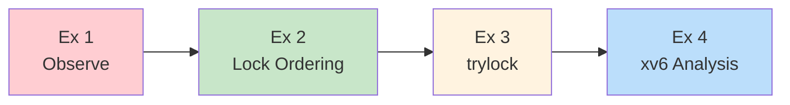
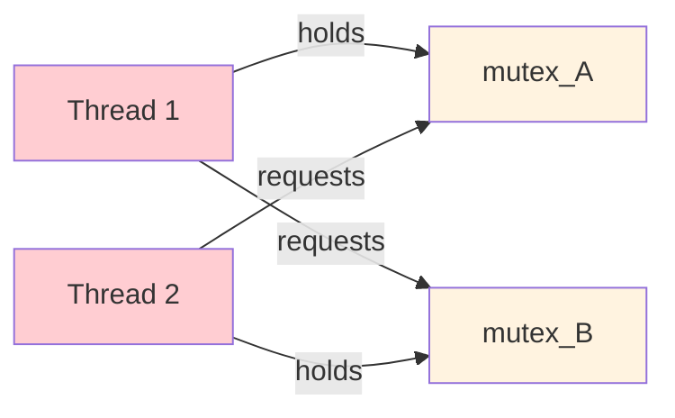
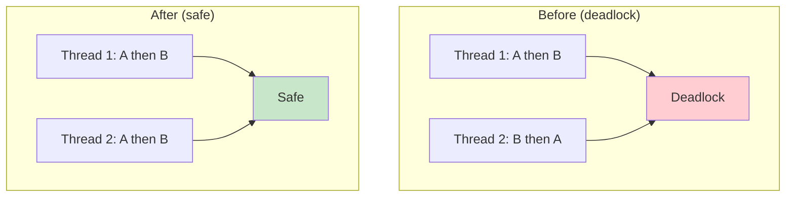
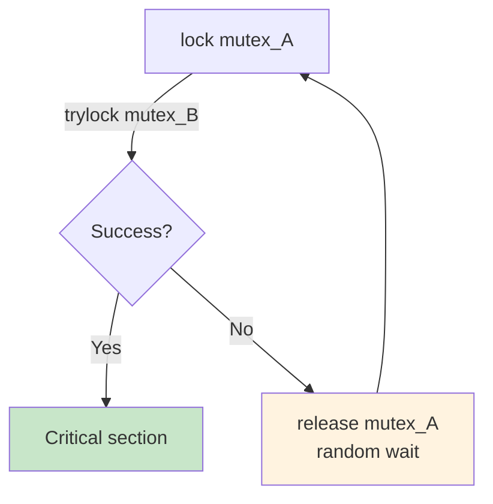
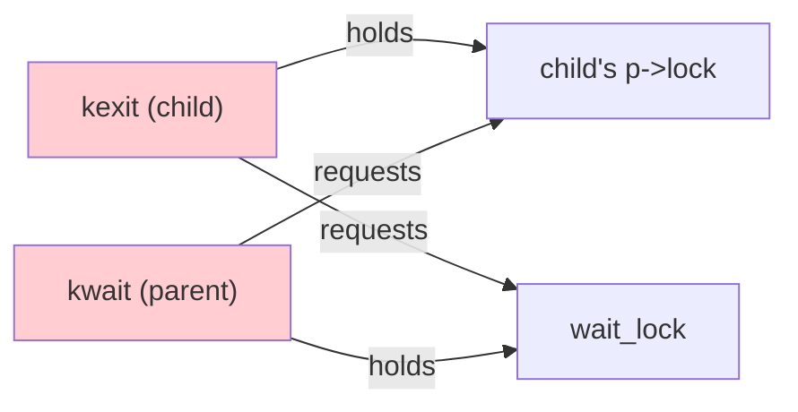
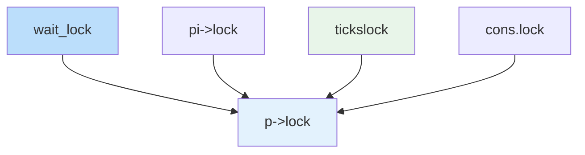

# Week 10 Lab — Deadlocks

[Repository Guide](../../README.md) | [English](Concepts_Lab.md) | [한국어](Concepts_Lab.ko.md)

> **Last Updated:** 2026-11-18

> **Learning Objectives:**
> 1. Identify how each of the four necessary conditions for deadlock holds in real code
> 2. Reproduce a deadlock with pthread mutexes and analyze its cause
> 3. Prevent deadlock with lock ordering and `trylock` back-off, and compare the strengths and weaknesses of the two methods
> 4. Analyze how lock-ordering rules are observed in the xv6 kernel source
> 5. Explain why xv6's process kill and spinlock acquisition are designed to avoid deadlock

---

## Table of Contents

- [1. Lab Overview](#1-lab-overview)
  - [1.1 The Four Necessary Conditions for Deadlock](#11-the-four-necessary-conditions-for-deadlock)
- [2. Exercise 1: Observing a Deadlock](#2-exercise-1-observing-a-deadlock)
  - [2.1 Code](#21-code)
  - [2.2 Build and Run](#22-build-and-run)
  - [2.3 Analysis](#23-analysis)
- [3. Exercise 2: Lock Ordering](#3-exercise-2-lock-ordering)
  - [3.1 Principle](#31-principle)
  - [3.2 Code Change](#32-code-change)
  - [3.3 Why No Circular Wait Can Form](#33-why-no-circular-wait-can-form)
  - [3.4 Execution Result](#34-execution-result)
- [4. Exercise 3: trylock and Back-off](#4-exercise-3-trylock-and-back-off)
  - [4.1 pthread_mutex_trylock()](#41-pthread_mutex_trylock)
  - [4.2 Code](#42-code)
  - [4.3 Execution Result](#43-execution-result)
  - [4.4 Strengths and Weaknesses](#44-strengths-and-weaknesses)
- [5. Exercise 4: Lock Ordering in the xv6 Kernel](#5-exercise-4-lock-ordering-in-the-xv6-kernel)
  - [5.1 Major Locks in xv6](#51-major-locks-in-xv6)
  - [5.2 wait_lock Comes Before p->lock](#52-wait_lock-comes-before-p-lock)
  - [5.3 Condition Locks Come Before p->lock](#53-condition-locks-come-before-p-lock)
  - [5.4 Process Kill and Locks](#54-process-kill-and-locks)
  - [5.5 acquire() and Interrupts](#55-acquire-and-interrupts)
- [6. Summary of Deadlock Conditions and Strategies](#6-summary-of-deadlock-conditions-and-strategies)
- [Summary](#summary)
- [Self-Check Questions](#self-check-questions)

---

<br>

## 1. Lab Overview

- **Objective:** Learn how to observe, resolve, and prevent deadlocks in user-space pthread programs and in the xv6 kernel.
- **Topics:** Observing deadlock with `pthread_mutex`, lock ordering, `trylock` and back-off, analysis of lock ordering in xv6
- **Files:** `lab1_deadlock_demo.c`, `lab2_deadlock_fix_ordering.c`, `lab3_deadlock_fix_trylock.c`, `kernel/proc.c`, `kernel/spinlock.c`, `kernel/trap.c`



*Figure 1. Order of the four exercises*

### 1.1 The Four Necessary Conditions for Deadlock

A deadlock is a state in which two or more processes or threads each wait for a resource held by another, so that none of them can make progress (Week 10, Section 1.2). For a deadlock to occur, the following four conditions must hold **simultaneously**.

| Condition | Description |
|:-----|:-----|
| Mutual Exclusion | A resource used by only one process at a time |
| Hold and Wait | A process holding a resource while waiting for another |
| No Preemption | A resource held by a process that cannot be taken away by force |
| Circular Wait | Processes forming a circular chain, each waiting for a resource held by the next |

*Table 1. The four necessary conditions for deadlock*

Breaking any one of the four conditions prevents deadlock. This lab covers lock ordering, which breaks circular wait (Exercise 2), and `trylock` back-off, which breaks hold and wait (Exercise 3). When two threads try to acquire two locks in opposite orders, the situation looks as follows.

```text
Thread 1                     Thread 2
   |                            |
   | lock(A) -- success         | lock(B) -- success
   |                            |
   | lock(B) -- waiting...      | lock(A) -- waiting...
   |     ^                      |     ^
   |     |______________________|_____|
   |                            |
   +-- Waiting for Thread 2     +-- Waiting for Thread 1
       to release B                 to release A

   ==> No progress possible (Deadlock)
```

*Figure 2. A deadlock in which two threads wait for each other's locks*

---

<br>

## 2. Exercise 1: Observing a Deadlock

**Objective:** Directly observe a program hanging because of an actual deadlock, and analyze the cause.

### 2.1 Code

`lab1_deadlock_demo.c` makes two threads lock two mutexes in opposite orders.

```c
#include <stdio.h>      /* printf(), perror() */
#include <stdlib.h>     /* exit() */
#include <pthread.h>    /* pthread_mutex_t, pthread_create(), pthread_join(), etc. */
#include <unistd.h>     /* usleep() */

/* Statically initialize two mutexes. */
pthread_mutex_t mutex_A = PTHREAD_MUTEX_INITIALIZER;
pthread_mutex_t mutex_B = PTHREAD_MUTEX_INITIALIZER;

/* Thread 1: lock A first, then B */
void *thread1_func(void *arg)
{
    (void)arg;
    printf("[Thread 1] Attempting to lock mutex_A...\n");
    pthread_mutex_lock(&mutex_A);
    printf("[Thread 1] mutex_A locked successfully!\n");

    /* Wait 100ms to give Thread 2 time to lock mutex_B first */
    printf("[Thread 1] Waiting 0.1s (to let the other thread grab mutex_B)...\n");
    usleep(100000);

    /* Thread 2 holds mutex_B and waits for mutex_A, so this blocks forever */
    printf("[Thread 1] Attempting to lock mutex_B... (may hang here)\n");
    pthread_mutex_lock(&mutex_B);
    printf("[Thread 1] mutex_B locked successfully!\n");  /* never printed */

    pthread_mutex_unlock(&mutex_B);
    pthread_mutex_unlock(&mutex_A);
    return NULL;
}

/* Thread 2: lock B first, then A (opposite of Thread 1) */
void *thread2_func(void *arg)
{
    (void)arg;
    printf("[Thread 2] Attempting to lock mutex_B...\n");
    pthread_mutex_lock(&mutex_B);
    printf("[Thread 2] mutex_B locked successfully!\n");

    printf("[Thread 2] Waiting 0.1s (to let the other thread grab mutex_A)...\n");
    usleep(100000);

    printf("[Thread 2] Attempting to lock mutex_A... (may hang here)\n");
    pthread_mutex_lock(&mutex_A);
    printf("[Thread 2] mutex_A locked successfully!\n");  /* never printed */

    pthread_mutex_unlock(&mutex_A);
    pthread_mutex_unlock(&mutex_B);
    return NULL;
}

int main(void)
{
    pthread_t t1, t2;

    /* (banner output omitted) */
    if (pthread_create(&t1, NULL, thread1_func, NULL) != 0) {
        perror("pthread_create (t1)");
        exit(1);
    }
    if (pthread_create(&t2, NULL, thread2_func, NULL) != 0) {
        perror("pthread_create (t2)");
        exit(1);
    }

    /* On deadlock neither thread ends, so the main thread also waits here forever */
    pthread_join(t1, NULL);
    pthread_join(t2, NULL);

    printf("Both threads terminated normally (no deadlock occurred)\n");
    pthread_mutex_destroy(&mutex_A);
    pthread_mutex_destroy(&mutex_B);
    return 0;
}
```

`usleep(100000)` waits 0.1 seconds after acquiring the first lock, so that the other thread acquires its own first lock in the meantime. As a result, the two threads almost certainly end up each holding one lock while waiting for the other's.

### 2.2 Build and Run

```bash
gcc -Wall -pthread -o lab1_deadlock_demo lab1_deadlock_demo.c
./lab1_deadlock_demo
```

Running it on macOS produces the following.

```text
==============================================
  Deadlock Demonstration
==============================================

Thread 1: locks in order mutex_A -> mutex_B
Thread 2: locks in order mutex_B -> mutex_A (opposite!)

If deadlock occurs, the program will hang.
Terminate with Ctrl+C.

----------------------------------------------
[Thread 1] Attempting to lock mutex_A...
[Thread 1] mutex_A locked successfully!
[Thread 1] Waiting 0.1s (to let the other thread grab mutex_B)...
[Thread 2] Attempting to lock mutex_B...
[Thread 2] mutex_B locked successfully!
[Thread 2] Waiting 0.1s (to let the other thread grab mutex_A)...
[Thread 1] Attempting to lock mutex_B... (may hang here)
[Thread 2] Attempting to lock mutex_A... (may hang here)
```

After printing the last two lines, the program prints nothing more and hangs; it has to be terminated with `Ctrl+C`.

### 2.3 Analysis

In the last messages printed, Thread 1 is waiting for `mutex_B` and Thread 2 for `mutex_A`. Each waits for a lock the other holds, so neither can proceed. Drawing this state as a resource-allocation graph (Week 10, Section 2.2) reveals a cycle.



*Figure 3. Resource-allocation graph of the state in Exercise 1*

The four conditions hold in this code as follows.

1. **Mutual exclusion:** A mutex can be locked by only one thread at a time.
2. **Hold and wait:** Thread 1 holds `mutex_A` while waiting for `mutex_B`, and Thread 2 holds `mutex_B` while waiting for `mutex_A`.
3. **No preemption:** `pthread_mutex_lock()` cannot take away a lock held by another thread; it waits until the other side releases it.
4. **Circular wait:** A cycle forms: Thread 1 → `mutex_B` (held by Thread 2) → Thread 2 → `mutex_A` (held by Thread 1) → Thread 1.

> **Note:** `usleep()` does not enforce an execution order. If the system is so busy that one thread fails to acquire its first lock within 0.1 seconds, the other thread may acquire both locks and finish, and the program may end without deadlock. A deadlock is a nondeterministic bug that may or may not appear depending on the execution order, so passing a test does not justify concluding that there is no deadlock.

---

<br>

## 3. Exercise 2: Lock Ordering

**Objective:** Prevent deadlock by breaking the circular wait condition.

### 3.1 Principle

Define a **global total order** over all locks, and have every thread acquire locks only in that order. If both threads acquire A first and B second, then while one thread holds A, the other waits at A and cannot hold B. The first thread uses both A and B and releases them, after which the waiting thread proceeds.



*Figure 4. Before and after unifying the lock order*

### 3.2 Code Change

`lab2_deadlock_fix_ordering.c` changes only the lock order of Thread 2 and has each thread enter the critical section five times.

```c
/* [Before fix: deadlock occurs] */
pthread_mutex_lock(&mutex_B);  // B first
pthread_mutex_lock(&mutex_A);  // A second

/* [After fix: lock ordering applied] */
pthread_mutex_lock(&mutex_A);  // A first (unified order)
pthread_mutex_lock(&mutex_B);  // B second
```

The loop bodies of the two threads have the same form.

```c
for (int i = 0; i < 5; i++) {
    pthread_mutex_lock(&mutex_A);   /* first lock in the ordering rule */
    usleep(10000);                  /* 10ms: induce contention */
    pthread_mutex_lock(&mutex_B);   /* second lock in the ordering rule */

    /* Critical section: work while holding both A and B */
    usleep(5000);

    /* Release in reverse order of acquisition (B, A) */
    pthread_mutex_unlock(&mutex_B);
    pthread_mutex_unlock(&mutex_A);
}
```

### 3.3 Why No Circular Wait Can Form

The argument is by contradiction.

1. Define the global order `mutex_A < mutex_B`; every thread acquires the lower-ordered lock first.
2. For a circular wait, Thread X must hold `mutex_A` while waiting for `mutex_B`, and Thread Y must hold `mutex_B` while waiting for `mutex_A`.
3. However, for Y to hold `mutex_B`, it must have acquired `mutex_A` first.
4. Since X already holds `mutex_A`, Y must be waiting at the `mutex_A` step and cannot hold `mutex_B`. This is a contradiction.

The same holds for any number of locks. Following the chain of waits, the order of the locks must keep increasing, so the chain can never return to its first lock to form a cycle. This is the strategy the xv6 kernel uses, which Section 5 examines.

### 3.4 Execution Result

```bash
gcc -Wall -pthread -o lab2_deadlock_fix_ordering lab2_deadlock_fix_ordering.c
./lab2_deadlock_fix_ordering
```

```text
[Thread 1] Iteration 1: Attempting to lock mutex_A...
[Thread 2] Iteration 1: Attempting to lock mutex_A...
[Thread 1] Iteration 1: mutex_A locked
[Thread 1] Iteration 1: Attempting to lock mutex_B...
[Thread 1] Iteration 1: mutex_B locked
[Thread 1] Iteration 1: === Entered critical section (holding A and B) ===
[Thread 1] Iteration 1: mutex_B released
[Thread 1] Iteration 1: mutex_A released
...
[Thread 1] Iteration 5: mutex_A released

[Thread 2] Iteration 1: mutex_A locked
...
[Thread 2] Iteration 5: mutex_A released

----------------------------------------------
Both threads terminated normally! No deadlock occurred.
```

Each thread enters the critical section five times, ten times in total, and the program terminates normally. Thread 2 started waiting for `mutex_A` on its first attempt, but in this run Thread 1 re-acquired `mutex_A` each time right after releasing it and finished all five iterations first. Which thread finishes first varies from run to run.

> **Caution:** Lock ordering only prevents deadlock; it does not decide which of the waiting threads acquires the lock first (fairness). If a thread re-acquires a lock right after releasing it, another thread may wait for a long time, so a separate mechanism is needed when fairness is required.

---

<br>

## 4. Exercise 3: trylock and Back-off

**Objective:** Avoid deadlock by breaking the hold and wait condition.

### 4.1 pthread_mutex_trylock()

When `pthread_mutex_trylock()` cannot acquire the lock immediately, it returns a failure instead of waiting.

| Function | When the lock is unavailable | Return value |
|:-----|:-----|:-----|
| `pthread_mutex_lock()` | Blocks until it is released | 0 on success |
| `pthread_mutex_trylock()` | Returns immediately without blocking | 0 on success, `EBUSY` if another thread holds it |

*Table 2. Comparison of lock and trylock*

Releasing the locks already held on failure (back-off) ensures that the situation of "holding a resource while waiting for another" never arises. The procedure is as follows.

1. Acquire the first lock with an ordinary `lock()`.
2. Try the second lock with `trylock()`.
3. On failure, release the first lock, wait for a random time, and retry from the beginning.



*Figure 5. Acquiring two locks with trylock and back-off*

### 4.2 Code

In `lab3_deadlock_fix_trylock.c`, the two threads still acquire the locks in opposite orders. Thread 1 locks `mutex_A` and calls `trylock` on `mutex_B`, and Thread 2 locks `mutex_B` and calls `trylock` on `mutex_A`.

```c
void *thread1_func(void *arg)
{
    (void)arg;
    int success = 0;   /* Whether both locks were acquired */
    int attempts = 0;  /* Attempt counter */

    while (!success) {
        attempts++;
        pthread_mutex_lock(&mutex_A);          /* first lock: blocking lock */
        usleep(10000);                         /* 10ms: induce contention */

        if (pthread_mutex_trylock(&mutex_B) == 0) {
            /* Success: both locks are held */
            success = 1;
            usleep(5000);                      /* critical-section work */
            pthread_mutex_unlock(&mutex_B);
            pthread_mutex_unlock(&mutex_A);
        } else {
            /* Failure: back off, releasing the held mutex_A at once */
            pthread_mutex_unlock(&mutex_A);
            usleep((unsigned)(rand() % 50000));  /* random wait 0~50ms */
        }
    }
    printf("[Thread 1] Done (total %d attempts)\n\n", attempts);
    return NULL;
}
```

`main()` sets the random seed with `srand(42)` and then creates the two threads. A fixed seed makes the sequence of random numbers reproducible, but the order in which the two threads call `rand()` can differ from run to run.

### 4.3 Execution Result

```bash
gcc -Wall -pthread -o lab3_deadlock_fix_trylock lab3_deadlock_fix_trylock.c
./lab3_deadlock_fix_trylock
```

```text
[Thread 1] Attempt 1: Locking mutex_A...
[Thread 2] Attempt 1: Locking mutex_B...
[Thread 1] Attempt 1: mutex_A locked
[Thread 2] Attempt 1: mutex_B locked
[Thread 1] Attempt 1: Trying trylock on mutex_B...
[Thread 1] Attempt 1: mutex_B trylock failed! -> back-off
[Thread 1] Attempt 1: mutex_A released (back-off)
[Thread 2] Attempt 1: Trying trylock on mutex_A...
[Thread 2] Attempt 1: mutex_A trylock succeeded!
[Thread 2] === Entered critical section (holding A and B) ===
[Thread 2] mutex_A released
[Thread 2] mutex_B released
[Thread 2] Done (total 1 attempts)

[Thread 1] Attempt 2: Locking mutex_A...
[Thread 1] Attempt 2: mutex_A locked
[Thread 1] Attempt 2: Trying trylock on mutex_B...
[Thread 1] Attempt 2: mutex_B trylock succeeded!
[Thread 1] === Entered critical section (holding A and B) ===
[Thread 1] mutex_B released
[Thread 1] mutex_A released
[Thread 1] Done (total 2 attempts)

----------------------------------------------
Both threads terminated normally! No deadlock occurred.
```

With each thread holding its first lock, Thread 1's `trylock` failed first. When Thread 1 released `mutex_A` and backed off, Thread 2's `trylock(mutex_A)` succeeded and it finished its work, and Thread 1 acquired both locks on its second attempt. Typically, as here, one thread succeeds on its first attempt and the other on its second, and which one succeeds first varies from run to run.

### 4.4 Strengths and Weaknesses

`trylock` back-off releases the held lock on failure and thereby breaks the **hold and wait** condition. Its strength is that it can be used even when a uniform acquisition order is hard to establish, but it has the following weaknesses.

- **Risk of livelock:** If two threads repeat failure, back-off, and retry in lockstep, their states keep changing but no progress is made (Week 10, Section 1.4). Choosing the wait time at random puts the two threads out of step and makes it more likely that one of them acquires both locks first.
- **Performance overhead:** Needless locking and unlocking and wait times occur.
- **Complexity:** The code is more complex than with lock ordering.

Therefore lock ordering is used whenever possible, and `trylock` back-off is used when an order is hard to establish.

---

<br>

## 5. Exercise 4: Lock Ordering in the xv6 Kernel

**Objective:** Analyze, in the xv6 kernel source, how lock ordering prevents deadlock.

### 5.1 Major Locks in xv6

| Lock | Location | Protects |
|:-----|:-----|:-----|
| `p->lock` | `kernel/proc.h` | Per-process lock (`state`, `killed`, `pid`, etc.) |
| `wait_lock` | `kernel/proc.c` | The parent-child relationship (`p->parent`) |
| `bcache.lock` | `kernel/bio.c` | Buffer cache management |
| `ftable.lock` | `kernel/file.c` | File table management |
| `pi->lock` | `kernel/pipe.c` | Per-pipe lock |
| `cons.lock` | `kernel/console.c` | Console I/O |
| `tickslock` | `kernel/trap.c` | The system timer's `ticks` |

*Table 3. Major locks in the xv6 kernel*

### 5.2 wait_lock Comes Before p->lock

`kernel/proc.c` states the rule above the declaration of `wait_lock`.

```c
// helps ensure that wakeups of wait()ing
// parents are not lost. helps obey the
// memory model when using p->parent.
// must be acquired before any p->lock.
struct spinlock wait_lock;
```

**Rule: `wait_lock` is always acquired before `p->lock`.** `kexit()`, called when a process exits, follows this order.

```c
void
kexit(int status)
{
  struct proc *p = myproc();
  // ... close open files and release the current directory ...

  acquire(&wait_lock);       // (1) wait_lock first

  // Give any children to init.
  reparent(p);

  // Parent might be sleeping in wait().
  wakeup(p->parent);

  acquire(&p->lock);         // (2) then p->lock

  p->xstate = status;
  p->state = ZOMBIE;

  release(&wait_lock);

  // Jump into the scheduler, never to return.
  sched();
  panic("zombie exit");
}
```

`kwait()`, which waits for a child, acquires the locks in the same order.

```c
int
kwait(uint64 addr)
{
  struct proc *pp;
  int havekids, pid;
  struct proc *p = myproc();

  acquire(&wait_lock);              // (1) wait_lock first

  for(;;){
    havekids = 0;
    for(pp = proc; pp < &proc[NPROC]; pp++){
      if(pp->parent == p){
        acquire(&pp->lock);         // (2) child's p->lock second
        havekids = 1;
        if(pp->state == ZOMBIE){
          // ... copy the exit status and freeproc(pp) ...
          release(&pp->lock);
          release(&wait_lock);
          return pid;
        }
        release(&pp->lock);
      }
    }
    if(!havekids || killed(p)){
      release(&wait_lock);
      return -1;
    }
    sleep(p, &wait_lock);  //DOC: wait-sleep
  }
}
```

If `kexit()` acquired `p->lock` first and `wait_lock` second, the exiting child would wait for `wait_lock` while holding its own `p->lock`, and the parent's `kwait()` would wait for that child's `p->lock` while holding `wait_lock`. A circular wait would form, and a deadlock could occur.



*Figure 6. The circular wait that would arise if kexit() violated the lock order*

In the last line of `kwait()`, `sleep(p, &wait_lock)`, the parent sleeps using its own address `p` as the channel, and the child's `kexit()` wakes the same channel with `wakeup(p->parent)`. Because the child calls `wakeup()` while holding `wait_lock`, the wakeup signal is never lost, by the same principle as in the Week 9 Lab, Section 5.

### 5.3 Condition Locks Come Before p->lock

`sleep(chan, lk)` is called while holding the condition lock `lk` and acquires `p->lock` inside. Likewise, `wakeup()` acquires each process's `p->lock` inside a caller that holds the condition lock. This yields the rule that every condition lock used with sleep/wakeup is acquired before `p->lock`.

- `pipewrite()`, `piperead()`: Call `wakeup()` or `sleep()` while holding `pi->lock`.
- `clockintr()`: Calls `wakeup()` while holding `tickslock`, as in `acquire(&tickslock); ticks++; wakeup(&ticks); release(&tickslock);`, and `sys_pause()` calls `sleep(&ticks, &tickslock)` while holding `tickslock`.
- `consoleintr()`: Calls `wakeup(&cons.r)` while holding `cons.lock` when a newline arrives.



*Figure 7. Locks acquired before p->lock in xv6 (arrows show acquisition order)*

The reason `sleep()` acquires `p->lock` before releasing `lk` is the lost wakeup problem of the Week 9 Lab, Section 5. If the order were reversed, releasing `lk` first and then acquiring `p->lock`, a `wakeup()` called on another CPU in between would pass over a process that is not yet `SLEEPING`, and the wakeup signal would be lost.

> **Note:** The lock hierarchy figure in the lab material places `tickslock` below `p->lock`, but, as `clockintr()` and `sys_pause()` above show, the actual code acquires `p->lock` while holding `tickslock`, so `tickslock` comes first. A code path that acquired `tickslock` while holding `p->lock` would conflict with this rule and could cause a deadlock.

### 5.4 Process Kill and Locks

xv6's `kkill()` does not terminate the target process immediately; it only marks it.

```c
int
kkill(int pid)
{
  struct proc *p;

  for(p = proc; p < &proc[NPROC]; p++){
    acquire(&p->lock);
    if(p->pid == pid){
      p->killed = 1;
      if(p->state == SLEEPING){
        // Wake process from sleep().
        p->state = RUNNABLE;
      }
      release(&p->lock);
      return 0;
    }
    release(&p->lock);
  }
  return -1;
}
```

The target process may be executing kernel code and holding several locks. It may be holding a file-system lock while waiting for disk I/O, holding a pipe lock while waiting for data, or working while holding `wait_lock`. Terminating it immediately in such a state would mean **those locks are never released**, and other processes could fall into deadlock.

Therefore `kkill()` only sets `p->killed = 1` and wakes a sleeping process by changing it to `RUNNABLE`. The target process terminates itself at a point where it can clean up all its locks. A typical point is `usertrap()`, just before returning to user space.

```c
uint64
usertrap(void)
{
  ...
  if(r_scause() == 8){
    // system call
    if(killed(p))        // check before handling the system call
      kexit(-1);
    ...
    syscall();
  } ...

  if(killed(p))          // check before returning to user space
    kexit(-1);
  ...
}
```

Loops that sleep while waiting also check `killed()` each time they wake, release the locks they hold, and return an error. The loop in `piperead()` is an example.

```c
while(pi->nread == pi->nwrite && pi->writeopen){
  if(killed(pr)){
    release(&pi->lock);    // release the pipe lock and return
    return -1;
  }
  sleep(&pi->nread, &pi->lock);
}
```

`if(!havekids || killed(p))` in `kwait()` and `if(killed(myproc()))` in `sys_pause()` play the same role. In this way a process terminates only after cleaning up all the locks it holds, so a kill never becomes a cause of deadlock.

### 5.5 acquire() and Interrupts

```c
void
acquire(struct spinlock *lk)
{
  push_off(); // disable interrupts to avoid deadlock.
  if(holding(lk))
    panic("acquire");

  // On RISC-V, sync_lock_test_and_set turns into an atomic swap:
  //   a5 = 1
  //   s1 = &lk->locked
  //   amoswap.w.aq a5, a5, (s1)
  while(__sync_lock_test_and_set(&lk->locked, 1) != 0)
    ;

  // Tell the C compiler and the processor to not move loads or stores
  // past this point, to ensure that the critical section's memory
  // references happen strictly after the lock is acquired.
  // On RISC-V, this emits a fence instruction.
  __sync_synchronize();

  // Record info about lock acquisition for holding() and debugging.
  lk->cpu = mycpu();
}
```

`push_off()` disables interrupts and counts the nesting depth. Its counterpart `pop_off()`, called from `release()`, restores interrupts to their original state only when all spinlocks held by that CPU have been released. Acquiring a spinlock with interrupts enabled could cause the following deadlock.

1. A CPU acquires the spinlock `tickslock` (for example, in `sys_pause()`).
2. A timer interrupt occurs, and the interrupt handler `clockintr()` runs.
3. The handler tries to acquire `tickslock`.
4. The **same CPU** already holds that lock, so the handler spins forever, and the code holding the lock cannot release it because it runs again only after the handler finishes.

This deadlock occurs even with a single CPU. Disabling interrupts while holding the lock prevents the handler from running on that CPU and avoids the problem. In addition, the `holding(lk)` check catches the programming error of a CPU trying to re-acquire a lock it already holds and panics immediately. xv6 does not allow re-entrant locks and chooses to expose such an attempt at once rather than spin and hang.

---

<br>

## 6. Summary of Deadlock Conditions and Strategies

| Condition | Solution | Example in this lab |
|:-----|:-----|:-----|
| Mutual Exclusion | (generally cannot be removed) | - |
| Hold and Wait | `trylock` and back-off | Exercise 3: `lab3_deadlock_fix_trylock.c` |
| No Preemption | (generally cannot be removed) | - |
| Circular Wait | Lock ordering | Exercise 2: `lab2_deadlock_fix_ordering.c` |

*Table 4. Solutions for each deadlock condition and examples in this lab*

| Strategy | When to use |
|:-----|:-----|
| Lock ordering | Default choice, simple and provably correct |
| `trylock` and back-off | When a strict order is hard to establish |
| xv6 discipline | Every kernel path following the documented lock hierarchy |

*Table 5. Deadlock prevention strategies and when to use them*

The xv6 kernel's deadlock prevention strategies come down to the following four.

1. **Lock ordering:** Define a global lock order and always follow it (`wait_lock` → `p->lock`, condition lock → `p->lock`).
2. **Disabling interrupts:** Disable that CPU's interrupts while holding a spinlock (`acquire()` → `push_off()` → `intr_off()`).
3. **Deferred kill:** Do not terminate a process immediately; mark it and let it terminate at a point where its locks can be cleaned up safely.
4. **Duplicate-acquisition check:** Panic when the same lock is acquired twice (`if(holding(lk)) panic("acquire");`).

> **Key Point:** Lock ordering is the most practical and widely used deadlock prevention technique. The xv6 kernel documents its lock order through comments and conventions and follows it, and in complex situations such as process kill it defers the action until a point where locks can be cleaned up safely. Real operating systems such as Linux follow the same principles (lockdep in Week 10, Section 4.6).

---

<br>

## Summary

| Concept | Key Summary |
|:-----|:-----|
| The four conditions for deadlock | Mutual exclusion, hold and wait, no preemption, and circular wait must hold simultaneously, so breaking any one of them prevents deadlock. |
| The deadlock of Exercise 1 | When two threads lock two mutexes in opposite orders, each holds one and waits for the other so the program hangs, and this bug appears or not depending on the execution order. |
| Lock ordering | If every thread acquires locks in a global order, the lock order along a chain of waits must keep increasing, so no circular wait forms, although fairness is not guaranteed. |
| trylock and back-off | If the second lock cannot be acquired, the first lock is released and the thread retries after a random wait, breaking hold and wait, at the cost of livelock risk and overhead. |
| Lock order in xv6 | `wait_lock` and the condition locks of sleep/wakeup (`pi->lock`, `tickslock`, `cons.lock`) are always acquired before `p->lock`. |
| Deferred kill | `kkill()` only sets `p->killed`, and the target process terminates itself by checking `killed()` at points where it can clean up the locks it holds. |
| Disabling interrupts in acquire() | If an interrupt handler that wants the same lock runs on the CPU holding a spinlock, a deadlock arises even on a single CPU, so `push_off()` disables interrupts. |

---

<br>

## Self-Check Questions

1. Explain how each of the four necessary conditions for deadlock holds in the program of Exercise 1.

   <details>
   <summary>Answer</summary>

   Mutual exclusion holds because a mutex can be locked by only one thread at a time. Hold and wait holds because Thread 1 waits for `mutex_B` while holding `mutex_A`, and Thread 2 waits for `mutex_A` while holding `mutex_B`. No preemption holds because `pthread_mutex_lock()` cannot take away the lock the other side holds and can only wait. Circular wait holds through the cycle Thread 1 → `mutex_B` (held by Thread 2) → Thread 2 → `mutex_A` (held by Thread 1) → Thread 1.

   </details>

2. State which of the four conditions lock ordering breaks, and explain why no cycle can form even with many locks.

   <details>
   <summary>Answer</summary>

   It breaks circular wait. If every thread acquires locks starting from the lowest in the global order, the lock a thread waits for always has a higher order than every lock it already holds. Following the chain of waits, the order of the locks keeps increasing, so the chain can never return to its first lock to form a cycle.

   </details>

3. Which condition does `trylock` back-off break, and why does it wait for a random time when backing off?

   <details>
   <summary>Answer</summary>

   When `trylock` fails, the lock already held is released, so no thread holds a resource while waiting for another, which breaks hold and wait. If the wait time were fixed, the two threads could wake in lockstep and try to acquire the locks in the same order again, repeating failure and retry endlessly in a livelock. A random wait puts the two threads out of step and raises the chance that one of them acquires both locks first.

   </details>

4. What problem could arise if `kexit()` were changed to acquire `p->lock` first and `wait_lock` second?

   <details>
   <summary>Answer</summary>

   `kwait()` holds `wait_lock` first and then acquires the child's `p->lock`. If the exiting child waits for `wait_lock` while holding its own `p->lock` and the parent waits for that child's `p->lock` while holding `wait_lock`, the two processes wait for each other's locks in a circular wait, and a deadlock can occur.

   </details>

5. Explain from the perspective of locks why `kkill()` only sets `p->killed` instead of terminating the target process immediately.

   <details>
   <summary>Answer</summary>

   The target process may be executing kernel code and holding locks such as a file-system lock, a pipe lock, or `wait_lock`. Terminating it immediately in that state would leave those locks unreleased forever, and other processes waiting for them would deadlock. Therefore `kkill()` only marks the process and wakes it if it is sleeping, and the target process calls `kexit()` itself at points where it can clean up its locks, such as `usertrap()` or the `killed()` checks in waiting loops.

   </details>

6. Explain, with an example on a single CPU, why xv6's `acquire()` disables interrupts.

   <details>
   <summary>Answer</summary>

   If a timer interrupt arrives while the CPU holds `tickslock` in `sys_pause()`, `clockintr()` runs on the same CPU and tries to acquire `tickslock`. The code holding the lock runs again only after the handler finishes, but the handler spins waiting for that lock to be released, so a deadlock arises even with a single CPU. When `acquire()` disables interrupts with `push_off()`, the handler does not run on that CPU while the lock is held, so the problem cannot occur.

   </details>
