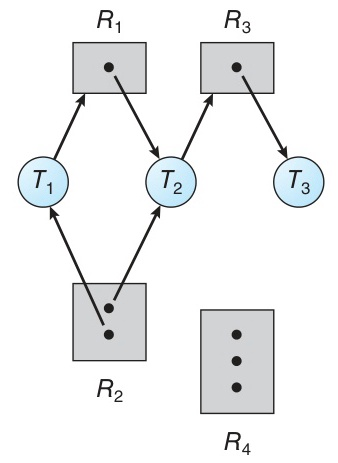
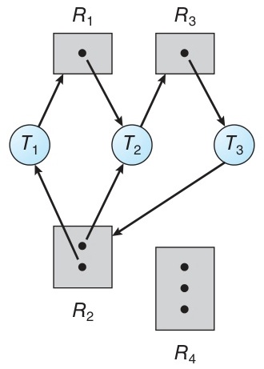
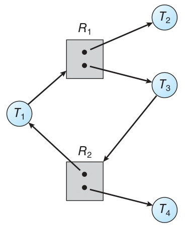
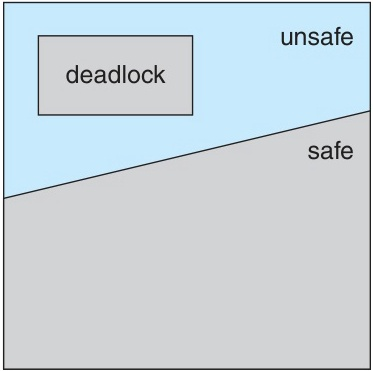
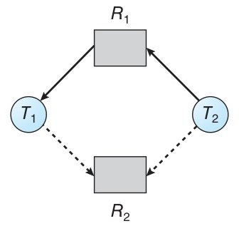
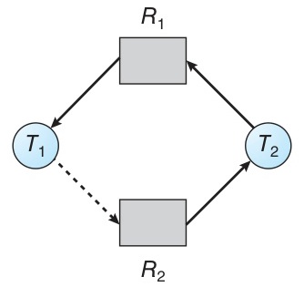
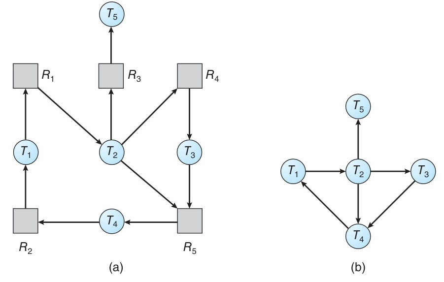

# Week 10 Lecture — Deadlocks

[Repository Guide](../../README.md) | [English](Concepts_Lecture.md) | [한국어](Concepts_Lecture.ko.md)

> **Last Updated:** 2026-10-20
>
> Operating System Concepts, Silberschatz, Galvin, and Gagne, Ch 8

> **Learning Objectives:**
> 1. Distinguish **deadlock** from **livelock** and recognize each in pthread code
> 2. State the **four necessary conditions** for deadlock (Mutual Exclusion, Hold and Wait, No Preemption, Circular Wait), and build a **Resource-Allocation Graph (RAG)** to reason about whether a cycle implies deadlock
> 3. Compare the four handling strategies (**Prevention**, **Avoidance**, **Detection and Recovery**, **Ignorance**) and explain when each is used in practice
> 4. Apply **prevention** by breaking each necessary condition, especially **resource ordering** for circular wait
> 5. Apply the **Banker's Algorithm** (Safety Algorithm and Resource-Request Algorithm) to decide whether a request keeps the system safe
> 6. Apply the **Detection Algorithm** (Wait-for Graph and multi-instance variant) with an appropriate invocation frequency, choose a **recovery** strategy (process termination, resource preemption), and avoid starvation in victim selection

---

## Table of Contents

- [1. System Model and the Problem of Deadlock](#1-system-model-and-the-problem-of-deadlock)
  - [1.1 System Model and Resource Usage](#11-system-model-and-resource-usage)
  - [1.2 Definition of Deadlock](#12-definition-of-deadlock)
  - [1.3 Deadlock in Multithreaded Code](#13-deadlock-in-multithreaded-code)
  - [1.4 Livelock](#14-livelock)
- [2. Deadlock Characterization](#2-deadlock-characterization)
  - [2.1 Four Necessary Conditions](#21-four-necessary-conditions)
  - [2.2 Resource-Allocation Graph (RAG)](#22-resource-allocation-graph-rag)
  - [2.3 RAG: Cycles and Deadlock](#23-rag-cycles-and-deadlock)
- [3. Methods for Handling Deadlocks](#3-methods-for-handling-deadlocks)
  - [3.1 Four Strategies](#31-four-strategies)
  - [3.2 The Ostrich Algorithm: Why Real OSes Ignore Deadlock](#32-the-ostrich-algorithm-why-real-oses-ignore-deadlock)
- [4. Deadlock Prevention](#4-deadlock-prevention)
  - [4.1 Breaking Mutual Exclusion](#41-breaking-mutual-exclusion)
  - [4.2 Breaking Hold and Wait](#42-breaking-hold-and-wait)
  - [4.3 Breaking No Preemption](#43-breaking-no-preemption)
  - [4.4 Breaking Circular Wait: Lock Ordering](#44-breaking-circular-wait-lock-ordering)
  - [4.5 Dynamic Locks Pitfall](#45-dynamic-locks-pitfall)
  - [4.6 Linux lockdep Tool](#46-linux-lockdep-tool)
  - [4.7 Prevention Summary](#47-prevention-summary)
- [5. Deadlock Avoidance](#5-deadlock-avoidance)
  - [5.1 Idea, Safe State, and Safe Sequence](#51-idea-safe-state-and-safe-sequence)
  - [5.2 Safe / Unsafe Examples](#52-safe--unsafe-examples)
  - [5.3 Resource-Allocation-Graph Algorithm (Single Instance)](#53-resource-allocation-graph-algorithm-single-instance)
  - [5.4 Banker's Algorithm: Data Structures](#54-bankers-algorithm-data-structures)
  - [5.5 Safety Algorithm](#55-safety-algorithm)
  - [5.6 Resource-Request Algorithm](#56-resource-request-algorithm)
  - [5.7 Banker's Algorithm Worked Example](#57-bankers-algorithm-worked-example)
- [6. Deadlock Detection](#6-deadlock-detection)
  - [6.1 Single Instance: Wait-for Graph](#61-single-instance-wait-for-graph)
  - [6.2 Multiple Instances: Detection Algorithm](#62-multiple-instances-detection-algorithm)
  - [6.3 Detection Algorithm Examples](#63-detection-algorithm-examples)
  - [6.4 Invocation Frequency](#64-invocation-frequency)
  - [6.5 Deadlock in Databases](#65-deadlock-in-databases)
- [7. Recovery from Deadlock](#7-recovery-from-deadlock)
  - [7.1 Process Termination](#71-process-termination)
  - [7.2 Victim Selection](#72-victim-selection)
  - [7.3 Resource Preemption](#73-resource-preemption)
  - [7.4 Comparison of Recovery Methods](#74-comparison-of-recovery-methods)
- [8. Lab: Banker's Algorithm Implementation](#8-lab-bankers-algorithm-implementation)
  - [8.1 Lab: Data Structures](#81-lab-data-structures)
  - [8.2 Lab: Safety Algorithm in C](#82-lab-safety-algorithm-in-c)
  - [8.3 Lab: Resource-Request Simulation](#83-lab-resource-request-simulation)
  - [8.4 Lab: Main and Practice Tasks](#84-lab-main-and-practice-tasks)
- [Summary](#summary)
- [Self-Check Questions](#self-check-questions)

---

<br>

## 1. System Model and the Problem of Deadlock

### 1.1 System Model and Resource Usage

A system consists of a finite number of **resource types** R1, R2, ..., Rm. Each type Ri has Wi **instances**.

Examples of resources:
- CPU cycles
- Memory frames
- I/O devices (printers, network interfaces)
- Files
- **Mutex locks** and **semaphores** (software resources, typically with 1 instance)

A thread uses a resource in three steps:

1. **Request:** ask the OS for the resource; block if it is unavailable.
2. **Use:** perform work with it (print, read, write).
3. **Release:** give it back so others can use it.

| Resource | Request / Release Calls |
|-----------|-------------|
| Device | `request()` / `release()` |
| File | `open()` / `close()` |
| Memory | `allocate()` / `free()` |
| Semaphore | `wait()` / `signal()` |
| Mutex | `acquire()` / `release()` |

*Table 1. Request and release calls by resource*

> **Note:** **Why this framing matters.** Every deadlock in this unit fits the *request → hold → request more* pattern. Once you can name what is held and what is requested, the rest of the analysis is mechanical.

### 1.2 Definition of Deadlock

> **Definition:** **Deadlock** is a state in which every thread in a set is waiting for an event (typically resource release) that can only be caused by another thread in the **same set**.

Canonical two-thread example:

```text
T1 holds resource A, waits for resource B
T2 holds resource B, waits for resource A
→ Neither thread can make progress, ever
```

A folksy analogue is the (apocryphal) Kansas railroad law: "When two trains meet at a crossing, both shall come to a full stop, and neither shall start until the other has gone." The state is logically impossible, which is exactly the property a deadlock has.

### 1.3 Deadlock in Multithreaded Code

Acquiring two mutexes in different orders is the textbook cause of deadlock in user-space programs:

```c
pthread_mutex_t first_mutex;
pthread_mutex_t second_mutex;

/* thread_one */
void *do_work_one(void *param) {
    pthread_mutex_lock(&first_mutex);
    pthread_mutex_lock(&second_mutex);
    /* Do some work */
    pthread_mutex_unlock(&second_mutex);
    pthread_mutex_unlock(&first_mutex);
    pthread_exit(0);
}

/* thread_two */
void *do_work_two(void *param) {
    pthread_mutex_lock(&second_mutex);   // Opposite order!
    pthread_mutex_lock(&first_mutex);
    /* Do some work */
    pthread_mutex_unlock(&first_mutex);
    pthread_mutex_unlock(&second_mutex);
    pthread_exit(0);
}
```

A scheduling that triggers the deadlock:

```text
Time 1: thread_one acquires first_mutex
Time 2: thread_two acquires second_mutex
Time 3: thread_one requests second_mutex → blocked!  (held by T2)
Time 4: thread_two requests first_mutex  → blocked!  (held by T1)

Result: both threads wait forever → Deadlock!
```

*Figure 1. Scheduling order that leads two threads into deadlock*

> **Note:** **Why deadlock is dangerous.** Deadlock depends on CPU scheduling, so code may pass thousands of tests and fail only in production. This is a **heisenbug**: observing it, for example by adding logging or a debugger, can change timing and make it disappear. That makes it intermittent and difficult to reproduce.

### 1.4 Livelock

> **Definition:** **Livelock** is a state where threads keep **changing state** but make **no actual progress**.

Unlike deadlock, livelocked threads are not blocked. They are running, but stuck in a retry loop:

```c
/* thread_one: using trylock */
void *do_work_one(void *param) {
    int done = 0;
    while (!done) {
        pthread_mutex_lock(&first_mutex);
        if (pthread_mutex_trylock(&second_mutex)) {
            /* Do some work */
            pthread_mutex_unlock(&second_mutex);
            pthread_mutex_unlock(&first_mutex);
            done = 1;
        } else
            pthread_mutex_unlock(&first_mutex);  // release and retry
    }
    pthread_exit(0);
}
```

> **Caution:** **The return value of `trylock`.** Real POSIX `pthread_mutex_trylock` returns **0 on success** and a non-zero error code such as `EBUSY` on failure, so a literal C `if (pthread_mutex_trylock(...))` would run the body on *failure*. The snippet above follows the textbook's simplified convention where the branch is illustrative; read it as doing the work only when the second lock was acquired. Do not internalize the bare return value as truthy-on-success.

If thread_two runs the same pattern in the opposite order (locking second_mutex first and calling `trylock` on first_mutex) and both threads proceed in lockstep, each acquires its first lock, fails the `trylock` on the other's lock, releases its first lock, and retries forever.

**Fix: random backoff.** Insert a randomized delay before retrying. This is exactly the **CSMA/CD collision-resolution** strategy from Ethernet (binary exponential backoff): breaking the symmetry of the retry pattern is what gets one thread through.

> **[Computer Networks]** In binary exponential backoff, after the k-th consecutive collision each station picks a random retry slot from $[0, 2^k - 1]$. The retry window *doubles* every collision, so the probability that two contenders pick the same slot drops exponentially. It was originally specified in Ethernet (IEEE 802.3) for resolving carrier-sense collisions on a shared medium. The idea of growing the wait window exponentially is also used in Wi-Fi and TCP retransmission timers, and here it is applied to software retry loops.

---

<br>

## 2. Deadlock Characterization

### 2.1 Four Necessary Conditions

Deadlock requires **all four** of the following to hold *simultaneously*:

1. **Mutual Exclusion:** at least one resource is held in a non-sharable mode (e.g., mutex lock).
2. **Hold and Wait:** a thread is holding at least one resource and waiting for additional ones.
3. **No Preemption:** a resource can only be released voluntarily by the thread that holds it; it cannot be forcibly taken away.
4. **Circular Wait:** there is a chain T0 → T1 → ... → Tn → T0 where each Ti waits for a resource held by T(i+1) and Tn waits for a resource held by T0.

```text
Circular Wait sketch: a cycle of three threads
(T0 holds R0, T1 holds R1, T2 holds R2; each thread waits for the next one's resource):

        ┌──(waits for R1, held by T1)──┐
        │                              ↓
       T0                             T1
        ↑                              │
        │                              │ (waits for R2, held by T2)
        │                              ↓
        └──(waits for R0, held by T0)─ T2

  Cycle:  T0 → T1 → T2 → T0   (length 3; break any one wait and it dissolves)
```

*Figure 2. Circular wait among three threads*

> **Note:** **A subtlety.** Circular Wait actually **implies** Hold and Wait (a thread cannot be in a cycle without holding something). The four conditions are not independent, but listing them all is pedagogically useful because each suggests a different *prevention* lever.

### 2.2 Resource-Allocation Graph (RAG)

A **Resource-Allocation Graph** represents the current allocation state as a directed graph.

| Symbol | Meaning |
|--------|---------|
| Circle `Ti` | Thread |
| Rectangle `Rj` (dots inside = instance count) | Resource type |
| `Ti → Rj` | **Request edge**: Ti is waiting for Rj |
| `Rj → Ti` | **Assignment edge**: one instance of Rj is currently held by Ti |

*Table 2. Symbols of the resource-allocation graph*

When a request is granted, the request edge `Ti → Rj` flips to an assignment edge `Rj → Ti`. When the resource is released, the assignment edge is removed.



*Figure 3. Resource-allocation graph without deadlock*

In Figure 3, R1 and R3 have one instance each, R2 has two, and R4 has three. T1 holds an instance of R2 and waits for R1, T2 holds one instance each of R1 and R2 and waits for R3, and T3 holds R3. The graph has no cycle, so there is no deadlock. When T3 finishes and releases R3, T2 can receive R3 and finish, and when T2 releases R1, T1 proceeds as well.

> **[Algorithms]** A RAG is a directed graph. Detecting whether a deadlock has formed reduces to **directed-cycle detection**, which is the standard DFS with three-color marking (white = unvisited, grey = on the current DFS stack, black = fully explored): a back edge to a grey node closes a cycle. Cycle detection runs in $O(V+E)$; for the RAG, that becomes $O(n^2)$ under the dense-graph assumption used in Sections 5.3 and 6.1.

### 2.3 RAG: Cycles and Deadlock

The relationship between cycles in the RAG and deadlock depends on whether resources have multiple instances:

| Situation | Conclusion |
|-----------|-----------|
| No cycle | **No** deadlock |
| Cycle and every resource has 1 instance | **Definitely** deadlock |
| Cycle and some resource has 2 or more instances | Deadlock **possible** but not guaranteed |

*Table 3. Relationship between cycles and deadlock in a RAG*

**Why the asymmetry?** With single-instance resources, the cycle's edges describe an immutable wait pattern: each thread waits for the *specific* instance held by the next. With multiple instances, a non-cycle thread holding another instance of the same type may release it and break the wait.

**Example 1: cycle and deadlock.** T1 holds R2 and waits for R1. T2 holds R1 and R2 and waits for R3 (the two instances of R2 are held one each by T1 and T2). T3 holds R3 and additionally requests R2. Two cycles form (`T1→R1→T2→R3→T3→R2→T1` and `T2→R3→T3→R2→T2`), so the system is in **deadlock**.



*Figure 4. Resource-allocation graph with a deadlock*

**Example 2: cycle but no deadlock.** A cycle exists, but a thread T4 outside the cycle holds a different instance of one of the cycle's resources. When T4 releases it, one of the cycle's waits is satisfied and the cycle breaks.



*Figure 5. Resource-allocation graph with a cycle but no deadlock*

Concretely, in Figure 5, R1 and R2 have 2 instances each. T1 holds an instance of R2 and waits for R1, and T3 holds an instance of R1 and waits for R2, which forms the cycle T1 → R1 → T3 → R2 → T1. However, T2 (outside the cycle) holds the other instance of R1 and T4 holds the other instance of R2, and neither waits for anything. When T4 finishes and releases its R2 instance, the OS allocates it to T3, which is waiting for R2; when T3 finishes and releases its R1 instance, T1 receives it and can finish. The cycle visible in the graph never resolves into deadlock because the cycle's wait condition can be satisfied by a node *outside* the cycle.

---

<br>

## 3. Methods for Handling Deadlocks

### 3.1 Four Strategies

There are essentially four philosophies:

1. **Deadlock Prevention:** design so that at least one of the four conditions cannot hold.
2. **Deadlock Avoidance:** using advance knowledge of maximum needs, refuse at allocation time any request that could lead to deadlock.
3. **Deadlock Detection & Recovery:** let deadlock occur, periodically detect it, then recover.
4. **Deadlock Ignorance (Ostrich Algorithm):** pretend it cannot happen; rely on developers and reboots.

| Method | Core Idea | Advantage | Disadvantage |
|--------|-----------|-----------|-------------|
| Prevention | Eliminate a necessary condition | Guaranteed prevention | Reduced resource utilization and throughput |
| Avoidance | Maintain a safe state | More flexible than prevention | Needs advance information, overhead |
| Detection & Recovery | Detect, then react | High resource utilization | Detection overhead and recovery cost |
| Ignorance | Do nothing | Lowest overhead | Manual intervention required |

*Table 4. Comparison of the four deadlock-handling methods*

In practice, large systems **mix** strategies, handling different resource types with different policies.

### 3.2 The Ostrich Algorithm: Why Real OSes Ignore Deadlock

Linux and Windows largely **ignore** deadlock in the general-purpose kernel. The reasoning is a cost-benefit calculation:

- Deadlocks are **rare** in well-written code (especially with good lock-ordering conventions).
- The cost of *ruling out* every possible deadlock at the OS level (declaring max claims, running Banker's at every request) would be prohibitive.
- It is cheaper to push responsibility to **kernel and application developers** and to provide *debugging tools* like lockdep to find ordering violations.

The name comes from the image of an ostrich burying its head in the sand (which real ostriches do not do): the OS pretends the problem does not exist.

> **Note:** **Engineering principle.** Choosing the right strategy is a question of *frequency × cost*. Systems where the cost of deadlock is catastrophic, such as financial transaction processing, accept costly mechanisms such as detection with transaction rollback (Section 6.5), whereas a web server typically ignores deadlock because it is rare and a process restart is cheap.

---

<br>

## 4. Deadlock Prevention

The idea is to break at least one of the four conditions **structurally**: by design, never at runtime.

### 4.1 Breaking Mutual Exclusion

- Some resources are **inherently sharable** (read-only files): multiple threads reading the same data never deadlock on it.
- But **mutex locks, semaphores, printers, write-mode file descriptors** are *intrinsically* non-sharable.

**Conclusion:** Breaking mutual exclusion is **generally impractical**, because the condition cannot be removed from the resources that need it most.

### 4.2 Breaking Hold and Wait

Two protocols:

- **Method 1:** A thread requests **all** the resources it will ever need at once, before it starts executing.
- **Method 2:** A thread may only request new resources when it holds **none**; it must release everything before any new request.

```text
Method 2 example: a read-then-print job

  Phase 1:  request(disk)    → read(file)  → release(disk)
  Phase 2:  request(printer) → print()     → release(printer)

  (disk and printer are never held simultaneously)
```

**Disadvantages:**
- **Low resource utilization:** a resource may sit unused for most of the thread's lifetime.
- **Starvation:** a thread that needs many popular resources may never get them all at once.

### 4.3 Breaking No Preemption

Two protocols:

- **Protocol 1:** If a thread's request cannot be granted immediately, force it to **release everything it holds** and restart when all needed resources (old and new) are available together.
- **Protocol 2:** If the requested resource is held by another *waiting* thread, **preempt** it from that thread. If it is held by a running thread, the requester waits.

**Applicable:** resources whose state can be saved and restored, such as CPU registers and memory pages (which is why CPU and RAM use this approach via context switching and paging).

**Not applicable:** mutex locks, semaphores, and printers mid-job; preempting them in the middle of a critical section corrupts shared state.

### 4.4 Breaking Circular Wait: Lock Ordering

**This is the most practical prevention technique.**

Impose a **total ordering** `F: R → ℕ` on all resource types (give each a distinct integer rank). Every thread must request locks in **strictly ascending** order of F.

```text
F(first_mutex)  = 1
F(second_mutex) = 5

// Correct (ascending)
lock(first_mutex);    // F = 1
lock(second_mutex);   // F = 5     ✓

// Forbidden (descending)
lock(second_mutex);   // F = 5
lock(first_mutex);    // F = 1     ✗
```

**Proof by contradiction.** Suppose a circular wait exists: T0 → T1 → ... → Tn → T0, where each Ti holds Ri and is waiting for R(i+1) (and Tn waits for R0). The lock-order rule forces F(Ri) < F(R(i+1)) for each step. Chaining the inequalities around the cycle:

```text
F(R0) < F(R1) < ... < F(Rn) < F(R0)
```

So F(R0) < F(R0), which is a **contradiction**. Therefore no cycle can form, and deadlock cannot occur. ∎

> **[Discrete Mathematics]** Two properties of `<` on ℕ, the set that holds the values of F, make this proof work. **Transitivity**: if a < b and b < c, then a < c, so chaining n separate inequalities yields F(R0) < F(R0). **Irreflexivity**: no natural number is less than itself, so F(R0) < F(R0) is *impossible*; that is where the contradiction lives. These two properties alone make `<` a strict partial order, and adding the fact that any two distinct natural numbers are comparable makes it a **strict total order**. The proof needs only the first two properties. The same algebraic structure is used in other topics, such as priority comparisons in CPU scheduling (Weeks 6-7) and sorting.

> **Caution:** Defining a lock order is necessary but not sufficient: **programmers must adhere to it**, and the compiler or runtime does not enforce it. Tools like lockdep (Section 4.6) catch violations at test time.

### 4.5 Dynamic Locks Pitfall

The lock-ordering rule is harder to apply when the locks involved are determined *dynamically*:

```c
void transaction(Account from, Account to, double amount) {
    mutex lock1 = get_lock(from);
    mutex lock2 = get_lock(to);

    acquire(lock1);     // lock for 'from'
    acquire(lock2);     // lock for 'to'

    withdraw(from, amount);
    deposit(to, amount);

    release(lock2);
    release(lock1);
}
```

Then the following can happen:

```text
Thread A: transaction(checking, savings, 25.0)
          → lock(checking) → lock(savings)
Thread B: transaction(savings, checking, 50.0)
          → lock(savings) → lock(checking)

→ Deadlock possible!
```

**Standard fix:** derive the order from a stable property of the lock itself. For example, **compare lock addresses** and always acquire the lock with the lower address first. At runtime every lock object lives at a unique, immutable memory address (a non-negative integer), so addresses give a **total order** with exactly the same mathematical properties as the static F mapping in Section 4.4. The same theorem therefore applies, and no two callers can request locks in opposite orders. In Java, where objects do not expose their address, `System.identityHashCode(Object)` plays a similar role. The value is stable for the object's lifetime, but distinct objects can share a value, so when the two values are equal the code first acquires a separate tie-breaking lock to fix the order.

### 4.6 Linux lockdep Tool

**lockdep** is a Linux kernel feature that **dynamically verifies lock orderings** at runtime.

Capabilities:
1. **Order violation detection:** records every lock-acquire chain it has ever seen and warns when the kernel later acquires the same two locks in the opposite order, even on a different code path.
2. **Interrupt-handler deadlock detection:** warns when a spinlock that is used in an interrupt handler is acquired without first disabling interrupts (which would deadlock if the handler fires and requests the lock while it is held).

Characteristics:
- Enabled **only in development and testing kernels**, because the overhead is too high for production.
- Since its introduction (Linux 2.6.18, 2006), kernel deadlock reports have decreased by about an order of magnitude.
- Recent versions extend the same idea to **user-space Pthreads** locks.

### 4.7 Prevention Summary

| Condition | Strategy | Practicality |
|-----------|----------|--------------|
| Mutual Exclusion | Use sharable resources | Not applicable to most resources |
| Hold and Wait | Acquire all at once / acquire none-while-holding | Low utilization, starvation |
| No Preemption | Force release | Only for resources whose state can be saved and restored |
| **Circular Wait** | **Total ordering on resources** | **Most practical** |

*Table 5. Prevention strategy and practicality by condition*

---

<br>

## 5. Deadlock Avoidance

### 5.1 Idea, Safe State, and Safe Sequence

Prevention is heavy-handed: it removes deadlock by structurally restricting what the system can do, often hurting utilization. **Avoidance** instead asks: *Given each thread's maximum future demand, can I grant this request and still be sure every thread can finish?*

> **Definition:** A **Safe State** is a state for which there exists a **safe sequence** ⟨T1, T2, ..., Tn⟩ such that for every Ti, its remaining resource needs can be satisfied by `Available + Σ Allocation(Tj for j < i)`.
>
> An **Unsafe State**, by contrast, is a state in which no safe sequence exists.

> **[Discrete Mathematics]** For equal-length vectors X and Y, **`X ≤ Y` means component-wise comparison**: `X[j] ≤ Y[j]` at every index. Vector addition and subtraction are also component-wise. This relation is a **partial order**, so some vectors are incomparable; for example, neither `(1,3) ≤ (2,2)` nor `(2,2) ≤ (1,3)`. The Banker's Algorithm relies on this: if `Request ≤ Available` fails, the request is not necessarily larger than Available; at least one resource component is unavailable.

```text
Safe ⊂ Not-deadlocked (Safe → deadlock impossible)
Unsafe ⊃ Deadlocked    (Unsafe → deadlock possible, not guaranteed)
```



*Figure 6. Relationship among safe, unsafe, and deadlocked states*

Avoidance allocates a resource only if doing so leaves the system in a Safe state, even if resources are physically available.

### 5.2 Safe / Unsafe Examples

**12 instances of one resource type, 3 threads:**

| Thread | Max Need | Currently Allocated |
|--------|----------|---------------------|
| T0 | 10 | 5 |
| T1 | 4 | 2 |
| T2 | 9 | 2 |

*Table 6. Maximum needs and current allocations of three threads sharing 12 instances*

**Available** = 12 − (5+2+2) = **3**.

Walk the candidate sequence ⟨T1, T0, T2⟩:

```text
T1 needs 4-2 = 2;  Available 3 ≥ 2;  T1 runs → Available = 3+2 = 5
T0 needs 10-5= 5;  Available 5 ≥ 5;  T0 runs → Available = 5+5 = 10
T2 needs 9-2 = 7;  Available 10 ≥ 7; T2 runs → Available = 10+2 = 12
```

All three finish, so the state is **Safe**.

**Now allocate one more instance to T2** (so T2 holds 3, and Available drops to 2):

```text
Only T1 can run: needs 2, Available 2 ≥ 2 → finishes → Available = 4

T0 needs 5, Available 4 < 5  → cannot proceed
T2 needs 6, Available 4 < 6  → cannot proceed
```

No safe sequence exists, so the state is **Unsafe**. *The mistake was granting the extra instance to T2 in the first place.* This is exactly the kind of decision Avoidance is designed to refuse.

### 5.3 Resource-Allocation-Graph Algorithm (Single Instance)

When every resource type has **exactly one instance**, augment the RAG with **claim edges** (dashed):

- `Ti ⇢ Rj` declares in advance that Ti *may* request Rj at some future point.
- On request, the claim edge becomes a request edge.
- On allocation, the request edge becomes an assignment edge.
- On release, the assignment edge reverts to a claim edge (Ti may request Rj again later).

**Allocation rule:** When converting a request edge into an assignment edge, check whether this would create a **cycle**, treating claim edges as if they were also waiting. If yes, **deny** the allocation. Cycle detection is $O(n^2)$.



*Figure 7. Resource-allocation graph for deadlock avoidance*



*Figure 8. Unsafe state with a cycle in a resource-allocation graph*

In Figure 7, R1 is assigned to T1 and T2 is requesting R1, and both T1 and T2 have claim edges to R2. If T2 now requests R2, R2 is free, but assigning it would create the cycle T1 ⇢ R2 → T2 → R1 → T1 together with the claim edge `T1 ⇢ R2`, as in Figure 8. If T1 then requested R2, deadlock would occur, so the algorithm denies T2's request and makes T2 wait.

### 5.4 Banker's Algorithm: Data Structures

The RAG-based algorithm fails for **multi-instance** resources. The **Banker's Algorithm** generalizes the idea. It is named for the principle that a banker should never lend out cash if doing so would make it impossible to satisfy every customer's maximum line of credit.

> **Note:** **Banking metaphor mapping.** Keep this in mind as the variables get formal:
>
> | OS concept | Bank concept |
> |---|---|
> | Threads T1..Tn | Customers |
> | Resource type Rj | A currency (e.g., USD, KRW) |
> | Available[j] | Cash on hand in that currency |
> | Max[i][j] | Customer i's credit limit |
> | Allocation[i][j] | Customer i's outstanding loan |
> | Need[i][j] = Max − Allocation | Customer i's remaining credit line |
>
> The bank's solvency rule, never to make a loan after which no order exists in which every customer's full credit line can be honored, is exactly the Safety check.

Each thread declares its **maximum** demand for each resource type up front. On each request, the OS checks whether granting it leaves the system Safe.

```text
n = number of threads
m = number of resource types

Available[m]
  Available[j] = k → resource type Rj has k available instances

Max[n][m]
  Max[i][j] = k → thread Ti may request up to k instances of Rj

Allocation[n][m]
  Allocation[i][j] = k → Ti currently has k instances of Rj

Need[n][m]
  Need[i][j] = Max[i][j] - Allocation[i][j]
```

Vector comparison: `X ≤ Y` iff `X[i] ≤ Y[i]` for all i.

### 5.5 Safety Algorithm

The algorithm determines whether the *current* allocation state is safe:

```text
1. Work  = Available
   Finish[i] = false for all i

2. Find an index i such that
     Finish[i] == false  AND  Need_i ≤ Work
   If no such i exists, go to step 4.

3. Work = Work + Allocation_i
   Finish[i] = true
   Go to step 2.

4. If Finish[i] == true for all i → Safe State
   Otherwise → Unsafe State
```

**Time complexity:** $O(m \cdot n^2)$. *Derivation:* at most **n** Finish flags can flip to true over the whole run (one per thread, and once all are true the algorithm exits), so the outer loop that searches for such an i makes at most **n** passes. Each pass scans up to **n** candidate threads, and testing `Need_i ≤ Work` takes **m** component-wise comparisons. The total is at most n × n × m, that is, $O(m \cdot n^2)$.

### 5.6 Resource-Request Algorithm

When thread Ti makes a request vector `Request_i`, the OS does the following:

```text
1. If Request_i ≤ Need_i  fails → error (exceeds declared max).

2. If Request_i ≤ Available fails → Ti must wait (insufficient resources).

3. Pretend allocation:
     Available    = Available - Request_i
     Allocation_i = Allocation_i + Request_i
     Need_i       = Need_i - Request_i

4. Run Safety Algorithm on the new state:
     Safe   → confirm allocation
     Unsafe → roll back step 3; Ti must wait
```

> **Note:** The pretend, check, and possible rollback sequence is rigorous rather than hand-wavy for the following reason. The entire system state for the purposes of Safety is captured in the three vectors `Available`, `Allocation_i`, `Need_i`, and step 3 modifies *only* these vectors. If the check fails, the inverse arithmetic (`+ Request_i` where we subtracted, `− Request_i` where we added) restores the exact pre-pretend state, so there are no external side effects. If the OS performs this sequence atomically with respect to other requests, there is no race condition either. The implementation updates the vectors in place, but conceptually it is a **purely functional transformation**: it builds a new state on a snapshot and then either commits or discards it. The same pattern shows up in transactional data structures (persistent trees, copy-on-write structures) and software transactional memory.

### 5.7 Banker's Algorithm Worked Example

**Initial state.** 5 threads and 3 resource types, with totals A=10, B=5, C=7.

```text
         Allocation    Max       Need
         A  B  C     A  B  C   A  B  C
  T0     0  1  0     7  5  3   7  4  3
  T1     2  0  0     3  2  2   1  2  2
  T2     3  0  2     9  0  2   6  0  0
  T3     2  1  1     2  2  2   0  1  1
  T4     0  0  2     4  3  3   4  3  1

  Total Allocated = (7, 2, 5)
  Available      = (10, 5, 7) - (7, 2, 5) = (3, 3, 2)
```

**Safety check.** Start with Work = (3,3,2):

```text
T1 (Need 1,2,2 ≤ 3,3,2)? Yes → Work = (3,3,2) + (2,0,0) = (5,3,2)
T3 (Need 0,1,1 ≤ 5,3,2)? Yes → Work = (5,3,2) + (2,1,1) = (7,4,3)
T4 (Need 4,3,1 ≤ 7,4,3)? Yes → Work = (7,4,3) + (0,0,2) = (7,4,5)
T2 (Need 6,0,0 ≤ 7,4,5)? Yes → Work = (7,4,5) + (3,0,2) = (10,4,7)
T0 (Need 7,4,3 ≤ 10,4,7)? Yes → Work = (10,4,7) + (0,1,0) = (10,5,7)

Safe sequence: ⟨T1, T3, T4, T2, T0⟩  → Safe.
```

**T1 requests (1, 0, 2).**

```text
Check 1: (1,0,2) ≤ Need[1]=(1,2,2)? Yes
Check 2: (1,0,2) ≤ Available=(3,3,2)? Yes

Pretend allocation:
  Available    = (3,3,2) - (1,0,2) = (2,3,0)
  Allocation[1]= (2,0,0) + (1,0,2) = (3,0,2)
  Need[1]      = (1,2,2) - (1,0,2) = (0,2,0)

Re-run Safety: a sequence ⟨T1, T3, T4, T0, T2⟩ works → Safe → allocate.
```

**Denied requests from the new state:**

- **T4 requests (3, 3, 0):** `(3,3,0) ≤ Available=(2,3,0)` does not hold (3 > 2), so resources are insufficient and T4 waits.
- **T0 requests (0, 2, 0):** both checks pass, and the pretend allocation gives Available=(2,1,0). The Safety check then fails, so the state would be **Unsafe**; the request is denied and T0 waits, even though the resources are physically available right now.

> **Key Point:** Avoidance can deny a request *even when the resource is physically free*, purely because granting it would leave no path to completion (no safe sequence).

---

<br>

## 6. Deadlock Detection

### 6.1 Single Instance: Wait-for Graph

When Prevention and Avoidance are not used, let deadlock happen and detect it after the fact.

For **single-instance** resources, contract the RAG into a **Wait-for Graph**:

- Remove resource nodes.
- Add a direct edge `Ti → Tj` whenever Ti is waiting for a resource currently held by Tj.

```text
Ti → Rq → Tj  is replaced by  Ti → Tj
```



*Figure 9. Resource-allocation graph and the corresponding wait-for graph*

Contracting the resource nodes of Figure 9(a) yields Figure 9(b). For example, T1 waits for R1, which T2 holds, so the edge T1 → T2 appears, and T4 waits for R2, which T1 holds, so the edge T4 → T1 appears. Graph (b) contains the cycles T1 → T2 → T4 → T1 and T1 → T2 → T3 → T4 → T1, so T1, T2, T3, and T4 are deadlocked, while T5, which waits for nothing, is not part of the deadlock.

A **cycle** in the wait-for graph means deadlock. Cycle detection runs in **$O(V+E)$** via DFS (the 3-color back-edge test from Section 2.2). For the wait-for graph V = n, and the graph can be near-dense with up to $n^2$ edges, so the worst-case bound becomes **$O(n^2)$** in the number of threads.

> **Note:** **Why this works for single-instance only.** With multi-instance resources, even if Ti is waiting for a resource Tj holds, there may be a *third* thread holding another instance of the same resource that will release it.

### 6.2 Multiple Instances: Detection Algorithm

The algorithm is similar to Banker's Safety Algorithm but with key differences:

| Aspect | Banker's (Avoidance) | Detection |
|---|---|---|
| Matrix used | **Max** (maximum potential demand) | **Request** (the *current* outstanding request) |
| Finish initialization | All false | `true` if `Allocation_i == 0` (threads holding nothing cannot be part of a deadlock) |
| Conclusion | Safe / Unsafe | Deadlocked / Not |
| Purpose | Avoid *future* deadlock | Diagnose *current* state |

*Table 7. Differences between the Banker's Algorithm and the Detection Algorithm*

Algorithm:

```text
1. Work  = Available
   Finish[i] = false  if Allocation_i ≠ 0
   Finish[i] = true   if Allocation_i == 0

2. Find i such that Finish[i] == false AND Request_i ≤ Work
   If none, go to step 4.

3. Work = Work + Allocation_i
   Finish[i] = true
   Goto 2.

4. If Finish[i] == false for some Ti, then Ti is deadlocked.
   If all true, no deadlock exists.
```

**Optimistic assumption:** if a thread's request can be fulfilled, the thread is assumed to finish soon and release everything it holds.

### 6.3 Detection Algorithm Examples

**Example A: no deadlock.** 5 threads; A=7, B=2, C=6.

```text
         Allocation    Request
         A  B  C      A  B  C
  T0     0  1  0      0  0  0
  T1     2  0  0      2  0  2
  T2     3  0  3      0  0  0
  T3     2  1  1      1  0  0
  T4     0  0  2      0  0  2

  Available = (0, 0, 0)
```

Walking the algorithm, T0, T2, T3, T1, and T4 all finish in that order, as follows.

```text
Work = Available = (0,0,0)
T0: Request (0,0,0) ≤ (0,0,0) → Work = (0,0,0) + (0,1,0) = (0,1,0)
T2: Request (0,0,0) ≤ (0,1,0) → Work = (0,1,0) + (3,0,3) = (3,1,3)
T3: Request (1,0,0) ≤ (3,1,3) → Work = (3,1,3) + (2,1,1) = (5,2,4)
T1: Request (2,0,2) ≤ (5,2,4) → Work = (5,2,4) + (2,0,0) = (7,2,4)
T4: Request (0,0,2) ≤ (7,2,4) → Work = (7,2,4) + (0,0,2) = (7,2,6)
```

Every Finish becomes true, so there is **no deadlock**, and the sequence is ⟨T0, T2, T3, T1, T4⟩.

**Example B: deadlock.** From state A, T2 now requests one more C, so Request[T2]=(0,0,1):

```text
Initial Work = Available = (0,0,0); Finish = [F,F,F,F,F]

Step 1: T0 has Request (0,0,0) ≤ Work (0,0,0) → T0 finishes
        Work = (0,0,0) + Allocation_T0 = (0,0,0) + (0,1,0) = (0,1,0)
Step 2: any of T1/T2/T3/T4?
   T1 (2,0,2) ≤ (0,1,0)? No
   T2 (0,0,1) ≤ (0,1,0)? No  (C: 1 > 0)
   T3 (1,0,0) ≤ (0,1,0)? No
   T4 (0,0,2) ≤ (0,1,0)? No
   → stuck

Finish = [T, F, F, F, F]  →  T1, T2, T3, T4 are deadlocked.
```

### 6.4 Invocation Frequency

How often should the detection algorithm run? Two factors must be balanced:

1. How often does deadlock occur?
2. How many threads are typically affected by a deadlock?

Strategies:

- **On every request:** finds the deadlock the instant it forms and identifies the *causing* thread, but the overhead is very high.
- **Periodic:** runs at a fixed interval (e.g., hourly). It is cheap but slow to respond.
- **CPU-utilization-triggered:** deadlock shrinks the runnable set and reduces CPU utilization, so detection runs when CPU utilization drops below a threshold (e.g., 40%).

### 6.5 Deadlock in Databases

Database systems acquire many locks per transaction and routinely **detect** deadlocks:

- A background task periodically searches for cycles in the lock wait-for graph.
- When a cycle is found, the system does the following:
  1. **Select victim:** choose the transaction with minimum rollback cost.
  2. **Abort:** undo the victim's work.
  3. **Release:** return all locks held by the victim.
  4. **Continue:** the remaining transactions proceed.
  5. **Restart victim:** re-execute the aborted transaction.

For example, **MySQL InnoDB** picks the transaction that has modified the fewest rows as the victim.

---

<br>

## 7. Recovery from Deadlock

Once detection confirms a deadlock, the system must act.

### 7.1 Process Termination

Two granularities:

- **Terminate all deadlocked processes:** guaranteed resolution, but very expensive because long-running computations are lost.
- **Terminate one at a time:** kill processes one by one until the cycle breaks, so that as few processes as possible are killed. Each kill is followed by re-running the detection algorithm to check whether the deadlock is gone.

### 7.2 Victim Selection

Which process should be killed first? Typical criteria:

1. **Priority:** kill lower-priority processes first.
2. **Execution time:** how long it has run already and how much it has left.
3. **Resources held:** count and type; easy-to-recover resources are cheaper to lose.
4. **Resources still needed:** a thread that needs many more is a worse investment.
5. **Impact scope:** how many other processes are affected by the termination.

### 7.3 Resource Preemption

Instead of killing the thread, **forcibly take** its resources. Three issues arise:

1. **Selecting a victim:** same cost calculus as termination, but at resource granularity.
2. **Rollback:** restore the victim to a *safe* prior state.
   - The simple approach is total rollback (abort and restart from scratch).
   - A better approach is **checkpoint-based rollback**, which restores the most recent checkpoint before the deadlock.
3. **Starvation prevention:** without care, the same thread may be picked as victim every time. **Include the number of prior rollbacks in the cost function**, so that a thread's cost increases each time it is rolled back and it becomes less likely to be picked next time.

### 7.4 Comparison of Recovery Methods

| Method | Description | Advantage | Disadvantage |
|--------|-------------|-----------|--------------|
| Terminate all | Kill every deadlocked process | Guaranteed resolution | Maximum computation loss |
| Terminate one at a time | Iteratively kill until cycle breaks | Minimum cost possible | Repeated detection cost |
| Resource preemption | Forcibly reclaim resources | Process preserved | Complex rollback, starvation risk |

*Table 8. Comparison of recovery methods*

**Real systems:**
- **Databases** naturally use rollback, because the transaction model is built on it.
- **General-purpose OSes** typically *ignore* deadlock (see Section 3.2). Recovery is manual (reboot) or pushed to applications.

---

<br>

## 8. Lab: Banker's Algorithm Implementation

### 8.1 Lab: Data Structures

```c
#include <stdio.h>
#include <stdbool.h>
#define N 5   // number of threads
#define M 3   // number of resource types

int available[M];
int max_res[N][M];
int allocation[N][M];
int need[N][M];        // need = max - allocation
```

After reading the Available vector and the Max and Allocation matrices, compute Need:

```c
for (int i = 0; i < N; i++)
    for (int j = 0; j < M; j++)
        need[i][j] = max_res[i][j] - allocation[i][j];
```

### 8.2 Lab: Safety Algorithm in C

The function returns `true` iff the current state is safe. The `safe_seq[]` parameter is an **output array**, a classic C idiom in which the caller owns the buffer and the callee writes thread indices into it in the order they would finish in a safe sequence. On a safe state the caller can read `safe_seq[0..N-1]` to recover one valid execution order; on an unsafe state the contents are partial and should be ignored.

```c
bool safety_algorithm(int safe_seq[]) {
    int work[M];
    bool finish[N];
    int count = 0;

    for (int j = 0; j < M; j++) work[j] = available[j];
    for (int i = 0; i < N; i++) finish[i] = false;

    while (count < N) {
        bool found = false;
        for (int i = 0; i < N; i++) {
            if (!finish[i]) {
                bool can_run = true;
                for (int j = 0; j < M; j++)
                    if (need[i][j] > work[j]) { can_run = false; break; }
                if (can_run) {
                    for (int j = 0; j < M; j++)
                        work[j] += allocation[i][j];
                    finish[i] = true;
                    safe_seq[count++] = i;
                    found = true;
                }
            }
        }
        if (!found) break;
    }
    return (count == N);
}
```

### 8.3 Lab: Resource-Request Simulation

```c
bool request_resources(int tid, int request[]) {
    // 1. request ≤ need[tid]?
    for (int j = 0; j < M; j++)
        if (request[j] > need[tid][j]) return false;  // error

    // 2. request ≤ available?
    for (int j = 0; j < M; j++)
        if (request[j] > available[j])  return false; // must wait

    // 3. Pretend allocation
    for (int j = 0; j < M; j++) {
        available[j]      -= request[j];
        allocation[tid][j] += request[j];
        need[tid][j]      -= request[j];
    }

    // 4. Safety check
    int safe_seq[N];
    if (safety_algorithm(safe_seq)) return true;  // approved

    // Unsafe → roll back
    for (int j = 0; j < M; j++) {
        available[j]      += request[j];
        allocation[tid][j] -= request[j];
        need[tid][j]      += request[j];
    }
    return false;
}
```

### 8.4 Lab: Main and Practice Tasks

```c
int main() {
    int avail[]    = {3, 3, 2};
    int alloc[][3] = {{0,1,0},{2,0,0},{3,0,2},{2,1,1},{0,0,2}};
    int max_r[][3] = {{7,5,3},{3,2,2},{9,0,2},{2,2,2},{4,3,3}};

    for (int j = 0; j < M; j++) available[j] = avail[j];
    for (int i = 0; i < N; i++)
        for (int j = 0; j < M; j++) {
            allocation[i][j] = alloc[i][j];
            max_res[i][j]    = max_r[i][j];
            need[i][j]       = max_r[i][j] - alloc[i][j];
        }

    int safe_seq[N];
    if (safety_algorithm(safe_seq)) {
        printf("Safe! Sequence: ");
        for (int i = 0; i < N; i++) printf("T%d ", safe_seq[i]);
        printf("\n");
    }

    int req[] = {1, 0, 2};
    printf("T1 request (1,0,2): %s\n",
           request_resources(1, req) ? "Granted" : "Denied");
    return 0;
}
```

The program prints `Safe! Sequence: T1 T3 T4 T0 T2` and `T1 request (1,0,2): Granted`. Because `safety_algorithm` scans the threads in index order on every pass, it finds a different safe sequence from the ⟨T1, T3, T4, T2, T0⟩ found by hand in Section 5.7.

**Basic tasks:**

1. Run the safety algorithm on the textbook example and print the safe sequence.
2. Simulate various requests and verify approval or denial.
3. Intentionally drive the state into Unsafe and identify the denied requests.

**Extensions:**

- Take N, M and all matrices from stdin.
- Process multiple requests sequentially, printing the state after each step.
- Add the **Detection Algorithm** (initialize Finish based on Allocation == 0) and use it to spot deadlock when Avoidance is disabled.

---

<br>

## Summary

| Concept | Key Summary |
|-------|-------------|
| Deadlock definition | A deadlock is a state in which every thread in a set waits on an event that only another member of the set can cause. |
| Livelock | In a livelock, threads keep changing state but make no progress, unlike deadlocked threads, which are blocked. |
| Four necessary conditions | Deadlock requires Mutual Exclusion, Hold and Wait, No Preemption, and Circular Wait to hold simultaneously. |
| Resource-Allocation Graph | A cycle implies deadlock when every resource has a single instance, and only the possibility of deadlock when some resource has multiple instances. |
| Prevention | Prevention breaks one of the four conditions, and **resource ordering** is the most practical way to do so. |
| Avoidance | Avoidance keeps the system in a Safe State and uses the **Banker's Algorithm** for multi-instance resources. |
| Detection | Detection uses the Wait-for Graph for single-instance resources and the Detection Algorithm for multi-instance resources. |
| Recovery | Recovery terminates processes or preempts resources, and including the rollback count in the cost function prevents starvation. |
| Real OS practice | Linux and Windows use the **Ostrich Algorithm**, while databases use detection and transaction rollback. |

---

<br>

## Self-Check Questions

1. **Deadlock and livelock:** Distinguish deadlock and livelock. Give one pthread example of each.

   <details>
   <summary>Answer</summary>

   A **deadlock** is when every thread in a set is *blocked* waiting for an event only another set member can cause. For example, T1 holds first_mutex and waits for second_mutex while T2 holds second_mutex and waits for first_mutex. A **livelock** is when threads are *running* but make no progress. For example, each thread locks its own first lock, calls `trylock` on the other thread's lock, fails, releases its first lock, and retries, forever in lockstep. Livelock is fixed with **random backoff**; deadlock is not.

   </details>

2. **Four necessary conditions:** List the four necessary conditions for deadlock. Which of them is implied by another?

   <details>
   <summary>Answer</summary>

   Mutual Exclusion, Hold and Wait, No Preemption, Circular Wait. **Circular Wait implies Hold and Wait**, because a thread cannot be in a cycle without holding at least one resource. So the four are not independent, but they correspond to four different prevention strategies.

   </details>

3. **Cycles in a RAG:** Why does a cycle in a Resource-Allocation Graph imply deadlock only when every resource has 1 instance?

   <details>
   <summary>Answer</summary>

   With single-instance resources, the cycle's wait edges describe an immutable, mutually exclusive wait: each thread waits for the *specific* instance held by the next. With multi-instance resources, a thread *outside* the cycle may hold another instance of the cycle's resource; when it releases, one of the cycle's waits is satisfied and the cycle breaks.

   </details>

4. **Lock-ordering theorem:** State and prove the lock-ordering theorem.

   <details>
   <summary>Answer</summary>

   Assign every resource a distinct integer F(R). If all threads acquire resources in strictly increasing F-order, no deadlock can occur. **Proof.** Suppose a cycle T0→T1→...→Tn→T0 exists, with each Ti holding Ri and waiting for R(i+1). The rule forces F(Ri) < F(R(i+1)). Chaining gives F(R0) < F(R1) < ... < F(Rn) < F(R0), so F(R0) < F(R0), which is a contradiction. Hence there is no cycle and no deadlock.

   </details>

5. **Breaking mutual exclusion:** Why is breaking Mutual Exclusion usually impractical?

   <details>
   <summary>Answer</summary>

   The resources that need synchronization (mutex locks, semaphores, printers, write-mode files) are *intrinsically* non-sharable. The condition only fails for naturally sharable resources like read-only files, where deadlock was never a real risk to begin with.

   </details>

6. **Denial under avoidance:** Why might Avoidance refuse a request even when the requested resource is currently available?

   <details>
   <summary>Answer</summary>

   Granting it could push the system into an Unsafe state, a state with no completion sequence. The Banker's Algorithm runs a Safety check on the *pretend-post-allocation* state; if no safe sequence exists, the request is denied, even though `Request ≤ Available` holds.

   </details>

7. **Safety Algorithm:** Walk through the Banker's Safety Algorithm. What is its time complexity?

   <details>
   <summary>Answer</summary>

   Initialize `Work = Available`, `Finish[i] = false`. Repeatedly find any i with `Finish[i] == false` and `Need_i ≤ Work`; if found, pretend Ti completes (`Work += Allocation_i`, `Finish[i] = true`) and loop. When no such i exists, check whether all Finish are true (Safe) or some remain false (Unsafe). The complexity is **$O(m \cdot n^2)$**, because there are at most n outer iterations, each comparing n candidates over m components.

   </details>

8. **Detection versus Safety:** How does the Detection Algorithm differ from Banker's Safety, given they look almost identical?

   <details>
   <summary>Answer</summary>

   There are three differences. (1) Detection uses the current **Request** matrix, not the **Max**. (2) Threads with `Allocation_i == 0` start with `Finish[i] = true` (they cannot be part of a deadlock). (3) The output distinguishes deadlocked from not deadlocked rather than safe from unsafe, so detection diagnoses the *current* state, while Banker's predicts whether a *future* allocation is safe.

   </details>

9. **When to run detection:** How does the OS decide *when* to run the detection algorithm? Give three strategies.

   <details>
   <summary>Answer</summary>

   Detection can run on every request for immediate results and an obvious culprit, at the cost of high overhead. It can run periodically to reduce overhead, though response is slower. A third option triggers detection when CPU utilization falls below a threshold (for example, 40%), since deadlocks reduce the runnable set.

   </details>

10. **Ostrich algorithm:** Why do real OSes (Linux, Windows) ignore deadlock by default?

    <details>
    <summary>Answer</summary>

    The reason is cost-benefit. Deadlock is rare with disciplined locking, and the cost of *ruling out* every possible deadlock at the kernel level (declaring max claims, running Banker's on every allocation) is prohibitive. It is cheaper to push responsibility to kernel and application developers, provide debugging tools like **lockdep**, and accept that the rare deadlock costs a reboot or a `kill -9`.

    </details>

11. **Wait-for Graph:** What is the Wait-for Graph, and when can it be used?

    <details>
    <summary>Answer</summary>

    It is the RAG with resource nodes contracted out: an edge `Ti → Tj` means that Ti is waiting on a resource currently held by Tj. A **cycle** in this graph means deadlock, but only when every resource has a single instance. With multi-instance resources you need the full Detection Algorithm, because outside threads may hold additional instances that can break the cycle.

    </details>

12. **Preventing victim starvation:** In recovery via resource preemption, how can the same thread be prevented from being the victim every time?

    <details>
    <summary>Answer</summary>

    Include the **number of prior rollbacks** as a cost factor in victim selection. Each time a thread is rolled back, its cost increases, making it less attractive to choose next time. Without this, the cheapest-to-roll-back thread is always picked and starves.

    </details>

13. **Dynamic lock ordering:** Why does a *dynamic* lock ordering (locks chosen at runtime) need special handling, and what is the standard fix?

    <details>
    <summary>Answer</summary>

    When locks are picked from function arguments (e.g., `transaction(from, to)`), two callers with swapped argument order can acquire the locks in opposite orders and deadlock. The standard fix is to derive the order from a *stable property of the lock itself*, e.g., compare lock addresses and always acquire the smaller-address lock first. Java often uses `System.identityHashCode(Object)` for the same purpose, with a separate tie-breaking lock for the rare case in which the two hash values are equal.

    </details>

14. **Transition from safe to unsafe:** Explain why allocating one more instance to T2 in the Safe-State example caused a transition to Unsafe.

    <details>
    <summary>Answer</summary>

    Before the extra allocation, Available is 3, enough for T1's remaining Need of 2. T1 can finish and return its allocation, raising Available to 5; then T0 can finish, so ⟨T1, T0, T2⟩ is a safe sequence. After granting one more unit to T2, Available falls to 2. T1 can still finish, but returning its 2 units raises Available only to 4, which is insufficient for T0's remaining 5 or T2's remaining 6. No further process can finish, so the state is unsafe and the grant should be refused.

    </details>

15. **lockdep:** What is lockdep, and what classes of bugs does it find?

    <details>
    <summary>Answer</summary>

    It is a Linux kernel dynamic lock-ordering verifier, introduced in 2006. It records every lock-acquire chain it sees and warns when later code acquires the same two locks in the opposite order, even on a different code path. In this way it catches potential circular waits before they deadlock in production. It also detects spinlocks acquired in interrupt-handler-reachable code without disabling interrupts. It is enabled only in testing and development kernels and has reduced kernel deadlock reports by about an order of magnitude.

    </details>
