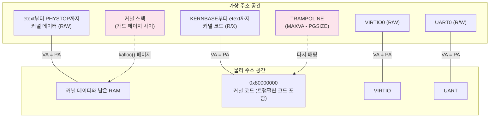
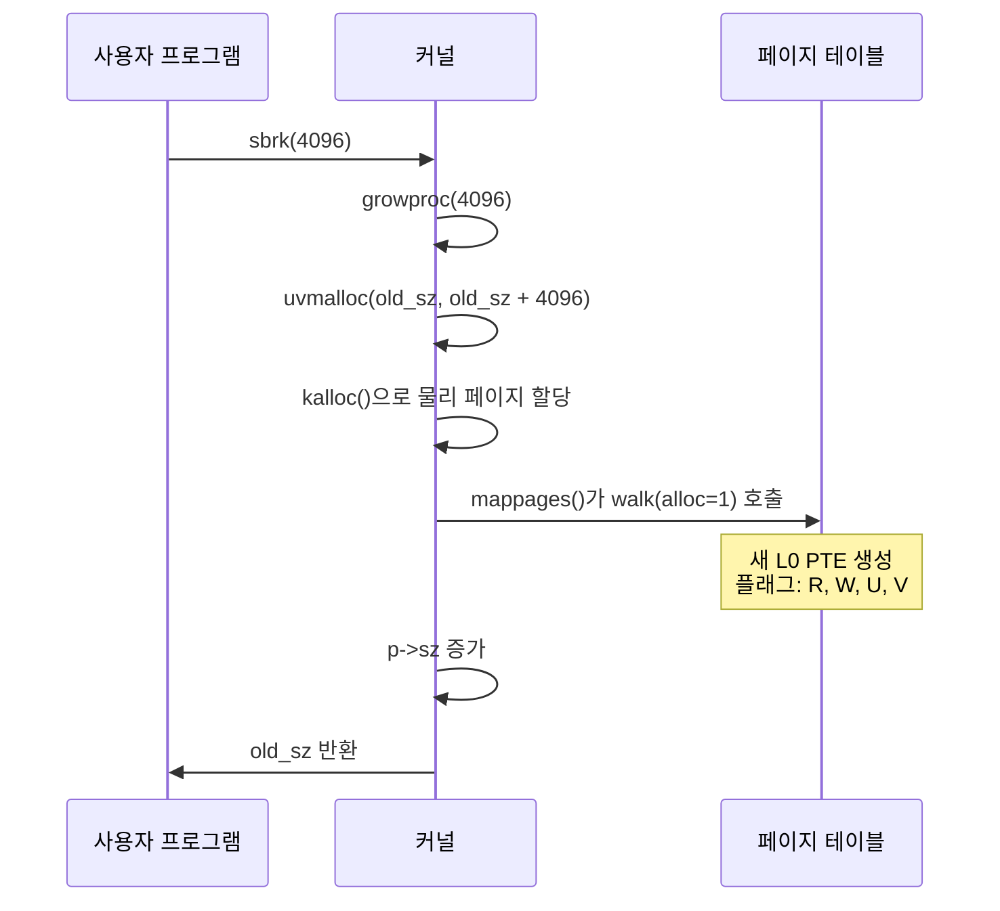

# 11주차 실습 — 페이지 테이블

[레포지토리 안내](../../README.ko.md) | [English](Concepts_Lab.md) | [한국어](Concepts_Lab.ko.md)

> **최종 수정일:** 2026-11-18

> **학습 목표:**
> 1. RISC-V Sv39의 3단계 페이지 테이블 구조와 PTE 형식을 설명할 수 있다
> 2. `kvmmake()`를 읽고 xv6 커널의 메모리 맵과 각 영역의 권한을 정리할 수 있다
> 3. `walk()`를 따라 가상 주소를 물리 주소로 직접 변환할 수 있다
> 4. `vmprint()`를 구현해 프로세스의 페이지 테이블을 출력하고 해석할 수 있다
> 5. `sbrk()`가 페이지 테이블을 바꾸는 과정을 추적하고 즉시 할당과 지연 할당을 구분할 수 있다

---

## 목차

- [1. 실습 개요와 배경](#1-실습-개요와-배경)
  - [1.1 RISC-V Sv39](#11-risc-v-sv39)
  - [1.2 가상 주소의 구조](#12-가상-주소의-구조)
  - [1.3 3단계 주소 변환](#13-3단계-주소-변환)
  - [1.4 PTE의 구조](#14-pte의-구조)
  - [1.5 xv6의 PTE 매크로](#15-xv6의-pte-매크로)
- [2. 실습 1: 커널 메모리 맵](#2-실습-1-커널-메모리-맵)
  - [2.1 kvmmake()](#21-kvmmake)
  - [2.2 커널 메모리 맵 정리](#22-커널-메모리-맵-정리)
  - [2.3 직접 매핑의 예외](#23-직접-매핑의-예외)
  - [2.4 권한 분석](#24-권한-분석)
- [3. 실습 2: walk() 추적](#3-실습-2-walk-추적)
  - [3.1 walk()](#31-walk)
  - [3.2 직접 해 보는 주소 변환](#32-직접-해-보는-주소-변환)
  - [3.3 alloc 매개변수](#33-alloc-매개변수)
- [4. 실습 3: vmprint() 구현](#4-실습-3-vmprint-구현)
  - [4.1 구현](#41-구현)
  - [4.2 커널에 연결하기](#42-커널에-연결하기)
  - [4.3 실행 결과](#43-실행-결과)
  - [4.4 출력 해석](#44-출력-해석)
  - [4.5 재귀 구조와 freewalk()](#45-재귀-구조와-freewalk)
- [5. 실습 4: sbrk() 추적](#5-실습-4-sbrk-추적)
  - [5.1 호출 경로와 코드](#51-호출-경로와-코드)
  - [5.2 uvmalloc()의 동작](#52-uvmalloc의-동작)
  - [5.3 vmprint()로 관찰하기](#53-vmprint로-관찰하기)
  - [5.4 지연 할당](#54-지연-할당)
  - [5.5 사용자 주소 공간의 배치](#55-사용자-주소-공간의-배치)
- [6. 함수와 매크로 정리](#6-함수와-매크로-정리)
- [요약](#요약)
- [점검 문제](#점검-문제)

---

<br>

## 1. 실습 개요와 배경

- **목표:** xv6 커널이 페이지 테이블을 만들고 쓰는 코드를 읽고, 주소 변환을 직접 추적하며, 페이지 테이블을 출력하는 `vmprint()`를 구현한다.
- **주제:** 커널 메모리 맵(`kvmmake()`), `walk()` 추적과 수동 주소 변환, `vmprint()` 구현, `sbrk()` 동작 추적
- **관련 파일:** `kernel/vm.c`, `kernel/riscv.h`, `kernel/memlayout.h`, `kernel/exec.c`, `kernel/proc.c`, `kernel/sysproc.c`


*그림 1. 네 실습의 진행 순서*

### 1.1 RISC-V Sv39

운영체제는 프로세스마다 독립된 가상 주소 공간을 제공하고, 페이지 테이블은 프로세스가 쓰는 **가상 주소(VA)** 를 실제 메모리의 **물리 주소(PA)** 로 변환한다(11주차 4절). xv6가 쓰는 RISC-V의 **Sv39** 방식은 다음과 같다.

- 가상 주소: **39비트** (512 GB 주소 공간)
- 물리 주소: **56비트**
- 페이지 크기: **4 KB** (4096바이트 = 2¹²바이트)
- 페이지 테이블: **3단계** (레벨 2 → 레벨 1 → 레벨 0)
- 페이지 테이블 페이지 하나: **512개 PTE** (2⁹ = 512, PTE 하나가 8바이트이므로 512 × 8 = 4096바이트로 정확히 한 페이지)

이 계층적 페이징은 11주차 7.2절의 다단계 페이지 테이블을 하드웨어가 정해 둔 형식이다. xv6의 `MAXVA`는 `1L << 38`(0x4000000000, 256 GB)로, Sv39가 허용하는 크기보다 한 비트 작다. `kernel/riscv.h`의 주석에 따르면 최상위 비트가 1인 가상 주소의 부호 확장을 다루지 않으려는 선택이다.

> **[컴퓨터구조]** 주소 변환은 MMU가 하드웨어로 수행한다. `satp` 레지스터에는 변환 방식(Sv39는 `8L << 60`)과 최상위(L2) 페이지 테이블의 물리 페이지 번호가 들어 있고(`MAKE_SATP()`), MMU는 여기서 시작해 세 단계를 따라간 결과를 TLB에 캐시한다. 페이지 테이블을 바꾼 뒤에는 `sfence.vma` 명령으로 TLB의 오래된 항목을 지워야 하며, xv6는 `kvminithart()`에서 `satp`를 쓰기 전후로 `sfence_vma()`를 호출한다.

### 1.2 가상 주소의 구조

```text
  63        39 38       30 29       21 20       12 11          0
 +------------+-----------+-----------+-----------+-------------+
 |   미사용   |  VPN[2]   |  VPN[1]   |  VPN[0]   |   오프셋    |
 |  (25비트)  |  (9비트)  |  (9비트)  |  (9비트)  |  (12비트)   |
 +------------+-----------+-----------+-----------+-------------+
  xv6에서 0    L2 인덱스   L1 인덱스   L0 인덱스   페이지 안 위치
```

*그림 2. Sv39 가상 주소의 필드*

- **L2 인덱스(VPN[2]):** 30번에서 38번 비트, 레벨 2 페이지 테이블의 인덱스(0\~511)
- **L1 인덱스(VPN[1]):** 21번에서 29번 비트, 레벨 1 페이지 테이블의 인덱스(0\~511)
- **L0 인덱스(VPN[0]):** 12번에서 20번 비트, 레벨 0 페이지 테이블의 인덱스(0\~511)
- **오프셋:** 0번에서 11번 비트, 4 KB 페이지 안의 위치(0\~4095)

Sv39 규격은 39번에서 63번 비트가 38번 비트와 같기를 요구한다. xv6는 38번 비트도 쓰지 않으므로 이 비트들은 모두 0이다.

### 1.3 3단계 주소 변환

```text
 satp 레지스터
 (L2 테이블의
  물리 주소)
      |
      v
 +----------+      +----------+      +----------+
 | L2 테이블|      | L1 테이블|      | L0 테이블|
 |----------|      |----------|      |----------|
 |  PTE  0  |      |  PTE  0  |      |  PTE  0  |
 |  PTE  1  |      |  PTE  1  |      |  PTE  1  |
 |  ...     |      |  ...     |      |  ...     |
 |  PTE  i  |----->|  PTE  j  |----->|  PTE  k  |-----> 물리 페이지
 |  ...     |      |  ...     |      |  ...     |        + 오프셋
 |  PTE 511 |      |  PTE 511 |      |  PTE 511 |
 +----------+      +----------+      +----------+

  i = VPN[2]        j = VPN[1]        k = VPN[0]
  (L2 인덱스)       (L1 인덱스)       (L0 인덱스)
```

*그림 3. Sv39의 3단계 페이지 테이블 탐색*

변환은 다음 순서로 일어난다.

1. `satp` 레지스터에서 L2 페이지 테이블의 물리 주소를 얻는다.
2. L2 테이블의 `VPN[2]`번 PTE를 읽어 L1 테이블의 물리 주소를 얻는다.
3. L1 테이블의 `VPN[1]`번 PTE를 읽어 L0 테이블의 물리 주소를 얻는다.
4. L0 테이블의 `VPN[0]`번 PTE를 읽어 최종 물리 페이지의 주소를 얻는다.
5. 물리 페이지 주소에 오프셋을 더한 값이 최종 물리 주소이다.

### 1.4 PTE의 구조

PTE(Page Table Entry)는 64비트이며, 물리 페이지 번호와 플래그 비트를 담는다.

```text
  63      54 53                        10 9   8 7 6 5 4 3 2 1 0
 +----------+----------------------------+-----+-+-+-+-+-+-+-+-+
 |   예약   |   PPN (물리 페이지 번호)   | RSW |D|A|G|U|X|W|R|V|
 | (10비트) |          (44비트)          | (2) | | | | | | | | |
 +----------+----------------------------+-----+-+-+-+-+-+-+-+-+
```

*그림 4. Sv39 PTE의 필드*

| 비트 | 이름 | 뜻 |
|:-----|:-----|:-----|
| 0 | V (Valid) | 이 PTE가 유효함 |
| 1 | R (Read) | 읽기 가능 |
| 2 | W (Write) | 쓰기 가능 |
| 3 | X (Execute) | 실행 가능 |
| 4 | U (User) | 사용자 모드에서 접근 가능 |
| 5 | G (Global) | 모든 주소 공간에 공통인 매핑 |
| 6 | A (Accessed) | 접근된 적 있음 |
| 7 | D (Dirty) | 쓰기가 일어난 적 있음 |
| 8\~9 | RSW | 소프트웨어용 예약 비트 (하드웨어가 무시) |

*표 1. PTE 플래그 비트*

V가 1인 PTE는 R, W, X 비트에 따라 두 종류로 나뉜다.

> **용어 정의:** **리프 PTE(leaf PTE)** 는 R, W, X 중 적어도 하나가 1인 유효한 PTE로, 실제 물리 페이지를 가리키는 최종 매핑이다.

> **용어 정의:** **비리프 PTE(non-leaf PTE)** 는 R, W, X가 모두 0인 유효한 PTE로, 다음 레벨 페이지 테이블의 물리 주소를 담는다.

### 1.5 xv6의 PTE 매크로

`kernel/riscv.h`는 PTE를 다루는 매크로를 정의한다.

```c
#define PTE_V (1L << 0) // 유효
#define PTE_R (1L << 1) // 읽기
#define PTE_W (1L << 2) // 쓰기
#define PTE_X (1L << 3) // 실행
#define PTE_U (1L << 4) // 사용자 접근 가능

// 물리 주소 -> PTE 형식: 하위 12비트 제거 후 왼쪽으로 10비트 이동
#define PA2PTE(pa) ((((uint64)pa) >> 12) << 10)

// PTE -> 물리 주소: 하위 10비트(플래그) 제거 후 왼쪽으로 12비트 이동
#define PTE2PA(pte) (((pte) >> 10) << 12)

// PTE에서 플래그(하위 10비트)만 추출
#define PTE_FLAGS(pte) ((pte) & 0x3FF)

// 가상 주소에서 레벨별 인덱스 추출
#define PXMASK          0x1FF // 9비트
#define PXSHIFT(level)  (PGSHIFT+(9*(level)))
#define PX(level, va) ((((uint64) (va)) >> PXSHIFT(level)) & PXMASK)
//   PX(2, va) -> 30번에서 38번 비트 추출 (L2 인덱스)
//   PX(1, va) -> 21번에서 29번 비트 추출 (L1 인덱스)
//   PX(0, va) -> 12번에서 20번 비트 추출 (L0 인덱스)
```

`PA2PTE()`와 `PTE2PA()`는 물리 주소와 PTE 사이에서 PPN의 위치를 옮긴다. 물리 주소의 하위 12비트는 페이지 안의 오프셋이므로 PTE에는 저장하지 않고, 그 자리에는 10비트의 플래그가 들어간다.

```text
 물리 주소 (PA):
  55                          12 11       0
 +------------------------------+---------+
 |         PPN (44비트)         | 오프셋  |
 +------------------------------+---------+

 PA >> 12 (오프셋 제거):
  43                             0
 +-------------------------------+
 |         PPN (44비트)          |
 +-------------------------------+

 (PA >> 12) << 10 (플래그 자리 확보):
  53                    10 9    0
 +------------------------+------+
 |      PPN (44비트)      | 0000 |
 +------------------------+------+
  = PTE 형식 (플래그 비트는 0)
```

*그림 5. PA2PTE()가 물리 주소를 PTE 형식으로 바꾸는 과정*

---

<br>

## 2. 실습 1: 커널 메모리 맵

**목표:** `kernel/vm.c`의 `kvmmake()`를 읽고 xv6 커널이 물리 메모리를 가상 주소 공간에 매핑하는 방식을 분석한다.

### 2.1 kvmmake()

`kvmmake()`는 부팅할 때 커널 페이지 테이블을 만든다.

```c
// 커널의 직접 매핑 페이지 테이블 생성
pagetable_t
kvmmake(void)
{
  pagetable_t kpgtbl;

  kpgtbl = (pagetable_t) kalloc();
  memset(kpgtbl, 0, PGSIZE);

  // uart 레지스터
  kvmmap(kpgtbl, UART0, UART0, PGSIZE, PTE_R | PTE_W);

  // virtio mmio 디스크 인터페이스
  kvmmap(kpgtbl, VIRTIO0, VIRTIO0, PGSIZE, PTE_R | PTE_W);

  // PLIC
  kvmmap(kpgtbl, PLIC, PLIC, 0x4000000, PTE_R | PTE_W);

  // 커널 코드를 실행 가능, 읽기 전용으로 매핑
  kvmmap(kpgtbl, KERNBASE, KERNBASE, (uint64)etext-KERNBASE, PTE_R | PTE_X);

  // 커널 데이터와 사용할 물리 RAM을 매핑
  kvmmap(kpgtbl, (uint64)etext, (uint64)etext, PHYSTOP-(uint64)etext, PTE_R | PTE_W);

  // 트랩 진입과 복귀용 트램펄린을
  // 커널의 가장 높은 가상 주소에 매핑
  kvmmap(kpgtbl, TRAMPOLINE, (uint64)trampoline, PGSIZE, PTE_R | PTE_X);

  // 프로세스마다 커널 스택을 할당해 매핑
  proc_mapstacks(kpgtbl);

  return kpgtbl;
}
```

`kvmmap(pagetable, va, pa, size, perm)`은 가상 주소 `va`부터 `size`바이트를 물리 주소 `pa`부터의 영역에 권한 `perm`으로 매핑하며, 내부에서 `mappages()`를 호출한다. 주요 상수는 `kernel/memlayout.h`에 있다.

```c
#define UART0     0x10000000L
#define VIRTIO0   0x10001000
#define PLIC      0x0c000000L
#define KERNBASE  0x80000000L
#define PHYSTOP   (KERNBASE + 128*1024*1024)  // = 0x88000000
#define TRAMPOLINE (MAXVA - PGSIZE)           // 가상 주소 공간의 맨 위
#define TRAPFRAME  (TRAMPOLINE - PGSIZE)
```

`etext`는 링커 스크립트(`kernel/kernel.ld`)가 커널 코드의 끝에 정해 두는 기호이며, 빌드에 따라 값이 다르다. 4.3절의 출력을 만든 빌드에서는 `etext`가 0x80007000, `trampoline`이 0x80006000이다.

### 2.2 커널 메모리 맵 정리

| 영역 | 가상 주소 | 물리 주소 | 크기 | 권한 | 용도 |
|:-----|:-----|:-----|:-----|:-----|:-----|
| UART | `0x10000000` | `0x10000000` | 4 KB | R, W | UART 장치 레지스터 |
| VIRTIO | `0x10001000` | `0x10001000` | 4 KB | R, W | 디스크 입출력 인터페이스 |
| PLIC | `0x0C000000` | `0x0C000000` | 64 MB (`0x4000000`) | R, W | 인터럽트 컨트롤러 |
| 커널 코드 | `0x80000000` | `0x80000000` | `etext`까지 | R, X | 커널 코드 |
| 커널 데이터 | `etext` | `etext` | `PHYSTOP`까지 | R, W | 커널 데이터와 남은 물리 메모리 |
| 트램펄린 | `MAXVA - PGSIZE` | `trampoline` 코드의 물리 주소 | 4 KB | R, X | 트랩 진입과 복귀 |
| 커널 스택 | `KSTACK(p)` | `kalloc()`으로 얻은 페이지 | 프로세스마다 4 KB | R, W | 프로세스별 커널 스택 |

*표 2. xv6 커널의 메모리 맵*



*그림 6. xv6 커널 페이지 테이블의 가상 주소와 물리 주소 대응*

### 2.3 직접 매핑의 예외

대부분의 커널 영역은 가상 주소와 물리 주소가 같은 **직접 매핑(direct mapping)** 이다. 커널은 `kalloc()`이 돌려준 물리 주소를 그대로 포인터로 쓸 수 있으므로 포인터 계산이 단순해진다. `walk()`가 PTE에서 꺼낸 물리 주소를 다음 테이블의 포인터로 바로 쓰는 것도 직접 매핑 덕분이다.

직접 매핑이 아닌 영역은 두 가지이다.

- **트램펄린:** 물리적으로는 커널 코드 안(이 빌드에서는 0x80006000)에 있지만, 가상 주소 공간의 맨 위(`MAXVA - PGSIZE` = 0x3FFFFFF000)에 한 번 더 매핑된다. 트랩에 들어가고 나올 때 `satp`가 사용자 페이지 테이블과 커널 페이지 테이블 사이에서 바뀌는데, 트램펄린 코드는 두 페이지 테이블에서 **같은 가상 주소**에 있어야 전환 도중에도 다음 명령어를 계속 가져올 수 있다. 그래서 모든 프로세스의 사용자 페이지 테이블에도 같은 주소에 같은 물리 페이지로 매핑된다.
- **커널 스택:** 각 프로세스의 커널 스택은 `kalloc()`으로 얻은 페이지를 트램펄린 아래의 높은 주소(`KSTACK(p)`)에 매핑한 것이다. 스택 사이마다 매핑하지 않은 가드 페이지를 두어, 커널 스택이 넘치면 그대로 다른 메모리를 덮어쓰지 않고 페이지 폴트가 일어나게 한다.

### 2.4 권한 분석

- **커널 코드가 `PTE_R | PTE_X`인 이유:** 코드는 실행해야 하므로 X가 필요하다. W를 빼면 버그나 공격으로 커널 코드가 바뀌는 것을 하드웨어가 막는다.
- **커널 데이터가 `PTE_R | PTE_W`인 이유:** 데이터는 읽고 써야 하지만 실행할 이유가 없다. X를 빼면 데이터 영역에 써 넣은 바이트가 코드로 실행되는 것을 막는다. 한 페이지가 쓰기 가능과 실행 가능을 동시에 갖지 않게 하는 이 원칙을 흔히 W^X라고 부른다.
- **`PTE_U`가 없는 이유:** 커널 영역은 모두 U가 0이므로 사용자 모드에서는 접근할 수 없고 슈퍼바이저 모드에서만 접근할 수 있다. 커널 페이지 테이블은 사용자 프로그램이 쓰지 않지만, 트램펄린처럼 사용자 페이지 테이블에도 들어가는 커널 페이지가 U 없이 매핑되어야 사용자 코드가 그 페이지를 읽거나 실행하지 못한다.

---

<br>

## 3. 실습 2: walk() 추적

**목표:** `walk()`를 읽고, 주어진 가상 주소에 대한 3단계 페이지 테이블 탐색을 손으로 따라간다.

### 3.1 walk()

```c
// 페이지 테이블 pagetable에서 가상 주소 va에 대응하는
// PTE의 주소를 반환, alloc!=0이면
// 필요한 페이지 테이블 페이지를 생성
pte_t *
walk(pagetable_t pagetable, uint64 va, int alloc)
{
  if(va >= MAXVA)
    panic("walk");

  for(int level = 2; level > 0; level--) {
    pte_t *pte = &pagetable[PX(level, va)];
    if(*pte & PTE_V) {
      pagetable = (pagetable_t)PTE2PA(*pte);
    } else {
      if(!alloc || (pagetable = (pde_t*)kalloc()) == 0)
        return 0;
      memset(pagetable, 0, PGSIZE);
      *pte = PA2PTE(pagetable) | PTE_V;
    }
  }
  return &pagetable[PX(0, va)];
}
```

동작은 다음과 같다.

1. **입력:** 최상위 페이지 테이블(`pagetable`), 가상 주소(`va`), 할당 여부(`alloc`)
2. **반복문:** `level`이 2와 1일 때, 즉 L2와 L1 단계를 처리한다.
   - `PX(level, va)`로 현재 단계의 인덱스를 구한다.
   - PTE가 유효하면(V=1) PTE에서 다음 단계 테이블의 물리 주소를 꺼낸다.
   - PTE가 무효하면(V=0) `alloc`이 1일 때 새 페이지를 할당해 0으로 채우고 연결하며, `alloc`이 0이면 0(NULL)을 반환한다.
3. **반환:** L0 테이블의 `PX(0, va)`번 PTE의 **주소**를 반환한다. L0 PTE 자체가 유효한지는 검사하지 않으므로, 호출자가 `*pte & PTE_V`를 확인해야 한다.

새로 만든 중간 테이블을 가리키는 PTE에는 `PTE_V`만 설정되므로 비리프 PTE가 된다.

### 3.2 직접 해 보는 주소 변환

가상 주소 `0x80001234`를 예로 든다. 각 필드는 다음과 같이 계산된다.

```text
VPN[2] = (0x80001234 >> 30) & 0x1FF = 2
VPN[1] = (0x80001234 >> 21) & 0x1FF = 0
VPN[0] = (0x80001234 >> 12) & 0x1FF = 1
offset =  0x80001234 & 0xFFF        = 0x234
```

```text
  비트:  38       30 29       21 20       12 11          0
        +-----------+-----------+-----------+--------------+
        | 000000010 | 000000000 | 000000001 | 001000110100 |
        +-----------+-----------+-----------+--------------+
         VPN[2] = 2  VPN[1] = 0  VPN[0] = 1  오프셋 = 0x234
```

*그림 7. 가상 주소 0x80001234의 필드 분해*

`walk()`는 이 주소에 대해 다음 순서로 실행된다.

```text
1단계 (level=2): PX(2, 0x80001234) = 2
                 L2 테이블[2]의 PTE를 읽음
                 PTE가 유효하면 PTE2PA(PTE) = L1 테이블의 물리 주소
2단계 (level=1): PX(1, 0x80001234) = 0
                 L1 테이블[0]의 PTE를 읽음
                 PTE가 유효하면 PTE2PA(PTE) = L0 테이블의 물리 주소
3단계 (반복문 뒤): PX(0, 0x80001234) = 1
                 L0 테이블[1]의 PTE 주소를 반환

최종 물리 주소 = PTE2PA(L0 PTE) + 0x234
```

이 주소는 커널 코드 영역(`KERNBASE` 이상, `etext` 미만)에 있고 직접 매핑되므로, 커널 페이지 테이블에서 `PTE2PA(L0 PTE)`는 0x80001000이고 최종 물리 주소는 가상 주소와 같은 0x80001234이다.

실습의 보조 스크립트 `lab2_va_translate.py`는 주소를 인자로 받아 같은 계산을 보여 주고, xv6의 주요 주소를 표로 출력한다.

```bash
python3 lab2_va_translate.py 0x80001234
```

| 주소 | L2 | L1 | L0 | 오프셋 | 영역 |
|:-----|-----:|-----:|-----:|:-----|:-----|
| `0x0000000000000000` | 0 | 0 | 0 | `0x000` | 사용자 코드의 시작 |
| `0x0000000000001000` | 0 | 0 | 1 | `0x000` | 사용자 공간의 두 번째 페이지 |
| `0x0000000010000000` | 0 | 128 | 0 | `0x000` | UART0 |
| `0x0000000010001000` | 0 | 128 | 1 | `0x000` | VIRTIO0 |
| `0x000000000c000000` | 0 | 96 | 0 | `0x000` | PLIC |
| `0x0000000080000000` | 2 | 0 | 0 | `0x000` | KERNBASE |
| `0x0000000080001234` | 2 | 0 | 1 | `0x234` | 커널 코드 안 |
| `0x0000000087ffffff` | 2 | 63 | 511 | `0xfff` | PHYSTOP 바로 앞 |
| `0x0000003fffffe000` | 255 | 511 | 510 | `0x000` | TRAPFRAME |
| `0x0000003ffffff000` | 255 | 511 | 511 | `0x000` | TRAMPOLINE |

*표 3. xv6의 주요 가상 주소와 레벨별 인덱스*

### 3.3 alloc 매개변수

- **`walk(pagetable, va, 0)`과 `walk(pagetable, va, 1)`의 차이:** 중간 테이블이 없을 때 `alloc`이 0이면 0을 반환하고, 1이면 새 페이지 테이블 페이지를 할당해 연결한 뒤 계속 내려간다.
- **`mappages()`가 `alloc=1`로 호출하는 이유:** `mappages()`는 새 매핑을 만드는 함수이므로, 그 주소에 이르는 중간 테이블이 아직 없으면 만들어야 한다. 반환된 L0 PTE에 `PA2PTE(pa) | perm | PTE_V`를 써서 매핑을 완성하며, 이미 유효한 PTE이면 `panic("mappages: remap")`을 일으킨다.
- **`walkaddr()`가 `alloc=0`으로 호출하는 이유:** `walkaddr()`는 가상 주소의 물리 주소를 찾기만 하는 조회 함수이다. 매핑이 없는 주소를 조회하다가 중간 테이블을 만들면 메모리만 낭비하고 매핑은 여전히 없으므로, 매핑이 없으면 0을 반환한다. `walkaddr()`는 사용자 페이지만 조회하므로 L0 PTE에 V와 U가 모두 있어야 물리 주소를 반환한다.

---

<br>

## 4. 실습 3: vmprint() 구현

**목표:** 프로세스의 3단계 페이지 테이블 내용을 출력하는 `vmprint()`를 작성해 페이지 테이블의 실제 구조를 눈으로 확인한다.

### 4.1 구현

출력은 레벨마다 들여쓰기를 달리해 유효한 PTE마다 인덱스, PTE 값, 물리 주소, 권한을 한 줄씩 보인다. `..`는 L2, `.. ..`는 L1, `.. .. ..`는 L0 단계이다. 다음 코드를 `kernel/vm.c`의 끝에 추가한다.

```c
// 페이지 테이블의 유효한 항목을 재귀적으로 출력
// level: 2 = L2(루트), 1 = L1(중간), 0 = L0(리프)
void
vmprint_recursive(pagetable_t pagetable, int level)
{
  // 페이지 테이블 하나는 PTE 512개(8바이트 x 512 = 4096 = 한 페이지)
  for(int i = 0; i < 512; i++){
    pte_t pte = pagetable[i];
    if(!(pte & PTE_V))
      continue;           // 무효한 항목은 건너뜀

    // 레벨이 깊을수록 들여쓰기를 늘림
    for(int j = 2; j >= level; j--){
      printf(" ..");
    }

    uint64 pa = PTE2PA(pte);
    printf("%d: pte %p pa %p", i, (void *)pte, (void *)pa);

    // R, W, X, U 플래그를 사람이 읽을 수 있게 출력
    printf(" [");
    if(pte & PTE_R) printf("R");
    if(pte & PTE_W) printf("W");
    if(pte & PTE_X) printf("X");
    if(pte & PTE_U) printf("U");
    if((pte & (PTE_R|PTE_W|PTE_X)) == 0) printf("--");  // 비리프 PTE
    printf("]");
    printf("\n");

    // 비리프 PTE(R=W=X=0)이면 다음 레벨 테이블로 재귀
    // 커널은 직접 매핑이므로 PA를 그대로 포인터로 사용 가능
    if((pte & (PTE_R|PTE_W|PTE_X)) == 0){
      vmprint_recursive((pagetable_t)pa, level - 1);
    }
  }
}

// 프로세스의 페이지 테이블 전체를 출력
void
vmprint(pagetable_t pagetable)
{
  printf("page table %p\n", (void *)pagetable);
  vmprint_recursive(pagetable, 2);
}
```

> **참고:** xv6 커널의 `printf()`는 `%d`, `%ld`, `%u`, `%x`, `%lx`, `%p`, `%s`, `%c`만 처리하며 `%016lx` 같은 폭 지정을 지원하지 않는다. 폭을 지정하면 `0x%016lx`가 해석되지 않고 문자 그대로 출력된다. `%p`는 `0x` 뒤에 16자리 16진수를 출력하므로 고정 폭 출력에는 `%p`를 쓰고, `defs.h`의 `printf` 선언에 형식 검사 속성이 있으므로 인자를 `(void *)`로 변환한다.

### 4.2 커널에 연결하기

`kernel/defs.h`의 `vm.c` 선언 부분에 함수 선언을 추가한다.

```c
void            vmprint(pagetable_t);
```

`kernel/exec.c`의 `kexec()`에서 `return argc;` 바로 앞에 다음 코드를 추가한다. 첫 번째 프로세스(`init`, pid 1)의 페이지 테이블만 출력하도록 제한해 출력량을 줄인다.

```c
  // 디버깅: 새 프로세스의 페이지 테이블 출력
  if(p->pid == 1){
    printf("== pid 1 (init) page table ==\n");
    vmprint(p->pagetable);
  }
```

```bash
make clean
make qemu
```

### 4.3 실행 결과

부팅하면 `init`이 `exec()`를 마친 시점의 페이지 테이블이 출력된다. 물리 주소는 실행 환경에 따라 달라질 수 있지만 구조와 플래그는 같다.

```text
xv6 kernel is booting

== pid 1 (init) page table ==
page table 0x0000000087f52000
 ..0: pte 0x0000000021fd3801 pa 0x0000000087f4e000 [--]
 .. ..0: pte 0x0000000021fd3401 pa 0x0000000087f4d000 [--]
 .. .. ..0: pte 0x0000000021fd3c1b pa 0x0000000087f4f000 [RXU]
 .. .. ..1: pte 0x0000000021fd3017 pa 0x0000000087f4c000 [RWU]
 .. .. ..2: pte 0x0000000021fd2c07 pa 0x0000000087f4b000 [RW]
 .. .. ..3: pte 0x0000000021fd2817 pa 0x0000000087f4a000 [RWU]
 ..255: pte 0x0000000021fd4401 pa 0x0000000087f51000 [--]
 .. ..511: pte 0x0000000021fd4001 pa 0x0000000087f50000 [--]
 .. .. ..510: pte 0x0000000021fd5807 pa 0x0000000087f56000 [RW]
 .. .. ..511: pte 0x000000002000180b pa 0x0000000080006000 [RX]
init: starting sh
```

### 4.4 출력 해석

**L2 테이블의 유효한 PTE**는 인덱스 0과 255 두 개이다.

- L2 인덱스 하나는 2³⁰바이트(1 GB)를 맡는다. 인덱스 0은 `0x0`부터 `0x3FFFFFFF`까지로, 사용자 코드, 데이터, 스택이 있는 낮은 주소 영역이다.
- 인덱스 255는 255 × 1 GB = `0x3FC0000000`부터 `0x3FFFFFFFFF`까지로, 가상 주소 공간의 맨 위이다. 그 안의 L1 인덱스 511은 마지막 2 MB(`0x3FFFE00000`부터)를 맡고, L0 인덱스 510과 511은 각각 `TRAPFRAME`(0x3FFFFFE000)과 `TRAMPOLINE`(0x3FFFFFF000)이다.

`MAXVA` 아래 256 GB(2³⁸바이트)의 가상 주소 공간 가운데 실제로 매핑된 것은 페이지 여섯 개뿐이며, 이를 위해 L2 테이블 1개, L1 테이블 2개, L0 테이블 2개가 쓰였다. 쓰지 않는 영역에는 하위 테이블을 만들지 않는 것이 계층적 페이지 테이블이 메모리를 아끼는 방식이다(11주차 7.2절).

| L0 인덱스 | 가상 주소 | 플래그 | 내용 |
|:-----|:-----|:-----|:-----|
| 0 | `0x0000` | R, X, U | 코드 |
| 1 | `0x1000` | R, W, U | 데이터 |
| 2 | `0x2000` | R, W | 스택 가드 페이지 |
| 3 | `0x3000` | R, W, U | 사용자 스택 |
| 510 | `0x3FFFFFE000` | R, W | TRAPFRAME |
| 511 | `0x3FFFFFF000` | R, X | TRAMPOLINE |

*표 4. init 프로세스의 리프 PTE*

- **코드 페이지에 W가 없는 이유:** `kexec()`는 ELF 프로그램 헤더의 플래그를 `flags2perm()`으로 PTE 권한으로 바꾸고, `uvmalloc()`이 여기에 R과 U를 더한다. 코드 세그먼트는 실행과 읽기만 허용되므로 R, X, U가 된다.
- **U가 없는 페이지:** U가 있는 페이지는 사용자 모드에서 접근할 수 있고, U가 없는 페이지는 슈퍼바이저 모드에서만 접근할 수 있다. 가드 페이지는 `kexec()`가 `uvmclear()`로 U를 지운 페이지로, 사용자 스택이 넘쳐 이 페이지에 닿으면 페이지 폴트가 일어난다. `TRAPFRAME`과 `TRAMPOLINE`도 U가 없어 사용자 코드는 접근할 수 없고, 트랩을 처리하는 동안 슈퍼바이저 모드의 코드만 쓴다.
- **PTE 값 읽기:** 예를 들어 `0x21fd3c1b`의 하위 10비트는 `0x01b` = V(0x1) + R(0x2) + X(0x8) + U(0x10)이고, `0x21fd3c1b >> 10 = 0x87f4f`에 `<< 12`를 하면 물리 주소 `0x87f4f000`이 된다.

### 4.5 재귀 구조와 freewalk()

`(pte & (PTE_R|PTE_W|PTE_X)) == 0` 조건은 그 PTE가 비리프인지 검사한다. 비리프 PTE의 PPN은 다음 레벨 페이지 테이블의 물리 주소이므로, 그 주소로 재귀 호출하면 하위 테이블을 같은 방식으로 훑게 된다. 유효한 페이지 테이블에서 L0 PTE는 항상 리프이므로 재귀는 세 단계에서 멈춘다. `level > 0` 조건을 함께 검사하면 손상된 페이지 테이블에서도 L0 아래로 내려가지 않는다.

`kernel/vm.c`의 `freewalk()`도 같은 재귀 구조를 가진다.

```c
// 페이지 테이블 페이지를 재귀적으로 해제
// 리프 매핑은 모두 미리 제거되어 있어야 함
void
freewalk(pagetable_t pagetable)
{
  // 페이지 테이블에는 2^9 = 512개의 PTE
  for(int i = 0; i < 512; i++){
    pte_t pte = pagetable[i];
    if((pte & PTE_V) && (pte & (PTE_R|PTE_W|PTE_X)) == 0){
      // 이 PTE는 하위 페이지 테이블을 가리킴
      uint64 child = PTE2PA(pte);
      freewalk((pagetable_t)child);
      pagetable[i] = 0;
    } else if(pte & PTE_V){
      panic("freewalk: leaf");
    }
  }
  kfree((void*)pagetable);
}
```

- **공통점:** 512개 항목을 모두 훑고, 유효한 비리프 PTE를 만나면 그 PTE가 가리키는 하위 테이블로 재귀한다.
- **차이점:** `vmprint_recursive()`는 리프와 비리프를 모두 출력할 뿐 페이지 테이블을 바꾸지 않으며, 항목을 먼저 출력하고 하위로 내려간다. `freewalk()`는 리프 매핑이 미리 모두 제거되어 있어야 하므로(`uvmfree()`가 먼저 `uvmunmap()`을 호출) 리프 PTE를 만나면 패닉을 일으키고, 하위 테이블을 모두 해제한 **뒤에** 자신의 페이지를 `kfree()`로 해제한다.

---

<br>

## 5. 실습 4: sbrk() 추적

**목표:** 프로세스가 `sbrk()` 시스템 콜로 힙을 늘릴 때 페이지 테이블이 어떻게 바뀌는지 추적한다.

### 5.1 호출 경로와 코드



*그림 8. sbrk()가 새 페이지를 매핑하는 호출 경로*

사용자 라이브러리의 `sbrk(n)`은 `sys_sbrk(n, SBRK_EAGER)`를, `sbrklazy(n)`은 `sys_sbrk(n, SBRK_LAZY)`를 호출한다(`user/ulib.c`). 커널의 `sys_sbrk()`는 다음과 같다.

```c
uint64
sys_sbrk(void)
{
  uint64 addr;
  int t;
  int n;

  argint(0, &n);
  argint(1, &t);
  addr = myproc()->sz;

  if(t == SBRK_EAGER || n < 0) {
    if(growproc(n) < 0) {
      return -1;
    }
  } else {
    // 이 프로세스의 메모리를 지연 할당: 크기만 늘리고
    // 메모리는 할당하지 않음, 프로세스가 그 메모리를 쓰면
    // vmfault()가 할당
    if(addr + n < addr)
      return -1;
    if(addr + n > TRAPFRAME)
      return -1;
    myproc()->sz += n;
  }
  return addr;
}
```

즉시 할당 경로는 `growproc()`를 거쳐 `uvmalloc()`에 이른다.

```c
int
growproc(int n)
{
  uint64 sz;
  struct proc *p = myproc();

  sz = p->sz;
  if(n > 0){
    if(sz + n > TRAPFRAME) {
      return -1;
    }
    if((sz = uvmalloc(p->pagetable, sz, sz + n, PTE_W)) == 0) {
      return -1;
    }
  } else if(n < 0){
    sz = uvmdealloc(p->pagetable, sz, sz + n);
  }
  p->sz = sz;
  return 0;
}

uint64
uvmalloc(pagetable_t pagetable, uint64 oldsz, uint64 newsz, int xperm)
{
  char *mem;
  uint64 a;

  if(newsz < oldsz)
    return oldsz;

  oldsz = PGROUNDUP(oldsz);
  for(a = oldsz; a < newsz; a += PGSIZE){
    mem = kalloc();                 // 1. 물리 페이지 할당
    if(mem == 0){
      uvmdealloc(pagetable, a, oldsz);
      return 0;
    }
    memset(mem, 0, PGSIZE);         // 2. 0으로 초기화
    if(mappages(pagetable, a, PGSIZE, (uint64)mem, PTE_R|PTE_U|xperm) != 0){
      kfree(mem);                   // 3. 페이지 테이블에 매핑
      uvmdealloc(pagetable, a, oldsz);
      return 0;
    }
  }
  return newsz;
}
```

### 5.2 uvmalloc()의 동작

프로세스의 현재 크기 `p->sz`가 `0x3000`(12 KB, 3페이지)일 때 `sbrk(8192)`(8 KB, 2페이지)를 호출한다고 하자.

- `uvmalloc()`의 인자는 `oldsz = 0x3000`, `newsz = 0x5000`이다. `PGROUNDUP(0x3000)`은 이미 페이지 경계이므로 그대로 `0x3000`이다.
- 반복문은 두 번 돈다. 첫 번째에는 `va = 0x3000`, 두 번째에는 `va = 0x4000`에 매핑이 생긴다.
- 새 PTE의 플래그는 `PTE_R | PTE_U | xperm`에 `mappages()`가 더하는 `PTE_V`이다. `xperm`이 `PTE_W`이므로 `PTE_R | PTE_U | PTE_W | PTE_V` = 0x2 + 0x10 + 0x4 + 0x1 = `0x17`이다.

`sbrk()`가 반환하는 값은 늘리기 전의 크기 `0x3000`이며, 사용자 프로그램은 이 주소부터 새 메모리를 쓴다. `kalloc()`은 페이지를 쓰레기 값으로 채워 돌려주므로 `uvmalloc()`이 `memset()`으로 0을 채워, 이전에 다른 프로세스가 쓰던 내용이 새 프로세스에 노출되지 않게 한다.

### 5.3 vmprint()로 관찰하기

`sbrk()` 앞뒤의 페이지 테이블을 비교하려고, `sys_sbrk()`에 이름이 `sbrkdemo`인 프로세스일 때만 `vmprint()`를 호출하는 관찰용 코드를 넣는다.

```c
// kernel/sysproc.c의 sys_sbrk(): 관찰용 출력 추가
  argint(0, &n);
  argint(1, &t);
  addr = myproc()->sz;
  int demo = strncmp(myproc()->name, "sbrkdemo", 16) == 0;
  if(demo){
    printf("-- before sbrk(%d, %s), sz=0x%lx --\n", n, t == SBRK_EAGER ? "EAGER" : "LAZY", addr);
    vmprint(myproc()->pagetable);
  }

  // ... 기존 코드 ...

  if(demo){
    printf("-- after: sz=0x%lx --\n", myproc()->sz);
    vmprint(myproc()->pagetable);
  }
  return addr;
```

사용자 프로그램 `sbrkdemo`는 즉시 할당과 지연 할당을 한 번씩 요청하고, 지연 할당된 페이지에 처음 쓴 뒤 `sbrk(0)`으로 페이지 테이블을 한 번 더 출력한다.

```c
#include "kernel/types.h"
#include "kernel/stat.h"
#include "user/user.h"

int
main(void)
{
  char *a = sbrk(4096);          // 즉시 할당: growproc() -> uvmalloc()
  printf("sbrk(4096) returned %p\n", a);
  char *b = sbrklazy(4096);      // 지연 할당: p->sz만 증가
  printf("sbrklazy(4096) returned %p\n", b);
  b[0] = 'x';                    // 첫 접근 -> 페이지 폴트 -> vmfault()
  sbrk(0);                       // 페이지 테이블을 한 번 더 출력
  exit(0);
}
```

실행 결과에서 L2 인덱스 0 아래의 L0 항목만 보면 다음과 같다(같은 항목의 반복은 `...`로 줄임).

```text
$ sbrkdemo
-- before sbrk(4096, EAGER), sz=0x4000 --
 .. .. ..0: pte 0x0000000021fc885b pa 0x0000000087f22000 [RXU]
 .. .. ..1: pte 0x0000000021fc7c17 pa 0x0000000087f1f000 [RWU]
 .. .. ..2: pte 0x0000000021fc7807 pa 0x0000000087f1e000 [RW]
 .. .. ..3: pte 0x0000000021fc74d7 pa 0x0000000087f1d000 [RWU]
-- after: sz=0x5000 --
 ...
 .. .. ..4: pte 0x0000000021fc9817 pa 0x0000000087f26000 [RWU]
sbrk(4096) returned 0x0000000000004000
-- before sbrk(4096, LAZY), sz=0x5000 --
 ...
-- after: sz=0x6000 --
 ...
 .. .. ..4: pte 0x0000000021fc9817 pa 0x0000000087f26000 [RWU]
sbrklazy(4096) returned 0x0000000000005000
-- before sbrk(0, EAGER), sz=0x6000 --
 ...
 .. .. ..4: pte 0x0000000021fc9817 pa 0x0000000087f26000 [RWU]
 .. .. ..5: pte 0x0000000021fd50d7 pa 0x0000000087f54000 [RWU]
```

- **즉시 할당:** `sbrk(4096)` 뒤에 L0 인덱스 4(가상 주소 `0x4000`)의 PTE가 새로 생겼고, `p->sz`가 `0x4000`에서 `0x5000`으로 늘었다. 반환값은 늘리기 전의 크기 `0x4000`이다.
- **지연 할당:** `sbrklazy(4096)` 뒤에는 `p->sz`만 `0x6000`으로 늘고 PTE는 생기지 않았다.
- **첫 접근:** `b[0] = 'x'`가 매핑되지 않은 `0x5000`에 쓰면서 페이지 폴트가 일어났고, `vmfault()`가 L0 인덱스 5의 PTE를 만들었다.
- **A, D 비트:** 실행된 코드 페이지의 PTE는 `0x...5b`로, 4.3절의 `0x...1b`에 A(0x40)가 더해졌다. 쓰기가 일어난 인덱스 3과 5의 하위 바이트 `0xd7`은 D(0x80)와 A(0x40)가 모두 설정된 값이다. QEMU의 RISC-V는 접근과 쓰기가 일어나면 하드웨어가 이 비트를 1로 만든다.

### 5.4 지연 할당

- **즉시 할당(eager allocation):** `sbrk()`를 호출하는 순간 `growproc()`와 `uvmalloc()`이 물리 페이지를 할당하고 페이지 테이블에 매핑한다.
- **지연 할당(lazy allocation):** `sbrk()`는 `p->sz`만 늘리고 물리 페이지를 할당하지 않는다. 지연 할당으로 `sbrk(4096)`을 호출해도 그 순간에는 물리 페이지가 할당되지 않는다.

지연 할당된 페이지는 프로세스가 그 주소에 처음 접근할 때 할당된다. 접근하면 PTE가 없어 페이지 폴트(`scause` 13 또는 15)가 일어나고, `usertrap()`이 `vmfault()`를 호출한다. 커널이 `copyin()`이나 `copyout()`으로 그 주소에 접근할 때도 `walkaddr()`가 0을 반환하면 `vmfault()`를 직접 호출한다.

```c
// sys_sbrk()에서 지연 할당된 페이지를
// 프로세스가 참조하면 할당해 매핑
// va가 잘못되었거나 이미 매핑되었거나 물리 메모리가
// 부족하면 0, 성공하면 물리 주소를 반환
uint64
vmfault(pagetable_t pagetable, uint64 va, int read)
{
  uint64 mem;
  struct proc *p = myproc();

  if (va >= p->sz)
    return 0;
  va = PGROUNDDOWN(va);
  if(ismapped(pagetable, va)) {
    return 0;
  }
  mem = (uint64) kalloc();
  if(mem == 0)
    return 0;
  memset((void *) mem, 0, PGSIZE);
  if (mappages(p->pagetable, va, PGSIZE, mem, PTE_W|PTE_U|PTE_R) != 0) {
    kfree((void *)mem);
    return 0;
  }
  return mem;
}
```

페이지 폴트를 이용하는 기법은 12주차 실습에서 자세히 다룬다.

### 5.5 사용자 주소 공간의 배치

`kexec()`는 프로그램의 코드와 데이터를 주소 0부터 적재하고, 그 위의 다음 페이지 경계에 `USERSTACK + 1`개(이 xv6에서는 2개)의 페이지를 할당한다. 그중 아래쪽 페이지는 `uvmclear()`로 U를 지워 가드 페이지로 만들고, 위쪽 페이지를 사용자 스택으로 쓴다. `p->sz`는 스택의 끝이며, 힙은 그 위로 `sbrk()`에 따라 늘어난다. 다음 그림은 `init` 프로세스의 예이다.

```text
  0x4000000000 +------------------------+ MAXVA
               | TRAMPOLINE   (R, X)    |  커널과 같은 물리 페이지
  0x3FFFFFF000 +------------------------+
               | TRAPFRAME    (R, W)    |  프로세스별 트랩 프레임
  0x3FFFFFE000 +------------------------+
               |                        |
               |       (빈 공간)        |
               |                        |
         p->sz +------------------------+
               | 힙           (R, W, U) |  sbrk()로 위쪽으로 늘어남
        0x4000 +------------------------+
               | 사용자 스택  (R, W, U) |  sp는 0x4000에서 아래로 자람
        0x3000 +------------------------+
               | 가드 페이지  (R, W)    |  PTE_U 없음, 스택이 넘치면 fault
        0x2000 +------------------------+
               | 데이터       (R, W, U) |  전역 변수, 초기화된 데이터와 BSS
        0x1000 +------------------------+
               | 코드         (R, X, U) |  프로그램 코드
        0x0000 +------------------------+
```

*그림 9. xv6 사용자 프로세스의 가상 주소 공간 배치 (init의 예)*

가드 페이지는 스택 **바로 아래**에 있다. 스택은 높은 주소에서 낮은 주소로 자라므로, 스택이 한 페이지를 넘으면 가드 페이지에 닿아 페이지 폴트가 일어나고, 데이터 영역을 조용히 덮어쓰지 않는다.

---

<br>

## 6. 함수와 매크로 정리

| 함수 | 파일 | 역할 |
|:-----|:-----|:-----|
| `kvmmake()` | `vm.c` | 커널 페이지 테이블 생성 (직접 매핑) |
| `kvmmap()` | `vm.c` | 커널 페이지 테이블에 매핑 추가 |
| `walk()` | `vm.c` | 3단계를 따라 VA에 대응하는 PTE를 찾아 반환 |
| `walkaddr()` | `vm.c` | 사용자 페이지의 VA를 PA로 변환 |
| `mappages()` | `vm.c` | VA 범위를 PA에 매핑 (PTE 설정) |
| `uvmcreate()` | `vm.c` | 빈 사용자 페이지 테이블 생성 |
| `uvmalloc()` | `vm.c` | 사용자 메모리 확장 (물리 페이지 할당과 매핑) |
| `uvmdealloc()` | `vm.c` | 사용자 메모리 축소 (매핑 해제와 물리 페이지 해제) |
| `freewalk()` | `vm.c` | 페이지 테이블 페이지를 재귀적으로 해제 |
| `growproc()` | `proc.c` | 프로세스 크기 변경 (`sbrk`의 즉시 할당 경로) |
| `vmfault()` | `vm.c` | 지연 할당된 페이지의 페이지 폴트 처리 |

*표 5. xv6의 페이지 테이블 관련 함수*

| 매크로 | 동작 |
|:-----|:-----|
| `PX(level, va)` | VA에서 해당 레벨의 9비트 인덱스 추출 |
| `PA2PTE(pa)` | 물리 주소를 PTE 형식으로 변환 |
| `PTE2PA(pte)` | PTE를 물리 주소로 변환 |
| `PTE_FLAGS(pte)` | PTE에서 플래그 비트(하위 10비트) 추출 |
| `PGROUNDUP(sz)` | 페이지 크기 경계로 올림 |
| `PGROUNDDOWN(a)` | 페이지 크기 경계로 내림 |

*표 6. xv6의 페이지 테이블 관련 매크로*

> **핵심:** RISC-V Sv39는 39비트 가상 주소를 9 + 9 + 9 + 12비트로 나누어 3단계 페이지 테이블로 변환한다. xv6 커널은 대부분의 물리 메모리를 VA = PA로 직접 매핑해 물리 주소를 쉽게 다루고, 트램펄린만 모든 주소 공간의 맨 위에 다시 매핑한다. 사용자 메모리는 `uvmalloc()`이 `kalloc()`과 `mappages()`로 늘리며, 지연 할당에서는 `p->sz`만 늘린 뒤 실제 접근 시점에 `vmfault()`가 물리 페이지를 할당한다.

---

<br>

## 요약

| 개념 | 핵심 요약 |
|:-----|:-----|
| Sv39 | 39비트 가상 주소를 9비트 인덱스 세 개와 12비트 오프셋으로 나누어 PTE 512개짜리 페이지 테이블 세 단계로 변환한다. |
| PTE | 64비트로 44비트 PPN과 V, R, W, X, U, G, A, D, RSW 플래그를 담으며, R, W, X가 모두 0인 유효한 PTE는 다음 레벨 테이블을 가리킨다. |
| 커널 직접 매핑 | `kvmmake()`는 장치, 커널 코드(R, X), 커널 데이터(R, W)를 VA = PA로 매핑하고, 트램펄린과 커널 스택만 높은 주소에 따로 매핑한다. |
| walk() | L2와 L1 단계를 `PX()`로 따라 내려가 L0 PTE의 주소를 반환하며, `alloc=1`이면 없는 중간 테이블을 새로 만든다. |
| vmprint() | 유효한 PTE를 레벨별 들여쓰기로 출력하고 비리프 PTE에서 재귀하며, xv6의 `printf()`에서는 고정 폭 출력에 `%p`를 쓴다. |
| sbrk() | 즉시 할당은 `growproc()`와 `uvmalloc()`으로 새 페이지를 매핑하고, 지연 할당은 `p->sz`만 늘린 뒤 첫 접근의 페이지 폴트에서 `vmfault()`가 매핑한다. |
| 사용자 주소 공간 | 아래부터 코드, 데이터, 가드 페이지, 스택, 힙이 놓이고, 맨 위에 U가 없는 `TRAPFRAME`과 `TRAMPOLINE`이 있다. |

---

<br>

## 점검 문제

1. 가상 주소 `0x80001234`의 VPN[2], VPN[1], VPN[0], 오프셋을 구하고, 커널 페이지 테이블에서 이 주소가 변환되는 물리 주소를 쓰라.

   <details>
   <summary>정답</summary>

   VPN[2] = `(0x80001234 >> 30) & 0x1FF` = 2, VPN[1] = `(0x80001234 >> 21) & 0x1FF` = 0, VPN[0] = `(0x80001234 >> 12) & 0x1FF` = 1, 오프셋 = `0x80001234 & 0xFFF` = `0x234`이다. 이 주소는 커널 코드 영역에 있고 직접 매핑되므로 L0 PTE가 가리키는 물리 페이지는 `0x80001000`이고, 최종 물리 주소는 `0x80001234`이다.

   </details>

2. 커널 페이지 테이블에서 직접 매핑되지 않는 영역을 두 가지 쓰고, 각각 그렇게 매핑하는 이유를 설명하라.

   <details>
   <summary>정답</summary>

   트램펄린과 커널 스택이다. 트램펄린은 트랩 진입과 복귀 도중 `satp`가 사용자 페이지 테이블과 커널 페이지 테이블 사이에서 바뀌어도 명령어를 계속 가져올 수 있도록, 두 페이지 테이블의 같은 가상 주소(`MAXVA - PGSIZE`)에 매핑된다. 커널 스택은 `kalloc()`으로 얻은 페이지를 높은 주소에 매핑하고 사이사이에 매핑하지 않은 가드 페이지를 두어, 스택이 넘치면 다른 메모리를 덮어쓰지 않고 페이지 폴트가 일어나게 한다.

   </details>

3. `mappages()`는 `walk()`를 `alloc=1`로, `walkaddr()`는 `alloc=0`으로 호출한다. 각각의 이유는 무엇인가?

   <details>
   <summary>정답</summary>

   `mappages()`는 새 매핑을 만드는 함수이므로 그 주소에 이르는 중간 페이지 테이블이 없으면 만들어야 한다. `walkaddr()`는 매핑이 있는지 조회만 하는 함수이므로, 매핑이 없는 주소 때문에 중간 테이블을 만들면 메모리만 낭비하고 매핑은 여전히 없다. 그래서 `alloc=0`으로 호출해 매핑이 없으면 0을 반환한다.

   </details>

4. 4.3절의 출력에서 L2 테이블의 유효한 PTE는 몇 개이며, 각각 어떤 가상 주소 범위를 맡는가? L0 인덱스 2의 PTE에 U가 없는 이유는 무엇인가?

   <details>
   <summary>정답</summary>

   인덱스 0과 255의 두 개이다. L2 인덱스 하나는 1 GB를 맡으므로 인덱스 0은 `0x0`부터 `0x3FFFFFFF`까지의 사용자 코드, 데이터, 스택 영역이고, 인덱스 255는 `0x3FC0000000`부터 `0x3FFFFFFFFF`까지로 `TRAPFRAME`과 `TRAMPOLINE`이 있는 맨 위 영역이다. L0 인덱스 2는 사용자 스택 바로 아래의 가드 페이지로, `kexec()`가 `uvmclear()`로 U를 지워 사용자 모드에서 접근하면 페이지 폴트가 일어나게 했다.

   </details>

5. `vmprint_recursive()`와 `freewalk()`의 공통점과 차이점을 설명하라.

   <details>
   <summary>정답</summary>

   둘 다 512개 항목을 훑으며 유효한 비리프 PTE(R, W, X가 모두 0)를 만나면 그 PTE가 가리키는 하위 테이블로 재귀한다. `vmprint_recursive()`는 리프와 비리프 PTE를 모두 출력하고 페이지 테이블을 바꾸지 않는다. `freewalk()`는 리프 매핑이 미리 제거되어 있어야 하므로 리프 PTE를 만나면 패닉을 일으키고, 하위 테이블을 해제한 뒤 항목을 0으로 지우고 마지막에 자신의 페이지를 해제한다.

   </details>

6. `p->sz`가 `0x3000`일 때 `sbrk(8192)`를 즉시 할당으로 호출하면 `uvmalloc()`은 어떤 가상 주소에 어떤 플래그로 매핑을 만드는가? 같은 요청을 지연 할당으로 하면 무엇이 달라지는가?

   <details>
   <summary>정답</summary>

   `oldsz = 0x3000`, `newsz = 0x5000`이므로 반복문이 두 번 돌아 `0x3000`과 `0x4000`에 매핑을 만들고, 플래그는 `PTE_R | PTE_U | PTE_W | PTE_V` = `0x17`이다. 지연 할당이면 `sys_sbrk()`가 `p->sz`만 `0x5000`으로 늘리고 PTE와 물리 페이지는 만들지 않는다. 프로세스가 그 주소에 처음 접근할 때 페이지 폴트가 일어나 `vmfault()`가 페이지 하나씩 할당해 매핑한다.

   </details>
