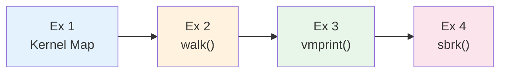
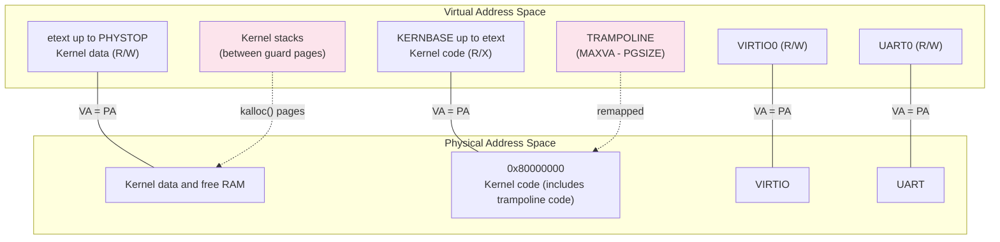
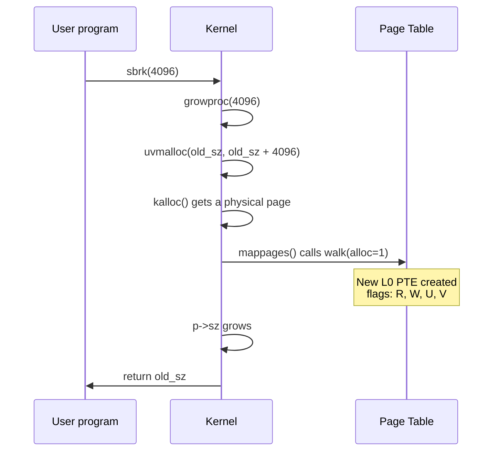

# Week 11 Lab — Page Tables

[Repository Guide](../../README.md) | [English](Concepts_Lab.md) | [한국어](Concepts_Lab.ko.md)

> **Last Updated:** 2026-11-19

> **Learning Objectives:**
> 1. Explain the three-level page table structure and the PTE format of RISC-V Sv39
> 2. Read `kvmmake()` and summarize the memory map of the xv6 kernel and the permissions of each region
> 3. Translate a virtual address to a physical address by hand by following `walk()`
> 4. Implement `vmprint()` to print and interpret a process's page table
> 5. Trace how `sbrk()` changes the page table and distinguish eager allocation from lazy allocation

---

## Table of Contents

- [1. Lab Overview and Background](#1-lab-overview-and-background)
  - [1.1 RISC-V Sv39](#11-risc-v-sv39)
  - [1.2 Structure of a Virtual Address](#12-structure-of-a-virtual-address)
  - [1.3 Three-Level Address Translation](#13-three-level-address-translation)
  - [1.4 Structure of a PTE](#14-structure-of-a-pte)
  - [1.5 PTE Macros in xv6](#15-pte-macros-in-xv6)
- [2. Exercise 1: The Kernel Memory Map](#2-exercise-1-the-kernel-memory-map)
  - [2.1 kvmmake()](#21-kvmmake)
  - [2.2 Summary of the Kernel Memory Map](#22-summary-of-the-kernel-memory-map)
  - [2.3 Exceptions to Direct Mapping](#23-exceptions-to-direct-mapping)
  - [2.4 Permission Analysis](#24-permission-analysis)
- [3. Exercise 2: Tracing walk()](#3-exercise-2-tracing-walk)
  - [3.1 walk()](#31-walk)
  - [3.2 Address Translation by Hand](#32-address-translation-by-hand)
  - [3.3 The alloc Parameter](#33-the-alloc-parameter)
- [4. Exercise 3: Implementing vmprint()](#4-exercise-3-implementing-vmprint)
  - [4.1 Implementation](#41-implementation)
  - [4.2 Hooking It into the Kernel](#42-hooking-it-into-the-kernel)
  - [4.3 Execution Result](#43-execution-result)
  - [4.4 Interpreting the Output](#44-interpreting-the-output)
  - [4.5 The Recursive Structure and freewalk()](#45-the-recursive-structure-and-freewalk)
- [5. Exercise 4: Tracing sbrk()](#5-exercise-4-tracing-sbrk)
  - [5.1 Call Path and Code](#51-call-path-and-code)
  - [5.2 How uvmalloc() Works](#52-how-uvmalloc-works)
  - [5.3 Observing with vmprint()](#53-observing-with-vmprint)
  - [5.4 Lazy Allocation](#54-lazy-allocation)
  - [5.5 Layout of the User Address Space](#55-layout-of-the-user-address-space)
- [6. Summary of Functions and Macros](#6-summary-of-functions-and-macros)
- [Summary](#summary)
- [Self-Check Questions](#self-check-questions)

---

<br>

## 1. Lab Overview and Background

- **Objective:** Read the code with which the xv6 kernel builds and uses page tables, trace address translation by hand, and implement `vmprint()`, which prints a page table.
- **Topics:** The kernel memory map (`kvmmake()`), tracing `walk()` and manual address translation, implementing `vmprint()`, tracing the behavior of `sbrk()`
- **Files:** `kernel/vm.c`, `kernel/riscv.h`, `kernel/memlayout.h`, `kernel/exec.c`, `kernel/proc.c`, `kernel/sysproc.c`



*Figure 1. Order of the four exercises*

### 1.1 RISC-V Sv39

The operating system gives each process an independent virtual address space, and the page table translates the **virtual addresses (VA)** a process uses into **physical addresses (PA)** in real memory (Week 11, Section 4). The RISC-V **Sv39** scheme used by xv6 is as follows.

- Virtual address: **39 bits** (a 512 GB address space)
- Physical address: **56 bits**
- Page size: **4 KB** (4096 bytes = 2¹² bytes)
- Page table: **three levels** (level 2 → level 1 → level 0)
- One page-table page: **512 PTEs** (2⁹ = 512; each PTE is 8 bytes, so 512 × 8 = 4096 bytes, exactly one page)

This hierarchical paging is the multilevel page table of Week 11, Section 7.2, in a format fixed by the hardware. xv6's `MAXVA` is `1L << 38` (0x4000000000, 256 GB), one bit smaller than what Sv39 allows. According to the comment in `kernel/riscv.h`, this choice avoids having to sign-extend virtual addresses whose top bit is set.

> **[Computer Architecture]** Address translation is performed in hardware by the MMU. The `satp` register holds the translation mode (`8L << 60` for Sv39) and the physical page number of the top-level (L2) page table (`MAKE_SATP()`), and the MMU starts there, walks the three levels, and caches the result in the TLB. After changing a page table, stale TLB entries must be flushed with the `sfence.vma` instruction, and xv6 calls `sfence_vma()` before and after writing `satp` in `kvminithart()`.

### 1.2 Structure of a Virtual Address

```text
  63        39 38       30 29       21 20       12 11          0
 +------------+-----------+-----------+-----------+-------------+
 |   Unused   |  VPN[2]   |  VPN[1]   |  VPN[0]   |   Offset    |
 | (25 bits)  | (9 bits)  | (9 bits)  | (9 bits)  |  (12 bits)  |
 +------------+-----------+-----------+-----------+-------------+
  0 in xv6     L2 index    L1 index    L0 index    page offset
```

*Figure 2. Fields of an Sv39 virtual address*

- **L2 index (VPN[2]):** Bits 30 through 38, the index into the level-2 page table (0-511)
- **L1 index (VPN[1]):** Bits 21 through 29, the index into the level-1 page table (0-511)
- **L0 index (VPN[0]):** Bits 12 through 20, the index into the level-0 page table (0-511)
- **Offset:** Bits 0 through 11, the position within the 4 KB page (0-4095)

The Sv39 specification requires bits 39 through 63 to equal bit 38. Since xv6 does not use bit 38 either, all of these bits are 0.

### 1.3 Three-Level Address Translation

```text
 satp register
 (physical address
  of L2 table)
      |
      v
 +----------+      +----------+      +----------+
 | L2 Table |      | L1 Table |      | L0 Table |
 |----------|      |----------|      |----------|
 |  PTE  0  |      |  PTE  0  |      |  PTE  0  |
 |  PTE  1  |      |  PTE  1  |      |  PTE  1  |
 |  ...     |      |  ...     |      |  ...     |
 |  PTE  i  |----->|  PTE  j  |----->|  PTE  k  |-----> Physical page
 |  ...     |      |  ...     |      |  ...     |        + offset
 |  PTE 511 |      |  PTE 511 |      |  PTE 511 |
 +----------+      +----------+      +----------+

  i = VPN[2]        j = VPN[1]        k = VPN[0]
  (L2 index)        (L1 index)        (L0 index)
```

*Figure 3. The three-level page table walk of Sv39*

Translation proceeds in the following order.

1. Obtain the physical address of the L2 page table from the `satp` register.
2. Read PTE number `VPN[2]` of the L2 table to obtain the physical address of the L1 table.
3. Read PTE number `VPN[1]` of the L1 table to obtain the physical address of the L0 table.
4. Read PTE number `VPN[0]` of the L0 table to obtain the address of the final physical page.
5. The physical page address plus the offset is the final physical address.

### 1.4 Structure of a PTE

A PTE (Page Table Entry) is 64 bits and holds a physical page number and flag bits.

```text
  63      54 53                        10 9   8 7 6 5 4 3 2 1 0
 +----------+----------------------------+-----+-+-+-+-+-+-+-+-+
 | Reserved | PPN (physical page number) | RSW |D|A|G|U|X|W|R|V|
 |(10 bits) |         (44 bits)          | (2) | | | | | | | | |
 +----------+----------------------------+-----+-+-+-+-+-+-+-+-+
```

*Figure 4. Fields of an Sv39 PTE*

| Bit | Name | Meaning |
|:-----|:-----|:-----|
| 0 | V (Valid) | This PTE is valid |
| 1 | R (Read) | Readable |
| 2 | W (Write) | Writable |
| 3 | X (Execute) | Executable |
| 4 | U (User) | Accessible in user mode |
| 5 | G (Global) | A mapping common to all address spaces |
| 6 | A (Accessed) | Has been accessed |
| 7 | D (Dirty) | Has been written to |
| 8-9 | RSW | Reserved for software (ignored by hardware) |

*Table 1. PTE flag bits*

A PTE with V set to 1 falls into one of two kinds depending on its R, W, and X bits.

> **Definition:** A **leaf PTE** is a valid PTE with at least one of R, W, and X set to 1, the final mapping that points to an actual physical page.

> **Definition:** A **non-leaf PTE** is a valid PTE with R, W, and X all 0, which holds the physical address of the next-level page table.

### 1.5 PTE Macros in xv6

`kernel/riscv.h` defines the macros for working with PTEs.

```c
#define PTE_V (1L << 0) // valid
#define PTE_R (1L << 1) // read
#define PTE_W (1L << 2) // write
#define PTE_X (1L << 3) // execute
#define PTE_U (1L << 4) // user can access

// Physical address -> PTE format: remove lower 12 bits, shift left 10 bits
#define PA2PTE(pa) ((((uint64)pa) >> 12) << 10)

// PTE -> Physical address: remove lower 10 bits (flags), shift left 12 bits
#define PTE2PA(pte) (((pte) >> 10) << 12)

// Extract only the flags from a PTE (lower 10 bits)
#define PTE_FLAGS(pte) ((pte) & 0x3FF)

// Extract the index for each level from a virtual address
#define PXMASK          0x1FF // 9 bits
#define PXSHIFT(level)  (PGSHIFT+(9*(level)))
#define PX(level, va) ((((uint64) (va)) >> PXSHIFT(level)) & PXMASK)
//   PX(2, va) -> Extract bits 30 through 38 (L2 index)
//   PX(1, va) -> Extract bits 21 through 29 (L1 index)
//   PX(0, va) -> Extract bits 12 through 20 (L0 index)
```

`PA2PTE()` and `PTE2PA()` move the PPN between its position in a physical address and its position in a PTE. The lower 12 bits of a physical address are the offset within the page, so they are not stored in the PTE, and the 10 flag bits take their place.

```text
 Physical address (PA):
  55                          12 11       0
 +------------------------------+---------+
 |        PPN (44 bits)         | offset  |
 +------------------------------+---------+

 PA >> 12 (remove the offset):
  43                             0
 +-------------------------------+
 |         PPN (44 bits)         |
 +-------------------------------+

 (PA >> 12) << 10 (make room for the flags):
  53                    10 9    0
 +------------------------+------+
 |     PPN (44 bits)      | 0000 |
 +------------------------+------+
  = PTE format (flag bits are 0)
```

*Figure 5. How PA2PTE() converts a physical address into PTE format*

---

<br>

## 2. Exercise 1: The Kernel Memory Map

**Objective:** Read `kvmmake()` in `kernel/vm.c` and analyze how the xv6 kernel maps physical memory into its virtual address space.

### 2.1 kvmmake()

`kvmmake()` builds the kernel page table at boot.

```c
// Make a direct-map page table for the kernel.
pagetable_t
kvmmake(void)
{
  pagetable_t kpgtbl;

  kpgtbl = (pagetable_t) kalloc();
  memset(kpgtbl, 0, PGSIZE);

  // uart registers
  kvmmap(kpgtbl, UART0, UART0, PGSIZE, PTE_R | PTE_W);

  // virtio mmio disk interface
  kvmmap(kpgtbl, VIRTIO0, VIRTIO0, PGSIZE, PTE_R | PTE_W);

  // PLIC
  kvmmap(kpgtbl, PLIC, PLIC, 0x4000000, PTE_R | PTE_W);

  // map kernel text executable and read-only.
  kvmmap(kpgtbl, KERNBASE, KERNBASE, (uint64)etext-KERNBASE, PTE_R | PTE_X);

  // map kernel data and the physical RAM we'll make use of.
  kvmmap(kpgtbl, (uint64)etext, (uint64)etext, PHYSTOP-(uint64)etext, PTE_R | PTE_W);

  // map the trampoline for trap entry/exit to
  // the highest virtual address in the kernel.
  kvmmap(kpgtbl, TRAMPOLINE, (uint64)trampoline, PGSIZE, PTE_R | PTE_X);

  // allocate and map a kernel stack for each process.
  proc_mapstacks(kpgtbl);

  return kpgtbl;
}
```

`kvmmap(pagetable, va, pa, size, perm)` maps `size` bytes starting at virtual address `va` to the region starting at physical address `pa` with permissions `perm`, calling `mappages()` internally. The key constants are in `kernel/memlayout.h`.

```c
#define UART0     0x10000000L
#define VIRTIO0   0x10001000
#define PLIC      0x0c000000L
#define KERNBASE  0x80000000L
#define PHYSTOP   (KERNBASE + 128*1024*1024)  // = 0x88000000
#define TRAMPOLINE (MAXVA - PGSIZE)           // Top of virtual address space
#define TRAPFRAME  (TRAMPOLINE - PGSIZE)
```

`etext` is a symbol that the linker script (`kernel/kernel.ld`) places at the end of the kernel code, and its value varies between builds. In the build that produced the output of Section 4.3, `etext` is 0x80007000 and `trampoline` is 0x80006000.

### 2.2 Summary of the Kernel Memory Map

| Region | Virtual address | Physical address | Size | Permission | Purpose |
|:-----|:-----|:-----|:-----|:-----|:-----|
| UART | `0x10000000` | `0x10000000` | 4 KB | R, W | UART device registers |
| VIRTIO | `0x10001000` | `0x10001000` | 4 KB | R, W | Disk I/O interface |
| PLIC | `0x0C000000` | `0x0C000000` | 64 MB (`0x4000000`) | R, W | Interrupt controller |
| Kernel text | `0x80000000` | `0x80000000` | Up to `etext` | R, X | Kernel code |
| Kernel data | `etext` | `etext` | Up to `PHYSTOP` | R, W | Kernel data and the remaining physical memory |
| Trampoline | `MAXVA - PGSIZE` | Physical address of the `trampoline` code | 4 KB | R, X | Trap entry and return |
| Kernel stacks | `KSTACK(p)` | Pages obtained with `kalloc()` | 4 KB per process | R, W | Per-process kernel stack |

*Table 2. Memory map of the xv6 kernel*



*Figure 6. Correspondence between virtual and physical addresses in the xv6 kernel page table*

### 2.3 Exceptions to Direct Mapping

Most kernel regions use **direct mapping**, in which the virtual address equals the physical address. The kernel can use a physical address returned by `kalloc()` directly as a pointer, which keeps pointer arithmetic simple. Direct mapping is also what lets `walk()` use the physical address taken from a PTE directly as a pointer to the next table.

Two regions are not direct-mapped.

- **Trampoline:** Physically it lies inside the kernel code (0x80006000 in this build), but it is mapped once more at the top of the virtual address space (`MAXVA - PGSIZE` = 0x3FFFFFF000). When entering and leaving a trap, `satp` switches between the user page table and the kernel page table, and the trampoline code must be at the **same virtual address** in both page tables so that the CPU can keep fetching the next instruction during the switch. For this reason it is mapped at the same address to the same physical page in every process's user page table as well.
- **Kernel stacks:** Each process's kernel stack is a page obtained with `kalloc()` and mapped at a high address below the trampoline (`KSTACK(p)`). An unmapped guard page is left between stacks, so that a kernel stack overflow causes a page fault instead of silently overwriting other memory.

### 2.4 Permission Analysis

- **Why kernel text is `PTE_R | PTE_X`:** Code must be executed, so X is required. Leaving out W lets the hardware prevent bugs or attacks from modifying kernel code.
- **Why kernel data is `PTE_R | PTE_W`:** Data must be read and written but has no reason to be executed. Leaving out X prevents bytes written into the data region from being executed as code. This principle, that no page is both writable and executable at the same time, is commonly called W^X.
- **Why there is no `PTE_U`:** Every kernel region has U set to 0, so it cannot be accessed in user mode and can be accessed only in supervisor mode. User programs do not use the kernel page table, but kernel pages that also appear in user page tables, such as the trampoline, must be mapped without U so that user code cannot read or execute them.

---

<br>

## 3. Exercise 2: Tracing walk()

**Objective:** Read `walk()` and follow by hand the three-level page table walk for a given virtual address.

### 3.1 walk()

```c
// Return the address of the PTE in page table pagetable
// that corresponds to virtual address va.  If alloc!=0,
// create any required page-table pages.
pte_t *
walk(pagetable_t pagetable, uint64 va, int alloc)
{
  if(va >= MAXVA)
    panic("walk");

  for(int level = 2; level > 0; level--) {
    pte_t *pte = &pagetable[PX(level, va)];
    if(*pte & PTE_V) {
      pagetable = (pagetable_t)PTE2PA(*pte);
    } else {
      if(!alloc || (pagetable = (pde_t*)kalloc()) == 0)
        return 0;
      memset(pagetable, 0, PGSIZE);
      *pte = PA2PTE(pagetable) | PTE_V;
    }
  }
  return &pagetable[PX(0, va)];
}
```

It works as follows.

1. **Input:** The top-level page table (`pagetable`), the virtual address (`va`), and the allocation flag (`alloc`)
2. **Loop:** For `level` equal to 2 and 1, that is, for the L2 and L1 levels:
   - Compute the index of the current level with `PX(level, va)`.
   - If the PTE is valid (V=1), take the physical address of the next-level table from the PTE.
   - If the PTE is invalid (V=0), allocate a new page, fill it with zeros, and link it when `alloc` is 1; return 0 (NULL) when `alloc` is 0.
3. **Return:** Return the **address** of PTE number `PX(0, va)` in the L0 table. It does not check whether the L0 PTE itself is valid, so the caller must check `*pte & PTE_V`.

A PTE that points to a newly created intermediate table has only `PTE_V` set, so it is a non-leaf PTE.

### 3.2 Address Translation by Hand

Take the virtual address `0x80001234` as an example. Its fields are computed as follows.

```text
VPN[2] = (0x80001234 >> 30) & 0x1FF = 2
VPN[1] = (0x80001234 >> 21) & 0x1FF = 0
VPN[0] = (0x80001234 >> 12) & 0x1FF = 1
offset =  0x80001234 & 0xFFF        = 0x234
```

```text
  bits:  38       30 29       21 20       12 11          0
        +-----------+-----------+-----------+--------------+
        | 000000010 | 000000000 | 000000001 | 001000110100 |
        +-----------+-----------+-----------+--------------+
         VPN[2] = 2  VPN[1] = 0  VPN[0] = 1  offset = 0x234
```

*Figure 7. Field decomposition of the virtual address 0x80001234*

For this address, `walk()` executes in the following order.

```text
Step 1 (level=2): PX(2, 0x80001234) = 2
                  Read the PTE at L2 table[2]
                  If the PTE is valid, PTE2PA(PTE) = physical address of the L1 table
Step 2 (level=1): PX(1, 0x80001234) = 0
                  Read the PTE at L1 table[0]
                  If the PTE is valid, PTE2PA(PTE) = physical address of the L0 table
Step 3 (after the loop): PX(0, 0x80001234) = 1
                  Return the address of the PTE at L0 table[1]

Final physical address = PTE2PA(L0 PTE) + 0x234
```

This address lies in the kernel text region (at or above `KERNBASE` and below `etext`) and is direct-mapped, so in the kernel page table `PTE2PA(L0 PTE)` is 0x80001000 and the final physical address is 0x80001234, the same as the virtual address.

The lab's helper script `lab2_va_translate.py` takes an address as an argument, shows the same computation, and prints a table of xv6's key addresses.

```bash
python3 lab2_va_translate.py 0x80001234
```

| Address | L2 | L1 | L0 | Offset | Region |
|:-----|-----:|-----:|-----:|:-----|:-----|
| `0x0000000000000000` | 0 | 0 | 0 | `0x000` | Start of user code |
| `0x0000000000001000` | 0 | 0 | 1 | `0x000` | Second page of user space |
| `0x0000000010000000` | 0 | 128 | 0 | `0x000` | UART0 |
| `0x0000000010001000` | 0 | 128 | 1 | `0x000` | VIRTIO0 |
| `0x000000000c000000` | 0 | 96 | 0 | `0x000` | PLIC |
| `0x0000000080000000` | 2 | 0 | 0 | `0x000` | KERNBASE |
| `0x0000000080001234` | 2 | 0 | 1 | `0x234` | Inside kernel text |
| `0x0000000087ffffff` | 2 | 63 | 511 | `0xfff` | Just before PHYSTOP |
| `0x0000003fffffe000` | 255 | 511 | 510 | `0x000` | TRAPFRAME |
| `0x0000003ffffff000` | 255 | 511 | 511 | `0x000` | TRAMPOLINE |

*Table 3. Key virtual addresses in xv6 and their per-level indices*

### 3.3 The alloc Parameter

- **Difference between `walk(pagetable, va, 0)` and `walk(pagetable, va, 1)`:** When an intermediate table is missing, `alloc` equal to 0 returns 0, and `alloc` equal to 1 allocates a new page-table page, links it, and continues downward.
- **Why `mappages()` calls it with `alloc=1`:** `mappages()` creates new mappings, so if the intermediate tables leading to the address do not yet exist, it must create them. It completes the mapping by writing `PA2PTE(pa) | perm | PTE_V` into the returned L0 PTE, and panics with `panic("mappages: remap")` if the PTE is already valid.
- **Why `walkaddr()` calls it with `alloc=0`:** `walkaddr()` is a lookup function that only finds the physical address for a virtual address. Creating intermediate tables while looking up an unmapped address would only waste memory and still leave no mapping, so it returns 0 when there is no mapping. Because `walkaddr()` looks up only user pages, it returns a physical address only if the L0 PTE has both V and U set.

---

<br>

## 4. Exercise 3: Implementing vmprint()

**Objective:** Write `vmprint()`, which prints the contents of a process's three-level page table, to see the actual structure of a page table.

### 4.1 Implementation

The output shows one line per valid PTE, with the index, PTE value, physical address, and permissions, indented differently for each level. `..` is the L2 level, `.. ..` is L1, and `.. .. ..` is L0. Add the following code to the end of `kernel/vm.c`.

```c
// Recursively print the valid entries of a page table
// level: 2 = L2 (root), 1 = L1 (middle), 0 = L0 (leaf)
void
vmprint_recursive(pagetable_t pagetable, int level)
{
  // A page table holds 512 PTEs (8 bytes x 512 = 4096 = one page)
  for(int i = 0; i < 512; i++){
    pte_t pte = pagetable[i];
    if(!(pte & PTE_V))
      continue;           // Skip invalid entries

    // Deeper levels get deeper indentation
    for(int j = 2; j >= level; j--){
      printf(" ..");
    }

    uint64 pa = PTE2PA(pte);
    printf("%d: pte %p pa %p", i, (void *)pte, (void *)pa);

    // Print the R, W, X, U flags in human-readable form
    printf(" [");
    if(pte & PTE_R) printf("R");
    if(pte & PTE_W) printf("W");
    if(pte & PTE_X) printf("X");
    if(pte & PTE_U) printf("U");
    if((pte & (PTE_R|PTE_W|PTE_X)) == 0) printf("--");  // Non-leaf PTE
    printf("]");
    printf("\n");

    // For a non-leaf PTE (R=W=X=0), recurse into the next-level table
    // The kernel is direct-mapped, so the PA can be used as a pointer
    if((pte & (PTE_R|PTE_W|PTE_X)) == 0){
      vmprint_recursive((pagetable_t)pa, level - 1);
    }
  }
}

// Print the entire page table of a process
void
vmprint(pagetable_t pagetable)
{
  printf("page table %p\n", (void *)pagetable);
  vmprint_recursive(pagetable, 2);
}
```

> **Note:** The xv6 kernel's `printf()` does not support width specifiers such as `%016lx`, so the code above prints the PTE and the physical address at a fixed width with `%p`, which prints `0x` followed by 16 hexadecimal digits, and casts the arguments to `(void *)`.

### 4.2 Hooking It into the Kernel

Add the function declaration to the `vm.c` section of `kernel/defs.h`.

```c
void            vmprint(pagetable_t);
```

In `kexec()` in `kernel/exec.c`, add the following code just before `return argc;`. Limiting the output to the first process (`init`, pid 1) keeps it short.

```c
  // Debugging: print new process's page table
  if(p->pid == 1){
    printf("== pid 1 (init) page table ==\n");
    vmprint(p->pagetable);
  }
```

```bash
make clean
make qemu
```

### 4.3 Execution Result

At boot, the page table of `init` is printed at the point where its `exec()` completes. Physical addresses may differ between environments, but the structure and flags are the same.

```text
xv6 kernel is booting

== pid 1 (init) page table ==
page table 0x0000000087f52000
 ..0: pte 0x0000000021fd3801 pa 0x0000000087f4e000 [--]
 .. ..0: pte 0x0000000021fd3401 pa 0x0000000087f4d000 [--]
 .. .. ..0: pte 0x0000000021fd3c1b pa 0x0000000087f4f000 [RXU]
 .. .. ..1: pte 0x0000000021fd3017 pa 0x0000000087f4c000 [RWU]
 .. .. ..2: pte 0x0000000021fd2c07 pa 0x0000000087f4b000 [RW]
 .. .. ..3: pte 0x0000000021fd2817 pa 0x0000000087f4a000 [RWU]
 ..255: pte 0x0000000021fd4401 pa 0x0000000087f51000 [--]
 .. ..511: pte 0x0000000021fd4001 pa 0x0000000087f50000 [--]
 .. .. ..510: pte 0x0000000021fd5807 pa 0x0000000087f56000 [RW]
 .. .. ..511: pte 0x000000002000180b pa 0x0000000080006000 [RX]
init: starting sh
```

### 4.4 Interpreting the Output

The **valid PTEs of the L2 table** are the two at indices 0 and 255.

- Each L2 index covers 2³⁰ bytes (1 GB). Index 0 covers `0x0` through `0x3FFFFFFF`, the low region that holds user code, data, and stack.
- Index 255 covers 255 × 1 GB = `0x3FC0000000` through `0x3FFFFFFFFF`, the top of the virtual address space. Within it, L1 index 511 covers the last 2 MB (from `0x3FFFE00000`), and L0 indices 510 and 511 are `TRAPFRAME` (0x3FFFFFE000) and `TRAMPOLINE` (0x3FFFFFF000), respectively.

Of the 256 GB (2³⁸ bytes) of virtual address space below `MAXVA`, only six pages are actually mapped, and this takes one L2 table, two L1 tables, and two L0 tables. Not creating lower-level tables for unused regions is how a hierarchical page table saves memory (Week 11, Section 7.2).

| L0 index | Virtual address | Flags | Contents |
|:-----|:-----|:-----|:-----|
| 0 | `0x0000` | R, X, U | Text |
| 1 | `0x1000` | R, W, U | Data |
| 2 | `0x2000` | R, W | Stack guard page |
| 3 | `0x3000` | R, W, U | User stack |
| 510 | `0x3FFFFFE000` | R, W | TRAPFRAME |
| 511 | `0x3FFFFFF000` | R, X | TRAMPOLINE |

*Table 4. Leaf PTEs of the init process*

- **Why the text page has no W:** `kexec()` converts the flags of the ELF program header into PTE permissions with `flags2perm()`, and `uvmalloc()` adds R and U to them. The text segment allows only execution and reading, so it becomes R, X, U.
- **Pages without U:** A page with U can be accessed in user mode, and a page without U only in supervisor mode. The guard page is a page whose U bit `kexec()` cleared with `uvmclear()`, so a page fault occurs when the user stack overflows into it. `TRAPFRAME` and `TRAMPOLINE` also lack U, so user code cannot access them; only supervisor-mode code uses them while handling a trap.
- **Reading a PTE value:** For example, the lower 10 bits of `0x21fd3c1b` are `0x01b` = V (0x1) + R (0x2) + X (0x8) + U (0x10), and `0x21fd3c1b >> 10 = 0x87f4f` shifted with `<< 12` gives the physical address `0x87f4f000`.

### 4.5 The Recursive Structure and freewalk()

The condition `(pte & (PTE_R|PTE_W|PTE_X)) == 0` checks whether the PTE is a non-leaf. The PPN of a non-leaf PTE is the physical address of the next-level page table, so a recursive call with that address scans the lower table in the same way. In a valid page table, L0 PTEs are always leaves, so the recursion stops after three levels. Checking a `level > 0` condition as well keeps the recursion from going below L0 even in a corrupted page table.

`freewalk()` in `kernel/vm.c` has the same recursive structure.

```c
// Recursively free page-table pages.
// All leaf mappings must already have been removed.
void
freewalk(pagetable_t pagetable)
{
  // there are 2^9 = 512 PTEs in a page table.
  for(int i = 0; i < 512; i++){
    pte_t pte = pagetable[i];
    if((pte & PTE_V) && (pte & (PTE_R|PTE_W|PTE_X)) == 0){
      // this PTE points to a lower-level page table.
      uint64 child = PTE2PA(pte);
      freewalk((pagetable_t)child);
      pagetable[i] = 0;
    } else if(pte & PTE_V){
      panic("freewalk: leaf");
    }
  }
  kfree((void*)pagetable);
}
```

- **Similarities:** Both scan all 512 entries and, on a valid non-leaf PTE, recurse into the lower table that PTE points to.
- **Differences:** `vmprint_recursive()` only prints both leaf and non-leaf PTEs and never modifies the page table, printing an entry before descending. `freewalk()` requires all leaf mappings to have been removed beforehand (`uvmfree()` calls `uvmunmap()` first), so it panics on a leaf PTE, and it frees its own page with `kfree()` only **after** freeing all lower tables.

---

<br>

## 5. Exercise 4: Tracing sbrk()

**Objective:** Trace how the page table changes when a process grows its heap with the `sbrk()` system call.

### 5.1 Call Path and Code



*Figure 8. Call path by which sbrk() maps a new page*

The user library's `sbrk(n)` calls `sys_sbrk(n, SBRK_EAGER)`, and `sbrklazy(n)` calls `sys_sbrk(n, SBRK_LAZY)` (`user/ulib.c`). The kernel's `sys_sbrk()` is as follows.

```c
uint64
sys_sbrk(void)
{
  uint64 addr;
  int t;
  int n;

  argint(0, &n);
  argint(1, &t);
  addr = myproc()->sz;

  if(t == SBRK_EAGER || n < 0) {
    if(growproc(n) < 0) {
      return -1;
    }
  } else {
    // Lazily allocate memory for this process: increase its memory
    // size but don't allocate memory. If the processes uses the
    // memory, vmfault() will allocate it.
    if(addr + n < addr)
      return -1;
    if(addr + n > TRAPFRAME)
      return -1;
    myproc()->sz += n;
  }
  return addr;
}
```

The eager path reaches `uvmalloc()` through `growproc()`.

```c
int
growproc(int n)
{
  uint64 sz;
  struct proc *p = myproc();

  sz = p->sz;
  if(n > 0){
    if(sz + n > TRAPFRAME) {
      return -1;
    }
    if((sz = uvmalloc(p->pagetable, sz, sz + n, PTE_W)) == 0) {
      return -1;
    }
  } else if(n < 0){
    sz = uvmdealloc(p->pagetable, sz, sz + n);
  }
  p->sz = sz;
  return 0;
}

uint64
uvmalloc(pagetable_t pagetable, uint64 oldsz, uint64 newsz, int xperm)
{
  char *mem;
  uint64 a;

  if(newsz < oldsz)
    return oldsz;

  oldsz = PGROUNDUP(oldsz);
  for(a = oldsz; a < newsz; a += PGSIZE){
    mem = kalloc();                 // 1. Allocate a physical page
    if(mem == 0){
      uvmdealloc(pagetable, a, oldsz);
      return 0;
    }
    memset(mem, 0, PGSIZE);         // 2. Initialize to zero
    if(mappages(pagetable, a, PGSIZE, (uint64)mem, PTE_R|PTE_U|xperm) != 0){
      kfree(mem);                   // 3. Map in the page table
      uvmdealloc(pagetable, a, oldsz);
      return 0;
    }
  }
  return newsz;
}
```

### 5.2 How uvmalloc() Works

Suppose `sbrk(8192)` (8 KB, two pages) is called when the process's current size `p->sz` is `0x3000` (12 KB, three pages).

- The arguments of `uvmalloc()` are `oldsz = 0x3000` and `newsz = 0x5000`. `PGROUNDUP(0x3000)` is already on a page boundary, so it stays `0x3000`.
- The loop runs twice. The first iteration creates a mapping at `va = 0x3000`, and the second at `va = 0x4000`.
- The flags of the new PTEs are `PTE_R | PTE_U | xperm` plus the `PTE_V` added by `mappages()`. Since `xperm` is `PTE_W`, they are `PTE_R | PTE_U | PTE_W | PTE_V` = 0x2 + 0x10 + 0x4 + 0x1 = `0x17`.

The value `sbrk()` returns is the size before growing, `0x3000`, and the user program uses the new memory starting at this address. `kalloc()` returns pages filled with junk values, so `uvmalloc()` fills them with zeros using `memset()`, which keeps contents previously used by another process from being exposed to the new process.

### 5.3 Observing with vmprint()

To compare the page table before and after `sbrk()`, add observation code to `sys_sbrk()` that calls `vmprint()` only for a process named `sbrkdemo`.

```c
// sys_sbrk() in kernel/sysproc.c: observation output added
  argint(0, &n);
  argint(1, &t);
  addr = myproc()->sz;
  int demo = strncmp(myproc()->name, "sbrkdemo", 16) == 0;
  if(demo){
    printf("-- before sbrk(%d, %s), sz=0x%lx --\n", n, t == SBRK_EAGER ? "EAGER" : "LAZY", addr);
    vmprint(myproc()->pagetable);
  }

  // ... existing code ...

  if(demo){
    printf("-- after: sz=0x%lx --\n", myproc()->sz);
    vmprint(myproc()->pagetable);
  }
  return addr;
```

The user program `sbrkdemo` requests one eager and one lazy allocation, writes to the lazily allocated page for the first time, and then prints the page table once more with `sbrk(0)`.

```c
#include "kernel/types.h"
#include "kernel/stat.h"
#include "user/user.h"

int
main(void)
{
  char *a = sbrk(4096);          // eager: growproc() -> uvmalloc()
  printf("sbrk(4096) returned %p\n", a);
  char *b = sbrklazy(4096);      // lazy: only p->sz grows
  printf("sbrklazy(4096) returned %p\n", b);
  b[0] = 'x';                    // first touch -> page fault -> vmfault()
  sbrk(0);                       // print the page table once more
  exit(0);
}
```

Looking only at the L0 entries under L2 index 0, the output is as follows (repeated entries are shortened to `...`).

```text
$ sbrkdemo
-- before sbrk(4096, EAGER), sz=0x4000 --
 .. .. ..0: pte 0x0000000021fc885b pa 0x0000000087f22000 [RXU]
 .. .. ..1: pte 0x0000000021fc7c17 pa 0x0000000087f1f000 [RWU]
 .. .. ..2: pte 0x0000000021fc7807 pa 0x0000000087f1e000 [RW]
 .. .. ..3: pte 0x0000000021fc74d7 pa 0x0000000087f1d000 [RWU]
-- after: sz=0x5000 --
 ...
 .. .. ..4: pte 0x0000000021fc9817 pa 0x0000000087f26000 [RWU]
sbrk(4096) returned 0x0000000000004000
-- before sbrk(4096, LAZY), sz=0x5000 --
 ...
-- after: sz=0x6000 --
 ...
 .. .. ..4: pte 0x0000000021fc9817 pa 0x0000000087f26000 [RWU]
sbrklazy(4096) returned 0x0000000000005000
-- before sbrk(0, EAGER), sz=0x6000 --
 ...
 .. .. ..4: pte 0x0000000021fc9817 pa 0x0000000087f26000 [RWU]
 .. .. ..5: pte 0x0000000021fd50d7 pa 0x0000000087f54000 [RWU]
```

- **Eager allocation:** After `sbrk(4096)`, a new PTE appeared at L0 index 4 (virtual address `0x4000`), and `p->sz` grew from `0x4000` to `0x5000`. The return value is the size before growing, `0x4000`.
- **Lazy allocation:** After `sbrklazy(4096)`, only `p->sz` grew to `0x6000`, and no PTE was created.
- **First touch:** `b[0] = 'x'` wrote to the unmapped `0x5000`, causing a page fault, and `vmfault()` created the PTE at L0 index 5.
- **A and D bits:** The PTE of the executed text page is `0x...5b`, which is the `0x...1b` of Section 4.3 plus A (0x40). The low byte `0xd7` of indices 3 and 5, which were written to, has both D (0x80) and A (0x40) set. QEMU's RISC-V sets these bits to 1 in hardware when an access or a write occurs.

### 5.4 Lazy Allocation

- **Eager allocation:** At the moment `sbrk()` is called, `growproc()` and `uvmalloc()` allocate physical pages and map them in the page table.
- **Lazy allocation:** `sbrk()` only increases `p->sz` and does not allocate physical pages. Calling `sbrk(4096)` with lazy allocation allocates no physical page at that moment.

A lazily allocated page is allocated when the process first accesses its address. On access there is no PTE, so a page fault (`scause` 13 or 15) occurs and `usertrap()` calls `vmfault()`. When the kernel accesses that address through `copyin()` or `copyout()` and `walkaddr()` returns 0, it also calls `vmfault()` directly.

```c
// allocate and map user memory if process is referencing a page
// that was lazily allocated in sys_sbrk().
// returns 0 if va is invalid or already mapped, or if
// out of physical memory, and physical address if successful.
uint64
vmfault(pagetable_t pagetable, uint64 va, int read)
{
  uint64 mem;
  struct proc *p = myproc();

  if (va >= p->sz)
    return 0;
  va = PGROUNDDOWN(va);
  if(ismapped(pagetable, va)) {
    return 0;
  }
  mem = (uint64) kalloc();
  if(mem == 0)
    return 0;
  memset((void *) mem, 0, PGSIZE);
  if (mappages(p->pagetable, va, PGSIZE, mem, PTE_W|PTE_U|PTE_R) != 0) {
    kfree((void *)mem);
    return 0;
  }
  return mem;
}
```

Techniques that exploit page faults are covered in detail in the Week 12 Lab.

### 5.5 Layout of the User Address Space

`kexec()` loads the program's text and data starting at address 0 and allocates `USERSTACK + 1` pages (two in this xv6) at the next page boundary above them. It clears U in the lower of these pages with `uvmclear()` to make it a guard page and uses the upper page as the user stack. `p->sz` is the end of the stack, and the heap grows above it with `sbrk()`. The following figure shows the example of the `init` process.

```text
  0x4000000000 +------------------------+ MAXVA
               | TRAMPOLINE   (R, X)    |  same physical page as the kernel
  0x3FFFFFF000 +------------------------+
               | TRAPFRAME    (R, W)    |  per-process trap frame
  0x3FFFFFE000 +------------------------+
               |                        |
               |        (unused)        |
               |                        |
         p->sz +------------------------+
               | Heap         (R, W, U) |  grows upward with sbrk()
        0x4000 +------------------------+
               | User stack   (R, W, U) |  sp grows down from 0x4000
        0x3000 +------------------------+
               | Guard page   (R, W)    |  no PTE_U, faults on stack overflow
        0x2000 +------------------------+
               | Data         (R, W, U) |  globals, initialized data, and BSS
        0x1000 +------------------------+
               | Text         (R, X, U) |  program code
        0x0000 +------------------------+
```

*Figure 9. Layout of the virtual address space of an xv6 user process (example of init)*

The guard page lies **directly below** the stack. The stack grows from high addresses toward low addresses, so when the stack overflows one page, it reaches the guard page and causes a page fault instead of silently overwriting the data region.

---

<br>

## 6. Summary of Functions and Macros

| Function | File | Role |
|:-----|:-----|:-----|
| `kvmmake()` | `vm.c` | Create the kernel page table (direct mapping) |
| `kvmmap()` | `vm.c` | Add a mapping to the kernel page table |
| `walk()` | `vm.c` | Find and return the PTE for a VA through three levels |
| `walkaddr()` | `vm.c` | Translate the VA of a user page to a PA |
| `mappages()` | `vm.c` | Map a VA range to PAs (set PTEs) |
| `uvmcreate()` | `vm.c` | Create an empty user page table |
| `uvmalloc()` | `vm.c` | Grow user memory (allocate physical pages and map them) |
| `uvmdealloc()` | `vm.c` | Shrink user memory (unmap and free physical pages) |
| `freewalk()` | `vm.c` | Recursively free page-table pages |
| `growproc()` | `proc.c` | Change the process size (eager path of `sbrk`) |
| `vmfault()` | `vm.c` | Handle page faults on lazily allocated pages |

*Table 5. Page-table functions in xv6*

| Macro | Operation |
|:-----|:-----|
| `PX(level, va)` | Extract the 9-bit index for the given level from a VA |
| `PA2PTE(pa)` | Convert a physical address to PTE format |
| `PTE2PA(pte)` | Convert a PTE to a physical address |
| `PTE_FLAGS(pte)` | Extract the flag bits (lower 10 bits) from a PTE |
| `PGROUNDUP(sz)` | Round up to a page boundary |
| `PGROUNDDOWN(a)` | Round down to a page boundary |

*Table 6. Page-table macros in xv6*

> **Key Point:** RISC-V Sv39 splits a 39-bit virtual address into 9 + 9 + 9 + 12 bits and translates it through a three-level page table. The xv6 kernel direct-maps most physical memory with VA = PA so that physical addresses are easy to handle, and remaps only the trampoline at the top of every address space. User memory is grown by `uvmalloc()` with `kalloc()` and `mappages()`; with lazy allocation, only `p->sz` grows, and `vmfault()` allocates the physical page at the time of the actual access.

---

<br>

## Summary

| Concept | Key Summary |
|:-----|:-----|
| Sv39 | Splits a 39-bit virtual address into three 9-bit indices and a 12-bit offset and translates it through three levels of page tables with 512 PTEs each. |
| PTE | A 64-bit entry holding a 44-bit PPN and the V, R, W, X, U, G, A, D, and RSW flags; a valid PTE with R, W, and X all 0 points to the next-level table. |
| Kernel direct mapping | `kvmmake()` maps devices, kernel text (R, X), and kernel data (R, W) with VA = PA, and maps only the trampoline and kernel stacks separately at high addresses. |
| walk() | Descends through the L2 and L1 levels with `PX()` and returns the address of the L0 PTE, creating missing intermediate tables when `alloc=1`. |
| vmprint() | Prints valid PTEs with per-level indentation and recurses at non-leaf PTEs; with xv6's `printf()`, `%p` is used for fixed-width output. |
| sbrk() | Eager allocation maps new pages through `growproc()` and `uvmalloc()`, while lazy allocation only grows `p->sz`, and `vmfault()` maps the page at the page fault of the first access. |
| User address space | From the bottom lie text, data, the guard page, the stack, and the heap, with `TRAPFRAME` and `TRAMPOLINE`, which lack U, at the top. |

---

<br>

## Self-Check Questions

1. Compute VPN[2], VPN[1], VPN[0], and the offset of the virtual address `0x80001234`, and state the physical address this address translates to in the kernel page table.

   <details>
   <summary>Answer</summary>

   VPN[2] = `(0x80001234 >> 30) & 0x1FF` = 2, VPN[1] = `(0x80001234 >> 21) & 0x1FF` = 0, VPN[0] = `(0x80001234 >> 12) & 0x1FF` = 1, and the offset = `0x80001234 & 0xFFF` = `0x234`. The address lies in the kernel text region and is direct-mapped, so the physical page the L0 PTE points to is `0x80001000`, and the final physical address is `0x80001234`.

   </details>

2. Name two regions of the kernel page table that are not direct-mapped, and explain why each is mapped that way.

   <details>
   <summary>Answer</summary>

   They are the trampoline and the kernel stacks. The trampoline is mapped at the same virtual address (`MAXVA - PGSIZE`) in both page tables so that the CPU can keep fetching instructions even when `satp` switches between the user page table and the kernel page table during trap entry and return. The kernel stacks are pages obtained with `kalloc()` and mapped at high addresses with unmapped guard pages between them, so that a stack overflow causes a page fault instead of overwriting other memory.

   </details>

3. `mappages()` calls `walk()` with `alloc=1`, and `walkaddr()` calls it with `alloc=0`. What is the reason for each?

   <details>
   <summary>Answer</summary>

   `mappages()` creates new mappings, so if the intermediate page tables leading to the address are missing, it must create them. `walkaddr()` only looks up whether a mapping exists, so creating intermediate tables for an unmapped address would only waste memory and still leave no mapping. It therefore calls `walk()` with `alloc=0` and returns 0 when there is no mapping.

   </details>

4. In the output of Section 4.3, how many valid PTEs does the L2 table have, and which virtual address range does each cover? Why does the PTE at L0 index 2 lack U?

   <details>
   <summary>Answer</summary>

   There are two, at indices 0 and 255. Each L2 index covers 1 GB, so index 0 is the user text, data, and stack region from `0x0` through `0x3FFFFFFF`, and index 255 is the top region from `0x3FC0000000` through `0x3FFFFFFFFF`, which holds `TRAPFRAME` and `TRAMPOLINE`. L0 index 2 is the guard page directly below the user stack; `kexec()` cleared its U bit with `uvmclear()` so that an access from user mode causes a page fault.

   </details>

5. Explain the similarities and differences between `vmprint_recursive()` and `freewalk()`.

   <details>
   <summary>Answer</summary>

   Both scan all 512 entries and, on a valid non-leaf PTE (R, W, and X all 0), recurse into the lower table it points to. `vmprint_recursive()` prints both leaf and non-leaf PTEs and never modifies the page table. `freewalk()` requires leaf mappings to have been removed beforehand, so it panics on a leaf PTE; it frees the lower tables, clears the entries to 0, and finally frees its own page.

   </details>

6. When `p->sz` is `0x3000`, at which virtual addresses and with which flags does `uvmalloc()` create mappings for an eager `sbrk(8192)`? What changes if the same request uses lazy allocation?

   <details>
   <summary>Answer</summary>

   With `oldsz = 0x3000` and `newsz = 0x5000`, the loop runs twice and creates mappings at `0x3000` and `0x4000` with the flags `PTE_R | PTE_U | PTE_W | PTE_V` = `0x17`. With lazy allocation, `sys_sbrk()` only grows `p->sz` to `0x5000` and creates neither PTEs nor physical pages. When the process first accesses those addresses, page faults occur and `vmfault()` allocates and maps one page at a time.

   </details>
