# Week 11 Lecture — Main Memory

[Repository Guide](../../README.md) | [English](Concepts_Lecture.md) | [한국어](Concepts_Lecture.ko.md)

> **Last Updated:** 2026-10-18
>
> Operating System Concepts, Silberschatz, Ch 9

> **Learning Objectives:**
> 1. Explain why the CPU can only directly address **registers and main memory**, not disk, distinguish **logical** and **physical** addresses, and describe the role of the **MMU**, **base register**, and **limit register**
> 2. Compare the three address-binding times (**compile time, load time, execution time**) and explain **dynamic loading** and **dynamic linking** (shared libraries, DLLs, stubs)
> 3. Apply **contiguous allocation** algorithms (**First-fit, Best-fit, Worst-fit**) and compute the resulting layout, distinguish **external** and **internal fragmentation**, and explain the **50-percent rule** and **compaction**
> 4. Translate a logical address to a physical address under **paging**, with and without a **TLB**, compute **Effective Access Time (EAT)**, and reason about page-size trade-offs
> 5. Describe **protection bits**, **valid-invalid bits**, **PTLR**, and **shared pages**, and compare page-table structures: **single-level, hierarchical (2-/3-/4-level), hashed, inverted**
> 6. Distinguish **standard swapping** from **paged swapping**, explain why mobile OSes avoid swapping, and outline address translation in **IA-32**, **IA-32 PAE**, **x86-64**, and **ARMv8**

---

## Table of Contents

- [1. Background and Basic Hardware](#1-background-and-basic-hardware)
  - [1.1 Why Memory Management Is Needed](#11-why-memory-management-is-needed)
  - [1.2 The CPU's Directly Addressable Storage](#12-the-cpus-directly-addressable-storage)
  - [1.3 Base and Limit Registers](#13-base-and-limit-registers)
- [2. Address Binding and the MMU](#2-address-binding-and-the-mmu)
  - [2.1 Three Binding Times](#21-three-binding-times)
  - [2.2 Multistep Processing of a User Program](#22-multistep-processing-of-a-user-program)
  - [2.3 Logical vs Physical Address](#23-logical-vs-physical-address)
  - [2.4 MMU: Memory-Management Unit](#24-mmu-memory-management-unit)
  - [2.5 Dynamic Loading](#25-dynamic-loading)
  - [2.6 Dynamic Linking and Shared Libraries](#26-dynamic-linking-and-shared-libraries)
  - [2.7 Segmentation](#27-segmentation)
- [3. Contiguous Memory Allocation](#3-contiguous-memory-allocation)
  - [3.1 Overview and Memory Protection](#31-overview-and-memory-protection)
  - [3.2 Variable Partition Scheme](#32-variable-partition-scheme)
  - [3.3 First-fit / Best-fit / Worst-fit](#33-first-fit--best-fit--worst-fit)
  - [3.4 Worked Allocation Example](#34-worked-allocation-example)
  - [3.5 External vs Internal Fragmentation](#35-external-vs-internal-fragmentation)
  - [3.6 Compaction](#36-compaction)
- [4. Paging: Basic Method](#4-paging-basic-method)
  - [4.1 Paging Overview](#41-paging-overview)
  - [4.2 Address Translation Principle](#42-address-translation-principle)
  - [4.3 Paging Hardware and Free-Frame Management](#43-paging-hardware-and-free-frame-management)
  - [4.4 Internal Fragmentation and Page Size Trade-offs](#44-internal-fragmentation-and-page-size-trade-offs)
- [5. Paging Hardware Support: TLB](#5-paging-hardware-support-tlb)
  - [5.1 Where to Keep the Page Table](#51-where-to-keep-the-page-table)
  - [5.2 TLB: Translation Look-aside Buffer](#52-tlb-translation-look-aside-buffer)
  - [5.3 ASID: Address-Space Identifier](#53-asid-address-space-identifier)
  - [5.4 Effective Access Time (EAT)](#54-effective-access-time-eat)
- [6. Paging: Protection and Shared Pages](#6-paging-protection-and-shared-pages)
  - [6.1 Protection Bits and Valid-Invalid Bit](#61-protection-bits-and-valid-invalid-bit)
  - [6.2 Shared Pages](#62-shared-pages)
- [7. Page-Table Structure](#7-page-table-structure)
  - [7.1 Why Single-Level Page Tables Do Not Scale](#71-why-single-level-page-tables-do-not-scale)
  - [7.2 Hierarchical Paging](#72-hierarchical-paging)
  - [7.3 Hierarchical Paging Falls Apart in 64-bit](#73-hierarchical-paging-falls-apart-in-64-bit)
  - [7.4 Hashed Page Tables](#74-hashed-page-tables)
  - [7.5 Inverted Page Tables](#75-inverted-page-tables)
  - [7.6 Comparison](#76-comparison)
- [8. Swapping](#8-swapping)
  - [8.1 Standard Swapping](#81-standard-swapping)
  - [8.2 Swapping with Paging](#82-swapping-with-paging)
  - [8.3 Swapping on Mobile Systems](#83-swapping-on-mobile-systems)
- [9. Real-World Architectures](#9-real-world-architectures)
  - [9.1 IA-32](#91-ia-32)
  - [9.2 IA-32 PAE](#92-ia-32-pae)
  - [9.3 x86-64](#93-x86-64)
  - [9.4 ARMv8](#94-armv8)
  - [9.5 Comparison](#95-comparison)
- [10. Lab: Memory Allocation Simulator](#10-lab-memory-allocation-simulator)
  - [10.1 Lab Goal and Data Structure](#101-lab-goal-and-data-structure)
  - [10.2 Lab Functions and Example I/O](#102-lab-functions-and-example-io)
- [Summary](#summary)
- [Self-Check Questions](#self-check-questions)

---

<br>

## 1. Background and Basic Hardware

### 1.1 Why Memory Management Is Needed

To keep the CPU busy (high CPU utilization), the OS must keep **many processes resident in memory at the same time**. As soon as more than one process shares physical memory, three problems appear:

- **Mutual protection:** one process must not be able to read or overwrite another's memory.
- **Address translation:** each process expects a clean address space starting from 0, but they cannot all actually live at physical address 0.
- **Efficient sharing:** code (libraries, the kernel) should be shared, but private data must not be.

> **Note:** **Why this is foundational.** Every later memory topic (paging, virtual memory, page replacement, copy-on-write) is a different way to enforce these three properties at scale.

### 1.2 The CPU's Directly Addressable Storage

The CPU can directly access only two kinds of storage: registers and main memory.

```text
   +-----------+
   | Register  |   <- ~1 cycle
   +-----------+
   |   Cache   |   <- a few cycles (transparent to ISA)
   +-----------+
   |   Main    |   <- 10s–100s of cycles
   |  Memory   |
   +-----------+
   |   Disk    |   <- millions of cycles, NOT directly addressable
   +-----------+
```

*Figure 1. Storage hierarchy and access latency*

> **[Computer Architecture]** The diagram above is the canonical **memory hierarchy**, in which each level trades capacity for latency. The cache being **transparent to the ISA** means the cache is managed entirely by hardware: neither the OS nor the running program issues explicit loads or stores to it, and the CPU automatically fills cache lines on demand and evicts them under its own policy. Only the **register file** and **main memory** are exposed to the load and store instructions in the instruction set, which is why OS textbooks talk about directly addressable storage as if the cache did not exist.

Everything on disk must be **loaded into memory** before the CPU can touch it. This is exactly why memory is a scarce, contended resource.

### 1.3 Base and Limit Registers

The simplest hardware protection scheme gives every process a **base** and a **limit** register value.

- **Base register:** the smallest physical address the process can legally access.
- **Limit register:** the *size* of the legal range (not an upper address).
- A CPU-issued address must satisfy `base ≤ addr < base + limit`. Any violation raises a **trap to the OS** (a fatal segmentation violation in user-space programs).

Concrete example: with Base = 300040 and Limit = 120900, the accessible range is `300040 ~ 420939`.

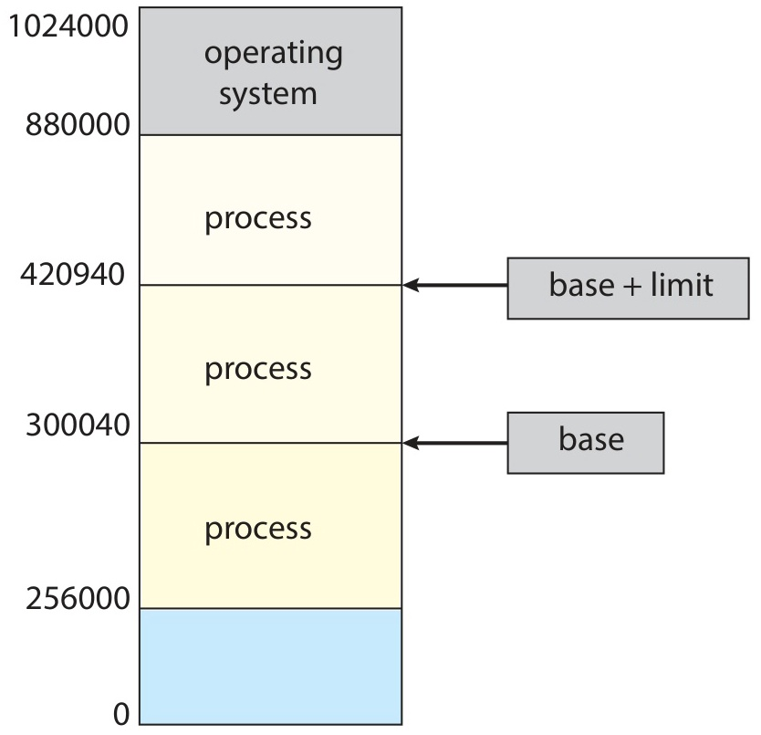

*Figure 2. Logical address space defined by a base and a limit register*

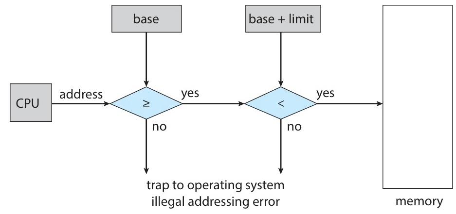

*Figure 3. Hardware address protection with base and limit registers*

These registers can only be loaded from **kernel mode** by privileged instructions; otherwise a malicious user process could lift its own limit.

---

<br>

## 2. Address Binding and the MMU

### 2.1 Three Binding Times

A program's memory addresses are not fixed by themselves from the start; they are *bound* to physical locations at some point. The choice of binding time determines what the OS must do at runtime.

| Binding time | Description | Characteristics |
|--------------|-------------|------------------|
| **Compile time** | Memory start address fixed at compile time | Generates **absolute code**, recompilation needed if start address changes (MS-DOS .COM files) |
| **Load time** | Start address fixed when the loader places the program in memory | Generates **relocatable code**, binary cannot be relocated after launch |
| **Execution time** | Binding happens *while the program runs* | Requires an **MMU**, used by virtually every modern OS |

*Table 1. Comparison of the three address-binding times*

### 2.2 Multistep Processing of a User Program

Source code passes through several stages, each performing a partial binding:

```text
  source.c   --(compile)-->  object module   (relocatable, with symbolic names)
             --(link)----->  load module
             --(load)----->  in-memory binary
             --(run)------>  physical reference (MMU)
```

*Figure 4. Stages from source code through compile, link, load, and run to a physical reference*

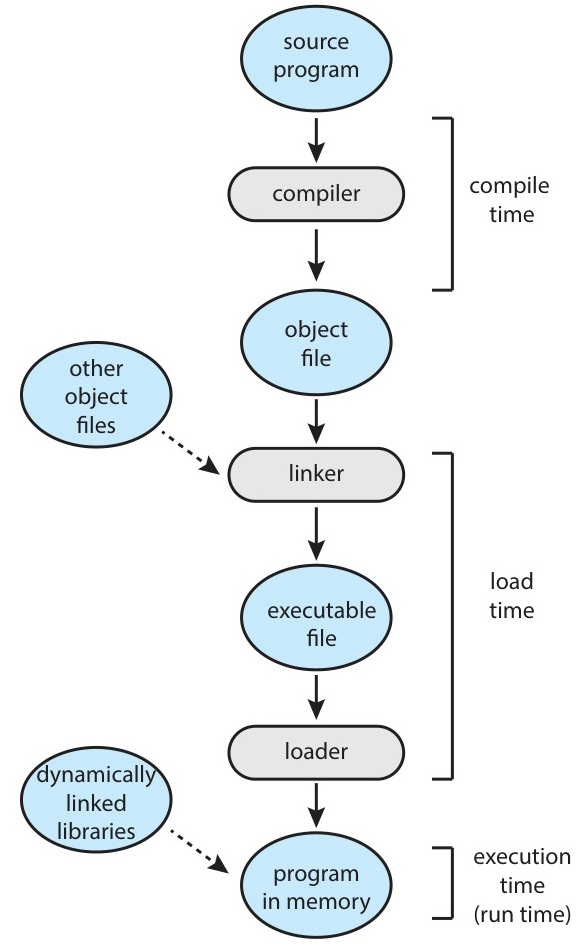

*Figure 5. Multistep processing of a user program*

- Addresses go from **symbolic** (variable names) to **relocatable** (offset from module start) to **absolute** (physical address).

### 2.3 Logical vs Physical Address

Two address spaces coexist at runtime.

- **Logical address** (a.k.a. *virtual address*)
  - The address the CPU generates while executing instructions.
  - The process sees a private space from 0 to some maximum.
- **Physical address**
  - The address actually delivered to the DRAM (placed into the Memory Address Register).
  - Lives in the real, shared range `R + 0 … R + max`.

With **compile-time** or **load-time** binding, logical and physical addresses are the same. With **execution-time** binding, they differ and **translation is required on every memory reference**.

### 2.4 MMU: Memory-Management Unit

The **MMU** is the hardware that performs logical-to-physical translation. In the simplest scheme (dynamic relocation) it just adds a **relocation register** to every logical address.

> **Note:** In this simplest design the relocation register is the same physical register as the **base register** introduced in Section 1.3; the two names emphasize different roles. As "base", it sets the lower bound for the limit check; as "relocation", it is the addend that shifts the user's view of 0…max up to the actual physical range.

```text
  logical addr  -->  +-----+
                     | MMU |  + relocation_register  -->  physical addr  -->  DRAM
                     +-----+
```

*Figure 6. MMU adding the relocation register to a logical address to form a physical address*

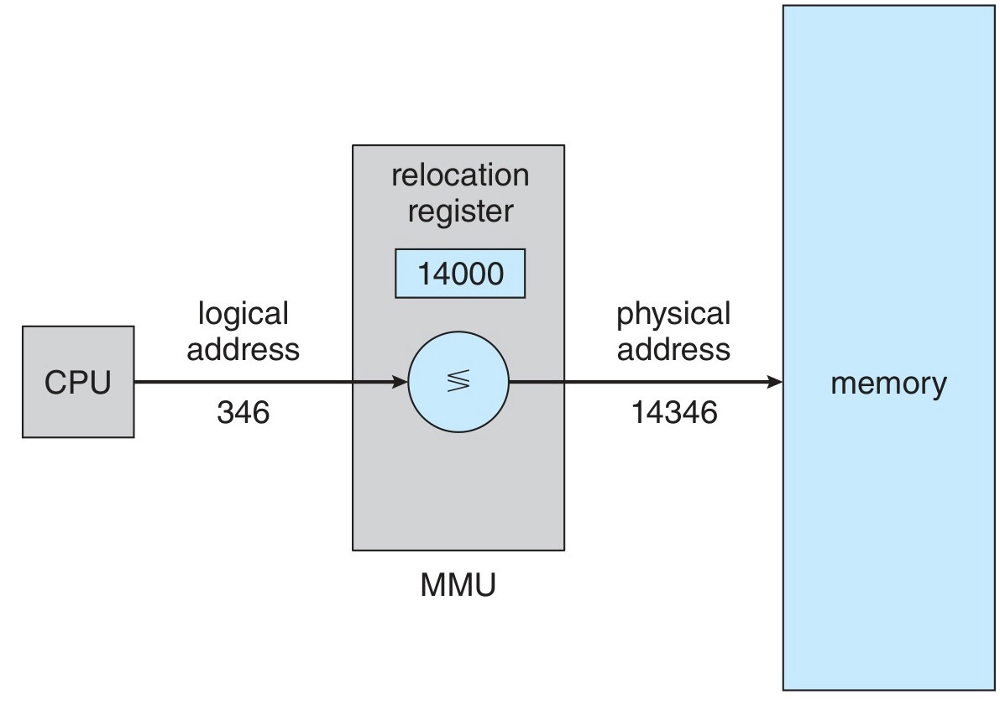

*Figure 7. Dynamic relocation using a relocation register*

The user program *only ever sees* logical addresses 0 … max. It has no way to forge a physical address, because the MMU is on the path between the CPU and the bus.

Real systems use much more elaborate MMUs (paging, segmentation), but the principle is the same: hardware-enforced indirection between what the program writes and what reaches DRAM.

### 2.5 Dynamic Loading

**Dynamic loading** loads a routine into memory **only when it is called**. The main program lives in memory; rarely used routines (e.g., obscure error handlers) sit on disk until needed.

```text
  Main Program (in memory)
   ├── routine_A()        loaded
   ├── routine_B()        loaded on call
   └── error_handler()    loaded only on error  (on disk)
```

*Figure 8. Load time of each routine under dynamic loading*

Notably, dynamic loading can be implemented **without OS support** (the programmer arranges the conditional load). Total program size is large, but the *resident* size stays small.

### 2.6 Dynamic Linking and Shared Libraries

**Static linking** copies all library code into the executable at link time, so every program ships its own complete copy of `libc`. **Dynamic linking** defers the bind to *execution time* and shares one in-memory copy among all processes.

| Aspect | Benefit of DLL / shared libraries |
|--------|-----------------------------------|
| Memory savings | One physical copy serves all processes |
| Disk savings | Library code not duplicated in every executable |
| Easy updates | Replace the library file, no rebuild of users |
| Versioning | Multiple versions coexist, programs pick a compatible one |

*Table 2. Benefits of DLLs and shared libraries*

A small **stub** in each program locates the library routine at first call and patches the call site to jump directly thereafter. Dynamic linking requires OS support because the library must be mapped into the process's protected address space.

```text
  Static Linking                    Dynamic Linking
  +-----------------+               +-----------------+
  | Program A       |               | Program A       |
  | +-------------+ |               | (stub -> libc)  |
  | | libc copy 1 | |               +-----------------+
  | +-------------+ |                        |
  +-----------------+               +-----------------+
  | Program B       |               | Program B       |
  | +-------------+ |               | (stub -> libc)  |
  | | libc copy 2 | |               +-----------------+
  | +-------------+ |                        |
  +-----------------+               +-----------------+
                                    | libc (1 copy)   | <- shared
                                    +-----------------+

  libc 2MB × 40 processes           libc 2MB × 1 copy
  = 80MB memory                     = 2MB memory
```

*Figure 9. Number of libc copies and memory use under static and dynamic linking*

### 2.7 Segmentation

So far the MMU has presented memory as a single linear range. **Segmentation** is an alternative (and historically older) MMU scheme that exposes the address space the way a *programmer* thinks of it: as a collection of variable-sized **segments**, such as one for the code, one for the global data, one for the stack, and one per shared library.

- A **logical address** is a pair **(segment number `s`, offset `d`)** rather than a single number.
- A **segment table** holds, for each segment, a **base** (its starting physical address) and a **limit** (its length).
- Translation indexes the segment table with `s`, checks `d < limit` (trap on violation), and forms the physical address `base + d`.

```text
Logical address: (s, d)

   segment table
   s | base    | limit
   --+---------+-------
   0 | 1400    | 1000     code
   1 |  500    |  400     data
   2 | 4300    | 1100     stack

  translate (2, 53):  53 < 1100 OK  ->  4300 + 53 = 4353
```

*Figure 10. Segment table and the translation of logical address (2, 53)*

This is essentially **base and limit per segment** instead of one base and limit for the whole process. It therefore gives each logical unit its own protection and lets segments grow independently and be shared at segment granularity. Its weakness is the same as variable-partition contiguous allocation. Because segments have **arbitrary sizes**, the free physical memory between them gets chopped into odd-sized gaps. In other words, segmentation suffers **external fragmentation**. IA-32 (Section 9.1) therefore combines segmentation *with* paging: segmentation maps `(s, d)` to a linear address, and paging then maps that linear address to physical frames, eliminating the external fragmentation.

---

<br>

## 3. Contiguous Memory Allocation

### 3.1 Overview and Memory Protection

Historically the simplest scheme gives each process **one contiguous block** of physical memory.

- Memory is split into an **OS area** and a **user area**. The location of the OS area depends on factors such as the location of the interrupt vector, and many OSes, including Linux and Windows, place it in high memory.
- A **hole** is a free block. Holes appear in many sizes across the user area.
- When a process arrives, the OS picks some hole of sufficient size.

Protection is enforced with the **relocation register and the limit register**. Every logical address is first compared with the limit register to check that it is in range, and if it passes, the relocation register is added to form the physical address. The OS dispatcher loads both registers during a context switch.

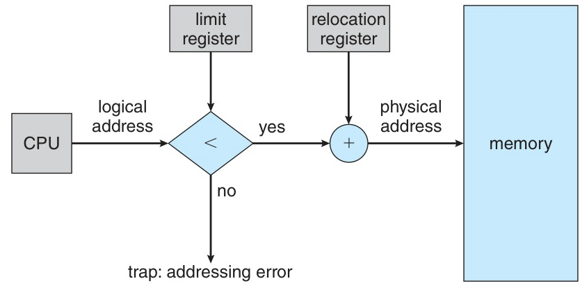

*Figure 11. Hardware support for relocation and limit registers*

### 3.2 Variable Partition Scheme

Each process gets a **variable-sized partition** matching its needs. When a process terminates a hole is created, and **adjacent holes are coalesced** to form larger free blocks.

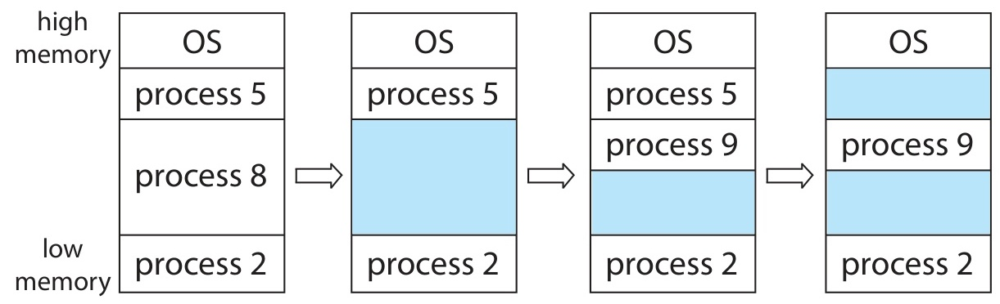

*Figure 12. Variable partition*

The problem is this: given the current hole list, **which hole** should a new request of size n be allocated to? This is the **Dynamic Storage-Allocation Problem**.

### 3.3 First-fit / Best-fit / Worst-fit

| Strategy | Method | Characteristics |
|----------|--------|------------------|
| **First-fit** | Use the first hole large enough | Fast (stops on first match), generally good utilization |
| **Best-fit** | Use the smallest hole that fits | Minimum leftover, but requires scanning the whole list, tends to create many tiny holes |
| **Worst-fit** | Use the largest hole | Leaves the biggest remaining hole, counter-intuitively often the *worst* strategy |

*Table 3. Comparison of the three allocation strategies*

**Empirical results:** in simulations, First-fit and Best-fit beat Worst-fit, and First-fit is usually faster than Best-fit at comparable utilization.

### 3.4 Worked Allocation Example

Holes (in order): 300KB, 600KB, 350KB, 200KB, 750KB, 125KB.
Requests in order: P1 = 115KB, P2 = 500KB, P3 = 358KB, P4 = 200KB, P5 = 375KB.

Each line shows the chosen hole and the leftover that hole becomes (in parentheses).

```text
First-fit (use the first hole large enough):
  P1(115) -> 300  hole  (185 left)
  P2(500) -> 600  hole  (100 left)
  P3(358) -> 750  hole  (392 left)
  P4(200) -> 350  hole  (150 left)
  P5(375) -> 392  leftover hole  (17 left)
  => ALL 5 requests succeed.

Best-fit (use the smallest hole that fits):
  P1(115) -> 125  hole  (10 left)
  P2(500) -> 600  hole  (100 left)
  P3(358) -> 750  hole  (392 left)
  P4(200) -> 200  hole  (0 left, exact fit)
  P5(375) -> 392  leftover hole  (17 left)
  => ALL 5 requests succeed.

Worst-fit (use the largest hole):
  P1(115) -> 750  hole  (635 left)
  P2(500) -> 635  leftover hole  (135 left)
  P3(358) -> 600  hole  (242 left)
  P4(200) -> 350  hole  (150 left)
  P5(375) -> FAILS
            (remaining holes: 300, 242, 150, 200, 135, 125 — largest is 300 < 375)
```

The lesson is not the exact numbers; it is that **the allocation strategy meaningfully changes which requests succeed**. Worst-fit always carves into the *largest* available hole, so it **shreds big holes early**. After spending the 750KB and then the 600KB holes on small or medium requests, no hole large enough for the final 375KB request remains, and **P5 fails** even though plenty of total free memory is left (external fragmentation). First-fit and Best-fit both preserve a large enough hole and complete all five requests.

### 3.5 External vs Internal Fragmentation

There are two different forms of waste:

- **External fragmentation:** total free memory is sufficient, but **no single hole is large enough** for the request; this is a contiguity problem.
- **Internal fragmentation:** when the system allocates in fixed *units* and the request is smaller than the unit, the leftover space *inside* the allocation is wasted.

```text
External Fragmentation             Internal Fragmentation
+--------+                         +---------+
|  P1    |                         |Allocated|  <- Request: 3.5KB
+--------+                         | (3.5KB) |
|  hole  | 50KB                    |---------|
+--------+                         | Wasted  |  <- 0.5KB
|  P2    |                         | (0.5KB) |
+--------+                         +---------+  <- Allocation unit: 4KB
|  hole  | 30KB
+--------+
|  P3    |  Request: 70KB  Total free: 80KB  Largest contiguous: 50KB → fails
```

*Figure 13. External and internal fragmentation*

> **Note:** **The 50-percent rule (Knuth).** Statistical analysis of first-fit predicts that with N allocated blocks, about 0.5N additional blocks are lost to fragmentation. Since 0.5N of the 1.5N blocks are unusable, about one third of memory can become unusable to external fragmentation in long-running variable-partition systems. This problem motivated paging.

### 3.6 Compaction

The brute-force fix for external fragmentation is to **move occupied memory to one end** and consolidate all free space at the other end into one big hole.

```text
Before                  After
+--------+              +--------+
|  P1    |              |  P1    |
+--------+              +--------+
|  hole  |              |  P2    |
+--------+              +--------+
|  P2    |  -- shift -> |  P3    |
+--------+              +--------+
|  hole  |              |        |
+--------+              |  hole  |  <- one big contiguous block
|  P3    |              |        |
+--------+              +--------+
```

*Figure 14. Memory layout before and after compaction*

Compaction is only possible with **execution-time binding** (a process's base register must be changeable on the fly). It is also very expensive: copying every process and updating its base register stalls the system.

The better answer turned out to be **paging**, which allocates non-contiguously so that external fragmentation cannot happen in the first place.

---

<br>

## 4. Paging: Basic Method

### 4.1 Paging Overview

**Paging** decouples logical and physical memory:

- Physical memory is divided into fixed-size **frames**.
- Logical memory is divided into same-size **pages**.
- A **page table** maps page number → frame number, on a per-process basis.

Consequences:

- **External fragmentation is eliminated**, because any free frame can hold any page.
- **Internal fragmentation remains**: the last page of each process is almost never fully used, and the average waste is half a page per process.

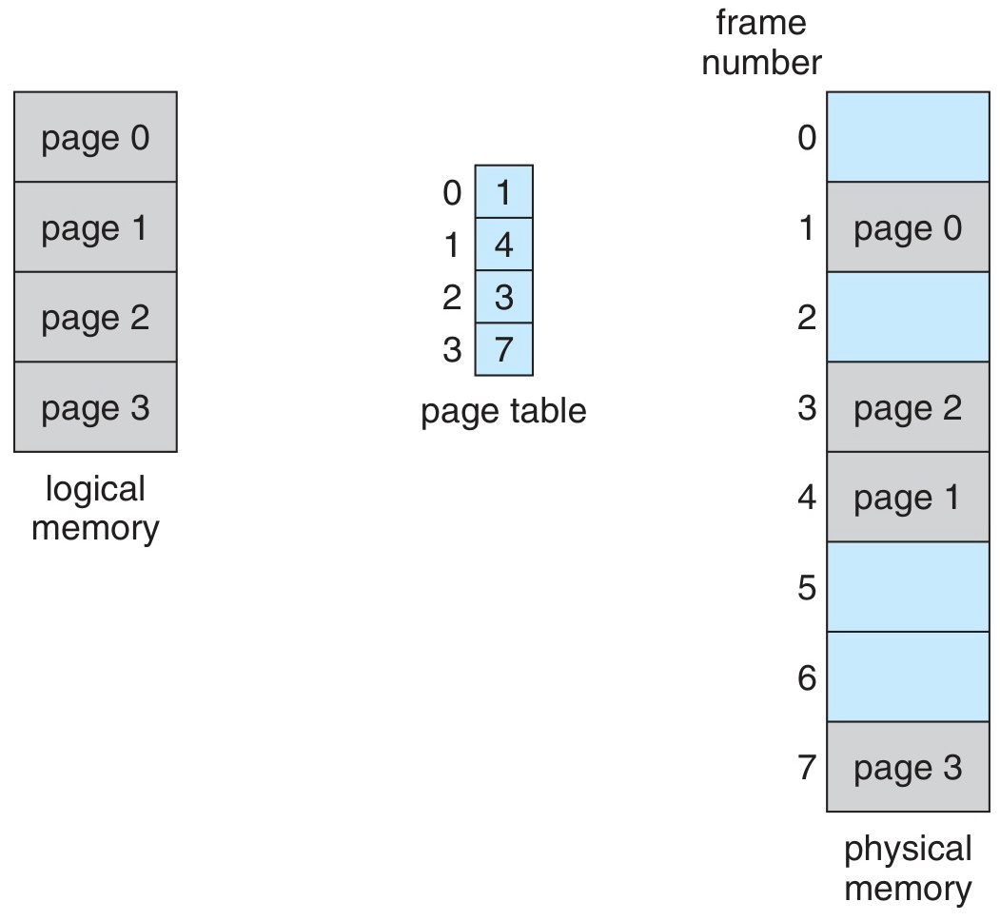

*Figure 15. Paging model of logical and physical memory*

### 4.2 Address Translation Principle

Let the page size be $2^n$ bytes and the logical address space be $2^m$ bytes (on a 32-bit architecture, m = 32; on x86-64, m = 48; see Section 9.3). Split the address:

```text
Logical Address (m bits)
+-------------------+------------------+
| Page number (p)   | Page offset (d)  |
|    (m-n bits)     |    (n bits)      |
+-------------------+------------------+

Translation
1. Index the page table with p.
2. Read the frame number f from PT[p].
3. Physical address = (f << n) | d.

Physical Address
+-------------------+------------------+
| Frame number (f)  | Page offset (d)  |
+-------------------+------------------+
```

*Figure 16. Splitting a logical address into page number and offset, and translating it to a physical address*

**Key invariant:** the page offset `d` passes through unchanged, because pages and frames are the same size and the position within them is identical.

> **[Computer Architecture]** Why `(f << n) | d` equals `f × page_size + d`: shifting an integer left by `n` bits multiplies it by $2^n$. Since page size = $2^n$, `f << n` is exactly `f × page_size`. The lower `n` bits of `f << n` are all zero, so OR-ing the `n`-bit offset `d` into them is the same as adding `d`. Splitting the address into (page number, offset) is thus a *no-cost* division and modulus by the page size, done by wiring, not arithmetic. This is also why page sizes are always powers of two: it lets the MMU peel off the offset by routing wires, never invoking a divider circuit.

### 4.3 Paging Hardware and Free-Frame Management

For every CPU memory reference the MMU consults the **current process's page table** to perform translation. Each process maintains its own table, and context switching includes loading the page table's base address into the PTBR.

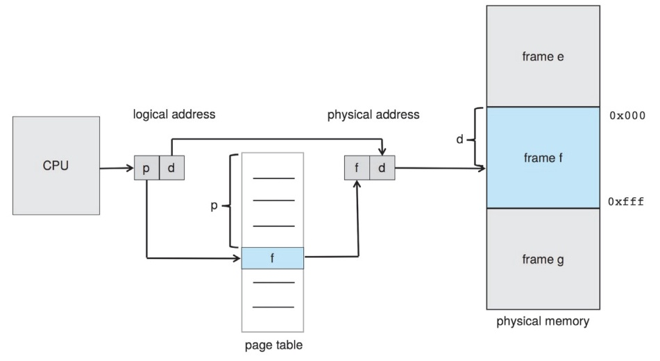

*Figure 17. Paging hardware*

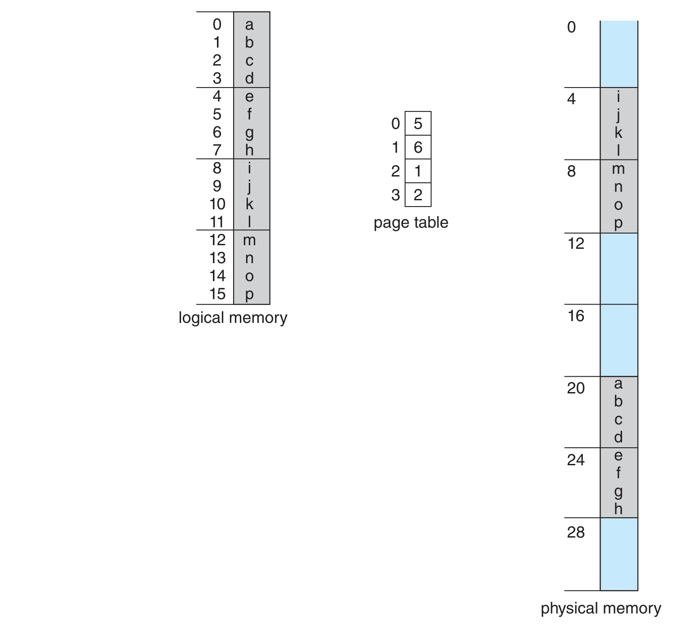

*Figure 18. Paging example for a 32-byte memory with 4-byte pages*

The OS maintains a **free-frame list**. When a process is created (or grows), frames are taken from the list and recorded in the process's page table.

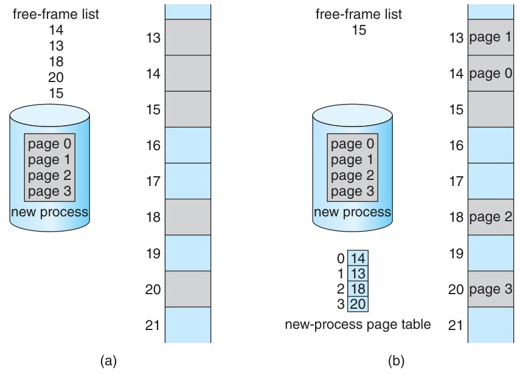

*Figure 19. Free frames before and after allocation*

### 4.4 Internal Fragmentation and Page Size Trade-offs

Suppose the page size is 2,048 bytes and a process needs 72,766 bytes:

- 72,766 / 2,048 = 35 full pages + 1,086 bytes.
- The OS allocates **36 frames**, so internal fragmentation = 2,048 − 1,086 = **962 bytes**.
- In the worst case, a process of size *(n × page_size) + 1 byte* needs n+1 frames, wasting nearly a full frame.

The page size trade-off is as follows:

| Smaller page | Larger page |
|--------------|-------------|
| Less internal fragmentation | More internal fragmentation |
| Larger page table | Smaller page table |
| More I/O operations | More efficient bulk I/O |

*Table 4. Trade-offs of page size*

Modern systems typically use **4KB** or **8KB** as the default, with optional **2MB** and **1GB** huge pages for memory-intensive workloads.

---

<br>

## 5. Paging Hardware Support: TLB

### 5.1 Where to Keep the Page Table

There are two implementation strategies:

**Method 1: Dedicated registers.** Store the entire page table in special-purpose hardware registers.
- Pro: extremely fast lookup.
- Con: only viable when the page table has a few hundred entries, so it does not scale.

**Method 2: PTBR (Page-Table Base Register).** Keep the page table in main memory; the PTBR points to its base.
- Pro: context switching only updates the PTBR.
- Con: **every memory reference now costs two memory accesses**, one to read the page-table entry (PTE) and one to read the actual data. This doubles effective memory latency.

### 5.2 TLB: Translation Look-aside Buffer

The **TLB** is a small, very fast **associative memory** that caches recent translations.

> **[Computer Architecture]** Associative memory is also called **Content-Addressable Memory (CAM)**. A regular RAM takes an *address* in and returns the *value* at that address. A CAM works the other way around: you give it a *value* (here, a page number), and dedicated comparator hardware checks **every stored key in parallel** in a single cycle, returning the slot index (and stored data) of whichever entry matches. The same hardware idea underlies cache tag arrays. Parallel comparison is what makes TLB lookup essentially free, but it is also expensive in transistors per entry, which is why a TLB has only tens to a couple thousand entries.

- Size: typically 32 to 1,024 entries.
- Each entry holds **(page #, frame #)** plus protection bits.
- Lookup compares the input page # against **all keys in parallel**, so it takes a single cycle.
- The TLB lookup is part of the CPU pipeline, so a TLB hit adds almost no observable latency.

```text
TLB Hit / Miss process:

CPU --p,d--> Search for p in TLB
              |
          +---+---+
          |       |
       hit       miss
          |       |
       got f    walk page table in memory,
          |    insert (p,f) into TLB
          |       |
          +---+---+
              |
          f + d --> physical addr --> DRAM
```

*Figure 20. Address translation on a TLB hit and a TLB miss*

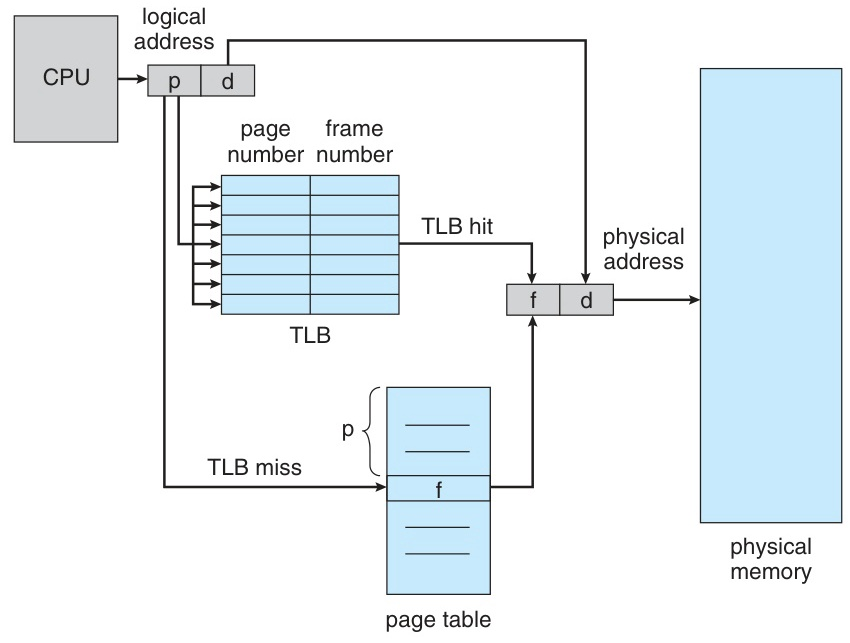

*Figure 21. Paging hardware with TLB*

When the TLB is full, an entry must be evicted (LRU, round-robin, random). Some entries are **wired down** (cannot be evicted); these are typically kernel code and data, kept to preserve OS responsiveness.

### 5.3 ASID: Address-Space Identifier

Without help, a context switch must **flush the entire TLB**, because TLB entries from process P1 would otherwise mis-translate process P2's addresses. The cost is a flood of TLB misses every time the scheduler switches processes.

> **Note:** **Order of magnitude.** A 1,024-entry TLB with about 100 ns per miss can spend roughly **100 µs** rewarming after a flush. That is a non-negligible fraction of a Linux time slice (typically around one millisecond to a few milliseconds). Multiply by the context-switch rate (often thousands per second) and unmitigated TLB flushes become a serious source of overhead. This is the gap ASID is designed to close.

**ASID** tags each TLB entry with a process identifier:

```text
+------+-----+-----+
| ASID |  p  |  f  |
+------+-----+-----+
|  P1  |  3  |  7  |   Process 1's page 3 -> frame 7
|  P2  |  3  | 12  |   Process 2's page 3 -> frame 12
+------+-----+-----+
```

*Figure 22. TLB entries tagged with ASIDs*

On lookup, the page number and the current process's ASID must **both** match. The TLB can hold entries from many processes simultaneously, and context switches become much cheaper.

### 5.4 Effective Access Time (EAT)

To quantify TLB performance, let:

- α = TLB **hit ratio**
- M = main-memory access time
- T = TLB access time

```text
EAT = α · (T + M) + (1 − α) · (T + 2M)
```

> **[Probability and Statistics]** The formula follows from the standard **expected-value** technique of probability, $E[X] = \sum P(\text{case}) \times \text{cost}(\text{case})$:
> - On a **hit** (probability α) we pay T (the TLB lookup itself, always paid) and M (one memory access to fetch the actual data), giving `T + M`.
> - On a **miss** (probability 1 − α) we pay T (the unsuccessful TLB lookup), M (reading the page-table entry from memory), and M (then reading the actual data), giving `T + 2M`.
> - Multiply each case by its probability and sum.

**Numerical examples** (M = 100 ns, T = 10 ns):

```text
α = 0.80:  EAT = 0.80·110 + 0.20·210 = 88 + 42  = 130 ns  (30% slowdown vs. raw)
α = 0.98:  EAT = 0.98·110 + 0.02·210 = 107.8 + 4.2 = 112 ns  (~ 2% slowdown)
α = 0.99:  EAT = 0.99·110 + 0.01·210 = 108.9 + 2.1 = 111 ns  (~ 1% slowdown)
```

> **Note:** The slowdowns in parentheses use different baselines. The α = 0.80 line is relative to the raw memory access time of 100 ns, while the other two lines are relative to the TLB-hit access time T + M = 110 ns. Relative to the raw 100 ns, α = 0.98 is a 12% slowdown and α = 0.99 is an 11% slowdown. If the TLB lookup is integrated into the pipeline so that T can be ignored, EAT becomes $\alpha M + (1 - \alpha) \times 2M$.

The lesson: a high TLB hit rate (98% or more, easily achievable on real workloads thanks to *spatial* and *temporal locality*) nearly eliminates the cost of paging compared with paying two memory accesses (200 ns) on every reference without a TLB.

---

<br>

## 6. Paging: Protection and Shared Pages

### 6.1 Protection Bits and Valid-Invalid Bit

Each page-table entry carries extra bits:

**Permission bits:**
- **R/W:** read-only or read-write.
- **X:** executable.
- A protection-violation reference triggers a hardware trap; the OS typically delivers `SIGSEGV` to the offending process.

**Valid-invalid bit:**
- *Valid*: the page belongs to the process's logical address space.
- *Invalid*: the page is not in use by this process; any reference traps.

This handles the common case where a process's actual address-space use is much smaller than the theoretical maximum. To cut the page table down to just the used portion, hardware exposes a **PTLR (Page-Table Length Register)** that bounds the table's actual length.

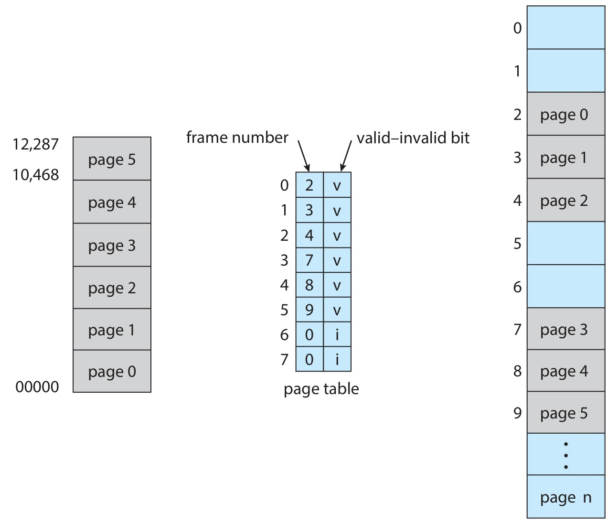

*Figure 23. Valid (v) and invalid (i) bits in a page table*

### 6.2 Shared Pages

Two processes running the same code can **share frames** for the read-only text pages, provided the code is **reentrant** (no self-modifying instructions, no per-process global state).

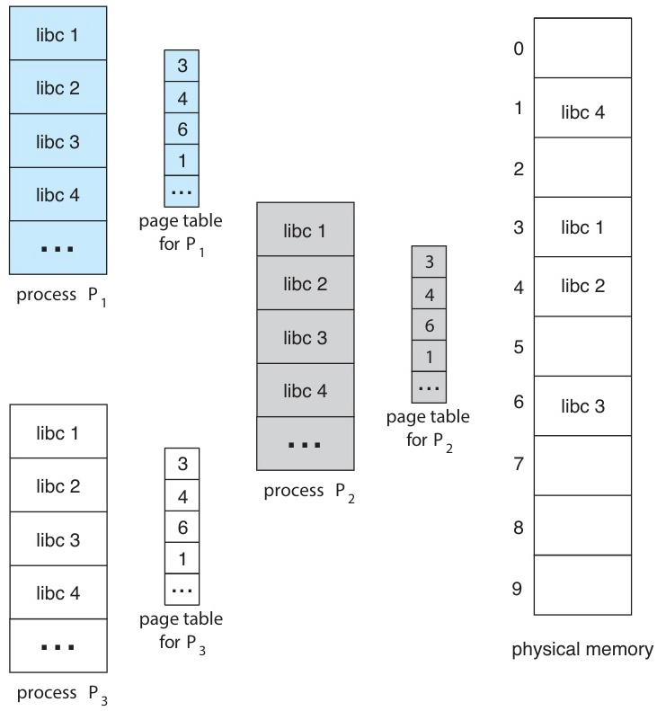

*Figure 24. Sharing of the standard C library in a paging environment*

```text
Example — 40 users on a text editor (libc text 2MB):
  Without sharing:  40 × 2MB = 80MB
  With sharing:      1 × 2MB =  2MB + 40 × (private data)
```

Typical sharing targets:
- **System libraries** (libc, dynamic linker, kernel-mode shared code)
- **Compilers, editors, window systems** used by many users at once in time-sharing servers
- **Database engines** with many client connections
- **Shared memory** segments for explicit IPC

The OS *enforces* the read-only property via protection bits. Each process keeps its own private data and stack pages.

---

<br>

## 7. Page-Table Structure

### 7.1 Why Single-Level Page Tables Do Not Scale

A flat page table with one entry per virtual page is fine for small address spaces but blows up quickly.

```text
32-bit address, 4 KB (= 2^12) page:
  entries = 2^32 / 2^12 = 2^20 ≈ 1,048,576
  4 bytes per entry → page table = 4 MB per process

64-bit address, 4 KB page:
  entries = 2^64 / 2^12 = 2^52 ≈ 4·10^15
  8 bytes per entry → page table ≈ 32 PB (!)
```

Finding 4 MB of contiguous physical memory just to hold one process's page table is already hard, let alone 32 PB. There are three classical fixes:

1. **Hierarchical paging** (multi-level)
2. **Hashed page tables**
3. **Inverted page tables**

### 7.2 Hierarchical Paging

Page the page table itself.

```text
Logical address (32-bit, 4KB pages, two-level):
+----------+----------+----------+
|   p1     |   p2     |    d     |
| 10 bits  | 10 bits  |  12 bits |
+----------+----------+----------+

  p1  →  outer page table (1024 entries)
  p2  →  inner page table (1024 entries)
  d   →  page offset
```

*Figure 25. Logical address layout for 32-bit two-level paging*

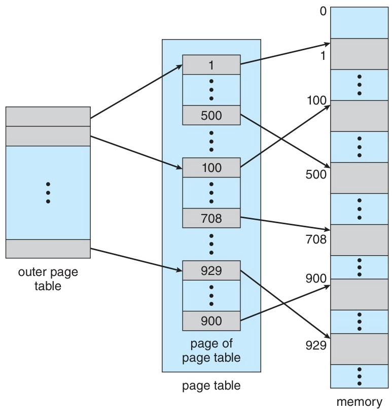

*Figure 26. A two-level page-table scheme*

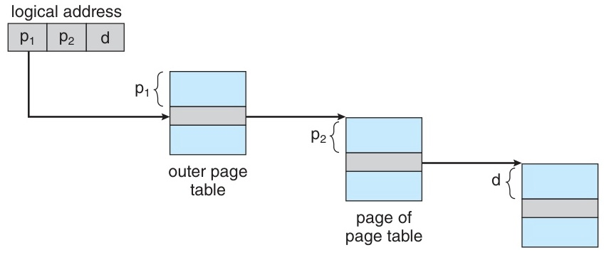

*Figure 27. Address translation for a two-level 32-bit paging architecture*

This is the classical **forward-mapped page table**, a conventional page table that is *indexed by the virtual page number*: you start from the virtual address and walk forward through the table levels to reach the frame. This is the opposite of an **inverted page table** (Section 7.5), which is indexed by frame number and must be searched to find a given virtual page. The huge win is that inner page tables for **unused address-space regions are not allocated**. Mechanically (in data-structures terms), the outer table is an array of 1024 pointers, and each pointer either references an inner page table (4 KB, 1024 entries) or is **null (invalid)**. Walking a null outer entry traps to the OS as having no mapping, and the corresponding 4 MB of virtual address space costs zero physical memory for the page table itself. A typical process uses only a small fraction of its 4 GB virtual space, so most outer entries stay null and we pay only for the used branches.

### 7.3 Hierarchical Paging Falls Apart in 64-bit

Naive two-level paging on a 64-bit address space looks like this:

```text
+----------+----------+----------+
|    p1    |    p2    |    d     |
|  42-bit  |  10-bit  |  12-bit  |
+----------+----------+----------+

outer table = 2^42 entries = 2^44 bytes = 16 TB  → still impossible
```

*Figure 28. Address layout for two-level paging applied to a 64-bit address*

Adding more levels helps but quickly becomes impractical:

```text
Three-level (4KB pages): keep the two inner levels page-sized
  (10 bits = 1024 entries each), leaving the outer level
  52 - 10 - 10 = 32 bits:
    outer table = 2^32 entries x 4 B = 2^34 bytes = 16 GB  → still too large
Pushing further: ~6-7 levels are needed before the outer
  table shrinks to a manageable size → per-reference walk
  cost (one memory access per level) balloons.
```

So real 64-bit systems do **not** use a uniform multi-level page table at the same granularity as 32-bit. They use **4-level paging with sparse address-space use** (x86-64 limits virtual addresses to 48 bits) or one of the alternatives below.

### 7.4 Hashed Page Tables

Index the table with a **hash of the virtual page number**:

```text
hash(p) → chain of (p, f, next) entries
walk the chain until p matches
```

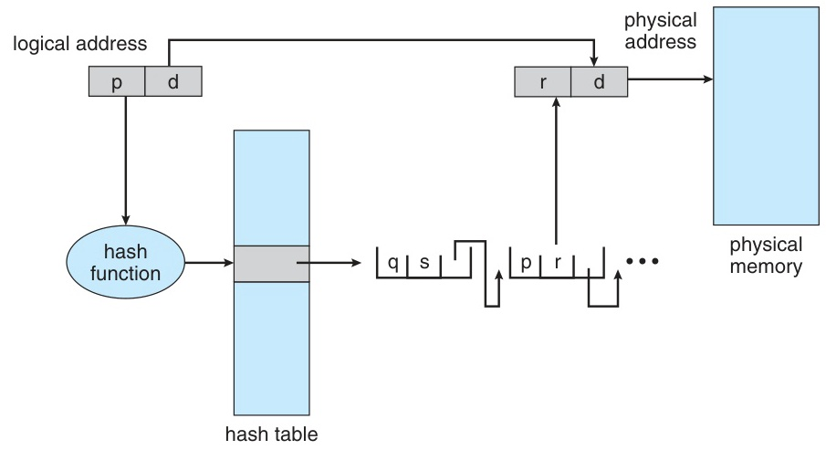

*Figure 29. Hashed page table*

Each bucket holds collisions in a linked list. This is the standard **separate-chaining** collision resolution from data structures. The entry stored in a bucket has the form `(virtual_page, frame, next)`, with `next` linking to the next collision in the same bucket. To translate page `p` you compute `hash(p)`, walk the linked list at that bucket, and stop on the node whose stored virtual_page equals `p`. Average lookup is $O(1)$ when the load factor is kept low, and the worst case is $O(\text{chain length})$. This works well for **sparse** address spaces (most of the 64-bit range is unused), because the table size is proportional to the pages actually used, not to the theoretical maximum.

A **clustered page table** stores mappings for several consecutive pages in one entry, amortizing hash-table overhead. This is especially well suited to 64-bit sparse address spaces.

### 7.5 Inverted Page Tables

Flip the data structure: maintain a **single global table indexed by frame number** (one entry per physical frame).

```text
Inverted PT:
  frame_id | (pid, virtual_page)
  -------- | ---------------------
     0     | (P3, 0x4012)
     1     | (P1, 0x000A)
     ...
```

*Figure 30. Entries of an inverted page table indexed by frame number*

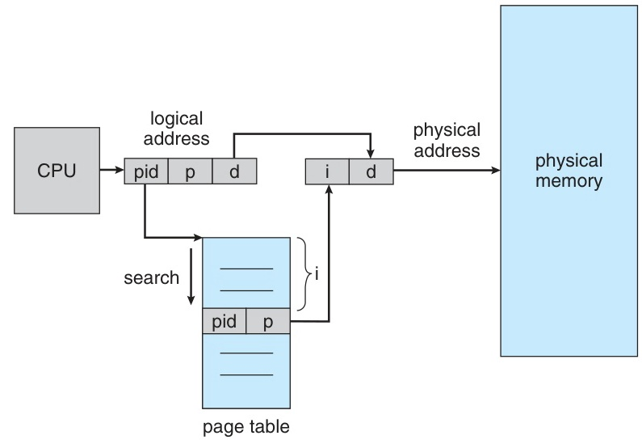

*Figure 31. Inverted page table*

- **Pro:** total size is proportional to physical memory, not virtual memory, which is a huge saving.
- **Con:** lookups are by *virtual* address, so the OS must search the whole table. The fix is an **auxiliary hash table** layered *on top of* the inverted table: hash `(pid, virtual_page)` to obtain the **frame index** (the row in the inverted table). This is structurally different from the hashed page table in Section 7.4: there the hash *replaces* the page table, whereas here it accelerates lookup into a separate structure indexed by frame.
- **Limitation:** each frame maps to exactly one (pid, vpage). Shared pages, where the same frame appears in multiple processes' page tables, are therefore awkward to express.

### 7.6 Comparison

| Structure | Pros | Cons | Suitable for |
|-----------|------|------|--------------|
| Single-level | Simple, fast | Huge table per process | Small address spaces |
| Hierarchical | Skips unused regions | Many levels in 64-bit | 32-bit systems, x86-64 (4-level) |
| Hashed | Scales to large/sparse address spaces | Hash-collision overhead | 64-bit, sparse VAs |
| Inverted | Size proportional to physical memory | Slow search, hard to share | Large physical RAM |

*Table 5. Comparison of page-table structures*

---

<br>

## 8. Swapping

### 8.1 Standard Swapping

**Swap out** an entire process from memory to a **backing store** (a region on disk reserved for this), and **swap in** when it is scheduled again.

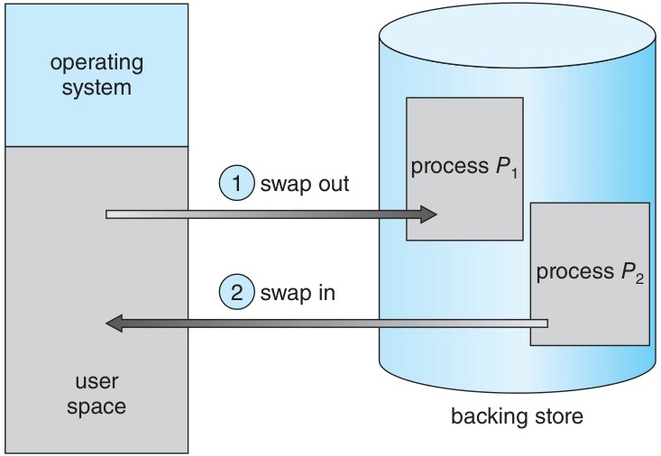

*Figure 32. Standard swapping of two processes using a disk as a backing store*

- It frees memory for other processes when the system is overcommitted.
- It is **very expensive**: transferring an entire process across disk takes seconds, dwarfing any time slice.
- It is rarely used in modern OSes.

### 8.2 Swapping with Paging

The modern equivalent operates at **page granularity**:

- **Page out:** write specific pages from memory to the backing store.
- **Page in:** load specific pages from the backing store on demand.
- Only the *needed* pages move, not the whole process, which is faster, finer, and much more efficient.

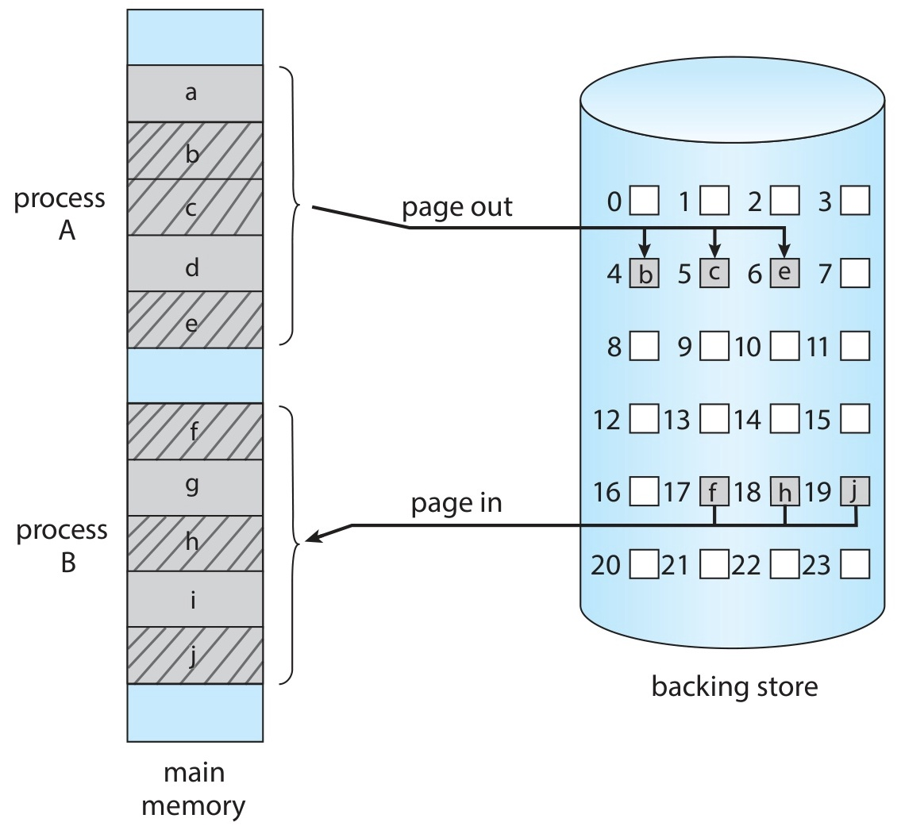

*Figure 33. Swapping with paging*

This is the foundation of **virtual memory**, covered in detail in Week 12.

### 8.3 Swapping on Mobile Systems

Most mobile OSes **do not support** swapping, for the following reasons:

- **Flash storage has limited write endurance**, and swapping wears it out.
- **Throughput** between flash and RAM is much lower than between desktop SSD and RAM.
- **Storage capacity** is small to begin with.

Alternative strategies:

- **iOS:** when memory is low, it notifies apps and asks them to release memory voluntarily; uncooperative apps are terminated.
- **Android:** it saves an app's serialized state to flash before killing the process, so the user perceives a fast restart even though the process is brand new.

---

<br>

## 9. Real-World Architectures

### 9.1 IA-32

IA-32 is 32-bit x86, and it uses **segmentation and paging** in combination.

- A **logical address** is a (segment selector, offset) pair.
- Segmentation hardware maps it to a **linear address**.
- Paging then maps the linear address to a physical address.
- The page size is **4 KB** (and **4 MB** large pages are available via **PSE, Page Size Extension**).

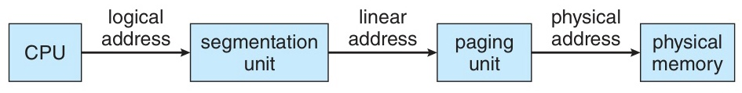

*Figure 34. Logical to physical address translation in IA-32*

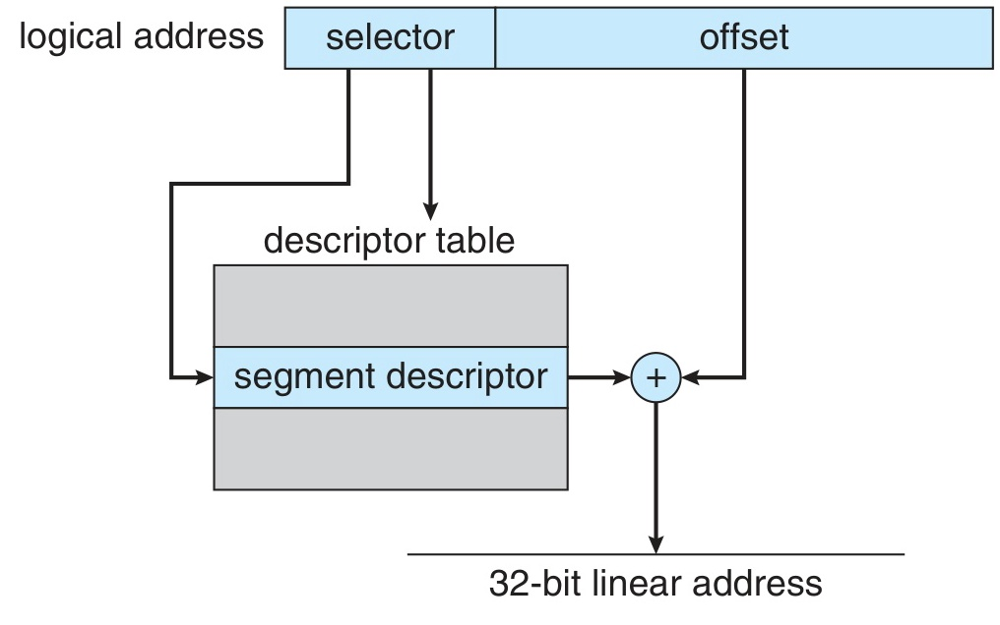

*Figure 35. IA-32 segmentation*

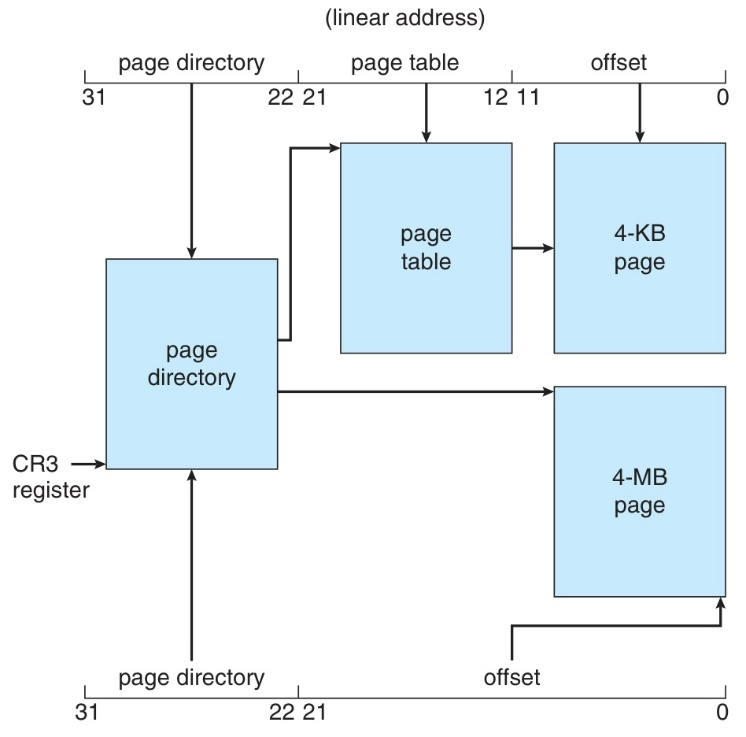

*Figure 36. Paging in the IA-32*

### 9.2 IA-32 PAE

**PAE (Page Address Extension)** lets a 32-bit processor address more than 4 GB of physical RAM (Intel's official name is Physical Address Extension).

- Page-table entries are extended from **32 bits to 64 bits**.
- The physical frame number is widened from 20 to **24 bits** (with the 12-bit offset, a 36-bit physical address, or 64 GB).
- Linux and macOS supported PAE, while 32-bit consumer Windows was capped at 4 GB even with PAE enabled.

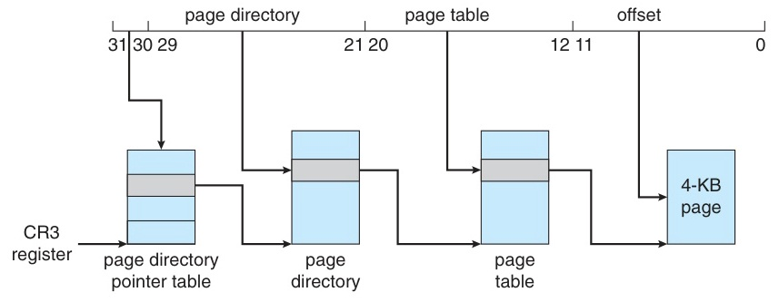

*Figure 37. Page address extension (PAE)*

### 9.3 x86-64

x86-64 is the 64-bit extension architecture, originally AMD64 and later adopted by Intel.

- **48-bit virtual address space** = 256 TB. The unused top bits must be a sign extension of bit 47, and such addresses are called canonical addresses. In other words, only the low 48 bits of a 64-bit pointer carry information, and bits 48-63 must all match bit 47 (**all 0s or all 1s**). Dereferencing a non-canonical pointer triggers a #GP general-protection fault. Forbidding software from storing other information in the top bits now means that future CPUs can widen the address space without breaking existing software.
- A **52-bit physical address** = 4 PB is supported via PAE-style extension.
- Page sizes: **4 KB**, **2 MB**, **1 GB**.
- It uses a 4-level page table (PML4 → PDPT → PD → PT). Modern parts add a 5th level for 57-bit VAs.
- Segmentation is effectively disabled (flat 64-bit address space).

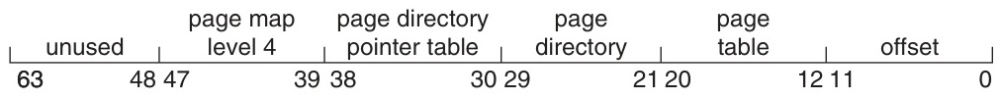

*Figure 38. x86-64 linear address*

### 9.4 ARMv8

ARMv8 is the dominant 64-bit architecture in mobile and embedded systems.

- It uses hierarchical paging with up to **4 levels** (translation granules of 4 KB, 16 KB, or 64 KB).
- **Two-level TLB:** separate micro-TLBs for instructions and data, backed by a larger main TLB.
- Hardware support for **ASIDs** avoids flushing on context switches.

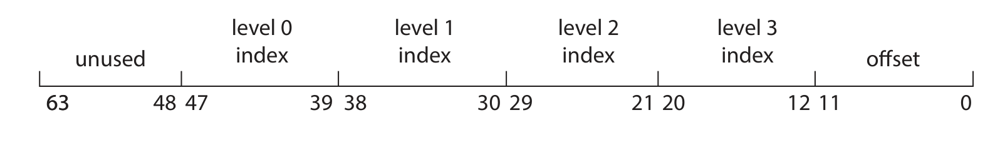

*Figure 39. ARM 4 KB translation granule*

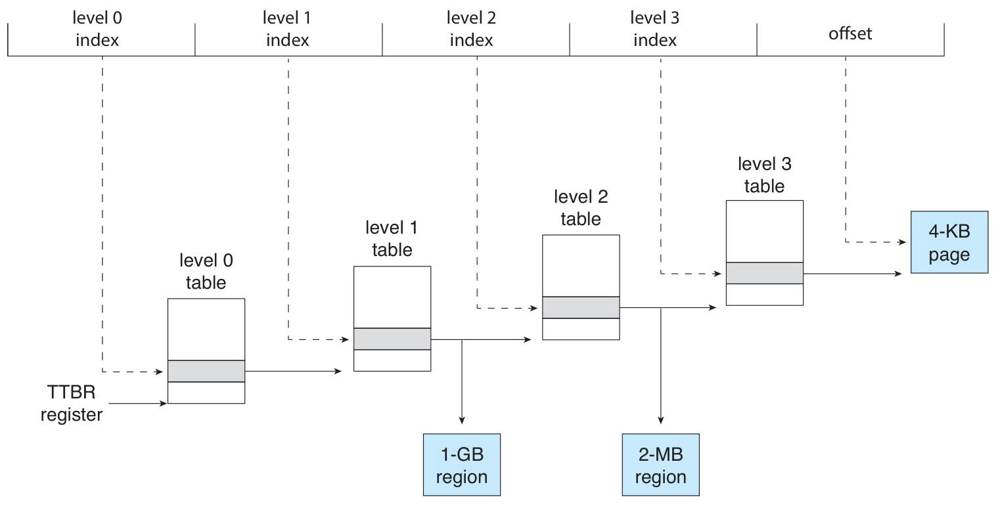

*Figure 40. ARM four-level hierarchical paging*

### 9.5 Comparison

| Feature | IA-32 | x86-64 | ARMv8 |
|---------|-------|--------|-------|
| Address size | 32-bit | 48-bit virtual | 48-bit virtual |
| Paging levels | 2 (3 with PAE) | 4 | up to 4 |
| Page sizes | 4 KB, 4 MB | 4 KB, 2 MB, 1 GB | 4 KB, 16 KB, 64 KB |
| Segmentation | Used | Effectively disabled | None |
| Physical memory | 4 GB (64 GB w/ PAE) | 4 PB (52-bit) | up to 48-bit |
| TLB | Present | Multi-level | 2-level |

*Table 6. Comparison of IA-32, x86-64, and ARMv8*

---

<br>

## 10. Lab: Memory Allocation Simulator

### 10.1 Lab Goal and Data Structure

**Goal:** implement a memory-block list manager and compare First-fit, Best-fit, and Worst-fit on the same request stream.

Requirements:
- Represent memory as a linked list of blocks (start, size, status, owner).
- Allocate by each of the three strategies.
- On release, coalesce adjacent free blocks.
- Output a layout snapshot, allocation success or failure, and the external-fragmentation size.

```c
typedef struct Block {
    int start;        // start address
    int size;         // block size
    int allocated;    // 0 = free, 1 = allocated
    char process[10]; // owning process name
    struct Block* next;
} Block;
```

> **[Data Structures]** An address-sorted singly linked list supports the needed operations: finding a hole takes a sequential $O(n)$ scan, and splitting a block takes $O(1)$ pointer updates. Once the block to release and its predecessor are found, coalescing adjacent holes also takes $O(1)$ neighbor checks. **First-fit can stop** at the first matching hole, so its expected cost is often below n. **Best-fit and Worst-fit** must scan the full list to find the smallest sufficient hole or the largest hole, taking $O(n)$ each time. This is why First-fit is usually faster. Production allocators such as glibc's ptmalloc use size-segregated bins (free lists) to find a suitably sized block without scanning the whole list, and some allocators use tree structures for large blocks to bring the search cost down to about $O(\log n)$.

### 10.2 Lab Functions and Example I/O

```c
Block* first_fit(Block* head, int size);   // first sufficient hole
Block* best_fit(Block* head, int size);    // smallest sufficient hole
Block* worst_fit(Block* head, int size);   // largest hole
void   release(Block* head, char* process);// release + coalesce neighbors
void   print_memory(Block* head);
```

Example trace:

```text
Input
  Memory size: 1024
  Allocate P1: 200
  Allocate P2: 350
  Allocate P3: 150
  Release P2
  Allocate P4: 300

Output (First-fit)
  [  0- 199] P1 (200)
  [200- 549] FREE (350)      <- after P2 release
  [550- 699] P3 (150)
  [700-1023] FREE (324)

  Allocate P4(300) → First-fit → [200-499] P4
  [  0- 199] P1 (200)
  [200- 499] P4 (300)
  [500- 549] FREE (50)       <- residual hole
  [550- 699] P3 (150)
  [700-1023] FREE (324)

  External fragmentation = 50 + 324 = 374 bytes
```

As extensions, feed a stream of randomized requests, compare the average external fragmentation across strategies, and verify the 50-percent rule empirically.

---

<br>

## Summary

| Concept | Key Summary |
|-------|-------------|
| Memory hierarchy | The CPU directly addresses only registers and main memory, so data on disk must first be loaded into memory. |
| Address binding | Binding can happen at compile time, load time, or execution time, and only execution-time binding needs an MMU. |
| MMU | The MMU translates addresses in hardware, protects processes with base and limit, and enables relocation. |
| Dynamic loading/linking | Routines are loaded lazily, and shared libraries save memory and ease updates. |
| Contiguous allocation | Among First-fit, Best-fit, and Worst-fit, First-fit usually wins in practice. |
| Fragmentation | External fragmentation comes from a lack of contiguity and internal fragmentation from allocation units larger than requests, and by the 50-percent rule about one third of memory can be lost. |
| Paging | Paging maps fixed-size pages to frames and eliminates external fragmentation. |
| TLB | The TLB caches translations, and a hit ratio of 98% or more nearly eliminates the doubled access cost of paging without a TLB. |
| ASID | ASIDs tag TLB entries with processes so that context switches avoid TLB flushes. |
| Page-table structures | The four structures are single-level, hierarchical, hashed, and inverted page tables. |
| 64-bit | Hierarchical paging alone is insufficient, so systems use 4-level paging that exploits sparsity, or hashed page tables. |
| Swapping | Standard swapping moves whole processes and paged swapping moves individual pages, while mobile OSes mostly avoid swapping. |
| Architectures | IA-32 uses segmentation with paging, x86-64 uses 4-level paging, and ARMv8 uses 4-level paging with ASIDs. |

---

<br>

## Self-Check Questions

1. Why can the CPU directly access main memory but not disk?

   <details>
   <summary>Answer</summary>

   The CPU's load and store instructions operate only on registers and main memory, and main memory is reached by issuing addresses on the memory bus. These are the storage layers the architecture exposes as directly addressable. Disk sits behind a separate I/O subsystem (controllers, DMA, drivers), so reaching it requires explicit OS-mediated transfers (on the order of millions of cycles). To execute or even read disk data, the OS must first **load** it into memory.

   </details>

2. Distinguish logical and physical addresses. Under which binding scheme are they identical?

   <details>
   <summary>Answer</summary>

   A **logical address** is generated by the CPU as part of program execution, and a process sees its own private space 0…max. A **physical address** is what hits DRAM. They are identical under **compile-time** or **load-time** binding (no runtime translation). Under **execution-time** binding, the MMU translates every reference, and the two diverge.

   </details>

3. State the role of the MMU. How does a base+limit MMU protect processes?

   <details>
   <summary>Answer</summary>

   The MMU sits between the CPU and the memory bus, **translating every logical address to a physical address**. In the simplest base+limit form, it (a) checks that the logical address is less than the **limit** and traps otherwise, and (b) adds the **base** register to produce the physical address. Because base and limit can only be modified in **kernel mode**, a user process has no way to escape its region.

   </details>

4. Compare static and dynamic linking. Why are shared libraries called *shared*?

   <details>
   <summary>Answer</summary>

   **Static linking** copies all library code into each executable at build time, so each process carries its own copy. **Dynamic linking** leaves library calls as stubs; at execution time the loader maps a single in-memory copy of the library and patches the stubs. The library is called *shared* because one set of physical frames holds the code (typically read-only) and all callers use it. This saves memory and disk, and a single update fixes all callers.

   </details>

5. Walk through First-fit, Best-fit, Worst-fit on the same hole list. Why does Worst-fit usually perform worst?

   <details>
   <summary>Answer</summary>

   First-fit picks the first hole that satisfies the request, stopping as soon as it finds one. Best-fit scans the whole list and picks the smallest sufficient hole, while Worst-fit picks the largest. In the example of Section 3.4, First-fit and Best-fit allocate all five requests, but Worst-fit cannot allocate P5 (375KB). Worst-fit's intuition of leaving the biggest leftover hole backfires. It shreds the largest hole first, eliminating the only hole large enough for future big requests. First-fit and Best-fit preserve big holes, and First-fit is also faster because it needs no full scan.

   </details>

6. Distinguish external and internal fragmentation. State the 50-percent rule.

   <details>
   <summary>Answer</summary>

   External fragmentation occurs when total free memory is sufficient but no single hole is large enough. Internal fragmentation occurs when the allocation unit exceeds the request and wastes space inside the allocation. Under Knuth's **50-percent rule** for first-fit, N allocated blocks lead to about 0.5N additional blocks lost to external fragmentation, leaving roughly one third of memory unusable. This helped motivate paging.

   </details>

7. Walk through a paging address translation. Why does the offset pass through unchanged?

   <details>
   <summary>Answer</summary>

   Split the logical address as `(page #, offset)`. Index the page table with the page # to obtain a **frame #**. The physical address is `(frame # << offset_bits) | offset`. The **offset is unchanged** because pages and frames are the same size, so the position within a page is identical to the position within the frame that backs it. Only the higher-order page number is translated.

   </details>

8. What problem does the TLB solve, and how? What does ASID add?

   <details>
   <summary>Answer</summary>

   Without a TLB, every memory reference costs *two* memory accesses (read PTE, read data). The TLB caches recent (page, frame) translations in an associative memory inside the CPU pipeline, and a hit avoids the memory access for the page table. **ASID** tags each TLB entry with the owning process, so context switches need not flush the TLB and multiple processes' translations can coexist. Without ASID, every context switch triggers a flood of TLB misses on the next process.

   </details>

9. Compute EAT for M = 100 ns, T = 10 ns, hit ratio α = 0.99. Where does the slowdown come from?

   <details>
   <summary>Answer</summary>

   $\text{EAT} = 0.99 \times (10+100) + 0.01 \times (10+200) = 108.9 + 2.1 = 111$ ns. The slowdown over raw memory (100 ns) is about 11 ns or 11%; of that, 10 ns is the TLB lookup itself (paid on every reference), and about 1 ns is amortized miss cost. The takeaway is that a 99% TLB hit rate nearly eliminates the cost of paging compared with having no TLB (200 ns).

   </details>

10. Why does a single-level page table not scale to 64-bit, and why does a *uniform* 2-level paging not work either?

    <details>
    <summary>Answer</summary>

    A single-level table needs $2^{64} / 2^{12} = 2^{52} \approx 4.5 \times 10^{15}$ entries at 8 bytes each, about 32 PB per process, which is impossible. In a uniform two-level scheme with a 42-bit `p1` and a 10-bit `p2`, the *outer* table alone needs $2^{42}$ entries (16 TB at 4 bytes per entry), which is still impossible. Even three- or four-level uniform schemes leave intermediate tables too large. Real 64-bit systems use **hierarchical paging with sparse allocation** (skip unused branches) or alternate structures like **hashed or inverted** page tables.

    </details>

11. When are inverted page tables a good fit? What is their main limitation?

    <details>
    <summary>Answer</summary>

    They work well when **physical memory is much smaller than virtual memory**, because the inverted table's size is proportional to RAM, not to per-process virtual space. The major limitation is that each physical frame has *one* entry. **Shared pages** (a frame that appears in many processes' virtual address spaces) are therefore difficult to model and typically require an auxiliary structure or a chain. Lookup is also slow without a hash, but combining a lookup hash with the TLB mitigates this.

    </details>

12. Why do mobile operating systems mostly *not* implement swapping?

    <details>
    <summary>Answer</summary>

    There are three reasons. (1) **Flash has limited write endurance**, and writing swap pages wears it out. (2) **Throughput** from flash to RAM is much lower than from desktop SSD, so swapping in and out is slow. (3) **Storage capacity** on phones is small. iOS and Android instead reclaim memory by killing apps: iOS asks first and then kills, and Android serializes app state to flash so the user perceives a fast restart.

    </details>

13. What is the page-size trade-off, and why have systems converged on around 4-8 KB?

    <details>
    <summary>Answer</summary>

    Smaller pages give less internal fragmentation but larger page tables and more (smaller) I/O operations; larger pages give smaller page tables and bulkier I/O but more internal fragmentation. The 4-8 KB sweet spot balances these for typical desktop and server workloads. Modern systems also offer **2 MB and 1 GB huge pages** as an opt-in for large-RAM workloads (databases, VMs) where TLB pressure outweighs internal-fragmentation waste.

    </details>

14. How does page sharing work, and what does the read-only requirement protect?

    <details>
    <summary>Answer</summary>

    Two processes' page tables both map a particular virtual page to the *same* physical frame (e.g., libc text). The OS marks the entry **read-only** in both page tables. The read-only enforcement is what makes sharing *safe*: neither process can modify the shared frame, so memory that one process regards as its own is never changed by the other process's writes. Reentrant code fits naturally, because it does not need to write to its own text.

    </details>

15. Why does the OS need execution-time binding to use compaction, but not to use paging?

    <details>
    <summary>Answer</summary>

    Compaction physically moves a process's bytes to a new range. For the process to keep running, its base register must be updated *while it is in memory*, and that is exactly what execution-time binding enables. Paging avoids the question entirely by *not requiring contiguous physical allocation*: the page-table indirection already lets any virtual page sit on any physical frame, so there is nothing to compact.

    </details>
