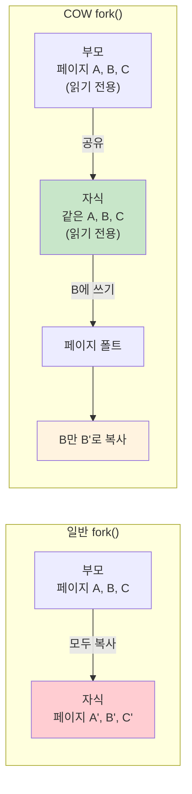
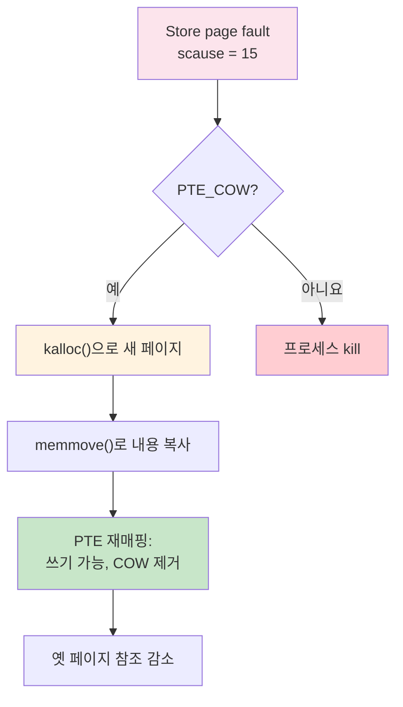
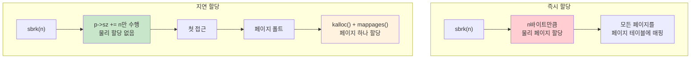

# 12주차 실습 — Copy-on-Write 포크와 지연 할당

[레포지토리 안내](../../README.ko.md) | [English](Concepts_Lab.md) | [한국어](Concepts_Lab.ko.md)

> **최종 수정일:** 2026-11-18

> **학습 목표:**
> 1. RISC-V에서 페이지 폴트가 발생해 xv6 커널이 처리하기까지의 전체 흐름을 설명할 수 있다
> 2. COW 포크의 원리와 xv6에서의 구현 설계(`PTE_COW`, 참조 카운트, 폴트 처리)를 설명할 수 있다
> 3. 지연 할당의 원리와 xv6 구현에서 고려해야 할 점을 설명할 수 있다
> 4. 사용자 공간 프로그램으로 COW와 지연 할당의 효과를 관찰하고 결과를 해석할 수 있다

---

## 목차

- [1. 실습 개요](#1-실습-개요)
  - [1.1 페이지 폴트](#11-페이지-폴트)
  - [1.2 scause, stval, sepc 레지스터](#12-scause-stval-sepc-레지스터)
  - [1.3 PTE 플래그와 RSW 비트](#13-pte-플래그와-rsw-비트)
- [2. 실습 1: 페이지 폴트 처리 흐름](#2-실습-1-페이지-폴트-처리-흐름)
  - [2.1 usertrap()](#21-usertrap)
  - [2.2 vmfault()](#22-vmfault)
  - [2.3 전체 흐름](#23-전체-흐름)
- [3. 실습 2: COW 포크 설계](#3-실습-2-cow-포크-설계)
  - [3.1 현재 fork()의 문제](#31-현재-fork의-문제)
  - [3.2 핵심 아이디어](#32-핵심-아이디어)
  - [3.3 1단계: COW 비트 정의](#33-1단계-cow-비트-정의)
  - [3.4 2단계: uvmcopy() 수정](#34-2단계-uvmcopy-수정)
  - [3.5 3단계: COW 폴트 처리](#35-3단계-cow-폴트-처리)
  - [3.6 4단계: 참조 카운트](#36-4단계-참조-카운트)
  - [3.7 수정할 파일](#37-수정할-파일)
  - [3.8 사용자 공간에서 관찰하기](#38-사용자-공간에서-관찰하기)
- [4. 실습 3: 지연 할당 설계](#4-실습-3-지연-할당-설계)
  - [4.1 현재 sbrk()의 동작](#41-현재-sbrk의-동작)
  - [4.2 핵심 아이디어](#42-핵심-아이디어)
  - [4.3 고려 사항 1: uvmunmap()](#43-고려-사항-1-uvmunmap)
  - [4.4 고려 사항 2: copyin()과 copyout()](#44-고려-사항-2-copyin과-copyout)
  - [4.5 고려 사항 3: 크기 줄이기와 가드 페이지](#45-고려-사항-3-크기-줄이기와-가드-페이지)
  - [4.6 전체 흐름](#46-전체-흐름)
  - [4.7 사용자 공간에서 관찰하기](#47-사용자-공간에서-관찰하기)
- [5. 페이지 폴트 활용 기법 비교](#5-페이지-폴트-활용-기법-비교)
- [요약](#요약)
- [점검 문제](#점검-문제)

---

<br>

## 1. 실습 개요

- **목표:** 페이지 폴트가 처리되는 흐름을 이해하고, 페이지 폴트를 이용하는 두 가지 가상 메모리 최적화인 **COW(Copy-On-Write) 포크**와 **지연 할당(lazy allocation)** 을 xv6에서 설계한다.
- **핵심 통찰:** 페이지 폴트는 **오류가 아니라** 작업을 미루고 공유할 기회이다.
- **관련 파일:** `kernel/trap.c`, `kernel/vm.c`, `kernel/kalloc.c`, `kernel/riscv.h`, `kernel/sysproc.c`


*그림 1. 세 실습의 진행 순서*

두 기법 모두 12주차 강의 노트의 Demand Paging(1절)과 Copy-on-Write(2절)를 xv6 커널 코드 수준에서 구현하는 방법이다.

### 1.1 페이지 폴트

> **용어 정의:** **페이지 폴트(page fault)** 는 프로세스가 유효하지 않은 가상 주소에 접근했을 때 MMU가 일으키는 예외이다.

여기서 "유효하지 않다"는 다음 경우를 모두 포함한다.

1. 그 가상 주소에 대한 PTE가 없다(PTE_V = 0).
2. PTE는 있지만 접근 권한이 부족하다(예: 읽기 전용 페이지에 쓰기).
3. 사용자 모드에서 커널 전용 페이지에 접근한다(PTE_U = 0).

### 1.2 scause, stval, sepc 레지스터

RISC-V에서 트랩이 발생하면 그 원인이 `scause` 레지스터에 기록된다. 페이지 폴트와 관련된 값은 다음과 같다.

| scause 값 | 이름 | 설명 |
|:-----|:-----|:-----|
| **12** | Instruction page fault | 명령어를 가져오는 중의 페이지 폴트 |
| **13** | Load page fault | 메모리 읽기(load) 중의 페이지 폴트 |
| **15** | Store/AMO page fault | 메모리 쓰기(store)나 원자적 메모리 연산 중의 페이지 폴트 |

*표 1. 페이지 폴트와 관련된 scause 값*

페이지 폴트가 일어나면 `stval`(Supervisor Trap Value) 레지스터에는 **폴트를 일으킨 가상 주소**가, `sepc` 레지스터에는 폴트를 일으킨 **명령어의 주소**가 저장된다. 커널은 `stval`로 어느 페이지에서 폴트가 났는지 알아낸다. 시스템 콜은 `scause` 8(사용자 모드의 `ecall`)로 구분된다.

### 1.3 PTE 플래그와 RSW 비트

```c
#define PTE_V (1L << 0) // valid: 유효한 PTE
#define PTE_R (1L << 1) // read: 읽기 권한
#define PTE_W (1L << 2) // write: 쓰기 권한
#define PTE_X (1L << 3) // execute: 실행 권한
#define PTE_U (1L << 4) // user: 사용자 모드 접근 권한
```

```text
63    54 53    28 27    19 18    10 9  8 7 6 5 4 3 2 1 0
+------+--------+--------+--------+----+-+-+-+-+-+-+-+-+
|  (0) | PPN[2] | PPN[1] | PPN[0] | RSW|D|A|G|U|X|W|R|V|
+------+--------+--------+--------+----+-+-+-+-+-+-+-+-+
```

*그림 2. Sv39 PTE에서 PPN 세 부분과 RSW 비트의 위치*

**RSW**(Reserved for Software, 8번과 9번 비트)는 하드웨어(MMU)가 무시하는 비트이므로 운영체제가 원하는 용도로 쓸 수 있다. COW 포크는 이 비트 하나를 COW 표시로 쓴다.

---

<br>

## 2. 실습 1: 페이지 폴트 처리 흐름

**목표:** xv6 커널이 페이지 폴트를 처리하는 코드를 따라가며 흐름을 이해한다.

### 2.1 usertrap()

`kernel/trap.c`의 `usertrap()`은 사용자 모드에서 일어난 모든 트랩을 처리한다.

```c
uint64
usertrap(void)
{
  // ... (생략) ...

  struct proc *p = myproc();

  // 사용자 프로그램 카운터 저장
  p->trapframe->epc = r_sepc();

  if(r_scause() == 8){
    // 시스템 콜
    // ...
    // sepc는 ecall 명령어를 가리키지만
    // 다음 명령어로 돌아가야 하므로 4를 더함
    p->trapframe->epc += 4;
    // ...
    syscall();
  } else if((which_dev = devintr()) != 0){
    // 장치 인터럽트
  } else if((r_scause() == 15 || r_scause() == 13) &&
            vmfault(p->pagetable, r_stval(), (r_scause() == 13)? 1 : 0) != 0) {
    // 지연 할당된 페이지의 페이지 폴트
  } else {
    // 처리할 수 없는 예외이면 프로세스를 kill
    printf("usertrap(): unexpected scause 0x%lx pid=%d\n", r_scause(), p->pid);
    printf("            sepc=0x%lx stval=0x%lx\n", r_sepc(), r_stval());
    setkilled(p);
  }
  // ...
}
```

- **페이지 폴트를 알아내는 조건:** `r_scause()`가 13(load page fault)이나 15(store page fault)이면 페이지 폴트로 판단한다.
- **폴트를 일으킨 가상 주소:** `r_stval()`로 `stval` 레지스터를 읽어 얻는다.
- **처리하지 못한 경우:** `vmfault()`가 0을 반환하면 마지막 `else`로 가서 `setkilled(p)`로 프로세스를 kill 상태로 표시한다. 프로세스는 `usertrap()` 뒤쪽의 `killed()` 검사에서 종료된다(10주차 실습 5.4절).

`scause`가 12인 명령어 페이지 폴트는 따로 처리하지 않는다. xv6의 `kexec()`는 프로그램의 코드를 실행 전에 모두 적재하므로 코드 페이지를 나중에 채울 일이 없고, `vmfault()`가 지연 할당으로 만드는 페이지에는 `PTE_X`가 없다. 따라서 정상적으로 실행되는 프로그램에서는 명령어 페이지 폴트가 생길 수 없으며, 생겼다면 매핑되지 않은 주소로 점프한 프로그램 오류이므로 프로세스를 종료하는 것이 맞다.

### 2.2 vmfault()

`kernel/vm.c`의 `vmfault()`는 현재 xv6에서 **지연 할당**을 위한 페이지 폴트 처리기이다. `sbrk()`로 가상 주소 공간은 늘렸지만 물리 메모리를 아직 할당하지 않은 페이지에 프로세스가 접근하면, 그 시점에 물리 메모리를 할당하고 매핑을 만든다.

```c
uint64
vmfault(pagetable_t pagetable, uint64 va, int read)
{
  uint64 mem;
  struct proc *p = myproc();

  if (va >= p->sz)               // (1) 프로세스 주소 공간 안의 주소인지 검사
    return 0;
  va = PGROUNDDOWN(va);          // (2) 페이지 경계로 정렬
  if(ismapped(pagetable, va)) {  // (3) 이미 매핑된 페이지인지 검사
    return 0;
  }
  mem = (uint64) kalloc();       // (4) 물리 페이지 할당
  if(mem == 0)
    return 0;
  memset((void *) mem, 0, PGSIZE);  // (5) 0으로 초기화
  if (mappages(p->pagetable, va, PGSIZE, mem, PTE_W|PTE_U|PTE_R) != 0) {
    kfree((void *)mem);          // (6) 페이지 테이블에 매핑
    return 0;
  }
  return mem;
}
```

| 단계 | 코드 | 설명 |
|:-----|:-----|:-----|
| (1) | `va >= p->sz` | 폴트 주소가 프로세스 메모리 범위 안에 있는지 검사 |
| (2) | `PGROUNDDOWN(va)` | 가상 주소를 페이지의 시작으로 정렬 |
| (3) | `ismapped()` | 이미 매핑된 페이지이면 다른 원인이므로 처리하지 않음 |
| (4) | `kalloc()` | 새 물리 페이지 할당 |
| (5) | `memset(0)` | 보안을 위해 0으로 초기화 |
| (6) | `mappages()` | 가상 주소와 물리 주소의 매핑을 페이지 테이블에 추가 |

*표 2. vmfault()의 처리 단계*

### 2.3 전체 흐름

```text
사용자 프로그램: 메모리 접근 (예: *ptr = 42;)
        |
        v
   [MMU] PTE 검사 -> 유효하지 않음
        |
        v
   [하드웨어] scause = 15 (store page fault)
              stval = 폴트를 일으킨 가상 주소
              sepc  = 폴트를 일으킨 명령어의 주소
        |
        v
   [trampoline.S] uservec -> 레지스터 저장
        |
        v
   [trap.c] usertrap()
        |--- scause == 8 ?       --> 시스템 콜 처리
        |--- devintr() ?         --> 장치 인터럽트 처리
        |--- scause == 13 or 15 ? --> vmfault() 호출
        |         |
        |         |--- 성공: 물리 메모리 할당 + 매핑 생성
        |         |--- 실패: 프로세스 kill
        |
        v
   [trampoline.S] userret -> 사용자 모드로 복귀
                             (같은 명령어를 다시 실행 -> 이번에는 성공)
```

*그림 3. 사용자 프로그램의 메모리 접근에서 페이지 폴트 처리와 복귀까지*

> **핵심:** 페이지 폴트를 처리하고 사용자 프로그램으로 돌아갈 때 `epc`는 여전히 폴트를 일으킨 명령어를 가리키므로 **같은 명령어가 다시 실행된다.** 이번에는 매핑이 있으므로 성공한다. 시스템 콜은 `epc += 4`로 다음 명령어로 넘어가지만, 페이지 폴트에서는 그렇게 하지 않는다.

---

<br>

## 3. 실습 2: COW 포크 설계

**목표:** `fork()`가 부모의 메모리를 즉시 복사하지 않고, 쓰기가 일어날 때만 복사하도록 바꾸는 설계를 이해한다.

### 3.1 현재 fork()의 문제

현재 xv6의 `kfork()`(`kernel/proc.c`)는 `uvmcopy()`를 호출해 부모 프로세스의 **모든 페이지를 즉시 복사**한다.

```c
// kernel/vm.c
int
uvmcopy(pagetable_t old, pagetable_t new, uint64 sz)
{
  pte_t *pte;
  uint64 pa, i;
  uint flags;
  char *mem;

  for(i = 0; i < sz; i += PGSIZE){
    if((pte = walk(old, i, 0)) == 0)
      continue;   // 페이지 테이블 항목이 할당되지 않음
    if((*pte & PTE_V) == 0)
      continue;   // 물리 페이지가 할당되지 않음
    pa = PTE2PA(*pte);
    flags = PTE_FLAGS(*pte);
    if((mem = kalloc()) == 0)        // <-- 페이지마다 새 물리 메모리 할당
      goto err;
    memmove(mem, (char*)pa, PGSIZE); // <-- 4 KB 전체 복사
    if(mappages(new, i, PGSIZE, (uint64)mem, flags) != 0){
      kfree(mem);
      goto err;
    }
  }
  return 0;

 err:
  uvmunmap(new, 0, i / PGSIZE, 1);
  return -1;
}
```

셸에서 명령을 실행할 때처럼 `fork()` 직후에 `exec()`를 호출하면, 복사한 메모리는 곧바로 버려진다. 이 불필요한 복사가 성능을 크게 떨어뜨린다. 예를 들어 100페이지(400 KB)를 쓰는 프로세스가 `fork()`를 호출하면, 현재 구현은 `kalloc()`을 100번, `memmove()`를 100번 호출해 모두 400 KB를 복사한다.

### 3.2 핵심 아이디어



*그림 4. 일반 fork()와 COW fork()의 메모리 처리 비교*

COW 포크는 다음과 같이 동작한다.

1. `fork()` 시점에는 페이지를 복사하지 않고, 부모와 자식이 **같은 물리 페이지를 공유**한다.
2. 두 프로세스 모두 그 페이지를 **읽기 전용**으로 설정한다.
3. 어느 쪽이든 **쓰기를 시도하면** store page fault가 발생한다.
4. 페이지 폴트 처리기가 **그 시점에 페이지를 복사**하고 쓰기 권한을 준다.

`fork()`로 만든 자식은 대부분 곧바로 `exec()`를 호출하므로 공유한 페이지에 한 번도 쓰지 않는다. 그 경우 복사는 한 번도 일어나지 않는다.

### 3.3 1단계: COW 비트 정의

PTE의 RSW 비트 하나를 COW 표시로 쓴다. `kernel/riscv.h`에 다음을 추가한다.

```c
#define PTE_COW (1L << 8)  // RSW 비트 하나를 COW 표시로 사용
```

RSW는 PTE의 8번과 9번 비트이며, 하드웨어(MMU)는 이 비트를 무시한다. 따라서 운영체제가 어떤 목적으로든 자유롭게 쓸 수 있다.

### 3.4 2단계: uvmcopy() 수정

`uvmcopy()`를 다음과 같이 바꾼다(설계 의사코드).

```c
// COW 포크를 위해 수정한 uvmcopy() (의사코드)
int
uvmcopy(pagetable_t old, pagetable_t new, uint64 sz)
{
  pte_t *pte;
  uint64 pa, i;
  uint flags;

  for(i = 0; i < sz; i += PGSIZE){
    if((pte = walk(old, i, 0)) == 0)
      continue;
    if((*pte & PTE_V) == 0)
      continue;
    pa = PTE2PA(*pte);
    flags = PTE_FLAGS(*pte);

    // [핵심 변경] 쓰기 가능한 페이지를 읽기 전용 + COW 표시로 변경
    if(flags & PTE_W) {
      flags = (flags & ~PTE_W) | PTE_COW;  // W 제거, COW 추가
      *pte = PA2PTE(pa) | flags;           // 부모의 PTE도 수정
    }

    // 자식의 페이지 테이블에 같은 물리 페이지를 매핑 (복사 없음)
    if(mappages(new, i, PGSIZE, pa, flags) != 0)
      goto err;

    // 참조 카운트 증가 (3.6절)
    krefpage((void*)pa);
  }
  return 0;

 err:
  uvmunmap(new, 0, i / PGSIZE, 1);
  return -1;
}
```

**부모의 PTE도 바꾸는 이유:** 부모가 먼저 쓰기를 시도할 수도 있기 때문이다. 부모의 PTE도 읽기 전용과 COW 표시로 바꿔야, 부모와 자식 중 어느 쪽이 먼저 쓰든 페이지 폴트가 일어나 복사가 이루어진다. 부모의 PTE를 바꾼 뒤에는 TLB에 남아 있을 수 있는 쓰기 가능한 옛 항목을 `sfence_vma()`로 지워야 한다. 그러지 않으면 MMU가 캐시된 옛 PTE로 쓰기를 허용해 자식과 공유하는 페이지가 바뀐다.

원래 쓰기 권한이 없던 페이지(예: 코드 페이지)는 COW 표시 없이 그대로 공유한다. 어느 쪽도 그 페이지에 쓸 수 없으므로 복사할 일이 없다.

### 3.5 3단계: COW 폴트 처리

`usertrap()`에서, 또는 별도의 COW 폴트 처리기에서 다음 논리를 수행한다(설계 의사코드).

```c
// COW 페이지 폴트 처리 (의사코드)
int
cowfault(pagetable_t pagetable, uint64 va)
{
  pte_t *pte;
  uint64 pa, flags;
  char *mem;

  va = PGROUNDDOWN(va);

  // 1. PTE 찾기
  pte = walk(pagetable, va, 0);
  if(pte == 0 || (*pte & PTE_V) == 0)
    return -1;

  // 2. COW 페이지인지 검사
  if((*pte & PTE_COW) == 0)
    return -1;  // COW가 아닌 페이지에 대한 쓰기 폴트는 실제 오류

  pa = PTE2PA(*pte);
  flags = PTE_FLAGS(*pte);

  // 3. 참조 카운트 검사
  if(kgetrefcnt((void*)pa) == 1) {
    // 이 물리 페이지를 쓰는 프로세스가 하나뿐이면 복사 불필요
    // PTE 플래그만 수정: COW 제거, W 복원
    *pte = PA2PTE(pa) | ((flags & ~PTE_COW) | PTE_W);
    return 0;
  }

  // 4. 새 물리 페이지를 할당하고 복사
  if((mem = kalloc()) == 0)
    return -1;
  memmove(mem, (char*)pa, PGSIZE);

  // 5. PTE 갱신: 새 물리 주소, COW 제거, W 복원
  *pte = PA2PTE(mem) | ((flags & ~PTE_COW) | PTE_W);

  // 6. 옛 물리 페이지의 참조 카운트 감소 (0이 되면 해제)
  kfree((void*)pa);

  return 0;
}
```



*그림 5. COW 페이지 폴트 처리기의 흐름*

`usertrap()`은 `scause == 15`(store page fault)이고 해당 PTE에 `PTE_COW`가 설정되어 있으면 COW 폴트로 판단한다. 참조 카운트가 1이면 그 페이지를 쓰는 프로세스가 자기뿐이므로, 복사하지 않고 PTE에서 COW를 지우고 W를 되돌리기만 한다. 예를 들어 부모가 먼저 복사본을 만든 뒤에는 자식만 원래 페이지를 참조하므로, 자식의 쓰기는 복사 없이 처리된다.

> **주의:** 커널이 `copyout()`으로 사용자 페이지에 쓸 때는 하드웨어 페이지 폴트가 일어나지 않는다. 커널은 `walkaddr()`로 물리 주소를 구해 그 주소에 직접 쓰기 때문이다. 현재 `copyout()`은 PTE에 `PTE_W`가 없으면 -1을 반환하므로, COW 포크를 구현하면 `copyout()`에서도 `PTE_COW`를 검사해 `cowfault()`처럼 페이지를 복사해야 한다. 그러지 않으면 자식이 `read()`로 공유 페이지의 버퍼에 데이터를 받으려 할 때 시스템 콜이 실패한다.

### 3.6 4단계: 참조 카운트

COW에서는 여러 프로세스가 물리 페이지 하나를 공유하므로, 그 페이지를 쓰는 프로세스가 더 이상 없을 때만 해제해야 한다. 이를 위해 **참조 카운트**가 필요하다.

```c
// kernel/kalloc.c에 추가할 내용 (의사코드)

struct {
  struct spinlock lock;
  int cnt[PHYSTOP / PGSIZE];  // 물리 페이지별 참조 카운트
} refcnt;

// 참조 카운트 증가
void krefpage(void *pa) {
  acquire(&refcnt.lock);
  refcnt.cnt[(uint64)pa / PGSIZE]++;
  release(&refcnt.lock);
}

// 참조 카운트 조회
int kgetrefcnt(void *pa) {
  int cnt;
  acquire(&refcnt.lock);
  cnt = refcnt.cnt[(uint64)pa / PGSIZE];
  release(&refcnt.lock);
  return cnt;
}

// 수정한 kfree(): 참조 카운트가 0이 될 때만 실제로 해제
void kfree(void *pa) {
  acquire(&refcnt.lock);
  refcnt.cnt[(uint64)pa / PGSIZE]--;
  if(refcnt.cnt[(uint64)pa / PGSIZE] > 0) {
    release(&refcnt.lock);
    return;  // 아직 다른 프로세스가 사용 중
  }
  release(&refcnt.lock);
  // ... 기존 해제 논리 ...
}
```

참조 카운트 배열에 락이 필요한 이유는, CPU가 여럿인 환경에서 여러 프로세스가 동시에 `fork()`나 `exit()`를 하며 같은 물리 페이지의 참조 카운트를 바꿀 수 있기 때문이다. 스핀락이 없으면 증가와 감소가 겹쳐 값이 틀어지는 데이터 경쟁이 생긴다.

> **주의:** 위 의사코드는 `kfree()`가 카운트를 줄이는 쪽만 보여 준다. `kalloc()`은 새 페이지의 카운트를 1로 정해야 하고, 부팅할 때 `kinit()`의 `freerange()`는 모든 페이지를 `kfree()`로 빈 목록에 넣으므로, 그 전에 카운트를 1로 맞춰 두지 않으면 카운트가 -1이 되어 페이지가 빈 목록에 들어가지 않는다.

> **참고:** `PHYSTOP / PGSIZE`는 0x88000(557,056)이므로 `int` 배열이면 약 2.1 MB를 차지한다. 커널이 실제로 관리하는 물리 페이지는 `KERNBASE`부터 `PHYSTOP`까지의 32,768개뿐이므로, `(pa - KERNBASE) / PGSIZE`로 인덱스를 구하면 배열은 128 KB면 된다.

### 3.7 수정할 파일

| 파일 | 수정 내용 |
|:-----|:-----|
| `kernel/riscv.h` | `PTE_COW` 매크로 정의 |
| `kernel/kalloc.c` | 참조 카운트 배열과 관리 함수 추가, `kalloc()`과 `kfree()` 수정 |
| `kernel/vm.c` | `uvmcopy()` 수정(복사 대신 공유), `cowfault()` 추가, `copyout()`에서 COW 페이지 처리 |
| `kernel/trap.c` | `usertrap()`에 COW 폴트 처리 분기 추가 |
| `kernel/defs.h` | 새로 추가한 함수의 원형 선언 |

*표 3. COW 포크 구현에서 수정할 파일*

### 3.8 사용자 공간에서 관찰하기

`lab2_cow_concept.c`는 Linux와 macOS에서 `fork()` 뒤의 COW 동작을 관찰하는 프로그램이다. `mmap(MAP_PRIVATE | MAP_ANONYMOUS)`로 1024 × 4 KB = 4 MB를 할당해 채운 뒤 `fork()`하고, 자식이 읽기만 할 때와 쓸 때의 **minor page fault** 횟수를 `getrusage()`로 비교한다. minor page fault는 디스크 입출력 없이 처리되는 페이지 폴트로, COW 복사도 여기에 포함된다.

```c
/* 영역 할당: MAP_PRIVATE이면 fork() 뒤 쓰기에서 COW 복사가 일어남 */
region = mmap(NULL, REGION_SIZE, PROT_READ | PROT_WRITE,
              MAP_PRIVATE | MAP_ANONYMOUS, -1, 0);
for (i = 0; i < NUM_PAGES; i++)
    region[i * PAGE_SIZE] = (char)('A' + (i % 26));   /* 모든 페이지에 쓰기 */

pid_t pid = fork();
if (pid == 0) {
    long before_read = get_minor_faults();
    volatile char sum = 0;
    for (i = 0; i < NUM_PAGES; i++)
        sum += region[i * PAGE_SIZE];                 /* 읽기만 */
    long after_read = get_minor_faults();

    for (i = 0; i < NUM_PAGES; i++)
        region[i * PAGE_SIZE] = 'Z';                  /* 쓰기 -> COW */
    long after_write = get_minor_faults();
    /* 두 구간의 fault 증가량 출력 */
    exit(0);
} else {
    wait(NULL);
    /* 부모의 데이터가 그대로인지 검사 */
}
```

```bash
gcc -Wall -o lab2_cow_concept lab2_cow_concept.c
./lab2_cow_concept
```

Apple Silicon의 macOS에서 실행한 결과의 주요 부분은 다음과 같다.

```text
System page size: 16384 bytes
Allocated region size: 1024 pages (4096 KB)

=== 1. COW Fork Basic Behavior ===

[Parent] Data written to 1024 pages (4096 KB)
[Parent] Minor page faults before fork: 518

[Child] Minor page faults right after fork: 103
[Child] Minor page faults after read: 359 (additional faults from read: 256)
[Child] Minor page faults after write: 615 (additional faults from write: 256)
[Child] -> Expected about 256 COW faults based on system page size (actual: 256)
         (system page size = 16384 bytes, program PAGE_SIZE = 4096 bytes)

[Parent] Parent data verification after child's write: Unchanged (PASS)
         -> Thanks to COW, child's writes do not affect the parent

=== 2. COW Fork Performance Comparison ===

[Child] Fork elapsed time: 811 us
[Child] -> Thanks to COW, fork completed instantly without copying 4096 KB
[Child] -> With eager copy, all 1024 pages would have needed to be copied

=== 3. COW Process Isolation Verification ===

[Parent] Value before fork: 42
[Child] Value right after fork: 42 (sharing the same physical page as parent)
[Child] Value after modification: 100 (written to a separate physical page due to COW)
[Parent] Parent's value after child exits: 42 (unchanged!)
         -> COW guarantees process isolation
```

- **페이지 크기:** 이 시스템의 페이지는 16 KB이므로 4 MB 영역은 4 KB 페이지 1024개가 아니라 16 KB 페이지 256개이다. fault 횟수는 시스템 페이지 단위로 센다. COW 복사도 시스템 페이지 단위로 일어나므로, 페이지가 클수록 fault 횟수는 줄고 한 번의 COW가 복사하는 양은 늘어난다.
- **쓰기:** 자식이 모든 페이지에 쓰자 fault가 정확히 256번, 즉 시스템 페이지마다 한 번 늘었다. `fork()` 직후의 페이지가 자식만의 쓰기 가능한 사본이었다면 쓰기에서 fault가 날 이유가 없으므로, 각 페이지가 첫 쓰기에서 복사되었음을 보여 준다. 부모의 데이터는 바뀌지 않았다(PASS).
- **읽기:** 이 시스템에서는 읽기만 해도 fault가 256번 늘었다. fault 횟수만으로는 복사가 일어났는지 알 수 없으며, 자식의 페이지 테이블에 아직 없는 매핑을 처음 채울 때도 minor fault가 생긴다. xv6의 COW 설계처럼 `fork()`가 PTE를 읽기 전용으로 복사해 두는 구현에서는 읽기만으로는 fault가 생기지 않는다.
- **fork() 시간:** 측정값은 `fork()` 호출 전체의 비용이므로 4 MB 복사 여부를 이 값만으로 판단할 수는 없다. 복사가 미뤄졌다는 증거는 위의 쓰기 fault이다.
- **격리:** 자식이 값을 100으로 바꿔도 부모는 42를 유지한다. COW는 성능 최적화이지만 프로세스 사이의 격리는 그대로 유지된다. 같은 영역을 `MAP_SHARED`로 매핑했다면 `fork()` 뒤에도 부모와 자식이 같은 페이지를 계속 공유하고, 자식이 쓴 값이 부모에게도 보인다. 프로세스 간 통신에 공유 메모리를 쓰는 방식이 이것이다(3주차 강의 노트).

---

<br>

## 4. 실습 3: 지연 할당 설계

**목표:** `sbrk()`가 물리 메모리를 즉시 할당하지 않고, 접근할 때 할당하도록 하는 설계와 그때 고려할 점을 이해한다.

### 4.1 현재 sbrk()의 동작

`sys_sbrk()`(`kernel/sysproc.c`)는 두 번째 인자로 할당 방식을 받는다(11주차 실습 5.1절).

```c
  if(t == SBRK_EAGER || n < 0) {
    if(growproc(n) < 0) {       // 즉시 할당
      return -1;
    }
  } else {
    // 지연 할당: 크기만 늘리고 물리 메모리는 할당하지 않음
    if(addr + n < addr)
      return -1;
    if(addr + n > TRAPFRAME)
      return -1;
    myproc()->sz += n;          // 프로세스 크기만 변경
  }
  return addr;
```

`SBRK_EAGER` 방식은 `growproc()`와 `uvmalloc()`을 거쳐 물리 메모리를 즉시 할당하고 페이지 테이블에 매핑한다. 지연 할당은 물리 메모리를 할당하지 않고 `p->sz`만 늘린다. 두 검사는 `addr + n`이 넘쳐 작아지는 경우와 힙이 `TRAPFRAME`을 넘어서는 경우를 막는다.

### 4.2 핵심 아이디어



*그림 6. 즉시 할당과 지연 할당의 비교*

프로그램은 할당받은 메모리를 다 쓰지 않는 경우가 많다. 지연 할당은 실제로 접근한 페이지에만 물리 메모리를 쓰므로 메모리 효율이 높고, `sbrk()` 호출 자체도 바로 끝난다.

### 4.3 고려 사항 1: uvmunmap()

지연 할당된 영역을 해제할 때는 아직 물리 페이지가 할당되지 않은 PTE가 있을 수 있다.

```c
// kernel/vm.c의 uvmunmap() (현재 구현)
void
uvmunmap(pagetable_t pagetable, uint64 va, uint64 npages, int do_free)
{
  // ...
  for(a = va; a < va + npages*PGSIZE; a += PGSIZE){
    if((pte = walk(pagetable, a, 0)) == 0) // 리프 페이지 테이블 항목이 있는가?
      continue;
    if((*pte & PTE_V) == 0)  // 물리 페이지가 할당되었는가?
      continue;
    // ...
  }
}
```

원래 xv6의 `uvmunmap()`은 PTE가 없거나 무효하면 `panic()`을 호출했다. 지연 할당에서는 `sbrk()`로 주소 공간만 늘리고 물리 페이지는 아직 할당하지 않은 페이지가 정상적으로 존재한다. 프로세스가 종료하면 `uvmfree()`가 `p->sz`까지 `uvmunmap()`을 호출하므로, 할당되지 않은 페이지에서 패닉을 일으키지 않고 건너뛰어야 한다.

### 4.4 고려 사항 2: copyin()과 copyout()

커널이 사용자 메모리에 접근할 때(`copyin()`, `copyout()`)도 지연 할당된 페이지를 만날 수 있다.

```c
// kernel/vm.c의 copyout() (현재 구현)
int
copyout(pagetable_t pagetable, uint64 dstva, char *src, uint64 len)
{
  // ...
  pa0 = walkaddr(pagetable, va0);
  if(pa0 == 0) {
    if((pa0 = vmfault(pagetable, va0, 0)) == 0) {  // <-- 지연 할당 페이지 처리
      return -1;
    }
  }
  // ...
}
```

커널 모드에서 일어난 페이지 폴트는 `kerneltrap()`이 처리하며, 기본적으로 커널 코드의 버그로 보고 패닉을 일으킨다. 그래서 커널은 지연 할당된 사용자 메모리에 접근할 때 하드웨어 페이지 폴트에 기대지 않는다. 대신 `walkaddr()`로 매핑을 확인하고, 매핑이 없으면 `vmfault()`를 직접 호출해 할당한다. 예를 들어 프로세스가 지연 할당으로 늘린 힙을 아직 건드리지 않은 채 그 주소를 `read()`의 버퍼로 넘기면, `copyout()`이 그 페이지를 할당한다.

> **참고:** 문자열 인자를 복사하는 `copyinstr()`은 현재 `vmfault()`를 호출하지 않는다. 지연 할당으로 늘린 뒤 한 번도 접근하지 않은 주소를 `open()`의 경로 인자로 넘기면, 그 페이지의 내용은 0(빈 문자열)이어야 하지만 `copyinstr()`이 `walkaddr()`의 0을 받아 -1을 반환하므로 시스템 콜이 실패한다.

### 4.5 고려 사항 3: 크기 줄이기와 가드 페이지

```c
if(t == SBRK_EAGER || n < 0) {
  if(growproc(n) < 0) {
    return -1;
  }
}
```

`n < 0`으로 메모리를 줄일 때는 지연 처리하지 않고 바로 `growproc()`를 호출한다. 메모리를 줄이는 것은 물리 페이지를 실제로 해제해 메모리를 즉시 돌려받는 것이 목적이다. 줄이기를 미루면 이미 쓰던 페이지의 매핑과 물리 메모리가 `p->sz` 밖에 남아, 해제해야 할 메모리를 제대로 해제하지 못하고 다음에 다시 늘린 영역에서 옛 내용이 보일 수도 있다.

`vmfault()`는 지연 할당의 경계도 지킨다.

- **힙 밖의 주소:** `va >= p->sz`이면 0을 반환하므로, 할당하지 않은 주소에 대한 접근은 프로세스를 종료시킨다.
- **스택 가드 페이지:** 가드 페이지는 PTE_U만 지운 채 매핑되어 있으므로 `ismapped()`가 1을 반환하고, `vmfault()`는 0을 반환한다. 스택이 넘쳐 가드 페이지에 닿으면 지연 할당과 혼동되지 않고 그대로 치명적인 폴트로 처리된다.

### 4.6 전체 흐름

```text
1. sbrk(n) 호출 (n > 0, SBRK_LAZY)
   -> p->sz += n (크기만 변경, 물리 메모리 할당 없음)

2. 프로그램이 새로 늘린 영역에 접근
   -> MMU: PTE 없음 -> store 또는 load page fault 발생
   -> scause = 13 또는 15, stval = 폴트 주소

3. usertrap() -> vmfault() 호출
   -> va < p->sz 검사 (유효한 주소인지 확인)
   -> ismapped() 검사 (아직 매핑되지 않았는지 확인)
   -> kalloc() + memset(0) + mappages()

4. usertrap()에서 사용자 모드로 복귀
   -> 같은 명령어를 다시 실행 -> 이번에는 성공
```

*그림 7. 지연 할당의 전체 처리 흐름*

### 4.7 사용자 공간에서 관찰하기

`lab3_lazy_concept.c`는 `mmap(MAP_PRIVATE | MAP_ANONYMOUS)`로 4 KB × 8192 = 32 MB를 요청한 뒤, 페이지를 실제로 접근할 때만 물리 메모리가 할당되는 모습을 관찰한다. 네 데모는 기본 동작, 드문드문한 접근, 할당 시간과 접근 시간, 새 페이지의 0 초기화를 차례로 확인한다.

```c
long faults_after_mmap = get_minor_faults();   /* mmap 직후 */

for (i = 0; i < TOTAL_PAGES; i++) {
    /* 각 페이지의 첫 바이트에 쓰기 -> 여기서 페이지 폴트 */
    region[(size_t)i * PAGE_SIZE] = (char)(i & 0xFF);

    if ((i + 1) % TOUCH_STEP == 0) {            /* 512페이지마다 출력 */
        long cur_faults = get_minor_faults();
        printf("  %-20d  %-15ld  %-15ld\n", i + 1,
               cur_faults - faults_after_mmap, cur_faults - prev_faults);
        prev_faults = cur_faults;
    }
}
```

```bash
gcc -Wall -o lab3_lazy_concept lab3_lazy_concept.c
./lab3_lazy_concept
```

macOS에서 실행한 결과의 주요 부분은 다음과 같다.

```text
System page size: 16384 bytes
Allocation region size: 8192 pages (32768 KB)

=== 1. Lazy Allocation Basic Behavior ===

[After mmap(32768 KB) call - not yet accessed]
  minor page faults: 314 (added: 0)
  RSS: 1456 KB

[Minor page fault changes as pages are accessed]
  Pages accessed        Cumulative faults  Interval faults
  --------------------  ---------------  ---------------
  512                   128              128
  1024                  256              128
  ...
  8192                  2048             128

[All pages accessed]
  Total minor page faults: 2048
  RSS: 34208 KB

=== 2. Lazy Allocation Benefits with Sparse Access Patterns ===

  Allocated virtual memory: 32768 KB (8192 pages)
  Actually accessed pages: 820 pages (about 10% of total)
  minor page faults: 820

=== 3. Allocation Time vs Access Time Comparison ===

  mmap(32768 KB) elapsed time: 1 us
  Time to access all pages: 2587 us
  Time to re-access already allocated pages: 43 us
  Ratio: first access is about 60.2x slower than re-access

=== 4. Verify Zero-Initialization of New Pages ===

  Pages with non-zero data out of 8192 pages: 0
```

- **기본 동작:** `mmap()` 직후에는 fault가 하나도 늘지 않았고 RSS(실제로 물리 메모리에 있는 크기)도 그대로이다. 32 MB는 가상 주소 공간에만 있다. 접근하면서 fault가 512페이지(4 KB 단위)마다 128번씩 일정하게 늘었고, 모두 2048번이다. 32 MB를 이 시스템의 16 KB 페이지로 나눈 값과 같으므로, 시스템 페이지마다 첫 접근에서 한 번씩 fault가 났다.
- **드문드문한 접근:** 4 KB 단위로 열 번째 페이지마다 접근하면 820번 접근에 fault도 820번이다. 접근 간격이 40 KB라 16 KB 시스템 페이지보다 크므로 접근마다 서로 다른 시스템 페이지에 닿는다. 그래서 이 시스템에서 실제로 할당된 물리 메모리는 820 × 16 KB = 13,120 KB로, 32 MB의 약 40%이다. 4 KB 페이지 시스템이었다면 약 10%였을 것이다. 접근하지 않은 페이지는 물리 메모리를 쓰지 않으며, 즉시 할당이었다면 32 MB 전체가 할당되었을 것이다.
- **시간:** `mmap()` 자체는 1 us 만에 끝났고, 모든 페이지에 처음 접근하는 데 2587 us, 이미 할당된 페이지에 다시 접근하는 데 43 us가 걸려 첫 접근이 약 60배 느렸다. 첫 접근에는 트랩 진입, 물리 페이지 할당, 0 초기화, 페이지 테이블 갱신 같은 페이지 폴트 처리 비용이 들어 있다.
- **0 초기화:** 처음 읽은 8192페이지 모두 내용이 0이었다. 운영체제는 보안을 위해 새 페이지를 0으로 채워, 이전 프로세스가 쓰던 내용(암호, 개인 정보 등)이 새 프로세스에 노출되지 않게 한다. xv6의 `vmfault()`도 `memset(mem, 0, PGSIZE)`로 같은 일을 한다.

> **참고:** macOS의 `getrusage()`가 돌려주는 `ru_maxrss`는 현재 값이 아니라 최대 RSS이므로, 2번 데모의 RSS는 앞선 데모의 최댓값이 그대로 보인다. 이 시스템에서는 fault 횟수로 지연 할당을 확인한다.

---

<br>

## 5. 페이지 폴트 활용 기법 비교

| | COW 포크 | 지연 할당 |
|:-----|:-----|:-----|
| **목적** | `fork()` 때 불필요한 메모리 복사 방지 | 쓰지 않을 메모리의 할당 방지 |
| **적용 시점** | `fork()` 시점 | `sbrk()` 시점 |
| **동작** | 먼저 공유하고 쓸 때 복사 | 할당하지 않고 접근할 때 할당 |
| **폴트 종류** | store page fault (`scause` 15) | load와 store page fault (`scause` 13, 15) |
| **PTE 변화** | W 제거, COW 비트 설정 | PTE 자체가 없음 |
| **추가 자료 구조** | 참조 카운트 배열 | 없음 (범위는 `p->sz`로 판단) |
| **핵심 함수** | `uvmcopy()`, `cowfault()` | `sys_sbrk()`, `vmfault()` |

*표 4. COW 포크와 지연 할당의 비교*

두 기법에서 얻는 원리는 다음과 같다.

1. **페이지 폴트는 오류가 아니라 기회이다.** 전통적으로 페이지 폴트는 프로그램의 잘못된 메모리 접근을 뜻했지만, 현대 운영체제는 이를 메모리 관리 최적화의 메커니즘으로 적극 활용한다.
2. **미루기의 가치.** COW와 지연 할당은 모두 "지금 할 필요가 없는 일은 미룬다"는 원칙을 따른다. 비싼 작업을 실제로 필요할 때까지 미루면 전체 성능이 좋아지고, 끝내 필요 없으면 그 비용을 아예 치르지 않는다.
3. **하드웨어와 소프트웨어의 협력.** MMU가 PTE를 검사해 페이지 폴트를 일으키고(하드웨어), 커널의 트랩 처리기가 이를 적절히 처리한다(소프트웨어). PTE의 RSW 비트는 이 협력을 위해 마련된 인터페이스이다.
4. **TLB 플러시의 중요성.** PTE를 바꾼 뒤에는 `sfence_vma()`로 TLB를 비워야 한다. 그러지 않으면 MMU가 캐시된 옛 PTE를 써서 잘못 동작할 수 있다.

---

<br>

## 요약

| 개념 | 핵심 요약 |
|:-----|:-----|
| 페이지 폴트 | PTE가 없거나 권한이 부족하거나 U가 없는 페이지에 사용자 모드로 접근할 때 생기며, `scause`(12, 13, 15)에 원인, `stval`에 폴트 주소가 기록된다. |
| 폴트 뒤의 복귀 | 페이지 폴트를 처리한 뒤에는 `epc`를 그대로 두어 폴트를 일으킨 명령어를 다시 실행하며, 시스템 콜만 `epc += 4`로 다음 명령어로 넘어간다. |
| COW 포크 | `fork()` 때 쓰기 가능한 페이지를 읽기 전용과 `PTE_COW`로 바꿔 부모와 자식이 공유하고, store page fault에서 그 페이지만 복사한다. |
| 참조 카운트 | 공유된 물리 페이지는 참조 카운트가 0이 될 때만 해제하며, 카운트가 1이면 복사 없이 W만 되돌린다. |
| 지연 할당 | `sbrk()`는 `p->sz`만 늘리고, 첫 접근의 페이지 폴트에서 `vmfault()`가 0으로 채운 페이지를 할당해 매핑한다. |
| 커널의 사용자 메모리 접근 | 커널 모드의 페이지 폴트는 패닉이므로 `copyin()`과 `copyout()`은 `walkaddr()`로 확인한 뒤 `vmfault()`를 직접 호출하며, COW를 구현하면 `copyout()`도 COW 페이지를 복사해야 한다. |
| 사용자 공간 관찰 | macOS에서 COW 쓰기와 지연 할당의 첫 접근은 16 KB 시스템 페이지마다 minor fault 한 번으로 나타나며, 새 페이지는 모두 0으로 초기화된다. |

---

<br>

## 점검 문제

1. `usertrap()`은 어떤 조건으로 페이지 폴트를 알아내며, 폴트를 처리한 뒤 사용자 프로그램은 어느 명령어부터 다시 실행되는가?

   <details>
   <summary>정답</summary>

   `r_scause()`가 13(load page fault)이나 15(store page fault)이면 페이지 폴트로 보고 `r_stval()`로 얻은 폴트 주소를 `vmfault()`에 넘긴다. 폴트를 처리한 뒤에는 `epc`가 여전히 폴트를 일으킨 명령어를 가리키므로 그 명령어부터 다시 실행되고, 이번에는 매핑이 있어 성공한다. `epc += 4`는 시스템 콜에서만 한다.

   </details>

2. 100페이지(400 KB)를 쓰는 프로세스가 `fork()`를 호출할 때, 현재 xv6와 COW 포크 xv6에서 각각 페이지 복사는 몇 번 일어나는가? 자식이 곧바로 `exec()`를 호출하는 경우를 생각하라.

   <details>
   <summary>정답</summary>

   현재 xv6의 `uvmcopy()`는 `kalloc()`과 `memmove()`를 100번씩 호출해 400 KB를 모두 복사한다. COW 포크에서는 `fork()` 때 PTE만 복사하고 물리 페이지는 공유하므로 복사가 일어나지 않으며, 자식이 곧바로 `exec()`를 호출하면 공유한 페이지에 한 번도 쓰지 않으므로 끝까지 복사가 0번이다. 복사는 부모나 자식이 어떤 페이지에 처음 쓸 때 그 페이지에서만 일어난다.

   </details>

3. COW 포크의 `uvmcopy()`에서 자식의 PTE뿐 아니라 부모의 PTE까지 읽기 전용으로 바꾸는 이유는 무엇이며, 바꾼 뒤에 해야 할 일은 무엇인가?

   <details>
   <summary>정답</summary>

   부모가 먼저 쓰기를 시도할 수도 있기 때문이다. 부모의 PTE가 쓰기 가능으로 남아 있으면 부모의 쓰기가 폴트 없이 공유 페이지를 바꿔 자식에게 보이게 된다. 부모와 자식 모두 읽기 전용과 COW 표시로 바꿔야 어느 쪽이 먼저 쓰든 페이지 폴트가 일어나 복사된다. 부모의 PTE를 바꾼 뒤에는 TLB에 남은 쓰기 가능한 옛 항목을 `sfence_vma()`로 지워야 한다.

   </details>

4. COW 폴트 처리기에서 참조 카운트가 1이면 페이지를 복사하지 않는 이유는 무엇인가? 참조 카운트 배열에 락이 필요한 이유도 설명하라.

   <details>
   <summary>정답</summary>

   참조 카운트가 1이면 그 물리 페이지를 쓰는 프로세스가 폴트를 일으킨 프로세스 하나뿐이므로 복사할 필요가 없고, PTE에서 COW를 지우고 W를 되돌리기만 하면 된다. 예를 들어 부모가 먼저 복사본을 만든 뒤에는 자식만 원래 페이지를 참조한다. 락은 CPU가 여럿일 때 여러 프로세스가 동시에 `fork()`나 `exit()`로 같은 페이지의 카운트를 바꾸면서 증가와 감소가 겹쳐 값이 틀어지는 데이터 경쟁을 막기 위해 필요하다.

   </details>

5. 지연 할당에서 `uvmunmap()`이 PTE가 없거나 무효한 페이지를 만나면 패닉 대신 건너뛰어야 하는 이유는 무엇인가? 커널이 `copyout()`에서 하드웨어 페이지 폴트에 기대지 않고 `vmfault()`를 직접 호출하는 이유도 설명하라.

   <details>
   <summary>정답</summary>

   지연 할당에서는 `sbrk()`로 주소 공간만 늘리고 물리 페이지는 아직 할당하지 않은 페이지가 정상적으로 존재한다. 프로세스가 종료하면 `p->sz`까지 `uvmunmap()`이 호출되므로, 할당되지 않은 페이지에서 패닉을 일으키면 안 된다. 커널 모드의 페이지 폴트는 `kerneltrap()`이 커널 버그로 보고 패닉을 일으키므로, `copyout()`은 `walkaddr()`로 매핑을 확인한 뒤 매핑이 없으면 `vmfault()`를 직접 호출해 할당한다.

   </details>

6. macOS에서 `lab3_lazy_concept`의 드문드문한 접근 데모는 4 KB 단위로 열 번째 페이지마다 접근해 820번의 fault를 기록했다. 이때 실제로 할당된 물리 메모리는 전체 32 MB의 몇 퍼센트인가? 4 KB 페이지 시스템이라면 어떻게 달라지는가?

   <details>
   <summary>정답</summary>

   접근 간격 40 KB가 16 KB 시스템 페이지보다 크므로 820번의 접근은 모두 서로 다른 시스템 페이지에 닿고, 할당된 물리 메모리는 820 × 16 KB = 13,120 KB로 32 MB(32,768 KB)의 약 40%이다. 4 KB 페이지 시스템이라면 820 × 4 KB = 3,280 KB로 약 10%이다. 지연 할당이 아끼는 양은 접근 패턴과 페이지 크기에 함께 달려 있다.

   </details>
