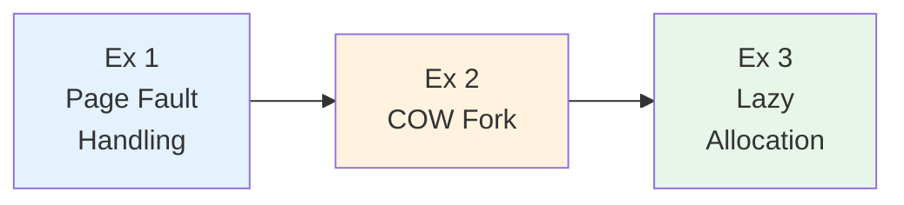
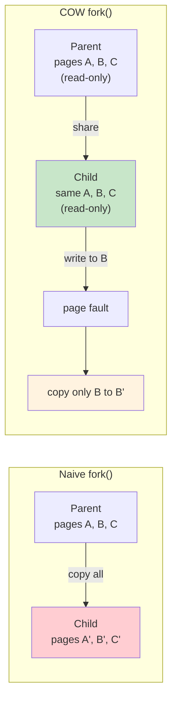
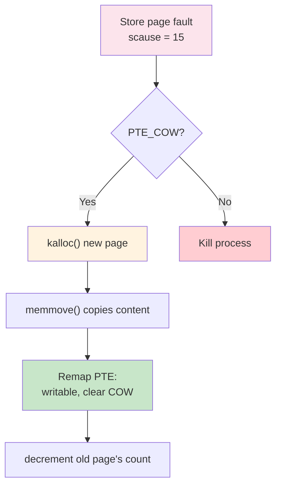
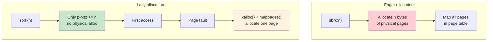

# Week 12 Lab — Copy-on-Write Fork and Lazy Allocation

[Repository Guide](../../README.md) | [English](Concepts_Lab.md) | [한국어](Concepts_Lab.ko.md)

> **Last Updated:** 2026-11-18

> **Learning Objectives:**
> 1. Explain the complete flow from a page fault arising on RISC-V to its handling by the xv6 kernel
> 2. Explain the principle of COW fork and its implementation design in xv6 (`PTE_COW`, reference counting, fault handling)
> 3. Explain the principle of lazy allocation and the points that an xv6 implementation must consider
> 4. Observe the effects of COW and lazy allocation with user-space programs and interpret the results

---

## Table of Contents

- [1. Lab Overview](#1-lab-overview)
  - [1.1 Page Faults](#11-page-faults)
  - [1.2 The scause, stval, and sepc Registers](#12-the-scause-stval-and-sepc-registers)
  - [1.3 PTE Flags and the RSW Bits](#13-pte-flags-and-the-rsw-bits)
- [2. Exercise 1: The Page Fault Handling Flow](#2-exercise-1-the-page-fault-handling-flow)
  - [2.1 usertrap()](#21-usertrap)
  - [2.2 vmfault()](#22-vmfault)
  - [2.3 The Complete Flow](#23-the-complete-flow)
- [3. Exercise 2: Designing COW Fork](#3-exercise-2-designing-cow-fork)
  - [3.1 The Problem with the Current fork()](#31-the-problem-with-the-current-fork)
  - [3.2 Core Idea](#32-core-idea)
  - [3.3 Step 1: Defining the COW Bit](#33-step-1-defining-the-cow-bit)
  - [3.4 Step 2: Modifying uvmcopy()](#34-step-2-modifying-uvmcopy)
  - [3.5 Step 3: Handling COW Faults](#35-step-3-handling-cow-faults)
  - [3.6 Step 4: Reference Counting](#36-step-4-reference-counting)
  - [3.7 Files to Modify](#37-files-to-modify)
  - [3.8 Observing in User Space](#38-observing-in-user-space)
- [4. Exercise 3: Designing Lazy Allocation](#4-exercise-3-designing-lazy-allocation)
  - [4.1 Current Behavior of sbrk()](#41-current-behavior-of-sbrk)
  - [4.2 Core Idea](#42-core-idea)
  - [4.3 Consideration 1: uvmunmap()](#43-consideration-1-uvmunmap)
  - [4.4 Consideration 2: copyin() and copyout()](#44-consideration-2-copyin-and-copyout)
  - [4.5 Consideration 3: Shrinking and the Guard Page](#45-consideration-3-shrinking-and-the-guard-page)
  - [4.6 The Complete Flow](#46-the-complete-flow)
  - [4.7 Observing in User Space](#47-observing-in-user-space)
- [5. Comparison of Techniques That Use Page Faults](#5-comparison-of-techniques-that-use-page-faults)
- [Summary](#summary)
- [Self-Check Questions](#self-check-questions)

---

<br>

## 1. Lab Overview

- **Objective:** Understand the flow in which page faults are handled, and design in xv6 two virtual memory optimizations that use page faults: **COW (Copy-On-Write) fork** and **lazy allocation**.
- **Key insight:** Page faults are **not errors**; they are opportunities to defer and share work.
- **Files:** `kernel/trap.c`, `kernel/vm.c`, `kernel/kalloc.c`, `kernel/riscv.h`, `kernel/sysproc.c`



*Figure 1. Order of the three exercises*

Both techniques implement, at the level of xv6 kernel code, the Demand Paging (Section 1) and Copy-on-Write (Section 2) of the Week 12 lecture notes.

### 1.1 Page Faults

> **Definition:** A **page fault** is an exception that the MMU raises when a process accesses an invalid virtual address.

Here "invalid" covers all of the following cases.

1. There is no PTE for the virtual address (PTE_V = 0).
2. A PTE exists, but the access permissions are insufficient (for example, writing to a read-only page).
3. A kernel-only page is accessed from user mode (PTE_U = 0).

### 1.2 The scause, stval, and sepc Registers

When a trap occurs on RISC-V, its cause is recorded in the `scause` register. The values related to page faults are as follows.

| scause value | Name | Description |
|:-----|:-----|:-----|
| **12** | Instruction page fault | Page fault while fetching an instruction |
| **13** | Load page fault | Page fault during a memory read (load) |
| **15** | Store/AMO page fault | Page fault during a memory write (store) or an atomic memory operation |

*Table 1. scause values related to page faults*

When a page fault occurs, the `stval` (Supervisor Trap Value) register holds **the virtual address that caused the fault**, and the `sepc` register holds **the address of the instruction** that caused it. The kernel uses `stval` to find out which page faulted. A system call is distinguished by `scause` 8 (an `ecall` from user mode).

### 1.3 PTE Flags and the RSW Bits

```c
#define PTE_V (1L << 0) // valid - valid PTE
#define PTE_R (1L << 1) // read  - read permission
#define PTE_W (1L << 2) // write - write permission
#define PTE_X (1L << 3) // execute - execute permission
#define PTE_U (1L << 4) // user - user mode access permission
```

```text
63    54 53    28 27    19 18    10 9  8 7 6 5 4 3 2 1 0
+------+--------+--------+--------+----+-+-+-+-+-+-+-+-+
|  (0) | PPN[2] | PPN[1] | PPN[0] | RSW|D|A|G|U|X|W|R|V|
+------+--------+--------+--------+----+-+-+-+-+-+-+-+-+
```

*Figure 2. Positions of the three PPN parts and the RSW bits in an Sv39 PTE*

The **RSW** (Reserved for Software, bits 8 and 9) bits are ignored by the hardware (MMU), so the operating system can use them for any purpose. COW fork uses one of these bits as the COW marker.

---

<br>

## 2. Exercise 1: The Page Fault Handling Flow

**Objective:** Understand the flow by following the code with which the xv6 kernel handles a page fault.

### 2.1 usertrap()

`usertrap()` in `kernel/trap.c` handles every trap that occurs in user mode.

```c
uint64
usertrap(void)
{
  // ... (omitted) ...

  struct proc *p = myproc();

  // save user program counter.
  p->trapframe->epc = r_sepc();

  if(r_scause() == 8){
    // system call
    // ...
    // sepc points to the ecall instruction,
    // but we want to return to the next instruction.
    p->trapframe->epc += 4;
    // ...
    syscall();
  } else if((which_dev = devintr()) != 0){
    // device interrupt
  } else if((r_scause() == 15 || r_scause() == 13) &&
            vmfault(p->pagetable, r_stval(), (r_scause() == 13)? 1 : 0) != 0) {
    // page fault on lazily-allocated page
  } else {
    // unhandled exception: kill the process
    printf("usertrap(): unexpected scause 0x%lx pid=%d\n", r_scause(), p->pid);
    printf("            sepc=0x%lx stval=0x%lx\n", r_sepc(), r_stval());
    setkilled(p);
  }
  // ...
}
```

- **The condition that identifies a page fault:** If `r_scause()` is 13 (load page fault) or 15 (store page fault), the trap is treated as a page fault.
- **The faulting virtual address:** It is obtained by reading the `stval` register with `r_stval()`.
- **When it cannot be handled:** If `vmfault()` returns 0, control reaches the final `else`, which marks the process as killed with `setkilled(p)`. The process terminates at the `killed()` check later in `usertrap()` (Week 10 Lab, Section 5.4).

An instruction page fault, with `scause` 12, is not handled separately. xv6's `kexec()` loads all of a program's code before it runs, so code pages never need to be filled in later, and the pages that `vmfault()` creates for lazy allocation have no `PTE_X`. Therefore an instruction page fault cannot occur in a correctly running program; if it does, the program has jumped to an unmapped address, which is a program error, so terminating the process is the right response.

### 2.2 vmfault()

`vmfault()` in `kernel/vm.c` is the page fault handler for **lazy allocation** in the current xv6. When a process accesses a page whose virtual address space was grown by `sbrk()` but for which no physical memory has been allocated yet, it allocates physical memory and creates the mapping at that point.

```c
uint64
vmfault(pagetable_t pagetable, uint64 va, int read)
{
  uint64 mem;
  struct proc *p = myproc();

  if (va >= p->sz)               // (1) Check if address is within process address space
    return 0;
  va = PGROUNDDOWN(va);          // (2) Align to page boundary
  if(ismapped(pagetable, va)) {  // (3) Check if page is already mapped
    return 0;
  }
  mem = (uint64) kalloc();       // (4) Allocate a physical page
  if(mem == 0)
    return 0;
  memset((void *) mem, 0, PGSIZE);  // (5) Initialize to zero
  if (mappages(p->pagetable, va, PGSIZE, mem, PTE_W|PTE_U|PTE_R) != 0) {
    kfree((void *)mem);          // (6) Map in page table
    return 0;
  }
  return mem;
}
```

| Step | Code | Description |
|:-----|:-----|:-----|
| (1) | `va >= p->sz` | Check that the fault address is within the process's memory range |
| (2) | `PGROUNDDOWN(va)` | Align the virtual address to the start of the page |
| (3) | `ismapped()` | Skip handling if the page is already mapped, since the cause is something else |
| (4) | `kalloc()` | Allocate a new physical page |
| (5) | `memset(0)` | Initialize to zero for security |
| (6) | `mappages()` | Add the virtual-to-physical mapping to the page table |

*Table 2. Steps performed by vmfault()*

### 2.3 The Complete Flow

```text
User program: memory access (e.g., *ptr = 42;)
        |
        v
   [MMU] PTE check -> invalid
        |
        v
   [Hardware] scause = 15 (store page fault)
              stval = faulting virtual address
              sepc  = faulting instruction address
        |
        v
   [trampoline.S] uservec -> save registers
        |
        v
   [trap.c] usertrap()
        |--- scause == 8 ?       --> system call handling
        |--- devintr() ?         --> device interrupt handling
        |--- scause == 13 or 15 ? --> call vmfault()
        |         |
        |         |--- success: allocate physical memory + create mapping
        |         |--- failure: kill the process
        |
        v
   [trampoline.S] userret -> return to user mode
                             (re-execute the same instruction -> succeeds this time)
```

*Figure 3. From a user program's memory access to page fault handling and return*

> **Key Point:** When returning to the user program after handling a page fault, `epc` still points to the instruction that caused the fault, so **the same instruction is executed again.** This time the mapping exists, so it succeeds. A system call advances to the next instruction with `epc += 4`, but a page fault does not.

---

<br>

## 3. Exercise 2: Designing COW Fork

**Objective:** Understand a design in which `fork()` does not copy the parent's memory immediately but copies it only when a write occurs.

### 3.1 The Problem with the Current fork()

The current xv6 `kfork()` (`kernel/proc.c`) calls `uvmcopy()` to **copy every page** of the parent process **immediately**.

```c
// kernel/vm.c
int
uvmcopy(pagetable_t old, pagetable_t new, uint64 sz)
{
  pte_t *pte;
  uint64 pa, i;
  uint flags;
  char *mem;

  for(i = 0; i < sz; i += PGSIZE){
    if((pte = walk(old, i, 0)) == 0)
      continue;   // page table entry hasn't been allocated
    if((*pte & PTE_V) == 0)
      continue;   // physical page hasn't been allocated
    pa = PTE2PA(*pte);
    flags = PTE_FLAGS(*pte);
    if((mem = kalloc()) == 0)        // <-- allocate new physical memory for every page
      goto err;
    memmove(mem, (char*)pa, PGSIZE); // <-- copy all 4 KB
    if(mappages(new, i, PGSIZE, (uint64)mem, flags) != 0){
      kfree(mem);
      goto err;
    }
  }
  return 0;

 err:
  uvmunmap(new, 0, i / PGSIZE, 1);
  return -1;
}
```

When `exec()` is called right after `fork()`, as when a shell runs a command, the copied memory is discarded at once. This needless copying degrades performance significantly. For example, when a process using 100 pages (400 KB) calls `fork()`, the current implementation calls `kalloc()` 100 times and `memmove()` 100 times, copying 400 KB in total.

### 3.2 Core Idea



*Figure 4. Memory handling in a naive fork() and in a COW fork()*

COW fork works as follows.

1. At `fork()` time, pages are not copied; the parent and child **share the same physical pages**.
2. Both processes set those pages to **read-only**.
3. When either side **attempts a write**, a store page fault occurs.
4. The page fault handler **copies the page at that point** and grants write permission.

Most children created by `fork()` call `exec()` immediately and never write to the shared pages. In that case no copy happens at all.

### 3.3 Step 1: Defining the COW Bit

One of the PTE's RSW bits is used as the COW marker. Add the following to `kernel/riscv.h`.

```c
#define PTE_COW (1L << 8)  // Use one of the RSW bits as a COW marker
```

RSW is bits 8 and 9 of a PTE, and the hardware (MMU) ignores these bits. The operating system can therefore use them freely for any purpose.

### 3.4 Step 2: Modifying uvmcopy()

Change `uvmcopy()` as follows (design pseudocode).

```c
// Modified uvmcopy() for COW fork (pseudocode)
int
uvmcopy(pagetable_t old, pagetable_t new, uint64 sz)
{
  pte_t *pte;
  uint64 pa, i;
  uint flags;

  for(i = 0; i < sz; i += PGSIZE){
    if((pte = walk(old, i, 0)) == 0)
      continue;
    if((*pte & PTE_V) == 0)
      continue;
    pa = PTE2PA(*pte);
    flags = PTE_FLAGS(*pte);

    // [Key change] Change writable pages to read-only + COW marked
    if(flags & PTE_W) {
      flags = (flags & ~PTE_W) | PTE_COW;  // Remove W, add COW
      *pte = PA2PTE(pa) | flags;           // Modify the parent's PTE too
    }

    // Map the same physical page in the child's page table (no copy)
    if(mappages(new, i, PGSIZE, pa, flags) != 0)
      goto err;

    // Increment reference count (Section 3.6)
    krefpage((void*)pa);
  }
  return 0;

 err:
  uvmunmap(new, 0, i / PGSIZE, 1);
  return -1;
}
```

**Why the parent's PTE must also be modified:** The parent might attempt a write first. The parent's PTE must also be changed to read-only with the COW marker so that a page fault, and hence a copy, occurs no matter whether the parent or the child writes first. After changing the parent's PTEs, any stale writable entries left in the TLB must be flushed with `sfence_vma()`. Otherwise the MMU would permit writes using the cached old PTE, and the page shared with the child would be modified.

Pages that had no write permission to begin with (for example, text pages) are shared as they are, without the COW marker. Neither side can write to such a page, so there is never a need to copy it.

### 3.5 Step 3: Handling COW Faults

The following logic is performed in `usertrap()` or in a separate COW fault handler (design pseudocode).

```c
// COW page fault handling (pseudocode)
int
cowfault(pagetable_t pagetable, uint64 va)
{
  pte_t *pte;
  uint64 pa, flags;
  char *mem;

  va = PGROUNDDOWN(va);

  // 1. Find the PTE
  pte = walk(pagetable, va, 0);
  if(pte == 0 || (*pte & PTE_V) == 0)
    return -1;

  // 2. Check if it is a COW page
  if((*pte & PTE_COW) == 0)
    return -1;  // Write fault on a non-COW page is a real error

  pa = PTE2PA(*pte);
  flags = PTE_FLAGS(*pte);

  // 3. Check reference count
  if(kgetrefcnt((void*)pa) == 1) {
    // If this process is the only one using this physical page, no copy needed
    // Just modify the PTE flags: remove COW, restore W
    *pte = PA2PTE(pa) | ((flags & ~PTE_COW) | PTE_W);
    return 0;
  }

  // 4. Allocate a new physical page and copy
  if((mem = kalloc()) == 0)
    return -1;
  memmove(mem, (char*)pa, PGSIZE);

  // 5. Update PTE: new physical address, remove COW, restore W
  *pte = PA2PTE(mem) | ((flags & ~PTE_COW) | PTE_W);

  // 6. Decrement reference count of the old physical page (free if it reaches 0)
  kfree((void*)pa);

  return 0;
}
```



*Figure 5. Flow of the COW page fault handler*

`usertrap()` recognizes a COW fault when `scause == 15` (store page fault) and the corresponding PTE has `PTE_COW` set. If the reference count is 1, the faulting process is the only one using the page, so instead of copying, the handler only clears COW in the PTE and restores W. For example, once the parent has made its own copy, only the child refers to the original page, so the child's write is handled without a copy.

> **Caution:** When the kernel writes to a user page with `copyout()`, no hardware page fault occurs, because the kernel obtains the physical address with `walkaddr()` and writes to it directly. The current `copyout()` returns -1 if the PTE lacks `PTE_W`, so an implementation of COW fork must also check `PTE_COW` in `copyout()` and copy the page as `cowfault()` does. Otherwise, when the child tries to receive data with `read()` into a buffer on a shared page, the system call fails.

### 3.6 Step 4: Reference Counting

In COW, several processes share one physical page, so the page must be freed only when no process uses it anymore. This requires a **reference count**.

```c
// Content to add to kernel/kalloc.c (pseudocode)

struct {
  struct spinlock lock;
  int cnt[PHYSTOP / PGSIZE];  // Reference count for each physical page
} refcnt;

// Increment reference count
void krefpage(void *pa) {
  acquire(&refcnt.lock);
  refcnt.cnt[(uint64)pa / PGSIZE]++;
  release(&refcnt.lock);
}

// Get reference count
int kgetrefcnt(void *pa) {
  int cnt;
  acquire(&refcnt.lock);
  cnt = refcnt.cnt[(uint64)pa / PGSIZE];
  release(&refcnt.lock);
  return cnt;
}

// Modified kfree(): only actually free when reference count reaches 0
void kfree(void *pa) {
  acquire(&refcnt.lock);
  refcnt.cnt[(uint64)pa / PGSIZE]--;
  if(refcnt.cnt[(uint64)pa / PGSIZE] > 0) {
    release(&refcnt.lock);
    return;  // Still in use by another process
  }
  release(&refcnt.lock);
  // ... existing free logic ...
}
```

A lock is needed for the reference count array because, with several CPUs, multiple processes may simultaneously `fork()` or `exit()` and modify the reference count of the same physical page. Without the spinlock, increments and decrements could overlap and corrupt the value in a data race.

> **Caution:** The pseudocode above shows only `kfree()` decrementing the count. `kalloc()` must set the count of a new page to 1, and at boot `freerange()` in `kinit()` puts every page on the free list through `kfree()`, so unless the counts are set to 1 beforehand, a count would drop to -1 and the page would never enter the free list.

> **Note:** `PHYSTOP / PGSIZE` is 0x88000 (557,056), so an `int` array of that size takes about 2.1 MB. The physical pages the kernel actually manages are only the 32,768 pages from `KERNBASE` to `PHYSTOP`, so computing the index as `(pa - KERNBASE) / PGSIZE` lets the array fit in 128 KB.

### 3.7 Files to Modify

| File | Modification |
|:-----|:-----|
| `kernel/riscv.h` | Define the `PTE_COW` macro |
| `kernel/kalloc.c` | Add the reference count array and its management functions, modify `kalloc()` and `kfree()` |
| `kernel/vm.c` | Modify `uvmcopy()` (share instead of copy), add `cowfault()`, handle COW pages in `copyout()` |
| `kernel/trap.c` | Add a COW fault branch to `usertrap()` |
| `kernel/defs.h` | Declare prototypes for the newly added functions |

*Table 3. Files to modify when implementing COW fork*

### 3.8 Observing in User Space

`lab2_cow_concept.c` is a program that observes COW behavior after `fork()` on Linux and macOS. It allocates and fills 1024 × 4 KB = 4 MB with `mmap(MAP_PRIVATE | MAP_ANONYMOUS)`, calls `fork()`, and uses `getrusage()` to compare the number of **minor page faults** when the child only reads and when it writes. A minor page fault is a page fault handled without disk I/O, and COW copies are counted among them.

```c
/* Allocate the region: with MAP_PRIVATE, writes after fork() cause COW copies */
region = mmap(NULL, REGION_SIZE, PROT_READ | PROT_WRITE,
              MAP_PRIVATE | MAP_ANONYMOUS, -1, 0);
for (i = 0; i < NUM_PAGES; i++)
    region[i * PAGE_SIZE] = (char)('A' + (i % 26));   /* write to every page */

pid_t pid = fork();
if (pid == 0) {
    long before_read = get_minor_faults();
    volatile char sum = 0;
    for (i = 0; i < NUM_PAGES; i++)
        sum += region[i * PAGE_SIZE];                 /* read only */
    long after_read = get_minor_faults();

    for (i = 0; i < NUM_PAGES; i++)
        region[i * PAGE_SIZE] = 'Z';                  /* write -> COW */
    long after_write = get_minor_faults();
    /* print the fault increase of the two phases */
    exit(0);
} else {
    wait(NULL);
    /* check that the parent's data is unchanged */
}
```

```bash
gcc -Wall -o lab2_cow_concept lab2_cow_concept.c
./lab2_cow_concept
```

The main part of the result of running it on macOS on Apple Silicon is as follows.

```text
System page size: 16384 bytes
Allocated region size: 1024 pages (4096 KB)

=== 1. COW Fork Basic Behavior ===

[Parent] Data written to 1024 pages (4096 KB)
[Parent] Minor page faults before fork: 518

[Child] Minor page faults right after fork: 103
[Child] Minor page faults after read: 359 (additional faults from read: 256)
[Child] Minor page faults after write: 615 (additional faults from write: 256)
[Child] -> Expected about 256 COW faults based on system page size (actual: 256)
         (system page size = 16384 bytes, program PAGE_SIZE = 4096 bytes)

[Parent] Parent data verification after child's write: Unchanged (PASS)
         -> Thanks to COW, child's writes do not affect the parent

=== 2. COW Fork Performance Comparison ===

[Child] Fork elapsed time: 811 us
[Child] -> Thanks to COW, fork completed instantly without copying 4096 KB
[Child] -> With eager copy, all 1024 pages would have needed to be copied

=== 3. COW Process Isolation Verification ===

[Parent] Value before fork: 42
[Child] Value right after fork: 42 (sharing the same physical page as parent)
[Child] Value after modification: 100 (written to a separate physical page due to COW)
[Parent] Parent's value after child exits: 42 (unchanged!)
         -> COW guarantees process isolation
```

- **Page size:** The pages of this system are 16 KB, so the 4 MB region consists not of 1024 pages of 4 KB but of 256 pages of 16 KB. Faults are counted per system page. COW copies also happen per system page, so the larger the page, the fewer the faults and the more data each COW copy moves.
- **Writes:** When the child wrote to every page, faults increased by exactly 256, one per system page. If the pages right after `fork()` had been private writable copies for the child, the writes would have had no reason to fault, so this shows that each page was copied on its first write. The parent's data was unchanged (PASS).
- **Reads:** On this system, faults increased by 256 even when the child only read. The fault count alone cannot tell whether a copy occurred, and a minor fault also arises when a mapping that is not yet in the child's page table is filled in for the first time. In an implementation where `fork()` copies the PTEs as read-only, as in the xv6 COW design, reads alone cause no faults.
- **fork() time:** The measured value is the cost of the entire `fork()` call, so it alone cannot decide whether 4 MB was copied. The evidence that copying was deferred is the write faults above.
- **Isolation:** Even after the child changes the value to 100, the parent keeps 42. COW is a performance optimization, but isolation between processes is fully preserved. Had the same region been mapped with `MAP_SHARED`, the parent and child would keep sharing the same pages after `fork()`, and the value written by the child would be visible to the parent as well. This is how shared memory is used for interprocess communication (the Week 3 lecture notes).

---

<br>

## 4. Exercise 3: Designing Lazy Allocation

**Objective:** Understand a design in which `sbrk()` does not allocate physical memory immediately but allocates it on access, and the points to consider in that design.

### 4.1 Current Behavior of sbrk()

`sys_sbrk()` (`kernel/sysproc.c`) receives the allocation mode as its second argument (Week 11 Lab, Section 5.1).

```c
  if(t == SBRK_EAGER || n < 0) {
    if(growproc(n) < 0) {       // Immediate allocation
      return -1;
    }
  } else {
    // Lazy allocation: only increase size, do not allocate physical memory
    if(addr + n < addr)
      return -1;
    if(addr + n > TRAPFRAME)
      return -1;
    myproc()->sz += n;          // Only change the process size
  }
  return addr;
```

`SBRK_EAGER` mode goes through `growproc()` and `uvmalloc()` to allocate physical memory immediately and map it in the page table. Lazy allocation allocates no physical memory and only increases `p->sz`. The two checks prevent `addr + n` from overflowing to a smaller value and the heap from growing past `TRAPFRAME`.

### 4.2 Core Idea



*Figure 6. Comparison of eager and lazy allocation*

Programs often do not use all the memory they allocate. Lazy allocation uses physical memory only for the pages actually accessed, so memory efficiency is high, and the `sbrk()` call itself completes immediately.

### 4.3 Consideration 1: uvmunmap()

When a lazily allocated region is freed, some PTEs may not yet have physical pages.

```c
// uvmunmap() in kernel/vm.c (current implementation)
void
uvmunmap(pagetable_t pagetable, uint64 va, uint64 npages, int do_free)
{
  // ...
  for(a = va; a < va + npages*PGSIZE; a += PGSIZE){
    if((pte = walk(pagetable, a, 0)) == 0) // leaf page table entry allocated?
      continue;
    if((*pte & PTE_V) == 0)  // has physical page been allocated?
      continue;
    // ...
  }
}
```

The original xv6 `uvmunmap()` called `panic()` when a PTE was missing or invalid. With lazy allocation, pages whose address space was grown by `sbrk()` but whose physical pages have not yet been allocated exist as a normal matter. When a process exits, `uvmfree()` calls `uvmunmap()` up to `p->sz`, so it must skip unallocated pages instead of panicking.

### 4.4 Consideration 2: copyin() and copyout()

The kernel can also encounter lazily allocated pages when it accesses user memory (`copyin()`, `copyout()`).

```c
// copyout() in kernel/vm.c (current implementation)
int
copyout(pagetable_t pagetable, uint64 dstva, char *src, uint64 len)
{
  // ...
  pa0 = walkaddr(pagetable, va0);
  if(pa0 == 0) {
    if((pa0 = vmfault(pagetable, va0, 0)) == 0) {  // <-- handle lazy page
      return -1;
    }
  }
  // ...
}
```

A page fault in kernel mode is handled by `kerneltrap()`, which by default treats it as a bug in kernel code and panics. The kernel therefore does not rely on hardware page faults when it accesses lazily allocated user memory. Instead, it checks the mapping with `walkaddr()` and, if no mapping exists, calls `vmfault()` directly to allocate it. For example, if a process passes an address in a lazily grown heap that it has not yet touched as the buffer of `read()`, `copyout()` allocates that page.

> **Note:** `copyinstr()`, which copies string arguments, does not currently call `vmfault()`. If an address that was grown with lazy allocation and never accessed is passed as the path argument of `open()`, the contents of that page should be zero (an empty string), but `copyinstr()` gets 0 from `walkaddr()` and returns -1, so the system call fails.

### 4.5 Consideration 3: Shrinking and the Guard Page

```c
if(t == SBRK_EAGER || n < 0) {
  if(growproc(n) < 0) {
    return -1;
  }
}
```

When memory is shrunk with `n < 0`, it is not deferred; `growproc()` is called immediately. The purpose of shrinking memory is to actually free physical pages and reclaim the memory at once. If shrinking were deferred, the mappings and physical memory of pages already in use would remain outside `p->sz`, memory that should be freed would not be freed properly, and old contents might even reappear in a region grown again later.

`vmfault()` also guards the boundaries of lazy allocation.

- **Addresses outside the heap:** If `va >= p->sz`, it returns 0, so an access to an unallocated address terminates the process.
- **The stack guard page:** The guard page is mapped with only PTE_U cleared, so `ismapped()` returns 1 and `vmfault()` returns 0. When the stack overflows into the guard page, the fault is not mistaken for lazy allocation and is treated as fatal.

### 4.6 The Complete Flow

```text
1. sbrk(n) called (n > 0, SBRK_LAZY)
   -> p->sz += n (only change size, no physical memory allocation)

2. Program accesses the newly grown region
   -> MMU: no PTE -> store or load page fault occurs
   -> scause = 13 or 15, stval = fault address

3. usertrap() -> vmfault() called
   -> Check va < p->sz (verify it is a valid address)
   -> Check ismapped() (confirm it is not yet mapped)
   -> kalloc() + memset(0) + mappages()

4. usertrap() returns to user mode
   -> Re-execute same instruction -> succeeds this time
```

*Figure 7. Complete handling flow of lazy allocation*

### 4.7 Observing in User Space

`lab3_lazy_concept.c` requests 4 KB × 8192 = 32 MB with `mmap(MAP_PRIVATE | MAP_ANONYMOUS)` and observes that physical memory is allocated only when pages are actually accessed. Its four demos check, in order, the basic behavior, sparse access, allocation time versus access time, and the zero-initialization of new pages.

```c
long faults_after_mmap = get_minor_faults();   /* right after mmap */

for (i = 0; i < TOTAL_PAGES; i++) {
    /* Write to the first byte of each page -> page fault occurs here */
    region[(size_t)i * PAGE_SIZE] = (char)(i & 0xFF);

    if ((i + 1) % TOUCH_STEP == 0) {            /* print every 512 pages */
        long cur_faults = get_minor_faults();
        printf("  %-20d  %-15ld  %-15ld\n", i + 1,
               cur_faults - faults_after_mmap, cur_faults - prev_faults);
        prev_faults = cur_faults;
    }
}
```

```bash
gcc -Wall -o lab3_lazy_concept lab3_lazy_concept.c
./lab3_lazy_concept
```

The main part of the result of running it on macOS is as follows.

```text
System page size: 16384 bytes
Allocation region size: 8192 pages (32768 KB)

=== 1. Lazy Allocation Basic Behavior ===

[After mmap(32768 KB) call - not yet accessed]
  minor page faults: 314 (added: 0)
  RSS: 1456 KB

[Minor page fault changes as pages are accessed]
  Pages accessed        Cumulative faults  Interval faults
  --------------------  ---------------  ---------------
  512                   128              128
  1024                  256              128
  ...
  8192                  2048             128

[All pages accessed]
  Total minor page faults: 2048
  RSS: 34208 KB

=== 2. Lazy Allocation Benefits with Sparse Access Patterns ===

  Allocated virtual memory: 32768 KB (8192 pages)
  Actually accessed pages: 820 pages (about 10% of total)
  minor page faults: 820

=== 3. Allocation Time vs Access Time Comparison ===

  mmap(32768 KB) elapsed time: 1 us
  Time to access all pages: 2587 us
  Time to re-access already allocated pages: 43 us
  Ratio: first access is about 60.2x slower than re-access

=== 4. Verify Zero-Initialization of New Pages ===

  Pages with non-zero data out of 8192 pages: 0
```

- **Basic behavior:** Right after `mmap()`, not a single fault was added, and the RSS (the size actually resident in physical memory) stayed the same. The 32 MB exists only in the virtual address space. As the pages were accessed, faults rose steadily by 128 for every 512 pages (in 4 KB units), reaching 2048 in total. This equals 32 MB divided by this system's 16 KB page size, so each system page faulted once on its first access.
- **Sparse access:** Accessing every tenth page in 4 KB units gives 820 accesses and also 820 faults. The access stride of 40 KB is larger than the 16 KB system page, so every access lands on a different system page. On this system, then, the physical memory actually allocated is 820 × 16 KB = 13,120 KB, about 40% of 32 MB. On a system with 4 KB pages it would have been about 10%. Pages that are never accessed use no physical memory, whereas eager allocation would have allocated the full 32 MB.
- **Time:** `mmap()` itself completed in 1 us; the first access to all pages took 2587 us and the re-access to already allocated pages 43 us, so the first access was about 60 times slower. The first access includes the cost of page fault handling, such as trap entry, physical page allocation, zero-filling, and page table updates.
- **Zero-initialization:** All 8192 pages read for the first time contained zeros. For security, the operating system fills new pages with zeros so that contents used by a previous process (passwords, personal data, and so on) are not exposed to a new process. xv6's `vmfault()` does the same with `memset(mem, 0, PGSIZE)`.

> **Note:** `ru_maxrss` returned by macOS's `getrusage()` is the maximum RSS rather than the current value, so the RSS in Demo 2 still shows the maximum of the earlier demo. On this system, lazy allocation is confirmed through the fault counts.

---

<br>

## 5. Comparison of Techniques That Use Page Faults

| | COW Fork | Lazy Allocation |
|:-----|:-----|:-----|
| **Purpose** | Avoid needless memory copying at `fork()` | Avoid allocating memory that will not be used |
| **When applied** | At `fork()` time | At `sbrk()` time |
| **Behavior** | Share first, copy on write | Do not allocate, allocate on access |
| **Fault type** | Store page fault (`scause` 15) | Load and store page faults (`scause` 13, 15) |
| **PTE change** | Remove W, set the COW bit | The PTE does not exist at all |
| **Additional data structure** | Reference count array | None (range decided by `p->sz`) |
| **Key functions** | `uvmcopy()`, `cowfault()` | `sys_sbrk()`, `vmfault()` |

*Table 4. Comparison of COW fork and lazy allocation*

The principles drawn from the two techniques are as follows.

1. **A page fault is not an error but an opportunity.** Traditionally a page fault meant an invalid memory access by the program, but modern operating systems actively use it as a mechanism for optimizing memory management.
2. **The value of deferral.** COW and lazy allocation both follow the principle of "defer work that does not need to be done now". Deferring expensive operations until they are actually needed improves overall performance, and if they are never needed, their cost is never paid.
3. **Cooperation between hardware and software.** The MMU checks PTEs and raises page faults (hardware), and the kernel's trap handler handles them appropriately (software). The RSW bits of the PTE are an interface designed for this cooperation.
4. **The importance of TLB flushes.** After modifying a PTE, the TLB must be flushed with `sfence_vma()`. Otherwise the MMU may use a cached old PTE and behave incorrectly.

---

<br>

## Summary

| Concept | Key Summary |
|:-----|:-----|
| Page fault | Arises on an access to a page with no PTE, with insufficient permissions, or without U from user mode; `scause` (12, 13, 15) records the cause and `stval` the fault address. |
| Return after a fault | After handling a page fault, `epc` is left unchanged so that the faulting instruction is executed again; only a system call advances to the next instruction with `epc += 4`. |
| COW fork | At `fork()`, writable pages are changed to read-only with `PTE_COW` and shared by the parent and child, and only the faulting page is copied on a store page fault. |
| Reference count | A shared physical page is freed only when its reference count reaches 0, and when the count is 1, only W is restored without copying. |
| Lazy allocation | `sbrk()` only grows `p->sz`, and at the page fault of the first access, `vmfault()` allocates and maps a zero-filled page. |
| Kernel access to user memory | A page fault in kernel mode is a panic, so `copyin()` and `copyout()` check with `walkaddr()` and call `vmfault()` directly, and with COW, `copyout()` must also copy COW pages. |
| Observation in user space | On macOS, COW writes and first accesses under lazy allocation appear as one minor fault per 16 KB system page, and every new page is zero-initialized. |

---

<br>

## Self-Check Questions

1. By what condition does `usertrap()` recognize a page fault, and from which instruction does the user program resume after the fault is handled?

   <details>
   <summary>Answer</summary>

   If `r_scause()` is 13 (load page fault) or 15 (store page fault), the trap is treated as a page fault, and the fault address obtained with `r_stval()` is passed to `vmfault()`. After the fault is handled, `epc` still points to the instruction that caused the fault, so execution resumes from that instruction, which succeeds this time because the mapping exists. `epc += 4` is done only for system calls.

   </details>

2. When a process using 100 pages (400 KB) calls `fork()`, how many page copies occur in the current xv6 and in an xv6 with COW fork? Consider the case where the child calls `exec()` immediately.

   <details>
   <summary>Answer</summary>

   The current xv6 `uvmcopy()` calls `kalloc()` and `memmove()` 100 times each and copies all 400 KB. With COW fork, `fork()` copies only the PTEs and shares the physical pages, so no copy occurs, and if the child calls `exec()` immediately, it never writes to the shared pages, so the number of copies stays 0 to the end. A copy occurs only when the parent or child first writes to a page, and only for that page.

   </details>

3. Why does `uvmcopy()` in COW fork make not only the child's PTEs but also the parent's PTEs read-only, and what must be done after changing them?

   <details>
   <summary>Answer</summary>

   The parent might attempt a write first. If the parent's PTE remained writable, the parent's write would modify the shared page without a fault, and the change would be visible to the child. Both the parent and the child must be changed to read-only with the COW marker so that a page fault, and hence a copy, occurs no matter which side writes first. After changing the parent's PTEs, stale writable entries left in the TLB must be flushed with `sfence_vma()`.

   </details>

4. Why does the COW fault handler skip the copy when the reference count is 1? Also explain why the reference count array needs a lock.

   <details>
   <summary>Answer</summary>

   If the reference count is 1, the faulting process is the only one using that physical page, so no copy is needed; clearing COW in the PTE and restoring W is enough. For example, once the parent has made its own copy, only the child refers to the original page. The lock is needed because, with several CPUs, multiple processes can modify the count of the same page at the same time through `fork()` or `exit()`, and overlapping increments and decrements would corrupt the value in a data race.

   </details>

5. Under lazy allocation, why must `uvmunmap()` skip a page whose PTE is missing or invalid instead of panicking? Also explain why the kernel calls `vmfault()` directly in `copyout()` instead of relying on hardware page faults.

   <details>
   <summary>Answer</summary>

   Under lazy allocation, pages whose address space was grown by `sbrk()` but whose physical pages are not yet allocated exist as a normal matter. When a process exits, `uvmunmap()` is called up to `p->sz`, so it must not panic on unallocated pages. A page fault in kernel mode is treated by `kerneltrap()` as a kernel bug and causes a panic, so `copyout()` checks the mapping with `walkaddr()` and, if there is no mapping, calls `vmfault()` directly to allocate it.

   </details>

6. On macOS, the sparse-access demo of `lab3_lazy_concept` accessed every tenth page in 4 KB units and recorded 820 faults. What percentage of the full 32 MB was actually allocated as physical memory? How would this differ on a system with 4 KB pages?

   <details>
   <summary>Answer</summary>

   The access stride of 40 KB is larger than the 16 KB system page, so all 820 accesses land on different system pages, and the physical memory allocated is 820 × 16 KB = 13,120 KB, about 40% of 32 MB (32,768 KB). On a system with 4 KB pages it would be 820 × 4 KB = 3,280 KB, about 10%. The amount that lazy allocation saves depends on both the access pattern and the page size.

   </details>
