# 12주차 이론 — 가상 메모리

[레포지토리 안내](../../README.ko.md) | [English](Concepts_Lecture.md) | [한국어](Concepts_Lecture.ko.md)

> **최종 수정일:** 2026-10-20
>
> Operating System Concepts, Silberschatz, Galvin, and Gagne, Ch 10

> **학습 목표:**
> 1. 가상 메모리를 정의하고, 논리 주소 공간과 물리 주소 공간을 분리하는 것이 왜 유용한지 설명할 수 있다
> 2. demand paging과 lazy swapper(pager)의 역할, 페이지 폴트 처리 순서, pure demand paging과 명령어 재시작에 필요한 하드웨어를 설명할 수 있다
> 3. demand paging의 유효 접근 시간(EAT)을 계산하여 페이지 폴트 1회의 비용을 정량화하고, copy-on-write(COW)와 `fork()`, `vfork()`의 차이를 설명할 수 있다
> 4. 프레임 할당과 페이지 교체를 구분하고, 참조 문자열에 FIFO, OPT, LRU와 LRU 근사 알고리즘(additional reference bits, second-chance(clock), enhanced second-chance, LFU, MFU)을 적용하여 Belady의 변칙과 스택 알고리즘의 관계를 설명할 수 있다
> 5. 균등 할당과 비례 할당, global 교체와 local 교체를 비교하고 thrashing, locality model, working-set model, page-fault frequency(PFF)를 정의할 수 있다
> 6. 메모리 압축, buddy system, 커널 메모리를 위한 slab allocation, prepaging, 프로그램 구조가 지역성에 미치는 영향, I/O interlock과 페이지 잠금을 설명할 수 있다

---

## 목차

- [1. 배경과 Demand Paging](#1-배경과-demand-paging)
  - [1.1 가상 메모리가 주는 것](#11-가상-메모리가-주는-것)
  - [1.2 프로세스의 가상 주소 공간](#12-프로세스의-가상-주소-공간)
  - [1.3 가상 메모리를 통한 공유 라이브러리](#13-가상-메모리를-통한-공유-라이브러리)
  - [1.4 Demand Paging과 Lazy Pager](#14-demand-paging과-lazy-pager)
  - [1.5 유효/무효 비트](#15-유효무효-비트)
  - [1.6 단계별 페이지 폴트 처리](#16-단계별-페이지-폴트-처리)
  - [1.7 Pure Demand Paging과 하드웨어 요구사항](#17-pure-demand-paging과-하드웨어-요구사항)
  - [1.8 명령어 재시작의 어려움](#18-명령어-재시작의-어려움)
  - [1.9 Free-Frame List와 Zero-Fill-on-Demand](#19-free-frame-list와-zero-fill-on-demand)
  - [1.10 Demand-Paging 성능과 EAT](#110-demand-paging-성능과-eat)
  - [1.11 Swap 공간 활용](#111-swap-공간-활용)
- [2. Copy-on-Write](#2-copy-on-write)
  - [2.1 COW 아이디어](#21-cow-아이디어)
  - [2.2 수정 불가 페이지와 vfork()](#22-수정-불가-페이지와-vfork)
- [3. 페이지 교체](#3-페이지-교체)
  - [3.1 교체가 필요한 이유](#31-교체가-필요한-이유)
  - [3.2 기본 교체 절차와 Dirty Bit](#32-기본-교체-절차와-dirty-bit)
  - [3.3 페이지 교체가 주는 것](#33-페이지-교체가-주는-것)
  - [3.4 참조 문자열(Reference String)](#34-참조-문자열reference-string)
  - [3.5 FIFO](#35-fifo)
  - [3.6 Belady의 변칙](#36-belady의-변칙)
  - [3.7 Optimal (OPT / MIN)](#37-optimal-opt--min)
  - [3.8 LRU (Least Recently Used)](#38-lru-least-recently-used)
  - [3.9 LRU 구현](#39-lru-구현)
  - [3.10 스택 알고리즘과 Belady 회피 이유](#310-스택-알고리즘과-belady-회피-이유)
  - [3.11 알고리즘 비교](#311-알고리즘-비교)
- [4. LRU 근사 알고리즘](#4-lru-근사-알고리즘)
  - [4.1 왜 근사하는가?](#41-왜-근사하는가)
  - [4.2 Additional-Reference-Bits](#42-additional-reference-bits)
  - [4.3 Second-Chance (Clock) 알고리즘](#43-second-chance-clock-알고리즘)
  - [4.4 Clock 알고리즘의 시각화](#44-clock-알고리즘의-시각화)
  - [4.5 Enhanced Second-Chance와 (R, M) 클래스](#45-enhanced-second-chance와-r-m-클래스)
  - [4.6 LFU와 MFU](#46-lfu와-mfu)
  - [4.7 Page Buffering](#47-page-buffering)
- [5. 프레임 할당과 Thrashing](#5-프레임-할당과-thrashing)
  - [5.1 최소 프레임 수와 그 한계의 출처](#51-최소-프레임-수와-그-한계의-출처)
  - [5.2 균등 vs 비례 할당](#52-균등-vs-비례-할당)
  - [5.3 Global vs Local 교체](#53-global-vs-local-교체)
  - [5.4 페이지 회수와 Reaper](#54-페이지-회수와-reaper)
  - [5.5 NUMA와 프레임 할당](#55-numa와-프레임-할당)
  - [5.6 Thrashing](#56-thrashing)
  - [5.7 Locality Model](#57-locality-model)
  - [5.8 Working-Set Model](#58-working-set-model)
  - [5.9 Working-Set 구현](#59-working-set-구현)
  - [5.10 Page-Fault Frequency (PFF)](#510-page-fault-frequency-pff)
- [6. 메모리 압축](#6-메모리-압축)
- [7. 커널 메모리 할당](#7-커널-메모리-할당)
  - [7.1 커널 메모리가 특별한 이유](#71-커널-메모리가-특별한-이유)
  - [7.2 Buddy System](#72-buddy-system)
  - [7.3 Slab Allocation](#73-slab-allocation)
- [8. 기타 고려 사항](#8-기타-고려-사항)
  - [8.1 Prepaging](#81-prepaging)
  - [8.2 프로그램 구조와 지역성](#82-프로그램-구조와-지역성)
  - [8.3 I/O Interlock과 페이지 잠금](#83-io-interlock과-페이지-잠금)
- [9. 실습: 페이지 교체 알고리즘 시뮬레이터](#9-실습-페이지-교체-알고리즘-시뮬레이터)
- [요약](#요약)
- [점검 문제](#점검-문제)

---

<br>

## 1. 배경과 Demand Paging

### 1.1 가상 메모리가 주는 것

**가상 메모리(virtual memory)** 는 **논리(가상) 메모리와 물리 메모리를 분리**하는 기법이다. 11주차의 페이징 위에 세워지며, 페이지 테이블의 간접 계층을 강력한 착시로 바꾼다. 프로세스는 거대하고 연속된 주소 공간을 가졌다고 믿지만, OS는 실제로 사용되는 부분만 조용히 제공한다.

가상 메모리가 필요한 이유는 세 가지 구조적 이점에 있다.

- **프로그램이 물리 RAM보다 클 수 있다.** 실제로 접근하는 페이지만 메모리에 상주하면 된다. 오류 처리 코드, 사용하지 않는 기능, 필요 이상으로 크게 선언한 배열은 참조되기 전까지 물리 메모리를 전혀 차지하지 않는다.
- **더 많은 프로세스가 동시에 RAM에 들어간다.** 다중 프로그래밍 정도가 높아지면 CPU 사용률도 높아진다(6주차).
- **프로세스가 빨리 시작한다.** 새 프로세스는 일부 페이지만 메모리에 있으면 바로 실행할 수 있고, 나머지 페이지는 요청될 때 읽어 온다.

같은 기제 위에서 다음 기능도 함께 얻는다.

- **공유 프레임**으로 공유 라이브러리를 구현한다(토대는 11주차 6.2절).
- **공유 메모리**를 통한 프로세스 간 통신이 가능하다.
- copy-on-write로 **빠른 `fork()`** 를 구현한다(2절).

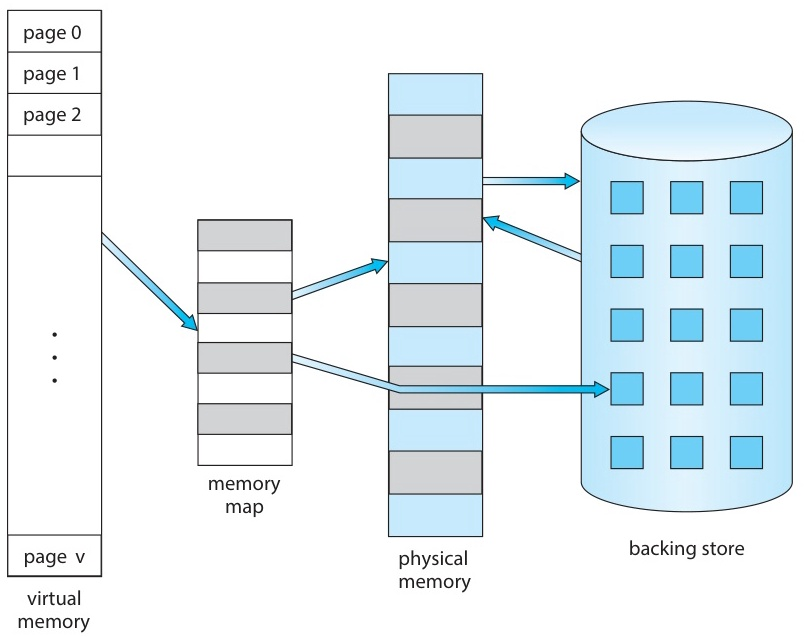

*그림 1. 물리 메모리보다 큰 가상 메모리*

> **참고:** **올바른 추상화인 이유.** 11주차의 주소 지정 계층(페이지 테이블, MMU, TLB)은 공간적 가상화를 제공한다. demand paging은 여기에 시간적 가상화를 더한다. 페이지는 CPU가 참조하는 순간에만 RAM에 있으면 되고, 그 전에 있을 필요는 없다. 이 단원의 모든 내용은 부재 페이지를 싸게 만든다는 원칙에서 나온다.

### 1.2 프로세스의 가상 주소 공간

각 프로세스는 자신만의 독립된 가상 주소 공간을 본다. 이 공간은 보통 0부터 시작하고 연속된 것처럼 보이지만, 그 아래의 물리 프레임은 RAM 곳곳에 흩어져 있거나 일부가 디스크에 있을 수 있다.

```text
가상 주소 공간 (한 프로세스):

  HIGH ┌─────────────┐
       │   Stack     │  ← 아래로 자람
       ├─────────────┤
       │             │
       │   HOLE      │  ← 물리 메모리 소비 없음
       │             │
       ├─────────────┤
       │   Heap      │  ← 위로 자람
       ├─────────────┤
       │   Data      │
       ├─────────────┤
       │   Text      │  ← 읽기 전용 코드
   LOW └─────────────┘
```

*그림 2. 한 프로세스의 가상 주소 공간 배치*

- **희소 주소 공간(sparse address space)**: text와 data, heap, stack 사이에 거대한 홀(hole)이 있다.
- 홀은 **물리 메모리를 차지하지 않는다.** 홀에는 프레임을 가리키는 PTE가 없기 때문이다.
- 공유 라이브러리는 보통 heap과 stack 사이의 가운데 영역에 매핑된다.

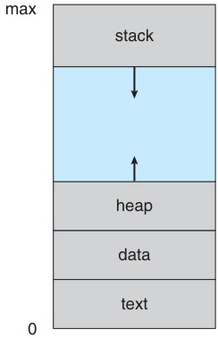

*그림 3. text, data, heap, stack과 홀로 이루어진 가상 주소 공간*

> **핵심:** 홀은 비용이 들지 않으므로 프로세스는 최대 크기를 거대하게 선언해도 그 비용을 치르지 않는다. 64비트 프로세스가 2 TB 희소 파일을 mmap해도 실제로 접근한 페이지에만 프레임이 할당된다.

### 1.3 가상 메모리를 통한 공유 라이브러리

여러 프로세스는 표준 C 라이브러리 같은 라이브러리를 **공유**할 수 있다.

- 라이브러리는 각 프로세스의 가상 주소 공간에서 어떤 가상 주소에 매핑된다. 재배치를 단순하게 하려고 모든 프로세스에서 같은 주소를 쓰기도 하지만 필수는 아니다.
- 라이브러리 코드를 담은 **물리 프레임은 공유된다.** 프레임 한 세트를 여러 PTE가 가리키는 구조이다.
- 라이브러리는 **읽기 전용**으로 매핑되며, 이것이 공유를 안전하게 만든다(11주차 6.2절).
- 공유 메모리 IPC도 같은 메커니즘으로 구현한다.
- `fork()`는 처음에 페이지 테이블을 복사하여 부모와 자식이 모든 페이지를 공유하게 한다. 자세한 내용은 2절의 copy-on-write에서 다룬다.

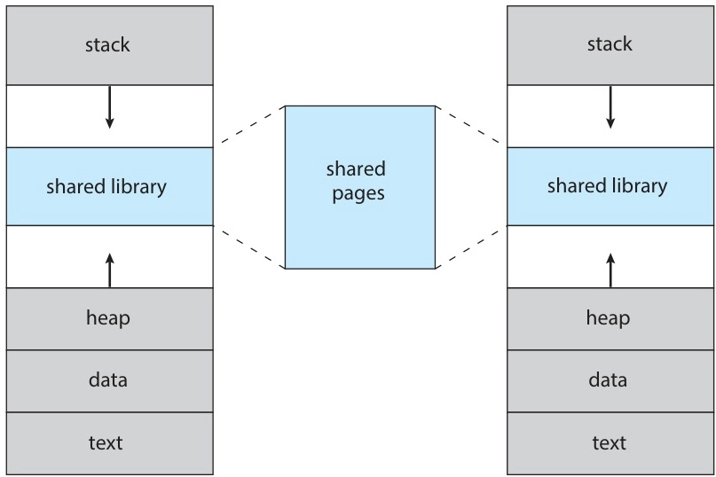

*그림 4. 가상 메모리를 사용한 공유 라이브러리*

### 1.4 Demand Paging과 Lazy Pager

**Demand paging**은 페이지를 실제로 **참조할 때만** 메모리에 적재하는 기법이다.

적재를 수행하는 OS 구성 요소를 **lazy swapper** 또는 **pager**라고 부른다. 이름 그대로 게을러서 어떤 페이지도 투기적으로 미리 가져오지 않는다.

장점은 다음과 같다.
- **I/O 감소:** 접근하지 않는 페이지는 디스크에서 읽지 않는다.
- **메모리 절약:** working set만 상주한다.
- **빠른 시작:** 첫 명령어가 담긴 페이지가 들어오는 즉시 실행을 시작한다.
- **동시 프로세스 증가:** 각 프로세스가 RAM을 적게 쓴다.

### 1.5 유효/무효 비트

각 페이지 테이블 엔트리(PTE)는 **유효/무효 비트**를 가진다. 11주차 6.1절에서 본 비트를 demand paging 관점에서 다시 해석한 것이다.

- **유효(valid):** 페이지가 합법적이면서 **현재 물리 프레임에 상주**한다.
- **무효(invalid):** 페이지가 프로세스 주소 공간 밖에 있거나, **또는** 합법적이지만 현재 디스크에 있다.

CPU는 두 종류의 무효를 구분하지 않으며, 둘 다 같은 하드웨어 트랩을 일으킨다. 어느 쪽인지는 OS의 트랩 핸들러가 판단한다.

> **참고:** **설계가 깔끔한 이유.** 페이지가 존재하는가와 상주하는가를 가리는 검사가 MMU가 이미 수행하는 보호 검사에 합쳐진다. MMU가 유효 비트를 지원하면 demand paging은 새 데이터 경로 없이 트랩 위의 OS 로직만으로 구현된다. 그 밖에 필요한 명령어 재시작 능력은 1.7절에서 다룬다.

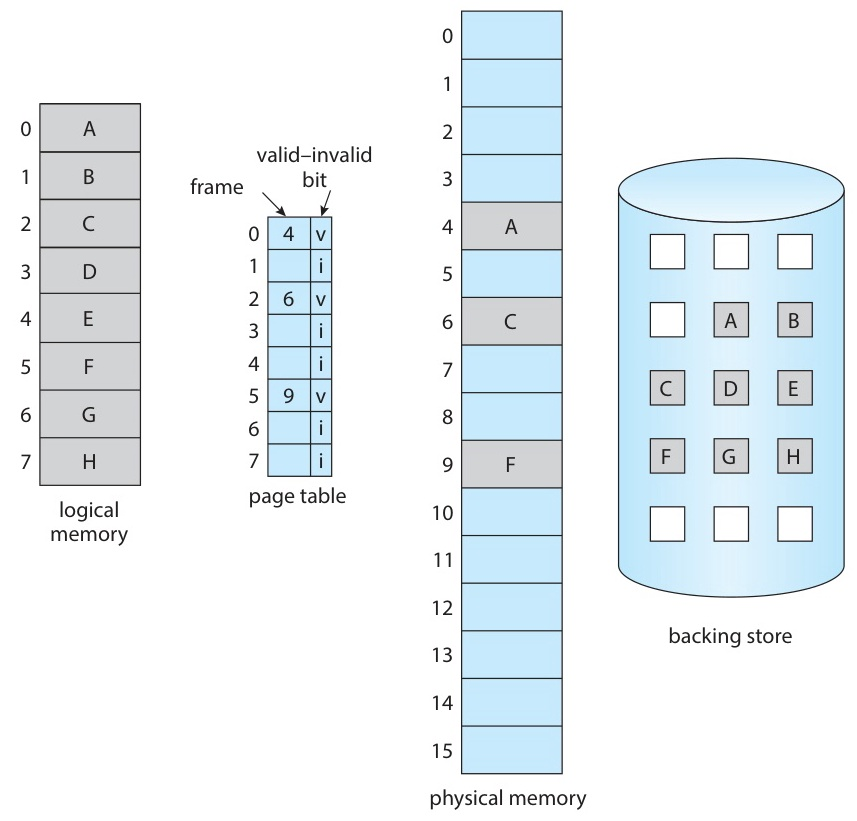

*그림 5. 일부 페이지가 주 메모리에 없을 때의 페이지 테이블*

### 1.6 단계별 페이지 폴트 처리

CPU가 PTE가 무효인 페이지에 접근하면 **페이지 폴트 트랩**이 발생하여 커널로 제어가 넘어간다.

```text
1. CPU가 가상 주소 참조  →  MMU가 PTE 확인.
2. 유효 비트 = invalid  →  OS로 페이지 폴트 트랩.
3. OS가 분류:
     (a) 불법 주소  →  SIGSEGV 전달, 프로세스 종료.
     (b) 합법이지만 디스크에 있음 → 계속.
4. OS가 free-frame list에서 빈 프레임 선택
     (리스트가 비었으면 페이지 교체 실행, 3절).
5. OS가 디스크 I/O로 페이지를 그 프레임으로 읽음.
6. OS가 PTE 갱신: 프레임 번호, 유효 비트 세팅, 권한 세팅.
7. OS가 페이지 폴트를 일으킨 명령어를 RESTART.
8. 명령어가 재실행됨; 이번엔 PTE 유효 → 성공.
```

전체 처리 시간은 일반 메모리 접근(약 100 ns)보다 **몇 자릿수 더 길다.** 회전 디스크는 보통 5~10 ms, SSD는 수백 μs, NVMe는 수십 μs가 걸린다. 따라서 페이지 폴트율을 극히 낮게 유지해야 한다.

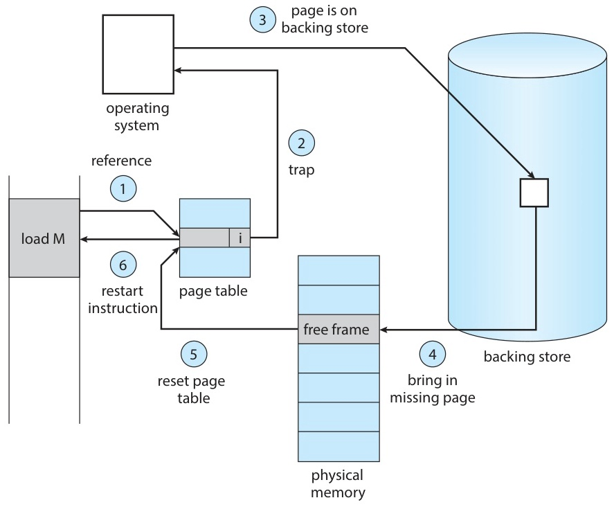

*그림 6. 페이지 폴트 처리 단계*

### 1.7 Pure Demand Paging과 하드웨어 요구사항

**Pure demand paging**은 메모리에 페이지를 **하나도** 두지 않고 프로세스를 시작하는 극단적 전략이다. 첫 명령어부터 페이지 폴트를 일으킨다. 실행이 진행되면 **참조의 지역성**(5.7절의 locality model에서 정확히 정의한다)에 따라 working set이 빠르게 채워지고 폴트율이 급격히 떨어진다.

demand paging을 지원하려면 다음 **하드웨어**가 필요하다.

- 유효/무효 비트(와 보호 비트)를 가진 **페이지 테이블**이 필요하다.
- 상주하지 않는 페이지를 담을 **보조 메모리(swap 공간)** 가 필요하다.
- **명령어 재시작(instruction restart) 기능**이 필요하다. CPU는 폴트를 처리한 뒤 트랩된 명령어를 깔끔하게 다시 실행할 수 있어야 한다.

### 1.8 명령어 재시작의 어려움

명령어 재시작은 개념적으로 단순하지만 아키텍처 측면에서는 까다롭다.

- **쉬운 경우:** 명령어 fetch 중에 폴트가 나면 다시 fetch하여 처음부터 시작하면 된다.
- **어려운 경우:** 여러 단계로 실행되는 명령어 `ADD A, B, C`를 생각한다.
  1. 명령어를 fetch하고 decode한다.
  2. A의 피연산자를 fetch한다.
  3. B의 피연산자를 fetch한다.
  4. A + B를 계산한다.
  5. 결과를 C에 store한다. **여기서 페이지 폴트가 난다.**
  - 단순히 다시 실행하면 1~4단계가 반복되지만, 이 단계들에는 부작용이 없으므로 문제가 없다. 그러나 부작용이 **있는** 명령어는 어떻게 해야 하는가?
- **IBM MVC 명령어:** 최대 256바이트를 한 위치에서 다른 위치로 복사한다. 원본 블록이나 목적지 블록이 페이지 경계를 걸치고 다음 페이지가 무효이면 복사 도중에 폴트가 난다. 두 블록이 겹치면 원본이 이미 바뀌었을 수 있으므로 단순히 다시 실행할 수도 없다.
  - **해법 1:** 어떤 바이트도 쓰기 전에 양쪽 끝 주소에 미리 접근해 본다. 어느 쪽이든 폴트가 날 것이면 부작용이 생기기 **전에** 폴트를 일으킨다.
  - **해법 2:** 덮어쓸 목적지 바이트를 임시 레지스터에 저장해 두고, 폴트가 나면 트랩 핸들러로 넘어가기 전에 복원한다.

> **참고:** **역사적 의의.** 명령어 재시작이 가능한지가 그 아키텍처에서 demand paging을 지원할 수 있는지를 결정한다. 초기의 일부 CPU는 이를 깔끔하게 지원하지 못했고, 그래서 가상 메모리가 보편화되기까지 한 세대의 하드웨어 설계가 필요했다.

### 1.9 Free-Frame List와 Zero-Fill-on-Demand

OS는 할당 가능한 물리 프레임의 풀인 **free-frame list**를 유지한다.

- 시스템이 부팅할 때 사용자에게 줄 수 있는 메모리 **전체**를 리스트에 등록한다.
- 페이지 폴트를 처리할 때 리스트에서 프레임 하나를 꺼내 사용한다.
- 리스트가 임계값 아래로 줄면 **페이지 교체**(3절)가 희생 페이지를 추방하여 리스트를 보충한다.

**Zero-fill-on-demand**: 커널은 새 프로세스에 프레임을 넘기기 전에 그 프레임을 **0으로 채운다.** 이유는 보안이다. 그 프레임은 이전에 다른 프로세스의 것이었으므로 남은 내용이 새 프로세스에 누출되면 안 된다.


*그림 7. free-frame list의 구조*

### 1.10 Demand-Paging 성능과 EAT

기호를 다음과 같이 정한다.
- $p$: 페이지 폴트율, $0 \leq p \leq 1$
- $\text{mem}$: 메모리 접근 시간
- $\text{pf}$: 페이지 폴트 서비스 시간(인터럽트 처리, 디스크 I/O, 프로세스 재시작 포함)

$$
\text{EAT} = (1 - p) \cdot \text{mem} + p \cdot \text{pf}
$$

**예시:** $\text{mem} = 200\ \text{ns}$, $\text{pf} = 8\ \text{ms} = 8\,000\,000\ \text{ns}$이면 다음과 같다.

$$
\text{EAT} = 200 + 7\,999\,800 \cdot p
$$

- $p = 1/1000$(접근 1000회당 폴트 1회)이면 $\text{EAT} = 200 + 7999.8 \approx 8200\ \text{ns}$이다. 원래 메모리 접근보다 **약 40배 느리다.**
- 성능 저하를 10% 이내로 유지하려면($\text{EAT} \leq 220$) $20 \geq 7\,999\,800 \cdot p$, 즉 $p \leq 0.0000025 \approx 1/400\,000$이어야 한다.

> **참고:** **교훈.** demand paging이 거의 비용 없이 동작하려면 페이지 폴트가 참조 40만 회당 1회 이하로 **극히 드물어야** 한다. 그래서 좋은 교체 정책, working set, 지역성 관리가 중요하다. 폴트율이 조금만 높아져도 유효 접근 시간은 크게 늘어난다.

> **[컴퓨터구조]** 이 EAT 공식은 11주차에서 **TLB**에 쓴 기댓값 기법($\alpha(T+M) + (1-\alpha)(T+2M)$)을 **메모리 계층**의 한 단계 아래에 적용한 것이다. TLB 계산은 캐시 히트(사이클 단위)와 메모리 접근(약 100 ns)을 비교했고, 여기서는 메모리 접근(약 100 ns)과 디스크나 SSD에서 처리하는 폴트(수백만 사이클)를 비교한다. 계층을 한 단계 내려갈 때마다(레지스터, 캐시, DRAM, SSD, 디스크) 지연이 대략 **두 자릿수**씩 커지므로 이 수치가 가혹해진다. TLB 미스는 빠른 연산의 시간을 두 배로 늘리는 데 그치지만, 페이지 폴트는 100 ns짜리 연산을 8 ms짜리 연산으로 바꾼다. 그래서 허용할 수 있는 미스율이 TLB의 약 2%에서 페이지 폴트의 약 0.00025%로 떨어진다.

### 1.11 Swap 공간 활용

swap 공간은 디스크의 한 영역이며, 이곳에서 읽는 것은 보통 일반 파일 시스템에서 읽는 것보다 빠르다. 이유는 다음과 같다.
- OS가 파일별 탐색 오버헤드 없이 **더 큰 블록 단위로 전송**한다.
- 파일 시스템 메타데이터를 거치는 간접 참조가 없다.

페이지를 어디에 둘지에 관한 전략은 두 가지이다.

- **전략 1:** 프로세스를 시작할 때 실행 파일 전체를 swap 공간에 복사한 뒤 swap에서 demand paging한다.
- **전략 2:** 처음에는 파일 시스템에서 demand paging하고, 페이지가 추방될 때 수정된(dirty) 버전을 swap에 쓴 뒤 이후에는 swap에서 읽는다. **Linux와 Windows**가 이 방식을 쓴다.

세부 사항은 다음과 같다.
- **바이너리 실행 파일 페이지**(text, 읽기 전용 데이터)는 파일 시스템에서 온다. 수정되지 않으므로 추방할 때 버리고, 다음에 필요하면 파일 시스템에서 다시 읽는다.
- **익명(anonymous) 메모리**(stack, heap처럼 파일 백킹이 없는 메모리)는 추방할 때 swap에 써야 한다. swap 공간이 실제로 쓰이는 곳이 여기이다.

swap 공간 관리, 디스크 스케줄링(FCFS, SCAN, C-SCAN, LOOK), RAID 같은 대용량 저장 장치 구조는 13주차에서 다룬다.

---

<br>

## 2. Copy-on-Write

### 2.1 COW 아이디어

`fork()`를 단순하게 구현하면 부모의 주소 공간 전체를 자식을 위한 새 프레임에 복제한다. 그러나 자식은 대개 곧바로 `exec()`를 호출하여 복제한 내용을 모두 버리므로 이 복제는 낭비이다.

**Copy-on-write(COW)** 는 복사가 실제로 필요해질 때까지 미룬다.

```text
1. fork():
      부모의 PTE를 복사해 자식의 페이지 테이블 구성.
      부모와 자식의 PTE 모두 같은 물리 프레임을 가리킴.
      모든 공유 쓰기 가능 페이지를 양쪽 PTE에서 READ-ONLY로 표시.

2. 읽기 접근:
      폴트 없음. 양쪽 프로세스가 공유 프레임에서 그대로 읽음.

3. 쓰기 접근:
      읽기 전용 표시 때문에 protection fault 발생.
      OS가 그 페이지를 새 프레임으로 복사.
      쓰는 쪽의 PTE 갱신: 새 프레임, 다시 쓰기 가능.
      다른 쪽 PTE는 옛 프레임을 가리킨 채 (역시 다시 쓰기 가능).

4. 어느 쪽도 수정하지 않은 페이지는 NEVER 복사됨.
```

**Linux, Windows, macOS**가 COW를 사용한다. `fork()` 직후 `exec()`를 호출하는 워크로드(셸, 서버)에서 성능 이득이 크다.

> **참고:** 위 3단계는 단순화한 설명이다. 구현에 따라 다른 쪽 PTE는 읽기 전용으로 남겨 두었다가, 그 프로세스가 나중에 쓰기를 시도할 때 폴트 핸들러가 프레임이 더 이상 공유되지 않음을 확인하고 복사 없이 쓰기 권한만 되돌리기도 한다.

### 2.2 수정 불가 페이지와 vfork()

- **수정 불가 페이지**(실행 코드)에는 COW가 필요 없다. 본래 항상 공유되고 읽기 전용이기 때문이다. COW는 쓰일 **수 있는** 페이지에만 해당한다.
- **`vfork()`(virtual memory fork)** 는 더 공격적인 변형이다.
  - 부모 프로세스는 자식이 종료하거나 `exec()`를 호출할 때까지 **중단(suspended)** 된다.
  - 페이지는 **복사도 COW 표시도 없이 공유된다.** 자식은 말 그대로 부모의 주소 공간에서 실행된다.
  - 페이지 테이블조차 복사하지 않으므로 극히 빠르지만 **위험하다.** 자식이 최소한의 준비 후 `exec()`를 호출하는 것 외의 일을 하면 부모의 주소 공간을 손상시킨다.
  - 자식이 곧바로 자신을 다른 프로그램으로 교체하는 고전적인 UNIX 셸 구현에서 쓰인다.

---

<br>

## 3. 페이지 교체

### 3.1 교체가 필요한 이유

demand paging은 **과다 할당(over-allocation)** 으로 이어진다. OS가 폴트가 날 때마다 페이지를 적재하다 보면 결국 모든 프레임이 사용 중이 되고, 그 뒤의 페이지 폴트는 들어올 페이지를 둘 곳이 없다.

**페이지 교체**는 상주 페이지 중 추방할 페이지(**희생 페이지(victim)**)를 골라 들어올 페이지의 자리를 만드는 것이다.

페이지 교체가 가상 메모리의 착시를 완성한다. OS가 가장 유용한 10개 페이지를 끊임없이 바꿔 들이고 내보내므로 20페이지짜리 프로세스도 프레임 10개로 실행할 수 있다.

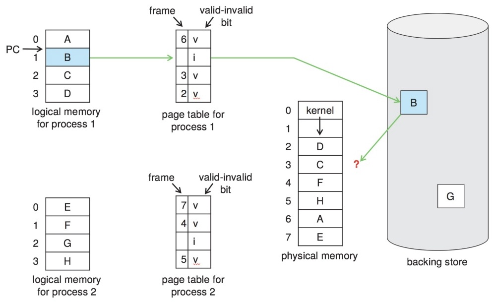

*그림 8. 페이지 교체의 필요성*

### 3.2 기본 교체 절차와 Dirty Bit

```text
1. 원하는 페이지를 디스크에서 찾음.
2. 빈 프레임 찾기:
   - free-frame list에 있으면 사용.
   - 없으면 페이지 교체 알고리즘으로 VICTIM 프레임 선택.
       Victim의 dirty bit = 1이면 디스크로 write-back.
       Victim의 dirty bit = 0이면 바로 폐기 (디스크에 이미 존재).
3. 원하는 페이지를 이제 빈 프레임으로 읽음.
4. 페이지 테이블 갱신 (victim을 invalid로, 새 페이지를 valid로).
5. 폴트 낸 프로세스 재시작.
```

**Dirty bit(modify bit)** 는 페이지에 쓰기가 일어날 때마다 하드웨어가 설정한다. 추방 시점에도 0이면 메모리 사본이 디스크 사본과 같으므로 write-back을 건너뛸 수 있다.

> **참고:** **Dirty bit가 중요한 이유.** 희생 페이지의 write-back(swap-out)은 page-in과 함께 페이지 폴트 처리에서 가장 비싼 디스크 I/O이다. 수정된 페이지를 교체하면 write-back과 page-in이라는 두 번의 디스크 전송이 필요하지만, 수정되지 않은(clean) 페이지는 write-back을 건너뛰므로 그 폴트의 I/O 시간이 절반으로 준다.

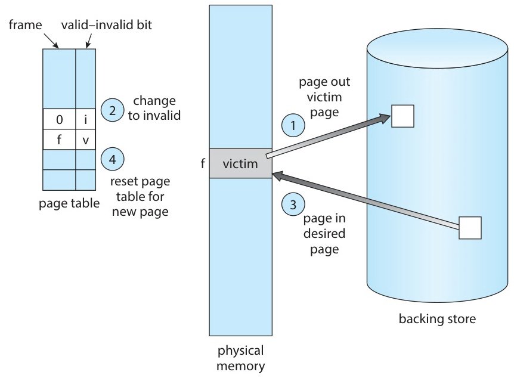

*그림 9. 희생 페이지 추방과 새 페이지 적재로 이루어진 페이지 교체*

### 3.3 페이지 교체가 주는 것

페이지 교체는 **논리 메모리를 물리 메모리로부터 진정으로 분리**한다. 교체가 없으면 프로세스는 주소 공간 전체가 RAM에 들어갈 때만 실행할 수 있다. 교체가 있으면 다음이 가능하다.

- 20페이지짜리 프로세스가 프레임 10개로 실행된다.
- 가상 크기의 합이 RAM을 넘는 여러 프로세스가 무리 없이 공존한다.

답해야 할 알고리즘 문제는 두 가지이다.

1. **프레임 할당:** 각 프로세스에 줄 프레임 수를 정한다(5절).
2. **페이지 교체:** 프레임 수가 정해져 있을 때 추방할 페이지를 고른다(3.5절~4절).

목표는 언제나 **페이지 폴트율을 최소화**하는 것이다(1.10절의 EAT 계산 참고).

### 3.4 참조 문자열(Reference String)

알고리즘을 공정하게 비교하기 위해, 프로세스가 접근한 페이지 번호의 시퀀스인 **참조 문자열**로 평가한다.

**예:** 페이지 크기가 100바이트일 때 다음 바이트 주소 시퀀스를 생각한다.
```text
0100, 0432, 0101, 0612, 0102, 0103, ...
```
주소를 페이지 번호로 바꾸고, 같은 페이지를 연이어 참조하면 뒤의 참조는 폴트를 일으키지 않으므로 하나로 합친다. 그러면 다음 참조 문자열로 축약된다.
```text
1, 4, 1, 6, 1, 6, 1, 6, 1, 6, 1
```

같은 문자열로 각 알고리즘을 시뮬레이션하여 폴트 수를 센다. 일반적으로 **프레임이 많을수록 폴트가 줄어든다**(3.6절의 유명한 예외는 제외).

아래에서 사용할 표준 예시 참조 문자열은 다음과 같다.
```text
7, 0, 1, 2, 0, 3, 0, 4, 2, 3, 0, 3, 2, 1, 2, 0, 1, 7, 0, 1
```

### 3.5 FIFO

**FIFO**(First-In, First-Out)는 메모리에 가장 오래 있던 페이지를 교체한다.

- FIFO 큐로 관리한다. 새 페이지는 꼬리로 들어가고 희생 페이지는 머리에서 나간다.
- 구현은 간단하지만 최근 활동과 관계없이 모든 페이지를 똑같이 취급한다.

**FIFO 추적:** 프레임 3개, 참조 문자열 `7 0 1 2 0 3 0 4 2 3 0 3 2 1 2 0 1 7 0 1`

| 참조 | F1   | F2   | F3   | 폴트 |
|-----|------|------|------|--------|
| 7   | 7    | -    | -    | F      |
| 0   | 7    | 0    | -    | F      |
| 1   | 7    | 0    | 1    | F      |
| 2   | **2**| 0    | 1    | F      |
| 0   | 2    | 0    | 1    |        |
| 3   | 2    | **3**| 1    | F      |
| 0   | 2    | 3    | **0**| F      |
| 4   | **4**| 3    | 0    | F      |
| 2   | 4    | **2**| 0    | F      |
| 3   | 4    | 2    | **3**| F      |
| 0   | **0**| 2    | 3    | F      |
| 3   | 0    | 2    | 3    |        |
| 2   | 0    | 2    | 3    |        |
| 1   | 0    | **1**| 3    | F      |
| 2   | 0    | 1    | **2**| F      |
| 0   | 0    | 1    | 2    |        |
| 1   | 0    | 1    | 2    |        |
| 7   | **7**| 1    | 2    | F      |
| 0   | 7    | **0**| 2    | F      |
| 1   | 7    | 0    | **1**| F      |

*표 1. 프레임 3개에서 표준 참조 문자열의 FIFO 추적*

**총 15회 페이지 폴트**가 발생한다.

### 3.6 Belady의 변칙

**프레임을 늘리면 항상 폴트가 줄어든다**고 기대하기 쉽지만, FIFO에서는 **항상 그렇지는 않다.**

**참조 문자열:** `1, 2, 3, 4, 1, 2, 5, 1, 2, 3, 4, 5`

| 프레임 | 페이지 폴트 |
|--------|-------------|
| 3      | **9**       |
| 4      | **10**      |

*표 2. FIFO에서 프레임 수에 따른 페이지 폴트 수*

프레임을 늘렸는데 폴트가 **더 많아진다.** 이것이 FIFO의 근본적 병리인 **Belady의 변칙**이다.

**프레임 3개 추적**(9회 폴트):

| 참조 | F1   | F2   | F3   | 폴트 |
|-----|------|------|------|--------|
| 1   | 1    | -    | -    | F      |
| 2   | 1    | 2    | -    | F      |
| 3   | 1    | 2    | 3    | F      |
| 4   | **4**| 2    | 3    | F      |
| 1   | 4    | **1**| 3    | F      |
| 2   | 4    | 1    | **2**| F      |
| 5   | **5**| 1    | 2    | F      |
| 1   | 5    | 1    | 2    |        |
| 2   | 5    | 1    | 2    |        |
| 3   | 5    | **3**| 2    | F      |
| 4   | 5    | 3    | **4**| F      |
| 5   | 5    | 3    | 4    |        |

*표 3. Belady 예제의 프레임 3개 FIFO 추적*

**프레임 4개 추적**(10회 폴트):

| 참조 | F1   | F2   | F3   | F4   | 폴트 |
|-----|------|------|------|------|--------|
| 1   | 1    | -    | -    | -    | F      |
| 2   | 1    | 2    | -    | -    | F      |
| 3   | 1    | 2    | 3    | -    | F      |
| 4   | 1    | 2    | 3    | 4    | F      |
| 1   | 1    | 2    | 3    | 4    |        |
| 2   | 1    | 2    | 3    | 4    |        |
| 5   | **5**| 2    | 3    | 4    | F      |
| 1   | 5    | **1**| 3    | 4    | F      |
| 2   | 5    | 1    | **2**| 4    | F      |
| 3   | 5    | 1    | 2    | **3**| F      |
| 4   | **4**| 1    | 2    | 3    | F      |
| 5   | 4    | **5**| 2    | 3    | F      |

*표 4. Belady 예제의 프레임 4개 FIFO 추적*

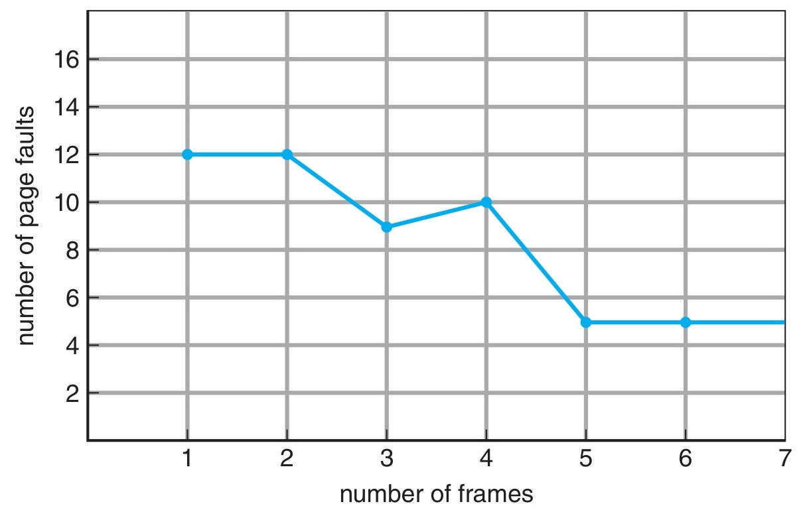

*그림 10. FIFO 교체의 페이지 폴트 곡선과 Belady의 변칙*

### 3.7 Optimal (OPT / MIN)

**OPT** 알고리즘은 **앞으로 가장 오랫동안 사용되지 않을** 페이지를 교체한다.

- **가능한 가장 낮은 페이지 폴트율**을 낸다는 것이 증명되어 있으며, 어떤 알고리즘도 이보다 나을 수 없다.
- **Belady의 변칙이 없다.** 프레임을 늘려도 폴트가 늘지 않는다.
- 미래를 완벽히 알아야 하므로 실제로는 **구현할 수 없다.**
- 실제 알고리즘을 평가하는 **기준선**(품질의 상한)으로 쓴다.

**OPT 추적:** 프레임 3개, FIFO와 같은 문자열

| 참조 | F1    | F2    | F3    | 폴트 | 이유(희생 페이지는 다음 사용이 가장 먼 페이지) |
|-----|-------|-------|-------|--------|------------------------------------|
| 7   | **7** | -     | -     | F      |      |
| 0   | 7     | **0** | -     | F      |      |
| 1   | 7     | 0     | **1** | F      |      |
| 2   | **2** | 0     | 1     | F      | 다음 사용 7→#18, 0→#5, 1→#14이므로 7 추방 |
| 0   | 2     | 0     | 1     |        |      |
| 3   | 2     | 0     | **3** | F      | 다음 사용 2→#9, 0→#7, 1→#14이므로 1 추방 |
| 0   | 2     | 0     | 3     |        |      |
| 4   | 2     | **4** | 3     | F      | 다음 사용 2→#9, 0→#11, 3→#10이므로 0 추방 |
| 2   | 2     | 4     | 3     |        |      |
| 3   | 2     | 4     | 3     |        |      |
| 0   | 2     | **0** | 3     | F      | 다음 사용 2→#13, 4→없음, 3→#12이므로 4 추방 |
| 3   | 2     | 0     | 3     |        |      |
| 2   | 2     | 0     | 3     |        |      |
| 1   | 2     | 0     | **1** | F      | 다음 사용 2→#15, 0→#16, 3→없음이므로 3 추방 |
| 2   | 2     | 0     | 1     |        |      |
| 0   | 2     | 0     | 1     |        |      |
| 1   | 2     | 0     | 1     |        |      |
| 7   | **7** | 0     | 1     | F      | 다음 사용 2→없음, 0→#19, 1→#20이므로 2 추방 |
| 0   | 7     | 0     | 1     |        |      |
| 1   | 7     | 0     | 1     |        |      |

*표 5. 프레임 3개에서 표준 참조 문자열의 OPT 추적*

**총 9회 페이지 폴트**로 FIFO보다 6회 적다. 매 폴트에서 희생 페이지는 **다음 사용이 가장 먼 미래에 있는** 상주 페이지이다(다시 사용되지 않는 페이지는 무한히 먼 것으로 본다). 참조 위치는 문자열 `7 0 1 2 0 3 0 4 2 3 0 3 2 1 2 0 1 7 0 1`에서 1부터 센다.

### 3.8 LRU (Least Recently Used)

미래를 볼 수 없으므로 과거로 미래를 근사한다. **가장 오랫동안 사용되지 않은 페이지를 교체**한다.

- **핵심 가정:** 참조의 지역성이다. 오랫동안 쓰이지 않은 페이지는 곧 필요할 가능성도 낮다.
- 앞이 아니라 뒤를 보고 가장 먼 페이지를 고르므로, 시간을 거꾸로 본 OPT에 해당한다.
- **Belady의 변칙이 없다.** LRU는 **스택 알고리즘**이다(3.10절).

**LRU 추적:** 프레임 3개, 같은 참조 문자열

| 참조 | F1    | F2    | F3    | 폴트 | 이유(LRU 희생 페이지) |
|-----|-------|-------|-------|--------|--------------------|
| 7   | 7     | -     | -     | F      |                    |
| 0   | 7     | 0     | -     | F      |                    |
| 1   | 7     | 0     | 1     | F      |                    |
| 2   | **2** | 0     | 1     | F      | 7이 가장 오래전에 사용됨 |
| 0   | 2     | 0     | 1     |        |                    |
| 3   | 2     | 0     | **3** | F      | 1이 가장 오래전에 사용됨 |
| 0   | 2     | 0     | 3     |        |                    |
| 4   | **4** | 0     | 3     | F      | 2가 가장 오래전에 사용됨 |
| 2   | 4     | 0     | **2** | F      | 3이 가장 오래전에 사용됨 |
| 3   | 4     | **3** | 2     | F      | 0이 가장 오래전에 사용됨 |
| 0   | **0** | 3     | 2     | F      | 4가 가장 오래전에 사용됨 |
| 3   | 0     | 3     | 2     |        |                    |
| 2   | 0     | 3     | 2     |        |                    |
| 1   | **1** | 3     | 2     | F      | 0이 가장 오래전에 사용됨 |
| 2   | 1     | 3     | 2     |        |                    |
| 0   | 1     | **0** | 2     | F      | 3이 가장 오래전에 사용됨 |
| 1   | 1     | 0     | 2     |        |                    |
| 7   | 1     | 0     | **7** | F      | 2가 가장 오래전에 사용됨 |
| 0   | 1     | 0     | 7     |        |                    |
| 1   | 1     | 0     | 7     |        |                    |

*표 6. 프레임 3개에서 표준 참조 문자열의 LRU 추적*

**총 12회 페이지 폴트**가 발생한다. 비교하면 **FIFO 15 > LRU 12 > OPT 9**이다.

### 3.9 LRU 구현

정확한 LRU는 모든 상주 페이지의 **상대적 최근성**을 알아야 한다. 하드웨어 지원을 받는 구현은 두 가지이다.

**방법 1: 카운터(타임스탬프).**
- 각 PTE에 사용 시각(time-of-use) 필드를 둔다.
- CPU에 논리 시계를 추가하고, 메모리 접근마다 시계를 증가시킨다.
- 참조할 때마다 시계 값을 참조된 페이지의 PTE에 복사한다.
- 희생 페이지는 타임스탬프가 가장 작은 페이지이다.
- **비용:** 접근마다 PTE에 메모리 쓰기가 일어나고, 최솟값을 찾으려면 상주 페이지를 선형으로 훑어야 한다.

**방법 2: 스택(이중 연결 리스트).**
- 상주 페이지를 최근성 순서로 연결한 이중 연결 리스트를 유지한다.
- 페이지를 참조하면 그 페이지를 스택의 **맨 위**로 옮긴다. 최악의 경우 포인터 6개를 바꾼다.
- 희생 페이지는 스택 **맨 아래**의 페이지이며, 훑을 필요 없이 O(1)에 찾는다.

두 방법 모두 하드웨어의 도움이 필요하다. 하드웨어 없이 인터럽트를 써서 소프트웨어로 구현하면 모든 메모리 접근이 최소 10배 느려진다.

> **[자료구조]** 방법 2는 최근성 순서 큐로 쓰는 **이중 연결 리스트** 그 자체이며, 포인터 6개라는 수치는 노드를 떼어 맨 앞에 다시 넣는 연산의 표준 비용이다. 노드를 떼어 낼 때 선행 노드와 후행 노드의 포인터를 바꾸고, 맨 앞에 다시 넣을 때 옛 head, 새 노드의 두 링크, head 포인터를 바꾼다. 단일이 아닌 **이중** 연결 리스트가 필요한 이유는 LRU가 **중간 노드를 O(1)에 제거**해야 하기 때문이다. 내부 노드를 상수 시간에 떼어 내려면 선행 노드를 가리키는 역방향 포인터가 있어야 한다. 이 리스트를 페이지 번호에서 노드로 가는 해시 맵과 짝지으면 교과서적인 **LRU 캐시** 설계가 된다(O(1) 조회, O(1) 맨 앞 이동, O(1) 꼬리 추방).

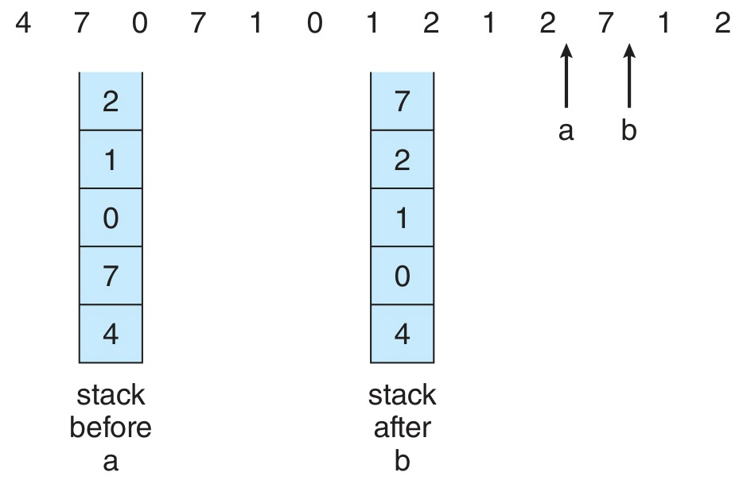

*그림 11. 가장 최근 페이지 참조를 기록하는 스택*

### 3.10 스택 알고리즘과 Belady 회피 이유

교체 알고리즘이 **스택 알고리즘**이라는 것은, 모든 참조 문자열의 모든 시점에서 프레임 $n$개일 때의 상주 페이지 집합이 프레임 $n + 1$개일 때의 상주 페이지 집합의 **부분집합**이라는 뜻이다.

- **LRU는 스택 알고리즘이다.** 프레임이 $n$개이면 상주 집합은 정확히 가장 최근에 참조된 $n$개 페이지이다. 프레임이 $n + 1$개이면 그 $n$개 페이지가 그대로 상주 집합에 있고 하나가 더 있다.
- **OPT도 스택 알고리즘이다**(미래에 대한 대칭적 논증).
- **FIFO는 스택 알고리즘이 아니다.** 프레임 $n$개일 때의 상주 집합이 프레임 $n + 1$개일 때의 부분집합이라는 보장이 없으며, 바로 이 점이 Belady의 변칙을 허용한다.

**정리(직관):** 스택 알고리즘에서는 프레임을 늘려도 폴트 수가 **절대 늘지 않는다.** 프레임 $n$개에서 히트인 참조는 그 시점의 상주 집합이 프레임 $n + 1$개의 상주 집합에 포함되므로 프레임 $n + 1$개에서도 반드시 히트이다. 따라서 큰 메모리에서 나는 폴트는 작은 메모리에서 나는 폴트의 일부일 뿐이다.

### 3.11 알고리즘 비교

같은 참조 문자열, 프레임 3개에서 비교하면 다음과 같다.

| 알고리즘 | 페이지 폴트 | 비고 |
|----------|-------------|------|
| FIFO     | **15**      | 간단하지만 Belady의 변칙이 발생 |
| LRU      | **12**      | 성능이 좋지만 구현 비용이 큼 |
| OPT      | **9**       | 최적이지만 구현 불가 |

*표 7. 프레임 3개에서 FIFO, LRU, OPT의 페이지 폴트 수*

---

<br>

## 4. LRU 근사 알고리즘

### 4.1 왜 근사하는가?

정확한 LRU는 **모든** 메모리 참조에서 시계나 스택을 갱신하는 하드웨어를 요구하지만, 대부분의 아키텍처는 이를 제공하지 않는다. 대부분의 아키텍처가 **제공하는** 것은 **reference bit**이다.

- 페이지를 읽거나 쓸 때 하드웨어가 1로 설정한다.
- OS가 자신의 일정에 따라 0으로 지운다.
- 최근 어느 구간에 **어떤 페이지가 사용되었는지**는 알려 주지만 **순서**는 알려 주지 않는다.

LRU 근사 알고리즘은 이 한 비트(또는 몇 비트)로 LRU에 가까운 교체 결정을 훨씬 적은 비용으로 내린다.

> **[컴퓨터구조]** **reference bit**와 **dirty(modify) bit**는 MMU가 주소를 변환할 때마다 이미 읽는 **페이지 테이블 엔트리**에 저장된다(11주차). 하드웨어는 메모리 접근의 부수 효과로 이 비트를 설정하므로 접근 시간이 늘지 않는다. 정확한 LRU를 유지하려면 모든 메모리 참조마다 타임스탬프를 갱신하거나 리스트 노드를 옮기는 추가 쓰기가 필요하지만, 데이터 경로는 이를 감당할 수 없다. 그래서 실제 시스템은 LRU를 근사하며, clock 알고리즘은 하드웨어가 비용 없이 설정하는 reference bit 하나에서 최대한의 정보를 끌어낸다.

### 4.2 Additional-Reference-Bits

OS는 페이지마다 **8비트 바이트**(시프트 레지스터)를 두고, 주기적인 타이머 인터럽트(예: 100 ms마다)에 이를 갱신한다.

```text
매 타이머 tick:
  1. 현재 reference bit를 페이지 바이트의 MSB로 시프트 인.
  2. 바이트의 나머지를 오른쪽으로 1비트 시프트.
  3. 하드웨어 reference bit 클리어 (다음 구간 준비).
```

바이트는 왼쪽에서 오른쪽으로 읽는다. **MSB(비트 7)가 가장 최근 구간**이고, 오른쪽으로 한 칸 갈수록 한 구간씩 더 과거이다(비트 0은 추적하는 가장 오래된 구간). 어떤 위치의 `1`은 그 구간에 참조되었음을 뜻한다.

```text
비트 위치:    7 6 5 4 3 2 1 0   ← MSB = 가장 최근 구간, LSB = 가장 오래된 구간
예시 히스토리:
  1 1 0 0 0 1 0 0   →  최근 2 구간 사용, 이후 3 구간 idle, 그 후 오래전 한 번 사용
  0 1 1 1 0 1 1 1   →  가장 최근 구간에는 사용 없음, 더 과거에 더 무거운 사용

unsigned 정수로 비교하면 11000100 (196) > 01110111 (119)
→ 두 번째 페이지가 더 좋은 교체 후보(작은 값 = 덜 최근 사용)
```

가장 최근 구간이 가장 높은 자릿값 비트에 놓이므로, 평범한 부호 없는 정수 비교만으로 최근 사용이 오래전 사용보다 높은 순위를 받는다. 정수가 클수록 활동이 더 최근이다.

- 희생 페이지는 바이트 값이 **가장 작은** 페이지, 즉 가장 덜 최근에 사용된 페이지이다.
- 값이 같으면 FIFO 순서로 고른다.
- 히스토리 비트 수를 늘리면 정확도가 높아지지만 인터럽트 비용도 커진다.

### 4.3 Second-Chance (Clock) 알고리즘

**FIFO**와 **reference bit**를 결합한다.

```text
페이지를 FIFO 순서로 유지(원형 큐).
교체가 필요할 때:
   FIFO 머리 페이지 본다.
   reference bit = 0 이면 → 이 페이지를 REPLACE.
   reference bit = 1 이면 → 비트를 클리어, 페이지를 방금 도착한 것처럼 취급,
                            FIFO 다음 페이지로 진행, 반복.
```

손 포인터를 가진 **원형 큐**로 구현하며, 알고리즘의 모습이 손이 도는 시계와 같아서 **Clock 알고리즘**이라고 부른다.

> **[자료구조]** 손은 **원형 버퍼**(또는 꼬리가 head로 다시 이어지는 원형 단일 연결 리스트)를 가리키는 인덱스나 포인터일 뿐이다. 손을 진행하는 것은 고전적인 `i = (i + 1) % n` 순환이다. 앞도 뒤도 없으므로 3.5절의 평범한 FIFO 큐와 달리 어떤 원소도 옮기거나 다시 넣지 않는다. reference bit를 지우는 것은 O(1) 제자리 변경이고 손은 다음으로 이동할 뿐이다. 이 구조 덕분에 페이지에 두 번째 기회를 주는 데 비용이 들지 않는다. 실제 FIFO 큐라면 살아남은 페이지를 dequeue한 뒤 다시 append해야 하지만, 원형 리스트는 그 페이지를 제자리에 두고 커서만 옮긴다.

- 최악의 경우(모든 비트가 1)에는 손이 한 바퀴 돌며 모든 비트를 지우고, 그다음에는 순수 FIFO처럼 동작한다.
- 자주 쓰는 페이지는 손이 도달할 때마다 reference bit가 1이므로 거의 교체되지 않는다.

> **참고:** **Clock이 작동하는 이유.** reference bit는 최근에 사용되었는지를 이진 신호로 알려 준다. Clock은 이 한 비트를 LRU에 가까운 정책으로 바꾼다. 최근 사용된 페이지는 면제를 받고, 오래 사용되지 않은 페이지만 추방된다.

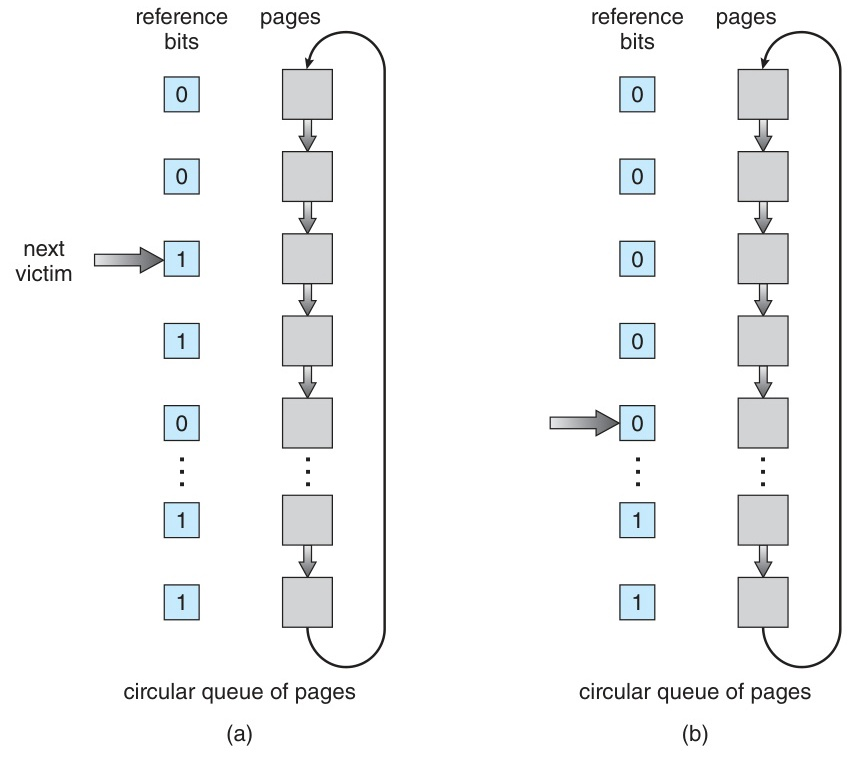

*그림 12. Second-chance(clock) 페이지 교체 알고리즘*

### 4.4 Clock 알고리즘의 시각화

```text
[초기 상태]                    [검색 후]
   v (포인터)                    v (포인터, 새 victim 지정)
+------+                    +------+
| P1: 1| → bit=0으로 클리어 | P1: 0|
| P2: 1| → bit=0으로 클리어 | P2: 0|
| P3: 0| → VICTIM!          | NEW  | ← 들어오는 페이지 삽입
| P4: 1|                    | P4: 1|
| P5: 0|                    | P5: 0|
+------+                    +------+

P1, P2 생존: 비트를 클리어하고 두 번째 기회를 받음.
P3 교체: 비트가 이미 0이었음.
```

*그림 13. P1, P2의 비트를 지우고 P3을 교체하는 clock 검색*

### 4.5 Enhanced Second-Chance와 (R, M) 클래스

**reference bit(R)** 와 **modify(dirty) bit(M)** 를 함께 사용하여 clock을 정교하게 만든다. 각 페이지는 **4개 클래스** 중 하나에 속한다.

| 클래스 | (R, M) | 의미                              | 교체 우선순위 |
|--------|--------|-----------------------------------|----------------|
| 1      | (0, 0) | 최근 미사용, 미수정                 | **최우선**(버리는 비용이 쌈) |
| 2      | (0, 1) | 최근 미사용, 수정됨                 | 2순위(write-back 필요) |
| 3      | (1, 0) | 최근 사용됨, 미수정                 | 3순위           |
| 4      | (1, 1) | 최근 사용됨, **그리고** 수정됨       | **최후순위**    |

*표 8. Enhanced second-chance의 (R, M) 클래스와 교체 우선순위*

낮은 번호 클래스의 페이지를 먼저 추방한다. 수정된 페이지를 교체하면 디스크 쓰기가 추가로 들므로 clean 페이지를 먼저 추방하고, 최근에 쓰였으면서 dirty인 페이지는 가장 나중에 추방한다.

### 4.6 LFU와 MFU

각 페이지가 참조된 횟수를 센다.

- **LFU(Least Frequently Used):** 참조 횟수가 **가장 적은** 페이지를 추방한다.
  - 문제: 초기화 동안 많이 쓰이고 그 뒤로 쓰이지 않는 페이지가 큰 카운트 때문에 계속 남는다.
  - 해법: 주기적으로 모든 카운터를 오른쪽으로 시프트하여(지수적 감쇠) 오래된 활동의 영향을 줄인다.
- **MFU(Most Frequently Used):** 참조 횟수가 **가장 많은** 페이지를 추방한다.
  - 논리: 카운트가 작은 페이지는 방금 들어와 앞으로 쓰일 가능성이 크고, 많이 참조된 페이지는 이미 할 일을 마쳤다고 본다.

어느 쪽도 일반적으로 OPT를 잘 근사하지 못한다. 구현 비용에 비해 이득이 크지 않아 **실제로는 거의 쓰이지 않는다.**

### 4.7 Page Buffering

어떤 교체 정책 위에도 얹을 수 있는 보완 기법은 다음과 같다.

- **Free-frame 풀 유지:** 페이지 폴트가 나면 교체 알고리즘을 기다리지 않고 풀에서 프레임을 **즉시** 꺼낸다. 희생 페이지는 **나중에 비동기적으로** write-back한다. 폴트를 낸 프로세스가 빨리 재시작한다.
- **수정된 페이지 리스트(일괄 write-back):** dirty 페이지를 모아 두었다가 페이징 장치가 유휴 상태일 때 한꺼번에 write-back한다.
- **Free-frame 풀의 희생 페이지 캐시:** 프레임을 해제할 때 그 프레임이 어떤 페이지를 담고 있었는지 기억한다. 프레임이 재사용되기 **전에** 그 페이지가 다시 필요하면 디스크 I/O 없이 되살린다. 일부 UNIX 계열 시스템이 second-chance와 함께 이 방법을 쓴다.

---

<br>

## 5. 프레임 할당과 Thrashing

### 5.1 최소 프레임 수와 그 한계의 출처

각 프로세스는 명령어 **하나**와 그 피연산자가 접근하는 모든 페이지를 담을 수 있도록 **최소 프레임 수**를 확보해야 한다. 그래야 페이지 폴트 뒤에 명령어를 재시작하여 끝까지 실행할 수 있다. 명령어 하나가 프로세스가 가진 프레임보다 많은 서로 다른 페이지를 필요로 하면, 재시작할 때마다 같은 명령어에서 다시 폴트가 나서 영원히 진전하지 못한다.

- 최솟값은 **아키텍처가 결정한다.** 명령어 하나가 참조할 수 있는 서로 다른 페이지의 최대 수(명령어 자신의 페이지와 모든 피연산자 페이지)가 최솟값이다.
- 간접 주소 지정은 이 한계를 늘린다. 예를 들어 모든 메모리 참조 명령어가 메모리 주소 하나만 참조하는 기계에서 1단계 간접 주소 지정을 허용하면 최소 **3개 프레임**(명령어 페이지, 피연산자 포인터 페이지, 피연산자 페이지)이 필요하다.

**최댓값**은 사용 가능한 물리 메모리가 정한다.

### 5.2 균등 vs 비례 할당

가용 프레임이 $m$개이고 프로세스가 $n$개일 때 프레임을 어떻게 나눌지 정해야 한다.

- **균등 할당:** 각 프로세스에 $m / n$개씩 준다.
  - 예: 프레임 93개, 프로세스 5개이면 각각 18개를 주고 3개가 남는다(남은 프레임은 free-frame 버퍼 풀로 쓸 수 있다).
- **비례 할당:** 프로세스 크기 $s_i$에 비례하여 준다.
  $$ a_i = \frac{s_i}{S} \cdot m, \qquad S = \sum_i s_i $$
  - 예: 프레임 62개, 프로세스 A(10 KB)와 B(127 KB)가 있으면 $S = 137\ \text{KB}$이다.
    - A: $10/137 \times 62 \approx 4$개 프레임
    - B: $127/137 \times 62 \approx 57$개 프레임
  - **우선순위 기반 할당:** 크기 대신 우선순위를 가중치로 쓴다.

### 5.3 Global vs Local 교체

프로세스가 페이지 폴트를 냈는데 빈 프레임이 없을 때 희생 페이지를 어디에서 찾을지 정해야 한다.

- **Global 교체:** 시스템 **전체**의 프레임에서 희생 페이지를 고른다. 폴트를 낸 프로세스가 다른 프로세스의 프레임을 가져갈 수 있다.
  - 전체 **처리율(throughput)** 이 좋아 현대 OS에서 일반적으로 쓴다.
  - **단점:** 다른 프로세스가 자기 working set의 프레임을 예고 없이 가져갈 수 있으므로, 프로세스는 자기 페이지 폴트율을 예측할 수 없다.
- **Local 교체:** 폴트를 낸 **프로세스 자신의** 프레임에서만 희생 페이지를 고른다.
  - 프로세스별 폴트율을 예측할 수 있다.
  - **단점:** 한 프로세스의 프레임이 부족하면 다른 프로세스에 여유가 있어도 혼자 thrashing에 빠지며, 가용 메모리가 충분히 활용되지 않을 수 있다.

### 5.4 페이지 회수와 Reaper

실용적인 global 교체는 백그라운드에서 동작하는 **reaper** 루틴을 사용한다.

- free-frame list가 **최소 임계값** 아래로 떨어지면 동작을 시작한다.
- LRU 근사 알고리즘으로 페이지를 훑으며 회수한다.
- 빈 메모리가 **최대 임계값**을 넘으면 멈춘다.

빈 메모리가 위험할 정도로 줄어 reaper가 따라가지 못하면 **Linux는 OOM Killer(Out-Of-Memory Killer)** 를 실행한다. OOM Killer는 OOM 점수가 가장 높은 프로세스를 종료한다. OOM 점수는 주로 프로세스가 사용하는 메모리 비율이 클수록 높아지며, 구현에 따라 실행 시간이나 종료 가능성을 조정하는 값 같은 요소도 결합한다.

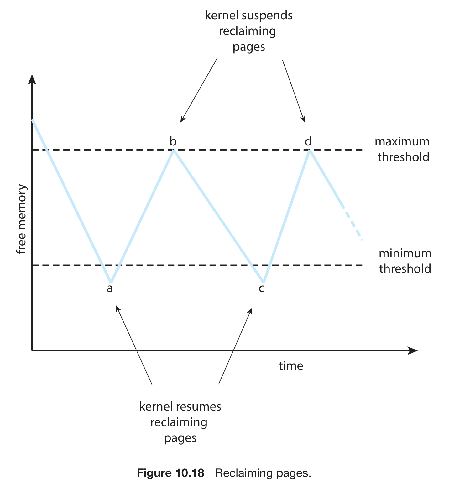

*그림 14. 최소 임계값과 최대 임계값에 따른 reaper의 페이지 회수*

### 5.5 NUMA와 프레임 할당

**NUMA(Non-Uniform Memory Access)** 기계에서는 각 CPU가 자신의 로컬 메모리 뱅크를 가지며, 로컬 메모리에 접근하는 것이 다른 CPU에 붙은 메모리에 접근하는 것보다 훨씬 빠르다.

- 페이지 폴트가 나면 OS는 폴트를 낸 프로세스를 실행 중인 **CPU에 가장 가까운** NUMA 노드에 프레임을 할당해야 한다.
- Linux는 NUMA 노드마다 별도의 free-frame list를 유지한다.
- 스케줄러는 프로세스를 가장 최근에 실행한 CPU에 계속 두려고 하며, 이는 캐시 재사용과 물리 메모리 지역성을 모두 높인다.

### 5.6 Thrashing

**Thrashing**은 프로세스가 실제 명령어를 실행하는 시간보다 페이지 폴트를 처리하는 시간이 더 많은 상태이다.

**악순환:**

```text
1. 프로세스가 현재 working set에 비해 프레임 부족
2. 거의 모든 명령어에서 페이지 폴트
3. I/O 폭주; 프로세스는 대부분 블록
4. CPU 사용률 하락 (모두 I/O 대기)
5. OS가 낮은 CPU 사용률 보고 더 많은 프로세스 스케줄
6. 이제 모든 프로세스가 더 적은 프레임
7. 단계 2로 돌아감: 폴트가 더 폭증
```

*그림 15. Thrashing의 악순환*

**증상 그래프:** 다중 프로그래밍 정도가 올라가면 CPU 사용률은 처음에는 오르다가, 임계점을 넘으면 **갑자기 붕괴한다.** 이 붕괴가 thrashing이다.

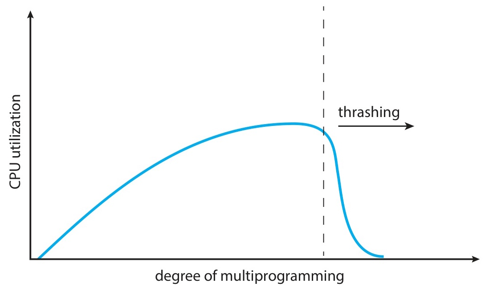

*그림 16. 다중 프로그래밍 정도에 따른 CPU 사용률과 thrashing*

> **참고:** **운영체제의 대표적 병리.** thrashing은 추상화가 깨지는 순간이다. 가상 메모리의 핵심은 프로그램이 RAM보다 클 수 있다는 것이지만, 이는 활성 풋프린트가 가용 프레임에 들어갈 때만 성립한다. 풋프린트가 가용 프레임을 넘으면 시스템은 계산보다 페이지를 옮기는 데 더 많은 시간을 쓴다.

**방어:** **local 교체**를 선호하면 한 프로세스의 나쁜 행동이 다른 프로세스에 번지지 않는다. 더 좋은 방법은 working set이나 PFF(아래)로 애초에 과다 할당을 막는 것이다.

### 5.7 Locality Model

프로세스는 실행 중에 **한 locality에서 다른 locality로 이동**한다.

- **Locality**는 어떤 구간 동안 집중적으로 사용되는 페이지의 집합이다.
- 함수 호출은 새 locality를 정의한다. 그 함수의 코드, 지역 변수, 접근하는 일부 전역 변수가 locality를 이룬다.
- 함수에서 반환하면 그 locality를 떠난다.
- locality는 겹칠 수 있다(callee가 반환된 뒤에도 caller의 데이터는 여전히 자주 쓰인다).

**시사점:** 프로세스에 **현재** locality를 담을 만큼 프레임을 주면, 폴트는 locality 사이를 짧게 전환할 때만 발생하고 정상 상태의 실행 중에는 거의 발생하지 않는다. locality가 프레임에 들어가지 않으면 프로세스는 thrashing에 빠진다.

### 5.8 Working-Set Model

working-set model은 현재 locality를 **실용적으로** 근사한다. 최근 메모리 참조 수로 working-set window $\Delta$를 정의한다.

$$
WS_i(t) = \{\text{프로세스 } i \text{ 가 최근 } \Delta \text{ 회의 참조에서 접근한 페이지}\}
$$

- $\Delta$가 너무 작으면 locality를 다 담지 못해 불필요한 미스가 생긴다.
- $\Delta$가 너무 크면 여러 locality를 포괄하여 과다 할당이 된다.
- $\Delta = \infty$이면 프로세스가 지금까지 접근한 모든 페이지가 된다.

**예:** $\Delta = 10$

```text
...2 6 1 5 7 7 7 7 5 1 | 6 2 3 4 1 2 | 3 4 4 4 3 4 3 4 4 4 | 1 3 2 3 4...
   └──── Δ = 10 ─────┘t1               └──── Δ = 10 ─────┘t2

WS(t1) = {1, 2, 5, 6, 7}   WS(t2) = {3, 4}
```

*그림 17. 창 크기 10일 때 두 시점의 working set*

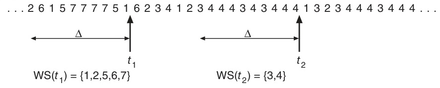

*그림 18. Working-set 모델*

**WS를 이용한 thrashing 방지:**
- $WSS_i = |WS_i|$는 프로세스 $i$에 필요한 프레임 수이다.
- $D = \sum_i WSS_i$는 시스템 전체의 프레임 수요이다.
- $D > m$(가용 프레임 수)이면 **thrashing이 임박**한 것이다.
  - **해법:** 프로세스 하나를 중단(suspend)하여 그 프레임을 해제한다.
- $D \leq m$이면 남는 프레임으로 새 프로세스를 적재할 수 있다.

### 5.9 Working-Set 구현

working set을 정확히 추적하는 것은 비싸므로 보통 **타이머 인터럽트와 reference bit**로 근사한다.

```text
Δ = 10,000회 참조, 타이머 인터럽트는 5,000회 참조마다.

매 타이머 tick:
  각 페이지에 대해:
    현재 reference bit를 in-memory history bit 슬롯으로 복사
    reference bit 클리어

페이지 폴트 결정 시:
  현재 reference bit + 가장 최근 2개 history bit 확인
  셋 중 하나라도 1 → 최근 10,000~15,000회 참조 안에 사용됨
                     → working set의 일부로 간주
  모두 0 → working set 밖
```

히스토리 비트가 많을수록 정확도는 높아지지만 타이머 인터럽트마다 하는 기록 작업도 늘어난다. 근사가 늘 그렇듯 적절한 설정은 워크로드에 따라 달라지는 절충이다.

### 5.10 Page-Fault Frequency (PFF)

**PFF** 전략은 각 프로세스의 페이지 폴트율을 감시하여 thrashing을 **직접** 제어한다.

| 상황                                     | 동작                          |
|------------------------------------------|--------------------------------|
| 프로세스 PFF > 상한                        | **프레임 추가 할당**            |
| 프로세스 PFF < 하한                        | **프레임 회수**                 |
| PFF > 상한이고 시스템에 빈 프레임 없음      | **프로세스 중단(suspend)**      |

*표 9. PFF 전략의 상황별 동작*

working-set model과 비교하면 다음과 같다.
- 폴트 수만 세면 되므로 **구현이 더 간단하다.**
- 궁극적으로 신경 쓰는 값(폴트율)을 **직접 제어한다.**
- 폴트율이 **왜** 그 값인지에 대한 정보는 적다.

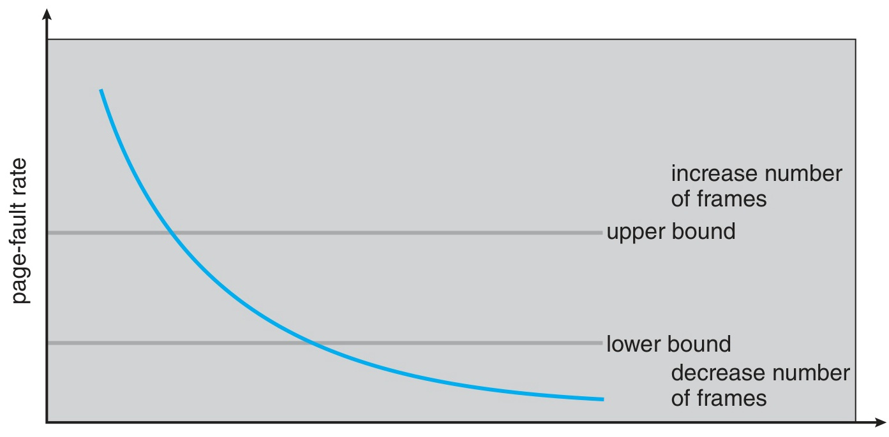

*그림 19. 상한과 하한으로 조절하는 페이지 폴트 빈도*

---

<br>

## 6. 메모리 압축

메모리 압축은 dirty 페이지를 디스크에 쓰는 대신 **RAM 안에서 압축**하는 대안이다.

- 여러 페이지를 모아 압축기(Apple WKdm, Microsoft Xpress)로 압축한 뒤, **압축된 결과를 프레임 하나에 모아 담는다.**
- CPU를 조금 더 쓰는 대신 디스크 I/O를 크게 줄인다. 현대 하드웨어에서는 압축이 SSD 페이징보다 빠른 경우가 많으며, swap이 제한적이거나 없는 모바일 기기에서는 사실상 유일한 선택지이다.

```text
압축 전                                압축 후
modified-frame list: [F12][F45][F88]   F99 = F12, F45, F88 페이지의 압축 묶음
free-frame list:     [F99][F07]        free-frame list: [F07][F12][F45][F88]
```

*그림 20. 수정된 페이지 셋을 프레임 하나에 압축하고 원래 프레임을 반환하는 과정*

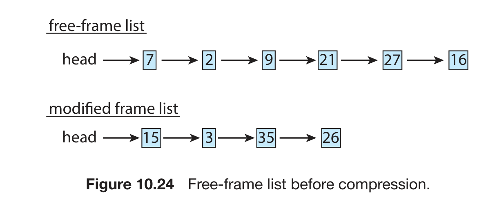

*그림 21. 압축 전 free-frame list와 modified-frame list*

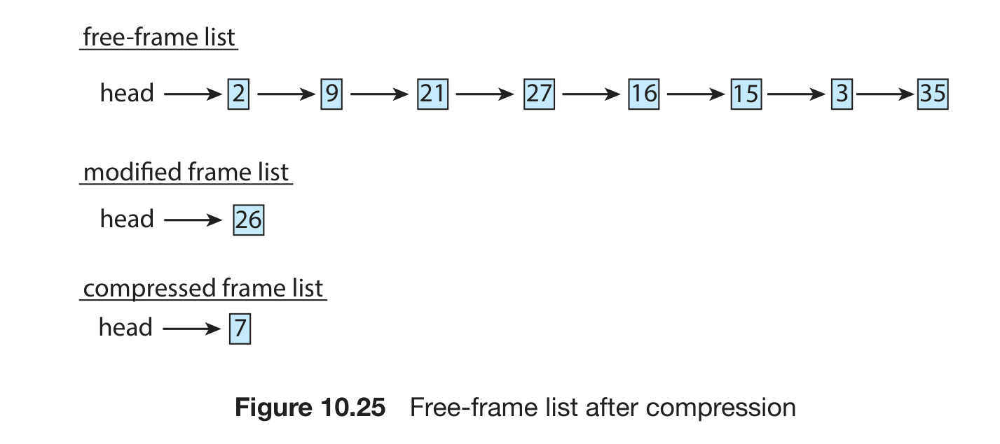

*그림 22. 압축 후 free-frame list*

압축된 페이지가 다시 참조되면 OS가 새 프레임에 압축을 풀어 넣는다. 페이지 폴트와 압축 해제 비용은 들지만 디스크 I/O는 없다.

**macOS, iOS, Android, Windows 10 이후 버전**이 메모리 압축을 사용한다. 압축 결과는 보통 원래 크기의 30\~50%이므로 4 KB 페이지가 약 1.2\~2 KB가 된다.

---

<br>

## 7. 커널 메모리 할당

### 7.1 커널 메모리가 특별한 이유

커널은 사용자 프로세스에 주는 페이징 기반 할당자를 그대로 쓸 수 없다. 이유는 두 가지이다.

1. **작은 객체가 많다.** 커널 자료 구조(PCB, 파일 객체, 세마포어, 네트워크 패킷)는 **페이지보다 작은** 경우가 많다. 객체마다 프레임 하나를 할당하면 작은 객체에서는 메모리의 90% 이상이 낭비된다.
2. **일부 하드웨어는 물리적으로 연속된 메모리를 요구한다.** 특히 DMA 컨트롤러가 그렇다. 페이지 단위 할당은 페이지를 주지만 **연속된** 페이지를 보장하지 않는다.

실제 커널에는 두 가지 고전적 전략이 공존한다.

- **Buddy system:** 큰 단위의 연속 할당과 빠른 병합(coalescing)을 제공한다.
- **Slab allocation:** 작은 단위의 객체 종류별 캐시를 제공한다.

### 7.2 Buddy System

연속된 물리 영역 안에서 메모리를 **2의 거듭제곱 크기 블록**으로 관리한다.

- 크기 $r$인 요청은 다음 2의 거듭제곱으로 올림한다.
  - 예: 21 KB 요청에는 32 KB 블록을 준다.
- 그 크기의 블록이 없으면 더 큰 블록을 재귀적으로 반으로 쪼개어(각 반쪽은 서로의 buddy이다) 알맞은 크기에 도달한다.

```text
256 KB 세그먼트에서 21 KB 할당:

   [           256 KB             ]
   [   128 KB AL  ][   128 KB AR  ]   ← 쪼개기
   [ 64 BL ][ 64 BR ][   128 KB   ]   ← AL 쪼개기
   [32 CL][32 CR][ 64 BR ]...         ← BL 쪼개기, 21 KB 요청에 32 KB 할당
```

*그림 23. 256 KB 세그먼트를 쪼개어 21 KB 요청에 32 KB 블록을 할당하는 과정*

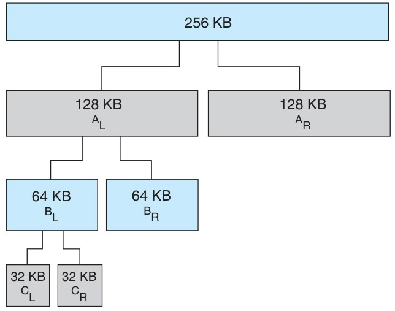

*그림 24. Buddy system의 블록 분할*

**해제하면 병합이 일어난다.** 블록을 해제할 때 그 buddy도 비어 있으면 둘을 한 단계 큰 블록으로 합치며, 이 과정은 트리 위쪽으로 재귀적으로 이어진다.

- **장점:** 병합이 단순하고 빠르다(단계마다 상수 시간, 전체 $O(\log n)$).
- **단점:** **내부 단편화**가 생긴다. 33 KB 요청도 64 KB 블록을 차지한다(약 50% 낭비).

### 7.3 Slab Allocation

**객체 종류별 캐시**는 특정 커널 자료 구조의 인스턴스를 미리 할당하여 바로 쓸 수 있는 상태로 유지한다.

- **Slab**은 하나 이상의 연속된 물리 페이지이다.
- **Cache**는 특정 객체 타입의 인스턴스를 담는 slab의 모음이다(예: PCB 캐시, 파일 객체 캐시, 세마포어 캐시).
- 각 캐시는 자신의 slab과 빈 객체 리스트를 가진다.

```text
Cache: "PCB"   ─── slab 1: [PCB][PCB][PCB][PCB]
                ── slab 2: [PCB][PCB][PCB][PCB]
                ── ...
```

*그림 25. 여러 slab으로 이루어진 PCB 캐시*

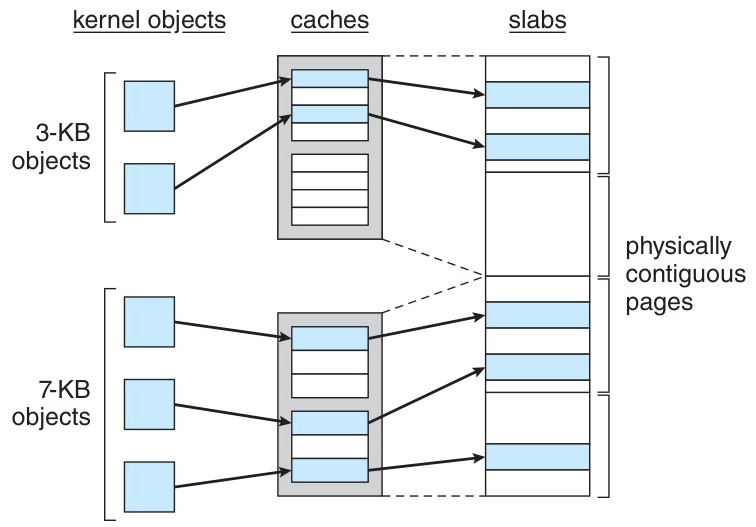

*그림 26. 커널 객체, 캐시, slab의 관계*

**동작:**
- 할당하면 캐시에서 첫 빈 객체를 가져온다.
- 해제하면 객체를 캐시의 빈 리스트로 돌려준다(파괴하거나 다시 초기화하지 않는다).

**Slab 상태:**
- **Full:** slab의 모든 객체가 사용 중이다.
- **Partial:** 사용 중인 객체와 빈 객체가 섞여 있다.
- **Empty:** 모든 객체가 비어 있다.

할당자는 **partial slab, empty slab, 새 slab 할당** 순서로 선호한다.

**장점:**
- **내부 단편화가 없다.** 슬롯 크기가 객체 크기와 정확히 같다.
- **빠르다.** 일반적인 할당과 해제 비용 없이 미리 초기화된 객체를 재사용한다.
- **캐시 친화적이다.** 같은 종류의 객체가 모여 있다.

Linux의 변형은 다음과 같다.
- **SLAB:** 원래의 Linux 구현이다.
- **SLOB:** 리스트 기반의 최소 구현으로, 메모리가 제한된 임베디드 시스템용이다.
- **SLUB:** Linux 2.6.24 이후의 기본 할당자이며, 메타데이터 오버헤드가 적고 SMP 확장성이 좋다.

---

<br>

## 8. 기타 고려 사항

### 8.1 Prepaging

순수 demand paging에서는 프로세스가 시작할 때 폴트가 몰린다. **Prepaging**은 곧 필요할 페이지를 미리 적재한다.

- 프로세스를 중단할 때 그 working set을 기억한다.
- 다시 시작할 때 첫 명령어를 실행하기 **전에** 그 페이지를 모두 적재한다.

**비용과 편익:** 페이지 $s$개를 prepage했고 그중 비율 $\alpha$가 실제로 쓰인다고 가정한다.
- 이득: 폴트 $s \cdot \alpha$회를 피한다.
- 낭비: 쓰이지 않는 페이지 $s \cdot (1 - \alpha)$개를 적재한다.
- $\alpha$가 1에 가까우면 이득이다.

Linux의 **`readahead()`** 는 관련 기제로, 파일의 특정 범위를 곧 읽을 것이니 미리 메모리에 읽어 두라고 커널에 명시적으로 알린다.

### 8.2 프로그램 구조와 지역성

프로그래머가 제어하는 지역성은 OS의 어떤 최적화보다 큰 효과를 낼 수 있다. 페이지 크기가 128워드(`int` 128개)여서 한 행이 정확히 한 페이지를 채우는 128 × 128 `int` 배열을 생각한다.

```c
// BAD: 행 우선 언어에서 열 우선 접근, 접근마다 다른 페이지로 점프
int data[128][128];
for (int j = 0; j < 128; j++)
    for (int i = 0; i < 128; i++)
        data[i][j] = 0;          // 128 × 128 = 16,384 페이지 폴트!
```

```c
// GOOD: 행 우선 접근이 저장 레이아웃과 일치
int data[128][128];
for (int i = 0; i < 128; i++)
    for (int j = 0; j < 128; j++)
        data[i][j] = 0;          // 128 페이지 폴트만
```

두 폴트 수는 프로그램 전체에 할당된 프레임이 128개보다 적다는 가정에서 나온 값이다. 열 우선 접근은 바깥 반복마다 128개 페이지를 모두 건드리므로 매 접근이 폴트가 되어 128 × 128 = 16,384회 폴트가 나고, 행 우선 접근은 한 행(한 페이지)을 다 채운 뒤 다음 행으로 가므로 128회 폴트만 낸다.

> **[컴퓨터프로그래밍]** C는 2차원 배열을 **행 우선(row-major)** 순서로 저장한다. `int data[128][128]`에서 `data[i][j]`는 배열 시작에서 `(i × 128 + j)`번째 원소이므로, 같은 행의 원소는 메모리에 연속해 놓이고 `i`가 1 늘 때마다 한 행(원소 128개)만큼 떨어진다. 위 예에서는 한 행이 정확히 한 페이지를 채우므로, 안쪽 반복이 `j`를 바꾸면 같은 페이지 안에서 움직이고 `i`를 바꾸면 매번 다른 페이지로 넘어간다. Fortran처럼 배열을 열 우선(column-major)으로 저장하는 언어에서는 두 반복 순서의 유불리가 반대가 된다.

자료 구조의 지역성도 중요하다.
- **스택**은 항상 top에 접근하므로 지역성이 훌륭하다.
- **해시 테이블**은 설계상 참조가 흩어지므로 지역성이 나쁘다.

### 8.3 I/O Interlock과 페이지 잠금

global 교체와 동시 I/O가 만나면 미묘한 문제가 생긴다.

```text
프로세스 A: 자기 버퍼 페이지 X로 디스크 READ 시작
프로세스 B: 페이지 폴트; OS가 페이지 X를 victim으로 선택 (global 교체!)
         OS가 페이지 X를 프로세스 B의 새 내용으로 다시 씀
DMA 완료: 원래 디스크 read 결과를 (이제 가로채진) 페이지 X에 씀
        → 손상!
```

*그림 27. Global 교체가 진행 중인 DMA의 버퍼 페이지를 가로채는 과정*

**해법:**

- **커널 버퍼를 통한 간접 I/O:** 항상 커널 메모리로 먼저 읽고 사용자 메모리로 복사한다. 안전하지만 복사가 한 번 더 든다.
- **Lock bit(pin):** 이 프레임은 잠겨 있으니 교체하지 말라는 비트를 설정한다. 페이지 교체 알고리즘은 잠긴 프레임을 건너뛰고, I/O가 끝나면 잠금을 해제한다. 커널 페이지도 같은 이유로 보통 영구히 고정된다.

---

<br>

## 9. 실습: 페이지 교체 알고리즘 시뮬레이터

**목표:** 같은 참조 문자열과 같은 프레임 수에서 **FIFO, LRU, OPT**를 시뮬레이션하여 페이지 폴트 수를 비교한다.

**요구사항:**
- **입력**은 참조 문자열(정수 배열)과 프레임 수이다.
- **알고리즘별 출력**은 각 참조 뒤의 프레임 상태이며, 폴트이면 `* Fault`를 표시한다.
- **최종 출력**은 비교 표이다.

**입력 예시:**
```text
Reference String: 7 0 1 2 0 3 0 4 2 3 0 3 2 1 2 0 1 7 0 1
Number of Frames: 3
```

**Python FIFO 핵심 스케치:**

```python
def fifo(ref_string, num_frames):
    frames = []
    faults = 0
    for page in ref_string:
        fault = page not in frames     # `frames` 변경 전에 판정
        if fault:
            faults += 1
            if len(frames) < num_frames:
                frames.append(page)
            else:
                frames.pop(0)          # 가장 오래된 추방
                frames.append(page)
        print(f"Ref: {page}  Frames: {frames}  {'* Fault' if fault else ''}")
    return faults
```

**기대 출력:**

```text
=== FIFO Algorithm ===
Ref: 7  Frames: [7, -, -]  * Page Fault
Ref: 0  Frames: [7, 0, -]  * Page Fault
Ref: 1  Frames: [7, 0, 1]  * Page Fault
Ref: 2  Frames: [2, 0, 1]  * Page Fault
Ref: 0  Frames: [2, 0, 1]
...
Total Page Faults: 15

=== Comparison ===
| Algorithm | Page Faults |
|-----------|-------------|
| FIFO      | 15          |
| LRU       | 12          |
| Optimal   |  9          |
```

> **참고:** 위 스케치는 프레임을 큐 순서로 유지하고(`pop(0)` 뒤 `append`) 빈 칸을 표시하지 않으므로 출력 형식이 기대 출력과 다르다. 예를 들어 참조 2 뒤에 스케치는 `[0, 1, 2]`를 출력하지만, 기대 출력은 표 1처럼 프레임 칸의 위치를 고정한 `[2, 0, 1]`이다. 기대 출력과 같은 형식을 얻으려면 희생 페이지가 있던 칸에 새 페이지를 넣고(`frames[frames.index(victim)] = page`), 빈 칸을 `-`로 채우고, 폴트 표시를 `* Page Fault`로 출력해야 한다. 폴트 수 15는 두 방식에서 같다.

---

<br>

## 요약

| 개념 | 핵심 요약 |
|------|---------|
| 가상 메모리 | 논리 주소 공간과 물리 주소 공간을 분리하여 프로그램이 RAM보다 커도 실행되게 하며, 운영체제의 다른 추상화를 가능하게 하는 기반이다. |
| Demand paging | lazy pager가 참조된 페이지만 적재하며, 유효/무효 비트와 페이지 폴트 트랩으로 구현한다. |
| EAT | $(1-p)\cdot \text{mem} + p\cdot \text{pf}$는 폴트율에 극도로 민감하므로 $p$가 백만 분의 몇 수준(1.10절의 예에서 $2.5 \times 10^{-6}$ 이하)이어야 하며, 이후의 모든 기법은 $p$를 0 가까이 유지하기 위해 존재한다. |
| Copy-on-Write | `fork()`는 페이지를 공유하다가 쓸 때만 복사하며, `vfork()`는 복사를 전혀 하지 않는다. |
| 페이지 교체 | FIFO, OPT, LRU가 기본 알고리즘이고 dirty bit는 수정되지 않은 페이지의 write-back을 생략하게 하며, 페이지 교체는 가상 메모리라는 추상화를 믿을 만하게 유지한다. |
| 교체 알고리즘의 계층 | OPT는 상한, LRU는 실용적 이상, clock은 실제 시스템이 쓰는 방식이며, 이 근사의 계층은 하드웨어 제약에 대한 직접적인 대응이다. |
| Belady의 변칙 | FIFO에서는 프레임이 많을수록 폴트가 늘 수 있지만 이는 가상 메모리가 아니라 FIFO의 결함이며, 스택 알고리즘(LRU, OPT)은 구조적으로 이를 겪지 않는다. |
| LRU 근사 | reference bit와 clock으로 LRU를 근사하며, enhanced clock은 (R, M) 클래스를 사용한다. |
| 프레임 할당 | 균등 할당과 비례 할당이 있으며, 최소 프레임 수는 명령어 아키텍처가 정한다. |
| 교체 범위 | global 교체는 처리율이 좋지만 예측하기 어렵고, local 교체는 예측할 수 있지만 메모리를 덜 활용할 수 있다. |
| 지역성 | 지역성은 가상 메모리를 작동하게 하는 원동력이며, 지역성이 없으면 모든 교체 알고리즘이 무작위 교체 수준으로 떨어진다. |
| Thrashing | 프레임이 부족하면 폴트가 폭증하고 CPU 사용률이 붕괴하는 가상 메모리의 실패 모드이다. |
| Working-set, PFF | 최근 참조나 폴트율을 추적하여 thrashing을 탐지하고 방지하기 위해 존재한다. |
| 메모리 압축 | 디스크로 swap하는 대신 RAM 안에서 페이지를 압축한다. |
| 커널 메모리 | 커널은 작은 구조체를 많이 할당하고 때로 물리적으로 연속된 메모리가 필요하므로, buddy system(2의 거듭제곱, 연속, 쉬운 병합)과 slab(객체별 캐시)을 함께 쓰는 것이 교과서적 해법이다. |
| 기타 | prepaging, 프로그램 구조에 따른 지역성, I/O를 위한 페이지 고정(pin)도 성능과 정확성에 영향을 준다. |

---

<br>

## 점검 문제

1. **정의:** 논리 메모리를 물리 메모리로부터 분리한다는 것은 무슨 뜻이며, 그로써 무엇을 얻는가?

   <details>
   <summary>정답</summary>

   논리 주소는 각 프로세스의 사적인 가상 주소 공간에 있고, 물리 주소는 공유 DRAM에 있다. 페이지 테이블이 앞의 것을 뒤의 것으로 매핑하지만 **모든 논리 페이지가 매 순간 매핑될 필요는 없다.** 부재 페이지는 PTE에 무효로 표시하면 된다. 이 분리 덕분에 OS는 (1) 페이지를 요청 시 읽어 와 물리 RAM보다 큰 프로그램을 실행하고, (2) 여러 프로세스를 동시에 상주시키고, (3) 완전히 적재하기 전에 프로세스를 시작하고, (4) 프로세스 사이에 물리 프레임을 공유하고, (5) copy-on-write로 빠른 `fork()`를 구현할 수 있다. 이 중 어느 것도 간접 계층 없이는 불가능하다.

   </details>

2. **페이지 폴트 따라가기:** 프로세스가 `MOV [0x4000], EAX`를 실행한다. 0x4000을 포함하는 페이지는 무효로 표시되어 있다. CPU에서 명령어 재시작까지 모든 단계를 따라가라.

   <details>
   <summary>정답</summary>

   (1) CPU가 유효 주소 0x4000을 만들어 MMU에 제시한다. (2) MMU가 페이지 테이블을 워크하여 PTE의 유효 비트가 0임을 발견하고 **페이지 폴트 트랩**을 일으킨다. (3) 커널 트랩 핸들러가 폴트 주소와 PTE를 검사한다. (4) 불법 주소(SIGSEGV 전달)인지, 합법이지만 디스크에 있는 페이지인지 구분한다. 여기서는 후자이다. (5) 커널이 free-frame list에서 빈 프레임을 가져온다. 리스트가 비어 있으면 페이지 교체로 희생 페이지를 고르며, 보통은 reaper가 리스트를 미리 채워 둔다. (6) 디스크 I/O로 페이지를 그 프레임에 읽어 들이고, 프로세스는 I/O를 기다리며 블록된다. (7) I/O가 끝나면 커널이 PTE에 (프레임 번호, valid=1, 권한)을 기록한다. (8) 트랩에서 복귀하면서 폴트를 낸 `MOV` 명령어를 **재시작**한다. (9) MMU가 0x4000을 다시 변환하고(이번에는 유효), 저장이 성공한다.

   </details>

3. **EAT 영향:** mem = 100 ns, pf = 5 ms일 때 성능 저하를 5% 이내로 유지하는 페이지 폴트율은 얼마인가?

   <details>
   <summary>정답</summary>

   EAT = $(1-p)\cdot 100 + p \cdot 5{,}000{,}000$ = $100 + 4{,}999{,}900 p$이다. 5% 이내는 EAT ≤ 105이므로 $5 \geq 4{,}999{,}900 p$, 즉 $p \leq 10^{-6}$이다. **메모리 접근 약 백만 회당 폴트 1회**에 해당한다. 회전 디스크의 페이지 폴트는 매우 비싸서 폴트율이 백만 분의 몇 수준이어야 한다. SSD는 이 조건을 완화한다. pf가 약 50 μs이면 같은 5% 목표에서 $p \leq 5/49{,}900 \approx 10^{-4}$이다.

   </details>

4. **Copy-on-write 추적:** 부모가 페이지 P1(코드, 읽기 전용)과 P2(데이터, 쓰기 가능)를 가지고 있다. 부모가 `fork()`를 호출한 뒤 자식이 P2에 쓴다. 각 단계의 프레임과 PTE 상태를 기술하라.

   <details>
   <summary>정답</summary>

   **fork 전:** 부모의 PTE가 F1(P1, RO)과 F2(P2, RW)를 가리킨다. **fork():** 커널이 부모의 PTE를 자식의 페이지 테이블에 복사한다. 두 프로세스 모두 F1(여전히 RO인 코드이므로 COW가 필요 없다)과 F2를 가리키며, P2는 논리적으로 쓰기 가능하지만 커널이 **양쪽 PTE에서 RO로 표시**한다. **자식이 P2에 쓴다:** MMU가 RO PTE를 보고 **protection fault**를 일으킨다. 커널이 새 프레임 F2'를 할당하고 F2를 F2'로 복사한 뒤, 자식의 P2 PTE가 F2'를 가리키고 RW가 되도록 갱신한다. 부모의 P2 PTE는 F2를 계속 가리키며, F2를 더 이상 공유하지 않으므로 RW로 되돌릴 수 있다(구현에 따라서는 부모가 다음에 쓰기를 시도할 때 폴트 핸들러가 복사 없이 쓰기 권한만 되돌린다). **결과:** F1은 여전히 공유되고(코드 프레임 하나), F2와 F2'가 쓰기 가능 데이터의 독립된 사본을 담는다. 단, 이는 **자식이 썼기 때문**이다. 자식이 대신 `exec()`를 호출했다면 F2는 복제되지 않았을 것이다.

   </details>

5. **FIFO vs LRU vs OPT:** 참조 문자열 `1 2 3 4 1 2 5 1 2 3 4 5`에 프레임 4개로 세 알고리즘을 실행하여 폴트 수를 표로 만들어라.

   <details>
   <summary>정답</summary>

   프레임 4개에서 **FIFO는 10회 폴트**가 난다(3.6절의 추적 참고). **LRU는 8회 폴트**이다. 처음 1, 2, 3, 4를 적재한 뒤 5, 3, 4, 5를 참조할 때 각각 3, 4, 5, 1을 추방한다. **OPT는 6회 폴트**이다. 첫 번째 교체에서는 다음 사용이 가장 먼 4를 추방하고, 두 번째 교체에서는 다시 사용되지 않는 페이지를 추방한다. 따라서 FIFO(10) > LRU(8) > OPT(6)이다. FIFO는 여기서 Belady의 변칙도 보인다. 프레임이 3개일 때 9회, 4개일 때 10회 폴트가 나지만, LRU(3개일 때 10회, 4개일 때 8회)와 OPT(3개일 때 7회, 4개일 때 6회)의 폴트 수는 프레임이 늘수록 줄어든다.

   </details>

6. **Belady의 변칙:** FIFO는 이 변칙을 겪는데 LRU는 왜 겪지 않는가? 스택 알고리즘의 성질로 정당화하라.

   <details>
   <summary>정답</summary>

   교체 알고리즘이 **스택 알고리즘**이라는 것은 모든 참조 문자열의 모든 접두에 대해 프레임 $n$개의 상주 집합이 프레임 $n+1$개의 상주 집합의 부분집합이라는 뜻이다. **LRU**는 이를 자명하게 만족한다. 프레임 $n$개의 상주 집합은 가장 최근에 참조된 $n$개 페이지이고, 이는 가장 최근에 참조된 $n+1$개 페이지의 부분집합이다. 프레임을 늘리면 상주 집합에 페이지가 더해질 뿐 다른 페이지의 유지 여부는 바뀌지 않으므로, 폴트 수는 그대로이거나 줄어들 뿐이다. **FIFO**는 스택 알고리즘이 **아니다.** 프레임 $n$개의 상주 집합은 삽입 순서에 의존하고, 프레임 $n+1$개에서는 순서가 달라져 $n$개일 때 남아 있던 페이지가 $n+1$개일 때의 상주 집합에 **없을 수도** 있다. 추방 패턴이 달라지므로 Belady의 변칙이 가능하다.

   </details>

7. **Reference bit와 clock:** 원형 큐에 페이지 5개가 있고 reference bit는 (1, 1, 0, 1, 0)이다. 손은 페이지 1을 가리킨다. 페이지를 하나 추방해야 할 때 clock 포인터를 따라가고, 어떤 페이지가 추방되는지 답하라.

   <details>
   <summary>정답</summary>

   페이지 1에서 시작하면 bit가 1이므로 0으로 지우고 진행한다. 페이지 2도 bit가 1이므로 0으로 지우고 진행한다. 페이지 3은 bit가 0이므로 **희생 페이지**이며, 페이지 3을 추방한다. 페이지 1과 2는 두 번째 기회를 받아 살아남았고 비트가 이제 0이므로, 그동안 다시 참조되지 않으면 다음 희생 페이지가 된다. 페이지 4와 5는 이번 검색에서 건드리지 않았다. 새 페이지를 넣기 직전의 비트 상태는 (0, 0, ?, 1, 0)이고, 페이지 3 자리에 새 페이지가 들어간다. 새 페이지의 reference bit는 구현에 따라 0 또는 1로 시작하며, 재시작된 명령어가 그 페이지에 접근하면 하드웨어가 1로 설정한다.

   </details>

8. **Enhanced second-chance:** 어떤 프레임이 (R=0, M=1)이다. 이 페이지에 대해 무엇을 알 수 있으며, (R=0, M=0)과 비교한 추방 비용은 어떠한가?

   <details>
   <summary>정답</summary>

   R=0은 현재 주기에 페이지가 참조되지 않았음(최근 미사용)을, M=1은 적재된 뒤 쓰기가 있었음(dirty)을 뜻한다. 따라서 이 페이지는 **오래되었지만 수정된** 페이지이다. 역시 오래되었지만 **clean**인 (R=0, M=0)과 비교하면 (0, 1)을 추방하는 쪽이 더 비싸다. 프레임을 재사용하기 전에 dirty 내용을 **swap이나 디스크에 write-back**해야 하기 때문이다. clean 페이지는 디스크에 같은 바이트가 이미 있으므로 버리기만 하면 된다. enhanced second-chance는 바로 이 write-back을 피하려고 (0, 0)을 먼저 추방하고, clean이면서 오래된 페이지가 없을 때만 (0, 1)을 추방한다.

   </details>

9. **Working set:** $\Delta = 8$이고 참조 문자열이 `1 2 1 3 4 5 1 2 3 4 5 6`일 때, 마지막 참조 직후의 working set은 무엇인가?

   <details>
   <summary>정답</summary>

   마지막 8번의 참조는 위치 5~12의 `4, 5, 1, 2, 3, 4, 5, 6`이다. 따라서 $WS = \{1, 2, 3, 4, 5, 6\}$이며, 마지막 8번의 참조에 서로 다른 페이지 6개가 있다. 현재 locality에서 thrashing을 피하려면 프레임이 적어도 6개 필요하다.

   </details>

10. **Thrashing 진단:** OS가 프로세스를 하나 더 받아들인 뒤 서버의 CPU 사용률이 80%에서 15%로 급락하고 페이지 폴트율이 폭증했다. 무슨 일이 일어나고 있으며, (a) global 교체, (b) local 교체, (c) PFF에서의 해법은 무엇인가?

    <details>
    <summary>정답</summary>

    전형적인 thrashing의 시작이다. 전체 working-set 수요 $D = \sum WSS_i$가 물리 프레임 수 $m$을 넘어 모든 프로세스가 페이지 부족을 겪고, 폴트 I/O가 지배하며, CPU는 디스크를 기다리며 쉰다. **(a) Global 교체:** OS는 $D \leq m$이 될 때까지 프로세스 하나(보통 가장 최근에 받아들인 프로세스나 폴트율이 가장 높은 프로세스)를 **중단**해야 한다. 중단된 프로세스의 프레임이 다른 프로세스에 돌아간다. **(b) Local 교체:** local 교체 자체가 한 프로세스의 나쁜 행동이 다른 프로세스에 번지는 것을 막지만, 이 경우 승인 제어(admission control)가 실패한 것이다. 해법은 $\sum WSS_i + WSS_\text{new} > m$이면 새 프로세스를 받아들이지 않는 것이다. **(c) PFF:** 하나 이상의 프로세스의 폴트율이 상한을 넘는다. 알고리즘은 그 프로세스에 프레임을 더 주려 하지만 빈 프레임이 없어 실패하고, 결국 프로세스를 중단한다. 결과는 같으며, 신호를 working-set 크기에서 추론하는 대신 직접 측정한다는 점만 다르다.

    </details>

11. **Buddy vs slab:** 커널에는 왜 두 할당자가 **모두** 필요한가? 각각 무엇에 강하고 무엇에 약한가?

    <details>
    <summary>정답</summary>

    **Buddy**는 페이지와 여러 페이지로 된 블록 같은 **큰 단위의 연속 물리 메모리**를 다룬다. 해제된 buddy를 $O(\log n)$에 병합하므로 큰 블록의 단편화가 깔끔하게 회복된다. 그러나 페이지보다 작은 객체에는 **내부 단편화**가 크다(17바이트 할당이 32바이트 블록을 차지하고, 더 나쁘게는 페이지 크기의 최소 단위를 차지한다). 이는 수백만 개의 작은 커널 구조체(PCB, 파일 객체, inode)에는 받아들일 수 없다. **Slab**은 buddy **위에** 놓여 이를 보완한다. slab은 buddy에서 받은 하나 이상의 연속 페이지를 고정 크기 객체 슬롯으로 나눈 것이다. 각 slab 캐시는 한 타입 전용이므로 슬롯 크기가 객체 크기와 정확히 같아 그 객체에 대해 **내부 단편화가 없고**, 할당과 해제는 빈 리스트의 O(1) pop과 push이다. slab은 크기가 제각각인 큰 할당에는 약하며(크기마다 별도 캐시가 필요하다), buddy는 이를 자연스럽게 처리한다. 따라서 커널은 페이지 프레임 할당과 큰 연속 블록(예: DMA 버퍼)에 **buddy**를, 자주 쓰는 타입 객체에 **slab**을 쓴다.

    </details>

12. **프로그램 구조:** 페이지가 4 KB인 시스템에서 `double M[1024][1024]`(각 행은 8 KB, 즉 2페이지)를 다룬다. `for i, for j: M[i][j] = 0`과 `for j, for i: M[i][j] = 0`의 페이지 폴트 동작을 비교하라.

    <details>
    <summary>정답</summary>

    **행 우선 접근(`for i, for j`)** 은 이웃한 원소를 차례로 쓰므로 각 행의 두 페이지를 순서대로 방문한다. 1024개 행은 2048개 페이지를 차지하므로, 프레임 수와 관계없이 서로 다른 페이지마다 한 번씩 총 **2048회 폴트**가 나며 이보다 적을 수는 없다. **열 우선 접근(`for j, for i`)** 은 안쪽 반복마다 다른 행, 즉 다른 페이지를 방문한다. 바깥 반복 한 번은 각 행에서 열 j를 담은 페이지 하나씩, 총 1024개 페이지를 건드린다. LRU를 가정하고 프레임이 1024개 이상이면, j = 0~511 동안 각 행의 첫 페이지가 메모리에 남고 j = 512에서 둘째 페이지로 넘어가므로 총 폴트는 역시 2048회이다. 프레임이 1024개보다 적으면 다음 바깥 반복까지 페이지가 남지 못해 최대 **1024 × 1024 ≈ $10^6$회** 폴트가 날 수 있으며, 이는 약 **500배**이다. 8.2절의 예(16,384회 대 128회)도 배열이 가용 프레임에 다 들어가지 않는다는 같은 가정에서 나온 비교이다. 이 배치에서는 C의 행 우선 접근이 언제나 최적이다.

    </details>
