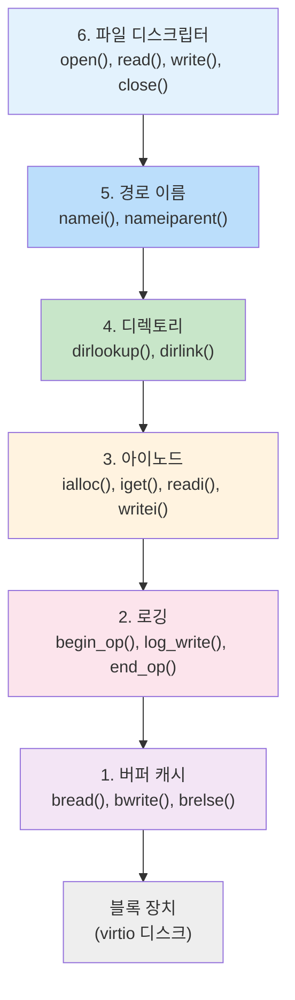
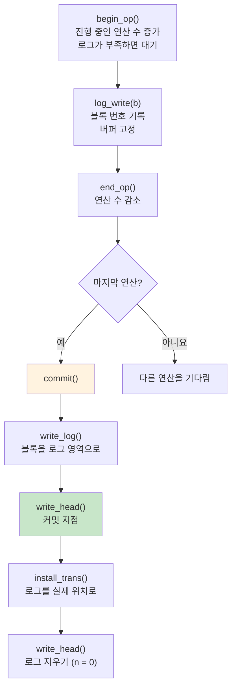

# 13주차 실습 — 파일 시스템 내부 구조

[레포지토리 안내](../../README.ko.md) | [English](Concepts_Lab.md) | [한국어](Concepts_Lab.ko.md)

> **최종 수정일:** 2026-11-19

> **학습 목표:**
> 1. xv6 파일 시스템의 계층 구조와 디스크 배치를 설명할 수 있다
> 2. 버퍼 캐시가 디스크 블록을 캐싱하고 같은 블록에 대한 접근을 직렬화하는 방식을 분석할 수 있다
> 3. 로깅 시스템이 충돌 뒤에도 파일 시스템의 일관성을 보장하는 원리를 설명할 수 있다
> 4. 파일 생성, 쓰기, 읽기의 코드 경로를 아이노드와 블록 수준까지 추적할 수 있다
> 5. xv6의 최대 파일 크기를 계산하고 간접 블록을 늘려 확장하는 방법을 설명할 수 있다

---

## 목차

- [1. 실습 개요와 배경](#1-실습-개요와-배경)
  - [1.1 xv6 파일 시스템의 계층](#11-xv6-파일-시스템의-계층)
  - [1.2 디스크 배치](#12-디스크-배치)
  - [1.3 핵심 자료 구조](#13-핵심-자료-구조)
- [2. 실습 1: 버퍼 캐시](#2-실습-1-버퍼-캐시)
  - [2.1 bget()](#21-bget)
  - [2.2 bread()와 bwrite()](#22-bread와-bwrite)
  - [2.3 brelse()와 LRU](#23-brelse와-lru)
  - [2.4 두 종류의 락](#24-두-종류의-락)
- [3. 실습 2: 로깅 시스템](#3-실습-2-로깅-시스템)
  - [3.1 선행 기록 로그](#31-선행-기록-로그)
  - [3.2 begin_op()와 end_op()](#32-begin_op와-end_op)
  - [3.3 log_write()와 흡수](#33-log_write와-흡수)
  - [3.4 commit()의 네 단계](#34-commit의-네-단계)
  - [3.5 충돌 복구](#35-충돌-복구)
- [4. 실습 3: 파일 생성 추적](#4-실습-3-파일-생성-추적)
  - [4.1 open()의 호출 사슬](#41-open의-호출-사슬)
  - [4.2 sys_open()과 create()](#42-sys_open과-create)
  - [4.3 write()의 경로](#43-write의-경로)
  - [4.4 read()의 경로](#44-read의-경로)
  - [4.5 fs_trace 실행](#45-fs_trace-실행)
- [5. 실습 4: 큰 파일 지원](#5-실습-4-큰-파일-지원)
  - [5.1 현재의 파일 크기 한계](#51-현재의-파일-크기-한계)
  - [5.2 bmap()](#52-bmap)
  - [5.3 이중 간접 블록 추가](#53-이중-간접-블록-추가)
  - [5.4 bmap() 확장](#54-bmap-확장)
- [6. 계층별 정리](#6-계층별-정리)
- [요약](#요약)
- [점검 문제](#점검-문제)

---

<br>

## 1. 실습 개요와 배경

- **목표:** xv6 파일 시스템을 계층별로 분석하고, 파일 연산을 처음부터 끝까지 추적한다.
- **주제:** 버퍼 캐시, 로깅, 파일 생성 추적, 큰 파일 지원
- **관련 파일:** `kernel/bio.c`, `kernel/log.c`, `kernel/fs.c`, `kernel/fs.h`, `kernel/file.c`, `kernel/sysfile.c`, `mkfs/mkfs.c`


*그림 1. 네 실습의 진행 순서*

13주차 강의 노트가 저장 장치 자체(HDD, NVM, RAID)를 다룬다면, 이 실습은 그 위에서 블록을 파일과 디렉토리로 조직하는 파일 시스템을 다룬다.

### 1.1 xv6 파일 시스템의 계층

xv6 파일 시스템은 여섯 계층으로 이루어지며, 각 계층은 **바로 아래 계층의 서비스만** 사용해 관심사를 분리한다.



*그림 2. xv6 파일 시스템의 여섯 계층*

| 계층 | 소스 파일 | 역할 |
|:-----|:-----|:-----|
| 6. 파일 디스크립터 | `file.c`, `sysfile.c` | 파일 디스크립터 테이블, 읽기와 쓰기 오프셋, 파이프, 장치, 아이노드 파일의 통일된 인터페이스 |
| 5. 경로 이름 | `fs.c` (`namei`, `namex`) | 경로를 `/`로 나누어 차례로 따라가며 각 이름을 디렉토리에서 찾음 |
| 4. 디렉토리 | `fs.c` (`dirlookup`, `dirlink`) | 디렉토리는 `dirent` 배열을 담은 특별한 아이노드, 이름을 아이노드 번호로 대응 |
| 3. 아이노드 | `fs.c` (`ialloc`, `readi`, `writei`, `bmap`) | 파일 메타데이터(종류, 크기, 링크 수)와 데이터 블록 매핑, 블록 할당과 해제 |
| 2. 로깅 | `log.c` | `begin_op()`와 `end_op()`의 트랜잭션, 선행 기록 로그로 충돌 복구 |
| 1. 버퍼 캐시 | `bio.c` | 디스크 블록의 메모리 캐시, LRU 교체, sleep-lock으로 접근 직렬화 |
| 0. 디스크 드라이버 | `virtio_disk.c` | virtio 프로토콜로 실제 디스크 입출력 수행 |

*표 1. xv6 파일 시스템의 계층과 소스 파일*

**로깅**은 충돌에 대한 안전성을 제공하고, **버퍼 캐시**는 디스크 블록마다 메모리에 사본이 하나만 있도록 보장한다.

### 1.2 디스크 배치

xv6 디스크는 1024바이트 크기의 블록 배열이며, `mkfs`가 다음 배치로 디스크 이미지(`fs.img`)를 만든다. `make qemu`를 실행할 때 `mkfs`가 각 영역의 크기를 출력한다.

```text
nmeta 47 (boot, super, log blocks 31, inode blocks 13, bitmap blocks 1) blocks 1953 total 2000
```

```text
     0      1        2 - 32       33 - 45         46         47 - 1999
 +------+-------+-------------+-------------+-----------+-----------------+
 | boot | super |     log     |    inode    |  bitmap   |      data       |
 |      |       |  (31블록)   |  (13블록)   |  (1블록)  |   (1953블록)    |
 +------+-------+-------------+-------------+-----------+-----------------+
```

*그림 3. xv6 디스크의 블록 배치*

| 상수 | 값 | 의미 |
|:-----|:-----|:-----|
| `FSSIZE` | 2000 | 파일 시스템 전체 크기(블록) |
| `BSIZE` | 1024 | 블록 크기(바이트) |
| `MAXOPBLOCKS` | 10 | 파일 시스템 연산 하나가 쓸 수 있는 최대 블록 수 |
| `LOGBLOCKS` | 30 | 로그 데이터 블록 수 (`MAXOPBLOCKS * 3`) |
| `nlog` | 31 | 로그 영역 = 헤더 1 + 데이터 30 |
| `NINODES` | 200 | 최대 아이노드 수 |
| `IPB` | 16 | 블록 하나에 담기는 아이노드 수 (1024 / 64) |
| `ninodeblocks` | 13 | 아이노드 블록 수 (200 / 16 + 1) |
| `nbitmap` | 1 | 비트맵 블록 수 (2000 / 8192 + 1) |
| `NBUF` | 30 | 버퍼 캐시 크기 (`MAXOPBLOCKS * 3`) |
| `NDIRECT` | 12 | 직접 블록 포인터 수 |
| `NINDIRECT` | 256 | 간접 블록 하나에 담기는 포인터 수 (1024 / 4) |
| `MAXFILE` | 268 | 최대 파일 크기(블록, 12 + 256) |

*표 2. xv6 파일 시스템의 주요 상수*

| 영역 | 블록 범위 | 역할 |
|:-----|:-----|:-----|
| 부트 블록 | 0 | 부트 로더 자리 (xv6는 사용하지 않음) |
| 수퍼블록 | 1 | 파일 시스템 메타데이터 (크기, 각 영역의 시작 위치) |
| 로그 | 2\~32 | 충돌 복구를 위한 선행 기록 로그 |
| 아이노드 블록 | 33\~45 | 디스크 아이노드(`struct dinode`) 배열 |
| 비트맵 | 46 | 데이터 블록의 사용 여부를 나타내는 비트맵 |
| 데이터 블록 | 47\~1999 | 실제 파일 데이터와 디렉토리 엔트리 |

*표 3. 디스크 영역별 블록 범위와 역할*

`mkfs`는 메타데이터 블록 수를 `nmeta = 2 + nlog + ninodeblocks + nbitmap = 2 + 31 + 13 + 1 = 47`로 계산하고, 나머지 `2000 - 47 = 1953`블록을 데이터 블록으로 쓴다. 실습의 `lab4_disk_layout.py`도 같은 계산으로 이 표를 출력한다. 비트맵 블록 하나는 8192(`BPB = BSIZE * 8`)개 블록을 나타내므로, `FSSIZE`를 10,000블록으로 늘리면 비트맵은 `10000 / 8192 + 1 = 2`블록이 된다.

### 1.3 핵심 자료 구조

**수퍼블록**(`kernel/fs.h`)은 디스크 배치를 기록한다.

```c
struct superblock {
  uint magic;        // FSMAGIC(0x10203040)이어야 함
  uint size;         // 파일 시스템 이미지의 크기(블록)
  uint nblocks;      // 데이터 블록 수
  uint ninodes;      // 아이노드 수
  uint nlog;         // 로그 블록 수
  uint logstart;     // 첫 로그 블록의 번호
  uint inodestart;   // 첫 아이노드 블록의 번호
  uint bmapstart;    // 첫 비트맵 블록의 번호
};
```

> **용어 정의:** **아이노드(inode)** 는 파일 하나의 메타데이터(종류, 링크 수, 크기)와 데이터 블록의 위치를 담는 자료 구조이다. 파일 이름은 아이노드가 아니라 디렉토리 엔트리에 있다.

**디스크 아이노드**(`kernel/fs.h`)는 64바이트이므로 블록 하나에 16개가 들어간다.

```c
struct dinode {
  short type;              // 파일 종류 (0=빈 아이노드, T_DIR, T_FILE, T_DEVICE)
  short major;             // 장치 번호 (T_DEVICE만)
  short minor;
  short nlink;             // 하드 링크 수
  uint size;               // 파일 크기(바이트)
  uint addrs[NDIRECT+1];   // 데이터 블록 주소 (직접 12개 + 간접 1개)
};
```

**디렉토리 엔트리**는 아이노드 번호 2바이트와 이름 14바이트로 이루어진 16바이트 구조체이다. 이름이 `DIRSIZ`(14)바이트로 제한되는 이유가 여기에 있다.

```c
struct dirent {
  ushort inum;
  char name[DIRSIZ] __attribute__((nonstring));
};
```

**버퍼**(`kernel/buf.h`)는 메모리에 캐시된 디스크 블록 하나이다.

```c
struct buf {
  int valid;   // 디스크에서 읽어 온 데이터가 있는가?
  int disk;    // 디스크 드라이버가 사용 중인가?
  uint dev;
  uint blockno;
  struct sleeplock lock;
  uint refcnt;
  struct buf *prev; // LRU 캐시 목록
  struct buf *next;
  uchar data[BSIZE];
};
```

---

<br>

## 2. 실습 1: 버퍼 캐시

**목표:** `kernel/bio.c`와 `kernel/buf.h`를 읽고, 버퍼 캐시가 디스크 블록을 캐싱하고 동기화하는 방식을 분석한다.

> **용어 정의:** **버퍼 캐시(buffer cache)** 는 디스크 블록의 사본을 메모리에 보관해 디스크 입출력을 줄이고, 같은 블록에 대한 동시 접근을 직렬화하는 파일 시스템의 가장 낮은 소프트웨어 계층이다.

버퍼 캐시는 두 가지 역할을 한다.

1. **동기화:** 같은 블록에 대한 동시 접근을 한 번에 하나씩으로 직렬화한다. 블록마다 메모리에 사본이 하나뿐이고 그 사본을 한 번에 한 프로세스만 쓰므로, 두 프로세스가 같은 블록의 서로 다른 사본을 고치는 일이 생기지 않는다.
2. **캐싱:** 자주 쓰는 블록을 메모리에 두어 디스크 입출력을 줄인다.

### 2.1 bget()

`bget()`은 버퍼 캐시의 핵심 함수로, 요청한 블록을 캐시에서 찾거나 새 버퍼를 배정한다.

```c
static struct buf*
bget(uint dev, uint blockno)
{
  struct buf *b;

  acquire(&bcache.lock);

  // 이미 캐시에 있는 블록인가?
  for(b = bcache.head.next; b != &bcache.head; b = b->next){
    if(b->dev == dev && b->blockno == blockno){
      b->refcnt++;
      release(&bcache.lock);
      acquiresleep(&b->lock);
      return b;
    }
  }

  // 캐시에 없음
  // 가장 오래전에 사용된(LRU) 빈 버퍼를 재활용
  for(b = bcache.head.prev; b != &bcache.head; b = b->prev){
    if(b->refcnt == 0) {
      b->dev = dev;
      b->blockno = blockno;
      b->valid = 0;
      b->refcnt = 1;
      release(&bcache.lock);
      acquiresleep(&b->lock);
      return b;
    }
  }
  panic("bget: no buffers");
}
```

캐시 적중과 실패는 `valid` 필드로 구분된다. 적중하면 버퍼의 `valid`를 건드리지 않으므로 이미 읽어 둔 데이터를 그대로 쓴다. 실패하면 `refcnt`가 0인 버퍼를 목록의 뒤쪽(가장 오래전에 사용된 쪽)부터 찾아 다른 블록용으로 바꾸고 `valid`를 0으로 만들어, 호출자가 디스크에서 새로 읽게 한다. 두 경우 모두 버퍼의 sleep-lock을 쥔 채로 반환한다.

### 2.2 bread()와 bwrite()

```c
// 블록 읽기
struct buf*
bread(uint dev, uint blockno)
{
  struct buf *b;

  b = bget(dev, blockno);
  if(!b->valid) {              // 캐시 실패였으면
    virtio_disk_rw(b, 0);      // 디스크에서 읽기 (0 = 읽기)
    b->valid = 1;
  }
  return b;                    // 잠긴 상태로 반환
}

// 블록 쓰기
void
bwrite(struct buf *b)
{
  if(!holdingsleep(&b->lock))
    panic("bwrite");
  virtio_disk_rw(b, 1);        // 디스크에 쓰기 (1 = 쓰기)
}
```

`bwrite()`는 호출자가 그 버퍼의 sleep-lock을 쥐고 있을 때만 쓸 수 있다. 파일 시스템 코드는 `bwrite()`를 직접 부르지 않고 3절의 `log_write()`를 거친다.

### 2.3 brelse()와 LRU

```c
void
brelse(struct buf *b)
{
  if(!holdingsleep(&b->lock))
    panic("brelse");

  releasesleep(&b->lock);

  acquire(&bcache.lock);
  b->refcnt--;
  if (b->refcnt == 0) {
    // 기다리는 프로세스가 없음
    b->next->prev = b->prev;
    b->prev->next = b->next;
    b->next = bcache.head.next;
    b->prev = &bcache.head;
    bcache.head.next->prev = b;
    bcache.head.next = b;
  }

  release(&bcache.lock);
}
```

```text
  가장 최근에 사용                              가장 오래전에 사용
         (MRU)                                       (LRU)
           |                                           |
           v                                           v
  head <-> buf_A <-> buf_B <-> buf_C <-> ... <-> buf_Z <-> head
       next->                                       <-prev
```

*그림 4. 버퍼 캐시의 LRU 목록*

- `brelse()`에서 `refcnt`가 0이 되면 버퍼를 목록의 **앞**(`head.next`, 가장 최근에 사용)으로 옮긴다.
- `bget()`은 캐시에 없는 블록을 위해 빈 버퍼가 필요하면 목록의 **뒤**(`head.prev`, 가장 오래전에 사용)부터 찾는다.

> **[자료구조]** 버퍼 목록은 머리 노드(`bcache.head`)를 둔 원형 이중 연결 리스트이다. 머리 노드는 데이터를 담지 않는 보초(sentinel)로, 목록이 비었는지나 끝에 닿았는지를 `b != &bcache.head` 하나로 판단하게 해 준다. 노드를 떼어 앞에 붙이는 연산은 포인터 여섯 개를 바꾸는 상수 시간 연산이다.

`NBUF`는 30이다. 30개 버퍼가 모두 사용 중(`refcnt > 0`)일 때 캐시에 없는 블록을 요청하면 `bget()`은 `panic("bget: no buffers")`을 일으켜 커널이 멈춘다. 실제 운영체제라면 사용 중인 버퍼가 풀릴 때까지 기다리게 구현할 것이다.

### 2.4 두 종류의 락

| 락 | 종류 | 보호하는 것 | 쥐는 기간 |
|:-----|:-----|:-----|:-----|
| `bcache.lock` | 스핀락 | 버퍼 캐시의 연결 리스트 구조와 각 버퍼의 `refcnt`, `dev`, `blockno` | 목록을 훑거나 고치는 짧은 구간 |
| `b->lock` | sleep-lock | 버퍼 하나의 데이터(`data[]`)와 `valid` | 블록을 읽고 고치는 동안, 디스크 입출력 포함 |

*표 4. 버퍼 캐시의 두 락*

버퍼의 락이 스핀락이 아니라 sleep-lock인 이유는 디스크 입출력이 수 밀리초가 걸리는 느린 작업이기 때문이다. 스핀락으로 기다리면 입출력이 끝날 때까지 CPU가 회전하며 낭비되지만, sleep-lock은 기다리는 프로세스를 잠재워 그동안 CPU를 다른 프로세스가 쓰게 한다. 또 sleep-lock은 락을 쥔 채 잠드는 것을 허용하는데, 스핀락을 쥔 채로는 잠들 수 없다(10주차 실습 5.5절의 인터럽트 끄기). `bget()`이 `bcache.lock`을 놓은 **뒤에** `acquiresleep(&b->lock)`을 호출하는 것도 같은 이유로, 스핀락을 쥔 채 sleep-lock을 기다리며 잠들지 않기 위해서이다.

---

<br>

## 3. 실습 2: 로깅 시스템

**목표:** `kernel/log.c`를 읽고, xv6 로깅 시스템이 파일 시스템 연산의 원자성을 보장하는 방식을 분석한다.

### 3.1 선행 기록 로그

파일 생성은 아이노드 할당, 디렉토리 엔트리 추가처럼 여러 블록을 써야 한다. 그 도중에 전원이 끊기면 일부 블록만 디스크에 반영되어, 예를 들어 해제된 블록을 가리키는 아이노드가 남을 수 있다. 파일 시스템은 중간에 전원이 끊겨도 **일관된 상태**를 유지해야 한다.

> **용어 정의:** **선행 기록 로그(write-ahead log)** 는 디스크의 실제 위치에 쓰기 전에, 쓸 블록들을 먼저 로그 영역에 기록하고 완료 표시를 남기는 방식이다. 완료 표시가 있는 로그는 복구 때 다시 적용하고, 없는 로그는 버려서 여러 블록의 쓰기를 충돌에 대해 원자적으로 만든다.



*그림 5. 시스템 콜 하나가 로그를 거쳐 디스크에 반영되는 과정*

시스템 콜은 파일 시스템을 바꾸는 부분을 `begin_op()`와 `end_op()`로 감싸고, 그 사이에서 블록을 고칠 때 `bwrite()` 대신 `log_write()`를 호출한다.

```c
begin_op();
...
bp = bread(...);
bp->data[...] = ...;
log_write(bp);
...
end_op();
```

> **[데이터베이스]** 선행 기록 로그는 데이터베이스의 트랜잭션 회복에서도 쓰는 기법이다. xv6의 로그는 바뀐 블록의 새 내용만 기록하는 재실행(redo) 로그이며, 커밋된 트랜잭션은 복구 때 다시 실행하고 커밋되지 않은 트랜잭션은 반영하지 않는다.

### 3.2 begin_op()와 end_op()

```c
// 파일 시스템 시스템 콜마다 처음에 호출
void
begin_op(void)
{
  acquire(&log.lock);
  while(1){
    if(log.committing){
      sleep(&log, &log.lock);           // 커밋 중이면 대기
    } else if(log.lh.n + (log.outstanding+1)*MAXOPBLOCKS > LOGBLOCKS){
      // 이 연산이 로그 공간을 다 쓸 수 있으므로 커밋을 기다림
      sleep(&log, &log.lock);
    } else {
      log.outstanding += 1;             // 진행 중인 연산 수 증가
      release(&log.lock);
      break;
    }
  }
}

// 파일 시스템 시스템 콜마다 끝에 호출
// 마지막으로 남은 연산이면 커밋
void
end_op(void)
{
  int do_commit = 0;

  acquire(&log.lock);
  log.outstanding -= 1;                 // 진행 중인 연산 수 감소
  if(log.committing)
    panic("log.committing");
  if(log.outstanding == 0){
    do_commit = 1;                      // 마지막 연산이면 커밋
    log.committing = 1;
  } else {
    // begin_op()가 로그 공간을 기다리고 있을 수 있고,
    // log.outstanding을 줄여
    // 예약된 공간이 줄었음
    wakeup(&log);
  }
  release(&log.lock);

  if(do_commit){
    // 락을 쥔 채 잠들 수 없으므로 락 없이 commit 호출
    commit();
    acquire(&log.lock);
    log.committing = 0;
    wakeup(&log);                       // 커밋이 끝났음을 알림
    release(&log.lock);
  }
}
```

`begin_op()`는 시스템 콜 하나가 최대 `MAXOPBLOCKS`(10)개의 서로 다른 블록을 쓴다고 보수적으로 가정하고, 진행 중인 연산들이 예약한 공간(`(outstanding + 1) * MAXOPBLOCKS`)과 이미 로그에 기록된 블록 수(`log.lh.n`)의 합이 `LOGBLOCKS`(30)를 넘으면 기다린다. `log.outstanding`을 늘리는 것은 공간을 예약하는 동시에, 이 시스템 콜이 끝나기 전에 커밋이 일어나지 않게 막는 일이다. `LOGBLOCKS`가 `MAXOPBLOCKS`의 세 배이므로, 로그가 비어 있으면 최대 세 개의 시스템 콜이 한 트랜잭션에 동시에 참여할 수 있다.

로깅 시스템은 여러 시스템 콜의 쓰기를 한 트랜잭션에 모아, 진행 중인 파일 시스템 시스템 콜이 하나도 없을 때만 커밋한다. 이를 **그룹 커밋**이라 하며, 커밋의 고정 비용을 여러 연산에 나누어 디스크 연산 횟수를 줄인다. 시스템 콜 하나가 두 트랜잭션에 나뉘지 않으므로, 커밋된 내용에 끝나지 않은 시스템 콜의 쓰기가 섞이는 일도 없다.

### 3.3 log_write()와 흡수

```c
// 호출자가 b->data를 고쳤고 버퍼 사용을 마침
// 블록 번호를 기록하고 refcnt를 늘려 캐시에 고정
// 실제 디스크 쓰기는 commit()/write_log()가 수행
void
log_write(struct buf *b)
{
  int i;

  acquire(&log.lock);
  if (log.lh.n >= LOGBLOCKS)
    panic("too big a transaction");
  if (log.outstanding < 1)
    panic("log_write outside of trans");

  for (i = 0; i < log.lh.n; i++) {
    if (log.lh.block[i] == b->blockno)   // 로그 흡수
      break;
  }
  log.lh.block[i] = b->blockno;
  if (i == log.lh.n) {  // 로그에 새 블록을 추가하는가?
    bpin(b);
    log.lh.n++;
  }
  release(&log.lock);
}
```

`log_write()`는 블록을 디스크에 쓰지 않고, 그 블록 번호를 메모리의 로그 헤더에 기록해 로그의 칸 하나를 예약한다. 그리고 `bpin()`으로 버퍼의 `refcnt`를 늘려 캐시에서 쫓겨나지 않게 고정한다. 커밋 전까지는 캐시의 사본이 그 변경의 유일한 기록이고, 커밋 전에는 실제 위치에 쓸 수 없으며, 같은 트랜잭션의 다른 읽기는 바뀐 내용을 봐야 하기 때문이다.

같은 트랜잭션에서 같은 블록을 여러 번 고치면 로그의 같은 칸을 다시 쓴다. 이 최적화를 **로그 흡수(absorption)** 라고 한다. 예를 들어 여러 파일의 아이노드가 들어 있는 같은 아이노드 블록이나 같은 비트맵 블록을 여러 번 고쳐도 로그 칸은 하나만 쓰므로, 제한된 로그 크기(`LOGBLOCKS = 30`) 안에서 더 많은 연산을 처리할 수 있고 디스크에 쓸 사본도 하나로 줄어든다.

### 3.4 commit()의 네 단계

```c
static void
commit()
{
  if (log.lh.n > 0) {
    write_log();     // [1] 바뀐 블록을 캐시에서 로그 영역으로 쓰기
    write_head();    // [2] 헤더를 디스크에 쓰기 -- 실제 커밋 지점
    install_trans(0); // [3] 로그의 블록을 실제 위치에 설치
    log.lh.n = 0;
    write_head();    // [4] 로그에서 트랜잭션 지우기
  }
}
```

1. `write_log()`: 트랜잭션에서 바뀐 각 블록을 버퍼 캐시에서 디스크의 로그 영역(헤더 다음 칸들)으로 복사한다.
2. `write_head()`: 블록 수 `n`과 블록 번호들을 담은 헤더 블록을 디스크에 쓴다. 이것이 **커밋 지점**이다.
3. `install_trans(0)`: 로그 영역의 블록을 하나씩 읽어 파일 시스템의 실제 위치에 쓰고, 고정했던 버퍼를 `bunpin()`으로 풀어 준다.
4. 헤더의 `n`을 0으로 만들어 다시 쓴다. 다음 트랜잭션이 로그 블록을 쓰기 시작하기 전에 이 단계가 끝나야, 충돌 뒤 복구가 한 트랜잭션의 헤더와 다음 트랜잭션의 로그 블록을 섞어 쓰는 일이 없다.

`write_head()`가 실제 커밋 지점인 이유는, 이 쓰기가 끝나야 "커밋된 트랜잭션이 있다"는 사실이 디스크에 영구히 기록되기 때문이다. 재부팅하면 `read_head()`가 이 값을 읽고, `n > 0`이면 복구를 수행한다. 이 설계는 디스크가 블록 하나(`write_head()`의 헤더 블록)를 원자적으로 쓴다는 가정에 기댄다.

### 3.5 충돌 복구

전원이 `commit()`의 어느 단계에서 끊기는지에 따라 결과가 달라진다.

```text
  commit() {
    write_log();       // [1] 데이터를 로그에 쓰기
    ────────── 전원 차단 지점 A ──────────
    write_head();      // [2] 헤더에 n 쓰기 <- 커밋 지점
    ────────── 전원 차단 지점 B ──────────
    install_trans(0);  // [3] 데이터를 실제 위치로 복사
    ────────── 전원 차단 지점 C ──────────
    log.lh.n = 0;
    write_head();      // [4] 로그 지우기
  }
```

| 전원 차단 지점 | 디스크의 로그 헤더 | 재부팅 때의 동작 | 결과 |
|:-----|:-----|:-----|:-----|
| A | `n = 0` | 복구할 것이 없음 | 트랜잭션 **버림** (그 시스템 콜들의 변경 손실, 파일 시스템은 일관됨) |
| B | `n > 0` | `install_trans(1)` 실행 | 트랜잭션 **재실행** (완전 복구) |
| C | `n > 0` | `install_trans(1)` 실행 | 트랜잭션 **재실행** (멱등이므로 안전) |

*표 5. 전원 차단 지점별 복구 결과*

부팅할 때 `fsinit()`가 호출하는 `initlog()`는 첫 사용자 프로세스가 실행되기 전에 `recover_from_log()`를 호출한다.

```c
static void
recover_from_log(void)
{
  read_head();
  install_trans(1); // 커밋되었으면 로그에서 디스크로 복사
  log.lh.n = 0;
  write_head(); // 로그 지우기
}
```

지점 C에서처럼 일부 블록이 이미 실제 위치에 설치된 뒤에 다시 설치해도 안전한 이유는 `install_trans()`가 **멱등(idempotent)** 이기 때문이다. `install_trans()`는 실제 위치를 로그 블록의 내용으로 **덮어쓰기**만 하므로, 이미 올바른 데이터가 있어도 같은 데이터를 다시 쓰면 결과가 같다. 따라서 여러 번 실행해도 안전하다. 복구가 끝나면 결과는 항상 "트랜잭션의 쓰기가 모두 반영됨" 또는 "하나도 반영되지 않음" 중 하나이다.

---

<br>

## 4. 실습 3: 파일 생성 추적

**목표:** 사용자 프로그램이 `open("newfile", O_CREATE|O_RDWR)`을 호출했을 때 실행되는 코드 경로를 단계별로 추적한다.

### 4.1 open()의 호출 사슬

```text
  사용자: open("newfile", O_CREATE|O_RDWR)
    |
    v
  [sysfile.c] sys_open()
    |-- begin_op()                       // 트랜잭션 시작
    |-- create("newfile", T_FILE, 0, 0)
    |     |-- nameiparent("newfile")     // 부모 디렉토리(/)의 아이노드 찾기
    |     |-- ilock(dp)                  // 부모 디렉토리 잠금
    |     |-- dirlookup(dp, "newfile")   // 이미 있는지 검사
    |     |-- ialloc(dev, T_FILE)        // 새 아이노드 할당 *
    |     |     |-- bread(dev, IBLOCK(inum))  // 아이노드 블록 읽기
    |     |     |-- log_write(bp)             // 바뀐 블록을 로그에 기록
    |     |     `-- brelse(bp)
    |     |-- ilock(ip)                  // 새 아이노드 잠금
    |     |-- iupdate(ip)                // nlink=1을 디스크에 기록
    |     |     |-- bread(...)
    |     |     |-- log_write(...)
    |     |     `-- brelse(...)
    |     |-- dirlink(dp, "newfile", ip->inum)  // 디렉토리에 엔트리 추가 *
    |     |     `-- writei(dp, ...)      // 디렉토리 아이노드에 쓰기
    |     |           |-- bmap(dp, ...)  // 블록 매핑 (필요하면 balloc)
    |     |           |-- bread(...)
    |     |           |-- log_write(...)
    |     |           `-- brelse(...)
    |     `-- iunlockput(dp)             // 부모 디렉토리 해제
    |
    |-- filealloc()                      // 시스템 전체 파일 테이블의 칸 할당
    |-- fdalloc(f)                       // 프로세스 파일 디스크립터 테이블의 칸 할당
    |-- f->type = FD_INODE
    |-- f->ip = ip
    |-- f->readable = 1, f->writable = 1
    |-- iunlock(ip)                      // 아이노드 잠금 해제 (참조는 유지)
    |-- end_op()                         // 트랜잭션 끝 -> 커밋
    `-- return fd                        // 파일 디스크립터 반환
```

*그림 6. O_CREATE로 open()을 호출했을 때의 호출 사슬*

파일 생성은 아이노드 블록(새 아이노드)과 부모 디렉토리의 데이터 블록(새 엔트리)을 함께 바꾸며, 두 변경은 하나의 트랜잭션 안에 있으므로 충돌이 나도 함께 반영되거나 함께 버려진다. `ialloc()`은 디스크 아이노드를 차례로 읽어 `type`이 0인 빈 아이노드를 찾아 종류를 기록한 뒤 `log_write()`로 표시한다. GDB로 `ialloc()`에 중단점을 걸면 `log_write()` 전에 `dip->type`이 `T_FILE`(2)로 설정되는 것을 확인할 수 있다.

### 4.2 sys_open()과 create()

`sys_open()`의 `O_CREATE` 경로는 다음과 같다(장치 파일과 `O_TRUNC` 처리 일부 생략).

```c
uint64
sys_open(void)
{
  char path[MAXPATH];
  int fd, omode;
  struct file *f;
  struct inode *ip;
  int n;

  argint(1, &omode);
  if((n = argstr(0, path, MAXPATH)) < 0)
    return -1;

  begin_op();

  if(omode & O_CREATE){
    ip = create(path, T_FILE, 0, 0);   // 잠긴 상태로 반환
    if(ip == 0){
      end_op();
      return -1;
    }
  } else {
    // ... 기존 파일 열기: namei(path), ilock(ip) ...
  }

  if((f = filealloc()) == 0 || (fd = fdalloc(f)) < 0){
    if(f)
      fileclose(f);
    iunlockput(ip);
    end_op();
    return -1;
  }

  f->type = FD_INODE;
  f->off = 0;
  f->ip = ip;
  f->readable = !(omode & O_WRONLY);
  f->writable = (omode & O_WRONLY) || (omode & O_RDWR);

  iunlock(ip);
  end_op();

  return fd;
}
```

```c
static struct inode*
create(char *path, short type, short major, short minor)
{
  struct inode *ip, *dp;
  char name[DIRSIZ];

  if((dp = nameiparent(path, name)) == 0)   // 부모 디렉토리의 아이노드
    return 0;

  ilock(dp);

  if((ip = dirlookup(dp, name, 0)) != 0){   // 이미 있는지 검사
    iunlockput(dp);
    ilock(ip);
    if(type == T_FILE && (ip->type == T_FILE || ip->type == T_DEVICE))
      return ip;                            // 기존 파일 반환
    iunlockput(ip);
    return 0;
  }

  if((ip = ialloc(dp->dev, type)) == 0){    // 새 아이노드 할당
    iunlockput(dp);
    return 0;
  }

  ilock(ip);
  ip->major = major;
  ip->minor = minor;
  ip->nlink = 1;
  iupdate(ip);                              // 디스크에 기록

  if(type == T_DIR){  // "."과 ".." 엔트리 생성
    // "."에는 ip->nlink++ 없음: 순환 참조 수 방지
    if(dirlink(ip, ".", ip->inum) < 0 || dirlink(ip, "..", dp->inum) < 0)
      goto fail;
  }

  if(dirlink(dp, name, ip->inum) < 0)       // 디렉토리에 엔트리 추가
    goto fail;

  if(type == T_DIR){
    // 이제 성공이 보장되므로
    dp->nlink++;  // ".."에 대한 몫
    iupdate(dp);
  }

  iunlockput(dp);

  return ip;                                // 잠긴 상태로 반환

 fail:
  // 무언가 잘못되었으므로 ip를 해제
  ip->nlink = 0;
  iupdate(ip);
  iunlockput(ip);
  iunlockput(dp);
  return 0;
}
```

디렉토리를 만들 때 새 디렉토리의 `"."`는 자기 자신을 가리키지만 `nlink`를 늘리지 않는다. 늘리면 디렉토리가 자기 자신을 세는 순환이 생겨 링크 수가 0이 되지 않기 때문이다. 대신 새 디렉토리의 `".."`가 부모를 가리키므로 부모의 `nlink`를 하나 늘린다.

### 4.3 write()의 경로

```text
  사용자: write(fd, "hello", 5)
    |
    v
  [sysfile.c] sys_write()
    |-- argfd(0, 0, &f)                  // fd -> struct file*
    `-- filewrite(f, addr, 5)
          |
          v
        [file.c] filewrite()
          |-- begin_op()                 // 트랜잭션 시작
          |-- ilock(f->ip)               // 아이노드 잠금
          |-- writei(f->ip, 1, addr, f->off, n)
          |     |
          |     v
          |   [fs.c] writei()
          |     |-- bmap(ip, off/BSIZE)  // 논리 블록 -> 물리 블록
          |     |     `-- balloc()       // 필요하면 새 블록 할당
          |     |-- bread(ip->dev, addr) // 블록 읽기
          |     |-- either_copyin(...)   // 사용자 데이터 -> 버퍼
          |     |-- log_write(bp)        // 로그에 기록
          |     |-- brelse(bp)           // 버퍼 해제
          |     `-- iupdate(ip)          // 아이노드의 크기 갱신
          |
          |-- f->off += r                // 파일 오프셋 갱신
          |-- iunlock(f->ip)             // 아이노드 잠금 해제
          `-- end_op()                   // 트랜잭션 끝 -> 커밋
```

*그림 7. write() 시스템 콜이 데이터 블록에 이르는 경로*

`filewrite()`는 큰 쓰기를 여러 트랜잭션으로 나눈다.

```c
    // 최대 로그 트랜잭션 크기를 넘지 않도록
    // 몇 블록씩 나누어 쓰기, 아이노드, 간접 블록,
    // 할당 블록, 정렬되지 않은 쓰기를 위한
    // 여유 블록 2개 포함
    int max = ((MAXOPBLOCKS-1-1-2) / 2) * BSIZE;
    int i = 0;
    while(i < n){
      int n1 = n - i;
      if(n1 > max)
        n1 = max;

      begin_op();
      ilock(f->ip);
      if ((r = writei(f->ip, 1, addr + i, f->off, n1)) > 0)
        f->off += r;
      iunlock(f->ip);
      end_op();

      if(r != n1){
        // writei의 오류
        break;
      }
      i += r;
    }
```

트랜잭션 하나에 쓸 수 있는 블록은 `MAXOPBLOCKS`(10)개로 제한된다. 쓰기는 데이터 블록뿐 아니라 아이노드 블록 1개, 간접 블록 1개, 정렬되지 않은 쓰기 때문에 더 걸칠 수 있는 블록 2개를 쓸 수 있으므로 이들을 먼저 빼고, 남은 6블록을 데이터 블록과 그 블록의 할당을 기록할 비트맵 블록이 짝을 이룬다고 보아 2로 나눈다. 그래서 한 번에 `(10 - 1 - 1 - 2) / 2 = 3`블록, 즉 `3 * 1024 = 3072`바이트만 쓰고, 큰 파일은 여러 트랜잭션에 걸쳐 쓴다.

### 4.4 read()의 경로

```text
  사용자: read(fd, buf, 5)
    |
    v
  [sysfile.c] sys_read()
    `-- fileread(f, addr, 5)
          |
          v
        [file.c] fileread()
          |-- ilock(f->ip)
          |-- readi(f->ip, 1, addr, f->off, n)
          |     |
          |     v
          |   [fs.c] readi()
          |     |-- bmap(ip, off/BSIZE)     // 논리 블록 -> 물리 블록
          |     |-- bread(ip->dev, addr)    // 블록 읽기 (캐시 확인)
          |     |-- either_copyout(...)     // 버퍼 -> 사용자 공간
          |     `-- brelse(bp)
          |
          |-- f->off += r
          `-- iunlock(f->ip)
```

*그림 8. read() 시스템 콜이 데이터 블록에 이르는 경로*

`read()`는 `begin_op()`와 `end_op()`를 호출하지 않는다. 디스크를 **바꾸지 않으므로** 충돌 복구가 필요 없고 로그 트랜잭션도 필요 없다. 반면 `write()`는 데이터 블록, 아이노드, 비트맵 같은 블록을 바꾸므로 트랜잭션이 필요하다.

### 4.5 fs_trace 실행

`lab3_fs_trace.c`는 파일 생성, 쓰기, 닫기, 다시 열기, 읽기, 검증, 디렉토리 생성, 중첩 파일 생성, 삭제를 단계별로 수행하며 각 단계의 호출 경로를 출력하는 xv6 사용자 프로그램이다. 9주차 실습 4.3절과 같은 방법으로 `user/fs_trace.c`로 복사하고 `UPROGS`에 `$U/_fs_trace\`를 추가해 실행한다. 각 단계의 핵심 호출은 다음과 같다.

```c
fd = open("testfile.txt", O_CREATE | O_RDWR);      // [1단계] sys_open -> create -> ialloc + dirlink
print_stat("testfile.txt");                        // fstat()으로 type, ino, nlink, size 출력
write(fd, "Hello, xv6 file system!\n", 24);        // [2단계] 첫 쓰기: bmap이 balloc 호출
write(fd, "Second write to file.\n", 22);          // [3단계] 같은 블록에 이어 쓰기
close(fd);                                         // [4단계] fileclose -> iput
fd = open("testfile.txt", O_RDONLY);               // [5단계] namei -> dirlookup
n = read(fd, buf, sizeof(buf) - 1);                // [6단계] readi -> bread
/* [7단계] 읽은 내용과 쓴 내용 비교 */
mkdir("testdir");                                  // [8단계] create(T_DIR) + "." + ".."
fd = open("testdir/inner.txt", O_CREATE | O_RDWR); // [9단계] namex가 경로를 나누어 따라감
unlink("testdir/inner.txt");                       // [10단계] 엔트리 지우기, nlink 감소
```

실행 결과에서 각 단계의 결과 부분은 다음과 같다(나머지 출력은 `...`로 줄임).

```text
$ fs_trace
...
[Step 1] File creation: open("testfile.txt", O_CREATE|O_RDWR)
...
  Success! fd = 3
  File info:
    - type  : 2 (T_FILE)
    - ino   : 26
    - nlink : 1
    - size  : 0 bytes
...
  Success! 24 bytes written
  ...
    - size  : 24 bytes
...
  Success! 22 bytes written
  ...
    - size  : 46 bytes
...
  Success! 46 bytes read
  Content: "Hello, xv6 file system!
Second write to file.
"
...
  Verification succeeded! Read data matches written data.
...
[Step 8] Directory creation: mkdir("testdir")
...
  Success!
  File info:
    - type  : 1 (T_DIR)
    - ino   : 27
    - nlink : 1
    - size  : 32 bytes
...
[Step 9] Nested file creation: open("testdir/inner.txt", O_CREATE|O_RDWR)
...
  Success! fd = 3
  ...
    - ino   : 28
  ...
    - size  : 20 bytes
...
  Success! "testdir/inner.txt" deleted
```

- **아이노드 번호:** 새 파일은 26번 아이노드를 받았다. 1번은 루트 디렉토리이고, `mkfs`가 `fs.img`에 넣은 `README`와 사용자 프로그램, 그리고 `init`이 처음 부팅할 때 `mknod()`로 만드는 `console` 장치 파일이 2번부터 차례로 아이노드를 차지하므로, 이 번호는 이미지에 든 프로그램 수에 따라 달라진다.
- **크기:** 생성 직후 0바이트였던 파일은 첫 쓰기로 24바이트, 두 번째 쓰기로 46바이트가 되었다. 두 쓰기는 모두 첫 번째 데이터 블록(1024바이트) 안에 들어가므로, 두 번째 쓰기에서 `bmap()`은 첫 쓰기에서 할당한 블록을 그대로 반환한다.
- **디렉토리:** 새 디렉토리의 크기 32바이트는 `"."`과 `".."` 두 엔트리(각 16바이트)이다. `nlink`가 1인 것은 `"."`이 링크 수를 늘리지 않기 때문이다.
- **닫기와 다시 열기:** `O_CREATE` 없이 열면 `sys_open()`은 `namei()`와 `dirlookup()`으로 기존 아이노드를 찾기만 하고 `ialloc()`과 `dirlink()`를 거치지 않는다. 다시 열어 읽은 46바이트가 쓴 내용과 일치해, 쓰기에서 로그와 디스크를 거쳐 버퍼 캐시와 읽기에 이르는 경로가 확인된다.
- **삭제:** `unlink()`는 부모 디렉토리 엔트리의 아이노드 번호를 0으로 지우고 `nlink`를 줄인다. 다른 프로세스가 그 파일을 열어 두고 있으면 메모리 아이노드의 참조가 남아 있으므로 블록은 바로 해제되지 않고, 마지막 참조가 닫힐 때 `iput()`이 `nlink == 0`을 보고 `itrunc()`로 블록을 해제한다.

---

<br>

## 5. 실습 4: 큰 파일 지원

**목표:** xv6의 파일 크기 한계를 계산하고, 이중 간접 블록으로 확장하는 방법을 분석한다.

### 5.1 현재의 파일 크기 한계

xv6 아이노드의 블록 주소 배열은 다음과 같다.

```text
  struct dinode {
    ...
    uint addrs[NDIRECT+1];   // addrs[0..11]: 직접 블록
  };                          // addrs[12]:    간접 블록 포인터

  addrs[0]  -> 데이터 블록 0     -+
  addrs[1]  -> 데이터 블록 1      |
  addrs[2]  -> 데이터 블록 2      | 직접 블록 12개
  ...                             | = 12 * 1024 = 12,288바이트
  addrs[11] -> 데이터 블록 11    -+

  addrs[12] -> [간접 블록] -------+
                  |               |
                  v               | 간접 블록이 가리키는 블록 256개
              +--------+          | = 256 * 1024 = 262,144바이트
              | addr 0 | -> 데이터 블록 12
              | addr 1 | -> 데이터 블록 13
              | ...    |
              |addr 255| -> 데이터 블록 267
              +--------+          |
                                 -+
```

*그림 9. xv6 아이노드의 직접 블록과 간접 블록*

```text
  NDIRECT   = 12
  NINDIRECT = BSIZE / sizeof(uint) = 1024 / 4 = 256
  MAXFILE   = NDIRECT + NINDIRECT = 12 + 256 = 268블록
  최대 파일 크기 = 268 * 1024바이트 = 274,432바이트 (268 KB)
```

`writei()`는 `off + n > MAXFILE*BSIZE`이면 -1을 반환하므로, 274,432바이트를 넘는 쓰기는 실패한다.

### 5.2 bmap()

`bmap()`은 파일의 논리 블록 번호 `bn`을 디스크의 물리 블록 번호로 바꾸며, 필요하면 블록을 할당한다.

```c
static uint
bmap(struct inode *ip, uint bn)
{
  uint addr, *a;
  struct buf *bp;

  // 직접 블록 (bn = 0..11)
  if(bn < NDIRECT){
    if((addr = ip->addrs[bn]) == 0){
      addr = balloc(ip->dev);      // 아직 없으면 할당
      if(addr == 0)
        return 0;
      ip->addrs[bn] = addr;
    }
    return addr;
  }
  bn -= NDIRECT;

  // 간접 블록 (bn = 0..255, 원래 번호로는 12..267)
  if(bn < NINDIRECT){
    // 간접 블록을 읽고, 없으면 할당
    if((addr = ip->addrs[NDIRECT]) == 0){
      addr = balloc(ip->dev);
      if(addr == 0)
        return 0;
      ip->addrs[NDIRECT] = addr;
    }
    bp = bread(ip->dev, addr);
    a = (uint*)bp->data;
    if((addr = a[bn]) == 0){
      addr = balloc(ip->dev);      // 데이터 블록 할당
      if(addr){
        a[bn] = addr;
        log_write(bp);
      }
    }
    brelse(bp);
    return addr;
  }

  panic("bmap: out of range");     // 268블록을 넘으면 오류
}
```

`balloc()`은 비트맵 블록에서 0인 비트를 찾아 1로 바꾸고 `log_write()`로 기록한 뒤, 할당한 블록을 0으로 채워 번호를 반환한다. 블록이 없으면 0을 반환하므로 `bmap()`도 0을 반환하고, `writei()`는 그 자리에서 쓰기를 멈춘다. 비트맵 변경도 `log_write()`로 기록되므로, 블록 할당과 그 블록을 가리키는 아이노드나 간접 블록의 변경은 같은 트랜잭션에 묶인다. 그 사이에 충돌이 나도 둘 다 반영되거나 둘 다 버려지므로, 할당 표시만 남고 아무도 가리키지 않는 블록이 새는 일이 없다.

### 5.3 이중 간접 블록 추가

`addrs[]`에 **이중 간접(double indirect)** 포인터를 하나 더하면 다음과 같다.

```text
  addrs[0..11]  : 직접 블록 12개
  addrs[12]     : 간접 블록 1개 -> 데이터 블록 256개
  addrs[13]     : 이중 간접 블록 1개 (새로 추가)
                     |
                     v
                 +--------+
                 | ptr 0  | -> [간접 블록 0]   -> 데이터 블록 256개
                 | ptr 1  | -> [간접 블록 1]   -> 데이터 블록 256개
                 | ...    |
                 |ptr 255 | -> [간접 블록 255] -> 데이터 블록 256개
                 +--------+
                  포인터 256개 * 데이터 블록 256개 = 65,536블록
```

*그림 10. 이중 간접 블록을 더한 아이노드의 블록 주소 구조*

```text
  직접 블록:              12블록
  간접 블록:             256블록
  이중 간접: 256 * 256 = 65,536블록
  ──────────────────────────────
  합계:                65,804블록

  최대 파일 크기 = 65,804 * 1024바이트
               = 67,383,296바이트
               (약 64.26 MB)
```

이를 위해 `dinode`와 메모리 아이노드(`kernel/file.h`의 `struct inode`)의 `addrs[]`를 `addrs[NDIRECT+2]`(크기 14)로 바꾸고, `addrs[12]`를 간접 블록에, `addrs[13]`을 이중 간접 블록에 쓴다. `MAXFILE` 매크로도 `NDIRECT + NINDIRECT + NINDIRECT*NINDIRECT`로 바꾼다.

> **주의:** `addrs[]`가 14칸이 되면 `struct dinode`가 64바이트에서 68바이트로 커져, 블록 하나에 담기는 아이노드가 16개에서 15개(1024 / 68)로 줄어든다. 크기를 64바이트로 유지하려면 직접 블록을 11개로 줄이고 그 자리를 이중 간접 포인터로 쓰는 방법도 있다. 어느 쪽이든 `mkfs`도 같은 `fs.h`로 다시 빌드해야 하고, 파일을 지울 때 블록을 해제하는 `itrunc()`가 이중 간접 블록과 그 아래 간접 블록들까지 해제하도록 고쳐야 한다. 또 `FSSIZE`가 2000블록(약 2 MB)이므로, 실제로 큰 파일을 만들어 보려면 `FSSIZE`도 늘려야 한다.

여기에 삼중 간접 블록까지 더하면 최대 크기는 다음과 같다.

```text
  직접:                     12블록
  간접:                    256블록
  이중 간접: 256 * 256 =   65,536블록
  삼중 간접: 256^3     = 16,777,216블록
  합계:                  16,843,020블록
  = 16,843,020 * 1024바이트 = 17,247,252,480바이트 (약 16.06 GB)
```

| 단계 | 계산 | 최대 크기 |
|:-----|:-----|:-----|
| 직접 | 12블록 | 12 KB |
| 간접 | 256블록 | 256 KB |
| 이중 간접 | 256 × 256블록 | 64 MB |
| 삼중 간접 | 256³블록 | 16 GB |

*표 6. 간접 단계별로 늘어나는 블록 수와 크기*

간접 단계가 하나 늘 때마다 블록 수는 256배가 된다. 간접 단계를 더하지 않고 최대 크기를 늘리는 방법으로는, 블록 크기 `BSIZE`를 키워 블록 하나와 간접 블록 하나가 가리키는 양을 함께 늘리거나, 연속된 블록들을 (시작 블록, 길이) 쌍 하나로 기록하는 익스텐트(extent) 방식으로 바꾸는 설계가 있다.

> **참고:** `dinode`의 `size`는 32비트 `uint`이므로 파일 크기를 4 GB(2³² - 1바이트)까지만 나타낼 수 있다. 삼중 간접 블록으로 16 GB를 가리킬 수 있어도 실제 최대 크기는 `size` 필드에 묶이므로, 그만큼을 쓰려면 `size`와 `readi()`, `writei()`의 오프셋 `off`(역시 `uint`)도 64비트로 늘려야 한다.

### 5.4 bmap() 확장

이중 간접 블록을 지원하도록 `bmap()`을 확장하는 의사코드는 다음과 같다.

```c
static uint bmap(struct inode *ip, uint bn)
{
  // ... 기존의 직접, 간접 블록 코드 ...

  bn -= NINDIRECT;

  // 이중 간접 (bn = 0 .. NINDIRECT*NINDIRECT - 1)
  if(bn < NINDIRECT * NINDIRECT){
    // 1단계: 이중 간접 블록 자체를 읽기
    if((addr = ip->addrs[NDIRECT+1]) == 0){
      addr = balloc(ip->dev);
      ip->addrs[NDIRECT+1] = addr;
    }
    bp = bread(ip->dev, addr);
    a = (uint*)bp->data;

    // 2단계: 중간 간접 블록(bn/NINDIRECT번째)을 읽기
    uint idx1 = bn / NINDIRECT;
    if((addr = a[idx1]) == 0){
      addr = balloc(ip->dev);
      a[idx1] = addr;
      log_write(bp);
    }
    brelse(bp);

    // 3단계: 최종 데이터 블록
    bp = bread(ip->dev, addr);
    a = (uint*)bp->data;
    uint idx2 = bn % NINDIRECT;
    if((addr = a[idx2]) == 0){
      addr = balloc(ip->dev);
      a[idx2] = addr;
      log_write(bp);
    }
    brelse(bp);
    return addr;
  }

  panic("bmap: out of range");
}
```

논리 블록 번호에서 직접 블록 12개와 간접 블록 256개를 뺀 `bn`을 256으로 나눈 몫이 이중 간접 블록 안의 인덱스(`idx1`), 나머지가 중간 간접 블록 안의 인덱스(`idx2`)이다. 예를 들어 논리 블록 번호 1000은 `bn = 1000 - 12 - 256 = 732`이므로 `idx1 = 2`, `idx2 = 220`이다. 실제 구현에서는 기존 코드처럼 `balloc()`이 0을 반환하는 경우를 단계마다 검사해야 한다.

---

<br>

## 6. 계층별 정리

| 계층 | 소스 파일 | 핵심 함수 | 역할 |
|:-----|:-----|:-----|:-----|
| 파일 디스크립터 | `file.c`, `sysfile.c` | `fileread`, `filewrite`, `sys_open` | 사용자 인터페이스 |
| 경로 이름 | `fs.c` | `namei`, `namex` | 경로 이름 해석 |
| 디렉토리 | `fs.c` | `dirlookup`, `dirlink` | 이름을 아이노드로 대응 |
| 아이노드 | `fs.c` | `ialloc`, `readi`, `writei`, `bmap` | 파일 메타데이터와 데이터 블록 |
| 로그 | `log.c` | `begin_op`, `end_op`, `log_write` | 충돌 복구 |
| 버퍼 캐시 | `bio.c` | `bread`, `bwrite`, `brelse` | 블록 캐싱과 동기화 |

*표 7. 계층별 소스 파일, 핵심 함수, 역할*

> **핵심:** 파일 시스템은 xv6에서 가장 복잡한 부분이며, 계층별로 나누어 읽는 것이 가장 효과적이다. 버퍼 캐시는 블록마다 사본을 하나만 두고 LRU로 교체하며 sleep-lock으로 접근을 직렬화하고, 로그는 `write_head()`를 커밋 지점으로 삼아 여러 블록의 쓰기를 원자적으로 만든다. 파일 생성은 `ialloc()`과 `dirlink()`로 아이노드 블록과 부모 디렉토리 블록을 함께 바꾸며, 둘은 한 트랜잭션에 묶인다. 간접 블록은 단계마다 블록 수를 256배로 늘린다.

---

<br>

## 요약

| 개념 | 핵심 요약 |
|:-----|:-----|
| 계층 구조 | 파일 디스크립터, 경로 이름, 디렉토리, 아이노드, 로깅, 버퍼 캐시의 여섯 계층이 각자 바로 아래 계층만 사용한다. |
| 디스크 배치 | 2000블록 디스크는 부트 블록, 수퍼블록, 로그 31블록, 아이노드 13블록, 비트맵 1블록의 메타데이터 47블록과 데이터 1953블록으로 나뉜다. |
| 버퍼 캐시 | `bget()`은 캐시 적중이면 그 버퍼를, 실패면 `refcnt`가 0인 LRU 버퍼를 재활용해 sleep-lock을 쥔 채 반환하고, `brelse()`는 다 쓴 버퍼를 MRU 쪽으로 옮긴다. |
| 두 종류의 락 | `bcache.lock` 스핀락은 목록 구조와 `refcnt`를 짧게 보호하고, `b->lock` sleep-lock은 디스크 입출력 동안 버퍼 데이터를 보호한다. |
| 로깅 | 시스템 콜은 `begin_op()`와 `end_op()` 사이에서 `log_write()`로 블록을 기록하고, 마지막 `end_op()`의 `commit()`이 로그 쓰기, 헤더 쓰기(커밋 지점), 설치, 로그 지우기를 수행한다. |
| 충돌 복구 | 부팅 때 헤더의 `n`이 0보다 크면 멱등인 `install_trans()`로 트랜잭션을 다시 실행하고, 0이면 버리므로 트랜잭션은 모두 반영되거나 하나도 반영되지 않는다. |
| 파일 크기 | 직접 12개와 간접 1개로 최대 268블록(274,432바이트)이며, 이중 간접 블록을 더하면 65,804블록(약 64.26 MB)이 된다. |

---

<br>

## 점검 문제

1. `bget()`의 캐시 적중과 캐시 실패는 `valid` 필드를 어떻게 다루며, `bread()`는 이를 이용해 무엇을 결정하는가?

   <details>
   <summary>정답</summary>

   캐시 적중이면 버퍼의 `valid`를 건드리지 않으므로 이미 디스크에서 읽어 둔 데이터가 유효하다. 캐시 실패면 `refcnt`가 0인 LRU 버퍼를 새 블록용으로 바꾸고 `valid`를 0으로 만든다. `bread()`는 `valid`가 0일 때만 `virtio_disk_rw(b, 0)`으로 디스크에서 읽고 `valid`를 1로 만들어, 적중한 경우의 디스크 입출력을 생략한다.

   </details>

2. 버퍼 캐시가 버퍼마다 스핀락이 아니라 sleep-lock을 쓰는 이유는 무엇인가? `bcache.lock`과 `b->lock`이 각각 보호하는 것도 쓰라.

   <details>
   <summary>정답</summary>

   디스크 입출력은 수 밀리초가 걸리므로 스핀락으로 기다리면 그동안 CPU가 회전하며 낭비된다. sleep-lock은 기다리는 프로세스를 잠재워 CPU를 다른 프로세스가 쓰게 하고, 락을 쥔 채 잠드는 것도 허용한다. `bcache.lock`은 버퍼 캐시의 연결 리스트 구조와 `refcnt` 같은 필드를 짧은 구간 동안 보호하고, `b->lock`은 버퍼 하나의 데이터를 디스크 입출력을 포함한 긴 구간 동안 보호한다.

   </details>

3. 로그 흡수란 무엇이며 왜 중요한가?

   <details>
   <summary>정답</summary>

   같은 트랜잭션에서 같은 블록을 여러 번 고쳐도 `log_write()`가 로그 헤더에서 그 블록 번호를 찾아 같은 칸을 다시 쓰므로, 로그에 한 번만 기록되는 최적화이다. 여러 파일의 아이노드가 든 아이노드 블록이나 비트맵 블록처럼 자주 고치는 블록이 로그 칸을 하나만 차지하므로, 제한된 로그 크기(`LOGBLOCKS = 30`) 안에서 더 많은 연산을 처리하고 디스크에 쓸 사본도 줄일 수 있다.

   </details>

4. `commit()`에서 `write_head()`가 실제 커밋 지점인 이유를 설명하고, 전원이 `write_log()` 직후와 `install_trans()` 도중에 끊겼을 때의 복구 결과를 각각 쓰라.

   <details>
   <summary>정답</summary>

   헤더에 `n > 0`이 기록되어야 "커밋된 트랜잭션이 있다"는 사실이 디스크에 남고, 재부팅 때 `read_head()`가 이 값을 보고 복구를 결정한다. 블록 하나의 쓰기는 원자적이라고 가정한다. `write_log()` 직후에 끊기면 헤더의 `n`이 0이므로 복구할 것이 없어 트랜잭션은 버려지고, 파일 시스템은 그 시스템 콜들이 시작되기 전의 일관된 상태로 남는다. `install_trans()` 도중에 끊기면 헤더의 `n`이 0보다 크므로 `install_trans(1)`로 트랜잭션을 처음부터 다시 설치하며, 덮어쓰기만 하는 멱등 연산이므로 이미 설치된 블록을 다시 써도 안전하다.

   </details>

5. `filewrite()`가 한 트랜잭션에 3072바이트까지만 쓰는 이유를 `MAXOPBLOCKS`로 설명하라. `read()`가 `begin_op()`와 `end_op()`를 호출하지 않는 이유도 설명하라.

   <details>
   <summary>정답</summary>

   트랜잭션 하나는 최대 `MAXOPBLOCKS`(10)개의 블록을 쓸 수 있다. 쓰기는 데이터 블록 외에 아이노드 블록 1개, 간접 블록 1개, 정렬되지 않은 쓰기로 더 걸치는 블록 2개를 쓸 수 있으므로 이를 빼면 6블록이 남고, 데이터 블록마다 비트맵 블록이 하나씩 더 필요할 수 있다고 보아 2로 나누면 3블록, 즉 3 × 1024 = 3072바이트이다. `read()`는 디스크를 바꾸지 않으므로 충돌 복구가 필요 없고 로그 트랜잭션도 필요 없다.

   </details>

6. 현재 xv6의 최대 파일 크기를 계산하고, 이중 간접 블록을 추가했을 때의 최대 크기와 그때 함께 고쳐야 하는 것을 두 가지 이상 쓰라.

   <details>
   <summary>정답</summary>

   현재는 직접 12블록과 간접 256블록으로 268블록, 268 × 1024 = 274,432바이트이다. 이중 간접 블록을 더하면 12 + 256 + 256 × 256 = 65,804블록, 67,383,296바이트(약 64.26 MB)이다. 함께 고칠 것은 `dinode`와 메모리 아이노드의 `addrs[]` 크기(또는 `NDIRECT`), `MAXFILE` 매크로, 이중 간접 단계를 처리하는 `bmap()`, 이중 간접 블록까지 해제하는 `itrunc()`, 같은 `fs.h`로 다시 빌드한 `mkfs`이며, 큰 파일을 실제로 만들려면 `FSSIZE`도 늘려야 한다.

   </details>
