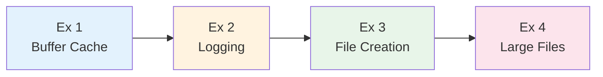
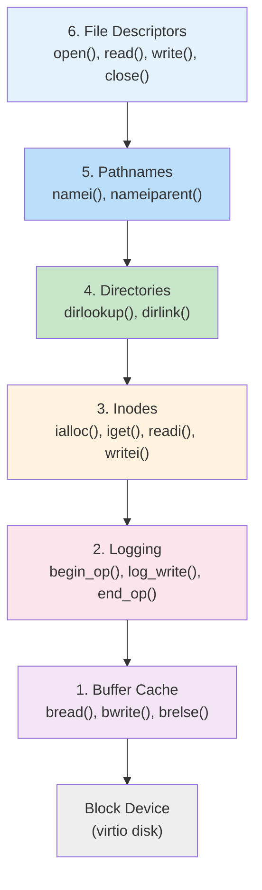
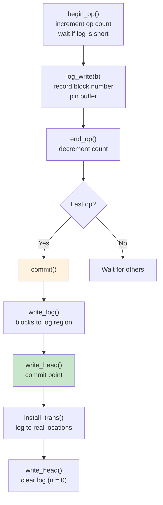

# Week 13 Lab — File System Internals

[Repository Guide](../../README.md) | [English](Concepts_Lab.md) | [한국어](Concepts_Lab.ko.md)

> **Last Updated:** 2026-11-19

> **Learning Objectives:**
> 1. Explain the layered structure and the disk layout of the xv6 file system
> 2. Analyze how the buffer cache caches disk blocks and serializes access to the same block
> 3. Explain how the logging system keeps the file system consistent across crashes
> 4. Trace the code paths of file creation, writing, and reading down to the inode and block level
> 5. Calculate xv6's maximum file size and explain how to extend it by adding indirect blocks

---

## Table of Contents

- [1. Lab Overview and Background](#1-lab-overview-and-background)
  - [1.1 Layers of the xv6 File System](#11-layers-of-the-xv6-file-system)
  - [1.2 Disk Layout](#12-disk-layout)
  - [1.3 Key Data Structures](#13-key-data-structures)
- [2. Exercise 1: The Buffer Cache](#2-exercise-1-the-buffer-cache)
  - [2.1 bget()](#21-bget)
  - [2.2 bread() and bwrite()](#22-bread-and-bwrite)
  - [2.3 brelse() and LRU](#23-brelse-and-lru)
  - [2.4 Two Kinds of Locks](#24-two-kinds-of-locks)
- [3. Exercise 2: The Logging System](#3-exercise-2-the-logging-system)
  - [3.1 Write-Ahead Logging](#31-write-ahead-logging)
  - [3.2 begin_op() and end_op()](#32-begin_op-and-end_op)
  - [3.3 log_write() and Absorption](#33-log_write-and-absorption)
  - [3.4 The Four Stages of commit()](#34-the-four-stages-of-commit)
  - [3.5 Crash Recovery](#35-crash-recovery)
- [4. Exercise 3: Tracing File Creation](#4-exercise-3-tracing-file-creation)
  - [4.1 The Call Chain of open()](#41-the-call-chain-of-open)
  - [4.2 sys_open() and create()](#42-sys_open-and-create)
  - [4.3 The Path of write()](#43-the-path-of-write)
  - [4.4 The Path of read()](#44-the-path-of-read)
  - [4.5 Running fs_trace](#45-running-fs_trace)
- [5. Exercise 4: Large File Support](#5-exercise-4-large-file-support)
  - [5.1 The Current File Size Limit](#51-the-current-file-size-limit)
  - [5.2 bmap()](#52-bmap)
  - [5.3 Adding a Double-Indirect Block](#53-adding-a-double-indirect-block)
  - [5.4 Extending bmap()](#54-extending-bmap)
- [6. Summary by Layer](#6-summary-by-layer)
- [Summary](#summary)
- [Self-Check Questions](#self-check-questions)

---

<br>

## 1. Lab Overview and Background

- **Objective:** Analyze the xv6 file system layer by layer and trace file operations from start to finish.
- **Topics:** The buffer cache, logging, tracing file creation, large file support
- **Files:** `kernel/bio.c`, `kernel/log.c`, `kernel/fs.c`, `kernel/fs.h`, `kernel/file.c`, `kernel/sysfile.c`, `mkfs/mkfs.c`



*Figure 1. Order of the four exercises*

Whereas the Week 13 lecture notes cover the storage devices themselves (HDDs, NVM, RAID), this lab covers the file system that organizes blocks on top of them into files and directories.

### 1.1 Layers of the xv6 File System

The xv6 file system consists of six layers, and each layer uses **only the services of the layer directly below it**, which separates concerns.



*Figure 2. The six layers of the xv6 file system*

| Layer | Source files | Role |
|:-----|:-----|:-----|
| 6. File descriptors | `file.c`, `sysfile.c` | File descriptor table, read and write offsets, a unified interface for pipes, devices, and inode files |
| 5. Pathnames | `fs.c` (`namei`, `namex`) | Splitting a path by `/` and following it, looking up each name in a directory |
| 4. Directories | `fs.c` (`dirlookup`, `dirlink`) | A directory as a special inode holding an array of `dirent`, mapping names to inode numbers |
| 3. Inodes | `fs.c` (`ialloc`, `readi`, `writei`, `bmap`) | File metadata (type, size, link count) and data block mapping, block allocation and freeing |
| 2. Logging | `log.c` | Transactions with `begin_op()` and `end_op()`, crash recovery with a write-ahead log |
| 1. Buffer cache | `bio.c` | In-memory cache of disk blocks, LRU replacement, access serialized with sleep-locks |
| 0. Disk driver | `virtio_disk.c` | Actual disk I/O through the virtio protocol |

*Table 1. Layers of the xv6 file system and their source files*

**Logging** provides safety against crashes, and the **buffer cache** guarantees that each disk block has only one copy in memory.

### 1.2 Disk Layout

An xv6 disk is an array of 1024-byte blocks, and `mkfs` builds the disk image (`fs.img`) with the following layout. When `make qemu` runs, `mkfs` prints the size of each region.

```text
nmeta 47 (boot, super, log blocks 31, inode blocks 13, bitmap blocks 1) blocks 1953 total 2000
```

```text
     0      1        2 - 32       33 - 45         46         47 - 1999
 +------+-------+-------------+-------------+-----------+-----------------+
 | boot | super |     log     |    inode    |  bitmap   |      data       |
 |      |       | (31 blocks) | (13 blocks) | (1 block) |  (1953 blocks)  |
 +------+-------+-------------+-------------+-----------+-----------------+
```

*Figure 3. Block layout of an xv6 disk*

| Constant | Value | Meaning |
|:-----|:-----|:-----|
| `FSSIZE` | 2000 | Total file system size (in blocks) |
| `BSIZE` | 1024 | Block size (in bytes) |
| `MAXOPBLOCKS` | 10 | Maximum number of blocks one file system operation can write |
| `LOGBLOCKS` | 30 | Number of log data blocks (`MAXOPBLOCKS * 3`) |
| `nlog` | 31 | Log area = 1 header + 30 data |
| `NINODES` | 200 | Maximum number of inodes |
| `IPB` | 16 | Inodes per block (1024 / 64) |
| `ninodeblocks` | 13 | Number of inode blocks (200 / 16 + 1) |
| `nbitmap` | 1 | Number of bitmap blocks (2000 / 8192 + 1) |
| `NBUF` | 30 | Buffer cache size (`MAXOPBLOCKS * 3`) |
| `NDIRECT` | 12 | Number of direct block pointers |
| `NINDIRECT` | 256 | Number of pointers in one indirect block (1024 / 4) |
| `MAXFILE` | 268 | Maximum file size (in blocks, 12 + 256) |

*Table 2. Key constants of the xv6 file system*

| Region | Block range | Role |
|:-----|:-----|:-----|
| Boot block | 0 | Place for a boot loader (unused by xv6) |
| Superblock | 1 | File system metadata (size, start of each region) |
| Log | 2-32 | Write-ahead log for crash recovery |
| Inode blocks | 33-45 | Array of on-disk inodes (`struct dinode`) |
| Bitmap | 46 | Bitmap marking which data blocks are in use |
| Data blocks | 47-1999 | Actual file data and directory entries |

*Table 3. Block ranges and roles of the disk regions*

`mkfs` computes the number of metadata blocks as `nmeta = 2 + nlog + ninodeblocks + nbitmap = 2 + 31 + 13 + 1 = 47` and uses the remaining `2000 - 47 = 1953` blocks as data blocks. The lab's `lab4_disk_layout.py` prints this table with the same computation. One bitmap block represents 8192 (`BPB = BSIZE * 8`) blocks, so increasing `FSSIZE` to 10,000 blocks would require `10000 / 8192 + 1 = 2` bitmap blocks.

### 1.3 Key Data Structures

The **superblock** (`kernel/fs.h`) records the disk layout.

```c
struct superblock {
  uint magic;        // Must be FSMAGIC
  uint size;         // Size of file system image (blocks)
  uint nblocks;      // Number of data blocks
  uint ninodes;      // Number of inodes.
  uint nlog;         // Number of log blocks
  uint logstart;     // Block number of first log block
  uint inodestart;   // Block number of first inode block
  uint bmapstart;    // Block number of first free map block
};
```

> **Definition:** An **inode** is a data structure that holds the metadata of one file (type, link count, size) and the locations of its data blocks. The file name is stored not in the inode but in a directory entry.

The **on-disk inode** (`kernel/fs.h`) is 64 bytes, so 16 of them fit in one block.

```c
struct dinode {
  short type;              // File type (0=free, T_DIR, T_FILE, T_DEVICE)
  short major;             // Device number (T_DEVICE only)
  short minor;
  short nlink;             // Number of hard links
  uint size;               // File size (bytes)
  uint addrs[NDIRECT+1];   // Data block addresses (12 direct + 1 indirect)
};
```

A **directory entry** is a 16-byte structure consisting of a 2-byte inode number and a 14-byte name. This is why names are limited to `DIRSIZ` (14) bytes.

```c
struct dirent {
  ushort inum;
  char name[DIRSIZ] __attribute__((nonstring));
};
```

A **buffer** (`kernel/buf.h`) is one disk block cached in memory.

```c
struct buf {
  int valid;   // has data been read from disk?
  int disk;    // does disk "own" buf?
  uint dev;
  uint blockno;
  struct sleeplock lock;
  uint refcnt;
  struct buf *prev; // LRU cache list
  struct buf *next;
  uchar data[BSIZE];
};
```

---

<br>

## 2. Exercise 1: The Buffer Cache

**Objective:** Read `kernel/bio.c` and `kernel/buf.h` and analyze how the buffer cache caches and synchronizes disk blocks.

> **Definition:** The **buffer cache** is the lowest software layer of the file system, which keeps copies of disk blocks in memory to reduce disk I/O and serializes concurrent access to the same block.

The buffer cache has two roles.

1. **Synchronization:** It serializes concurrent access to the same block so that only one access happens at a time. Each block has only one copy in memory, and only one process at a time uses that copy, so two processes never modify different copies of the same block.
2. **Caching:** It keeps frequently used blocks in memory to reduce disk I/O.

### 2.1 bget()

`bget()` is the core function of the buffer cache; it finds the requested block in the cache or assigns it a new buffer.

```c
static struct buf*
bget(uint dev, uint blockno)
{
  struct buf *b;

  acquire(&bcache.lock);

  // Is the block already cached?
  for(b = bcache.head.next; b != &bcache.head; b = b->next){
    if(b->dev == dev && b->blockno == blockno){
      b->refcnt++;
      release(&bcache.lock);
      acquiresleep(&b->lock);
      return b;
    }
  }

  // Not cached.
  // Recycle the least recently used (LRU) unused buffer.
  for(b = bcache.head.prev; b != &bcache.head; b = b->prev){
    if(b->refcnt == 0) {
      b->dev = dev;
      b->blockno = blockno;
      b->valid = 0;
      b->refcnt = 1;
      release(&bcache.lock);
      acquiresleep(&b->lock);
      return b;
    }
  }
  panic("bget: no buffers");
}
```

A cache hit and a cache miss are distinguished by the `valid` field. On a hit, the buffer's `valid` is left untouched, so the data already read is used as is. On a miss, the function searches from the back of the list (the least recently used end) for a buffer whose `refcnt` is 0, repurposes it for the other block, and sets `valid` to 0 so that the caller reads it fresh from disk. In both cases it returns with the buffer's sleep-lock held.

### 2.2 bread() and bwrite()

```c
// block read
struct buf*
bread(uint dev, uint blockno)
{
  struct buf *b;

  b = bget(dev, blockno);
  if(!b->valid) {              // If it was a cache miss
    virtio_disk_rw(b, 0);      // Read from disk (0 = read)
    b->valid = 1;
  }
  return b;                    // Returned in locked state
}

// block write
void
bwrite(struct buf *b)
{
  if(!holdingsleep(&b->lock))
    panic("bwrite");
  virtio_disk_rw(b, 1);        // Write to disk (1 = write)
}
```

`bwrite()` may be used only while the caller holds that buffer's sleep-lock. File system code does not call `bwrite()` directly but goes through `log_write()` of Section 3.

### 2.3 brelse() and LRU

```c
void
brelse(struct buf *b)
{
  if(!holdingsleep(&b->lock))
    panic("brelse");

  releasesleep(&b->lock);

  acquire(&bcache.lock);
  b->refcnt--;
  if (b->refcnt == 0) {
    // no one is waiting for it.
    b->next->prev = b->prev;
    b->prev->next = b->next;
    b->next = bcache.head.next;
    b->prev = &bcache.head;
    bcache.head.next->prev = b;
    bcache.head.next = b;
  }

  release(&bcache.lock);
}
```

```text
  Most recently used                            Least recently used
         (MRU)                                       (LRU)
           |                                           |
           v                                           v
  head <-> buf_A <-> buf_B <-> buf_C <-> ... <-> buf_Z <-> head
       next->                                       <-prev
```

*Figure 4. The LRU list of the buffer cache*

- When `refcnt` reaches 0 in `brelse()`, the buffer moves to the **front** of the list (`head.next`, most recently used).
- When `bget()` needs a free buffer for an uncached block, it searches from the **back** of the list (`head.prev`, least recently used).

> **[Data Structures]** The buffer list is a circular doubly linked list with a head node (`bcache.head`). The head node is a sentinel that holds no data, which lets the single test `b != &bcache.head` decide both whether the list is empty and whether the end has been reached. Unlinking a node and attaching it at the front is a constant-time operation that changes six pointers.

`NBUF` is 30. If a block that is not cached is requested while all 30 buffers are in use (`refcnt > 0`), `bget()` calls `panic("bget: no buffers")` and the kernel halts. A real operating system would instead be implemented to wait until a buffer in use is released.

### 2.4 Two Kinds of Locks

| Lock | Kind | Protects | Held for |
|:-----|:-----|:-----|:-----|
| `bcache.lock` | Spinlock | The linked-list structure of the buffer cache and each buffer's `refcnt`, `dev`, and `blockno` | The short interval of scanning or modifying the list |
| `b->lock` | Sleep-lock | The data (`data[]`) and `valid` of one buffer | While the block is read and modified, including disk I/O |

*Table 4. The two locks of the buffer cache*

A buffer's lock is a sleep-lock rather than a spinlock because disk I/O is a slow operation that takes several milliseconds. Waiting on a spinlock would keep the CPU spinning and wasted until the I/O completes, whereas a sleep-lock puts the waiting process to sleep so that other processes can use the CPU in the meantime. A sleep-lock also allows sleeping while holding the lock, which is impossible while holding a spinlock (disabling interrupts in Week 10 Lab, Section 5.5). For the same reason, `bget()` calls `acquiresleep(&b->lock)` only **after** releasing `bcache.lock`, so that it never sleeps waiting for a sleep-lock while holding a spinlock.

---

<br>

## 3. Exercise 2: The Logging System

**Objective:** Read `kernel/log.c` and analyze how the xv6 logging system guarantees the atomicity of file system operations.

### 3.1 Write-Ahead Logging

Creating a file requires writing several blocks, such as allocating an inode and adding a directory entry. If power is lost midway, only some of the blocks reach the disk, which may leave, for example, an inode that points to a freed block. The file system must remain in a **consistent state** even if power is lost in the middle.

> **Definition:** A **write-ahead log** is a scheme that, before writing blocks to their real locations on disk, first records those blocks in a log area and leaves a completion mark. A log with the completion mark is applied again at recovery and a log without it is discarded, which makes the writes of several blocks atomic with respect to crashes.



*Figure 5. How one system call reaches the disk through the log*

A system call wraps the part that modifies the file system in `begin_op()` and `end_op()`, and whenever it modifies a block in between, it calls `log_write()` instead of `bwrite()`.

```c
begin_op();
...
bp = bread(...);
bp->data[...] = ...;
log_write(bp);
...
end_op();
```

> **[Databases]** Write-ahead logging is also a technique used for transaction recovery in databases. The xv6 log is a redo log that records only the new contents of modified blocks; committed transactions are redone at recovery, and uncommitted transactions are never applied.

### 3.2 begin_op() and end_op()

```c
// called at the start of each FS system call.
void
begin_op(void)
{
  acquire(&log.lock);
  while(1){
    if(log.committing){
      sleep(&log, &log.lock);           // Wait if a commit is in progress
    } else if(log.lh.n + (log.outstanding+1)*MAXOPBLOCKS > LOGBLOCKS){
      // this op might exhaust log space; wait for commit.
      sleep(&log, &log.lock);
    } else {
      log.outstanding += 1;             // Increment outstanding operation count
      release(&log.lock);
      break;
    }
  }
}

// called at the end of each FS system call.
// commits if this was the last outstanding operation.
void
end_op(void)
{
  int do_commit = 0;

  acquire(&log.lock);
  log.outstanding -= 1;                 // Decrement outstanding operation count
  if(log.committing)
    panic("log.committing");
  if(log.outstanding == 0){
    do_commit = 1;                      // If last operation, commit
    log.committing = 1;
  } else {
    // begin_op() may be waiting for log space,
    // and decrementing log.outstanding has decreased
    // the amount of reserved space.
    wakeup(&log);
  }
  release(&log.lock);

  if(do_commit){
    // call commit w/o holding locks, since not allowed to sleep with locks.
    commit();
    acquire(&log.lock);
    log.committing = 0;
    wakeup(&log);                       // Notify commit completion
    release(&log.lock);
  }
}
```

`begin_op()` conservatively assumes that one system call writes up to `MAXOPBLOCKS` (10) distinct blocks, and it waits if the space reserved by the operations in progress (`(outstanding + 1) * MAXOPBLOCKS`) plus the number of blocks already recorded in the log (`log.lh.n`) exceeds `LOGBLOCKS` (30). Incrementing `log.outstanding` both reserves space and prevents a commit from happening before this system call ends. Since `LOGBLOCKS` is three times `MAXOPBLOCKS`, up to three system calls can take part in one transaction at the same time when the log is empty.

The logging system gathers the writes of several system calls into one transaction and commits only when no file system system call is in progress. This is called **group commit**; it spreads the fixed cost of a commit over several operations and reduces the number of disk operations. Since no system call is ever split across two transactions, committed contents never mix in writes from a system call that has not finished.

### 3.3 log_write() and Absorption

```c
// Caller has modified b->data and is done with the buffer.
// Record the block number and pin in the cache by increasing refcnt.
// commit()/write_log() will do the disk write.
void
log_write(struct buf *b)
{
  int i;

  acquire(&log.lock);
  if (log.lh.n >= LOGBLOCKS)
    panic("too big a transaction");
  if (log.outstanding < 1)
    panic("log_write outside of trans");

  for (i = 0; i < log.lh.n; i++) {
    if (log.lh.block[i] == b->blockno)   // log absorption
      break;
  }
  log.lh.block[i] = b->blockno;
  if (i == log.lh.n) {  // Add new block to log?
    bpin(b);
    log.lh.n++;
  }
  release(&log.lock);
}
```

`log_write()` does not write the block to disk; it records the block number in the in-memory log header, reserving one slot of the log. It then pins the buffer in the cache with `bpin()`, which increments its `refcnt` so that it is not evicted. Until the commit, the cached copy is the only record of the modification, it cannot be written to its real location before the commit, and other reads in the same transaction must see the modified contents.

When the same block is modified several times within one transaction, the same log slot is reused. This optimization is called **log absorption**. For example, even if the same inode block, holding the inodes of several files, or the same bitmap block is modified many times, it uses only one log slot, so more operations fit within the limited log size (`LOGBLOCKS = 30`) and only one copy has to be written to disk.

### 3.4 The Four Stages of commit()

```c
static void
commit()
{
  if (log.lh.n > 0) {
    write_log();     // [1] Write modified blocks from cache to log
    write_head();    // [2] Write header to disk -- the real commit
    install_trans(0); // [3] Now install writes to home locations
    log.lh.n = 0;
    write_head();    // [4] Erase the transaction from the log
  }
}
```

1. `write_log()`: Copies each block modified in the transaction from the buffer cache to the log area on disk (the slots after the header).
2. `write_head()`: Writes the header block, holding the block count `n` and the block numbers, to disk. This is the **commit point**.
3. `install_trans(0)`: Reads each block from the log area, writes it to its real location in the file system, and releases the pinned buffer with `bunpin()`.
4. Sets `n` in the header to 0 and writes the header again. This stage must finish before the next transaction starts writing log blocks, so that recovery after a crash never combines the header of one transaction with the log blocks of the next.

`write_head()` is the real commit point because only when this write completes is the fact that "a committed transaction exists" permanently recorded on disk. On reboot, `read_head()` reads this value, and if `n > 0`, recovery is performed. This design relies on the assumption that the disk writes a single block (the header block of `write_head()`) atomically.

### 3.5 Crash Recovery

The outcome depends on the stage of `commit()` at which power is lost.

```text
  commit() {
    write_log();       // [1] Write data to log
    ────────── Power loss point A ──────────
    write_head();      // [2] Write n to header <- commit point
    ────────── Power loss point B ──────────
    install_trans(0);  // [3] Copy data to home location
    ────────── Power loss point C ──────────
    log.lh.n = 0;
    write_head();      // [4] Erase log
  }
```

| Power loss point | Log header on disk | Action on reboot | Result |
|:-----|:-----|:-----|:-----|
| A | `n = 0` | Nothing to recover | Transaction **discarded** (changes of those system calls lost, file system consistent) |
| B | `n > 0` | Run `install_trans(1)` | Transaction **replayed** (full recovery) |
| C | `n > 0` | Run `install_trans(1)` | Transaction **replayed** (idempotent, so safe) |

*Table 5. Recovery result by power loss point*

At boot, `initlog()`, called from `fsinit()`, calls `recover_from_log()` before the first user process runs.

```c
static void
recover_from_log(void)
{
  read_head();
  install_trans(1); // if committed, copy from log to disk
  log.lh.n = 0;
  write_head(); // clear the log
}
```

Reinstalling blocks after some have already been installed in their real locations, as at point C, is safe because `install_trans()` is **idempotent**. `install_trans()` only **overwrites** the real locations with the contents of the log blocks, so writing the same data again over data that is already correct gives the same result. It is therefore safe to run it many times. After recovery, the result is always either "all writes of the transaction are applied" or "none are applied".

---

<br>

## 4. Exercise 3: Tracing File Creation

**Objective:** Trace step by step the code path executed when a user program calls `open("newfile", O_CREATE|O_RDWR)`.

### 4.1 The Call Chain of open()

```text
  User: open("newfile", O_CREATE|O_RDWR)
    |
    v
  [sysfile.c] sys_open()
    |-- begin_op()                       // Start transaction
    |-- create("newfile", T_FILE, 0, 0)
    |     |-- nameiparent("newfile")     // Find parent directory (/) inode
    |     |-- ilock(dp)                  // Lock parent directory
    |     |-- dirlookup(dp, "newfile")   // Check if already exists
    |     |-- ialloc(dev, T_FILE)        // Allocate new inode *
    |     |     |-- bread(dev, IBLOCK(inum))  // Read inode block
    |     |     |-- log_write(bp)             // Log modified block
    |     |     `-- brelse(bp)
    |     |-- ilock(ip)                  // Lock new inode
    |     |-- iupdate(ip)                // Write nlink=1 to disk
    |     |     |-- bread(...)
    |     |     |-- log_write(...)
    |     |     `-- brelse(...)
    |     |-- dirlink(dp, "newfile", ip->inum)  // Add entry to directory *
    |     |     `-- writei(dp, ...)      // Write to directory inode
    |     |           |-- bmap(dp, ...)  // Block mapping (balloc if needed)
    |     |           |-- bread(...)
    |     |           |-- log_write(...)
    |     |           `-- brelse(...)
    |     `-- iunlockput(dp)             // Release parent directory
    |
    |-- filealloc()                      // Allocate slot in system-wide file table
    |-- fdalloc(f)                       // Allocate slot in process file descriptor table
    |-- f->type = FD_INODE
    |-- f->ip = ip
    |-- f->readable = 1, f->writable = 1
    |-- iunlock(ip)                      // Unlock inode (reference retained)
    |-- end_op()                         // End transaction -> commit
    `-- return fd                        // Return file descriptor
```

*Figure 6. The call chain of open() with O_CREATE*

File creation modifies both the inode block (the new inode) and a data block of the parent directory (the new entry), and since both modifications lie in one transaction, they are applied together or discarded together even if a crash occurs. `ialloc()` reads the on-disk inodes in order, finds a free inode whose `type` is 0, records the type, and marks it with `log_write()`. Setting a breakpoint at `ialloc()` in GDB shows that `dip->type` is set to `T_FILE` (2) before `log_write()`.

### 4.2 sys_open() and create()

The `O_CREATE` path of `sys_open()` is as follows (part of the device-file and `O_TRUNC` handling omitted).

```c
uint64
sys_open(void)
{
  char path[MAXPATH];
  int fd, omode;
  struct file *f;
  struct inode *ip;
  int n;

  argint(1, &omode);
  if((n = argstr(0, path, MAXPATH)) < 0)
    return -1;

  begin_op();

  if(omode & O_CREATE){
    ip = create(path, T_FILE, 0, 0);   // Returned in locked state
    if(ip == 0){
      end_op();
      return -1;
    }
  } else {
    // ... open existing file: namei(path), ilock(ip) ...
  }

  if((f = filealloc()) == 0 || (fd = fdalloc(f)) < 0){
    if(f)
      fileclose(f);
    iunlockput(ip);
    end_op();
    return -1;
  }

  f->type = FD_INODE;
  f->off = 0;
  f->ip = ip;
  f->readable = !(omode & O_WRONLY);
  f->writable = (omode & O_WRONLY) || (omode & O_RDWR);

  iunlock(ip);
  end_op();

  return fd;
}
```

```c
static struct inode*
create(char *path, short type, short major, short minor)
{
  struct inode *ip, *dp;
  char name[DIRSIZ];

  if((dp = nameiparent(path, name)) == 0)   // Parent directory inode
    return 0;

  ilock(dp);

  if((ip = dirlookup(dp, name, 0)) != 0){   // Check if already exists
    iunlockput(dp);
    ilock(ip);
    if(type == T_FILE && (ip->type == T_FILE || ip->type == T_DEVICE))
      return ip;                            // Return existing file
    iunlockput(ip);
    return 0;
  }

  if((ip = ialloc(dp->dev, type)) == 0){    // Allocate new inode
    iunlockput(dp);
    return 0;
  }

  ilock(ip);
  ip->major = major;
  ip->minor = minor;
  ip->nlink = 1;
  iupdate(ip);                              // Write to disk

  if(type == T_DIR){  // Create . and .. entries.
    // No ip->nlink++ for ".": avoid cyclic ref count.
    if(dirlink(ip, ".", ip->inum) < 0 || dirlink(ip, "..", dp->inum) < 0)
      goto fail;
  }

  if(dirlink(dp, name, ip->inum) < 0)       // Add entry to directory
    goto fail;

  if(type == T_DIR){
    // now that success is guaranteed:
    dp->nlink++;  // for ".."
    iupdate(dp);
  }

  iunlockput(dp);

  return ip;                                // Returned in locked state

 fail:
  // something went wrong. de-allocate ip.
  ip->nlink = 0;
  iupdate(ip);
  iunlockput(ip);
  iunlockput(dp);
  return 0;
}
```

When a directory is created, the new directory's `"."` points to itself but does not increment `nlink`. Incrementing it would create a cycle in which the directory counts itself, and its link count could never reach 0. Instead, since the new directory's `".."` points to the parent, the parent's `nlink` is incremented by one.

### 4.3 The Path of write()

```text
  User: write(fd, "hello", 5)
    |
    v
  [sysfile.c] sys_write()
    |-- argfd(0, 0, &f)                  // Convert fd -> struct file*
    `-- filewrite(f, addr, 5)
          |
          v
        [file.c] filewrite()
          |-- begin_op()                 // Start transaction
          |-- ilock(f->ip)               // Lock inode
          |-- writei(f->ip, 1, addr, f->off, n)
          |     |
          |     v
          |   [fs.c] writei()
          |     |-- bmap(ip, off/BSIZE)  // Logical block -> physical block
          |     |     `-- balloc()       // Allocate new block if needed
          |     |-- bread(ip->dev, addr) // Read block
          |     |-- either_copyin(...)   // Copy user data -> buffer
          |     |-- log_write(bp)        // Schedule log write
          |     |-- brelse(bp)           // Release buffer
          |     `-- iupdate(ip)          // Update inode's size
          |
          |-- f->off += r                // Update file offset
          |-- iunlock(f->ip)             // Unlock inode
          `-- end_op()                   // End transaction -> commit
```

*Figure 7. The path by which the write() system call reaches the data blocks*

`filewrite()` splits a large write into several transactions.

```c
    // write a few blocks at a time to avoid exceeding
    // the maximum log transaction size, including
    // i-node, indirect block, allocation blocks,
    // and 2 blocks of slop for non-aligned writes.
    int max = ((MAXOPBLOCKS-1-1-2) / 2) * BSIZE;
    int i = 0;
    while(i < n){
      int n1 = n - i;
      if(n1 > max)
        n1 = max;

      begin_op();
      ilock(f->ip);
      if ((r = writei(f->ip, 1, addr + i, f->off, n1)) > 0)
        f->off += r;
      iunlock(f->ip);
      end_op();

      if(r != n1){
        // error from writei
        break;
      }
      i += r;
    }
```

One transaction may write at most `MAXOPBLOCKS` (10) blocks. Besides data blocks, a write may touch one inode block, one indirect block, and two more blocks that a non-aligned write can span, so these are subtracted first, and the remaining six blocks are divided by 2 on the view that each data block pairs with a bitmap block recording its allocation. Hence only `(10 - 1 - 1 - 2) / 2 = 3` blocks, that is, `3 * 1024 = 3072` bytes, are written at once, and a large file is written across several transactions.

### 4.4 The Path of read()

```text
  User: read(fd, buf, 5)
    |
    v
  [sysfile.c] sys_read()
    `-- fileread(f, addr, 5)
          |
          v
        [file.c] fileread()
          |-- ilock(f->ip)
          |-- readi(f->ip, 1, addr, f->off, n)
          |     |
          |     v
          |   [fs.c] readi()
          |     |-- bmap(ip, off/BSIZE)     // Logical block -> physical block
          |     |-- bread(ip->dev, addr)    // Read block (check cache)
          |     |-- either_copyout(...)     // Copy buffer -> user space
          |     `-- brelse(bp)
          |
          |-- f->off += r
          `-- iunlock(f->ip)
```

*Figure 8. The path by which the read() system call reaches the data blocks*

`read()` does not call `begin_op()` and `end_op()`. Since it does **not modify** the disk, crash recovery is not needed and neither is a log transaction. In contrast, `write()` modifies blocks such as data blocks, inodes, and bitmaps, so it needs a transaction.

### 4.5 Running fs_trace

`lab3_fs_trace.c` is an xv6 user program that performs, step by step, file creation, writing, closing, reopening, reading, verification, directory creation, nested file creation, and deletion, printing the call path of each step. As in the Week 9 Lab, Section 4.3, copy it to `user/fs_trace.c`, add `$U/_fs_trace\` to `UPROGS`, and run it. The key calls of each step are as follows.

```c
fd = open("testfile.txt", O_CREATE | O_RDWR);      // [Step 1] sys_open -> create -> ialloc + dirlink
print_stat("testfile.txt");                        // print type, ino, nlink, size with fstat()
write(fd, "Hello, xv6 file system!\n", 24);        // [Step 2] first write: bmap calls balloc
write(fd, "Second write to file.\n", 22);          // [Step 3] write on into the same block
close(fd);                                         // [Step 4] fileclose -> iput
fd = open("testfile.txt", O_RDONLY);               // [Step 5] namei -> dirlookup
n = read(fd, buf, sizeof(buf) - 1);                // [Step 6] readi -> bread
/* [Step 7] compare what was read with what was written */
mkdir("testdir");                                  // [Step 8] create(T_DIR) + "." + ".."
fd = open("testdir/inner.txt", O_CREATE | O_RDWR); // [Step 9] namex splits and follows the path
unlink("testdir/inner.txt");                       // [Step 10] clear the entry, decrement nlink
```

The result parts of each step in the output are as follows (the rest of the output is shortened to `...`).

```text
$ fs_trace
...
[Step 1] File creation: open("testfile.txt", O_CREATE|O_RDWR)
...
  Success! fd = 3
  File info:
    - type  : 2 (T_FILE)
    - ino   : 26
    - nlink : 1
    - size  : 0 bytes
...
  Success! 24 bytes written
  ...
    - size  : 24 bytes
...
  Success! 22 bytes written
  ...
    - size  : 46 bytes
...
  Success! 46 bytes read
  Content: "Hello, xv6 file system!
Second write to file.
"
...
  Verification succeeded! Read data matches written data.
...
[Step 8] Directory creation: mkdir("testdir")
...
  Success!
  File info:
    - type  : 1 (T_DIR)
    - ino   : 27
    - nlink : 1
    - size  : 32 bytes
...
[Step 9] Nested file creation: open("testdir/inner.txt", O_CREATE|O_RDWR)
...
  Success! fd = 3
  ...
    - ino   : 28
  ...
    - size  : 20 bytes
...
  Success! "testdir/inner.txt" deleted
```

- **Inode numbers:** The new file received inode 26. Inode 1 is the root directory, and the `README` and user programs that `mkfs` put into `fs.img`, together with the `console` device file that `init` creates with `mknod()` at first boot, take inodes from 2 onward in order, so this number depends on how many programs the image contains.
- **Size:** The file, 0 bytes right after creation, became 24 bytes with the first write and 46 bytes with the second. Both writes fit within the first data block (1024 bytes), so in the second write `bmap()` returns the block allocated during the first write.
- **Directory:** The new directory's size of 32 bytes is the two entries `"."` and `".."` (16 bytes each). Its `nlink` is 1 because `"."` does not increment the link count.
- **Closing and reopening:** When a file is opened without `O_CREATE`, `sys_open()` only finds the existing inode with `namei()` and `dirlookup()` and does not go through `ialloc()` and `dirlink()`. The 46 bytes read after reopening match what was written, confirming the path from a write through the log and the disk to the buffer cache and a read.
- **Deletion:** `unlink()` clears the inode number in the parent directory's entry to 0 and decrements `nlink`. If another process has the file open, a reference to the in-memory inode remains, so the blocks are not freed at once; when the last reference is closed, `iput()` sees `nlink == 0` and frees the blocks with `itrunc()`.

---

<br>

## 5. Exercise 4: Large File Support

**Objective:** Calculate xv6's file size limit and analyze how to extend it with a double-indirect block.

### 5.1 The Current File Size Limit

The block address array of an xv6 inode is as follows.

```text
  struct dinode {
    ...
    uint addrs[NDIRECT+1];   // addrs[0..11]: direct blocks
  };                          // addrs[12]:    indirect block pointer

  addrs[0]  -> data block 0     -+
  addrs[1]  -> data block 1      |
  addrs[2]  -> data block 2      | 12 direct blocks
  ...                             | = 12 * 1024 = 12,288 bytes
  addrs[11] -> data block 11    -+

  addrs[12] -> [indirect block] -+
                  |               |
                  v               | 256 blocks pointed to by the indirect block
              +--------+          | = 256 * 1024 = 262,144 bytes
              | addr 0 | -> data block 12
              | addr 1 | -> data block 13
              | ...    |
              |addr 255| -> data block 267
              +--------+          |
                                 -+
```

*Figure 9. Direct and indirect blocks of an xv6 inode*

```text
  NDIRECT   = 12
  NINDIRECT = BSIZE / sizeof(uint) = 1024 / 4 = 256
  MAXFILE   = NDIRECT + NINDIRECT = 12 + 256 = 268 blocks
  Maximum file size = 268 * 1024 bytes = 274,432 bytes (268 KB)
```

`writei()` returns -1 if `off + n > MAXFILE*BSIZE`, so a write beyond 274,432 bytes fails.

### 5.2 bmap()

`bmap()` translates a file's logical block number `bn` into a physical block number on disk, allocating a block if necessary.

```c
static uint
bmap(struct inode *ip, uint bn)
{
  uint addr, *a;
  struct buf *bp;

  // Direct blocks (bn = 0..11)
  if(bn < NDIRECT){
    if((addr = ip->addrs[bn]) == 0){
      addr = balloc(ip->dev);      // Allocate if not yet allocated
      if(addr == 0)
        return 0;
      ip->addrs[bn] = addr;
    }
    return addr;
  }
  bn -= NDIRECT;

  // Indirect blocks (bn = 0..255, originally 12..267)
  if(bn < NINDIRECT){
    // Load indirect block, allocating if necessary.
    if((addr = ip->addrs[NDIRECT]) == 0){
      addr = balloc(ip->dev);
      if(addr == 0)
        return 0;
      ip->addrs[NDIRECT] = addr;
    }
    bp = bread(ip->dev, addr);
    a = (uint*)bp->data;
    if((addr = a[bn]) == 0){
      addr = balloc(ip->dev);      // Allocate data block
      if(addr){
        a[bn] = addr;
        log_write(bp);
      }
    }
    brelse(bp);
    return addr;
  }

  panic("bmap: out of range");     // Error if exceeding 268 blocks
}
```

`balloc()` finds a 0 bit in the bitmap block, sets it to 1, records it with `log_write()`, fills the allocated block with zeros, and returns its number. If no block is available, it returns 0, so `bmap()` also returns 0, and `writei()` stops writing at that point. Because the bitmap change is also recorded with `log_write()`, allocating a block and modifying the inode or indirect block that points to it are bound into the same transaction. Even if a crash occurs in between, both are applied or both are discarded, so no block can leak with only its allocation mark left and nothing pointing to it.

### 5.3 Adding a Double-Indirect Block

Adding a **double-indirect** pointer to `addrs[]` gives the following.

```text
  addrs[0..11]  : 12 direct blocks
  addrs[12]     : 1 indirect block -> 256 data blocks
  addrs[13]     : 1 double-indirect block (newly added)
                     |
                     v
                 +--------+
                 | ptr 0  | -> [indirect block 0]   -> 256 data blocks
                 | ptr 1  | -> [indirect block 1]   -> 256 data blocks
                 | ...    |
                 |ptr 255 | -> [indirect block 255] -> 256 data blocks
                 +--------+
                  256 pointers * 256 data blocks = 65,536 blocks
```

*Figure 10. Block address structure of an inode with a double-indirect block*

```text
  Direct blocks:              12 blocks
  Indirect blocks:           256 blocks
  Double indirect: 256 * 256 = 65,536 blocks
  ──────────────────────────────
  Total:                   65,804 blocks

  Maximum file size = 65,804 * 1024 bytes
                    = 67,383,296 bytes
                    (about 64.26 MB)
```

To do this, change `addrs[]` of both `dinode` and the in-memory inode (`struct inode` in `kernel/file.h`) to `addrs[NDIRECT+2]` (size 14), and use `addrs[12]` for the indirect block and `addrs[13]` for the double-indirect block. The `MAXFILE` macro must also be changed to `NDIRECT + NINDIRECT + NINDIRECT*NINDIRECT`.

> **Caution:** With 14 entries in `addrs[]`, `struct dinode` grows from 64 to 68 bytes, and the number of inodes per block drops from 16 to 15 (1024 / 68). To keep the size at 64 bytes, another option is to reduce the direct blocks to 11 and use the freed entry for the double-indirect pointer. Either way, `mkfs` must be rebuilt with the same `fs.h`, and `itrunc()`, which frees blocks when a file is deleted, must be changed to free the double-indirect block and the indirect blocks below it as well. Also, since `FSSIZE` is 2000 blocks (about 2 MB), `FSSIZE` must be increased as well to actually create a large file.

Adding a triple-indirect block on top of this gives the following maximum size.

```text
  Direct:                        12 blocks
  Indirect:                     256 blocks
  Double indirect: 256 * 256 =   65,536 blocks
  Triple indirect: 256^3     = 16,777,216 blocks
  Total:                      16,843,020 blocks
  = 16,843,020 * 1024 bytes = 17,247,252,480 bytes (about 16.06 GB)
```

| Level | Calculation | Maximum size |
|:-----|:-----|:-----|
| Direct | 12 blocks | 12 KB |
| Indirect | 256 blocks | 256 KB |
| Double indirect | 256 × 256 blocks | 64 MB |
| Triple indirect | 256³ blocks | 16 GB |

*Table 6. Blocks and sizes added by each level of indirection*

Each additional level of indirection multiplies the number of blocks by 256. Ways to raise the maximum size without adding levels of indirection include increasing the block size `BSIZE`, which enlarges what one block and one indirect block can address, or switching to extents, which record a run of contiguous blocks as a single (start block, length) pair.

> **Note:** The `size` field of `dinode` is a 32-bit `uint`, so it can represent file sizes only up to 4 GB (2³² - 1 bytes). Even though a triple-indirect block can address 16 GB, the actual maximum size is bound by the `size` field, so using that much requires widening `size`, and the offset `off` of `readi()` and `writei()` (also a `uint`), to 64 bits.

### 5.4 Extending bmap()

Pseudocode that extends `bmap()` to support the double-indirect block is as follows.

```c
static uint bmap(struct inode *ip, uint bn)
{
  // ... existing direct, single indirect code ...

  bn -= NINDIRECT;

  // Double indirect (bn = 0 .. NINDIRECT*NINDIRECT - 1)
  if(bn < NINDIRECT * NINDIRECT){
    // Stage 1: Load the double indirect block itself
    if((addr = ip->addrs[NDIRECT+1]) == 0){
      addr = balloc(ip->dev);
      ip->addrs[NDIRECT+1] = addr;
    }
    bp = bread(ip->dev, addr);
    a = (uint*)bp->data;

    // Stage 2: Load the intermediate indirect block (the bn/NINDIRECT-th one)
    uint idx1 = bn / NINDIRECT;
    if((addr = a[idx1]) == 0){
      addr = balloc(ip->dev);
      a[idx1] = addr;
      log_write(bp);
    }
    brelse(bp);

    // Stage 3: Final data block
    bp = bread(ip->dev, addr);
    a = (uint*)bp->data;
    uint idx2 = bn % NINDIRECT;
    if((addr = a[idx2]) == 0){
      addr = balloc(ip->dev);
      a[idx2] = addr;
      log_write(bp);
    }
    brelse(bp);
    return addr;
  }

  panic("bmap: out of range");
}
```

With `bn` being the logical block number minus the 12 direct and 256 indirect blocks, the quotient of `bn` divided by 256 is the index within the double-indirect block (`idx1`), and the remainder is the index within the intermediate indirect block (`idx2`). For example, logical block number 1000 gives `bn = 1000 - 12 - 256 = 732`, so `idx1 = 2` and `idx2 = 220`. A real implementation must check, at every stage, for `balloc()` returning 0, as the existing code does.

---

<br>

## 6. Summary by Layer

| Layer | Source file | Key functions | Role |
|:-----|:-----|:-----|:-----|
| File descriptor | `file.c`, `sysfile.c` | `fileread`, `filewrite`, `sys_open` | User interface |
| Pathname | `fs.c` | `namei`, `namex` | Pathname resolution |
| Directory | `fs.c` | `dirlookup`, `dirlink` | Name-to-inode mapping |
| Inode | `fs.c` | `ialloc`, `readi`, `writei`, `bmap` | File metadata and data blocks |
| Log | `log.c` | `begin_op`, `end_op`, `log_write` | Crash recovery |
| Buffer cache | `bio.c` | `bread`, `bwrite`, `brelse` | Block caching and synchronization |

*Table 7. Source files, key functions, and roles by layer*

> **Key Point:** The file system is the most complex part of xv6, and reading it layer by layer is the most effective approach. The buffer cache keeps one copy per block, replaces buffers in LRU order, and serializes access with sleep-locks, and the log makes the writes of several blocks atomic with `write_head()` as the commit point. File creation modifies the inode block and the parent directory's block together through `ialloc()` and `dirlink()`, and both are bound into one transaction. Each level of indirect blocks multiplies the number of blocks by 256.

---

<br>

## Summary

| Concept | Key Summary |
|:-----|:-----|
| Layered structure | The six layers of file descriptors, pathnames, directories, inodes, logging, and the buffer cache each use only the layer directly below. |
| Disk layout | The 2000-block disk is divided into 47 metadata blocks (boot block, superblock, 31 log blocks, 13 inode blocks, 1 bitmap block) and 1953 data blocks. |
| Buffer cache | `bget()` returns the buffer on a cache hit, or recycles an LRU buffer with `refcnt` 0 on a miss, with its sleep-lock held, and `brelse()` moves a finished buffer to the MRU end. |
| Two kinds of locks | The `bcache.lock` spinlock briefly protects the list structure and `refcnt`, and the `b->lock` sleep-lock protects a buffer's data during disk I/O. |
| Logging | A system call records blocks with `log_write()` between `begin_op()` and `end_op()`, and `commit()` in the last `end_op()` writes the log, writes the header (the commit point), installs, and erases the log. |
| Crash recovery | At boot, if `n` in the header is greater than 0, the transaction is replayed with the idempotent `install_trans()`, and if it is 0 the log is discarded, so a transaction is applied either entirely or not at all. |
| File size | With 12 direct entries and 1 indirect entry, the maximum is 268 blocks (274,432 bytes), and adding a double-indirect block raises it to 65,804 blocks (about 64.26 MB). |

---

<br>

## Self-Check Questions

1. How do a cache hit and a cache miss in `bget()` treat the `valid` field, and what does `bread()` decide with it?

   <details>
   <summary>Answer</summary>

   On a cache hit, the buffer's `valid` is left untouched, so the data already read from disk is valid. On a cache miss, an LRU buffer with `refcnt` 0 is repurposed for the new block and `valid` is set to 0. `bread()` reads from disk with `virtio_disk_rw(b, 0)` and sets `valid` to 1 only when `valid` is 0, skipping disk I/O on a hit.

   </details>

2. Why does the buffer cache use a sleep-lock rather than a spinlock for each buffer? Also state what `bcache.lock` and `b->lock` each protect.

   <details>
   <summary>Answer</summary>

   Disk I/O takes several milliseconds, so waiting on a spinlock would keep the CPU spinning and wasted in the meantime. A sleep-lock puts the waiting process to sleep so that other processes can use the CPU, and it also allows sleeping while holding the lock. `bcache.lock` protects the linked-list structure of the buffer cache and fields such as `refcnt` for short intervals, and `b->lock` protects one buffer's data for long intervals that include disk I/O.

   </details>

3. What is log absorption, and why is it important?

   <details>
   <summary>Answer</summary>

   It is an optimization in which a block modified several times within the same transaction is recorded only once in the log, because `log_write()` finds the block number in the log header and reuses the same slot. Frequently modified blocks, such as an inode block holding the inodes of several files or a bitmap block, take only one log slot, so more operations fit within the limited log size (`LOGBLOCKS = 30`) and fewer copies must be written to disk.

   </details>

4. Explain why `write_head()` in `commit()` is the real commit point, and state the recovery result when power is lost right after `write_log()` and when it is lost in the middle of `install_trans()`.

   <details>
   <summary>Answer</summary>

   Only when `n > 0` is recorded in the header does the fact that "a committed transaction exists" remain on disk, and at reboot `read_head()` reads this value to decide on recovery; a single-block write is assumed to be atomic. If power is lost right after `write_log()`, `n` in the header is 0, so there is nothing to recover and the transaction is discarded, leaving the file system in the consistent state from before those system calls began. If power is lost in the middle of `install_trans()`, `n` in the header is greater than 0, so `install_trans(1)` reinstalls the transaction from the beginning, and because this is an idempotent operation that only overwrites, rewriting blocks that were already installed is safe.

   </details>

5. Explain with `MAXOPBLOCKS` why `filewrite()` writes at most 3072 bytes per transaction. Also explain why `read()` does not call `begin_op()` and `end_op()`.

   <details>
   <summary>Answer</summary>

   One transaction may write at most `MAXOPBLOCKS` (10) blocks. Besides data blocks, a write may touch one inode block, one indirect block, and two more blocks spanned by a non-aligned write, so subtracting these leaves six blocks, and dividing by 2 on the view that each data block may need one more bitmap block gives three blocks, that is, 3 × 1024 = 3072 bytes. `read()` does not modify the disk, so it needs neither crash recovery nor a log transaction.

   </details>

6. Calculate the maximum file size of the current xv6, and state the maximum size after adding a double-indirect block together with at least two things that must be changed along with it.

   <details>
   <summary>Answer</summary>

   Currently it is 12 direct blocks plus 256 indirect blocks, 268 blocks, or 268 × 1024 = 274,432 bytes. Adding a double-indirect block gives 12 + 256 + 256 × 256 = 65,804 blocks, or 67,383,296 bytes (about 64.26 MB). Things to change along with it are the size of `addrs[]` (or `NDIRECT`) in both `dinode` and the in-memory inode, the `MAXFILE` macro, `bmap()` to handle the double-indirect level, `itrunc()` to free the double-indirect block as well, and `mkfs` rebuilt with the same `fs.h`; to actually create a large file, `FSSIZE` must also be increased.

   </details>
