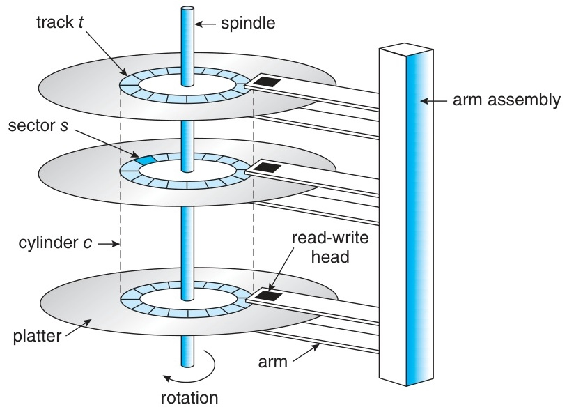
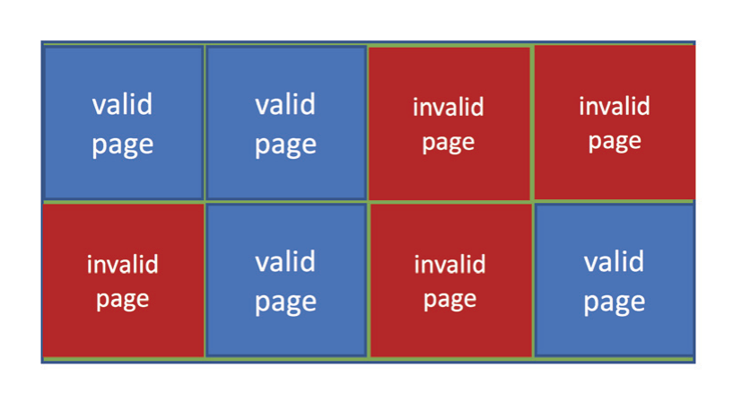
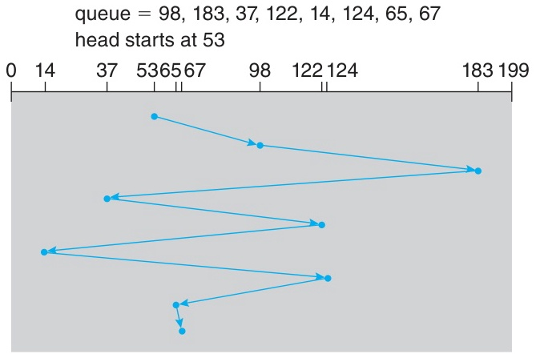
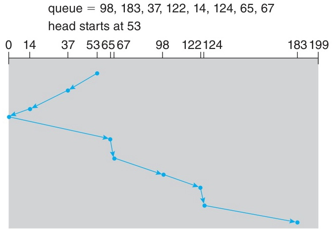
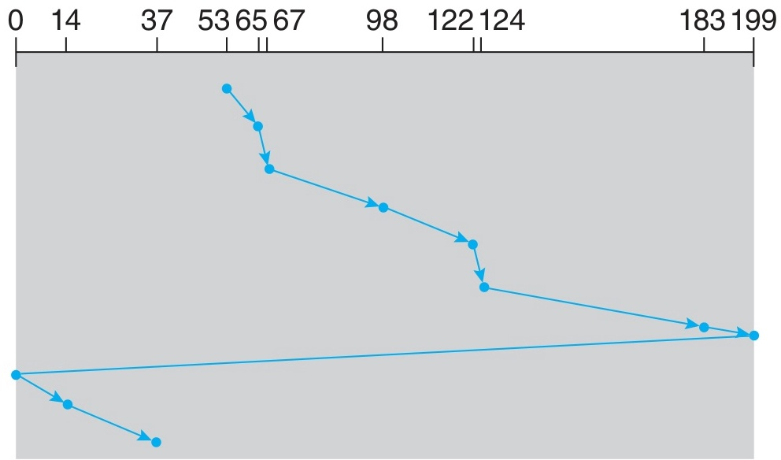
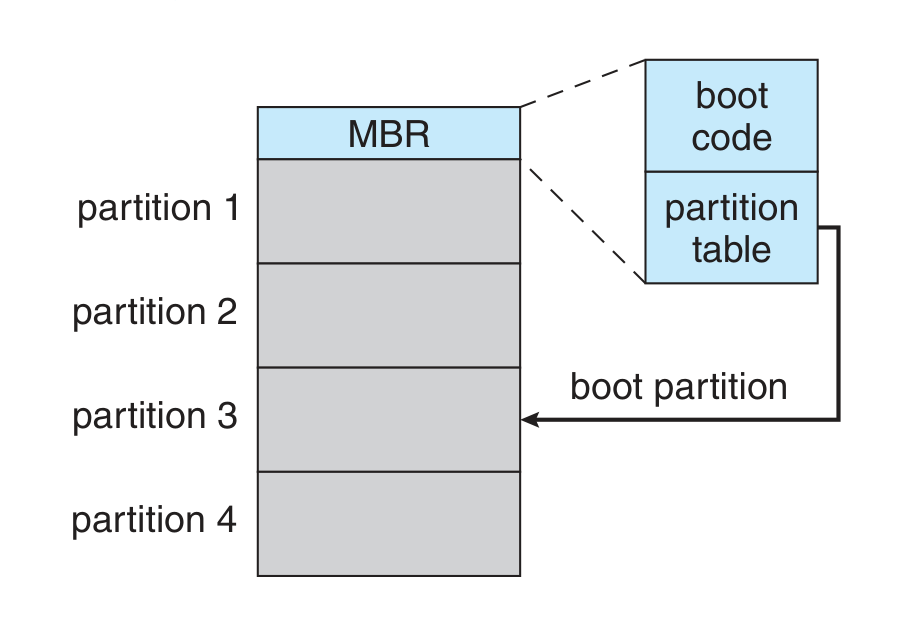
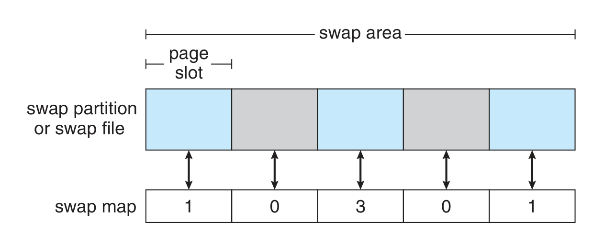
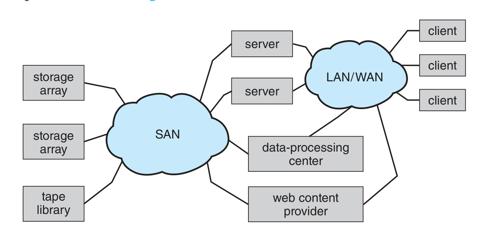
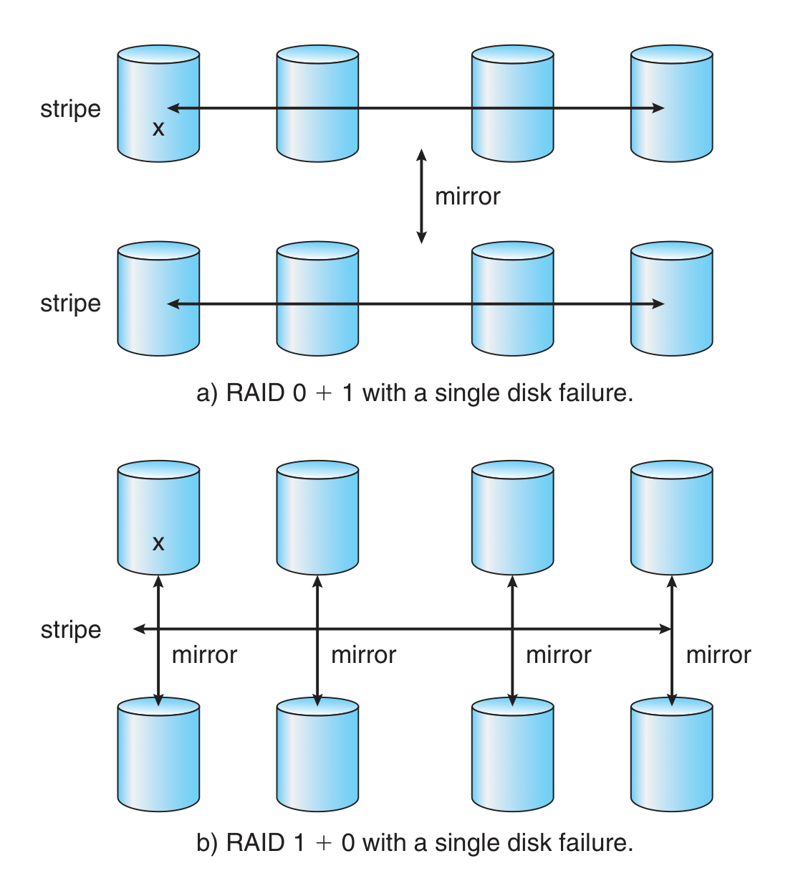
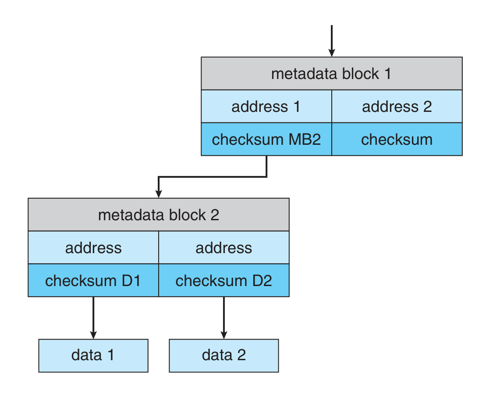

# Week 13 Lecture — Storage Management

[Repository Guide](../../README.md) | [English](Concepts_Lecture.md) | [한국어](Concepts_Lecture.ko.md)

> **Last Updated:** 2026-10-20
>
> Operating System Concepts, Silberschatz, Galvin, and Gagne, Ch 11

> **Learning Objectives:**
> 1. Describe the physical structure of an HDD (platter, track, sector, cylinder, head, arm, spindle) and head crashes, and decompose access time into seek time, rotational latency, and transfer time to compute typical totals
> 2. Distinguish HDDs from NVM/SSDs by mechanics, performance, and durability, and explain the characteristics of NAND Flash (page-level reads and writes, block-level erase, no overwrite) and the controller mechanisms (FTL, garbage collection, over-provisioning, wear leveling, TRIM, write amplification)
> 3. Compare storage connection interfaces (SATA, NVMe, SAS, USB, Fibre Channel) LBA addressing with its CHS mapping, and the CAV and CLV recording methods, and execute and compare the HDD-scheduling algorithms (FCFS, SCAN (elevator), C-SCAN, LOOK, C-LOOK)
> 4. Explain error detection and correction (parity, CRC, ECC) and its use in HDDs and SSDs, drive formatting (low-level formatting, partitioning, logical formatting), volume management, boot blocks, and bad-block handling (sector sparing, sector slipping)
> 5. Describe swap-space management on Linux (partition vs file, swap map) and the storage attachment methods (host-attached, NAS, SAN, cloud storage)
> 6. Explain RAID 0/1/4/5/6/10 in terms of striping, mirroring, parity, fault tolerance, and use cases, compute the MTBF of mirrored arrays, and explain when the independence assumption breaks and how ZFS-style checksums close the gaps RAID does not protect against

---

## Table of Contents

- [1. HDD Structure and Access Time](#1-hdd-structure-and-access-time)
  - [1.1 Mass-Storage Overview](#11-mass-storage-overview)
  - [1.2 HDD Physical Structure](#12-hdd-physical-structure)
  - [1.3 Rotation Speed and Capacity](#13-rotation-speed-and-capacity)
  - [1.4 Access Time = Seek + Rotational + Transfer](#14-access-time--seek--rotational--transfer)
  - [1.5 Concrete Access-Time Example](#15-concrete-access-time-example)
- [2. NVM Devices: SSD and NAND Flash](#2-nvm-devices-ssd-and-nand-flash)
  - [2.1 HDD vs SSD](#21-hdd-vs-ssd)
  - [2.2 NAND Flash Characteristics](#22-nand-flash-characteristics)
  - [2.3 FTL, Garbage Collection, Over-Provisioning](#23-ftl-garbage-collection-over-provisioning)
  - [2.4 Wear Leveling, TRIM, Write Amplification](#24-wear-leveling-trim-write-amplification)
  - [2.5 NVM Scheduling](#25-nvm-scheduling)
  - [2.6 Volatile Memory as Storage (RAM Drives)](#26-volatile-memory-as-storage-ram-drives)
- [3. Connection and Address Mapping](#3-connection-and-address-mapping)
  - [3.1 Connection Interfaces](#31-connection-interfaces)
  - [3.2 Logical Block Address (LBA)](#32-logical-block-address-lba)
- [4. HDD Scheduling Algorithms](#4-hdd-scheduling-algorithms)
  - [4.1 Goals and Request Structure](#41-goals-and-request-structure)
  - [4.2 FCFS](#42-fcfs)
  - [4.3 SCAN: The Elevator Algorithm](#43-scan-the-elevator-algorithm)
  - [4.4 C-SCAN: Circular SCAN](#44-c-scan-circular-scan)
  - [4.5 LOOK and C-LOOK](#45-look-and-c-look)
  - [4.6 Comparison on the Same Queue](#46-comparison-on-the-same-queue)
  - [4.7 Linux I/O Schedulers](#47-linux-io-schedulers)
- [5. Error Detection and Correction](#5-error-detection-and-correction)
  - [5.1 Parity, CRC, ECC](#51-parity-crc-ecc)
  - [5.2 ECC in Practice](#52-ecc-in-practice)
- [6. Storage Device Management](#6-storage-device-management)
  - [6.1 Drive Formatting](#61-drive-formatting)
  - [6.2 Partitions and Volumes](#62-partitions-and-volumes)
  - [6.3 Boot Block](#63-boot-block)
  - [6.4 Bad-Block Management](#64-bad-block-management)
- [7. Swap-Space Management](#7-swap-space-management)
  - [7.1 Purpose and Sizing](#71-purpose-and-sizing)
  - [7.2 Location: Partition vs File](#72-location-partition-vs-file)
  - [7.3 Linux Swap Internal Structure](#73-linux-swap-internal-structure)
- [8. Storage Attachment](#8-storage-attachment)
  - [8.1 Overview](#81-overview)
  - [8.2 NAS](#82-nas)
  - [8.3 SAN](#83-san)
  - [8.4 Cloud Storage](#84-cloud-storage)
- [9. RAID](#9-raid)
  - [9.1 Purpose and Building Blocks](#91-purpose-and-building-blocks)
  - [9.2 Reliability via Redundancy: MTBF Math](#92-reliability-via-redundancy-mtbf-math)
  - [9.3 Performance via Striping](#93-performance-via-striping)
  - [9.4 RAID 0: Striping Only](#94-raid-0-striping-only)
  - [9.5 RAID 1: Mirroring](#95-raid-1-mirroring)
  - [9.6 RAID 4: Striping + Dedicated Parity](#96-raid-4-striping--dedicated-parity)
  - [9.7 RAID 5: Distributed Parity](#97-raid-5-distributed-parity)
  - [9.8 RAID 6: Dual Parity](#98-raid-6-dual-parity)
  - [9.9 RAID 0+1 vs RAID 1+0 (RAID 10)](#99-raid-01-vs-raid-10-raid-10)
  - [9.10 Comprehensive Comparison](#910-comprehensive-comparison)
  - [9.11 Hot Spare and Implementation Layers](#911-hot-spare-and-implementation-layers)
  - [9.12 What RAID Does Not Protect Against and ZFS](#912-what-raid-does-not-protect-against-and-zfs)
- [10. Lab: Disk-Scheduling Simulator](#10-lab-disk-scheduling-simulator)
- [Summary](#summary)
- [Self-Check Questions](#self-check-questions)

---

<br>

## 1. HDD Structure and Access Time

### 1.1 Mass-Storage Overview

| Category                | Examples                  | Characteristics                               |
|-------------------------|---------------------------|-----------------------------------------------|
| **Secondary Storage**   | HDD, SSD                  | Primary nonvolatile working storage           |
| **Tertiary Storage**    | Magnetic tape, optical disk | Slow but high capacity, used for backup     |
| **NVS (Nonvolatile Storage)** | All nonvolatile devices  | Data persists across power-off              |

*Table 1. Categories of mass storage*

This unit covers the following:
- Understand the physical structure of storage devices.
- Analyze the I/O scheduling algorithms the OS uses to order requests.
- Survey the storage device management services the OS provides, including **RAID**.

### 1.2 HDD Physical Structure



*Figure 1. Moving-head disk mechanism of an HDD*

```text
    Platter 1  ──── Head 1 (top surface)
                ──── Head 2 (bottom surface)
    Platter 2  ──── Head 3
                ──── Head 4
    Platter 3  ──── Head 5
                ──── Head 6
         ↑
       Spindle        ←── Disk arm (moves all heads together)
```

*Figure 2. Arrangement of platters, heads, spindle, and disk arm*

| Component | Description                                                                 |
|-----------|-----------------------------------------------------------------------------|
| **Platter** | Rigid disk where data is stored (both sides usable)                       |
| **Track**   | Concentric ring on the platter surface                                     |
| **Sector**  | Smallest logical unit of a track (historically 512 B, transitioning to 4 KB) |
| **Cylinder**| Set of tracks at the same radius across all platters                       |

*Table 2. Main components of an HDD*

- The **read-write head** flies over each platter surface on a very thin cushion of air (or helium).
- All heads attach to a **single disk arm** and move **simultaneously**, so seek time is paid once per arm move, not once per platter.
- Platter surfaces are coated with magnetic material, and data is recorded and read magnetically.

> **Definition:** A **head crash** is a catastrophic event in which the head physically touches the platter surface. It destroys the magnetic coating and renders the data unrecoverable, so the entire disk must be replaced. RAID (Section 9) is the primary defense at the system level.

### 1.3 Rotation Speed and Capacity

The platter spins at a fixed **RPM** (revolutions per minute):

| RPM    | Typical use case            | Time per revolution |
|--------|-----------------------------|---------------------|
| 5,400  | Laptops, low power          | 11.1 ms             |
| 7,200  | Desktops, general servers   | 8.3 ms              |
| 10,000 | High-performance servers    | 6.0 ms              |
| 15,000 | Enterprise SAS              | 4.0 ms              |

*Table 3. Typical use case and time per revolution by RPM*

- The **transfer rate** is the data rate between drive and host. The actual transfer rate is always lower than the nominal headline figure.
- Drive controllers include a **built-in DRAM buffer** used as a cache for prefetched and write-back data.
- Common platter diameters are 1.8-3.5 inches.

### 1.4 Access Time = Seek + Rotational + Transfer

$$
\text{Access time} = \text{Seek time} + \text{Rotational latency} + \text{Transfer time}
$$

| Component             | Description                                                          | Magnitude         |
|-----------------------|----------------------------------------------------------------------|-------------------|
| **Seek time**         | Time to move the arm to the desired cylinder                         | Largest (ms range)    |
| **Rotational latency**| Time to wait for the desired sector to rotate under the head         | Medium (ms range)     |
| **Transfer time**     | Time to actually read or write the data                              | Smallest (μs range)   |

*Table 4. Three components of access time*

```text
  Seek time           Rotational latency       Transfer time
  ──────────→         ──────────────────→      ─────→
  arm movement         sector rotation wait     data transfer
```

*Figure 3. Three phases of a disk access*

**Seek time dominates** for random I/O. The goal of HDD scheduling (Section 4) is to **minimize the total seek distance** by reordering requests.

### 1.5 Concrete Access-Time Example

Consider a 7,200 RPM drive:

- One revolution takes $60 / 7{,}200 = 8.33$ ms.
- The average rotational latency is $8.33 / 2 = \mathbf{4.17\ ms}$ (on average we wait half a revolution).

A typical breakdown:

```text
  Average seek time:          8 ms
  Average rotational latency: 4.17 ms
  Transfer time (4 KB):       ~0.01 ms
  ──────────────────────────────────
  Total access time:          ~12.18 ms
```

- Seek time is roughly **66%** of the total.
- That allows roughly **$1000 / 12.18 \approx 82$ random I/Os per second**, and this 82 IOPS figure defines HDD performance.
- **Sequential I/O is much faster** because the seek and rotation costs are amortized across a long contiguous run, so an HDD has a large gap between random and sequential performance.

> **Key Point:** The single most important number for HDD performance is 82 IOPS. It explains why databases use indices (to turn random access into sequential access), why file systems batch writes (to amortize seeks), and why SSDs feel transformative (they remove the seek penalty entirely).

> **[Computer Architecture]** The HDD is the bottom of the **memory hierarchy** from Week 11: registers, cache, main memory, and disk trade latency for capacity. Quantified in cycles, a register access takes about one cycle and a DRAM access tens to hundreds of cycles, while one HDD access at roughly 12 ms costs **tens of millions of CPU cycles**. This cliff between DRAM and disk is why the OS treats whether data is already in memory (page-fault handling, the page cache) as a central performance question, and why many real workloads are limited by the 82-IOPS ceiling rather than by raw CPU speed.

---

<br>

## 2. NVM Devices: SSD and NAND Flash

### 2.1 HDD vs SSD

| Property                       | HDD                          | SSD                            |
|--------------------------------|------------------------------|--------------------------------|
| Mechanical parts               | Yes (arm, spindle)           | None                           |
| Seek time                      | Yes                          | None                           |
| Rotational latency             | Yes                          | None                           |
| Random vs sequential gap       | Large                        | Small                          |
| Speed                          | Slow                         | Fast                           |
| Durability                     | Mechanical wear              | Limited write cycles           |
| Power consumption              | High                         | Low                            |
| Cost per GB                    | Cheap                        | Expensive                      |

*Table 5. Comparison of HDD and SSD*

Form factors include 2.5-inch and 3.5-inch SATA SSDs, M.2 NVMe drives mounted on the motherboard, USB sticks, smartphone built-in storage, and eMMC. They are physically diverse, but all are built on **NAND Flash** memory.

### 2.2 NAND Flash Characteristics

NAND Flash has three operations with very different units and speeds:

| Operation | Unit                                      | Speed                |
|-----------|-------------------------------------------|----------------------|
| Read      | **Page** (typically 4-16 KB)              | Fastest              |
| Write     | **Page**                                  | Slower than read     |
| Erase     | **Block** (group of many pages)           | Slowest              |

*Table 6. Units and speeds of NAND Flash operations*

**Critical asymmetry: no overwrite.**

- A page that already holds data cannot be directly overwritten.
- To rewrite a page, the entire enclosing block must first be **erased** and then written.

This single property leads to all the controller techniques below.



*Figure 4. NAND block with valid and invalid pages*

- **Lifespan:** approximately $10^5$ program-erase cycles per cell (it varies widely by product class).
- **DWPD (Drive Writes Per Day):** how many times the **entire** drive capacity can be overwritten per day over the rated lifespan; it is a standard endurance metric.

### 2.3 FTL, Garbage Collection, Over-Provisioning

**Flash Translation Layer (FTL).** The on-controller software that bridges what the OS sees (LBAs, simple block reads and writes) and what NAND flash demands (page-level reads and writes, block-level erase, no overwrite).

- It maintains a **logical-block to physical-page** mapping.
- It tracks valid and invalid pages.
- The OS just reads and writes LBAs; everything below is handled by the controller.

**Garbage Collection.** When the drive fills up with invalid (rewritten) pages, the GC routine works as follows:

```text
  Block A: [Valid][Invalid][Invalid][Valid]    → copy valid pages out
  Block B: [Valid][Valid][Valid][Free]          ← into here
  Block A: [Erased]                             → available for reuse
```

*Figure 5. Garbage collection moving valid pages and erasing a block*

GC consumes bandwidth and contributes to write amplification.

**Over-Provisioning.** A part of the drive's physical capacity (for example, about 20%) is reserved as spare space invisible to the user. It is used as scratch space during GC and as a buffer for wear leveling. It improves **performance**, because GC has somewhere to put valid data, and **lifespan**, because write cycles are spread over a larger physical pool.

### 2.4 Wear Leveling, TRIM, Write Amplification

**Wear leveling.** Without it, hot blocks (frequently rewritten) would wear out long before cold blocks. The controller **distributes erases evenly** across all blocks:

```text
  Without wear leveling:           With wear leveling:
  Block 0: ████████ (heavy)        Block 0: ████ (balanced)
  Block 1: █        (idle)         Block 1: ████ (balanced)
  Block 2: ██████   (heavy)        Block 2: ████ (balanced)
  Block 3: █        (idle)         Block 3: ████ (balanced)
```

*Figure 6. Erase counts per block with and without wear leveling*

**TRIM.** When a file is deleted at the file-system level, the OS sends a TRIM command telling the SSD controller that the block is no longer in use. The controller can then mark those pages invalid eagerly, run GC ahead of time, and avoid copying soon-to-be-discarded data. Without TRIM, the SSD has no way to distinguish valid user data from data that the file system has deleted but that still sits in flash.

**Write amplification.** A single logical write from the OS can internally trigger multiple reads, writes, and erases (because GC moves live data out of the way). The write amplification factor (WAF) measures this overhead: a WAF of 3 means a 4 KB host write becomes 12 KB of actual NAND traffic. Lower is better for both performance and lifespan.

> **Note:** **The big picture.** The OS sees a tidy block device. Under the hood, the controller is constantly garbage-collecting, remapping, and shuffling pages. SSDs feel fast and durable instead of slow and fragile because the FTL hides all of this work.

### 2.5 NVM Scheduling

SSDs have **no seek**, so the HDD scheduling algorithms of Section 4 are largely irrelevant, and there is no need to reorder requests for arm movement.

| Property            | HDD                       | SSD                                       |
|---------------------|---------------------------|-------------------------------------------|
| Random read         | Slow (seek required)      | Fast (about 100K IOPS)                    |
| Sequential read     | Relatively fast           | Fast                                      |
| Random write        | Slow                      | Fast but **variable** (GC dependence)     |
| Sequential write    | Relatively fast           | Fast                                      |

*Table 7. HDD and SSD performance by access type*

- SSDs typically use a simple **FCFS** policy (the Linux NOOP scheduler).
- Adjacent requests are **merged** into larger, more efficient transfers.
- Read service times are uniform, but **write service times are not**; they depend on garbage collection, current utilization, and wear-leveling state.
- An HDD delivers tens to hundreds of IOPS; an SSD delivers **hundreds of thousands of IOPS**.

### 2.6 Volatile Memory as Storage (RAM Drives)

A **RAM drive** uses a portion of DRAM as a block device. A device driver allocates a region of DRAM and presents it to the file-system layer as if it were a disk.

- It is the fastest possible storage, orders of magnitude faster than SSDs.
- It is **volatile**: data is lost on system restart.
- It is used for high-speed temporary file storage, cross-program data sharing, and build-system caches.

| OS      | RAM drive mechanism                    |
|---------|----------------------------------------|
| Linux   | `/dev/ram`, `tmpfs` (e.g., `/tmp`)      |
| macOS   | `diskutil` command                     |
| Windows | Third-party tools                      |

*Table 8. RAM drive mechanisms by operating system*

Linux's **initrd** uses a RAM drive as a temporary root file system during early boot, before the real root device is available.

---

<br>

## 3. Connection and Address Mapping

### 3.1 Connection Interfaces

| Interface                | Characteristics                                                            |
|--------------------------|----------------------------------------------------------------------------|
| **SATA**                 | General purpose, low cost, up to about 600 MB/s, most common               |
| **NVMe (PCIe)**          | High speed, low latency, optimized for SSDs, direct PCIe connection        |
| **SAS**                  | Server-grade, high reliability, cheaper than Fibre Channel                 |
| **USB**                  | External storage, universal connectivity                                   |
| **Fibre Channel (FC)**   | SAN environments, high-speed dedicated networked storage                   |

*Table 9. Storage connection interfaces*

- The **Host Bus Adapter (HBA)** is the bus controller on the **computer** side.
- The **Device Controller** is the built-in controller in each **storage device**.

```text
  CPU → HBA → bus (SATA / NVMe / SAS) → Device Controller → Media
                                                ↑
                                      DRAM cache (controller-local)
```

*Figure 7. I/O path from the CPU to the storage medium*

> **Note:** **Why NVMe is much faster than SATA.** NVMe rides directly on the **PCIe** bus instead of going through the SATA protocol stack. That means lower latency, much higher queue depth (64K commands per queue, 64K queues), and parallelism that matches what modern SSDs can actually deliver.

> **[Computer Architecture]** The path `CPU → HBA → bus → Device Controller → Media` is the **I/O subsystem** of computer architecture. The CPU does not copy bytes one at a time; it programs the controller and lets **DMA (Direct Memory Access)** stream the block straight into main memory, then receives an **interrupt** on completion. The HBA and device controller follow the same model of I/O controllers on a shared bus that is used to reason about memory-mapped I/O and interrupt-driven transfer. Storage is just one device class hanging off that bus, which is also why bus topology (PCIe lanes vs the legacy SATA link) directly caps throughput.

### 3.2 Logical Block Address (LBA)

The OS does not care about cylinders or pages. It addresses the device as a **one-dimensional array of logical blocks** numbered 0, 1, 2, ...

```text
  Application       OS              Storage device
  ──────────→  ──────────→       ──────────────────
  File name     LBA number         Physical location
               (0, 1, 2, …)       HDD: Cylinder-Head-Sector (CHS)
                                  NVM: Chip-Block-Page
```

*Figure 8. Address mapping from file name through LBA to physical location*

**LBA-to-CHS mapping on an HDD.** Sector 0 is the first sector of the first track of the outermost cylinder. Subsequent LBAs proceed along the track, then cylinder by cylinder toward the inside. The real mapping is messier because of bad-sector replacement, variable sector counts per track, and so on.

There are two ways to record data on rotating media, **CAV and CLV**:

| Method | Description                                                            | Used in |
|--------|------------------------------------------------------------------------|---------|
| **CAV (Constant Angular Velocity)** | Constant RPM; bit density decreases from inner to outer tracks to keep the data rate constant | HDD     |
| **CLV (Constant Linear Velocity)**  | Uniform bit density per track, so outer tracks hold more sectors; rotates slower when the head is at the outer edge | CD/DVD  |

*Table 10. Comparison of CAV and CLV*

---

<br>

## 4. HDD Scheduling Algorithms

### 4.1 Goals and Request Structure

Goals of disk scheduling:
- **Minimize access time** (especially seek time).
- **Maximize data transfer bandwidth**.
- Reorder the request queue to reduce arm movement distance.

Information attached to each I/O request:
1. Direction (input or output)
2. Open file handle
3. Target memory address (where to deliver or fetch the bytes)
4. Data size

When the disk is busy, new requests accumulate in a **pending queue**. The OS is free to reorder the queue for performance as long as it does not violate ordering constraints (e.g., a write that must precede a dependent read). Modern drives use LBAs, so closer LBAs are assumed to be physically closer, which is close enough for scheduling.

**Worked-example setup used throughout this section:**
- Request queue: `98, 183, 37, 122, 14, 124, 65, 67`
- Head start: 53
- Disk cylinders: 0-199

### 4.2 FCFS

**First-Come, First-Served.** Requests are processed in their arrival order.



*Figure 9. FCFS disk scheduling*

```text
  head
   53 → 98 → 183 → 37 → 122 → 14 → 124 → 65 → 67
```

*Figure 10. Head movement order under FCFS*

Total head movement:
$|53-98| + |98-183| + |183-37| + |37-122| + |122-14| + |14-124| + |124-65| + |65-67|$
$= 45 + 85 + 146 + 85 + 108 + 110 + 59 + 2 = \mathbf{640\ cylinders}$.

| Advantages           | Disadvantages                            |
|----------------------|------------------------------------------|
| Simple to implement  | Head swings widely back and forth        |
| Fair (no reordering) | Total seek distance is large             |
| No starvation        | Poor performance                         |

*Table 11. Advantages and disadvantages of FCFS*

Notice the **122 → 14 → 124** segment: the arm crosses almost the whole disk twice. Reordering to serve 37 and 14 first and then 122 and 124 would be far more efficient, and that is exactly what the next algorithms do.

### 4.3 SCAN: The Elevator Algorithm

The head moves in one direction to the end of the disk, servicing requests in order, then **reverses direction** and services the remaining ones, just like a building elevator.



*Figure 11. SCAN disk scheduling*

Same queue, head 53, initial direction **decreasing**:

```text
  head
   53 → 37 → 14 → [0] → 65 → 67 → 98 → 122 → 124 → 183
                    ↑
                reverse direction after reaching end
```

*Figure 12. Head movement order under SCAN in the decreasing direction*

Total movement is the sum of the absolute distances of the segments (the magnitude of head movement), so head movement is never negative:
$|53-37| + |37-14| + |14-0| + |0-65| + |65-67| + \dots$
$= 16 + 23 + 14 + 65 + 2 + 31 + 24 + 2 + 59 = \mathbf{236\ cylinders}$

This is much better than FCFS's 640.

> **Note:** **Why the name elevator.** A real elevator carrying one person going up and one going down does not bounce randomly between floors; it goes up to the top, then down to the bottom. SCAN uses the same idea.

### 4.4 C-SCAN: Circular SCAN

SCAN's downside is that positions near the middle get serviced **twice** per round (once in each direction), while positions at the ends get serviced only once, so waiting time is uneven.

**C-SCAN** services requests in **one direction only**. On reaching the end, the head **immediately returns to the start**, without servicing anything during the return.



*Figure 13. C-SCAN disk scheduling*

Same queue, direction **increasing**:

```text
  53 → 65 → 67 → 98 → 122 → 124 → 183 → [199]
                                            ↓ (jump back, no service)
  [0] → 14 → 37
```

*Figure 14. Head movement order under C-SCAN in the increasing direction*

| Property             | SCAN                | C-SCAN                                        |
|----------------------|---------------------|-----------------------------------------------|
| Service direction    | Bidirectional       | Unidirectional                                |
| Waiting time         | Middle is favored   | **Uniform across positions**                  |
| Implementation       | Simple              | Slightly more complex                         |

*Table 12. Comparison of SCAN and C-SCAN*

C-SCAN treats cylinders as a **circular list**, wrapping from the last cylinder back to the first.

### 4.5 LOOK and C-LOOK

SCAN and C-SCAN go all the way to the end of the disk even when there are no requests near the end, which wastes movement. **LOOK** and **C-LOOK** reverse or wrap as soon as there are no further requests in the current direction:

```text
  SCAN:    53 → 37 → 14 → [0] → 65 → …    (goes all the way to 0)
  LOOK:    53 → 37 → 14 →        65 → …   (reverses at 14, the last request)

  C-SCAN:  53 → 65 → … → 183 → [199] → [0] → 14 → 37
  C-LOOK:  53 → 65 → … → 183 →               14 → 37
```

*Figure 15. SCAN and C-SCAN going to the disk end versus LOOK and C-LOOK turning at the last request*

| Algorithm | Goes to disk end? | Bidirectional service? |
|-----------|-------------------|------------------------|
| SCAN      | Yes               | Yes                    |
| LOOK      | No                | Yes                    |
| C-SCAN    | Yes               | No (one-way)           |
| C-LOOK    | No                | No (one-way)           |

*Table 13. Behavior of the SCAN-family algorithms*

In practice, **LOOK and C-LOOK** are used much more often than SCAN and C-SCAN.

### 4.6 Comparison on the Same Queue

With the same setup as above (queue `98, 183, 37, 122, 14, 124, 65, 67`, head 53, disk 0-199):

| Algorithm     | Total Movement | Characteristics                              |
|---------------|----------------|----------------------------------------------|
| FCFS          | **640**        | Fair but inefficient                         |
| SCAN (down)   | **236**        | Bidirectional service, efficient             |
| C-SCAN (up)   | **382**        | Uniform waiting time across cylinders        |
| LOOK (down)   | **208**        | Improved SCAN, no end-of-disk excursion      |
| C-LOOK (up)   | **322**        | Improved C-SCAN, no end-of-disk excursion    |

*Table 14. Total head movement by algorithm on the same request queue*

The totals for C-SCAN and C-LOOK include the return movement from the end to the beginning (199 cylinders for C-SCAN, 169 cylinders for C-LOOK).

**Algorithm choice heuristics:**

- **Heavily loaded systems:** SCAN and C-SCAN fit well (they are less likely to cause starvation).
- **Uniform response time needed:** C-SCAN and C-LOOK fit well.
- **Light load or simple systems:** FCFS is enough (when the queue is short, all algorithms perform similarly).

### 4.7 Linux I/O Schedulers

**Deadline scheduler.**
- It keeps separate read and write queues and **prioritizes reads** (writes can be batched, but reads block the user).
- Within each queue, requests are sorted by LBA (similar to C-SCAN) for efficient batches.
- Each request has a **deadline** (default 500 ms), so no request waits forever.
- An FCFS queue runs in parallel to guarantee that old requests are served.

**NOOP scheduler.**
- It is FCFS plus adjacent-request merging, with no reordering.
- It suits CPU-bound systems and especially SSDs, where there is no seek to optimize.

**CFQ (Completely Fair Queueing).**
- It is the default for SATA HDDs in some distributions.
- It has three priority queues (Real-time > Best-effort > Idle).
- It maintains per-process queues to exploit per-process locality of reference.

---

<br>

## 5. Error Detection and Correction

### 5.1 Parity, CRC, ECC

Stored or transmitted data can pick up bit errors. The defenses:

| Technique       | Function                          | Description                                                            |
|-----------------|-----------------------------------|------------------------------------------------------------------------|
| **Parity bit**  | Detection                         | Detects an odd number of bit errors (typically a single-bit error), cannot correct |
| **CRC**         | Integrity verification            | Cyclic Redundancy Check, polynomial-based, detects multi-bit errors    |
| **ECC**         | Detection + Correction            | Error-Correcting Code, can locate and correct small numbers of bit errors |

*Table 15. Error detection and correction techniques*

```text
  Parity (even parity):
  Data: 10110101 → number of 1s = 5 (odd)
  Parity bit = 1  → 10110101 [1]   (total 1s becomes even)

  ECC:
  Data + multiple check bits → locates and corrects bad bit positions
  Soft error: correctable by ECC → recoverable
  Hard error: too many bad bits to correct → data loss

  CRC:
  Treat data as polynomial; store remainder mod a fixed generator polynomial
  Most widely used in network protocols
```

Modern storage devices have **built-in ECC** for automatic error detection and correction at the sector or page level.

### 5.2 ECC in Practice

**HDD:**
- On write, ECC is computed and stored alongside each sector.
- On read, ECC is recomputed and compared.
- A mismatch means corruption has been detected. If only a few bits are wrong, ECC corrects them automatically.

**SSD (NVM):**
- ECC is stored per page.
- If a page produces correctable errors **frequently**, the controller marks it **bad** and stops writing to it.

```text
  Write:  Data → [ECC calc] → [Data + ECC] → Storage
  Read:   Storage → [Data + ECC] → [ECC recalc]
                                       │
                       Match? ──→ Yes: return normally
                                └→ No:  correctable? ──→ Yes: Soft Error (correct, return)
                                                     └→ No:  Hard Error (I/O error reported)
```

*Figure 16. Write and read processing with ECC*

**Consumer vs enterprise.** Enterprise products use more powerful ECC schemes (Reed-Solomon, LDPC), trading more redundancy bits for higher correction capability. This is necessary for the higher reliability that data centers demand.

---

<br>

## 6. Storage Device Management

### 6.1 Drive Formatting

Making a fresh disk usable takes three steps:

```text
  Low-level Formatting  →  Partitioning  →  Logical Formatting
  (create physical       (logically divide   (create file system)
   sector structure)      the disk)
```

*Figure 17. Three steps of drive formatting*

| Step                    | Description                                                              |
|-------------------------|--------------------------------------------------------------------------|
| **Low-level format**    | Creates header, data area, and trailer (ECC) per sector; done at the factory |
| **Partitioning**        | Divides the disk into one or more partitions (Linux `fdisk`, etc.)       |
| **Logical formatting**  | Creates a file system on a partition (FAT, ext4, NTFS, APFS, etc.)       |

*Table 16. Work done in each drive-formatting step*

**Low-level format layout:**

```text
  ┌──────────┬────────────┬──────────┐
  │  Header  │  Data area │  Trailer │
  │ (sector#)│(512B / 4KB)│  (ECC)   │
  └──────────┴────────────┴──────────┘
```

*Figure 18. Sector structure created by low-level formatting*

Most drives ship with low-level formatting already done at the factory. Users only perform partitioning and logical formatting.

### 6.2 Partitions and Volumes

**Partition.** A logically divided region of a disk that can be used as an independent device. On Linux, partitions appear as `/dev/sda1`, `/dev/sda2`, ...

**Volume.** Either a single partition or a logical storage unit combining multiple partitions or devices.
- **Linux LVM** can combine multiple disks into a single volume.
- **ZFS** integrates volume management and the file system into one layer.

```text
  Physical disk
  ┌──────────┬──────────┬──────────┐
  │  Part 1  │  Part 2  │  Part 3  │
  │  (ext4)  │  (swap)  │  (ext4)  │
  └──────────┴──────────┴──────────┘

  Linux LVM:
  ┌── PV1 ───┐ ┌── PV2 ───┐
  │ Disk 1   │ │ Disk 2   │  →  Volume Group (VG)  →  Logical Volume (LV)
  └──────────┘ └──────────┘
```

*Figure 19. Partitions of one disk and LVM combining several disks*

**Raw I/O.** Direct access to a block device with **no file system on top**. Databases (especially Oracle) sometimes prefer this, because they manage their own layout for performance.

### 6.3 Boot Block

The boot sequence:

1. At power-on, the **firmware** (a bootstrap loader stored in NVM flash on the motherboard) executes.
2. The firmware reads the **boot block** (MBR or GPT) from the boot storage device.
3. The boot block's code loads and executes the **OS kernel**.



*Figure 20. Booting from a storage device in Windows*

- The **boot disk (system disk)** is the disk containing the boot partition.
- The default Linux bootstrap loader is **GRUB2**.
- The firmware itself can be compromised by malware, which is a real security concern in the supply chain.

Security and protection (the CIA triad, threats, cryptography, access control, authentication) are covered in Week 14.

### 6.4 Bad-Block Management

**Causes of bad blocks:**
- Manufacturing defects (shipped bad)
- Physical damage during use (head crash, etc.)
- Aging-related degradation of the magnetic material

**Method 1: Sector sparing (forwarding).**
- The controller replaces bad sectors with **spare sectors** reserved during low-level formatting.
- Spares within the same cylinder are preferred, to minimize the seek penalty of the remap.

```text
  LBA 87 request → controller checks ECC → BAD sector!
  → Automatically redirected to spare sector
  → All future LBA 87 requests map to the spare
```

*Figure 21. Mapping a bad sector to a spare sector by sector sparing*

**Method 2: Sector slipping.**
- When a sector goes bad, all subsequent sectors are shifted by one position.
- Physical layout continuity is maintained, but it takes a long time to perform.

**NVM devices.** Bad pages are recorded in a table and excluded from future allocation. There are no seek concerns, so remapping is essentially free.

---

<br>

## 7. Swap-Space Management

### 7.1 Purpose and Sizing

**Purpose.** Swap space is disk space that extends virtual memory. When physical memory is full, pages are sent to disk (**swap out**) and brought back when needed (**swap in**). Modern OSes swap at **page granularity** (Week 11), not whole processes.

**Sizing.**
- **Under-allocation:** the system runs out of swap and aborts processes (or crashes).
- **Over-allocation:** it wastes disk space but is otherwise harmless.
- The old Linux rule of thumb was 2× physical memory.
- Modern systems use much less, because RAM is plentiful.

```text
  Physical memory          Swap space (disk)
  ┌────────────────┐       ┌────────────────┐
  │  Active pages  │       │  Swapped-out   │
  │                │ ←──→  │  pages         │
  │                │       │                │
  └────────────────┘       └────────────────┘
```

*Figure 22. Page movement between physical memory and swap space*

### 7.2 Location: Partition vs File

| Method              | Advantages                            | Disadvantages                         |
|---------------------|---------------------------------------|---------------------------------------|
| Separate raw partition | Fast (no file-system overhead)     | Fixed size, low flexibility           |
| File-based (swap file) | Easy to resize                     | File-system overhead                  |

*Table 17. Comparison of a swap partition and a swap file*

**Linux** supports both and can distribute multiple swap spaces across different disks for better I/O bandwidth:

```bash
# Create and activate a swap partition
mkswap /dev/sda2
swapon /dev/sda2

# Create and activate a swap file
dd if=/dev/zero of=/swapfile bs=1M count=4096
mkswap /swapfile
swapon /swapfile
```

**Windows** uses a single managed file, `pagefile.sys`, whose size is set automatically.

### 7.3 Linux Swap Internal Structure

- Only **anonymous memory** is eligible for swap (code pages can be re-read from their executable file).
- The swap area is organized as an array of 4 KB **page slots**.
- The **swap map** is an array of integer counters, one per page slot.



*Figure 23. Data structures for swapping on Linux systems*

| Counter value | Meaning                                       |
|---------------|-----------------------------------------------|
| 0             | Slot is empty (available)                     |
| 1             | One process is using that swapped page        |
| N (> 1)       | N processes share that page (shared memory)   |

*Table 18. Meaning of swap-map counter values*

When the counter drops to 0, the slot is reclaimable. This is a tiny reference count for swap pages, resembling the page-table-level COW logic of Week 12.

---

<br>

## 8. Storage Attachment

### 8.1 Overview

| Method          | Description                                     | Protocol              |
|-----------------|-------------------------------------------------|-----------------------|
| **Host-Attached** | Direct connection via SATA, SAS, or NVMe      | AHCI, NVMe            |
| **NAS**         | File-system access over a network               | NFS, CIFS/SMB         |
| **Cloud Storage** | Internet-based storage service                  | REST API (S3, etc.)   |
| **SAN**         | Block-level access over a **dedicated** network | Fibre Channel, iSCSI  |

*Table 19. Storage attachment methods*

**AHCI (Advanced Host Controller Interface)** is the standard host-controller register interface for talking to **SATA** devices. It defines how the OS driver issues commands, manages the command queue (NCQ), and handles hot-plug. NVMe is its successor for PCIe-attached SSDs, and AHCI remains the interface of the SATA era.

```text
  Host-Attached: Server ──[SATA / SAS / NVMe]──→ Disk
  NAS:           Server ──[LAN (TCP/IP)]──→ NAS device (file-level)
  SAN:           Server ──[Dedicated network]──→ Storage array (block-level)
  Cloud:         Server ──[Internet]──→ Cloud provider (API)
```

*Figure 24. Connection paths of the four storage attachment methods*

### 8.2 NAS

**Network-Attached Storage.** It provides file-level access over a general LAN.

- The protocols are **NFS** (UNIX, Linux) and **CIFS/SMB** (Windows).
- Communication is RPC-based.
- File locking is supported, so multiple clients can safely share files.

**iSCSI.** It carries the SCSI protocol over IP networks to provide **block-level** access (unlike the file-level access of NFS and CIFS). The host treats remote storage as if it were directly attached.

The advantages of NAS are easy setup and low cost.
The disadvantage of NAS is that storage I/O competes with normal LAN traffic for bandwidth, so it can become a bottleneck under load.

### 8.3 SAN

**Storage-Area Network.** It connects servers and storage over a **dedicated** high-performance network.



*Figure 25. Storage-area network (SAN)*

| Item              | NAS                  | SAN                   |
|-------------------|----------------------|-----------------------|
| Access level      | File (file-level)    | Block (block-level)   |
| Network           | General LAN          | **Dedicated**         |
| Protocol          | NFS, CIFS            | FC, iSCSI             |
| Cost              | Low                  | Expensive             |
| Performance       | Average              | **High**              |
| Flexibility       | Low                  | High (dynamic alloc.) |

*Table 20. Comparison of NAS and SAN*

A SAN allows storage to be dynamically allocated to and released from specific servers. **JBOD** (Just a Bunch of Disks) is the simplest disk-array configuration on a SAN: an enclosure of raw disks with no RAID.

### 8.4 Cloud Storage

Cloud storage is remote storage accessed over the **Internet**.

| Property         | NAS                       | Cloud Storage                  |
|------------------|---------------------------|--------------------------------|
| Network          | LAN                       | **Internet / WAN**             |
| Access method    | File-system protocol      | **API-based** (REST / SDK)     |
| Failure handling | Hangs on disconnect       | App pauses and resumes         |
| Cost model       | Equipment purchase        | **Usage-based billing**        |

*Table 21. Comparison of NAS and cloud storage*

Representative services are Amazon S3, Microsoft OneDrive and Azure Blob, Google Cloud Storage, Apple iCloud, and Dropbox.

**Why API-based?** Wide-area networks have high, variable latency and frequent disconnections. The file-system protocols (NFS, CIFS) are optimized for LAN conditions and behave poorly across the public Internet. REST APIs are explicitly designed for retries, eventual consistency, and disconnection-tolerant client code.

---

<br>

## 9. RAID

### 9.1 Purpose and Building Blocks

**RAID** stands for **R**edundant **A**rray of **I**ndependent **D**isks. It combines multiple physical disks to improve:
- **Reliability:** survive disk failures through redundancy.
- **Performance:** perform I/O in parallel across disks.

RAID levels mix and match three techniques:

| Technique  | Description                                             | What it buys                  |
|------------|---------------------------------------------------------|-------------------------------|
| **Striping** | Distribute data across multiple disks                  | Performance                   |
| **Mirroring** | Store duplicate copies of data                         | Reliability                   |
| **Parity** | Compute and store recovery info (XOR, etc.)             | Space-efficient reliability   |

*Table 22. Three techniques that make up RAID*

```text
  Striping:   [A1][A2][A3][A4]  →  Disk0[A1]  Disk1[A2]  Disk2[A3]  Disk3[A4]
  Mirroring:  [A1]              →  Disk0[A1]  Disk1[A1]   (identical copy)
  Parity:     [A1][A2][P]       →  Disk0[A1]  Disk1[A2]  Disk2[A1 XOR A2]
```

*Figure 26. Data placement under striping, mirroring, and parity*

### 9.2 Reliability via Redundancy: MTBF Math

The **MTBF (Mean Time Between Failures)** of a single disk is about 100,000 hours.

For an **array of 100 disks**, the probability that **some** disk fails in a given hour is 100× higher, so the array MTBF is $100{,}000 / 100 = 1{,}000$ hours, about **42 days**.

Adding more disks **raises** the failure rate of the array, which is why redundancy is mandatory in large arrays.

**Mirrored volume MTBF (independence assumed):**
- The per-disk MTBF is 100,000 hours.
- The mean time to repair (MTTR) is 10 hours.
- Data is lost only if the second disk fails during the 10-hour repair window of the first.

$$
\text{MTBF}_{\text{data loss}} = \frac{(10^5)^2}{2 \cdot 10} = 5 \cdot 10^8 \text{ hours} \approx \mathbf{57{,}000\ years}.
$$

> **[Probability and Statistics]** The rates of **independent** events add, and the probability that two independent events both occur is the product of their probabilities. If one disk fails at a rate of $1/\text{MTBF}$ per hour, some disk among 100 fails at a rate of $100/\text{MTBF}$, so the array MTBF is one hundredth of the single-disk value. In a mirrored pair, one of the two disks fails first at a rate of $2/\text{MTBF}$ per hour, and the probability that the other disk fails during the repair time MTTR is about $\text{MTTR}/\text{MTBF}$. Their product, a data-loss rate of $2 \cdot \text{MTTR}/\text{MTBF}^2$, is the reciprocal of the formula above, $\text{MTBF}^2/(2 \cdot \text{MTTR})$, and multiplying the two factors is valid only because the two failures are assumed to be independent.

**Caveats:** the independence assumption breaks in practice.
- Power surges, natural disasters, and manufacturing-batch defects cause simultaneous failures.
- Aging disks have correlated failure timing (one failure foreshadows others).
- During a long rebuild, the surviving disks are stressed and more likely to fail.

This is the real reason RAID 6 (Section 9.8) was invented: to tolerate a second failure during the rebuild window.

### 9.3 Performance via Striping

**Bit-level striping.** The bits of each byte are distributed across multiple drives. With 8 drives, bit $i$ goes to drive $i$. Every access uses all drives in parallel, giving an 8× transfer rate, but there is no parallelism among separate small accesses.

**Block-level striping (most common).** With $N$ drives, block $i$ goes to drive $i \bmod N$.

```text
  4-Drive Block Striping:

  Block 0 → Disk 0    Block 1 → Disk 1
  Block 2 → Disk 2    Block 3 → Disk 3
  Block 4 → Disk 0    Block 5 → Disk 1
  ...
```

*Figure 27. Block-level striping across four drives*

Parallelism has two goals:
1. **Throughput improvement:** many small requests are served simultaneously by different disks.
2. **Response-time reduction:** one large request is split across disks and runs in parallel.

### 9.4 RAID 0: Striping Only

```text
  Disk 0    Disk 1    Disk 2    Disk 3
  ┌──────┐  ┌──────┐  ┌──────┐  ┌──────┐
  │  A1  │  │  A2  │  │  A3  │  │  A4  │
  │  A5  │  │  A6  │  │  A7  │  │  A8  │
  │  A9  │  │ A10  │  │ A11  │  │ A12  │
  └──────┘  └──────┘  └──────┘  └──────┘
```

*Figure 28. Block layout of RAID 0*

| Property           | Detail                                              |
|--------------------|-----------------------------------------------------|
| Minimum disks      | 2                                                   |
| Usable capacity    | $N \times$ disk size (100%)                         |
| Read performance   | $N\times$                                           |
| Write performance  | $N\times$                                           |
| Fault tolerance    | **None**; any disk failure loses all data           |
| Use case           | Performance-critical, loss-tolerant (scratch space) |

*Table 23. Properties of RAID 0*

It is a pure performance optimization with no reliability. If one disk fails, **everything** is lost.

### 9.5 RAID 1: Mirroring

```text
  Disk 0    Disk 1    Disk 2    Disk 3
  ┌──────┐  ┌──────┐  ┌──────┐  ┌──────┐
  │  A1  │  │  A1  │  │  A3  │  │  A3  │
  │  A2  │  │  A2  │  │  A4  │  │  A4  │
  └──────┘  └──────┘  └──────┘  └──────┘
   mirror pair 1       mirror pair 2
```

*Figure 29. Block layout of RAID 1 with two mirror pairs*

| Property           | Detail                                                     |
|--------------------|------------------------------------------------------------|
| Minimum disks      | 2                                                          |
| Usable capacity    | $N/2 \times$ disk size (50%)                               |
| Read performance   | Improved (can read from either side)                       |
| Write performance  | Unchanged (must write to both)                             |
| Fault tolerance    | 1 disk per mirror pair                                     |
| Rebuild            | Fastest (simple copy)                                      |

*Table 24. Properties of RAID 1*

It is the simplest form of redundancy. It costs twice as much, but rebuilds very fast and is highly reliable.

### 9.6 RAID 4: Striping + Dedicated Parity

```text
  Disk 0    Disk 1    Disk 2    Parity
  ┌──────┐  ┌──────┐  ┌──────┐  ┌──────┐
  │  A1  │  │  A2  │  │  A3  │  │  Ap  │   Ap = A1 ⊕ A2 ⊕ A3
  │  B1  │  │  B2  │  │  B3  │  │  Bp  │
  │  C1  │  │  C2  │  │  C3  │  │  Cp  │
  └──────┘  └──────┘  └──────┘  └──────┘
```

*Figure 30. Block layout of RAID 4 with a dedicated parity disk*

| Property         | Detail                            |
|------------------|-----------------------------------|
| Minimum disks    | 3                                 |
| Usable capacity  | $(N-1) \times$ disk size          |
| Fault tolerance  | 1 disk                            |
| Recovery         | Reverse-XOR using parity          |

*Table 25. Properties of RAID 4*

**Recovery:** if Disk 1 fails, $A_2 = A_1 \oplus A_3 \oplus A_p$. This works because **XOR is its own inverse** ($a \oplus b \oplus b = a$): since $A_p = A_1 \oplus A_2 \oplus A_3$, XOR-ing all the **surviving** disks (here $A_1, A_3, A_p$) cancels every term except the lost one, reconstructing it exactly.

**Problem: the parity bottleneck.** Every write also writes the parity disk, so the parity disk is overloaded while the data disks idle. Small writes need a read-modify-write (4 disk accesses). This is why RAID 4 is rare in practice.

> **[Discrete Mathematics]** Bitwise XOR makes the set of $n$-bit strings into an **abelian group** under $\oplus$, with the all-zeros string as identity and **every element its own inverse**. The three properties covered in discrete mathematics (associativity, commutativity, and self-inverse ($a \oplus a = 0$)) are exactly what makes parity recovery work: the XOR of the surviving disks can be reordered and regrouped in any way, and only the lost block's contribution remains. The same algebra also lets a **small** write update parity incrementally as $A_p' = A_p \oplus A_{\text{old}} \oplus A_{\text{new}}$ without re-reading the whole stripe.

### 9.7 RAID 5: Distributed Parity

```text
  Disk 0    Disk 1    Disk 2    Disk 3    Disk 4
  ┌──────┐  ┌──────┐  ┌──────┐  ┌──────┐  ┌──────┐
  │  A1  │  │  A2  │  │  A3  │  │  A4  │  │  Ap  │
  │  B1  │  │  B2  │  │  B3  │  │  Bp  │  │  B4  │
  │  C1  │  │  C2  │  │  Cp  │  │  C3  │  │  C4  │
  │  D1  │  │  Dp  │  │  D2  │  │  D3  │  │  D4  │
  │  Ep  │  │  E1  │  │  E2  │  │  E3  │  │  E4  │
  └──────┘  └──────┘  └──────┘  └──────┘  └──────┘
```

*Figure 31. Block layout of RAID 5 with parity distributed across all disks*

**Difference from RAID 4:** the parity block is **distributed across all disks** (one per stripe row). There is no dedicated parity disk, so there is no bottleneck.

| Property         | Detail                                  |
|------------------|-----------------------------------------|
| Minimum disks    | 3                                       |
| Usable capacity  | $(N-1) \times$ disk size                |
| Fault tolerance  | 1 disk                                  |
| Use              | **Most widely deployed parity RAID**     |

*Table 26. Properties of RAID 5*

### 9.8 RAID 6: Dual Parity

```text
  Disk 0    Disk 1    Disk 2    Disk 3    Disk 4    Disk 5
  ┌──────┐  ┌──────┐  ┌──────┐  ┌──────┐  ┌──────┐  ┌──────┐
  │  A1  │  │  A2  │  │  A3  │  │  A4  │  │  Ap  │  │  Aq  │
  │  B1  │  │  B2  │  │  B3  │  │  Bp  │  │  Bq  │  │  B4  │
  │  C1  │  │  C2  │  │  Cp  │  │  Cq  │  │  C3  │  │  C4  │
  └──────┘  └──────┘  └──────┘  └──────┘  └──────┘  └──────┘
```

*Figure 32. Block layout of RAID 6 with two distributed parities, P and Q*

| Property         | Detail                                            |
|------------------|---------------------------------------------------|
| Minimum disks    | 4                                                 |
| Usable capacity  | $(N-2) \times$ disk size                          |
| Fault tolerance  | **2 disks**                                       |
| Dual parity      | P (XOR) + Q (Galois-field arithmetic)             |

*Table 27. Properties of RAID 6*

- P and Q must be computed by **different** mathematical operations; if they were identical, the redundancy would give no extra recovery information.
- Write overhead is higher than RAID 5, because each write updates two parities.
- It is the **standard for large-capacity arrays**, where the long rebuild time after a single failure makes a second failure during the rebuild a realistic threat.

> **[Linear Algebra]** Plain XOR cannot tolerate **two** failures: with two unknowns you need two **independent** equations, and a second XOR equation would be linearly dependent on the first. RAID 6 therefore computes Q over a **Galois field** $GF(2^8)$, finite-field arithmetic in which bytes are treated as polynomials over $GF(2)$ reduced modulo an irreducible polynomial. Each data block is multiplied by a distinct field constant before summing, so P and Q form two linearly independent equations. Recovering two lost blocks is then just **solving a 2×2 linear system over the field**, the finite-field analogue of Gaussian elimination, which is always solvable because every nonzero field element is invertible.

### 9.9 RAID 0+1 vs RAID 1+0 (RAID 10)

These are combinations of RAID 0 (striping) and RAID 1 (mirroring) layered in different orders.



*Figure 33. RAID 0+1 and RAID 1+0 with a single disk failure*

- **RAID 0+1:** stripe first, then mirror the stripes. A single disk failure makes the entire stripe it belongs to unusable, so half the array goes offline.
- **RAID 1+0 (RAID 10):** mirror first, then stripe across the mirror pairs. A single disk failure breaks only one mirror; the rest of the array is intact, and only one disk needs rebuilding.

**RAID 10 is preferred**, because the impact of a single failure is smaller and the rebuild target is a single disk, so recovery is faster.

### 9.10 Comprehensive Comparison

| Level   | Configuration                       | Reliability     | Performance         | Min Disks | Usable Capacity |
|---------|--------------------------------------|-----------------|---------------------|-----------|-----------------|
| RAID 0  | Striping only                        | None            | Highest             | 2         | 100%            |
| RAID 1  | Mirroring                            | 1 disk          | Read improved       | 2         | 50%             |
| RAID 4  | Striping + dedicated parity          | 1 disk          | Parity bottleneck   | 3         | $(N-1)/N$       |
| RAID 5  | Striping + distributed parity        | 1 disk          | Improved over 4     | 3         | $(N-1)/N$       |
| RAID 6  | RAID 5 + dual parity                 | **2 disks**     | Higher write overhead | 4       | $(N-2)/N$       |
| RAID 10 | Mirror + stripe (1+0)                | 1 per pair      | Excellent R/W       | 4         | 50%             |

*Table 28. Configuration, reliability, performance, and capacity by RAID level*

**Choosing a RAID level:**
- **RAID 0:** use it when maximum performance is needed and data loss is acceptable.
- **RAID 1:** use it when fast rebuild and high reliability are needed and the cost is acceptable.
- **RAID 5:** use it for space-efficient, mid-scale storage.
- **RAID 6:** use it for large arrays where reliability matters most.
- **RAID 10:** use it when both performance **and** reliability are needed (DB servers, virtualization hosts).

### 9.11 Hot Spare and Implementation Layers

**Hot spare.** A disk that holds **no data** but is **automatically deployed** as a replacement when a failure occurs. In RAID 5 with a hot spare, the rebuild starts immediately without human intervention.

**RAID implementation layers:**

| Layer                  | Description                                                          |
|------------------------|----------------------------------------------------------------------|
| **Software RAID**      | Implemented in OS kernel or volume manager (Linux `md` / `mdadm`)     |
| **HBA**                | Hardware RAID controller card                                         |
| **Storage Array**      | Dedicated controller inside an external storage device (most common)  |
| **SAN Interconnect**   | RAID provided by a virtualization device between hosts and storage    |

*Table 29. RAID implementation layers*

**Additional features:**
- **Snapshot:** captures the file-system state at a specific point in time (cheap thanks to copy-on-write).
- **Replication:** automatically copies data to a remote site for disaster recovery.
  - **Synchronous:** acknowledge after both sides have written, so no data is lost, but latency is higher.
  - **Asynchronous:** batch periodically, so some data may be lost if the source fails, but it is much faster.

### 9.12 What RAID Does Not Protect Against and ZFS

RAID protects against **physical media errors**. It does **not** protect against:
- File-pointer or metadata errors caused by software bugs
- **Torn writes:** incomplete writes during a power loss
- RAID controller bugs or failures
- Silent bit rot beyond what ECC catches

**ZFS** takes a different approach:
- It stores **checksums for every block** (data and metadata).
- Crucially, the checksum is stored in the **parent pointer**, not in the block itself, so a corrupted block cannot lie about its checksum.



*Figure 34. ZFS checksumming all metadata and data*

On a read:
- The checksum of the data is recomputed and compared against the checksum stored in the parent.
- A mismatch means corruption has been detected.
- If a mirror or parity copy exists, the data is recovered automatically from the intact copy.

ZFS also integrates **volume management and the file system** into a unified storage pool, eliminating the layering mismatch between volume manager and file system that complicates traditional stacks.

---

<br>

## 10. Lab: Disk-Scheduling Simulator

Implement FCFS, SCAN, C-SCAN, LOOK, and C-LOOK in Python and compare the head movement on the canonical request queue.

The **inputs** are the request queue (list of cylinder numbers), the current head position, the disk size, and the initial direction (for SCAN and C-SCAN).

```python
def fcfs(requests, head):
    """FCFS: process requests in arrival order"""
    sequence = [head]
    total = 0
    current = head
    for req in requests:
        total += abs(current - req)
        sequence.append(req)
        current = req
    return sequence, total
```

```python
def scan(requests, head, disk_size, direction="up"):
    """SCAN: one direction to the end, then reverse"""
    sequence = [head]
    total = 0
    current = head
    left  = sorted(r for r in requests if r < head)
    right = sorted(r for r in requests if r >= head)
    run = right + [disk_size - 1] + left[::-1] if direction == "up" \
        else left[::-1] + [0] + right
    for pos in run:
        total += abs(current - pos)
        sequence.append(pos)
        current = pos
    return sequence, total
```

```python
def c_scan(requests, head, disk_size):
    """C-SCAN: service one direction, wrap to start"""
    sequence = [head]; total = 0; current = head
    left  = sorted(r for r in requests if r < head)
    right = sorted(r for r in requests if r >= head)
    run = right + [disk_size - 1] + [0] + left
    for pos in run:
        total += abs(current - pos)
        sequence.append(pos)
        current = pos
    return sequence, total
```

LOOK and C-LOOK are the same with the end-of-disk excursions removed.

**Driver and expected output:**

```python
requests = [98, 183, 37, 122, 14, 124, 65, 67]
head, disk_size = 53, 200

for name, fn in [
    ("FCFS",         lambda: fcfs(requests, head)),
    ("SCAN (down)",  lambda: scan(requests, head, disk_size, "down")),
    ("C-SCAN (up)",  lambda: c_scan(requests, head, disk_size)),
    ("LOOK (down)",  lambda: look(requests, head, "down")),
    ("C-LOOK (up)",  lambda: c_look(requests, head)),
]:
    seq, dist = fn()
    print(f"{name}: distance={dist}, path={seq}")
```

Expected totals: **FCFS 640, SCAN 236, C-SCAN 382, LOOK 208, C-LOOK 322**.

> **Note:** The driver calls `look` and `c_look`, which are not defined above and must be implemented. Removing `[disk_size - 1]` or `[0]` from `run` in `scan` gives `look`, and removing `[disk_size - 1] + [0]` from `run` in `c_scan` gives `c_look`. Implemented this way, LOOK (down) gives 208, and C-LOOK (up) gives 322, including the 169-cylinder return from 183 to 14.

**Extension:** visualize the head movement path of each algorithm with matplotlib.

---

<br>

## Summary

| Concept | Key Summary |
|------------------------|----------------------------------------------------------------------|
| HDD structure | Platters, tracks, sectors, cylinders, and RPM determine the structure and performance of an HDD. |
| Access time | It is the sum of seek, rotational latency, and transfer, and seek time is the dominant cost on HDDs, which is why scheduling, indexing, and SSDs all matter. |
| NVM / SSD | It builds the FTL, garbage collection, wear leveling, and TRIM on top of NAND Flash, and it is a fundamentally different storage device rather than just a fast HDD. |
| NAND specifics | It reads and writes by page, erases by block, and cannot overwrite, and this property shapes the entire controller stack (FTL, GC, wear leveling). |
| HDD scheduling | Among FCFS, SCAN, C-SCAN, LOOK, and C-LOOK, SCAN and LOOK turn random arm movement into one-way sweeps like an elevator, and the choice depends on whether uniform latency (C-variants) or minimum total movement matters more. |
| Linux schedulers | The Deadline, NOOP, and CFQ schedulers are available. |
| Error handling | Parity, CRC, and ECC detect and correct errors; an error that ECC can fix is a soft error, and one it cannot fix is a hard error. |
| Formatting | It proceeds in the order of low-level formatting, partitioning, and logical formatting. |
| Boot block | The firmware runs the bootstrap code in the MBR or GPT, and that code loads the OS kernel. |
| Bad blocks | They are handled by sector sparing or sector slipping. |
| Swap space | It extends virtual memory, lives in a partition or a file, and is managed with a per-slot reference count. |
| Storage attachment | The methods are host-attached, NAS, SAN, and cloud. |
| RAID | Striping, mirroring, and parity improve performance and reliability. |
| RAID levels | Levels 0, 1, 4, 5, 6, and 10 trade capacity for reliability or performance, and there is no best level, only the right level for the workload. |
| Beyond RAID | Physical-media redundancy does not catch corruption above the device layer, and ZFS-style end-to-end checksums close this blind spot. |
| OS storage stack | Swap, RAID, and storage attachment all pass through the same OS storage stack, and the OS hides each device's physical details and presents the layers above with the abstraction of a flat, reliable array of logical blocks. |

---

<br>

## Self-Check Questions

1. **Access-time arithmetic:** For a 10,000 RPM drive with a 5 ms average seek time and 4 KB sectors, compute the expected access time and the resulting random IOPS.

   <details>
   <summary>Answer</summary>

   One revolution takes $60{,}000 / 10{,}000 = 6$ ms, so the average rotational latency is $6 / 2 = 3$ ms. The transfer time for 4 KB at about 150 MB/s is about 0.027 ms, which is negligible. The total access time is $5 + 3 + 0.027 \approx 8\ \text{ms}$, and the random IOPS is $1000 / 8 \approx 125$. SSDs by comparison reach 100K IOPS or more, a gap of about 800× or more (roughly three orders of magnitude). This is why whether the data is on an SSD is the first question for any latency-sensitive workload.

   </details>

2. **Why no overwrite?** Explain why NAND Flash cannot overwrite a page directly, and the consequences that follow (FTL, garbage collection, write amplification).

   <details>
   <summary>Answer</summary>

   A NAND cell's program operation can only change bits in one direction (typically 1 to 0 within a page). Setting bits back to 1 requires an **erase**, which physically resets a large block (many pages), is slow, and stresses the cells. So rewriting a page must (1) write the new contents to a different free page, (2) mark the old page invalid in the FTL mapping, and (3) eventually, when many pages in a block are invalid, let the **garbage collector** copy the still-valid pages elsewhere and erase the block. The mapping layer, the **FTL**, hides this from the OS. The downside is that one logical write triggers extra reads, writes, and erases internally (**write amplification**), and since SSD endurance is measured in write cycles, amplification directly shortens the lifespan.

   </details>

3. **TRIM importance:** Without TRIM, why does the write performance of an SSD degrade over time?

   <details>
   <summary>Answer</summary>

   Without TRIM, when the user deletes a file, the OS only updates file-system metadata, and the SSD has no way to know that those LBAs hold garbage. From the SSD's perspective, every block is in use with valid-looking data. So GC treats the deleted data as valid and keeps copying it to other blocks, and fewer pre-erased free pages remain. When they run out, a write must wait for GC to read the valid-looking pages, copy them to another block, and erase the old block. With TRIM, the OS tells the SSD that those LBAs are now garbage, so the controller can mark the pages invalid immediately, run GC during idle time, and respond to subsequent writes without on-demand erase work. As a result, TRIM-enabled SSDs maintain near-fresh write performance over their lifetime.

   </details>

4. **HDD scheduling trace:** Given the queue `82, 170, 43, 140, 24, 16, 190`, head 50, and disk 0-199, compute the total movement under FCFS, SCAN (initial direction up), and C-LOOK (direction up).

   <details>
   <summary>Answer</summary>

   **FCFS:** $|50-82|+|82-170|+|170-43|+|43-140|+|140-24|+|24-16|+|16-190| = 32+88+127+97+116+8+174 = \mathbf{642}$. **SCAN up:** the head sweeps up through 82, 140, 170, and 190 to the end at 199, then down to 43, 24, and 16, so the total is $(199-50)+(199-16) = 149 + 183 = \mathbf{332}$. **C-LOOK up:** the head sweeps up to the largest request, 190, wraps to the smallest, 16, then serves 24 and 43, so the total is $(190-50)+(190-16)+(43-16) = 140+174+27 = \mathbf{341}$. Summing the segments one by one gives the same totals.

   </details>

5. **SCAN vs C-SCAN fairness:** Why does C-SCAN give more uniform waiting times than SCAN, even though SCAN visits most cylinders twice per round?

   <details>
   <summary>Answer</summary>

   Under SCAN, cylinders in the **middle** are visited twice per round (once on the way up, once on the way down), while cylinders at the **ends** are visited once per round, so end cylinders wait roughly twice as long between services. Under C-SCAN, every cylinder is visited exactly once per round (after the wrap-around, the head services nothing until it reaches the start again), so all cylinders see the same gap between services. SCAN's **average** wait may be shorter, but the **variance** of wait times is higher, and for QoS-sensitive workloads uniform latency beats a lower average latency.

   </details>

6. **Parity vs ECC:** Someone says that ECC is just parity with more bits. Refine this statement.

   <details>
   <summary>Answer</summary>

   Parity adds **one** bit per data word, which allows detection of any **odd** number of bit errors but no correction (you know something is wrong, not where). ECC adds **multiple** check bits arranged so that the location of the bad bits can be reconstructed, which enables actual **correction**, not just detection. Hamming codes correct 1 bit per word; Reed-Solomon and LDPC correct many bits per block. Saying it uses more bits is technically true, but the qualitative leap is from detection to correction, which fundamentally changes what the system can do (silently fixing soft errors vs reporting an I/O failure).

   </details>

7. **Boot sequence:** Walk through the steps from power-on to a running OS kernel, naming MBR/GPT, GRUB, and the firmware.

   <details>
   <summary>Answer</summary>

   (1) At **power-on**, the CPU starts executing the **firmware** (BIOS or UEFI) stored in motherboard NVM. (2) The firmware initializes the hardware (POST), then reads the **boot block** from the boot disk: sector 0 (**MBR**) in legacy BIOS, or a file in the EFI System Partition (**GPT**-formatted disks) in UEFI. (3) The boot block contains the **first-stage bootloader**, which is very small (about 440 bytes for MBR). (4) The first-stage bootloader loads the **second-stage bootloader** (**GRUB2** on Linux) from elsewhere on the disk. (5) GRUB presents a menu, then loads the **OS kernel** (e.g., `vmlinuz`) and an **initrd** (a RAM disk with minimal drivers) into memory. (6) GRUB transfers control to the kernel's entry point. (7) The kernel sets up paging, mounts the real root file system (using the initrd's drivers if needed), and starts `init` or `systemd`; the OS is now running.

   </details>

8. **Swap sizing under modern RAM:** When does a modern system with 32 GB of RAM still benefit from swap, and when is swap counterproductive?

   <details>
   <summary>Answer</summary>

   Swap helps when hibernation saves RAM contents before power-off, when brief memory-pressure spikes would otherwise trigger the OOM killer, and when cold pages can move to disk so that active workloads can use the RAM. It can hurt interactive responsiveness or shorten the life of flash storage through unnecessary writes (which is why mobile OSes avoid it, as covered in Week 11). When a workload needs more memory, swap only keeps the system running slowly; it cannot replace adding RAM.

   </details>

9. **MTBF math:** A 4-disk RAID 5 array has a per-disk MTBF of $10^5$ hours and an MTTR of 20 hours. What is the array's MTBF until data loss under independence?

   <details>
   <summary>Answer</summary>

   RAID 5 tolerates one disk failure. Data loss requires a second failure during the 20-hour repair window of the first. The per-disk failure rate is $1 / 10^5$ per hour, so the probability that any of the 4 disks fails in an hour is about $4 / 10^5$. Given the first failure, the probability that any of the **remaining 3** disks fails within 20 hours is about $3 \cdot 20 / 10^5 = 6 \cdot 10^{-4}$. The combined hazard rate is $(4/10^5) \cdot (6 \cdot 10^{-4}) = 2.4 \cdot 10^{-8}$ per hour, so the MTBF is about $1 / (2.4 \cdot 10^{-8}) \approx 4.2 \cdot 10^7$ hours, about **4,750 years**. The catch is that independence is a much weaker assumption for 3 surviving disks under stressful rebuild conditions than for 1. Real-world MTBFs are dramatically worse, and this is exactly the failure mode that RAID 6, which tolerates two failures, addresses.

   </details>

10. **RAID 5 vs RAID 10 for a busy DB:** A finance database performs many small random writes. Which RAID level should be chosen, and why?

    <details>
    <summary>Answer</summary>

    Choose **RAID 10**. Each small write on RAID 5 requires a **read-modify-write** on both the data and parity blocks, which means 4 disk accesses per logical write, with the parity computation in the critical path. For random-write-heavy workloads, this halves or quarters the achievable IOPS compared to mirroring. **RAID 10** writes to both disks of a mirror pair in parallel, so each logical write takes 2 writes, with no read-modify-write and no parity bottleneck. The tradeoff is that RAID 10 uses only 50% of the raw capacity (vs $(N-1)/N$ for RAID 5), so more is paid in disks for the throughput. For OLTP databases, the IOPS gain easily justifies that cost.

    </details>

11. **ZFS checksum trick:** Why does ZFS store block checksums in the **parent pointer** rather than in the block itself? What attacks or failures does this defend against?

    <details>
    <summary>Answer</summary>

    If a checksum were stored inside its data block, corruption could change both the data and the checksum together, making the damaged block appear valid. ZFS stores the checksum in the **parent pointer**, a separate on-disk location, so damage to the data block cannot also alter the checksum. ZFS verifies the checksum when it reads the block, which detects not only bit rot but also firmware bugs that return wrong data, misdirected writes, and lost writes that the controller acknowledged but that never reached the disk. RAID alone can miss all of these.

    </details>

12. **Storage attachment choice:** A startup needs shared storage for 8 web servers and 2 batch-processing servers. Compare NAS, SAN, and cloud storage for this case.

    <details>
    <summary>Answer</summary>

    **NAS** (e.g., NFS) is the natural fit: the 10 servers share files over the LAN, setup is simple, cost is low, and a standard `mount -t nfs` suffices. Performance is fine for web payloads but could become a bottleneck for batch jobs reading large files concurrently. **SAN** would give block-level access over dedicated FC or iSCSI links, but it is excessive and expensive for 10 servers; SAN shines with 100 or more servers that demand high IOPS (DB clusters, virtualization farms). **Cloud storage** (e.g., S3) fits when the application is already cloud-native or needs durability beyond a single data center. Its API-based access model requires changes to the application code (there is no mount), and its per-GB pricing grows with usage rather than being a single up-front purchase. For a startup of this size, NAS suits the frequently used workloads and cloud storage suits backups and large, rarely accessed assets. SAN remains excessive until traffic grows tenfold.

    </details>
