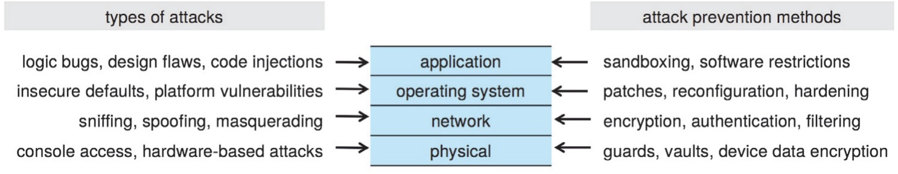
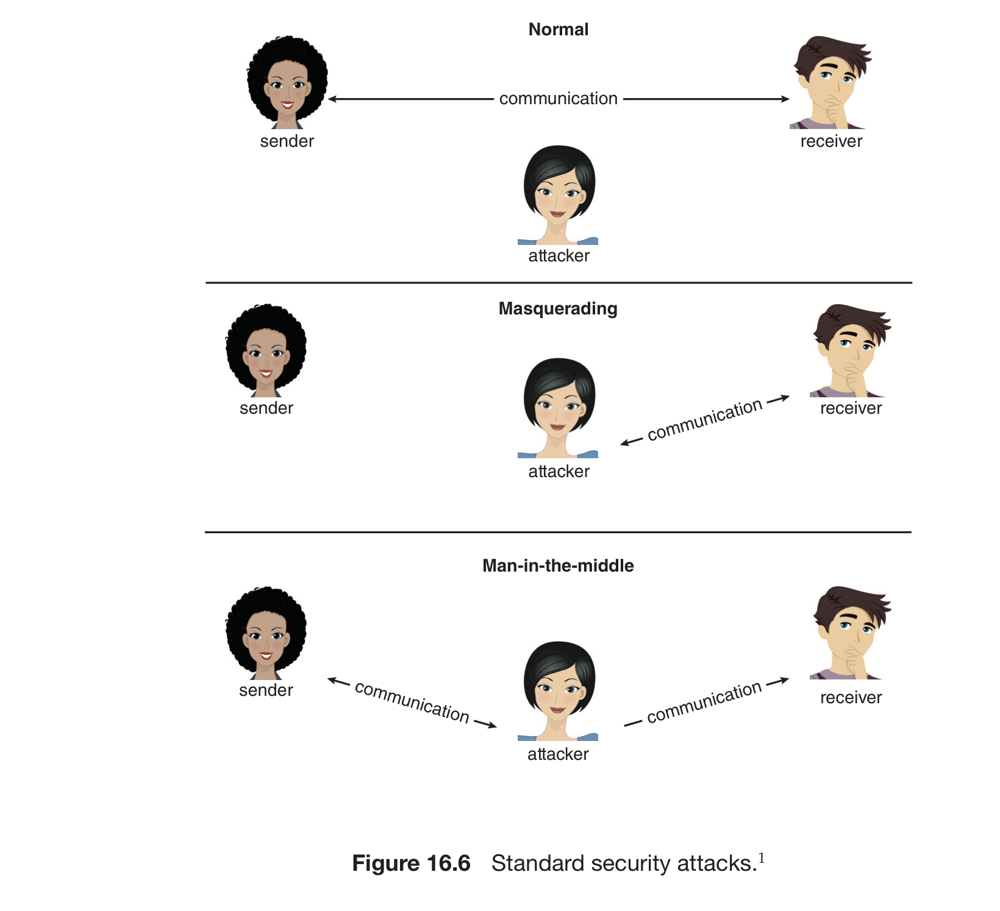
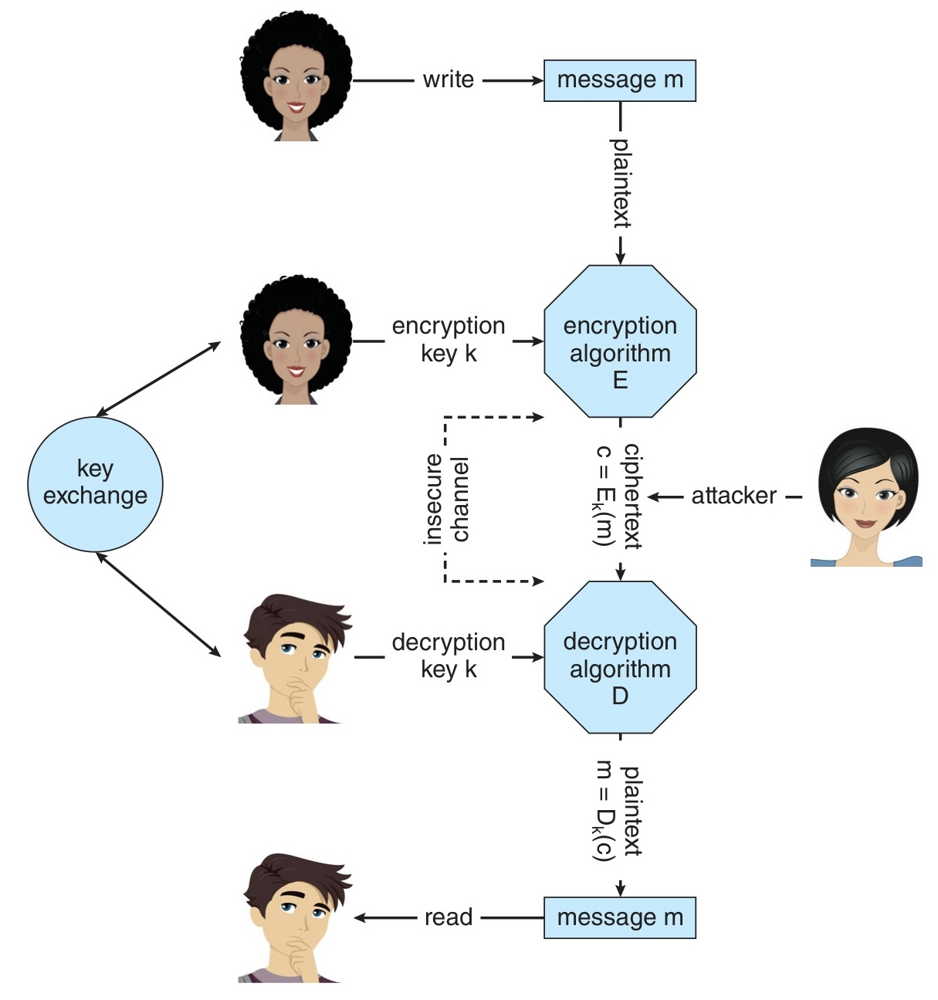
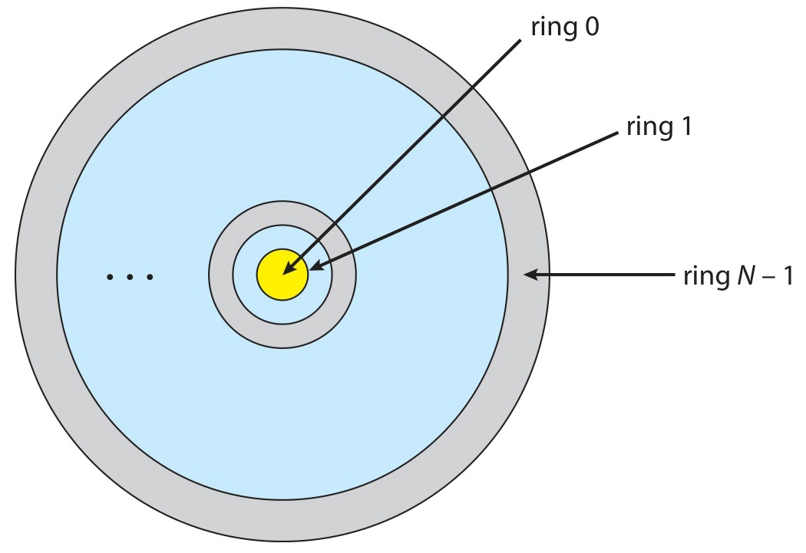
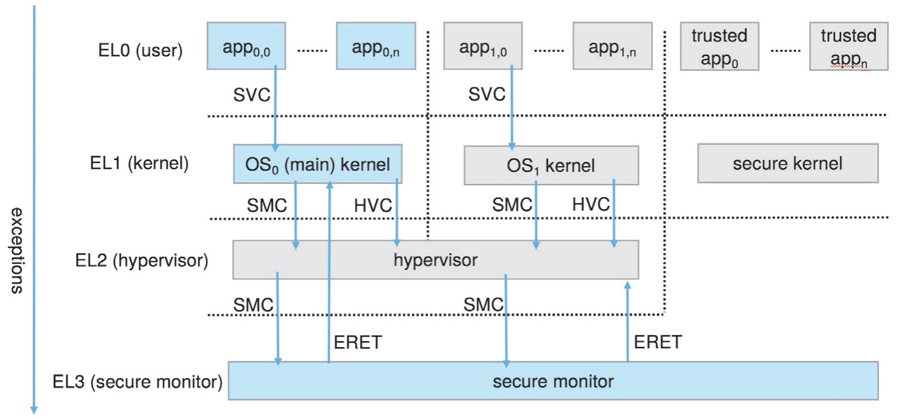

# 14주차 이론 — 보안과 보호 (Security and Protection)

[레포지토리 안내](../../README.ko.md) | [English](Concepts_Lecture.md) | [한국어](Concepts_Lecture.ko.md)

> **최종 수정일:** 2026-10-18
>
> Operating System Concepts, Silberschatz, Ch 16, 17

> **학습 목표:**
> 1. **보안(Security)** 과 **보호(Protection)** 를 구분하고 **CIA 트라이어드**(기밀성, 무결성, 가용성)와 추가 위반 유형(서비스 도용, DoS)을 설명할 수 있다
> 2. **위협(threat)** 과 **공격(attack)** 을 구분하고 주요 공격(masquerading, replay, MITM, session hijacking, privilege escalation)을 나열할 수 있다
> 3. **4계층 보안 모델**과 가장 약한 고리, 인적 요소(사회공학), **공격 표면(attack surface)** 개념을 설명할 수 있다
> 4. **멀웨어**를 분류(Trojan, Spyware, Ransomware, Back door, Logic bomb)하고 **최소 권한 원칙**이 피해 규모를 어떻게 좌우하는지 설명할 수 있다
> 5. 버퍼 오버플로(스택 구조와 return address 덮어쓰기), shellcode와 NOP-sled, SQL injection을 포함한 **코드 주입**의 원리와 방어를 설명할 수 있다
> 6. **바이러스**(유형별)와 **웜**을 호스트 필요성, 전파 방식, 피해 측면에서 구분할 수 있다
> 7. **네트워크 위협**(sniffing, spoofing, MITM, DoS/DDoS, SYN flood, port scanning)을 구분하고 zombie와 botnet 개념을 설명할 수 있다
> 8. **대칭/비대칭 암호**(AES, RSA), **해시**(SHA, salt), **디지털 서명/인증서**, **TLS 핸드셰이크**, **키 분배 문제**를 설명할 수 있다
> 9. **사용자 인증 3요소**와 비밀번호 취약점, **OTP**, **MFA**를 설명할 수 있다
> 10. **보호의 목표**와 핵심 원칙(최소 권한, compartmentalization, defense in depth)을 설명하고 **need-to-know**와 **least-privilege**를 구분할 수 있다
> 11. **보호 링** 구조(Intel Ring, ARM Exception Level, TrustZone)와 **도메인과 도메인 전환**(setuid)을 설명할 수 있다
> 12. **접근 행렬**과 그 구현(global table, **ACL**, **capability**, lock-key)을 비교하고 **권한 회수** 방법을 설명할 수 있다
> 13. **접근 제어 모델**(RBAC, DAC vs MAC, SELinux, Linux capabilities)을 구분할 수 있다
> 14. **샌드박싱**(SECCOMP-BPF, Seatbelt)과 **코드 서명**(SIP, Entitlements)의 원리를 설명할 수 있다

---

## 목차

- [1. 보안 문제](#1-보안-문제)
  - [1.1 보안 vs 보호](#11-보안-vs-보호)
  - [1.2 보안의 세 원칙: CIA 트라이어드](#12-보안의-세-원칙-cia-트라이어드)
  - [1.3 위협 vs 공격](#13-위협-vs-공격)
  - [1.4 4계층 보안 모델](#14-4계층-보안-모델)
- [2. 프로그램 위협](#2-프로그램-위협)
  - [2.1 멀웨어 개요](#21-멀웨어-개요)
  - [2.2 트로이 목마: 로그인 에뮬레이터](#22-트로이-목마-로그인-에뮬레이터)
  - [2.3 랜섬웨어와 최소 권한 원칙](#23-랜섬웨어와-최소-권한-원칙)
  - [2.4 코드 주입: 버퍼 오버플로](#24-코드-주입-버퍼-오버플로)
  - [2.5 Shellcode와 NOP-sled](#25-shellcode와-nop-sled)
  - [2.6 SQL Injection](#26-sql-injection)
  - [2.7 바이러스](#27-바이러스)
  - [2.8 웜](#28-웜)
- [3. 시스템과 네트워크 위협](#3-시스템과-네트워크-위협)
  - [3.1 네트워크 트래픽 공격: Sniffing, Spoofing, MITM](#31-네트워크-트래픽-공격-sniffing-spoofing-mitm)
  - [3.2 서비스 거부: DoS와 DDoS](#32-서비스-거부-dos와-ddos)
  - [3.3 포트 스캐닝](#33-포트-스캐닝)
- [4. 암호학](#4-암호학)
  - [4.1 개요](#41-개요)
  - [4.2 대칭 암호](#42-대칭-암호)
  - [4.3 비대칭 암호: RSA](#43-비대칭-암호-rsa)
  - [4.4 대칭 vs 비대칭과 하이브리드](#44-대칭-vs-비대칭과-하이브리드)
  - [4.5 해시 함수](#45-해시-함수)
  - [4.6 해시 응용: 비밀번호 저장과 Salt](#46-해시-응용-비밀번호-저장과-salt)
  - [4.7 디지털 서명](#47-디지털-서명)
  - [4.8 디지털 인증서](#48-디지털-인증서)
  - [4.9 TLS](#49-tls)
  - [4.10 키 분배 문제](#410-키-분배-문제)
- [5. 사용자 인증](#5-사용자-인증)
  - [5.1 인증 방법: 3요소](#51-인증-방법-3요소)
  - [5.2 비밀번호 취약점](#52-비밀번호-취약점)
  - [5.3 OTP](#53-otp)
  - [5.4 다요소 인증 (MFA)](#54-다요소-인증-mfa)
- [6. 보호의 목표와 원칙](#6-보호의-목표와-원칙)
  - [6.1 보호의 목표와 정책 vs 기제](#61-보호의-목표와-정책-vs-기제)
  - [6.2 핵심 보호 원칙](#62-핵심-보호-원칙)
  - [6.3 Need-to-Know 원칙](#63-need-to-know-원칙)
- [7. 보호 링](#7-보호-링)
  - [7.1 보호 링 구조](#71-보호-링-구조)
  - [7.2 Intel과 ARM 보호 링](#72-intel과-arm-보호-링)
- [8. 보호 도메인](#8-보호-도메인)
  - [8.1 도메인 구조](#81-도메인-구조)
  - [8.2 도메인 전환: setuid](#82-도메인-전환-setuid)
- [9. 접근 행렬](#9-접근-행렬)
  - [9.1 접근 행렬 개요](#91-접근-행렬-개요)
  - [9.2 도메인 전환의 행렬 표현](#92-도메인-전환의-행렬-표현)
  - [9.3 접근 권한 수정: Copy, Owner, Control](#93-접근-권한-수정-copy-owner-control)
- [10. 접근 행렬의 구현](#10-접근-행렬의-구현)
  - [10.1 Global Table](#101-global-table)
  - [10.2 Access List (ACL): 열 기반](#102-access-list-acl-열-기반)
  - [10.3 Capability List: 행 기반](#103-capability-list-행-기반)
  - [10.4 Lock-Key 기법](#104-lock-key-기법)
  - [10.5 구현 방법 비교](#105-구현-방법-비교)
  - [10.6 접근 권한 회수](#106-접근-권한-회수)
- [11. 접근 제어 모델](#11-접근-제어-모델)
  - [11.1 RBAC: 역할 기반 접근 제어](#111-rbac-역할-기반-접근-제어)
  - [11.2 DAC vs MAC](#112-dac-vs-mac)
  - [11.3 MAC: 보안 레이블과 SELinux](#113-mac-보안-레이블과-selinux)
  - [11.4 Linux Capabilities](#114-linux-capabilities)
- [12. 샌드박싱과 코드 서명](#12-샌드박싱과-코드-서명)
  - [12.1 샌드박싱](#121-샌드박싱)
  - [12.2 샌드박스 프로파일 예시](#122-샌드박스-프로파일-예시)
  - [12.3 코드 서명](#123-코드-서명)
  - [12.4 System Integrity Protection (SIP)](#124-system-integrity-protection-sip)
- [13. 실습: 접근 제어 시스템 구현](#13-실습-접근-제어-시스템-구현)
- [요약](#요약)
- [점검 문제](#점검-문제)

---

<br>

## 1. 보안 문제

### 1.1 보안 vs 보호

| 측면     | 보안 (Security)                          | 보호 (Protection)                  |
|----------|------------------------------------------|------------------------------------|
| **정의** | 시스템과 데이터의 무결성이 보존될 것이라는 신뢰의 척도 | 프로세스와 사용자의 자원 접근을 제어하는 기제의 집합 |
| **초점** | 외부 위협으로부터 시스템 보호             | 내부 자원 접근의 제어              |
| **대상** | 공격자, 멀웨어, 네트워크 위협             | 프로세스, 사용자, 역할(role)       |
| **범위** | 물리, 네트워크, OS, 애플리케이션          | 도메인, 접근 행렬, 권한            |
| **교재** | Ch 16                                    | Ch 17                              |

*표 1. 보안과 보호의 비교*

- **보안**은 시스템이 신뢰할 수 있게 동작하리라는 확신이라는 더 넓고 외향적인 개념이다.
- **보호**는 그 확신을 OS 내부에서 *기제(mechanism)* 로 실현하는 구체적 수단이다. 보호는 보안의 부분집합이자 토대이다.

### 1.2 보안의 세 원칙: CIA 트라이어드

| 원칙                      | 의미                                            | 위반 예시                       |
|---------------------------|-------------------------------------------------|---------------------------------|
| **기밀성 (Confidentiality)** | 인가된 사용자만 정보에 *접근* 가능              | 도청, 정보 유출                 |
| **무결성 (Integrity)**       | 인가된 사용자만 정보를 *수정* 가능              | 데이터 변조, 소스 코드 조작     |
| **가용성 (Availability)**    | 인가된 사용자가 필요할 때 자원에 *접근* 가능   | DoS 공격, 시스템 다운           |

*표 2. CIA 트라이어드의 세 원칙과 위반 예시*

추가적인 보안 위반 유형은 다음과 같다.

- **서비스 도용 (Theft of Service):** 인가 없이 자원을 사용하는 것이다(예: 암호화폐 채굴, 스팸 릴레이).
- **서비스 거부 (Denial of Service):** 정당한 사용자의 시스템 사용을 방해하는 것이다.

> **핵심:** CIA는 모든 보안 논의의 출발점이다. 어떤 공격이든 결국 이 셋 중 하나 이상을 무너뜨린다. 도청은 기밀성, 변조는 무결성, DoS는 가용성을 노린다.

### 1.3 위협 vs 공격

| 개념          | 정의                                              |
|---------------|---------------------------------------------------|
| **위협 (Threat)** | 잠재적 보안 위반(가능성)이며, *취약점의 발견*이 그 예이다 |
| **공격 (Attack)** | 실제 보안 침해 시도이며, *구체적 행위*이다        |

*표 3. 위협과 공격의 정의*

주요 공격 유형은 다음과 같다.

| 공격 유형                     | 설명                                          |
|-------------------------------|-----------------------------------------------|
| **Masquerading** (위장)       | 다른 사용자나 시스템으로 가장                  |
| **Replay Attack** (재전송)    | 유효한 데이터 전송을 악의적으로 반복           |
| **Man-in-the-Middle** (중간자) | 통신 중 데이터를 가로채거나 수정              |
| **Session Hijacking** (세션 탈취) | 활성 통신 세션을 가로챔                     |
| **Privilege Escalation** (권한 상승) | 인가된 것보다 높은 권한 획득               |

*표 4. 주요 공격 유형*

### 1.4 4계층 보안 모델



*그림 1. 4계층 보안 모델의 계층별 공격 유형과 방어 방법*

교재의 Figure 16.1처럼 보안은 물리(Physical) → 네트워크(Network) → 운영체제(Operating System) → 애플리케이션(Application)의 네 계층에서 동시에 다루어야 한다. 그림 1에서 물리 계층은 콘솔 접근과 하드웨어 기반 공격을 경비, 금고, 장치 데이터 암호화로 막고, 네트워크 계층은 sniffing, spoofing, masquerading을 암호화, 인증, 필터링으로 막는다. 운영체제 계층은 안전하지 않은 기본 설정과 플랫폼 취약점을 패치, 재구성, 강화(hardening)로 막고, 애플리케이션 계층은 논리 버그, 설계 결함, 코드 주입을 샌드박싱과 소프트웨어 제한으로 막는다.

- **가장 약한 고리(weakest link):** 보안의 강도는 *가장 약한 계층*만큼이다(사슬 비유). 한 계층이 뚫리면 전체가 위험해진다.
- **인적 요소(Human Factor):** 사회공학(social engineering), 피싱처럼 *사람*을 노리는 공격이며, 종종 가장 취약한 고리가 된다.
- **공격 표면(Attack Surface):** 공격자가 침투를 시도할 수 있는 지점들의 집합이다. 공격 표면을 줄이는 것이 방어의 핵심 전략이다.

---

<br>

## 2. 프로그램 위협

### 2.1 멀웨어 개요

**멀웨어(Malware):** 시스템을 악용, 무력화, 손상시키도록 설계된 소프트웨어이다.

| 유형                          | 설명                                                      |
|-------------------------------|-----------------------------------------------------------|
| **Trojan Horse** (트로이 목마) | 정상 프로그램으로 위장하지만 악성 기능을 실행            |
| **Spyware** (스파이웨어)      | 사용자 정보를 몰래 수집해 외부로 전송 (adware, keylogger) |
| **Ransomware** (랜섬웨어)     | 파일을 암호화하고 복호화 대가로 금전 요구                 |
| **Back Door** (Trap Door)     | 개발자가 남긴 비밀 접근 경로                              |
| **Logic Bomb** (논리 폭탄)    | 특정 조건이 충족되면 활성화되는 악성 코드                 |

*표 5. 멀웨어의 유형*

- 트로이 목마의 변종으로 **login emulator**(가짜 로그인 화면)가 있다.
- **최소 권한 원칙(principle of least privilege)** 을 어기면 멀웨어 피해가 극대화된다. 과도한 권한으로 실행되는 프로그램이 감염되면 시스템 전체가 넘어간다.

### 2.2 트로이 목마: 로그인 에뮬레이터

**로그인 에뮬레이터 공격 시나리오:**

```text
  1. 공격자가 가짜 로그인 화면을 띄워 둠
  2. 피해자가 로그인 시도 → "비밀번호 오류" 메시지 표시
  3. 실제로는 ID/PW가 공격자에게 전송됨
  4. 가짜 프로그램이 종료되고 진짜 로그인 프롬프트가 나타남
  5. 피해자는 "오타였나" 생각하고 다시 로그인 (정상 성공)
```

**방어:**
- **Ctrl+Alt+Delete**(Windows) 같은 *가로챌 수 없는(non-trappable) 키 시퀀스*를 사용한다. 이것은 가짜 프로그램이 가로챌 수 없는 안전한 주의 키(secure attention key, SAK)이다.
- 세션 종료 시 세션 사용 정보(마지막 로그인 시각 등)를 표시한다.
- URL의 정확성을 검증한다(피싱 방지).

### 2.3 랜섬웨어와 최소 권한 원칙

**랜섬웨어 동작:**

```text
  1. 멀웨어 감염 (피싱 이메일, 취약 서비스 등)
  2. 강력한 암호화 알고리즘으로 시스템의 파일 암호화
  3. 복호화 키 대가로 금전(암호화폐) 요구
  4. 지불 후에도 키를 받는다는 보장 없음
```

**최소 권한 원칙(Principle of Least Privilege):**
- 프로그램과 사용자에게 작업 수행에 필요한 **최소 권한**만 부여한다.
- 과도한 권한은 멀웨어가 시스템 전체를 장악하게 한다.
- OS는 **세분화된 접근 제어(fine-grained access control)** 를 제공해야 한다.

### 2.4 코드 주입: 버퍼 오버플로

프로그램 위협의 상당수는 **코드 주입(code injection)** 을 통해 일어난다.

**버퍼 오버플로(Buffer Overflow):** 버퍼 경계를 넘는 입력을 주어 인접 메모리를 덮어쓰는 공격이다.

```c
#include <stdio.h>
#include <string.h>
#define BUFFER_SIZE 64

void vulnerable(char *input) {
    char buffer[BUFFER_SIZE];
    strcpy(buffer, input);   // 길이 검사 없음 → 오버플로 가능
}

// 안전한 버전
void safe(char *input) {
    char buffer[BUFFER_SIZE];
    strncpy(buffer, input, sizeof(buffer) - 1);  // 길이 제한
    buffer[sizeof(buffer) - 1] = '\0';
}
```

- `strcpy()`, `sprintf()`, `gets()`는 길이를 검사하지 않는 **위험한 함수**이다.
- 대신 `strncpy()`, `snprintf()`처럼 *크기를 인식하는* 함수를 사용한다.

**버퍼 오버플로의 결과:** 다음은 스택 구조이며, 위쪽이 높은 주소이고 아래쪽이 낮은 주소이다.

```text
  ┌──────────────────┐
  │  Return Address   │  ← (3) 덮어쓰면 코드 흐름 장악
  ├──────────────────┤
  │  Saved EBP        │  ← (2) 프레임 포인터 손상 가능
  ├──────────────────┤
  │  지역 변수        │  ← (2) 인접 변수 덮어쓰기
  ├──────────────────┤
  │  buffer[64]       │  ← (1) 패딩 범위 내: 영향 없음
  └──────────────────┘
         ↑ 오버플로 방향
```

*그림 2. 버퍼 오버플로 시 스택 프레임의 구조와 덮어쓰기 범위*

오버플로 크기에 따른 결과는 다음과 같다.
1. **작은 오버플로:** 패딩 영역에 흡수되어 영향이 없다.
2. **중간 오버플로:** 인접 변수를 덮어쓰며, 프로그램이 크래시할 수 있다.
3. **큰 오버플로:** **return address가 손상**되어 임의 코드(shellcode)가 실행된다.

### 2.5 Shellcode와 NOP-sled

**Shellcode:** 공격자가 주입하는 코드이며, 보통 셸을 띄운다.

```c
void exploit(void) {
    execl("/bin/sh", "/bin/sh", NULL);   // 셸 생성
}
```

공격 과정은 다음과 같다.
1. 공격자가 사용자 입력에 shellcode를 포함한다.
2. 버퍼 오버플로로 return address를 shellcode 위치로 바꾼다.
3. 함수가 반환할 때 shellcode가 실행된다.

**NOP-sled:** 정확한 주소를 맞히기 어려우므로, shellcode 앞에 다수의 NOP(no-operation) 명령을 배치한다. 점프가 NOP 영역 어디에 떨어져도 *미끄러져(slide)* shellcode에 도달한다.

```text
  [NOP NOP NOP NOP NOP ... NOP] [SHELLCODE]
   ←──── NOP-sled ────────→     ← payload
```

*그림 3. NOP-sled와 shellcode의 배치*

- **Script kiddie:** 다른 해커가 만든 익스플로잇을 가져다 쓰는 초보 공격자이다.

### 2.6 SQL Injection

사용자 입력에 SQL 문을 삽입해 데이터베이스를 조작하는 공격이다.

```text
  정상 입력:    username = "alice"
  SQL 쿼리:     SELECT * FROM users WHERE name = 'alice'

  악의적 입력:  username = "' OR '1'='1"
  SQL 쿼리:     SELECT * FROM users WHERE name = '' OR '1'='1'
  → 모든 레코드 반환 (인증 우회)
```

**방어:**
- **Prepared Statement**(파라미터화 쿼리)를 사용한다.
- 입력을 **검증(validation)** 하고 **정화(sanitization)** 한다.
- DB 계정에 최소 권한을 부여한다.

```java
// 안전한 방식 (Prepared Statement)
PreparedStatement stmt = conn.prepareStatement(
    "SELECT * FROM users WHERE name = ?");
stmt.setString(1, username);  // 자동 이스케이프
```

### 2.7 바이러스

**바이러스(Virus):** 자신을 다른 프로그램에 **삽입**하여 퍼지는 자기 복제 코드이다.

- **호스트 프로그램이 필요하다**(독립 실행 불가).
- 주로 사용자 행위(파일 실행, 이메일 첨부)를 통해 전파된다.

| 바이러스 유형      | 설명                                              |
|--------------------|---------------------------------------------------|
| **File Virus**     | 실행 파일에 삽입 (기생 바이러스)                  |
| **Boot Virus**     | 부트 섹터 감염, OS 적재 전에 실행                 |
| **Macro Virus**    | 문서 매크로(VBA 등)에 삽입, Office 파일 감염       |
| **Polymorphic**    | 감염마다 코드 변형 → 시그니처 탐지 회피            |
| **Encrypted**      | 암호화된 바이러스 + 복호화 코드 포함              |
| **Stealth**        | 시스템 콜을 변조해 탐지 회피                       |
| **Rootkit**        | OS 자체를 감염, 시스템 전체 장악                  |
| **Armored**        | 분석이 어렵도록 난독화                            |

*표 6. 바이러스의 유형*

### 2.8 웜

**웜(Worm):** 네트워크를 통해 **자율적으로** 전파되는 멀웨어이다.

- **호스트 프로그램이 필요 없다**(독립 실행 가능).
- 네트워크를 통해 자동으로 확산되어 대량의 트래픽을 일으킨다.

**바이러스 vs 웜:**

| 속성          | 바이러스                | 웜                          |
|---------------|-------------------------|-----------------------------|
| 호스트 프로그램 | 필요                    | 불필요                      |
| 전파          | 사용자 행위(파일 실행)  | 네트워크 통한 자동 전파     |
| 자기 복제     | 다른 프로그램에 삽입    | 독립적으로 복제             |
| 주된 피해     | 파일 손상, 시스템 장애  | 네트워크 마비, 자원 고갈    |

*표 7. 바이러스와 웜의 비교*

- **Morris Worm**(1988)은 최초의 인터넷 웜으로, 버퍼 오버플로를 악용했다.
- 현대의 웜은 봇넷(botnet) 구축에 쓰인다(DDoS, 스팸 배포).

---

<br>

## 3. 시스템과 네트워크 위협

### 3.1 네트워크 트래픽 공격: Sniffing, Spoofing, MITM

| 공격 유형             | 설명                                       | 분류        |
|-----------------------|--------------------------------------------|-------------|
| **Sniffing** (스니핑) | 네트워크 패킷을 도청해 정보 탈취           | 수동 공격   |
| **Spoofing** (스푸핑) | IP/MAC 주소를 위조해 신뢰된 출처로 가장    | 능동 공격   |
| **Man-in-the-Middle** | 통신 중 데이터를 가로채고 수정             | 능동 공격   |

*표 8. 네트워크 트래픽 공격의 유형과 분류*



*그림 4. 정상 통신, masquerading, man-in-the-middle의 비교*

교재의 Figure 16.6에 해당하는 그림 4는 표준 보안 공격을 비교한다. 정상(Normal) 통신에서는 송신자와 수신자가 직접 주고받고, masquerading에서는 공격자가 송신자로 가장하여 수신자와 통신하며, man-in-the-middle에서는 공격자가 송신자와 수신자 사이에 끼어 양쪽 통신을 모두 중계한다.

- **Zombie system:** 해커에게 장악되어 공격 출처를 숨기는 데 쓰이는 시스템이다.
- **WarDriving:** 보호되지 않은 WiFi 네트워크를 찾아 접근을 시도하는 행위이다.

> **참고:** **수동 vs 능동.** Sniffing은 데이터를 *관찰만* 하므로 탐지가 어려운 **수동 공격**이다. Spoofing과 MITM은 데이터를 *조작*하므로 **능동 공격**이며, 흔적을 남기지만 더 큰 피해를 준다.

### 3.2 서비스 거부: DoS와 DDoS

**DoS:** 서버에 과도한 요청을 보내 정상 서비스를 방해하는 공격이다.

| 유형               | 설명                                  |
|--------------------|---------------------------------------|
| **자원 고갈**      | CPU, 메모리, 대역폭 등을 소진          |
| **네트워크 교란**  | 네트워크 자체를 무력화                |
| **DDoS**           | 다수의 zombie(botnet)로 동시 공격     |

*표 9. 서비스 거부 공격의 유형*

**SYN Flood 공격:**

```text
  공격자 → [SYN] → 서버       (연결 요청)
  서버   → [SYN-ACK] → ???    (응답 대기)
  ※ ACK가 끝내 오지 않아 half-open 연결이 누적
  → 서버의 연결 테이블 고갈 → 정당한 연결 거부
```

*그림 5. SYN flood 공격의 메시지 흐름*

- DDoS는 때로 **금전 갈취(blackmail)** 와 결합된다.
- 방어 방법으로는 rate limiting, 상위(upstream) 필터링, 자원 증설이 있다.

### 3.3 포트 스캐닝

**포트 스캐닝(Port Scanning):** 열린 포트를 탐색해 취약한 서비스를 찾아내는 행위이다.

- 공격 자체가 아니라 **정찰(reconnaissance)** 단계에 해당한다.
- 보안 관리자도 서비스 점검(audit)에 사용한다.

```text
  공격자 → 포트 21 (FTP)    → 무응답 (닫힘)
  공격자 → 포트 22 (SSH)    → 응답 (열림!) → 버전 확인
  공격자 → 포트 80 (HTTP)   → 응답 (열림!) → 웹 서버 식별
  공격자 → 포트 443 (HTTPS) → 응답 (열림!)
  ...
```

*그림 6. 포트 스캐닝의 탐색 과정*

- **Fingerprinting:** OS 종류와 서비스 버전을 식별해 알려진 취약점을 검색하는 기법이다.
- 주요 도구는 다음과 같다.
  - **nmap:** 네트워크 탐색과 보안 감사 도구이다.
  - **Metasploit:** 취약점 익스플로잇 테스트 프레임워크이다.

---

<br>

## 4. 암호학

### 4.1 개요

**암호학(Cryptography):** 신뢰할 수 없는 채널(네트워크 환경)에서 안전한 통신을 가능하게 하는 기술이다.

암호 알고리즘의 구성 요소는 다음과 같다.
- **K**는 키 집합이다.
- **M**은 평문(plaintext) 메시지 집합이다.
- **C**는 암호문(ciphertext) 집합이다.
- **E**: K → (M → C)는 암호화 함수이다.
- **D**: K → (C → M)은 복호화 함수이다.

핵심 성질: 암호문 $c$가 주어져도 키 $k$ 없이 원본 $m$을 복원하는 것은 **계산적으로 불가능(computationally infeasible)** 해야 한다.

| 유형     | 키 구조             | 속도   | 키 교환    |
|----------|---------------------|--------|------------|
| 대칭     | 같은 키             | 빠름   | 어려움     |
| 비대칭   | 공개키/개인키 쌍    | 느림   | 안전       |

*표 10. 대칭 암호와 비대칭 암호의 개요*

### 4.2 대칭 암호

암호화와 복호화에 **같은 키 $k$** 를 사용한다.



*그림 7. 안전하지 않은 매체 위의 안전한 통신*

교재의 Figure 16.7에 해당하는 그림 7에서 송신자는 메시지 $m$을 쓰고, 암호화 알고리즘 E가 키 $k$로 암호문 $c = E_k(m)$을 만든다. 암호문은 공격자가 볼 수 있는 안전하지 않은 채널로 전달되고, 수신자 쪽의 복호화 알고리즘 D가 같은 키 $k$로 $m = D_k(c)$를 복원한다. 두 사람은 키 교환(key exchange)으로 키를 미리 공유해야 한다.

| 알고리즘 | 키 길이           | 특징                                          |
|----------|-------------------|-----------------------------------------------|
| **DES**  | 56-bit            | 더 이상 안전하지 않음, brute-force에 취약      |
| **3DES** | 168-bit           | DES 3회 반복: $c = E_{k3}(D_{k2}(E_{k1}(m)))$  |
| **AES**  | 128/192/256-bit   | 현재 표준, 빠르고 안전                         |

*표 11. 대표적인 대칭 암호 알고리즘*

- **블록 암호(Block Cipher):** 고정 크기 블록 단위로 암호화한다(예: AES의 128비트 블록).
- **스트림 암호(Stream Cipher):** 바이트나 비트 단위로 연속 암호화하며, XOR 연산을 사용한다.
- 단점은 양쪽이 같은 키를 공유해야 한다는 것이며, 이를 **키 교환 문제(key exchange problem)** 라 한다.

### 4.3 비대칭 암호: RSA

공개키로 암호화하고 개인키로 복호화한다.

```text
  평문 m ──[공개키 ke]──→ 암호문 c ──[개인키 kd]──→ 평문 m
              암호화                      복호화
```

*그림 8. 비대칭 암호의 암호화와 복호화 흐름*

**RSA 알고리즘**(Rivest, Shamir, Adleman):
- $p, q$는 두 큰 소수이고, $N = p \times q$이다.
- 공개키 $ke$와 개인키 $kd$는 $ke \times kd \bmod (p-1)(q-1) = 1$을 만족한다.
- 암호화는 $c = m^{ke} \bmod N$이다.
- 복호화는 $m = c^{kd} \bmod N$이다.

**RSA 예시**(작은 수):

```text
  p=7, q=13 → N=91, (p-1)(q-1)=72
  ke=5, kd=29   (5×29 mod 72 = 1)
  암호화: 69^5  mod 91 = 62
  복호화: 62^29 mod 91 = 69
```

> **핵심:** RSA의 안전성은 **큰 합성수의 소인수분해가 어렵다**는 가정에 기댄다. $N$은 공개되지만 $p, q$를 모르면 $kd$를 계산할 수 없다.

### 4.4 대칭 vs 비대칭과 하이브리드

| 속성        | 대칭                  | 비대칭                          |
|-------------|-----------------------|---------------------------------|
| 키 구조     | 하나의 공유 키        | 공개키 + 개인키 쌍              |
| 속도        | **빠름**              | 느림 (수십~수백 배)             |
| 키 교환     | 안전한 채널 필요      | 공개키 자유 배포                |
| 용도        | 대용량 데이터 암호화  | 인증, 키 교환, 소량 데이터      |
| 대표 알고리즘 | AES, DES            | RSA, ECC                        |

*표 12. 대칭 암호와 비대칭 암호의 비교*

**실전 사용(하이브리드 암호):**

```text
  1. 비대칭 암호로 대칭 키를 안전하게 교환
  2. 이후 통신은 (성능 좋은) 대칭 암호 사용

  [RSA로 AES 키 교환] → [AES로 데이터 암복호화]
```

*그림 9. 하이브리드 암호의 두 단계*

- TLS/SSL이 이 방식을 사용한다. 비대칭 암호의 *안전한 키 교환*과 대칭 암호의 *빠른 처리*를 결합한다.

### 4.5 해시 함수

**해시 함수 $H(m)$:** 임의 길이의 메시지를 **고정 길이 해시값**(message digest)으로 바꾸는 함수이다.

성질은 다음과 같다.
- **단방향(One-way):** 해시값에서 원본을 복원하는 것이 계산적으로 불가능하다.
- **충돌 저항성(Collision Resistant):** 같은 해시를 내는 서로 다른 두 입력을 찾는 것이 계산적으로 불가능하다.
- 입력이 1비트만 바뀌어도 해시가 **완전히 달라진다**(avalanche effect).

```text
  "Hello World"  ──[SHA-256]──→ a591a6d40bf420404a011733cfb7b190...
  "Hello World!" ──[SHA-256]──→ 7f83b1657ff1fc53b92dc18148a1d65d...
```

| 알고리즘  | 출력 길이 | 상태             |
|-----------|-----------|------------------|
| MD5       | 128-bit   | **안전하지 않음** |
| SHA-1     | 160-bit   | 단계적 폐지 중   |
| SHA-256   | 256-bit   | **현재 표준**     |
| SHA-3     | 가변      | 최신 표준        |

*표 13. 해시 알고리즘의 출력 길이와 상태*

### 4.6 해시 응용: 비밀번호 저장과 Salt

**평문 비밀번호** 대신 해시값을 저장한다.

```text
  등록: password → H(password) → 해시를 DB에 저장
  인증: 입력 → H(입력) → 저장된 해시와 비교
```

*그림 10. 해시를 이용한 비밀번호 등록과 인증*

**Salt:** 보안을 강화하기 위해 해시하기 전에 비밀번호에 덧붙이는 무작위 값이다.

```text
  salt 없음:  H("password123") → abc123...  (같은 비밀번호 = 같은 해시)
  salt 사용:  H("password123" + "x7k9") → def456...
              H("password123" + "m2p5") → ghi789...
              (같은 비밀번호라도 salt가 다르면 다른 해시)
```

- **사전 공격(Dictionary Attack) 방지:** salt가 있으면 모든 사전 단어를 *salt 조합마다* 다시 해시해야 하므로 미리 계산한 rainbow table이 무력화된다.
- UNIX `/etc/shadow` 파일은 해시된 비밀번호를 저장하며, superuser만 읽을 수 있다.

### 4.7 디지털 서명

메시지의 **무결성**과 **출처(origin)** 를 검증하는 기제이다.

- 공개키 암호를 **역으로** 사용한다. 개인키로 서명하고 공개키로 검증한다.

```text
  서명 생성:  signature = H(m)^ks mod N      (개인키 ks로 서명)
  서명 검증:  H(m) =? signature^kv mod N      (공개키 kv로 검증)
```

**MAC (Message Authentication Code):**
- 대칭 키를 이용해 인증하므로 키 보유자만 MAC을 생성하고 검증할 수 있다.

**디지털 서명의 응용:**
- **부인 방지(Nonrepudiation):** 서명자가 자신의 행위를 부인할 수 없다.
- **Code Signing:** 프로그램의 무결성과 출처를 검증한다.
- **전자 문서 서명:** 디지털 계약과 인증서에 쓰인다.

### 4.8 디지털 인증서

**인증 기관(CA, Certificate Authority)** 이 공개키의 소유자를 보증하는 전자 문서이다.

```text
  인증서:
    Subject:    www.example.com
    Public Key: [RSA 2048-bit 키]
    Issuer:     신뢰된 CA
    Validity:   2025-01-01 ~ 2026-12-31
    Signature:  [CA의 개인키로 서명]
```

*그림 11. 디지털 인증서의 구성 예*

**인증서 체인(Chain of Trust):**

```text
  Root CA (브라우저에 내장)
    ↓ 서명
  Intermediate CA
    ↓ 서명
  서버 인증서 (www.example.com)
```

*그림 12. 루트 CA에서 서버 인증서까지의 인증서 체인*

- **X.509:** 디지털 인증서의 표준 형식이다.
- CA의 공개키는 **브라우저에 사전 설치**되어 있다.
- 인증서로 공개키의 진위를 검증하여 중간자 공격을 막는다.

### 4.9 TLS

HTTPS의 기반이 되는 암호화 프로토콜이며, SSL의 후속이다.

**TLS 핸드셰이크 과정:**

```text
  Client                              Server
    │                                    │
    │──── ClientHello (nc) ────────→     │ (1) 무작위 값 전송
    │                                    │
    │←──── ServerHello (ns) ────────     │ (2) 서버 무작위 값 +
    │←──── Certificate (certs) ────      │     인증서 전송
    │                                    │
    │   [인증서 검증]                     │ (3) CA 서명 검증
    │                                    │
    │──── Eke(pms) ────────────→         │ (4) premaster secret을
    │                                    │     공개키로 암호화해 전송
    │                                    │
    │   ms = H(nc, ns, pms)              │ (5) 양쪽이 동일한
    │   (대칭 세션 키 생성)               │     master secret 계산
    │                                    │
    │←──── [AES 암호화 통신] ────→        │ (6) 대칭 키로 통신
```

*그림 13. TLS 핸드셰이크 과정*

> **핵심:** 인증서로 *서버를 인증*하고 비대칭 암호로 *대칭 키를 안전하게 합의*한 뒤, 실제 데이터는 빠른 대칭 암호로 주고받는다(4.4절의 하이브리드 암호).

### 4.10 키 분배 문제

**대칭 암호의 키 교환 문제:**
- $N$명이 서로 통신하려면 $N(N-1)/2$개의 키가 필요하다.
- 키를 전달할 안전한 채널이 필요하며, 대역 외(out-of-band) 교환은 확장성이 낮다.

**비대칭 암호의 공개키 분배 문제:**

```text
  공개키에 대한 중간자 공격:

  Alice ──→ [공개키 요청] ──→ Bob
                  ↑
           Mallory가 자신의
           공개키를 대신 보냄

  Alice가 Mallory의 공개키로 암호화
  → Mallory가 복호화 후 Bob의 공개키로 재암호화해 전달
```

*그림 14. 공개키에 대한 중간자 공격*

**해결:** 디지털 인증서로 공개키를 인증한다. CA가 공개키 소유자를 보증하여 MITM을 차단한다.

---

<br>

## 5. 사용자 인증

### 5.1 인증 방법: 3요소

사용자의 신원을 검증하는 세 가지 요소는 다음과 같다.

| 요소                       | 범주        | 예시                                |
|----------------------------|-------------|-------------------------------------|
| **아는 것 (Something you know)** | 지식    | 비밀번호, PIN, 보안 질문            |
| **가진 것 (Something you have)** | 소유    | 스마트카드, OTP 토큰, 스마트폰      |
| **자신인 것 (Something you are)** | 생체    | 지문, 홍채, 안면 인식, 음성         |

*표 14. 사용자 인증의 세 요소*

**비밀번호 기반 인증:**
- 가장 흔하지만 다양한 취약점을 가진다.
- 편의성과 보안 사이의 트레이드오프가 있다.

### 5.2 비밀번호 취약점

| 공격 유형                   | 설명                                          |
|-----------------------------|-----------------------------------------------|
| **Dictionary Attack**       | 사전 단어와 변형을 순차 시도                  |
| **Brute Force**             | 가능한 모든 조합 시도 (짧은 비밀번호에 취약)  |
| **Social Engineering**      | 사용자를 속여 직접 비밀번호를 노출시킴        |
| **Shoulder Surfing**        | 어깨 너머로 입력을 관찰                       |
| **Sniffing**                | 네트워크 트래픽에서 비밀번호 탈취             |
| **Phishing**                | 가짜 사이트나 이메일로 비밀번호 입력 유도     |
| **Keylogger**               | 키보드 입력을 기록하는 멀웨어                 |

*표 15. 비밀번호 공격 유형*

- 4자리 숫자 비밀번호는 10,000가지이므로 평균 약 5,000회 시도하면 크랙된다.
- 시도당 1ms가 걸리면 **약 5초** 만에 크랙된다.
- 대응 방법은 긴 비밀번호, 대소문자와 숫자와 특수문자의 혼합, 시도 횟수 제한이다.

### 5.3 OTP

**OTP (One-Time Password):** 한 번만 사용할 수 있는 비밀번호로, sniffing과 replay 공격을 막는다.

```text
  Challenge-Response 방식:
  1. 서버 → 클라이언트: challenge(ch) 전송
  2. 클라이언트: H(password, ch) 계산 → authenticator 전송
  3. 서버: 동일 계산 수행 → 결과 비교
  → 매번 challenge가 달라 authenticator도 매번 다름
```

**OTP 구현 방법:**
- 하드웨어 토큰(RSA SecurID 등)을 사용한다.
- 소프트웨어 앱(Google Authenticator 등)을 사용한다.
- SMS 인증 코드를 사용한다.

**2단계 인증(2FA):**
- 가진 것(토큰)과 아는 것(PIN)을 결합하므로, 하나가 노출되어도 다른 하나가 보호한다.

### 5.4 다요소 인증 (MFA)

둘 이상의 인증 요소를 결합해 보안을 강화한다.

```text
  단일 요소:  비밀번호만 → 취약

  2FA 예:     비밀번호(지식) + OTP(소유)
              비밀번호(지식) + 지문(생체)

  3FA 예:     비밀번호(지식) + 스마트카드(소유) + 안면 인식(생체)
```

| 인증 수준  | 요소 수 | 보안 강도 | 사용 사례        |
|------------|---------|-----------|------------------|
| 단일 요소  | 1       | 낮음      | 일반 웹사이트    |
| 2FA        | 2       | 중간      | 온라인 뱅킹      |
| 3FA        | 3       | 높음      | 군/정부 시스템   |

*표 16. 인증 수준별 보안 강도와 사용 사례*

**생체 인증의 장단점:**
- 장점은 분실이나 도난의 위험이 없고 고유성이 높다는 것이다.
- 단점은 오인식률이 존재하고, *변경할 수 없어* 유출 시 치명적이며, 프라이버시 우려가 있다는 것이다.

---

<br>

## 6. 보호의 목표와 원칙

### 6.1 보호의 목표와 정책 vs 기제

**보호(Protection):** 프로세스와 사용자의 자원 접근을 제어하는 OS 기제이다.

보호가 필요한 이유는 다음과 같다.
1. 악의적인 접근 위반을 막는다.
2. 시스템 자원이 정의된 정책에 따라서만 사용되도록 보장한다.
3. **컴포넌트 간 인터페이스 오류를 조기에 탐지**하여 시스템 신뢰성을 높인다.

**정책(Policy) vs 기제(Mechanism):**

| 측면     | 설명                  | 예시                              |
|----------|-----------------------|-----------------------------------|
| 정책     | **무엇**을 할지 결정 | 학생은 자기 파일만 읽을 수 있다는 규칙 |
| 기제     | **어떻게** 할지 결정  | 접근 행렬, ACL                    |

*표 17. 정책과 기제의 비교*

- 정책과 기제의 **분리**가 중요하다. 정책이 바뀌어도 기제를 수정할 필요가 없기 때문이다. 6주차 CPU 스케줄링에서 본 정책과 기제의 분리(스케줄러는 정책, 디스패처는 기제)가 보호 설계에 그대로 다시 나타난다.

### 6.2 핵심 보호 원칙

**최소 권한 원칙(Principle of Least Privilege):**
- 사용자와 프로세스에게 작업에 필요한 **최소 권한**만 부여한다.
- UNIX에서 root로 실행하지 않는 관행이 대표적 예이다.
- 과도한 권한은 오류와 공격의 피해 범위를 넓힌다.

**구획화(Compartmentalization, 격리):**
- 시스템을 독립적인 구역으로 나눈다.
- 한 구역의 침해가 다른 구역에 영향을 주지 않게 한다.
- 예로 DMZ, 가상화, 컨테이너가 있다.

**심층 방어(Defense in Depth, 계층 방어):**
- 여러 층의 보안을 배치하여, 한 층이 뚫려도 다음 층이 방어하게 한다.

```text
  [방화벽] → [IDS/IPS] → [OS 접근 제어] → [애플리케이션 인증] → [데이터 암호화]
```

*그림 15. 심층 방어의 계층*

- **감사 추적(Audit Trail):** 공격을 탐지하고 분석하기 위해 접근 로그를 기록한다.

### 6.3 Need-to-Know 원칙

**Need-to-Know:** 프로세스는 *현재 작업*에 필요한 자원에만 접근할 수 있어야 한다.

```text
  프로세스 P가 프로시저 A()를 호출할 때:
  - A()는 자신의 지역 변수와 전달된 매개변수에만 접근 가능
  - 프로세스 P의 다른 변수에는 접근 불가

  프로세스 P가 컴파일러를 호출할 때:
  - 컴파일러는 관련 파일(소스, 출력 파일 등)에만 접근 가능
  - 임의의 파일에는 접근 불가
```

| 개념            | 역할                                |
|-----------------|-------------------------------------|
| Need-to-Know    | **정책**: 어떤 접근을 허용할지 결정 |
| Least Privilege | **기제**: 정책을 구현하는 수단      |

*표 18. Need-to-Know와 Least Privilege의 역할*

---

<br>

## 7. 보호 링

### 7.1 보호 링 구조

보호 링은 **Bell-LaPadula 모델**에 기반한 하드웨어 수준의 권한 계층이다.



*그림 16. 동심원으로 배치된 보호 링*

교재의 Figure 17.1에 해당하는 그림 16처럼 링은 ring 0부터 ring N-1까지 동심원으로 배치되며, 안쪽 링일수록 권한이 높다.

- Ring $i$는 Ring $j$($j < i$) 기능의 *부분집합*만 제공한다.
- **Ring 0**이 최고 권한(전체 권한)을 가진다.
- 더 높은 권한의 링으로는 시스템 콜 같은 **게이트(gate)** 를 통해서만 전환할 수 있다.

### 7.2 Intel과 ARM 보호 링

| 플랫폼            | 구조                | 설명                                    |
|-------------------|---------------------|-----------------------------------------|
| **Intel x86**     | Ring 0~3            | 대부분 Ring 0(커널)과 Ring 3(사용자)만 사용 |
| **Intel VT-x**    | Ring -1 추가        | 하이퍼바이저(VMM)용                     |
| **ARM (초기)**    | USR / SVC           | 사용자 모드 / 슈퍼바이저 모드           |
| **ARM TrustZone** | Secure / Normal World | 하드웨어 기반 보안 구역 분리            |
| **ARMv8**         | EL0~EL3             | 4단계 Exception Level                   |

*표 19. Intel과 ARM의 보호 링 구조*



*그림 17. ARMv8의 Exception Level과 전환 명령*

교재의 Figure 17.3에 해당하는 그림 17에서 EL0(사용자)의 앱은 SVC 명령으로 EL1(커널)에 진입하고, 커널은 HVC나 SMC로 EL2(하이퍼바이저)에, 하이퍼바이저는 SMC로 EL3(secure monitor)에 진입하며, ERET로 낮은 수준으로 돌아온다. TrustZone의 trusted app과 secure kernel은 일반 OS와 분리된 secure world에서 실행된다.

- **TrustZone:** 온칩 암호 키를 보호하며, 커널조차 직접 접근할 수 없다.
- Android 5.0 이상은 비밀번호와 암호 키 보호에 TrustZone을 적극 활용한다.

---

<br>

## 8. 보호 도메인

### 8.1 도메인 구조

**도메인(Domain):** 프로세스가 접근할 수 있는 자원과 권한의 집합이다.

```text
  Domain = { <object-name, rights-set>, ... }

  D1 = { <File1, {read}>, <File2, {read, write}> }
  D2 = { <File2, {read}>, <Printer, {write}> }
  D3 = { <File1, {execute}>, <File3, {read}> }
```

**도메인 연결 방법:**
- **정적(Static):** 프로세스 수명 동안 도메인이 고정되므로 과도한 권한을 줄 수 있다.
- **동적(Dynamic):** 프로세스가 도메인 사이를 전환하므로 need-to-know 원칙을 지킬 수 있다.

**도메인 구현:**
- **사용자 기반:** 사용자마다 도메인을 두며, 로그아웃하고 로그인할 때 전환된다.
- **프로세스 기반:** 프로세스마다 도메인을 두며, 메시지 전달로 전환된다.
- **프로시저 기반:** 프로시저마다 도메인을 두며, 함수를 호출할 때 전환된다.

### 8.2 도메인 전환: setuid

프로세스가 한 도메인에서 다른 도메인으로 옮겨 가는 것을 도메인 전환이라 한다.

```text
  사용자 프로세스 (Ring 3, User Domain)
       │
       │ 시스템 콜 (syscall 명령)
       ↓
  커널 (Ring 0, Kernel Domain)    ← 도메인 전환
       │
       │ 반환
       ↓
  사용자 프로세스 (Ring 3, User Domain)
```

*그림 18. 시스템 콜에 의한 도메인 전환*

**UNIX setuid 기제:**
- 실행 파일에 setuid 비트를 설정하면 그 파일은 **파일 소유자의 권한**으로 실행된다.
- 예를 들어 `passwd` 명령은 root 소유이고 setuid가 설정되어 있으므로, 일반 사용자도 `passwd`를 통해 `/etc/shadow`를 수정할 수 있다.
- setuid 바이너리에 취약점이 있으면 **권한 상승(privilege escalation)** 이 가능하다는 위험이 있다.

**Android Application ID:**
- 각 앱에 고유한 UID와 GID를 할당하여 앱 사이를 격리한다.
- 각 앱은 자신의 데이터 디렉터리 `/data/data/<app-name>`을 소유한다.

---

<br>

## 9. 접근 행렬

### 9.1 접근 행렬 개요

자원 접근 권한을 **행렬(matrix)** 로 표현하는 모델이다.

| | F1 | F2 | F3 | Printer |
|------|------|------|------|---------|
| **D1** | read | read, write | | |
| **D2** | | read | read | write |
| **D3** | read, write | | read, write | |
| **D4** | read, write | | read, write | |

*표 20. 접근 행렬의 예*

- **행(Row):** 도메인(subject)이며, 사용자, 프로세스, 역할이 해당한다.
- **열(Column):** 객체(object)이며, 파일, 장치, 메모리 영역이 해당한다.
- **셀(Cell):** 접근 권한이며, read, write, execute 등이 들어간다.

실제 시스템에서는 행렬 대부분이 **비어 있으므로**(희소 행렬) 효율적인 구현 방법이 필요하다(10절).

### 9.2 도메인 전환의 행렬 표현

도메인을 **객체**로도 포함시켜 도메인 전환을 제어한다.

| | F1 | F2 | F3 | Printer | D1 | D2 | D3 | D4 |
|------|------|------|------|---------|------|------|------|------|
| **D1** | read | | read | | | switch | | |
| **D2** | | read, write | | | | | switch | switch |
| **D3** | | | execute | | | | | |
| **D4** | read, write | | read, write | | switch | | | |

*표 21. 도메인을 객체로 포함한 접근 행렬*

- access(i, j)에 `switch`가 있으면 도메인 $D_i$에서 $D_j$로 전환할 수 있다.
- 예를 들어 $D_2$는 $D_3$ 또는 $D_4$로 전환할 수 있다.

### 9.3 접근 권한 수정: Copy, Owner, Control

**Copy Right (`*`):**
- `read*`처럼 `*`가 붙은 권한은 같은 열의 다른 도메인으로 *복사*할 수 있다.
- 이전(Transfer)은 복사한 뒤 원본을 제거하는 것이다.
- 제한된 복사(Limited Copy)는 `*` 없이 복사하는 것이며, 복사된 권한은 다시 복사할 수 없다.

**Owner Right:**
- access(i, j)에 owner가 있으면 $D_i$는 열 $j$의 모든 항목에 권한을 추가하거나 삭제할 수 있다.
- 파일 소유자가 다른 사용자의 접근 권한을 설정하는 경우가 이에 해당한다.

**Control Right:**
- 도메인 객체에만 적용된다.
- access(i, j)에 control이 있으면 $D_i$는 행 $j$의 접근 권한을 삭제할 수 있다.

**Confinement Problem(봉쇄 문제):** 정보가 실행 환경 밖으로 새지 않도록 보장하는 문제이며, 일반적으로 **결정 불가능(undecidable)** 하다.

---

<br>

## 10. 접근 행렬의 구현

희소 행렬을 통째로 저장하는 것은 비효율적이므로, 실제로는 행렬을 *부분적으로* 표현한다.

### 10.1 Global Table

가장 단순한 구현은 `<domain, object, rights-set>` 삼중쌍을 모두 담은 테이블이다.

```text
  < D1, F1, {read} >
  < D1, F2, {read, write} >
  < D2, F2, {read} >
  < D2, Printer, {write} >
  < D3, F1, {read, write} >
  < D3, F3, {read, write} >
  ...
```

- **장점:** 구현이 단순하다.
- **단점:**
  - 테이블이 매우 커서 **주 메모리에 담기 어렵고**, 추가 I/O가 필요하다.
  - 그룹화를 활용할 수 없다. 예를 들어 모든 도메인이 F1을 읽을 수 있다는 규칙도 도메인마다 개별 항목이 필요하다.

### 10.2 Access List (ACL): 열 기반

접근 행렬의 **열(객체)** 을 기준으로 구현한다. 각 객체가 (도메인, 권한) 리스트를 가진다.

```text
  File1:    [(D1, {read}), (D3, {read, write})]
  File2:    [(D1, {read, write}), (D2, {read})]
  File3:    [(D2, {read}), (D3, {read, write})]
  Printer:  [(D2, {write})]
```

이 목록과 10.3절의 목록은 9.1절 접근 행렬에서 D1~D3의 항목만 옮긴 것이며, D4의 항목은 생략했다.

- **기본 권한(Default Rights):** 리스트에 없는 도메인을 위한 기본 접근 권한을 설정할 수 있다.
- 접근 요청이 오면 객체의 ACL을 검색해 도메인의 권한을 확인한다.
- **장점:** 사용자 요구에 직접 대응한다(파일 생성 시 접근 권한 지정).
- **단점:** 특정 도메인의 모든 권한을 파악하기 어렵다. 또 매 접근마다 ACL을 검색해야 하므로 리스트가 길면 성능이 떨어진다.

### 10.3 Capability List: 행 기반

접근 행렬의 **행(도메인)** 을 기준으로 구현한다. 각 도메인이 (객체, 권한) 리스트를 가진다.

```text
  D1:  [(File1, {read}), (File2, {read, write})]
  D2:  [(File2, {read}), (File3, {read}), (Printer, {write})]
  D3:  [(File1, {read, write}), (File3, {read, write})]
```

- **Capability:** 객체에 대한 접근 권한을 나타내는 *보호된 포인터*이다.
  - capability를 소유하면 객체에 접근할 수 있다.
  - OS가 관리하며, 사용자가 직접 수정할 수 없다.
- **Capability 보호 방법:**
  - **Tag 방식:** 하드웨어가 tag 비트로 capability와 일반 데이터를 구분한다.
  - **분리된 주소 공간:** capability 리스트를 OS만 접근할 수 있는 별도 메모리에 저장한다.

### 10.4 Lock-Key 기법

ACL과 Capability List의 **절충안**이다.

```text
  각 객체에 Lock(비트 패턴) 부여:
    File1: Lock = [1010]
    File2: Lock = [0110]

  각 도메인에 Key(비트 패턴) 부여:
    D1: Key = [1010]  → File1의 Lock과 일치 → 접근 허용
    D2: Key = [0110]  → File2의 Lock과 일치 → 접근 허용
```

- Key가 Lock과 일치하면 접근을 허용한다.
- Key는 도메인 사이에서 자유롭게 이전할 수 있다.
- Lock을 변경하면 **권한 회수(revocation)** 를 효과적으로 할 수 있다.

### 10.5 구현 방법 비교

| 방법             | 기준           | 장점                          | 단점                          |
|------------------|----------------|-------------------------------|-------------------------------|
| **Global Table** | 전체 행렬      | 구현 단순                     | 테이블 크기 큼, 그룹화 불가   |
| **ACL**          | 열(객체)       | 사용자 직관적, 회수 쉬움      | 도메인별 권한 파악 어려움     |
| **Capability**   | 행(도메인)     | 접근 검증 빠름, 프로세스 중심 | 권한 회수 어려움              |
| **Lock-Key**     | 매칭           | 유연, 회수 쉬움               | 키 관리 복잡                  |

*표 22. 접근 행렬 구현 방법의 비교*

**실제 시스템**은 ACL과 Capability를 **조합**하여 사용한다.
- **파일 open:** ACL로 접근 권한을 검증한다.
- 검증이 끝나면 **capability(파일 디스크립터)** 를 생성하고, 이후 접근은 capability로 빠르게 검증한다.
- **파일 close:** capability를 삭제한다.
- 예로 UNIX 파일 시스템(open → fd → read/write → close)이 있다.

### 10.6 접근 권한 회수

권한 회수 시 고려 사항은 다음과 같다.

| 질문   | 선택지                          |
|--------|---------------------------------|
| 시점   | **즉시(Immediate)** vs **지연(Delayed)** |
| 범위   | **선택적(Selective)** vs **일반(General)** |
| 정도   | **부분(Partial)** vs **전체(Total)** |
| 기간   | **일시(Temporary)** vs **영구(Permanent)** |

*표 23. 권한 회수 시 고려 사항*

| 방법         | ACL                          | Capability                          |
|--------------|------------------------------|-------------------------------------|
| 회수 용이성  | **쉬움**: 리스트에서 삭제    | **어려움**: 분산된 capability를 찾아야 함 |
| 즉시 효과    | 예                           | 방법에 따라 다름                    |

*표 24. ACL과 Capability의 권한 회수 비교*

**Capability 회수 방법:**
- **재획득(Reacquisition):** 주기적으로 capability를 삭제하여 재획득을 요구한다.
- **역방향 포인터(Back-pointers):** 각 객체가 capability 포인터 리스트를 유지한다(MULTICS).
- **간접 참조(Indirection):** 전역 테이블을 통해 간접 참조한다(CAL).
- **키(Keys):** master key를 변경하여 기존 capability를 무효화한다.

---

<br>

## 11. 접근 제어 모델

### 11.1 RBAC: 역할 기반 접근 제어

사용자 → **역할(Role)** → 권한(Permission) 매핑을 통해 접근을 제어한다.

```text
  Users          Roles            Permissions
  ┌──────┐      ┌──────────┐      ┌──────────────────┐
  │ Alice │──→  │  Admin   │──→   │ File: read/write │
  │  Bob  │──→  │  Editor  │──→   │ File: read/write │
  │ Carol │──→  │  Viewer  │──→   │ File: read       │
  └──────┘      └──────────┘      └──────────────────┘
```

*그림 19. RBAC의 사용자, 역할, 권한 매핑*

**RBAC의 장점:**
- 사용자가 많아도 **역할 수준**에서 효율적으로 관리할 수 있다.
- 필요한 역할만 할당하면 되므로 **최소 권한 원칙**을 적용하기 쉽다.
- 사용자가 조직을 떠나면 역할에서 제거하기만 하면 된다.
- Solaris 10은 RBAC로 최소 권한 원칙을 명시적으로 지원하는 대표적 예이다.
- 역할에 권한을 할당하고 사용자에게 역할을 할당하는 *2단계* 구조이다.

### 11.2 DAC vs MAC

| 속성        | DAC (임의적)             | MAC (강제적)               |
|-------------|--------------------------|----------------------------|
| 정의        | 자원 소유자가 접근 권한 설정 | 시스템이 강제하는 접근 정책 |
| 권한 설정   | 사용자(소유자)           | 시스템 관리자/정책         |
| Root 권한   | root가 모든 것에 접근     | **root도 정책을 바꿀 수 없음** |
| 유연성      | 높음                     | 낮음 (정책에 종속)         |
| 보안 강도   | 상대적으로 낮음          | 높음                       |
| 예시        | UNIX 파일 권한           | SELinux, macOS SIP         |

*표 25. DAC와 MAC의 비교*

**DAC의 한계:** 소유자가 권한을 임의로 설정하고 변경할 수 있으며, root에 제한이 없다.
**MAC의 필요성:** root 권한을 얻어도 정책으로 접근을 차단할 수 있어 군과 정부 기관에 필수적이다.

### 11.3 MAC: 보안 레이블과 SELinux

MAC의 핵심은 **레이블(security label)** 이다.

- 주체(프로세스)와 객체(파일, 장치)에 레이블을 할당한다.
- 정책이 레이블 사이의 접근 허용과 거부를 결정한다.

```text
  보안 등급:  Unclassified < Secret < Top Secret

  "Secret" 사용자:
    ✓ "Unclassified" 파일 접근 가능
    ✓ "Secret" 파일 접근 가능
    ✗ "Top Secret" 파일 접근 불가 (존재조차 볼 수 없음)
```

**SELinux (Security-Enhanced Linux):**
- NSA가 개발한 Linux 커널의 MAC 구현이다.
- 정책 파일을 통해 세분화된 접근 제어를 한다.
- 대부분의 Linux 배포판에 통합되어 있다.

**기타 구현:** macOS(TrustedBSD 기반), Windows(Mandatory Integrity Control)가 있다.

### 11.4 Linux Capabilities

root 권한을 세분화하여 프로세스에 **필요한 권한**만 부여한다.

```text
  전통적 UNIX:  root = 모든 권한 (all-or-nothing)

  Linux Capabilities:
    CAP_NET_BIND_SERVICE  → 1024 미만 포트에 bind
    CAP_SYS_ADMIN         → 시스템 관리 작업
    CAP_DAC_OVERRIDE      → 파일 접근 제어 무시
    CAP_NET_RAW           → raw 소켓 사용
    ... (비트마스크로 관리)
```

**세 가지 비트마스크:**
- **Permitted:** 허용된 capability이다.
- **Effective:** 현재 활성화된 capability이다.
- **Inheritable:** 자식 프로세스가 상속할 수 있는 capability이다.

- 한 번 **회수된 capability는 다시 얻을 수 없다**.
- **최소 권한 원칙**을 직접 구현한 것이다.
- Android도 시스템 프로세스가 root로 실행되지 않도록 Linux capabilities를 사용한다.

---

<br>

## 12. 샌드박싱과 코드 서명

### 12.1 샌드박싱

프로그램의 실행 환경을 **격리**하여 시스템에 미치는 영향을 제한한다.

| 예시            | 설명                                      |
|-----------------|-------------------------------------------|
| **웹 브라우저** | 각 탭이나 플러그인을 별도 프로세스로 격리 |
| **모바일 앱**   | 앱별 독립 파일시스템과 권한 체계          |
| **컨테이너**    | Docker 등으로 애플리케이션 환경 격리      |
| **가상 머신**   | 하드웨어 수준의 완전 격리                 |
| **Java/JVM**    | 가상 머신 수준의 샌드박스 제약            |

*표 26. 샌드박싱의 예*

**샌드박싱 구현 방법:**
- **MAC 정책 기반:** SELinux 레이블을 사용한다(Android).
- **System-call 필터링:** SECCOMP-BPF(Linux)는 프로세스가 호출할 수 있는 시스템 콜을 제한한다.
- **프로파일 기반:** Apple Seatbelt(macOS)는 Scheme 언어로 작성한 동적 프로파일을 바이너리별로 맞춤 적용한다.

### 12.2 샌드박스 프로파일 예시

**macOS Sandbox Profile**(Scheme 언어):

```scheme
(version 1)
(deny default)                              ; 기본적으로 모든 동작 거부
(allow file-chroot)                         ; chroot 허용
(allow file-read-metadata (literal "/var")) ; /var 메타데이터 읽기 허용
(allow sysctl-read)                         ; sysctl 읽기 허용
(allow mach-per-user-lookup)
(allow mach-lookup
  (global-name "com.apple.system.logger"))  ; logger 서비스 접근만 허용
```

**SECCOMP-BPF**(Linux):
- Berkeley Packet Filter 언어로 시스템 콜 필터를 정의한다.
- `prctl()` 시스템 콜로 프로세스에 적용한다.
- fork할 때 자식 프로세스가 제약을 상속한다.
- Android의 Bionic C 라이브러리가 모든 앱에 자동으로 적용한다.

### 12.3 코드 서명

**디지털 서명**으로 코드의 **무결성**과 **출처**를 검증한다.

```text
  개발자                              사용자 시스템
  ┌────────┐                         ┌──────────┐
  │ 코드   │──[개인키]──→ 서명         │ 검증     │
  └────────┘                         │
  코드 + 서명 ──[공개키]──→ 무결성/출처 확인
                                     ├─ 성공: 실행 허용
                                     └─ 실패: 실행 차단 또는 경고
```

*그림 20. 코드 서명의 생성과 검증 흐름*

| OS          | 구현                                       |
|-------------|--------------------------------------------|
| **Windows** | Driver Signing, Authenticode               |
| **macOS**   | Gatekeeper, SIP (System Integrity Protection) |
| **iOS**     | 모든 앱이 서명 필요, App Store 배포 시 Apple이 서명 |
| **Android** | APK Signing (개발자 서명)                  |

*표 27. 운영체제별 코드 서명 구현*

- 서명되지 않은 코드를 실행하면 **차단하거나 경고**한다.
- Apple **Entitlements:** XML plist에 선언된 권한이며, 코드 서명에 포함된다.

### 12.4 System Integrity Protection (SIP)

macOS 10.11에 도입된 **시스템 보호 기제**이다.

**SIP 특징:**
- 시스템 파일과 자원에 대한 접근을 제한한다.
- **root 사용자조차** 시스템 파일을 수정할 수 없다.
- 코드 서명된 커널 확장만 허용한다.
- 시스템 바이너리의 디버깅과 변조를 막는다.

```text
  전통적 UNIX:
    root → 모든 파일 접근/수정 가능

  SIP 적용:
    root → 다른 사용자 파일 관리 가능
           프로그램 설치/제거 가능
           ✗ 시스템 파일 수정 불가
           ✗ 커널 확장 변조 불가
```

- SIP는 부팅 시 모든 프로세스에 강제 적용된다.
- **Entitlements**를 가진 Apple 서명 바이너리만 예외이다.

> **참고:** SIP는 11.2절의 MAC 사고를 macOS에 적용한 사례이다. DAC라면 root가 전능하지만, MAC인 SIP 아래에서는 root도 정책에 묶인다.

---

<br>

## 13. 실습: 접근 제어 시스템 구현

9~11절의 개념을 Python으로 구현한다.

**접근 행렬 (Access Matrix):**

```python
class AccessMatrix:
    def __init__(self):
        self.matrix = {}  # {domain: {object: set(rights)}}

    def add_right(self, domain, obj, right):
        if domain not in self.matrix:
            self.matrix[domain] = {}
        if obj not in self.matrix[domain]:
            self.matrix[domain][obj] = set()
        self.matrix[domain][obj].add(right)

    def check_access(self, domain, obj, right):
        if domain in self.matrix:
            if obj in self.matrix[domain]:
                return right in self.matrix[domain][obj]
        return False

    def revoke_right(self, domain, obj, right):
        if domain in self.matrix:
            if obj in self.matrix[domain]:
                self.matrix[domain][obj].discard(right)
```

**ACL과 Capability List**(각각 열 기반과 행 기반):

```python
class ACL:
    """열(객체) 기반 — 객체별 (도메인, 권한) 리스트"""
    def __init__(self):
        self.acl = {}  # {object: {domain: set(rights)}}

    def grant(self, obj, domain, right):
        self.acl.setdefault(obj, {}).setdefault(domain, set()).add(right)

    def check(self, obj, domain, right):
        return right in self.acl.get(obj, {}).get(domain, set())

    def revoke(self, obj, domain, right):
        if obj in self.acl and domain in self.acl[obj]:
            self.acl[obj][domain].discard(right)


class CapabilityList:
    """행(도메인) 기반 — 도메인별 (객체, 권한) 리스트"""
    def __init__(self):
        self.caps = {}  # {domain: {object: set(rights)}}

    def grant(self, domain, obj, right):
        self.caps.setdefault(domain, {}).setdefault(obj, set()).add(right)

    def check(self, domain, obj, right):
        return right in self.caps.get(domain, {}).get(obj, set())
```

**RBAC:**

```python
class RBAC:
    def __init__(self):
        self.roles = {}          # {role: {object: set(rights)}}
        self.user_roles = {}     # {user: set(roles)}

    def add_role(self, role):
        if role not in self.roles:
            self.roles[role] = {}

    def assign_permission(self, role, obj, right):
        if role not in self.roles:
            self.roles[role] = {}
        if obj not in self.roles[role]:
            self.roles[role][obj] = set()
        self.roles[role][obj].add(right)

    def assign_role(self, user, role):
        if user not in self.user_roles:
            self.user_roles[user] = set()
        self.user_roles[user].add(role)

    def check_access(self, user, obj, right):
        if user not in self.user_roles:
            return False
        for role in self.user_roles[user]:
            if role in self.roles and obj in self.roles[role]:
                if right in self.roles[role][obj]:
                    return True
        return False
```

**시뮬레이션:**

```python
# 접근 행렬 테스트
am = AccessMatrix()
am.add_right("D1", "File1", "read")
am.add_right("D1", "File2", "read")
am.add_right("D1", "File2", "write")
am.add_right("D2", "File2", "read")
am.add_right("D2", "Printer", "write")

print(am.check_access("D1", "File2", "write"))   # True
print(am.check_access("D2", "File2", "write"))   # False

# RBAC 테스트
rbac = RBAC()
rbac.add_role("admin")
rbac.add_role("editor")
rbac.add_role("viewer")
rbac.assign_permission("admin", "File1", "read")
rbac.assign_permission("admin", "File1", "write")
rbac.assign_permission("viewer", "File1", "read")
rbac.assign_role("Alice", "admin")
rbac.assign_role("Bob", "viewer")

print(rbac.check_access("Alice", "File1", "write"))  # True
print(rbac.check_access("Bob", "File1", "write"))    # False
```

> **참고:** **확장 연습.** 위 구현에 역할 추가와 삭제, 권한 회수, 접근 로깅(audit trail) 기능을 더하여 확장할 수 있다.

---

<br>

## 요약

| 개념 | 핵심 요약 |
|------|-----------|
| 보안과 보호 | 보안은 시스템 무결성에 대한 신뢰의 척도인 외향적 개념(Ch 16)이고, 보호는 그것을 OS 내부 기제로 실현하는 수단(Ch 17)이다. |
| CIA | 기밀성(Confidentiality), 무결성(Integrity), 가용성(Availability)의 세 원칙이며, 모든 공격은 결국 이 중 하나 이상을 무너뜨린다. |
| 멀웨어 | Trojan, Spyware, Ransomware, Back Door, Logic Bomb 등으로 나뉜다. |
| 코드 주입 | Buffer Overflow, SQL Injection, Shellcode와 NOP-sled가 대표적이며, 프로그램 위협의 상당수는 코드 주입과 최소 권한 위반에서 비롯된다. |
| 바이러스 vs 웜 | 둘은 호스트 프로그램의 필요성과 전파 방식이 다르다. |
| 네트워크 위협 | Sniffing, Spoofing, DoS/DDoS, MITM, Port Scanning은 네트워크 트래픽과 서비스 자원을 노린다. |
| 암호학 | 대칭(AES), 비대칭(RSA), 해시(SHA), salt를 사용하며, 해시(+salt)와 디지털 서명, 인증서로 무결성, 출처, 신원을 보장한다. |
| TLS | 대칭 암호(빠름)와 비대칭 암호(안전한 키 교환)를 결합한 하이브리드 암호를 쓰며, 인증서 기반 핸드셰이크로 시작한다. |
| 인증 | 비밀번호, 생체, OTP, MFA를 사용하며, 인증 요소는 아는 것, 가진 것, 자신인 것의 세 가지이다. |
| 보호 원칙 | 최소 권한, 구획화, 심층 방어, need-to-know가 있으며, 보호 설계의 두 축인 정책과 기제의 분리와 최소 권한에 따라 need-to-know(정책)를 least-privilege(기제)로 구현한다. |
| 보호 링 | Intel Ring, ARM Exception Level, TrustZone은 하드웨어 수준의 권한 계층이다. |
| 접근 행렬 | 보호의 추상 모델이며, 실제 구현은 ACL(열 기반)과 Capability(행 기반)를 조합하여 open 시 ACL로 검증하고 이후 접근은 fd라는 capability로 빠르게 처리한다. Lock-Key는 둘의 절충안이다. |
| RBAC/MAC/DAC | 역할 기반, 강제적, 임의적 접근 제어이며, root조차 정책으로 묶는 MAC이 가장 강력하다. |
| 샌드박싱 | SECCOMP-BPF, Apple Seatbelt 등으로 프로세스를 격리한다. |
| 코드 서명 | 디지털 서명, SIP, Entitlements로 코드의 무결성과 출처를 검증한다. |
| 계층별 보호 기제 | RBAC/MAC/DAC, 보호 링, 샌드박싱, 코드 서명/SIP는 모두 최소 권한과 심층 방어를 서로 다른 계층에서 구현한 기제이다. |
| 심층 방어 | 보안은 가장 약한 고리만큼 강하므로, 암호, 인증, 접근 제어 중 한 계층이 뚫리면 다음 계층이 막아야 한다. |

---

<br>

## 점검 문제

1. **보안 vs 보호, CIA:** 보안과 보호를 구분하고, 도청, 데이터 변조, DoS 공격이 각각 CIA 중 무엇을 침해하는지 답하라.

   <details>
   <summary>정답</summary>

   **보안(Security)** 은 시스템과 데이터의 무결성이 보존되리라는 *신뢰의 척도*로, 외부 위협(공격자, 멀웨어, 네트워크)에 대한 외향적 개념이다(Ch 16). **보호(Protection)** 는 프로세스와 사용자의 자원 접근을 제어하는 *OS 내부 기제*(Ch 17)로, 보안의 토대이자 부분집합이다. CIA 침해는 다음과 같다. **도청(eavesdropping)** 은 인가되지 않은 *접근*이므로 **기밀성(Confidentiality)** 을, **데이터 변조(tampering)** 는 인가되지 않은 *수정*이므로 **무결성(Integrity)** 을, **DoS**는 정당한 사용자의 *접근을 방해*하므로 **가용성(Availability)** 을 침해한다.

   </details>

2. **버퍼 오버플로의 단계적 결과:** 입력 크기에 따라 버퍼 오버플로가 어떻게 무해한 수준에서 크래시, 임의 코드 실행으로 악화되는지 스택 구조와 함께 설명하라.

   <details>
   <summary>정답</summary>

   스택 프레임은 낮은 주소부터 `buffer[64]`, `지역 변수`, `Saved EBP`, `Return Address`(높은 주소 쪽) 순으로 배치되고, 오버플로는 낮은 주소에서 높은 주소 방향으로 인접 메모리를 덮는다. (1) **작은 오버플로:** 패딩 범위 안에서 멈춰 영향이 없다. (2) **중간 오버플로:** 인접 *지역 변수*와 *Saved EBP*(프레임 포인터)를 덮어 잘못된 값이나 크래시를 일으킨다. (3) **큰 오버플로:** **Return Address**까지 덮어, 함수가 반환할 때 제어 흐름이 공격자가 지정한 주소(주입한 shellcode)로 넘어가 **임의 코드 실행**이 일어난다. 방어 방법은 `strcpy` 대신 `strncpy` 같은 크기 인식 함수를 쓰는 것과, OS와 컴파일러가 제공하는 스택 카나리, ASLR, NX 비트이다.

   </details>

3. **NOP-sled의 역할:** shellcode 공격에서 NOP-sled가 왜 필요한지, 무엇을 더 쉽게 만들어 주는지 설명하라.

   <details>
   <summary>정답</summary>

   공격자는 return address를 shellcode의 *정확한* 시작 주소로 덮어써야 하는데, 스택 주소는 환경과 ASLR에 따라 달라져 정확히 맞히기 어렵다. **NOP-sled**는 shellcode 앞에 다수의 NOP(아무 일도 하지 않고 다음 명령으로 진행하는 명령)를 배치한 영역이다. 점프가 NOP 영역 *어디에라도* 떨어지면 CPU가 NOP들을 미끄러지듯 지나(slide) 결국 shellcode에 도달한다. 즉 NOP-sled는 맞혀야 할 과녁을 한 점에서 넓은 구간으로 키워 공격 성공 확률을 높인다. 이런 익스플로잇을 가져다 쓰는 초보 공격자를 *script kiddie*라 한다.

   </details>

4. **바이러스 vs 웜:** 두 멀웨어를 호스트 필요성, 전파 방식, 주된 피해의 세 축에서 비교하라. Morris Worm이 시사하는 바는 무엇인가?

   <details>
   <summary>정답</summary>

   **바이러스**는 *호스트 프로그램이 필요*하고(독립 실행 불가), 자신을 다른 프로그램에 *삽입*하며, 주로 *사용자 행위*(파일 실행, 첨부 열기)로 전파되고, 파일 손상과 시스템 장애를 일으킨다. **웜**은 *호스트가 필요 없고*(독립 실행), *네트워크*를 통해 *자율적으로* 복제되고 전파되며, 네트워크 마비와 자원 고갈을 일으킨다. **Morris Worm(1988)** 은 최초의 인터넷 웜으로, *버퍼 오버플로*를 악용해 사람의 개입 없이 퍼졌다. 이는 코드 취약점이 자율 전파의 통로가 될 수 있고 네트워크 연결이 위협을 *증폭*한다는 점을 보여 준다. 현대 웜은 봇넷을 만들어 DDoS와 스팸에 쓰인다.

   </details>

5. **대칭 vs 비대칭과 하이브리드:** 두 암호의 속도와 키 교환 특성을 비교하고, TLS가 둘을 결합하는 이유를 설명하라.

   <details>
   <summary>정답</summary>

   **대칭 암호**(AES, DES)는 *같은 키*로 암호화와 복호화를 하므로 **빠르지만**, 양쪽이 키를 공유해야 하는 *키 교환 문제*가 있다(안전한 채널이 필요하고, $N$명이면 $N(N-1)/2$개의 키가 필요하다). **비대칭 암호**(RSA, ECC)는 *공개키/개인키 쌍*을 사용하여 공개키를 자유롭게 배포할 수 있으므로 *키 교환이 안전*하지만, 수십~수백 배 **느리다**. **하이브리드(TLS)** 는 둘의 장점을 취한다. ① 느리지만 안전한 *비대칭 암호*로 대칭 세션 키(premaster secret)를 교환하고 합의한 뒤, ② 대용량 데이터는 빠른 *대칭 암호(AES)* 로 처리한다. 비대칭 암호의 키 교환 안전성과 대칭 암호의 처리 성능을 동시에 얻는 설계이다.

   </details>

6. **Salt의 역할:** 비밀번호를 해시로 저장할 때 salt가 막아 주는 공격은 무엇이며, 어떻게 막는가?

   <details>
   <summary>정답</summary>

   salt 없이 해시만 저장하면 *같은 비밀번호는 항상 같은 해시*가 된다. 따라서 공격자는 흔한 비밀번호의 해시를 미리 계산해 둔 표(**rainbow table**)로 한꺼번에 역추적하거나, 유출된 DB에서 같은 해시를 가진 사용자들을 즉시 식별할 수 있다. **salt**는 비밀번호마다 덧붙이는 *무작위 값*으로, 시스템은 `H(password + salt)`를 저장한다. 같은 비밀번호라도 salt가 다르면 해시가 달라지므로, 공격자는 *각 salt마다* 사전을 새로 해시해야 한다. 그 결과 미리 계산한 표가 무력화되고(사전 공격과 rainbow table 공격 방지), 같은 비밀번호를 쓰는 사용자도 서로 다른 해시를 가져 노출이 격리된다. UNIX `/etc/shadow`가 대표적인 적용 예이다.

   </details>

7. **정책 vs 기제, Need-to-Know vs Least-Privilege:** 두 쌍의 개념이 어떻게 대응되는지 설명하라.

   <details>
   <summary>정답</summary>

   **정책(Policy)** 은 *무엇*을 허용하고 금지할지를 정하고, **기제(Mechanism)** 는 그것을 *어떻게* 강제할지를 정한다. 둘을 분리하면 정책이 바뀌어도 기제(접근 행렬, ACL)를 고칠 필요가 없다. 이 구분은 보호에 그대로 대응한다. **Need-to-Know**는 프로세스가 현재 작업에 필요한 자원에만 접근하게 하는 *정책*이고, **Least-Privilege**는 그 정책을 실현하기 위해 최소한의 권한만 부여하는 *기제(수단)* 이다. 즉 need-to-know(정책)를 least-privilege(기제)로 구현한다. 둘 다 침해가 일어났을 때 피해 범위를 좁히는 것이 목적이다.

   </details>

8. **보호 링과 도메인 전환:** Ring 0과 Ring 3 구조와, 사용자 프로세스가 커널 기능을 쓰려 할 때 일어나는 도메인 전환을 설명하라. setuid의 위험은 무엇인가?

   <details>
   <summary>정답</summary>

   **보호 링**은 하드웨어 권한 계층으로, Ring $i$는 Ring $j$($j<i$)의 부분집합 기능만 갖고 **Ring 0**이 최고 권한이다. Intel은 보통 Ring 0(커널)과 Ring 3(사용자)만 쓴다. 사용자 프로세스(Ring 3, User Domain)가 커널 기능이 필요하면 **게이트(시스템 콜)** 를 통해서만 Ring 0(Kernel Domain)으로 **도메인 전환**하고, 작업 후 다시 Ring 3으로 돌아온다. 이 구조는 임의로 상위 링에 진입하는 것을 막는다. **setuid의 위험:** setuid 비트가 설정된 실행 파일은 *파일 소유자(흔히 root)의 권한*으로 실행된다(예: `passwd`가 `/etc/shadow`를 수정). 이 바이너리에 취약점(예: 버퍼 오버플로)이 있으면 일반 사용자가 그 취약점으로 root 권한을 탈취하는 **권한 상승(privilege escalation)** 이 가능해진다.

   </details>

9. **ACL vs Capability:** 접근 행렬을 열 기반(ACL)과 행 기반(Capability)으로 구현할 때의 장단점을 비교하고, 실제 OS가 둘을 어떻게 조합하는지 설명하라.

   <details>
   <summary>정답</summary>

   **ACL**(열, 즉 객체 기준)은 객체마다 (도메인, 권한) 리스트를 둔다. 파일을 생성할 때 누가 무엇을 할 수 있는지를 직관적으로 지정할 수 있고, *권한 회수가 쉽다*(리스트에서 삭제). 단점은 *특정 도메인이 가진 모든 권한*을 파악하려면 모든 객체를 뒤져야 하고, 매 접근마다 리스트를 검색해야 한다는 것이다. **Capability**(행, 즉 도메인 기준)는 도메인마다 (객체, 권한) 리스트를 둔다. 프로세스 중심이므로 *접근 검증이 빠르다*. 단점은 분산된 capability를 모두 찾아야 하므로 *권한 회수가 어렵다*는 것이다. **실제 조합:** 파일을 **open**할 때 ACL로 권한을 한 번 검증한 뒤 **capability(파일 디스크립터)** 를 발급하고, 이후 read와 write는 fd로 빠르게 검증하며, **close**할 때 capability를 삭제한다. UNIX의 open → fd → read/write → close가 정확히 이 패턴이다.

   </details>

10. **DAC vs MAC, SIP:** 두 접근 제어 모델의 핵심 차이를 root 권한 관점에서 설명하고, macOS SIP가 어느 쪽에 해당하는지 답하라.

    <details>
    <summary>정답</summary>

    **DAC(임의적)** 는 자원 *소유자*가 권한을 임의로 설정하고 변경하며, **root는 모든 것에 접근**할 수 있다(UNIX 파일 권한). **MAC(강제적)** 는 *시스템 정책*이 접근을 강제하며, 핵심은 **root조차 정책을 바꿀 수 없다**는 점이다. 레이블(예: Unclassified < Secret < Top Secret)에 기반한 정책이 허용과 거부를 결정한다(SELinux). root를 탈취당한 뒤에도 접근을 막아야 하는 군과 정부 같은 환경에 필수적이다. **macOS SIP**는 **MAC**에 해당한다. 전통적인 UNIX에서 root는 전능하지만, SIP 아래에서는 root도 시스템 파일을 수정하거나 커널 확장을 변조할 수 *없고*, Entitlements를 가진 Apple 서명 바이너리만 예외이다. 즉 SIP는 root를 정책으로 묶는 MAC 방식의 보호이다.

    </details>

11. **샌드박싱 구현:** SECCOMP-BPF와 Apple Seatbelt가 각각 무엇을 제한하며 어떻게 격리를 달성하는지 비교하라.

    <details>
    <summary>정답</summary>

    **SECCOMP-BPF(Linux)** 는 *시스템 콜* 수준에서 격리한다. Berkeley Packet Filter 언어로 프로세스가 호출할 수 있는 syscall의 화이트리스트나 블랙리스트를 정의하고 `prctl()`로 적용하며, fork할 때 자식에게 상속된다(Android Bionic이 모든 앱에 자동 적용). 프로세스가 허용되지 않은 커널 인터페이스를 아예 부르지 못하게 하여 공격 표면을 줄인다. **Apple Seatbelt(macOS)** 는 *프로파일* 기반으로, Scheme 언어로 작성한 정책(`(deny default)` 뒤에 필요한 동작만 `allow`)을 바이너리별로 적용해 파일, Mach 서비스, sysctl 같은 *자원 접근*을 세밀하게 제한한다. 둘 다 필요한 것만 허용하는 최소 권한 원칙으로 프로그램이 시스템에 미치는 영향을 가두지만, 한쪽은 syscall 필터이고 다른 쪽은 자원 접근 프로파일이라는 점에서 *계층*이 다르다.

    </details>

12. **심층 방어로 종합:** 한 공격자가 웹 서버를 노린다고 할 때, 이 단원에서 다룬 기제들(방화벽부터 데이터 암호화까지)이 어떻게 *여러 계층*에서 차례로 방어하는지 하나의 시나리오로 엮어라.

    <details>
    <summary>정답</summary>

    **심층 방어(Defense in Depth)** 의 핵심은 한 계층이 뚫려도 다음 계층이 막는 것이다. 시나리오는 다음과 같다. ① **방화벽과 포트 정책**이 불필요한 포트를 닫아 *port scanning*의 정찰 범위를 줄이고, *SYN flood*를 rate limiting으로 완화한다. ② 통과한 트래픽은 **TLS**(인증서로 서버 인증, 하이브리드 암호)가 *sniffing과 MITM*으로부터 보호한다. ③ 입력은 **Prepared Statement와 검증**으로 *SQL injection*을, 크기 인식 함수, ASLR, NX로 *버퍼 오버플로*를 차단한다. ④ 그래도 코드 실행에 성공하면 **샌드박싱(SECCOMP, Seatbelt)** 과 **최소 권한(Linux capabilities, non-root)** 이 프로세스가 만질 수 있는 자원을 가둔다. ⑤ 권한 상승을 시도해도 **MAC(SELinux, SIP)** 가 root조차 정책으로 묶어 시스템 파일을 지킨다. ⑥ 마지막으로 **저장 데이터 암호화**와 **감사 추적(audit trail)** 이 유출 피해를 줄이고 사후 분석을 가능하게 한다. 각 계층은 독립적이며, 공격자는 *모든* 계층을 차례로 뚫어야 한다. 이것은 보안이 "가장 약한 고리만큼 강하다"는 명제를 방어 쪽에서 응용한 것이다.

    </details>
